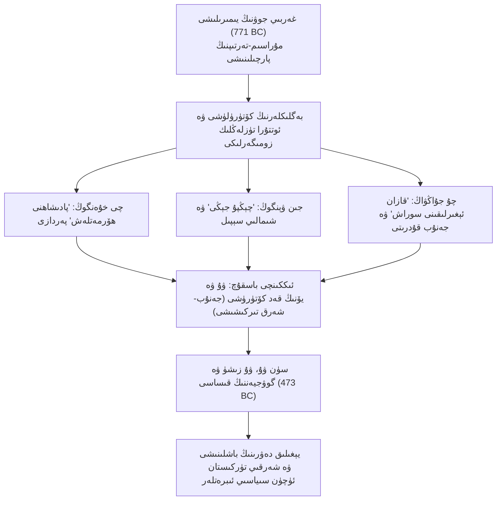
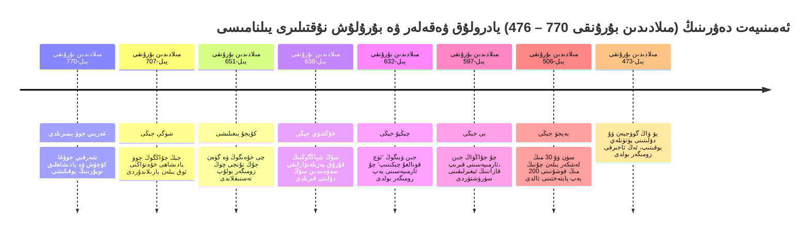
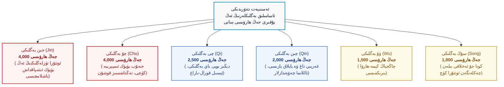
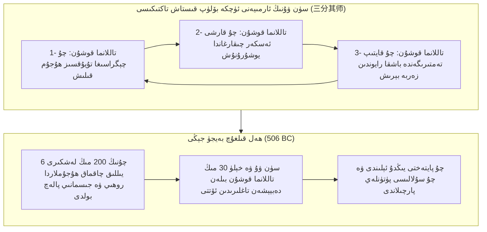
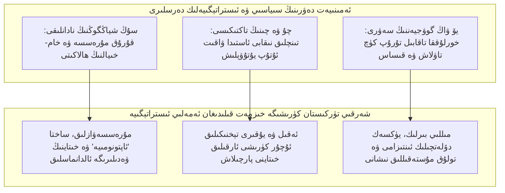

_تەخمىنەن ئوقۇش ۋاقتى 25 مىنۇت_

**بِسْمِ اللَّهِ الرَّحْمَٰنِ الرَّحِيمِ**

# **خىتاينى چۈشىنىش 42: ئەمىنىيەت دەۋرى (چۇنچيۇ) 300 يىللىق پاجىئەسى، خىتاينىڭ تاجاۋۇزچىلىق تەبىئىتى ۋە شەرقىي تۈركىستان ئۈچۈن سىياسىي ساۋاقلار**

تارىخ يالغاندىن قۇراشتۇرۇلغان شوئارلارنى رەھىمسىزلەرچە پاچاقلاپ تاشلايدىغان ئەڭ چوڭ سوتچىدۇر. بۈگۈنكى بېيجىڭ كۇرسىلىرىدا ئولتۇرغان كوممۇنىست تاجاۋۇزچىلار دۇنيا جامائەتچىلىكىگە ۋە ئۆز پۇقرالىرىغا تەرەپ-تەرەپتىن تىنچلىقپەرۋەرلىك نىقابىنى كىيگۈزۈپ، خىتاينى گويا مىڭ يىللاردىن بۇيان دۇنياغا پەقەت تىنچلىق، ئەدەپ-ئەخلاق ۋە ھەمكارلىق تارقىتىپ كەلگەن <dfn title="خىتاينىڭ ئۆزىنى قەدىمدىن تارتىپ ئەدەپ-ئەخلاق، مۇراسىم ۋە مەدەنىيەتنىڭ مەركىزى قىلىپ كۆرسىتىش ئۈچۈن ئىشلىتىدىغان تارىخىي سىياسىي نىقابى">«ئەخلاق ۋە مۇراسىم ئەللىكى» (礼仪之邦 - Lǐyí zhī Bāng)</dfn> قىلىپ كۆرسىتىشكە زورۇقماقتا. ئۇلارنىڭ بۇ سۈنئىي تەشۋىقاتىغا قارىغان ھەرقانداق كىشى، خىتاينىڭ دۆلەتچىلىك ئەنئەنىسى قەدىمدىن تارتىپ تاجاۋۇزچىلىق ۋە قىرغىنچىلىقتىن خالىي، مۇراسىملار ئارقىلىق دۆلەت باشقۇرىدىغان ئاقكۆڭۈل بىر سىستېمىدەك تۇيغۇدا بولۇپ قېلىشى مۇمكىن. ئەمما، تارىخنىڭ سارغايغان سەھىپىلىرىنى ئېچىپ، كۆك ئاسماننىڭ ئاستىدا قۇرۇلغان خىتاي مەدەنىيىتىنىڭ دەسلەپكى دەۋرلىرىگە، بولۇپمۇ <dfn title="مىلادىدىن بۇرۇنقى 770-يىلى جوۋ سۇلالىسى پايتەختىنىڭ لوئويىغا كۆچۈشىدىن مىلادىدىن بۇرۇنقى 476-يىلىغىچە بولغان 295 يىللىق تىركىشىش دەۋرى؛ خىتايچە ئەسلى ئاتىلىشى چۇنچيۇ دەۋرى">«ئەمىنىيەت دەۋرى» (春秋时期 - Chūnqiū Shíqī / چۇنچيۇ دەۋرى، مىلادىدىن بۇرۇنقى 770 – 476)</dfn> گە نەزەر تاشلىغىنىمىزدا، پۈتۈنلەي قارمۇقارشى، تۈكلەرنى تىكەنلەشتۈرىدىغان قانلىق بىر رېئاللىققا دۇچ كېلىمىز. بۇ 300 يىللىق مۇساپە ئاتالمىش ئەخلاق نىزامىنىڭ ئەمەلىيەتتە كۈچلۈكنىڭ ئاجىزنى يۇتۇۋېلىشى ئۈچۈن توقۇلغان قۇرۇق بىر پەرداز ئىكەنلىكىنى، قەدىمكى خۇاشىيا (华夏 - Huáxià) دۇنياسىنىڭ ئەڭ ۋەھشىي، ئەڭ غەيرىي ئىنسانىي كۈچ تىركىشىش مەيدانىغا ئايلانغانلىقىنى ئىسپاتلايدۇ.

تارىخىي رەسمىي خاتىرىلەرگە نەزەر سالساق، ئەمىنىيەت دەۋرى (چۇنچيۇ) دىكى 295 يىل ئىچىدە كەم دېگەندە 480 دىن ئارتۇق زور كۆلەملىك ئۇرۇش يۈز بەرگەن، 36 پادىشاھ ۋە بەگ مەخپىي قەستلەپ ئۆلتۈرۈلگەن، 52 مۇستەقىل بەگلىك تامامەن يۇتۇۋېلىنىپ خەرىتىدىن ئۆچۈرۈلگەن، يۈزلىگەن كىچىك دۆلەتلەر ۋە قەبىلىلەر پۈتۈنلەي يوقىتىۋېتىلگەن. <dfn title="قەدىمكى غەربىي جوۋ دەۋرىدە تۈزۈلگەن ئاقسۆڭەكلىك فېئوداللىق ئەخلاق ۋە بايرام-مۇراسىم تەرتىپىنىڭ ئېغىر پۈتۈنلەي يىمىرىلىشىنى، قانۇنسىز كۈچ كۈرىشىنىڭ ئەۋج ئېلىشىنى كۆرسىتىدىغان تارىخىي ئاتالغۇ">«مۇراسىملار يىمىرىلىپ، مۇزىكا بۇزۇلغان» (礼崩乐坏 - Lǐ Bēng Yuè Huài)</dfn> بۇ قانلىق جەرياندا، فېئوداللىق دەۋرنىڭ كونا شەكىلۋازلىقى ۋە ئالداش تۈسىنى ئالغان ئەخلاقىي ئەھدىلىرى سۈپۈرۈپ تاشلىنىپ، بۈگۈنكى زامان رېئال سىياسىتىنىڭ (Realpolitik) ئەڭ ئەپچىل قوراللىرى بولغان كېلىشىملەرنى بۇزۇش، ئىچكى سۇيىقەست، دوستلىرىغا ئارقىسىدىن خەنجەر ئۇرۇش، پىتنە-ئېغىۋا تارقىتىش، كۈچلۈك بولغاندا زومىگەرلىك قىلىپ، ئاجىز بولغاندا يالغانچىلىق بىلەن ۋاقىت ئۇتۇش تاكتىكىلىرى شەكىللەنگەن. بۇ تاكتىكىلار بۈگۈنكى كۈندە شى جىنپىڭ باشچىلىقىدىكى خىتاي تاجاۋۇزچىلىرىنىڭ مىللىي گېنىغا ئايلانغان بولۇپ، دەل شۇ سىياسىي ھىيلىلەر ئەينى ۋاقىتتىكى بەگلىكلەر ئارىسىدا قانداق يۈرگۈزۈلگەن بولسا، بۈگۈن پۈتكۈل دۇنياغا ۋە بولۇپمۇ شەرقىي تۈركىستان خەلقىگە قارشى شۇنداق رەھىمسىزلەرچە قوللىنىلماقتا.

مۇستەقىللىق، ھۆرلۈك ۋە ئۆز زېمىنىنىڭ ئىگىلىك ھوقۇقى ئۈچۈن قارشىلىق كۆرسىتىۋاتقان ھەربىر شەرقىي تۈركىستانلىق زىيالىي، تەتقىقاتچى ۋە ياش ئەۋلاد ئۈچۈن خىتاينىڭ بۇ 300 يىللىق ئەمىنىيەت دەۋرى (چۇنچيۇ) تارىخىنى چوڭقۇر ئىلمىي ئانالىز قىلىش بىر زۆرۈرىيەتتۇر. چۈنكى خىتاينىڭ سىياسىي تەپەككۇرىنى چۈشەنمەي تۇرۇپ، ئۇنىڭ دىپلوماتىك تۇزاقلىرىدىن ساقلىنىش، ئۇنىڭ تىنچلىق ۋە ھەمكارلىق ھەققىدىكى تاتلىق يالغانلىرىنىڭ تېگىگە يېتىش، ھەمدە كەلگۈسىدە قۇرۇلىدىغان مۇستەقىل ۋە تىنچلىقپەرۋەر شەرقىي تۈركىستان دۆلىتىنىڭ ئىستراتېگىيەلىك تاشقى سىياسىتىنى پۇختا پىلانلاش قەتئىي مۇمكىن ئەمەس. ئۇيغۇرلار ئەسىرلەردىن بېرى ئۆز تۇپرىقىدا ئېسىل مەدەنىيەت ياراتقان، ئادالەت ۋە ئەھدىگە سادىقلىقنى مىللىي ئەخلاقنىڭ يادروسى قىلغان بىر مىللەت سۈپىتىدە، خىتاينىڭ ۋەھشىي مىكىرلىرىگە ئالدانماسلىق ئۈچۈن، تارىخنىڭ بۇ ئەڭ قاراڭغۇ دەۋرىدىن ئىبرەت ئېلىشى شەرت.

*(سىخېما 1: ئەمىنىيەت دەۋرى (چۇنچيۇ) نىڭ 300 يىللىق سىياسىي تەرەققىيات ۋە زومىگەرلىك زەنجىرى)*

---

## بىرىنچى باب: ئىلاھىي ئورۇن ۋە شەرقىي جوۋنىڭ يىمىرىلىشى — ئەخلاق پەردىسىنىڭ يىرتىلىشى

قەدىمكى زاماندا خىتاي مەدەنىيىتىنىڭ مەركىزى دەپ قارالغان <dfn title="مىلادىدىن بۇرۇنقى 1046-يىلى پادىشاھ ۋۇۋاڭ تەرىپىدىن قۇرۇلۇپ، تاكى مىلادىدىن بۇرۇنقى 771-يىلى پايتەخت كۆچۈرۈلگۈچە ھۆكۈم سۈرگەن، فېئوداللىق ئەنئەنىۋى نىزام تۇرغۇزغان سۇلالە">غەربىي جوۋ سۇلالىسى (西周 - Xī Zhōu، مىلادىدىن بۇرۇنقى 1046 – 771)</dfn> ئۆزىنىڭ سىياسىي قۇرۇلمىسىنى تەبىئىي ھوقۇق نىزامى ۋە ئەجدادلار مۇراسىمى ئاساسىغا قۇرغان ئىدى. بۇ سىستېمىدا جوۋ پادىشاھى گويا ئاسماننىڭ بىر بىردىنبىر ئوغلى سۈپىتىدە <dfn title="خىتاي ئىمپېراتورلىرىنىڭ ئۆزىنى كۆك ئاسماننىڭ بىۋاسىتە ۋەكىلى ۋە دۇنيانىڭ بىردىنبىر مۇتلەق ھۆكۈمرانى دەپ جاكارلايدىغان سىياسىي-دىنىي ئۇقۇمى">«تەڭرى قۇتى / تەڭرى ئوغلى» (天子 - Tiānzǐ)</dfn> دەپ ئاتىلاتتى ۋە بارلىق زېمىن شۇ پادىشاھنىڭ خاس مۈلكى ھېسابلىناتتى. لېكىن، سىياسىي چىرىكلىك، ئىچكى نىزا ۋە تەبىئەت قانۇنىيىتىگە خىلاپ پاجىئەلەر نەتىجىسىدە بۇ سىستېما ئۆز ئىچىدىن پارچىلاندى. مىلادىدىن بۇرۇنقى 771-يىلى، ئەيش-ئىشرەتكە پاتقان ۋە كىچىك ئايالى باۋ سى (Bao Si / 褒姒) نى دەپ تەخت ۋارىسى يىجىيۇنى چەتكە قاققان <dfn title="غەربىي جوۋنىڭ ئاخىرقى زالىم ۋە نادان پادىشاھى بولۇپ، ئۆز سەۋەنلىكى بىلەن غەربىي جوۋنىڭ غۇلىشىنى كەلتۈرۈپ چىقارغان">جوۋ يۇۋاڭ (King You of Zhou / 周幽王، مىلادىدىن بۇرۇنقى 795 – 771)</dfn> نىڭ ئەخمەقانە قىلمىشلىرى ئېغىر پاجىئە پەيدا قىلدى. تەختتىن قوغلاپ چىقىرىلغان شاھزادە يىجىيۇنىڭ تاشقى بوۋىسى، يەنى شېن كىنەزلىكىنىڭ بېگى ئاچچىقىغا چىدىماي، شىمال ۋە غەربتىكى <dfn title="قەدىمكى دەۋردە ئوتتۇرا ئاسىيا ۋە تارىم ئويمانلىقى ئەتراپىدىن كەلگەن كۆچمەن تۈركىي ۋە ياۋروپوئىد تىپىدىكى ئەركىن قەبىلىلەر بىرلەشمىسى، خىتاينىڭ تاجاۋۇزچىلىقىغا قارشى پايتەخت خاۋجىڭنى بىتچىت قىلغان">«چۈەنروڭلار» (犬戎 - Quǎnróng)</dfn> نى باشلاپ كېلىپ، جوۋ سۇلالىسىنىڭ پايتەختى خاۋجىڭ (ھازىرقى شىئەن ئەتراپى) نى ئىشغال قىلدى ۋە جوۋ يۇۋاڭنى ئۆلتۈردى.

بۇ كرىزىس پۈتكۈل خۇاشىيا دۇنياسىنىڭ ئەڭ بۈيۈك بۇرۇلۇش نۇقتىسى بولدى. مىلادىدىن بۇرۇنقى 770-يىلى، جېڭ، ۋېي، جىن ۋە چىن بەگلىكلىرى كۈچ چىقىرىپ چۈەنروڭلارنى قوغلاپ چىقارغاندىن كېيىن، شاھزادە يىجىيۇ تەختكە ئولتۇرۇپ <dfn title="شەرقىي جوۋ سۇلالىسىنىڭ تۇنجى پادىشاھى بولۇپ، پايتەختنى لويىغا كۆچۈرۈپ ھوقۇقى قۇرۇق قالغان">جوۋ پىڭۋاڭ (King Ping of Zhou / 周平王، مىلادىدىن بۇرۇنقى 781 – 720)</dfn> بولدى ۋە پايتەختىنى تاجاۋۇز خەۋپىدىن قورقۇپ شەرقتىكى لويىغا (洛邑 - Luoyi، بۈگۈنكى خېنەن لوياڭ شەھىرى) كۆچۈردى. مانا مۇشۇ ۋاقىتتىن باشلاپ، نامدا پۈتۈن دۇنيانى سورىغان، ئەمەلىيەتتە بولسا پەقەت ئۆز شەھىرىنىڭ ئەتراپىدىن باشقا يەرگە ھۆكمى يۈرمەيدىغان <dfn title="مىلادىدىن بۇرۇنقى 770-يىلدىن مىلادىدىن بۇرۇنقى 256-يىلغىچە مەۋجۇت بولغان، ئەمما ھەقىقىي ھوقۇقى بەگلىكلەر تەرىپىدىن تارتىۋېلىنغان خىتاي سۇلالىسى">شەرقىي جوۋ سۇلالىسى (东周 - Dōng Zhōu، مىلادىدىن بۇرۇنقى 770 – 256)</dfn> باشلاندى.

﴿قُلِ اللَّهُمَّ مَالِكَ الْمُلْكِ تُؤْتِي الْمُلْكَ مَن تَشَاءُ وَتَنزِعُ الْمُلْكَ مِمَّن تَشَاءُ وَتُعِزُّ مَن تَشَاءُ وَتُذِلُّ مَن تَشَاءُ بِيَدِكَ الْخَيْرُ إِنَّكَ عَلَىٰ كُلِّ شَيْءٍ قَدِيرٌ﴾

*(ئېيتقىنكى: «ئى بارلىق مۈلۈكنىڭ ئىگىسى بولغان ئاللاھ! سەن ھاكىمىيەتنى خالىغان ئادىمىڭگە بېرىسەن، خالىغان ئادىمىڭدىن ھاكىمىيەتنى تارتىپ ئالىسەن؛ خالىغان ئادىمىڭنى ئەزىز قىلىسەن، خالىغان ئادىمىڭنى خار قىلىسەن. بارلىق ياخشىلىق پەقەت سېنىڭ ئىلكىڭدىدۇر. شەكسىزكى، سەن ھەر نەرسىگە قادىرسەن»)* (سۈرە ئال ئىمران، 26-ئايەت).

بۇ تارىخىي كۆچۈش نوقۇل بىر سۇلالىنىڭ جۇغراپىيىلىك يۆتكىلىشى ئەمەس، بەلكى فېئوداللىق ئەخلاق چۈشەنچىسىنىڭ، بېقىنىش ئېتىقادىنىڭ ۋە مەركىزىي ھاكىمىيەت ئەندىزىسىنىڭ پۈتۈنلەي ۋەيران بولۇشى ئىدى. پادىشاھنىڭ ئەتراپىدىكى زېمىن تارىيىپ كەتتى، قوشۇنى زەئىپلەشتى ۋە بايلىقى تۈگىدى؛ ئەكسىچە، تەرەپ-تەرەپتىكى كۈچلۈك بەگلىكلەر يەر كېڭەيتىش ۋە بايلىق توپلاش بىلەن مەشغۇل بولدى. ئەڭ دەسلەپتە ئوتتۇرا تۈزلەڭلىكتە باش كۆتۈرگەن <dfn title="شەرقىي جوۋنىڭ باشلىرىدا ئوتتۇرا تۈزلەڭلىكتىكى ئەڭ قۇدرەتلىك بەگلىك بولۇپ، پادىشاھنى بوزەك قىلىپ قوشنا زېمىنلارنى يۇتۇۋالغان">جېڭ بەگلىكى (郑国 - Zhèng Guó، مىلادىدىن بۇرۇنقى 806 – 375)</dfn> نىڭ ھۆكۈمرانى <dfn title="چۇنچيۇ دەۋرىدىكى تۇنجى بولۇپ مەركىزىي جوۋ خانىدانلىقىنىڭ ھەيۋىسىنى سۇندۇرغان ھۆكۈمران">جېڭ جۇاڭگوڭ (Duke Zhuang of Zheng / 郑庄公، مىلادىدىن بۇرۇنقى 757 – 701)</dfn> ئۆزىنىڭ سىياسىي قابىلىيىتى ۋە ھەربىي كۈچىگە تايىنىپ، ئەتراپتىكى دۆلەتلەرنى يۇتۇۋېلىشقا باشلىدى. جوۋ پادىشاھى ئۆزىنىڭ ئورنىنى ساقلاپ قېلىش ئۈچۈن جېڭ جۇاڭگوڭنىڭ مەنسىپىنى تارتىۋالغاندا، جېڭ جۇاڭگوڭ پادىشاھقا قاراشلىق ئاشلىقلارنى كۈچ بىلەن ئورۇۋېلىپ، ئوچۇق-ئاشكارە قارشى چىقتى.

مىلادىدىن بۇرۇنقى 707-يىلى يۈز بەرگەن <dfn title="جېڭ بەگلىكى بىلەن جوۋ پادىشاھىنىڭ بىرلەشمە ئارمىيەسى ئوتتۇرىسىدىكى مەشھۇر جەڭ بولۇپ، پادىشاھ خۇەنۋاڭ يارىلانغان ۋە پادىشاھلىق ھوقۇقى پۈتۈنلەي يەرگە ئۇرۇلغان">«شۈگې جېڭى» (繻葛之战 - Xūgé zhī Zhàn)</dfn> تا جوۋ پادىشاھى ئۆز ئارمىيەسى ۋە قوشنا بەگلىكلەرنى باشلاپ جېڭ بەگلىكىنى بويسۇندۇرۇشقا ئاتلاندى. ئەمما جېڭ قوشۇنلىرى جوۋ ئارمىيەسىنى پۈتۈنلەي تارمار قىلىپلا قالماي، ھەتتا جېڭ سەردارى جوۋ پادىشاھى خۇەنۋاڭنىڭ مۈرىسىگە ئوق ئېتىپ يارىلاندۇردى. پادىشاھ يارىلىنىپ قاچتى. بۇ ۋەقە — خىتاي تارىخىدا «تەڭرى قۇتى» غا تەۋە مۇقەددەس چۈشەنچىنىڭ ئەمەلىيەتتە پۈچەك بىر قەغەزگە ئايلانغانلىقىنى كۆرسەتتى. سىياسىي ھەيۋە پەقەت قورال ۋە قىلىچ ئارقىلىقلا ئۆلچىنىدىغان دەۋر رەسمىي يېتىپ كەلدى. شۇنىڭ بىلەن جېڭ دۆلىتى، شەرقتىكى چى دۆلىتى ۋە جەنۇبتىكى چۇ دۆلىتى تەڭ كۆتۈرۈلۈپ، تارىختا <dfn title="ئەمىنىيەت دەۋرىنىڭ باشلىرىدا تۇنجى بولۇپ رايون خاراكتېرلىك ھۆكۈمرانلىق ئورناتقان ئۈچ كۈچ: جېڭ، چى ۋە چۇ دۆلەتلىرى">«ئەمىنىيەت دەۋرىنىڭ ئۈچ كىچىك زومىگىرى» (春秋三小霸 - Chūnqiū Sān Xiǎobà / چۇنچيۇ ئۈچ كىچىك زومىگىرى)</dfn> نامىنى ئالغان دەسلەپكى تىركىشىش باسقۇچى باشلاندى.

---

## ئىككىنچى باب: «پادىشاھنى ھۆرمەتلەش، ئەتراپتىكىلەرنى قوغلاش» پەردازى — چى خۇەنگوڭ ۋە گۈەن جۇڭنىڭ ھۆكۈمرانلىق پەللىسى

جېڭ دۆلىتى ئىچكى تەخت تالىشىش قالايمىقانچىلىقى تۈپەيلىدىن زەئىپلەشكەندىن كېيىن، شەرقتىكى دېڭىز بويى دۆلىتى بولغان <dfn title="قەدىمكى دېڭىز بويىدا تۇز ۋە تۆمۈر بايلىقى ئارقىلىق تېز كۈچەيگەن قۇدرەتلىك بەگلىك (مىلادىدىن بۇرۇنقى 1046 – 221)">چى بەگلىكى (齐国 - Qí Guó)</dfn> سەھنىگە چىقتى. چى دۆلىتىنىڭ تەختىگە مۇشەققەتلىك قانلىق كۈرەشلەردىن كېيىن ئولتۇرغان <dfn title="ئەمىنىيەت دەۋرىدىكى مەشھۇر تۇنجى چوڭ زومىگەر بولۇپ، بەگلىكلەرنى ئىتتىپاقلاشتۇرۇپ سىياسىي تەرتىپ ئورناتقان">چى خۇەنگوڭ (Duke Huan of Qi / 齐桓公، مىلادىدىن بۇرۇنقى ؟ – 643)</dfn>، ئۆزىنى ئېتىپ يارىلاندۇرغان دۈشمىنىنىڭ ياردەمچىسى بولغان مەشھۇر سىياسەتچى <dfn title="خىتاي تارىخىدىكى ئەڭ بالدۇرقى ئىقتىساد، سىياسەت ۋە ھەربىي ئىسلاھاتچى، چى خۇەنگوڭنىڭ باش ۋەزىرى">گۈەن جۇڭ (Guan Zhong / 管仲، مىلادىدىن بۇرۇنقى 723 – 645)</dfn> نى ئەپۇ قىلىپ، ئۇنى باش ۋەزىرلىككە تەيىنلىدى. گۈەن جۇڭ ئۆزىنىڭ سىياسىي دۇنياسىدا خىتاي تارىخىدىكى ئەڭ دەسلەپكى <dfn title="دۆلەت بايلىقىنى ئاشۇرۇش ئۈچۈن تۇز، تۆمۈر قاتارلىق ئىستراتېگىيەلىك ماددىلارنى دۆلەت مونوپوللۇقىغا ئېلىش سىستېمىسى">«دۆلەت مونوپوللۇقى» (官山海 - Guān Shān Hǎi)</dfn> سىياسىتىنى يولغا قويۇپ، سودىنى راۋاجلاندۇردى، باج تۈزۈمىنى ئىسلاھ قىلدى ۋە كۈچلۈك قوراللىق قوشۇن تەشكىللىدى.

لېكىن گۈەن جۇڭنىڭ ئەڭ چوڭ سىياسىي ئىجادىيىتى — پەقەت قورال ۋە بايلىققا تايانماستىن، ئەخلاق بىلەن سىياسىي قانۇنلۇقنى نىقاب قىلىپ ئىشلىتىش ئىدى. ئۇ دۇنياغا پۇت تىرەپ تۇرالماي قالغان جوۋ پادىشاھىنىڭ بايرىقىنى ئېگىز كۆتۈرۈپ، <dfn title="جوۋ پادىشاھىنىڭ نامىدا بەگلىكلەرنى تىزگىنلەش ۋە ئەتراپتىكى باشقا مىللەتلەرنى، بولۇپمۇ كۆچمەن قەۋملەرنى چەتكە قېقىپ جازالاش سىياسىي شوئارى">«پادىشاھنى ھۆرمەتلەش، ئەتراپتىكىلەرنى قوغلاش» (尊王攘夷 - Zūn Wáng Rǎng Yí)</dfn> ئىستراتېگىيەسىنى مەيدانغا چىقاردى. بۇ شوئارنىڭ ماھىيىتى شۇ ئىدىكى: چى خۇەنگوڭ ئۆزى جوۋ پادىشاھى بولۇۋالمايتتى؛ بەلكى ئاجىز جوۋ پادىشاھىنى مەنىۋى قونچاق سۈپىتىدە ئەتىۋارلاپ، پۈتكۈل باشقا بەگلىكلەرنى جوۋ پادىشاھىنىڭ ئەمرى نامىدا ئۆزىگە بويسۇندۇراتتى، بويسۇنمىغانلارنى «ئاسىيلار» دەپ ئېلان قىلىپ، باشقا دۆلەتلەرنى ئەگەشتۈرۈپ ھۇجۇم قىلاتتى. 

چى خۇەنگوڭ شىمالدىن كەلگەن تاغلىق رۇڭلار ۋە دى قەبىلىلىرىنىڭ ھۇجۇمىغا ئۇچرىغان يەن، شىڭ ۋە ۋېي دۆلەتلىرىنى قۇتقۇزۇپ، ئۇلارنىڭ شەھەرلىرىنى قايتا قۇرۇپ بەردى؛ جەنۇبتىن ئوتتۇرا تۈزلەڭلىككە بېسىپ كېلىۋاتقان ۋە كۈنسايىن خەتەرلىك ھالەتتە كۈچىيىۋاتقان <dfn title="جەنۇبتىكى ياڭزى دەرياسى ۋادىسىدا گۈللەنگەن، ئۆزىنى پادىشاھ دەپ جاكارلاپ جوۋ سۇلالىسىگە بويسۇنمىغان ئەڭ چوڭ ۋەھشىي دۆلەت (مىلادىدىن بۇرۇنقى 1042 – 223)">چۇ دۆلىتى (楚国 - Chǔ Guó)</dfn> گە تاقابىل تۇرۇش ئۈچۈن سەككىز دۆلەت ئىتتىپاقىنى قۇرۇپ، مىلادىدىن بۇرۇنقى 656-يىلى چۇ دۆلىتىنىڭ چېگراسىغا قوشۇن يۆتكىدى ۋە <dfn title="چى دۆلىتى باشچىلىقىدىكى ئىتتىپاقداشلار بىلەن چۇ دۆلىتى ئوتتۇرىسىدا تۈزۈلگەن توقۇنۇشسىز سۈلھ كېلىشىمى">«جاۋلىڭ ئەھدىنامىسى» (召陵之盟 - Zhàolíng zhī Méng)</dfn> نى ئىمزالاشقا مەجبۇر قىلدى.

مىلادىدىن بۇرۇنقى 651-يىلى چى خۇەنگوڭ بەگلىكلەرنى چاقىرىپ، <dfn title="چى خۇەنگوڭنىڭ زومىگەرلىك ئورنى جوۋ پادىشاھى تەرىپىدىن رەسمىي ئېتىراپ قىلىنغان ئەڭ يۈكسەك قۇرۇلتاي">«كۇيجۇ يىغىلىشى» (葵丘之盟 - Kuíqiū zhī Méng)</dfn> نى ئۆتكۈزدى. بۇ يىغىندا جوۋ پادىشاھى ئۆز ئەلچىسى ئارقىلىق پادىشاھلىقنىڭ قۇربانلىق گۆشى ۋە قىزىل ئوق-يايلىرىنى سوۋغا قىلىپ، چى خۇەنگوڭنى رەسمىي تۈردە <dfn title="بەگلىكلەرنىڭ ھەقىقىي داھىيسى، ئوتتۇرا تۈزلەڭلىكنىڭ رەھبىرى مەنىسىدىكى تۇنجى رەسمىي سىياسىي ئۇنۋان">«زومىگەر / بېگىئەلا» (霸主 - Bàzhǔ)</dfn> دەپ تەستىقلىدى. بۇنىڭ بىلەن چى خۇەنگوڭ «توققۇز قېتىم بەگلىكلەرنى يىغىپ، قورال ئىشلەتمەي جاھاننى بىرلىككە كەلتۈرگەن» سىياسىي زاتقا ئايلاندى.

لېكىن بۇ ھۆكۈمرانلىقنىڭ ئاخىرى نېمە بىلەن تۈگىدى؟ پەقەت گۈەن جۇڭ ۋە چى خۇەنگوڭنىڭ شەخسىي تەسىرىگىلا تايانغان، دۆلەتنىڭ مەڭگۈلۈك ئادالەت تۈزۈمىگە ئايلانمىغان بۇ سىستېما تېزلا گۇمران بولدى. مىلادىدىن بۇرۇنقى 645-يىلى گۈەن جۇڭ قازا قىلدى، ئۇنىڭ ئارقىدىن چى خۇەنگوڭ خۇشامەتچى ۋە رەزىل مۇلازىملارغا ئىشىنىپ، مىلادىدىن بۇرۇنقى 643-يىلى كېسەل كارىۋىتىدا يالغۇز تاشلىنىپ، ئاچلىقتىن ئۆلدى. ئۇنىڭ بەش ئوغلى تەخت تالىشىپ ئۇرۇش قىلغانلىقتىن، پۈتكۈل ئوتتۇرا تۈزلەڭلىككە ئەمرى يۈرگەن بۈيۈك زومىگەرنىڭ جەسىتى 67 كۈن يەرلىككە قويۇلماي، ئوردىدا قۇرتلاپ كەتتى. قۇرۇق مەنپەئەت ۋە سىياسىي ھەيۋە ئۈستىگە قۇرۇلغان چى دۆلىتىنىڭ زومىگەرلىكى شۇنىڭ بىلەن سۇدەك ئېقىپ كەتتى.

*(سىخېما 2: ئەمىنىيەت دەۋرىدىكى 300 يىللىق مۇھىم بۇرۇلۇش ۋە ھەربىي توقۇنۇشلار يىلنامىسى)*

---

## ئۈچىنچى باب: رېئال كۈچ ئۇرۇشىدىكى قۇرۇق غۇرۇر — سۇڭ شياڭگوڭنىڭ ئاقسۆڭەكلەرچە خام-خىيالى ۋە خۇڭشۈي جېڭى

چى دۆلىتىنىڭ پاجىئەلىك يىمىرىلىشىدىن كېيىن، ئوتتۇرا تۈزلەڭلىكتە پادىشاھسىز، يېتەكچىسىز قالغان بوشلۇقنى تولدۇرۇشقا ئاتلانغانلار پەيدا بولدى. بۇلارنىڭ ئىچىدە تارىختا ئەڭ كۈلكىلىك ۋە ئەڭ ئىبرەتلىك پاجىئە ياراتقان كىشى — <dfn title="قەدىمكى شاڭ سۇلالىسى (مىلادىدىن بۇرۇنقى 1600 – 1046) نىڭ قالدۇق ئەۋلادلىرى قۇرغان بەگلىك (مىلادىدىن بۇرۇنقى 1040 – 286)">سۇڭ بەگلىكى (宋国 - Sòng Guó)</dfn> نىڭ ھۆكۈمرانى <dfn title="ئەمىنىيەت دەۋرىدىكى ئاتالمىش بەش زومىگەرنىڭ بىرى سۈپىتىدە تىلغا ئېلىنىدىغان، ئەمما شەكىلۋازلىق سەۋەبىدىن دۆلىتىنى ۋەيران قىلغان نادان ھۆكۈمران">سۇڭ شياڭگوڭ (Duke Xiang of Song / 宋襄公، مىلادىدىن بۇرۇنقى ؟ – 637)</dfn> ئىدى.

سۇڭ شياڭگوڭ چى خۇەنگوڭ ئۆلگەندىن كېيىنكى ئىچكى نىزانى تىنچىتىپ، چى شاھزادىسى جاۋنى تەختكە ئولتۇرغۇزۇشتا ئازراق رول ئوينىغانلىقى ئۈچۈن كۆرەڭلەپ كەتتى. ئۇ ئۆزىنىڭ دۆلەت كۈچىنىڭ، نوپۇسىنىڭ ۋە ھەربىي تەييارلىقىنىڭ ئىنتايىن ئاجىزلىقىغا قارىماي، قەدىمكى فېئوداللىق ئەدەپ-ئەخلاق مۇراسىملىرىنى كۆتۈرۈپ چىقىپ، بەگلىكلەرنى يىغىپ زومىگەر بولۇش خام-خىيالىغا پاتتى. مىلادىدىن بۇرۇنقى 639-يىلى، ئۇ چۇ دۆلىتىنىڭ پادىشاھىنى كېلىشىم يىغىنىغا تەكلىپ قىلدى. ئەمما ياۋايى كۈچكە ۋە ھىيلىگە تايىنىدىغان چۇ دۆلىتى پادىشاھى كېلىشىم مەيدانىدىلا سۇڭ شياڭگوڭنى تۇتقۇن قىلىپ قايمۇقتۇردى ۋە كېيىن رەھىم قىلىپ قويۇپ بەردى. بۇ خورلۇققا چىدىمىغان سۇڭ شياڭگوڭ قىساس ئېلىش ئۈچۈن، مىلادىدىن بۇرۇنقى 638-يىلى چۇ دۆلىتىنىڭ ئىتتىپاقدىشى بولغان جېڭ دۆلىتىگە قوشۇن تارتتى. نەتىجىدە چۇ دۆلىتى غايەت زور قوشۇن بىلەن سۇڭ دۆلىتىگە ھۇجۇم قىلىپ، ئىككى تەرەپ <dfn title="مىلادىدىن بۇرۇنقى 638-يىلى سۇڭ بىلەن چۇ ئوتتۇرىسىدا يۈز بەرگەن، كونا ئەخلاق تەلىپى بىلەن رېئال كۈچ سوقۇشىنىڭ سىياسىي نەتىجىسىنى نامايان قىلغان پاجىئەلىك جەڭ">«خۇڭشۈي جېڭى» (泓水之战 - Hóngshuǐ zhī Zhàn)</dfn> دە دۇچ كېلىشتى.

بۇ جەڭ خىتاي ۋە دۇنيا ھەربىي تارىخىدىكى ئەڭ چوڭ ساددالىق پاجىئەسى بولۇپ قالدى. چۇ دۆلىتىنىڭ غايەت زور ئارمىيەسى خۇڭشۈي دەرياسىدىن كېچىپ ئۆتۈۋاتقاندا، سۇڭ دۆلىتىنىڭ باش ۋەزىرى ۋە سەركەردىسى مۇ يى يۈگۈرۈپ كېلىپ: «دۈشمەن سان جەھەتتە بىزدىن خېلى كۆپ، ھازىر ئۇلار دەريادىن تېخى ئۆتۈپ بولالمىدى، دەريانىڭ يېرىمىدا تۇرغىنىدا ھۇجۇم قىلايلى، ئۇلار ئاسانلا تالقان بولىدۇ!» دەپ يالۋۇردى. سۇڭ شياڭگوڭ بولسا پىسەنت قىلماي: «ئەخلاقلىق كىشى (君子 - Jūnzǐ) باشقىلار قىيىن ئەھۋالدا قالغاندا ھۇجۇم قىلمايدۇ» دەپ رەت قىلدى. چۇ ئارمىيەسى دەريادىن ئۆتۈپ قىرغاققا چىقىپ، سەپ تۈزۈشكە باشلىغاندا، مۇ يى يەنە يالۋۇرۇپ: «ئۇلار سەپ تۈزۈپ بولغىچە دەرھال چاپايلى!» دېدى. سۇڭ شياڭگوڭ يەنە پەرۋاسىزلىق بىلەن: «سەپ تۈزەپ بولمىغان دۈشمەنگە ھۇجۇم قىلىش ئاقسۆڭەكلىككە ياراشمايدۇ» دەپ تۇرىۋالدى. چۇ ئارمىيەسى تولۇق سەپ تۈزەپ بولۇپ، گۈلدۈرلىگەن تاشقىن كەبى ھۇجۇمغا ئۆتكەندە، سۇڭ شياڭگوڭنىڭ ئارمىيەسى دەقىقىدە قىرغىن قىلىندى، سۇڭ شياڭگوڭنىڭ بېشىغا ئوق تېگىپ ئېغىر يارىلاندى، قوغدىغۇچىلىرى پۈتۈنلەي قىرىلىپ كەتتى. سۇڭ شياڭگوڭ كېيىنكى يىلى شۇ جاراھەت ئازابىدا نومۇس ئىچىدە جان بەردى. سۇڭ دۆلىتى مەڭگۈلۈك ئىككىنچى دەرىجىلىك خار دۆلەتكە ئايلاندى.

بۇ پاجىئە بۈگۈن شەرقىي تۈركىستان كۈرىشى قىلىۋاتقانلار ئۈچۈن قىممەتلىك بىر ئىبرەتتۇر: **تاجاۋۇزچى، رەھىمسىز، ئەھدىنى بىلمەيدىغان بىر دۈشمەن ئالدىدا قۇرۇق، يالغان پىرىنسىپۋازلىق قىلىش، كۈچ ۋە تەڭپۇڭلۇق رېئاللىقىنى تەھلىل قىلماي، شەكىلۋازلىققا مەھكەم ئېسىلىۋېلىش — مىللەتنى ئۆلۈمگە تۇتۇپ بېرىش بىلەن ئوخشاشتۇر!** مۇسۇلمان ئەللىرى ۋە ئۇيغۇر خەلقى تارىختا تىنچلىق ۋە ئادالەتنى ئەزىز بىلگەن بولسىمۇ، جەڭ مەيدانىدا دۈشمەننىڭ قارا نىيىتىگە قارىتا سەگەك، ئەقىللىق ۋە قەتئىي بولۇشقا بۇيرۇلغان. پەيغەمبىرىمىز مۇھەممەد ئەلەيھىسسالامنىڭ ھەربىي سىياسىتىدە دۈشمەننىڭ ھىيلىسىگە ئالدانماي، پۇرسەت كەلگەندە چاقماقتەك قەدەملەر بىلەن ھەرىكەت قىلىش پەزىلەت دەپ باھالانغان. سۇڭ شياڭگوڭنىڭ نادانلىقىنى بۈگۈنكى زاماندىكى خىتاينىڭ خەلقئارا تۈزۈملەر بىلەن ئويناش تاكتىكىسىغا قارىتا سېلىشتۇرغاندا، بىز رېئال كۈچ ۋە ھوشيارلىقنىڭ قانچىلىك مۇھىملىقىنى تېخىمۇ چوڭقۇر تونۇپ يېتەلەيمىز.

---

## تۆتىنچى باب: سەرگەردانلىقتىن زەپەرگە: جىن ۋېنگوڭ، «ئۈچ قونالغۇ چېكىنىش» ۋە چېڭپۇ جېڭى

ئوتتۇرا تۈزلەڭلىكنىڭ شىمالىدىكى ئەڭ قۇدرەتلىك بەگلىك بولغان <dfn title="تەيشاڭ تاغلىرى ۋە سېرىق دەريا بويىدىكى قەدىمكى بۈيۈك بەگلىك (مىلادىدىن بۇرۇنقى 1033 – 376)">جىن بەگلىكى (晋国 - Jìn Guó)</dfn> مۇ دەسلەپتە بىر مەزگىل ئىچكى قانلىق پاجىئەلەرگە مۇپتىلا بولدى. جىن شىئەنگوڭ ئۆزىنىڭ كىچىك خوتۇنى لى جىنىڭ پىتنىسىگە ئىشىنىپ، تەخت ۋارىسىنى ئۆلۈمگە مەجبۇرلىدى. بۇ جەرياندا ھەقىقىي بىلىملىك ۋە ئەقىللىق شاھزادە بولغان <dfn title="جىن بەگلىكىنىڭ ئەڭ بۈيۈك زومىگەر ھۆكۈمرانى، 19 يىل سەرسان بولۇپ ئاندىن تەختكە چىقىپ دۆلىتىنى جاھان سوراش دەرىجىسىگە ئۆستۈرگەن سىياسەتچى">جىن ۋېنگوڭ (چۇڭئېر / Duke Wen of Jin / 晋文公، مىلادىدىن بۇرۇنقى 697 – 628)</dfn> ئۆز ھاياتىنى ساقلاپ قېلىش ئۈچۈن، مىلادىدىن بۇرۇنقى 655-يىلىدىن باشلاپ پۈتۈنلەي سەرگەردانلىق سەپىرىگە چىقتى.

چۇڭئېر ئۆزىنىڭ ۋاپادار ۋە بىلىملىك سەرداشلىرى بىلەن بىللە شىمالدىكى دى قەبىلىلىرى ئارىسىدا 12 يىل ياشىدى، ئاندىن ۋېي، چى، ساۋ، سۇڭ، جېڭ، چۇ ۋە چىن دۆلەتلىرىنى كېزىپ، جەمئىي 19 يىل مۇساپىر بولدى. ئۇ قەشقەر ياكى تۇرپاندىن كەلگەن سەرگەردان ئەلچىدەك، ھەربىر بەگلىكنىڭ كۈچىنى، سىياسىي تۈزۈمىنى، پۇقرالىرىنىڭ كەيپىياتىنى، جۇغراپىيىلىك ئارتۇقچىلىقلىرىنى ئۆز كۆزى بىلەن كۆردى ۋە قەلبىدە بۈيۈك بىر سىياسىي ئەقىل تاۋلىدى. ئۇ چۇ دۆلىتىگە بارغاندا، چۇ پادىشاھى ئۇنىڭغا ھۆرمەت بىلدۈرۈپ: «ئەگەر كەلگۈسىدە جىن دۆلىتىگە قايتىپ تەختكە چىقسىڭىز، ماڭا قانداق ياخشىلىق قىلىسىز؟» دەپ سورىغاندا، چۇڭئېر تەبەسسۇم بىلەن: «سىزدە ئېسىل يىپەكلەر، پىل چىشلىرى ۋە ئالتۇنلار تولۇق. ئەگەر كۈنلەرنىڭ بىرىدە دۆلەتلىرىمىز ئوتتۇرىسىدا ئۇرۇش بولۇپ قالسا، مەن قوشۇنۇمنى سىزگە ھۆرمەت يۈزىسىدىن <dfn title="ھەربىي ئاتالغۇ بولۇپ، ئۈچ قونالغۇ تەخمىنەن 90 چاقىرىمغا (45 كىلومېتىرغا) تەڭ كېلىدىغان ئارىلىقنى چېكىنىپ، دۈشمەنگە ئۇرۇش ئورنى تاللاش ھوقۇقى بېرىشنى كۆرسىتىدۇ">«ئۈچ قونالغۇ چېكىندۈرۈپ» (退避三舍 - Tuì Bì Sān Shè)</dfn>، سىزنىڭ شەپقىتىڭىزگە جاۋاب قايتۇرىمەن» دەپ ۋەدە بەرگەن ئىدى.

مىلادىدىن بۇرۇنقى 636-يىلى، چىن مۇگوڭنىڭ ياردىمى بىلەن 62 يېشىدا جىن دۆلىتىنىڭ تەختىگە ئولتۇرغان جىن ۋېنگوڭ، سىستېمىلىق ئىسلاھاتلارنى ئېلىپ بېرىپ، ئاران 4 يىل ئىچىدە جىن دۆلىتىنى شىمالدىكى ئەڭ تەرتىپلىك، بايلىققا باي دۆلەتكە ئايلاندۇردى. ئۇ جوۋ پادىشاھلىقىدىكى شاھزادە دەينىڭ ئىسيانىنى باستۇرۇپ، جوۋ پادىشاھى شياڭۋاڭنى تەختكە قايتۇرۇپ كېلىپ، نەنياڭدىكى سەككىز شەھەرنى زېمىنىغا قوشۇۋالدى ۋە ئوتتۇرا تۈزلەڭلىكتە مۇتلەق ھەيۋە تىكلىدى.

مىلادىدىن بۇرۇنقى 633-يىلى چۇ دۆلىتى سۇڭ دۆلىتىنى قورشاۋغا ئالغاندا، جىن ۋېنگوڭ سۇڭنى قۇتقۇزۇش نامىدا ئەتراپلىق ئىستراتېگىيەلىك ھۇجۇمغا ئۆتتى. جىن ئارمىيەسى چۇنىڭ ئىتتىپاقداشلىرى بولغان ساۋ ۋە ۋېي دۆلەتلىرىنى بېسىۋېلىپ، چۇ قوشۇنلىرىنى شىمالغا مېڭىشقا قىستىدى. مىلادىدىن بۇرۇنقى 632-يىلى، ئىككى تەرەپ <dfn title="مىلادىدىن بۇرۇنقى 632-يىلى جىن بىلەن چۇ ئوتتۇرىسىدا ئېلىپ بېرىلغان، ئەمىنىيەت دەۋرىدىكى ھۆكۈمرانلىق تەقدىرىنى بەلگىلىگەن ئەڭ چوڭ كلاسسىك ئىستراتېگىيەلىك جەڭ">«چېڭپۇ جېڭى» (城濮之战 - Chéngpú zhī Zhàn)</dfn> دە دۇچ كەلگەندە، جىن ۋېنگوڭ ئەينى ۋاقىتتىكى ۋەدىسى بويىچە قوشۇننى تەرتىپلىك ھالدا 90 чаقىرىم ئارقىغا چېكىندۈردى. بۇ چېكىنىش قورققانلىق ئەمەس، ئەكسىچە دۈشمەننى چوڭقۇرلاپ كىرىشكە ئازدۇرىدىغان، جىن قوشۇنلىرىغا ئەڭ پايدىلىق ئۇرۇش رايونىنى تەييارلايدىغان پىسخىكىلىق بىر ھىيلە ئىدى. كۆرەڭلىگەن چۇ سەركەردىسى زىيۈ بۇ تۇزاققا چۈشۈپ قوشۇننى ئالدىغا ئېلىپ ماڭغاندا، جىن ۋېنگوڭنىڭ پىشقان قوماندانلىرى چۇنىڭ ئىككى قانات قوشۇنىنى پارچىلاپ، مەركىزىي ئارمىيەنى قورشاپ يوقاتتى.

چېڭپۇ جېڭىدىكى ئۇلۇغ زەپەردىن كېيىن، جىن ۋېنگوڭ جوۋ پادىشاھىنى جەنتۇ (践土 - Jiantu) شەھىرىگە يىغىنغا تەكلىپ قىلدى. جوۋ پادىشاھى ئۆز ئايىغى بىلەن كېلىپ جىن ۋېنگوڭغا ئالتۇن ھارۋا، قارا كەمەر ۋە مەمۇرىي ھوقۇق تامغىسىنى تەقدىم ئېتىپ، ئۇنى رەسمىي تۈردە جاھاننىڭ ئىككىنچى چوڭ زومىگىرى قىلىپ جاكارلىدى. جىن دۆلىتى شۇنىڭدىن باشلاپ بىر ئەسىردىن ئارتۇق ۋاقىت داۋامىدا ئوتتۇرا تۈزلەڭلىكنىڭ رەھبەرلىك ئورنىنى قولدىن بەرمىدى.

بۇ ۋەقەلىك بىزگە شۇنى ئۆگىتىدۇكى: **ھەقىقىي رەھبەر سەرگەردانلىق ۋە سىناقلاردا تاۋلىنىدۇ.** 19 يىللىق سەرسانلىق جىن ۋېنگوڭنى چۈشكۈنلەشتۈرمىدى، ئەكسىچە ئۇنىڭ تەمكىنلىكىنى، كۆزىتىش كۈچىنى ئاشۇردى. بۈگۈن شەرقىي تۈركىستان ئۈچۈن ۋەتەن سىرتىدا كۈرەش قىلىۋاتقان پائالىيەتچىلەر ۋە ياشلار جىن ۋېنگوڭنىڭ سەرگەردانلىقىنى بىر ھايات مەكتىپى دەپ قارىشى كېرەك: غەرب ۋە مۇسۇلمان دۇنياسىدىكى ئىلىم-پەن، سىياسىي لوگىكا ۋە تۈزۈملەرنى چوڭقۇر ئۆگىنىپ، ۋاقتى كەلگەندە ۋەتىنىگە قايتىپ يۈكسەك دۆلەت قۇرۇشنىڭ مەنىۋى تەييارلىقىنى قىلىشى لازىم.

---

## بەشىنچى باب: غەربتىن كەلگەن چىدامچانلىق — چىن مۇگوڭ، شياۋشەن پاجىئەسى ۋە غەربىي روڭلارنى بويسۇندۇرۇش

خىتاينىڭ غەربىي چەت رايونىدا يەنە بىر دۆلەت ئۈنسىز ئەمما كۈچلۈك قەدەم بىلەن ئۆسۈپ يېتىلىۋاتاتتى. بۇ — كېيىنچە بارلىق ئالتە بەگلىكنى يوقىتىپ پۈتۈن جاھاننى دەھشەتلىك مۇستەبىتلىككە چۆمدۈرىدىغان <dfn title="مىلادىدىن بۇرۇنقى 770-يىلى فېئوداللىق بەگلىك دەرىجىسىگە ئۆسكەن، كېيىنچە تۇنجى قېتىم پۈتكۈل خىتاينى قانلىق كۈچ بىلەن بىرلىككە كەلتۈرگەن مۇستەبىت دۆلەت">چىن بەگلىكى (秦国 - Qín Guó، مىلادىدىن بۇرۇنقى 770 – 221)</dfn> ئىدى. چىن خەلقى ئەسلىدە جوۋ خانىدانلىقىغا ئات بېقىپ بېرىدىغان كىچىك بىر خىزمەتكار قەۋم بولۇپ، پادىشاھ پىڭۋاڭ لوئويىغا كۆچكەندە قوغداش ۋەزىپىسىنى ياخشى ئۆتىگەنلىكى ئۈچۈن، پادىشاھ ئۇلارغا چىشەن تېغىنىڭ غەربىدىكى، ئەسلىدە روڭ ۋە دى قەبىلىلىرى ياشايدىغان زېمىننى رەسمىي سۇيۇرغال قىلىپ بەرگەن. جوۋ پادىشاھى: «ئەگەر سىلەر غەربتىكى ياۋايىلارنى ھەيدەپ چىقىرالىساڭلار، ئۇ يەرلەر سىلەرگە خاس بولسۇن» دەپ ئەھدە قىلغان. شۇندىن باشلاپ چىن خەلقى بىر نەچچە ئەۋلاد بويىچە قان كېچىپ، غەربتىكى يەرلىك كۆچمەن مىللەتلەر بىلەن ئۇرۇشۇپ، ئۆز تۇپرىقىنى كېڭەيتكەن.

مىلادىدىن بۇرۇنقى 659-يىلى تەختكە چىققان <dfn title="چىن دۆلىتىنى كۈچەيتىپ، غەربىي روڭلارنى بويسۇندۇرۇپ شەرقتىكى چوڭ كۈچلەر قاتارىغا قوشقان مەشھۇر ھۆكۈمران">چىن مۇگوڭ (Duke Mu of Qin / 秦穆公، مىلادىدىن بۇرۇنقى ؟ – 621)</dfn> غايەت زور سىياسىي ئارزۇلارغا تولغان ئىدى. ئۇ دۆلەت ئىچىدە تالانتلىق زىيالىيلارنى تېپىپ چىقىشتا چېگرا ئايرىمىدى، چەت ئەلدىن كەلگەن بەيلى شى ۋە جىيەن شۇلارنى ۋەزىر قىلدى. ئەمما ئۇنىڭ شەرقتىكى ئوتتۇرا تۈزلەڭلىككە كېڭىيىش يولى قۇدرەتلىك جىن دۆلىتى تەرىپىدىن توسۇۋېلىنغان ئىدى. چىن مۇگوڭ جىن دۆلىتىدىكى ئىچكى نىزالاردىن پايدىلىنىپ، ئاۋۋال جىن خۇيگوڭنىڭ، كېيىن جىن ۋېنگوڭنىڭ تەختكە چىقىشىغا ياردەم بەردى. ئەمما جىن ۋېنگوڭ كۈچەيگەندىن كېيىن، چىننىڭ شەرقتىكى بوشلۇققا قەدەم بېسىشىغا قەتئىي يول قويمىدى.

مىلادىدىن بۇرۇنقى 628-يىلى جىن ۋېنگوڭ قازا قىلغاندا، چىن مۇگوڭ «پۇرسەت كەلدى» دەپ قاراپ، ياشانغان ئەقىللىق ۋەزىرلىرىنىڭ توسۇشىغا پىسەنت قىلماستىن، جېڭ دۆلىتىگە تۇيۇقسىز ھۇجۇم قىلىش ئۈچۈن مىڭلىغان چاقىرىم يىراقتىكى دۈشمەن چېگرالىرىدىن ئۆتۈپ قوشۇن ماڭدۇردى. نەتىجىدە سىر پاش بولۇپ قېلىپ، قوشۇن ئارقىغا قايتىۋاتقاندا، جىن دۆلىتى قوشۇنلىرى ئۇلارنى تاغلىق رايوندا تۇزاققا چۈشۈردى. مىلادىدىن بۇرۇنقى 627-يىلى يۈز بەرگەن مەشھۇر <dfn title="چىن دۆلىتى ئارمىيەسى تاغ جىلغىسىدا تامامەن قورشاپ يوقىتىلغان، ئۈچ باش سەركەردىسى تۇتقۇن قىلىنغان پاجىئەلىك تارىخىي جەڭ">«شياۋشەن جېڭى» (殽之战 - Xiáo zhī Zhàn)</dfn> دە چىن دۆلىتىنىڭ پۈتكۈل سەرخىل ئارمىيەسى بىر كۈندە قىرىلىپ كەتتى، ئۈچ داڭلىق سەركەردىسى تىرىك ئەسىرگە چۈشتى.

شياۋشەن جېڭىدىكى بۇ ئېغىر مەغلۇبىيەت چىن مۇگوڭنى تامامەن ئويغاتتى. ئۇ پۈتكۈل خەلقى ئالدىدا ئۆز سەۋەنلىكىنى تونۇپ، مەشھۇر «چىن قەسىمى» (秦誓 - Qín Shì) نى يېزىپ چىقتى ۋە ئۆزىنىڭ سىياسىي پىلانىنى قايتا تۈزدى. ئۇ شەرقتىكى جىن دۆلىتى بىلەن كۆكرەك تىركىشىشنىڭ ھازىرچە بەك بالدۇر ئىكەنلىكىنى ھېس قىلىپ، ئىستراتېگىيەلىك بۇرۇلۇش ياسىدى: يۈزىنى غەربكە قارىتىپ، قەدىمكى مەشھۇر جۇغراپىيە كىتابى <dfn title="قەدىمكى دەۋردىكى ئەپسانىۋى ۋە تارىخىي تاغ-دەريالار، قەۋملەر خاتىرىلەنگەن كلاسسىك ئەسەر">«تاغ-دەريالار تەزكىرىسى» (山海经 - Shānhǎi Jīng)</dfn> دە بايان قىلىنغان تەڭرىتېغى (白山)، كەڭسۇ (甘肃) ۋە كۆكنۇر (青海) يۆنىلىشىگە، تارىم ئويمانلىقى ئەتراپىدىكى ئەركىن قەۋملەر بىلەن چېگراداش بولغان <dfn title="قەدىمكى غەربىي رايوندا ياشىغان، خىتاينىڭ تاجاۋۇزچىلىقىغا پۇت تىرەپ كەلگەن جەڭگىۋار قەبىلىلەر بىرلەشمىسى">«غەربىي روڭلارنى» (西戎 - Xī Róng)</dfn> بويسۇندۇرۇشقا ئاتلاندى. چىن دۆلىتى روڭ قەبىلىلىرىدىن كەلگەن يۇيۈ (You Yu / 由余) دىن پايدىلىنىپ، روڭلارنىڭ ھەربىي سىرىنى ۋە يوللىرىنى ئىگىلىدى، مىئەنجۇ، يىچۈ، دالى قاتارلىق ئون نەچچە روڭ قەبىلىسى ۋە كىچىك دۆلەتلىرىنى بويسۇندۇرۇپ، تېررىتورىيەسىنى مىڭ چاقىرىم كېڭەيتتى. شۇنىڭ بىلەن چىن دۆلىتى «غەربىي روڭلارنىڭ زومىگىرى» گە ئايلىنىپ، تېراكوتا جەڭچىلىرىنى تاۋلايدىغان پۇختا ئىستراتېگىيەلىك ئىچكى زېمىنغا ئېرىشتى.

بۇنىڭدىن ئالىدىغان ساۋاق شۇكى: **ئۆز كۈچىنى بىلمەي، يىراق ئارىلىققا تەۋەككۈل قىلىپ ھۇجۇم قىلىش ھامان ھالاكەت ئېلىپ كېلىدۇ؛ ئەمما خاتالىقنى تونۇپ، ئىچكى بايلىق ۋە تۇپراقنى پۇختىلاش كەلگۈسى غەلىبىنىڭ كاپالىتىدۇر.** شەرقىي تۈركىستان زېمىنىنى بۈگۈن بېسىۋالغان خىتاي فاشىستلىرىنىڭ ئەجدادلىرى دەل مۇشۇنداق قەدەممۇقەدەم ئالداش ۋە يۇتۇش ئارقىلىق كېڭەيگەن ئىدى. بۈگۈن خىتاينىڭ ئوتتۇرا ئاسىيا ۋە شەرقىي تۈركىستان ئارقىلىق غەربكە قىلغان «بىر بەلباغ بىر يول» تاجاۋۇزچىلىقى — قەدىمكى چىن سۇلالىسى (مىلادىدىن بۇرۇنقى 221 – 206) نىڭ غەربكە كېڭىيىش ئىستراتېگىيەسىنىڭ زامانىۋى كۆپەيتىلگەن نۇسخىسىدىن باشقا نەرسە ئەمەستۇر.

---

## ئالتىنچى باب: «قازاننىڭ ئېغىرلىقىنى سۈرۈشتۈرۈش» — چۇ جۇاڭۋاڭنىڭ جاھانگىرلىك ئىشتىھاسى ۋە بى جېڭى

ئوتتۇرا تۈزلەڭلىكتە جىن بىلەن چى زومىگەرلىك قىلىۋاتقاندا، جەنۇبتىكى ياڭزى دەرياسى بويىدىن بارلىققا كەلگەن چۇ دۆلىتى تېخىمۇ ۋەھشىي، تەبىئىي كېڭەيمىچىلىك خاراكتېرىگە ئىگە كۈچ ئىدى. ئۇلار شىمالدىكى ئەدەپ-ئەخلاق مۇراسىملىرىنى مازاق قىلىپ، ئۆزلىرىنى بۇرۇنلا «پادىشاھ» دەپ جاكارلىغان. ئەمما ئۇلارنىڭ ئەڭ چوڭ تارىخىي كۆتۈرۈلۈشى — مىلادىدىن بۇرۇنقى 613-يىلى تەختكە ئولتۇرغان <dfn title="چۇ دۆلىتىنىڭ ئەڭ داڭلىق زومىگىرى، جوۋ پادىشاھلىقىغا ئوچۇق تەھدىت سالغان ۋە ئوتتۇرا تۈزلەڭلىكتە غەلىبە قازانغان سىياسەتچى">چۇ جۇاڭۋاڭ (King Zhuang of Chu / 楚庄王، مىلادىدىن بۇرۇنقى ؟ – 591)</dfn> دەۋرىدە يۈز بەردى.

چۇ جۇاڭۋاڭ تەختتە ئولتۇرغان دەسلەپكى ئۈچ يىلدا ئۆزىنى ئەيش-ئىشرەتكە بېرىلگەندەك كۆرسىتىپ، مەملىكەتتىكى ھوقۇقپەرەس كونا ئاقسۆڭەكلەرنىڭ نىيىتىنى كۆزەتتى. بىر ۋەزىرى ئۇنىڭغا كېلىپ: «تاغدا بىر قۇش بار ئىكەن، ئۈچ يىل قانات قاقماپتۇ، ئۈچ يىل سايراپمۇ قويماپتۇ، بۇ نېمە قۇشتۇر؟» دەپ تۇمشۇق ئۇرغاندا، چۇ جۇاڭۋاڭ مەشھۇر جاۋابىنى بەردى: <dfn title="چوڭ ئىش قىلماقچى بولغان ئادەمنىڭ دەسلەپتە ئۆزىنى يوشۇرۇپ، پۇرسەت كەلگەندە بىرلا ھەرىكەت بىلەن دۇنيانى زىلزىلىگە سېلىشىنى كۆرسىتىدىغان مەشھۇر ماقال">«ئۈچ يىل ئۇچمىسا ئۇچماس، بىر ئۇچسا كۆككە يېتەر؛ ئۈچ يىل سايرىمىسا سايراس، بىر سايرىسا ئەلنى زىلزىلىگە سالار!» (三年不飞，一飞冲天；三年不鸣，一鸣惊人 - Sān nián bù fēi, yī fēi chōng tiān; sān nián bù míng, yī míng jīng rén)</dfn>. شۇنىڭدىن كېيىن ئۇ دۆلەت ئىچىدىكى خائىن ئاقسۆڭەكلەرنى تازىلاپ، سۈنشۇ ئاۋدەك سادىق دانىشمەنلەرنى تەكلىپ قىلدى.

مىلادىدىن بۇرۇنقى 606-يىلى، چۇ جۇاڭۋاڭ قوشۇن تارتىپ جوۋ سۇلالىسى پايتەختى لويىنىڭ چېگراسىغا كەلدى ۋە لوي دەرياسى بويىدا ھەيۋەتلىك ھەربىي پارات ئۆتكۈزدى. قورقۇپ كەتكەن جوۋ پادىشاھى دانىشمەن ۋەزىرى ۋاڭسۇن مەننى سوۋغا-سالام بىلەن ئەلچىلىككە ئەۋەتتى. چۇ جۇاڭۋاڭ ئەلچىنى كۆرۈپلا، خىتاي تارىخىدىكى ئەڭ چوڭ سىياسىي ھۆكۈمرانلىق تەھدىتى بولغان مەشھۇر سوئالنى سورىدى: «جوۋ پادىشاھلىقىنىڭ <dfn title="قەدىمكى خىتايدا توققۇز ئۆلكە ۋە جاھان ھاكىمىيەت ھوقۇقىنىڭ مەنىۋى بەلگىسى بولغان مىس قازانلار؛ ئۇنىڭ ئېغىرلىقىنى سوراش — تەختنى تارتىۋېلىش نىيىتىنى بىلدۈرىدۇ">«توققۇز مىس قازىنىنىڭ» (九鼎 - Jiǔ Dǐng)</dfn> ئېغىرلىقى قانچىلىك كېلەر؟». بۇ — جوۋ خانىدانلىقىنىڭ تەختىنى قاچان تارتىۋېلىشنى ئوچۇق سورىغانلىق ئىدى. ئەلچى ۋاڭسۇن مەن: «دۆلەتنىڭ مەۋجۇت بولۇشى قازاننىڭ چوڭ-كىچىكلىكىدە ئەمەس، ئەخلاق ۋە ئادالەتتىدۇر. جوۋ سۇلالىسىنىڭ ئەخلاقى تېخى پۈتۈنلەي تۈگىمىدى، قازاننىڭ ئېغىرلىقىنى سوراشقا بولمايدۇ» دەپ جاۋاب قايتۇرۇپ، چۇ جۇاڭۋاڭنىڭ ھۇجۇمىنى بىر مەزگىل كېچىكتۈردى. بۇ تارىختا <dfn title="خىتاي سىياسىي تىلىدا دۆلەتنىڭ ئالىي ھوقۇقىنى تارتىۋېلىش، مەركەزگە قارشى ئىسيان كۆتۈرۈپ ھاكىمىيەت تالىشىشنى ئىپادىلەيدىغان سىمۋوللۇق ئىبارە">«ئوتتۇرا تۈزلەڭلىك قازانلىرىنىڭ ئېغىرلىقىنى سۈرۈشتۈرۈش» (问鼎中原 - Wèn Dǐng Zhōng Yuán)</dfn> دەپ ئاتالدى.

مىلادىدىن بۇرۇنقى 597-يىلى چۇ جۇاڭۋاڭ جېڭ دۆلىتىگە ھۇجۇم قىلدى. جىن دۆلىتى چوڭ ئارمىيە باشلاپ قۇتقۇزۇشقا كەلدى. ئىككى دۆلەت ئوتتۇرىسىدا سېرىق دەريا بويىدىكى بۈيۈك <dfn title="مىلادىدىن بۇرۇنقى 597-يىلى جىن بىلەن چۇ ئوتتۇرىسىدا يۈز بەرگەن، چۇنىڭ تولۇق غەلىبىسى بىلەن ئوتتۇرا تۈزلەڭلىكتە بېگىئەلا بولۇشىنى بەلگىلىگەن جەڭ">«بى جېڭى» (邲之战 - Bì zhī Zhàn)</dfn> پارتلىدى. بۇ جەڭدە جىن ئارمىيەسىنىڭ سەركەردىلىرى ئۆزئارا ئىچكى نىزاغا پاتقان، بىرى چېكىنەيلى دېسە، يەنە بىرى ئۆز بېشىمچىلىق بىلەن دەريادىن ئۆتۈپ ھۇجۇم قىلغان قالايمىقان بىر پەيتتە، چۇ جۇاڭۋاڭنىڭ قوشۇنى بىر پۈتۈن تەشكىل بىلەن تۇيۇقسىز زەربە بەردى. جىن ئارمىيەسى تارمار بولدى، ئەسكەرلەر دەريادىن ئۆتۈپ قاچىمىز دەپ بىر-بىرىنىڭ بارماقلىرىنى كېسىپ تاشلايدىغان دەرىجىدە پاجىئەلىك قاچ-قاچلىق يۈز بەردى. چۇ جۇاڭۋاڭ سېرىق دەريا بويىغا كېلىپ، ئۆز ئاتلىرىنى سېرىق دەريا سۈيى بىلەن سۇغىرىپ، ئەمىنىيەت دەۋرىدىكى ئۈچىنچى چوڭ زومىگەر بولۇپ مەيدانغا چىقتى.

ئۇزۇن يىللىق تىركىشىش، جىن بىلەن چۇنىڭ ئوتتۇرىسىدىكى قانلىق توقۇنۇشلار ئىككى چوڭ دۆلەتنىمۇ، ئۇلارنىڭ ئارىسىدا قالغان كىچىك بەگلىكلەرنىمۇ پۈتۈنلەي تۈگىتىپ، چارچىتىپ تاشلىدى. شۇ سەۋەبتىن، مىلادىدىن بۇرۇنقى 579-يىلى ۋە 546-يىلى سۇڭ دۆلىتىنىڭ تەشەببۇسى بىلەن ئىككى قېتىم مەشھۇر <dfn title="ئەمىنىيەت دەۋرىدىكى ئەڭ چوڭ خەلقئارالىق تىنچلىق قۇرۇلتىيى؛ چوڭ بەگلىكلەر جەڭنى توختىتىپ كىچىك دۆلەتلەرنىڭ سېلىقىنى تەڭ بۆلۈشۈۋېلىشقا كېلىشكەن يىغىن">«ئۇرۇشنى توختىتىش ئەھدىنامىسى» (弭兵会盟 - Mǐ Bīng Huì Méng)</dfn> ئۆتكۈزۈلدى. بۇ يىغىندا جىن بىلەن چۇ ئىككى چوڭ كۈچ دۇنيانى تەڭ بۆلۈشۈپ، باشقا كىچىك دۆلەتلەرنىڭ ھەر ئىككى دۆلەتكە تەڭ باج تۆلىشىگە كېلىشتى. قارىماققا بۇ يىغىن دۇنياغا تىنچلىق ئېلىپ كەلگەندەك كۆرۈنسىمۇ، ئەمەلىيەتتە پەقەت چوڭ دۆلەتلەرنىڭ ئۆز بايلىقىنى تولۇقلاۋېلىش ۋە كىچىك ئەللەرنى بۆلۈشۈۋېلىشتىكى ۋاقىتلىق ئالدامچىلىقى ئىدى. تىنچلىق پەردازى ئاستىدا چى دۆلىتى شەرقتىكى كىچىك دۆلەتلەرنى، جىن شىمالدىكى دى قەبىلىلىرىنى، چۇ بولسا جەنۇبتىكى كىچىك ئەللەرنى يۇتۇۋېلىشنى بىر مىنۇتمۇ توختاتمىدى.

*(سىخېما 3: ئەمىنىيەت دەۋرىدىكى ئاساسلىق زومىگەر بەگلىكلەرنىڭ ھەربىي قوراللىنىش ۋە جەڭ ھارۋىسى سانى سېلىشتۇرمىسى)*

| بەگلىك نامى | جەڭ ھارۋىسى سانى | ھەربىي قوراللىنىش ئالاھىدىلىكى | تۈپ تەسىرى |
| :--- | :--- | :--- | :--- |
| **جىن بەگلىكى (Jin)** | 4,000 | ئۈچ ئارمىيە تەرتىپى، تۆمۈر ساۋۇتلۇق ھارۋىلار | چۇ دۆلىتىنى ئەسىرلەپ چەكلەپ تۇرغان بۈيۈك قالقان |
| **چۇ بەگلىكى (Chu)** | 4,000 | ياڭزى دەريا قورالى، قىستىما ئېگىز ھارۋىلار | شىمالغا تەھدىت سېلىپ ئوتتۇرا تۈزلەڭلىكنى زىلزىلىگە سالغان |
| **چى بەگلىكى (Qi)** | 2,500 | گۇەن جۇڭ ئىسلاھاتى، مىس ۋە تۆمۈر ياسىمىچىلىقى | شەرقىي دېڭىز زومىگىرى |
| **چىن بەگلىكى (Qin)** | 2,000 | چەۋەنداز-ھارۋا بىرىكمىسى، ياۋا ھۇن قوراللىرى | غەربكە ئېچىلىپ كېيىنكى قۇدرەتكە ئاساس سالغان |
| **ۋۇ بەگلىكى (Wu)** | 1,500 | سۈن ۋۇ تەلىماتى، دەريا-قۇرۇقلۇق بىرىكمە ھارۋىلىرى | بەيجۈ جېڭىدە چۇ پايتەختىنى ئىشغال قىلغان |
| **سۇڭ بەگلىكى (Song)** | 1,000 | ئەنئەنىۋى بىرونزا ئوقيا ۋە تۆت ئاتلىق ھارۋىلار | كونا مىزانغا ئېسىلىپ مەغلۇبىيەتكە ئۇچرىغان |

---

## يەتتىنچى باب: چاقماق ئىستراتېگىيە ۋە يانچىپ ئۆتۈش — سۈن ۋۇ، ۋۇ زىشۈ ۋە بەيجۈ جېڭى

ئوتتۇرا تۈزلەڭلىكتىكى تىركىشىش بىر ئاز پەسەيگەندەك كۆرۈنگەن بىلەن، تارىخنىڭ قانلىق چاقى تۇيۇقسىز جەنۇب-شەرققە — چاڭجياڭ (ياڭزى) دەرياسىنىڭ تۆۋەن ئېقىمىغا كۆچتى. جىن دۆلىتى چۇنى ئارقىسىدىن بوغۇش ئۈچۈن، دەريا بويىدىكى قاشاڭ ۋە مەدەنىيەتتىن ئارقىدا قالغان كىچىك دۆلەت بولغان <dfn title="ياڭزى دەرياسىنىڭ تۆۋەن ئېقىمىدا جىن دۆلىتىنىڭ ياردىمى بىلەن كۈچىيىپ، چۇ دۆلىتىنى پۈتۈنلەي ئىشغال قىلغان كۈچلۈك بەگلىك (مىلادىدىن بۇرۇنقى 12-ئەسىر – 473)">ۋۇ بەگلىكى (吴国 - Wú Guó)</dfn> گە چۇدىن قېچىپ كەلگەن چۈ ۋۇنى ئەۋەتىپ، ۋۇ خەلقىگە ھەربىي ھارۋا ھەيدەش، ئوق ئېتىش ۋە جەڭ تاكتىكىسىنى ئۆگەتتى. شۇنىڭ بىلەن ۋۇ دۆلىتى بارغانسېرى كۈچەيدى.

مىلادىدىن بۇرۇنقى 515-يىلى تەختكە چىققان <dfn title="ۋۇ دۆلىتىنى ھۆكۈمرانلىق پەللىسىگە چىقارغان، سۈن ۋۇ ۋە ۋۇ زىشۈنى ئىشقا سېلىپ چۇنىڭ پايتەختىنى ئالغان پادىشاھ">ۋۇ ۋاڭ خېلۈ (King Helü of Wu / 吴王阖闾، مىلادىدىن بۇرۇنقى ؟ – 496)</dfn> ئۆز ھاكىمىيىتىگە چۇ دۆلىتىنىڭ زۇلۇمىدىن قېچىپ كەلگەن ۋە پۈتكۈل ئائىلىسى قىرىپ تاشلانغان ئۆچمەن سەركەردە <dfn title="چۇ دۆلىتىدىن ئائىلىسىنىڭ قىساسىنى ئېلىش ئۈچۈن پۈتۈن ھاياتىنى سەرپ قىلغان مەشھۇر ئىستراتېگىيەچى ۋە باش ۋەزىر">ۋۇ زىشۈ (Wu Zixu / 伍子胥، مىلادىدىن بۇرۇنقى 559 – 484)</dfn> نى ۋە دۇنيا ھەربىي نەزەرىيەسىنىڭ چوققىسى ھېسابلىنىدىغان «سۈنزىنىڭ ھەربىي ئىشلار دەستۇرى» (孙子兵法 - Sūnzǐ Bīngfǎ) نىڭ ئاپتورى، چى دۆلىتىدىن چىققان بۈيۈك ھەربىي ئالىم <dfn title="دۇنياغا مەشھۇر «سۈنزىنىڭ ھەربىي ئىشلار دەستۇرى» ناملىق كىتابنىڭ ئاپتورى، تاكتىكا ۋە ئىستراتېگىيەنىڭ پېشۋاسى">سۈن ۋۇ (Sun Wu / 孙武، مىلادىدىن بۇرۇنقى 545 – 470)</dfn> نى سەركەردىلىككە تەيىنلىدى.

سۈن ۋۇ بىلەن ۋۇ زىشۈ ۋۇ دۆلىتىنى تۈزەشتە ئالدى بىلەن ئۆز كۈچىنى ئاشۇرۇش بىلەن بىرگە، چۇ دۆلىتىنى پارچىلاپ چارچىتىش ئۈچۈن <dfn title="دۈشمەننى ئۇزۇن مەزگىل ئارام بەرمەي، كۈچىنى، بايلىقىنى ۋە روھىنى تەلتۆكۈس ۋەيران قىلىش ئىستراتېگىيەسى">«ئارمىيەنى ئۈچكە بۆلۈپ، نۆۋەت بىلەن بوزەك قىلىش» (三分其师 - Sān Fēn Qí Shī)</dfn> تاكتىكىسىنى قوللاندى. ۋۇ ئارمىيەسى بىر قىسمى بىلەن چۇنىڭ چېگراسىغا باراتتى، چۇ چوڭ قوشۇن بىلەن چىققاندا دەرھال قاچاتتى؛ چۇ ئەسكەرلىرى قايتقاندا، ۋۇنىڭ يەنە بىر قوشۇنى باشقا تەرەپتىن تۇيۇقسىز ھۇجۇم قىلاتتى. ئالتە يىل توختىماي تەكرارلانغان بۇ ئالۋاستى تاكتىكا چۇ دۆلىتىنىڭ ئەسكەرلىرىنى روھىي ۋە جىسمانىي جەھەتتىن تولۇق پالەچ قىلدى، خەزىنە قۇرۇقدالدى.

مىلادىدىن بۇرۇنقى 506-يىلى، تولۇق تەييارلىق پۈتكەندىن كېيىن، ۋۇ ۋاڭ خېلۈ، سۈن ۋۇ ۋە ۋۇ زىشۈ باشچىلىقىدىكى 30 مىڭ كىشىلىك ۋۇ ئارمىيەسى پاراخوتلار بىلەن خۇەيخې دەرياسىنى يېرىپ كىرىپ، تۇيۇقسىز قۇرۇقلۇققا چىقىپ دەبيېشەن تاغلىرىدىن ھالقىپ ئۆتتى. ئۇلار چۇ دۆلىتىنىڭ قەلبىگە تۇيۇقسىز چاقماقتەك بېسىپ كىردى. مىلادىدىن بۇرۇنقى 506-يىلى 11-ئاينىڭ 18-كۈنى يۈز بەرگەن <dfn title="سۈن ۋۇ قوماندانلىقىدا 30 مىڭ ئەسكەر بىلەن چۇنىڭ 200 مىڭ كىشىلىك ئارمىيەسىنى يوقىتىپ، پايتەخت يىڭدۇنى بېسىۋالغان كلاسسىك چاقماق ھۇجۇم جېڭى">«بەيجۈ جېڭى» (柏举之战 - Bǎijǔ zhī Zhàn)</dfn> دە سۈن ۋۇ چۇ ئارمىيەسىنىڭ ئىچكى قوماندانلىق كۈندەشلىكىدىن پايدىلىنىپ، دۈشمەننىڭ 200 مىڭدىن ئارتۇق قوشۇنىنى بەش قېتىملىق ھۇجۇم بىلەن تامامەن يوقاتتى. چۇ پادىشاھى چۆچۈپ يىڭدۇ پايتەختىنى تاشلاپ قاچتى. ۋۇ قوشۇنلىرى نەچچە يۈز يىل ھۆكۈم سۈرگەن قۇدرەتلىك چۇ پايتەختىنى بېسىۋالدى. ۋۇ زىشۈ ئۆز ئائىلىسىنىڭ قىساسىنى ئېلىش ئۈچۈن، ئۆلۈپ كەتكەن چۇ پىڭۋاڭنىڭ قەبرىسىنى كولاپ چىقىپ، جەسىتىنى ئۈچ يۈز قامچا ئۇردى.

ئەمما بۇ بۈيۈك غەلىبىنىڭ شادلىقى ئۇزۇنغا بارمىدى. دۆلەت چېگرالىرىدىن نەچچە مىڭ چاقىرىم يىراققا چوڭقۇرلاپ كىرىپ، زېمىنىنى قوغداشسىز قالدۇرۇشنىڭ پاجىئەسى پات يېقىندا كۆرۈلدى: كۈچلۈك ۋۇنىڭ بارلىققا كېلىشىدىن ئەنسىرىگەن چىن دۆلىتى چۇغا ياردەم بېرىشكە قوشۇن ئەۋەتتى، خېلۈنىڭ ئىنىسى فۇگاي ئارقىغا قېچىپ بېرىپ ئۆزىنى پادىشاھ ئېلان قىلدى، ئەڭ مۇھىمى — جەنۇبتىكى كۈشەندە دۆلەت بولغان <dfn title="ياڭزى دەرياسىنىڭ جەنۇبىدا پۇت دەسسەپ، ۋۇ دۆلىتىنى پۈتۈنلەي مەھۋ قىلىپ ئەمىنىيەت دەۋرىنىڭ ئەڭ ئاخىرقى زومىگىرىگە ئايلانغان بەگلىك (مىلادىدىن بۇرۇنقى 2032 – 222)">يۆ بەگلىكى (越国 - Yuè Guó)</dfn> پۇرسەتتىن پايدىلىنىپ ۋۇ دۆلىتىنىڭ زېمىنىغا بېسىپ كىردى. ۋۇ ۋاڭ خېلۈ ئالدىراش چېكىنىشكە مەجبۇر بولدى.

*(سىخېما 4: سۈن ۋۇنىڭ سىممېترىك بولمىغان تاكتىكىسى ۋە بەيجۈ جېڭىدىكى چاقماق غەلىبە زەنجىرى)*

---

## سەككىزىنچى باب: خورلۇققا تاقابىل تۇرغان ئىستراتېگىيەلىك تەمكىنلىك — يۆ ۋاڭ گوۋجيەننىڭ سەۋرى ۋە قىساسى

ئەمىنىيەت دەۋرى تارىخىنىڭ ئەڭ ئاخىرقى ۋە ئەڭ كۈچلۈك كۆرۈنۈشى — ۋۇ دۆلىتى بىلەن يۆ دۆلىتى ئوتتۇرىسىدىكى ئۆلۈم-تىرىم ئېلىشىشىدۇر. مىلادىدىن بۇرۇنقى 496-يىلى ۋۇ ۋاڭ خېلۈ يۆ دۆلىتىگە قوشۇن تارتتى، لېكىن يۆ بېگى <dfn title="ئەمىنىيەت دەۋرىدىكى ئەڭ ئاخىرقى زومىگەر، قۇللۇق خارلىقىنى بېشىدىن كەچۈرۈپ قەتئىي سەۋر بىلەن ئۆچ ئالغان يۆ پادىشاھى">يۆ ۋاڭ گوۋجيەن (King Goujian of Yue / 越王勾践، مىلادىدىن بۇرۇنقى 520 – 465)</dfn> نىڭ غەلىتە جەڭ تاكتىكىسى (ئۆلۈمگە ھۆكۈم قىلىنغان ئەسكەرلەر سەپ ئالدىدا ئۆزىنى ئۆلتۈرۈپ ۋۇ ئەسكەرلىرىنى چۆچۈتۈش) ئالدىدا مەغلۇپ بولدى. خېلۈ پۇتىدىن يارىلىنىپ، قايتىش يولىدا قازا قىلدى. ئۇ ئۆلۈم ئالدىدا ئوغلى فۇچەيگە: «يۆ دۆلىتىنىڭ داداڭنى ئۆلتۈرگەنلىكىنى ئەبەدىي ئۇنتۇما!» دەپ ۋەسىيەت قالدۇردى.

تەختكە چىققان <dfn title="ۋۇ دۆلىتىنىڭ ئاخىرقى پادىشاھى، شۆھرەتپەرەسلىك، غۇرۇر ۋە ئاياللارغا مەپتۇن بولۇش تۈپەيلىدىن دۆلىتىنى ھالاك قىلغان ھۆكۈمران">ۋۇ ۋاڭ فۇچەي (King Fuchai of Wu / 吴王夫差، مىلادىدىن بۇرۇنقى ؟ – 473)</dfn> كېچە-كۈندۈز ئەسكەر تاۋلاپ، مىلادىدىن بۇرۇنقى 494-يىلى كۇئەيجى تېغىدا يۆ ۋاڭ گوۋجيەننى قورشىۋالدى. يۆ دۆلىتى ھالاكەت گىردابىغا كەلگەندە، گوۋجيەن دانىشمەن ۋەزىرلىرى <dfn title="گوۋجيەنگە ياردەم بېرىپ ۋۇ دۆلىتىنى ھالاك قىلغان، كېيىن سىياسەتتىن چېكىنىپ سودا ئالىمى ۋە باياشاتچىغا ئايلانغان مەشھۇر دانا سىياسەتچى">فەن لى (Fan Li / 范蠡، مىلادىدىن بۇرۇنقى 536 – 448)</dfn> بىلەن <dfn title="يۆ دۆلىتىنىڭ ئىچكى باشقۇرۇش ۋە ئاشلىق زاپىسىنى تەمىنلىگەن، غەلىبىدىن كېيىن پادىشاھنىڭ گۇمانى بىلەن ئۆلۈمگە بۇيرۇلغان ۋەزىر">ۋېن جۇڭ (Wen Zhong / 文种، مىلادىدىن بۇرۇنقى ؟ – 472)</dfn> نىڭ مەسلىھەتى بىلەن، ۋۇنىڭ خىيانەتچى ۋەزىرى بوفىغا پارا بەردى ۋە گۈزەل شىشىنى فۇچەيگە سوۋغا قىلىپ تەسلىم بولدى. فۇچەي دانىشمەن ۋۇ زىشۈنىڭ «گوۋجيەننى ئۆلتۈرمىسەڭ، ۋۇ دۆلىتى ھامان ۋەيران بولىدۇ!» دېگەن كۆيدۈرمە نەسىھەتلىرىگە قۇلاق سالماي، گوۋجيەننى تىرىك قالدۇردى.

گوۋجيەن خوتۇنى بىلەن بىللە پۈتكۈل شاھلىق كىيىملىرىنى تاشلاپ، ۋۇ دۆلىتىگە بېرىپ، فۇچەينىڭ ئېتىنى باقىدىغان قۇل بولدى. ئۇ فۇچەي كېسەل بولغاندا ھەتتا ئۇنىڭ تەرىتىنى تېتىپ كۆرۈپ، كېسىلىنىڭ تۈزەلگەنلىكىنى بايان قىلىپ تەبرىكلىدى. فۇچەي ئۇنىڭ بۇ دەرىجىدىكى تەسلىمىيەت خارلىقىنى كۆرۈپ، ئۇنىڭدىن گۇمان قىلماي ئۈچ يىلدىن كېيىن دۆلىتىگە قايتۇردى.

ئۆز يۇرتىغا قايتقان گوۋجيەن تارىختا مەڭگۈ ئۆچمەس بىر دەرس قالدۇردى: ئۇ ئوردا ئارامگاھىدا ياتمىدى، قوپال شاخ-شۇمبىلار ئۈستىدە ياتتى؛ تاماق يېيىشتىن بۇرۇن ئۆگزىدىن ئېسىپ قويۇلغان ئاچچىق ئۆتنى تېتىپ كۆرۈپ، ئۆزىگە: «سەن كۇئەيجىدىكى خورلۇقنى ئۇنتۇپ قالدىڭمۇ؟!» دەپ ئەسكەرتىپ تۇردى. بۇ تارىختا مەشھۇر <dfn title="ئېغىر نومۇس ۋە زۇلۇم ئالدىدا سەۋر قىلىپ، شەخسىي راھەتتىن كېچىپ، كۈچ توپلاپ مىللىي قىساس ئېلىش ئىرادىسىنى بىلدۈرىدىغان كىلاسسىك تەمسىل">«ياغاچ ئۈستىدە يېتىپ، ئاچچىق ئۆتنى يالاش» (卧薪尝胆 - Wò Xīn Cháng Dǎn)</dfn> نامىنى ئالدى. گوۋجيەن خەلقى بىلەن تەڭ ئېتىزغا چىقتى، ئون يىل نوپۇس ئاشۇردى، ئون يىل ئەسكەر تاۋلىدى، خەزىنە تولدۇردى. شۇنىڭ بىلەن بىر ۋاقىتتا، فەن لىنىڭ دىپلوماتىك ھىيلىلىرى ئارقىلىق ۋۇ ۋاڭ فۇچەينى كۆرەڭلىتىپ، ئۇنى شىمالدىكى قۇرۇق زومىگەرلىك نامىنى قوغلىشىپ بەگلىكلەر بىلەن ئۇرۇشۇشقا قۇتراتتى، فۇچەينىڭ ئۆز قولى بىلەن سادىق ۋەزىرى ۋۇ زىشۈنى ئۆلتۈرۈشىنى تەشكىللىدى.

مىلادىدىن بۇرۇنقى 482-يىلى فۇچەي پۈتكۈل ئاساسىي قوشۇننى باشلاپ شىمالدىكى خۇاڭچىغا بەگلىكلەر يىغىنىغا كەتكەندە، گوۋجيەن يىللاردىن بېرى تاۋلانغان سەرخىل يۆ ئارمىيەسىنى باشلاپ كېلىپ، قۇرۇق قالغان ۋۇ دۆلىتى پايتەختىنى تۇيۇقسىز ئىشغال قىلدى ۋە ۋۇنىڭ تەخت ۋارىسىنى ئەسىرگە ئالدى. قايتىپ كەلگەن فۇچەينىڭ ھېرىپ-چارچىغان ئارمىيەسى يۆ قوشۇنى بىلەن ئۇرۇش قىلىشقا قادىر بولالماي سۈلھى تىلىدى. مىلادىدىن بۇرۇنقى 473-يىلى گوۋجيەن قايتا ھۇجۇم قىلىپ ۋۇ دۆلىتىنى پۈتۈنلەي يوقاتتى. فۇچەي يۈزىگە لاتىنى تارتىپ: «مەن قەبرە ئاستىدا ۋۇ زىشۈگە قاراشقا يۈزۈم يوق!» دەپ ئۆزىنى ئۆلتۈرۈۋالدى.

گوۋجيەن مىلادىدىن بۇرۇنقى 472-يىلى شۈجوۋغا بېرىپ، جوۋ پادىشاھى تەرىپىدىن زومىگەر دەپ ئېتىراپ قىلىنىپ، ئەمىنىيەت دەۋرىنىڭ ئەڭ ئاخىرقى بېگىئەلاسى بولدى. 300 يىللىق ئەمىنىيەت دەۋرى (چۇنچيۇ) شۇنىڭ بىلەن ئاخىرلىشىپ، تارىختا تېخىمۇ چوڭ كۆلەمدىكى تولۇق ۋەھشىي قىرغىنچىلىق ۋە زوراۋانلىق دەۋرى بولغان <dfn title="مىلادىدىن بۇرۇنقى 475-يىلدىن مىلادىدىن بۇرۇنقى 221-يىلى چىن سۇلالىسى پۈتۈن جاھاننى بىرلىككە كەلتۈرگۈچە بولغان ئۇرۇش ۋە قوراللىق بېسىۋېلىش دەۋرى؛ خىتايچە ئەسلى ئاتىلىشى جەنگو دەۋرى">«يېغىلىق دەۋرى» (战国时期 - Zhànguó Shíqī / جەنگو دەۋرى، مىلادىدىن بۇرۇنقى 475 – 221)</dfn> گە قەدەم قويدى.

---

## توققۇزىنچى باب: تۆت دەۋرلىك تارىخىي ئىبرەت ۋە مىللىي يەكۈنلەر

بۇ 300 يىللىق قانلىق ئەمىنىيەت دەۋرى (چۇنچيۇ) كۈرىشى نوقۇل خىتاينىڭ كونا دەۋر ئۆتمۈشى ئەمەس، بەلكى ئىنسانىيەتنىڭ ھاكىمىيەت، تاجاۋۇزچىلىق ۋە ئەركىنلىك كۈرىشىنىڭ گۇۋاھچىسىدۇر. مەزكۇر تارىخىي دەۋرنى تەھلىل قىلغاندا، بىز تۆۋەندىكى تۆت تۈرلۈك تارىخىي ئىبرەت مەنبەسىنى ئەستايىدىل سېلىشتۇرۇپ كۆرۈشىمىز شەرت:

### 1. ئىسلام تارىخىدىن ئىبرەت: ئەھدە، ئىنتىزام ۋە ئىستراتېگىيەلىك سەۋر

ئىسلام ئەقىدىسىدە ئۇرۇش ھەرگىزمۇ چۇ ياكى چىن دۆلەتلىرىدەك نوقۇل ئۆلتۈرۈش، يۇتۇۋېلىش ۋە قۇل قىلىش مەقسىتىدە ئېلىپ بېرىلمايدۇ. ئىسلام تارىخىدىكى ئەڭ بۈيۈك دەۋر — پەيغەمبىرىمىز مۇھەممەد ﷺ نىڭ مەككە مۇشرىكلىرى بىلەن تۈزگەن <dfn title="مىلادى 628-يىلى پەيغەمبىرىمىز مۇھەممەد ﷺ بىلەن قۇرەيش مۇشرىكلىرى ئوتتۇرىسىدا تۈزۈلگەن، سىرتتىن قارىماققا ئېغىر، ماھىيەتتە ئىسلام تارىخىدىكى ئەڭ بۈيۈك سىياسىي غەلىبە بولغان ئەھدىنامە">«ھۈدەيبىيە كېلىشىمى» (صلح الحديبية)</dfn> دەۋرىدۇر. بۇ كېلىشىمدە ساھابىلەر دەسلەپتە بىر ئاز چۈشكۈنلۈك ھېس قىلغان بولسىمۇ، ئاللاھ تائالا ئۇنى «ئوچۇق بىر زەپەر» (فَتْحًا مُبِينًا) دەپ ئاتىدى. چۈنكى تىنچلىق پۇرسىتىدىن پايدىلىنىپ ئەقىدە ۋە ئىمان ئاساسى كۈچەيدى، ئەرەب يېرىم ئارىلىغا تىنچ ئەلچىلەر ئەۋەتىلدى ۋە ئىككى يىل ئىچىدە ئىسلامغا كىرگەن كىشىلەرنىڭ سانى ئىلگىرىكى 20 يىللىق كىشىلەردىن ئېشىپ كەتتى. قۇرئان كەرىم بىزگە ئۆگەتكەندەك:

﴿إِنَّا فَتَحْنَا لَكَ فَتْحًا مُّبِينًا﴾

*(شەكسىزكى، بىز ساڭا ئاشكارا بىر غەلىبىنى ئاتا قىلدۇق)* (سۈرە فەتھ، 1-ئايەت).

شۇنىڭدەك، ساھابە كەبىر خالىد ئىبنى ۋەلىد رەزىيەللاھۇ ئەنھۇ (مىلادى 592 – 642) ۋە سەئىد ئىبنى ئەبى ۋەققاس رەزىيەللاھۇ ئەنھۇ (مىلادى 595 – 674) لارنىڭ مۇتە جېڭى ۋە قادىسىيە جېڭىدىكى ھەربىي تاكتىكىلىرىغا قارىساق، ئۇلار ھەرگىز سۇڭ شياڭگوڭدەك خام خىيال بىلەن جەڭ قىلمىغان؛ بەلكى دۈشمەننىڭ پىسخىكىسىنى تولۇق چۈشىنىپ، ئەقىل، ئەھدىگە سادىقلىق ۋە چاقماق سۈرئەت بىلەن جەڭ قىلغان. شۇنداقلا، سالاھىددىن ئەييۇبى (مىلادى 1137 – 1193) ئەھلىسەلىپ قوشۇنلىرىنى خىتتىن جېڭىدە مەغلۇپ قىلغاندا، ئۇلارنىڭ سۇ بايلىقىنى ئۈزۈپ، پىسخىكىلىق بېسىم ئاستىدا ھۇجۇم قىلىپ، قۇددۇسنى ئازاد قىلغان ئىدى. ھەقىقىي مۆمىن — ساددا ۋە ئالدانغۇچى ئەمەس، بەلكى يۈكسەك پاراسەتلىك ئىستراتېگىيەچى بولۇشى شەرت.

### 2. دۇنيا تارىخىدىن ئىبرەت: فېئوداللىق ئەلشەكىللىرىنىڭ سوقۇشى ۋە گۇمرانلىقى

دۇنيا تارىخىدا ئەمىنىيەت دەۋرىگە ئەڭ ئوخشايدىغان دەۋر — قەدىمكى يۇنان (گىرېتسىيە) شەھەر-دۆلەتلىرى ئوتتۇرىسىدىكى <dfn title="مىلادىدىن بۇرۇنقى 431 – 404-يىللىرى ئافىنا دېڭىز ئىتتىپاقى بىلەن سپارتا قۇرۇقلۇق ئىتتىپاقى ئوتتۇرىسىدا پۈتكۈل گرېتسىيە دۇنياسىنى كۈلگە ئايلاندۇرغان چوڭ ئۇرۇش">«پېلوپوننېس ئۇرۇشى» (Peloponnesian War، مىلادىدىن بۇرۇنقى 431 – 404)</dfn> تۇر. ئافىنا بىلەن سپارتا كىچىك شەھەر-دۆلەتلەرنى ئۆز ئەتراپىغا توپلاپ يىللارچە بىر-بىرىنى قىرغاندىن كېيىن، پۈتكۈل گرېتسىيە مەدەنىيىتى ئېغىر ۋەيرانچىلىققا يۈزلەنگەن، ئاقىۋەتتە شىمالدىن كەلگەن ماكېدونىيەلىك فىلىپ ۋە ئالېكساندىر تەرىپىدىن بويسۇندۇرۇلغان. شۇنىڭدەك، ياۋروپادىكى فېئوداللىق ئاقسۆڭەكلەر كېلىشىملىرىمۇ مىلادى 1618-يىلىدىن 1648-يىلىغىچە بولغان «30 يىللىق ئۇرۇش» تا پۈتۈنلەي كۆيۈپ كەتكەن ۋە رېئال كۈچكە تايىنىدىغان زامانىۋى دۆلەتچىلىك سىستېمىسى بارلىققا كەلگەن. ئەخلاق چۈشەنچىسى ھەقىقىي بىر قوراللىق تۈزۈم ۋە ئادالەت بىلەن قوغدالمىغاندا، قۇرۇق سىياسىي چۈشەنچىلەر دۆلەتنى قۇتقۇزالمايدۇ.

### 3. خىتاي تارىخىنىڭ قاراڭغۇ تەبىئىتىدىن ئىبرەت: مىكىر، خىيانەت ۋە رەھىمسىز تاجاۋۇزچىلىق

ئەمىنىيەت دەۋرىدىن باشلانغان خىتاي سىياسىي تەپەككۇرى كېيىنكى دەۋرلەردە چىن سۇلالىسىنىڭ ۋەھشىي قانۇنچىلىق مەكتىپى (法家 - Fǎjiā) گە ئايلاندى. بۇنىڭ تۈپ ماھىيىتى شۇكى: دۆلەت ئۈچۈن ھېچقانداق ئەخلاقىي قىزىل سىزىق بولمايدۇ؛ تىنچلىق ئەھدىلىرى پەقەت دۈشمەننى ئۇخلىتىش، ئۆز كۈچىنى تەييارلاش ئۈچۈنلا بىر چاغلىق قەغەزدۇر. كۈچەيگەندە ئەھدىنى تاشلاپ يۇتۇۋېلىش — ئۇلارنىڭ تەبىئىتىدۇر. مانا بۇ تەبىئەت كېيىنكى خەن سۇلالىسى (مىلادىدىن بۇرۇنقى 202 – مىلادى 220)، تاڭ سۇلالىسى (مىلادى 618 – 907)، مانجۇ چىڭ ئىمپېرىيەسى (مىلادى 1644 – 1912) ۋە بۈگۈنكى خىتاي كومپارتىيەسى ھاكىمىيىتىگە مىراس بولۇپ قالدى. خىتاي ھاكىمىيىتى بۈگۈن خەلقئارادا ب د ت كىشىلىك ھوقۇق خىتابنامىسىگە ئىمزا قويغان، ھەتتا تىنچلىق ۋە ھەمكارلىق ھەققىدە توختىماي ۋەدە بېرىۋاتقان بولسىمۇ، زېمىنىنى بېسىۋالغان شەرقىي تۈركىستان خەلقىگە قارشى تۈرمىلەرنى، جازا لاگېرلىرىنى قۇرۇپ، بالىلارنى ئاتا-ئانىسىدىن كۈچ بىلەن ئايرىپ ۋە مىللەتنىڭ يىلتىزىنى قۇرۇتۇشقا ئۇرۇنۇپ، دەل شۇ ئەمىنىيەت ۋە يېغىلىق دەۋرلىرىدىكى (春秋战国) ئەڭ دەھشەتلىك ۋەھشىيلىكىنى تەكرارلىماقتا.

### 4. ئۇيغۇر ۋە تۈركىي تىللىق ئەللەر تارىخىنىڭ پارلاق تەرەپلىرىدىن ئىبرەت: ئىلىم، ئەخلاق ۋە دۆلەتچىلىك قۇدرىتى

ئۇيغۇر مىللىتى ۋە ئۇلارنىڭ ئەجدادلىرى تارىختا خىتاينىڭ بۇنداق رەزىل تاكتىكىلىرىغا ۋە كېڭەيمىچىلىكىگە ھەرگىز بويۇن ئەگكەن ئەمەس. ئەمىنىيەت ۋە يېغىلىق دەۋرلىرىدىن (春秋战国) كېيىنلا، چۆل-باياۋانلاردا دۇنيا تارىخىنى قايتا يازغان قۇدرەتلىك <dfn title="مىلادىدىن بۇرۇنقى 209-يىلدىن مىلادى 216-يىلغىچە ياۋرو-ئاسىيا قىتئەسىدە ھۆكۈم سۈرگەن، خىتاي سۇلالىلىرىنى بېقىندۇرغان تۇنجى بۈيۈك كۆچمەن تۈركىي ئىمپېرىيە">ھۇن ئىمپېرىيەسى (匈奴 - Xiōngnú، مىلادىدىن بۇرۇنقى 209 – مىلادى 216)</dfn> نىڭ ئۇلۇغ داھىيسى <dfn title="ھۇن ئىمپېرىيەسىنىڭ ئەڭ كۈچلۈك ھۆكۈمرانى، ئۆز ئەسكەرلىرىگە ساداقەت ۋە جىددىي تەرتىپ بېرىپ، خەن سۇلالىسى پادىشاھى گاۋزۇنى بەيدېڭ تېغىدا قورشىۋالغان داھىي">باتۇر تەڭرىقۇت (冒顿单于 - Mòdùn Chányú)</dfn> دەۋرىدە، خىتاينىڭ خەن سۇلالىسى (مىلادىدىن بۇرۇنقى 202 – مىلادى 9) دەۋەت قىلغان ھەربىي تاجاۋۇزچىلىقلىرى مەغلۇپ قىلىنىپ، خىتاي ئىمپېراتورلىرى تەڭرىقۇتقا ھەر يىلى تاپاۋەت، كىمخاپ تون (锦袍) ۋە ئالتۇن تۆلەشكە مەجبۇر بولغان. شۇنىڭدەك، مىلادى 6-ئەسىردىن باشلاپ <dfn title="مىلادى 552-يىلىدىن 744-يىلغىچە ئۆتۈكەن تېغى مەركىزىدە ئورنىتىلغان، پۈتكۈل ئوتتۇرا ئاسىيا ۋە ياۋرو-ئاسىيانى بىرلەشتۈرگەن بۈيۈك دۆلەت">كۆكتۈرك قاغانلىقى (مىلادى 552 – 744)</dfn> ئۆتۈكەن تېغى (都斤山) دىن تارتىپ سىر دەرياسى (药杀水) بويىغىچە يۈكسەك دۆلەتچىلىك ئىنتىزامىنى تۇرغۇزدى؛ كۈلتېگىن ۋە بىلگە قاغانلار ئۆز تاش پۈتۈكلىرىدە خىتاينىڭ ئەمىنىيەت دەۋرىدىن قالغان «تاتلىق سۆز، يۇمشاق يىپەك بىلەن ئالداپ، يىراقتىكىلەرنى ئۆزىگە جەلپ قىلىپ، يېقىنلاپ كەلگەندىن كېيىن يۇتۇۋېلىش» تەك رەزىل مىكىرلىرىدىن ھەزەر ئەيلەشنى مەڭگۈلۈك مىللىي ۋەسىيەت قىلىپ قالدۇردى.

ئورخۇن بويىدا قەد كۆتۈرگەن بۈيۈك <dfn title="مىلادى 744-يىلىدىن 840-يىلىغىچە ھۆكۈم سۈرگەن، تاڭ سۇلالىسىنىڭ پايتەختىنى ئەسلىگە كەلتۈرگەن، شەھەر مەدەنىيىتى ۋە يېزىق گۈللەندۈرگەن ئۇيغۇر دۆلىتى">ئورخۇن ئۇيغۇر قاغانلىقى (مىلادى 744 – 840)</dfn> دەۋرىدە، ئۇيغۇر قوشۇنلىرى ئەن لۇشەن ئىسيانىدا پۈتۈنلەي ۋەيران بولۇش ئالدىدا قالغان تاڭ سۇلالىسى (مىلادى 618 – 907) نىڭ پايتەختى چاڭئەننى ئۆز تىزگىنىگە ئېلىپ، ئوتتۇرا تۈزلەڭلىككە قايتا نىزام تۇرغۇزغان. شەرقىي تۈركىستان تۇپرىقىدا قۇرۇلغان <dfn title="مىلادى 843-يىلىدىن 1335-يىلىغىچە يارغول (交河) ۋە تۇرپان ۋادىسىدا يۈكسەك شەھەر، باياشاتلىق، سەنئەت ۋە ئەدەبىيات مىراسى ياراتقان ئۇيغۇر پادىشاھلىقى">قوچۇ (ئىدىقۇت) ئۇيغۇر دۆلىتى (高昌 - Gāochāng، مىلادى 843 – 1335)</dfn> تارىختا پارلاق مەدەنىيەت ياراتتى؛ ئۇدۇن (于闐 - خوتەن)، كۈسەن (龟兹 - كۇچا)، سۇلى (疏勒 - قەشقەر)، چەرچەن (且末)، كۈرلى (渠勒) ۋە پىشامشان (鄯善) قاتارلىق قەدىمكى شەھەرلىرىمىزدە ئەخلاق، سودا، ئەسىرلەر بويى باغلانغان ئېسىل زىلچا (地毯) توقۇلمىلىرى ۋە ئالىي كىمخاپلار (纹锦) دۇنياغا مەلۇم بولدى.

ئىسلامىي دەۋردىكى بۈيۈك مىللىي دۆلىتىمىز بولغان <dfn title="مىلادى 840-يىلىدىن 1212-يىلىغىچە ھۆكۈم سۈرگەن، ئىسلام ئەقىدىسى، تۈركىي تىل ۋە يۈكسەك شەھەر مەدەنىيىتىنى بىر گەۋدىلەشتۈرگەن ئۇلۇغ ئۇيغۇر دۆلىتى">قاراخانىيلار دەۋلىتى (مىلادى 840 – 1212)</dfn> دەۋرىدە بىز قۇرۇق زوراۋانلىق بىلەن ئەمەس، ئەل-فارابىي، يۈسۈپ خاس ھاجىپ ۋە مەھمۇد كاشغەرىيلەر ئارقىلىق پۈتكۈل شەرقتە ئەڭ يۈكسەك ئىلىم، ئەخلاق، ئادالەت ۋە مەدەنىيەت مەشئىلىنى ياندۇردۇق. يۈسۈپ خاس ھاجىپ «قۇتادغۇ بىلىگ» دە ھاكىمىيەتنىڭ تۈۋرىكى بايلىق ۋە زۇلۇمدا ئەمەس، بەلكى <dfn title="يۈسۈپ خاس ھاجىپنىڭ «قۇتادغۇ بىلىگ» تەلىماتىدىكى تۆت ئاساسلىق تۈۋرۈكنىڭ بىرى بولغان دۆلەتنىڭ مەڭگۈلۈك ئادالەت قانۇنى">«كۈنتۇغدى كۈنچى» (ئادالەت ۋە قانۇن)</dfn> دە ئىكەنلىكىنى بايان قىلغان. يېقىنقى زاماندا قۇرۇلغان <dfn title="1933-يىلى 11-ئاينىڭ 12-كۈنى قەشقەردە جاكارلانغان، شەرقىي تۈركىستان خەلقىنىڭ ئەڭ تۇنجى زامانىۋى ئىسلامىي ۋە جۇمھۇرىيىتى">شەرقىي تۈركىستان ئىسلام جۇمھۇرىيىتى (مىلادى 1933 – 1934)</dfn> ۋە كېيىن قۇرۇلغان <dfn title="1944-يىلى 11-ئاينىڭ 12-كۈنى غۇلجىدا قۇرۇلۇپ، 30 مىڭدىن ئارتۇق زامانىۋى مۇنتىزىم مىللىي ئارمىيە تەشكىللەپ تاجاۋۇزچى گومىنداڭنى سۈپۈرۈپ تاشلىغان جۇمھۇرىيەت">شەرقىي تۈركىستان جۇمھۇرىيىتى (مىلادى 1944 – 1949)</dfn> پۈتكۈل دۇنياغا ئۇيغۇرلارنىڭ دۆلەت باشقۇرۇش، زامانىۋى مىللىي ئارمىيە تەشكىللەش، ئاياللار ۋە مائارىپ ھوقۇقىنى تەمىنلەش جەھەتتە خىتايدىن نەچچە ھەسسە مەدەنىيەتلىك بىر خەلق ئىكەنلىكىنى تولۇق نامايان قىلدى.

---

## ئونىنچى باب: شەرقىي تۈركىستاننىڭ مۇستەقىللىقى، مىللىي ئىرادىسى ۋە خەلقئارالىق كۈرەشكە ئېرىشىدىغان پايدىلار

ئەمىنىيەت دەۋرىنىڭ سىياسىي لوگىكىسى بۈگۈن شەرقىي تۈركىستاننىڭ مۇستەقىللىق دەۋاسىنى يۈرگۈزۈۋاتقان مىللىي كۈرەشچىلەرگە تۆۋەندىكىدەك ھەل قىلغۇچ ئىستراتېگىيەلىك يەكۈنلەرنى سۇنىدۇ:

*(سىخېما 5: تارىخىي دەرسلەرنىڭ شەرقىي تۈركىستان مىللىي ئازادلىق ئىستراتېگىيەسىگە تۇتىشىش خەرىتىسى)*

### 1. تاجاۋۇزچىنىڭ «تىنچلىق، ئەھدە ۋە ھەمكارلىق» پەردازلىرىغا ھەرگىز ئالدانماسلىق
خىتاينىڭ خەلقئارادا ئوتتۇرىغا قويۇۋاتقان «ئورتاق تەقدىر ئورتاق گەۋدىسى»، «يەرشارى خاراكتېرلىك بىخەتەرلىك تەشەببۇسى» ياكى «تەڭ مەنپەئەت يەتكۈزۈش» دېگەن سۆزلىرى — ئەمىنىيەت دەۋرىدىكى سۇڭ دۆلىتىنى ئەخمەق قىلغان چۇ دۆلىتىنىڭ يالغان ۋەدىلىرى ۋە ۋاقىت ئۇتۇش ئۈچۈن قىلىنغان يالغان «ئۇرۇش توختىتىش ئەھدىنامىسى» (弭兵之盟) دۇر. خىتاي شەرقىي تۈركىستاندا گومىنداڭ بىلەن تۈزگەن «11 ماددىلىق پۈتۈم» نىمۇ ئۆز قولى بىلەن دەسسەپ، كېيىن رەھىمسىزلەرچە تاجاۋۇز قىلغان. شۇڭا، شەرقىي تۈركىستان داۋاسىدا خىتاي ھاكىمىيىتى بىلەن ھېچقانداق ئاتالمىش «ئاپتونومىيە»، «مۇرەسسە» ياكى «فېدېراتسىيە» نامى ئاستىدا خام خىيال قىلىشقا بولمايدۇ. بىردىنبىر يول — خىتاي بېسىۋالغۇچىلىرىنى مۇقەددەس تۇپرىقىمىزدىن پۈتۈنلەي قوغلاپ چىقىرىپ، **مۇستەقىل، ### سىنىپتا ئورۇنداش ئۈچۈن 5 ئەمەلىي سېنارىيە (رېئال خىزمەت تۈرلىرى)

### 2. ئۇيغۇرلارنىڭ ھەقىقىي تىنچلىقپەرۋەر ۋە مەدەنىيەتلىك مىللەت ئىكەنلىكىنى دۇنياغا كۆرسىتىش
خىتاي كومپارتىيەسى دۇنيا تاراتقۇلىرىدا شەرقىي تۈركىستان مۇستەقىللىق كۈرىشىنى ۋە ئۇيغۇر خەلقىنى «تېررورچى»، «ئاشقۇن» دەپ قارىلاشقا زورۇقماقتا. بۇ دەل چى خۇەنگوڭنىڭ «پادىشاھنى ھۆرمەتلەش، ئەتراپتىكىلەرنى قوغلاش» (尊王攘夷) شوئارى بىلەن باشقا مىللەتلەرنى بەدەل تۆلەتكۈزگەن قارا نىيىتىگە ئوخشايدۇ. بىز دۇنياغا ئېنىق بايان قىلىشىمىز كېرەككى: **ئۇيغۇرلار ھەرگىزمۇ تېررورچى ئەمەس!** ئۇيغۇرلار تارىختا يۈكسەك شەھەر مەدەنىيىتى قۇرغان، مىللەتلەر ۋە دىنلار ئوتتۇرىسىدا ئۆزئارا ھۆرمەتنى تۇرغۇزغان، تىنچلىقپەرۋەر ۋە پاراسەتلىك بىر قەۋمدۇر. بۈگۈنكى كۈرەش — مەدەنىيەتلىك بىر خەلقنىڭ يىرتقۇچ خىتاي فاشىست تاجاۋۇزچىلىرىغا قارشى پۈتۈنلەي قوغدىنىش، ئۆز مىللىي كىملىكى ۋە زېمىنىنى ئەسلىگە كەلتۈرۈش ئۈچۈن قىلىۋاتقان ئەڭ تەبىئىي، ئىنسانىي ۋە ئەقلىي قارشىلىقىدۇر.

### 3. سىممېترىك بولمىغان تاكتىكا ۋە ئەقىل كۈرىشىنى قوللىنىش
سۈن ۋۇ ۋە ۋۇ زىشۈنىڭ 30 مىڭ ئەسكەر بىلەن چۇنىڭ 200 مىڭ كىشىلىك ئارمىيەسىنى يوقىتىشتا قوللانغان تاكتىكىسى شۇنى كۆرسىتىدۇكى: ساندىكى ئۈستۈنلۈك تەقدىرنى بەلگىلىمەيدۇ. خىتاي تاجاۋۇزچىلىرى مىلياردلىغان نوپۇس ۋە غايەت زور قورال كۈچىگە تايىنىۋاتقان بولسىمۇ، ئۇلارنىڭ ئىچكى تۈزۈلمىسى ماھىيەتتە يىڭدۇ پايتەختىدىكى چۇ ھاكىمىيىتىدەك تولىمۇ ئاجىز، چىرىك ۋە قورقۇنچاقلار توپىدىن ئىبارەتتۇر. ئۇيغۇر ياشلىرى دۇنيادىكى ئەڭ يېڭى يۇقىرى تېخنىكىلارنى، سۈنئىي ئىدراك، ئۇچۇر ئۇرۇشى، خەلقئارالىق دىپلوماتىيە ۋە تاراتقۇ پىشاڭلىرىنى پىششىق ئىگىلەپ، خىتاينىڭ خەلقئارالىق ساختا ئىناۋىتىنى، تەمىنات زەنجىرىنى ۋە يالغان سىياسىي ھەيۋىسىنى ئەقىل ئارقىلىق پۈتۈنلەي پالەچ قىلىپ تاشلىشى كېرەك.

### 4. يۆ ۋاڭ گوۋجيەندەك ئىستراتېگىيەلىك سەۋرچانلىقنى مىللىي تاۋلىنىشقا ئايلاندۇرۇش
بۈگۈن شەرقىي تۈركىستان خەلقى چىدىغۇسىز ئېغىر بىر كۇئەيجى خورلۇقىنى بېشىدىن كەچۈرمەكتە. مىليونلىغان قېرىنداشلىرىمىز زۇلمەت ئاستىدا. ئەمما بۇ بىزنى ئۈمىدسىزلەندۈرمەسلىكى، ئەكسىچە مەنىۋى قەلبىمىزدە «ياغاچتا يېتىپ ئۆت يالاش» (卧薪尝胆) تەك تەۋرەنمەس بىر ئىرادىنى شەكىللەندۈرۈشى كېرەك. ھەربىر ئۇيغۇر پەرزەنتى ئۆزىنىڭ قەلبىدە بۈگۈنكى زۇلۇمنى ئۇنتۇماي، پۇرسەت كەلگەندە ۋەتىنىمىزنى ئەركىنلىككە چىقىرىدىغان، تىنچلىقپەرۋەر ۋە پاراسەتلىك دۆلەتچىلىك ئىزباسارلىرى قىلىپ ئۆزىنى تەربىيىلىشى زۆرۈردۇر. پۇرسەت دېرىزىسى ھامان بىر كۈنى ئېچىلىدۇ، ئەڭ مۇھىمى — شۇ پۇرسەت كەلگەندە بىزنىڭ ئۇنى چەبدەسلىك بىلەن چاڭگاللاپ، مىللىي مۇستەقىللىقنى قايتۇرۇۋالغۇدەك ئەقلىي ۋە ھەربىي تەييارلىقىمىزنىڭ بار-يوقلۇقىدۇر.

---

## ئون بىرىنچى باب: تەۋسىيە قىلىنىدىغان نوپۇزلۇق كىتابلار

مەزكۇر تارىخىي دەۋرنى ۋە خىتاينىڭ سىياسىي-ھەربىي تاجاۋۇزچىلىق ماھىيىتىنى ئەتراپلىق تەتقىق قىلىش ئۈچۈن، تۆۋەندىكى ئۈچ كىتابنى ئوقۇش تەۋسىيە قىلىنىدۇ:

1. **«زو جۇۋەن» (左传 - Zuo Zhuan) — زو چيۇمىڭ (Zuo Qiuming)**  
   *ئەھمىيىتى:* ئەمىنىيەت دەۋرى (چۇنچيۇ) دىكى 250 يىلدىن ئارتۇق ۋاقىت ئىچىدە يۈز بەرگەن بارلىق بەگلىكلەر ئۇرۇشى، كېلىشىملەر، سىياسىي سۇيىقەستلەر ۋە دىپلوماتىك تىركىشىشلەرنى كۈن بويىچە خاتىرىلىگەن ئەڭ مۇكەممەل ۋە بىباھا بىرىنچى قول تارىخىي كلاسسىك ئەسەر. خىتاينىڭ سىياسىي پىسخىكىسى ۋە ھىيلە-نەيرەڭلىرىنى كۆرۈش ئۈچۈن تېپىلغۇسىز مەنبە.

2. **«سۈنزىنىڭ ھەربىي ئىشلار دەستۇرى» (The Art of War / 孙子兵法) — سۈن ۋۇ (Sun Wu)**  
   *ئەھمىيىتى:* ئەمىنىيەت دەۋرىنىڭ ئاخىرىدا مەيدانغا كەلگەن، ئۇرۇشنىڭ تۈپ ماھىيىتى نوقۇل كۈچ سوقۇشى ئەمەس، بەلكى «ھىيلە ۋە پىسخىكا ئىكەنلىكىنى» (兵者，诡道也)، دۈشمەننى جەڭ قىلمايلا بويسۇندۇرۇشنىڭ ئالىي ھۈنەر ئىكەنلىكىنى شەرھلىگەن دۇنياۋى ئەسەر. دۈشمەننىڭ تاكتىكىسىنى بۇزۇش ئۈچۈن بۇ كىتابنى ئۇيغۇر كۈرەشچىلىرى چوقۇم چوڭقۇر تەھلىل قىلىشى كېرەك.

3. **«ئەمىنىيەت ۋە يېغىلىق دەۋرلىرىدىكى ئۇرۇش ۋە خىتاي دۆلەتچىلىكىنىڭ بارلىققا كېلىشى» (War and State Formation in Ancient China and Early Modern Europe / 春秋战国) — دوكتور ۋىكتورىيا خۇي (Victoria Tin-bor Hui)**  
   *ئەھمىيىتى:* نوبېل بايلىقىغا باراۋەر كېلىدىغان بۇ زامانىۋى ئىلمىي ئەسەردە، ئاپتور قەدىمكى خىتاينىڭ ئەمىنىيەت ۋە يېغىلىق دەۋرلىرىدىكى رەھىمسىز يۇتۇۋېلىش ھەرىكىتىنى ياۋروپانىڭ دۆلەتلىشىش مۇساپىسى بىلەن سېلىشتۇرۇپ، نېمە ئۈچۈن ياۋروپادا كۆپ قۇتۇپلۇق تەڭپۇڭلۇق ساقلىنىپ قالغان يەردە، خىتاينىڭ ئەڭ ۋەھشىي مۇستەبىت پۈتۈنلەي بېسىۋېلىش سىستېمىسىغا چۈشۈپ قالغانلىقىنى سىياسىي پەن نەزەرىيەلىرى بىلەن ئىسپاتلاپ بېرىدۇ.

---

## پايدىلانغان رىئال مەنبەلەر

<strong>ئۇيغۇرچە ۋە ئىسلامىي مەنبەلەر:</strong> 
1. قۇرئان كەرىم ئۇيغۇرچە تەرجىمىسى، سۈرە فۇرقان، سۈرە ئال ئىمران، سۈرە فەتھ ئايەتلىرى. 
2. يۈسۈپ خاس ھاجىپ، «قۇتادغۇ بىلىگ» (بەخت ۋە دۆلەتلىك بىلىم)، مىلادى 1069-يىلى كاشغەر نۇسخىسى، بېيجىڭ مىللەتلەر نەشرىياتى تەھرىرى، 1984-يىلى نەشرى. 
3. سىياسىي ھەيئەت تەتقىقات گۇرۇپپىسى، «شەرقىي تۈركىستان ئىنقىلابى ۋە خىتاينىڭ تاجاۋۇزچىلىق تەبىئىتى»، مىللىي ئازادلىق ئىستراتېگىيە دوكلاتلىرى، 2024-يىلى. 
4. سەئىد ئىبنى ئەلى ئەلقەھتانى، «مۇھەممەد ئەلەيھىسسالامنىڭ ھەربىي ۋە سىياسىي سىيرىتى»، رىياد، 2005-يىلى.

<strong>English, Chinese & Turkish References:</strong> 
1. Sima Qian (司马迁). <em>Records of the Grand Historian</em> (史记 - Shǐ Jì), Scroll 4 "Basic Annals of Zhou" (周本纪), Scroll 32 "House of Qi" (齐太公世家), Scroll 39 "House of Jin" (晋世家), Scroll 40 "House of Chu" (楚世家). Zhonghua Book Company, Beijing, 1959. 
2. Zuo Qiuming (左丘明). <em>The Zuo Tradition / Zuo Zhuan: Commentary on the Spring and Autumn Annals</em> (左传). Translated and edited by Stephen Durrant, Wai-yee Li, and David Schaberg. University of Washington Press, 2016. 
3. Sun Tzu (孙武). <em>The Art of War</em> (孙子兵法). Translated with Introduction and Commentary by Samuel B. Griffith. Oxford University Press, 1963. 
4. Hui, Victoria Tin-bor. <em>War and State Formation in Ancient China and Early Modern Europe</em>. Cambridge University Press, 2005. ISBN: 978-0521547321. 
5. Lewis, Mark Edward. <em>Sanctioned Violence in Early China</em>. State University of New York Press, 1990. 
6. Pines, Yuri. <em>Foundations of Confucian Thought: Intellectual Life in the Chunqiu Period (722–453 B.C.E.)</em>. University of Hawai'i Press, 2002. 
7. HistoMap Knight. <em>【春秋战国】一口气看完春秋300年局势演变：礼仪之邦如何变为争霸战场？【The Rise and Fall China's Spring and Autumn Period】</em>. YouTube Documentary & Analysis, Published January 12, 2026. Available at: https://www.youtube.com/watch?v=gdVhfPZzg1A. 
8. Erkin Alptekin. <em>Doğu Türkistan İnsan Hakları ve Geopolitik Durumu</em>. Turan Kültür Vakfı Yayınları, İstanbul, 2018.

