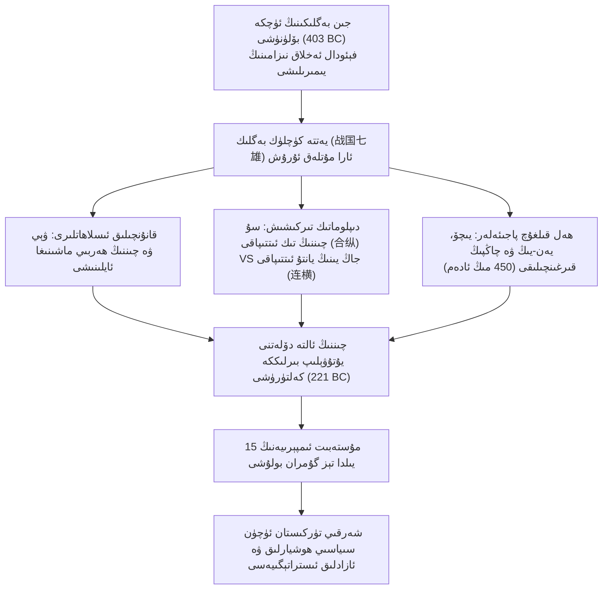
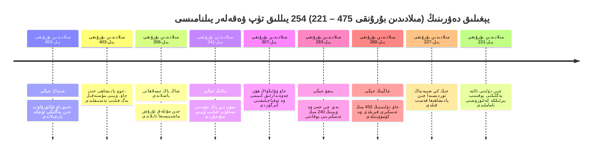
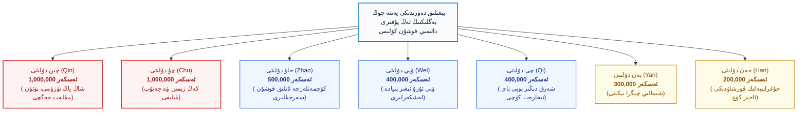
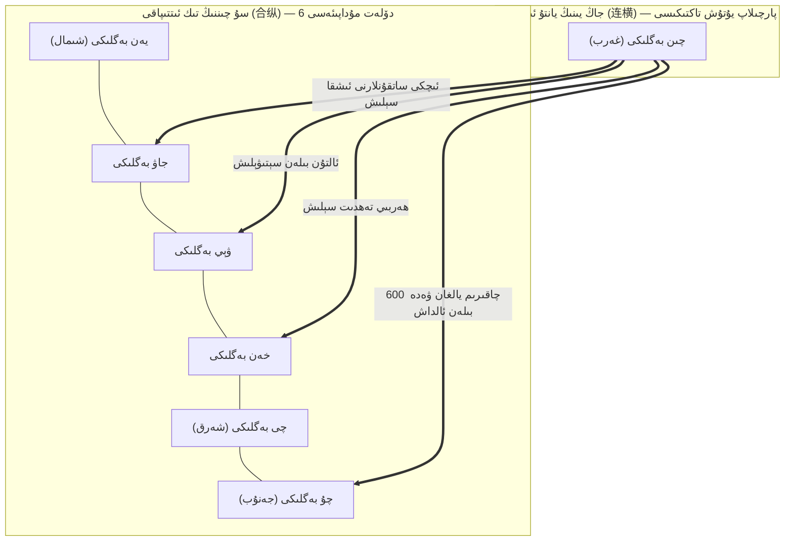
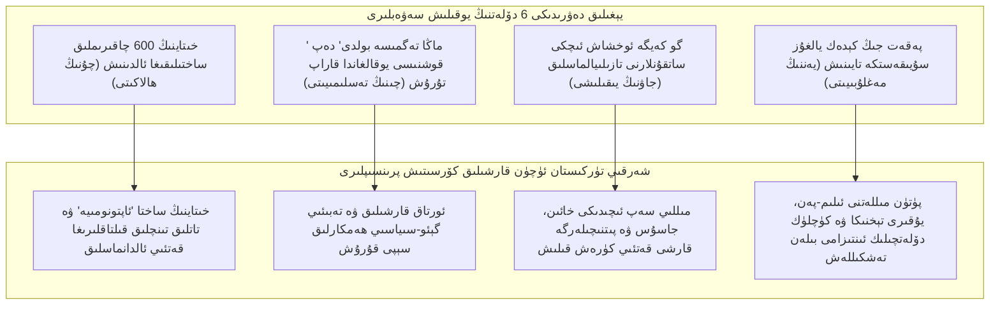

_تەخمىنەن ئوقۇش ۋاقتى 60 مىنۇت_

**بِسْمِ اللَّهِ الرَّحْمَٰنِ الرَّحِيمِ**

# **خىتاينى چۈشىنىش 43: قانلىق يېغىلىق ۋە ھاكىمىيەتپەرەسلىك قۇرۇلمىسى: يېغىلىق دەۋرىنىڭ 254 يىللىق پاجىئەسى (مىلادىدىن بۇرۇنقى 475 – 221)، چىننىڭ زوراۋانلىق بىلەن بارلىققا كېلىشى ۋە شەرقىي تۈركىستان ئۈچۈن سىياسىي ساۋاقلار**

﴿وَلَا تَحْسَبَنَّ اللَّهَ غَافِلًا عَمَّا يَعْمَلُ الظَّالِمُونَ ۚ إِنَّمَا يُؤَخِّرُهُمْ لِيَوْمٍ تَشْخَصُ فِيهِ الْأَبْصَارُ﴾

> «(ئى مۇھەممەد!) ئاللاھنى زالىملارنىڭ قىلمىشلىرىدىن قەتئىي غاپىل دەپ ئويلىمىغىن، ئاللاھ پەقەت ئۇلارنىڭ جازاسىنى (دەھشىتىدىن) كۆزلەر قېتىپ قالىدىغان بىر كۈنگىچە كېچىكتۈرىدۇ.» (سۈرە ئىبراھىم، 42-ئايەت)

---

## **مۇقەددىمە: فېئوداللىق پەردىنىڭ تامامەن يىرتىلىشى ۋە «مۇتلەق ئۇرۇش» (Total War) قا ئۆتۈش**

ئىنسانىيەت تەپەككۇرى ۋە سىياسىي ھاكىمىيەت تۈزۈلمىلىرى تەرەققىياتىنىڭ تارىخىغا قارايدىغان بولساق، دۇنيانىڭ ھەرقايسى جايلىرىدىكى مەدەنىيەتلەر ھاكىمىيەت يۈرگۈزۈشتە مەلۇم دەرىجىدىكى تۇتقا، ئەخلاقىي ئەھدە، دىنىي چەكلىمە ۋە تەبىئىي تەڭپۇڭلۇققا تايىنىپ مەۋجۇتلۇقىنى ساقلاپ كەلگەن. ئەمما خىتاي مەدەنىيىتىنىڭ يىلتىزىغا چوڭقۇرلاپ قارىغىنىمىزدا، بۈگۈنكى بېيجىڭ كۇرسىلىرىدا ئولتۇرغان كوممۇنىست تاجاۋۇزچىلارنىڭ يەر يۈزىگە چاچقان ۋەھشىيلىكى، ئالداش تاكتىكىلىرى، كېلىشىملەرنى قەغەز پۇلىچىلىك كۆرمەسلىكى ۋە ئاجىزلارنى مىسلىسىز زۇلۇم بىلەن يۇتۇۋېلىش قىلمىشلىرىنىڭ ئەسلا بۈگۈن ياكى تۈنۈگۈن پەيدا بولۇپ قالغان ئېغىش ئەمەسلىكىنى كۆرىمىز. ئەكسىچە، بۇ خىل مىللىي گېن بۇنىڭدىن 2400 يىل ئىلگىرى يۈز بەرگەن، تارىختا <dfn title="مىلادىدىن بۇرۇنقى 475-يىلدىن تارتىپ تاكى چىن سۇلالىسى ئالتە دۆلەتنى يۇتۇۋېلىپ بىرلىككە كەلتۈرگەن مىلادىدىن بۇرۇنقى 221-يىلىغىچە بولغان 254 يىللىق قانلىق كۈرەش دەۋرى">«يېغىلىق دەۋرى» (战国时期 - Zhànguó Shíqī، مىلادىدىن بۇرۇنقى 475 – 221)</dfn> دەپ ئاتالغان 254 يىللىق دەھشەتلىك قانلىق قىرغىنچىلىق ۋە زوراۋانلىق مەشىقگاھىدا يېتىلىپ چىققان بىر خىل سىستېمىلىق ھاكىمىيەتپەرەسلىك مېخانىزمىدۇر.

بۇنىڭدىن بۇرۇنقى <dfn title="مىلادىدىن بۇرۇنقى 770-يىلدىن مىلادىدىن بۇرۇنقى 476-يىلىغىچە بولغان دەۋر">«ئەمىنىيەت دەۋرى» (春秋时期 - Chūnqiū Shíqī، مىلادىدىن بۇرۇنقى 770 – 476)</dfn> دە، گەرچە كۈچلۈك بەگلىكلەر ئوتتۇرىسىدا زومىگەرلىك تىركىشىشلىرى توختاۋسىز داۋاملاشقان بولسىمۇ، تاشقى كۆرۈنۈشتە يەنىلا <dfn title="مىلادىدىن بۇرۇنقى 770-يىلدىن 256-يىلغىچە مەۋجۇت بولغان نامدىكى بىرلىككە كەلگەن خىتاي پادىشاھلىقى">شەرقىي جوۋ سۇلالىسى (东周 - Dōng Zhōu، مىلادىدىن بۇرۇنقى 770 – 256)</dfn> نىڭ ئەنئەنىۋى مۇراسىم-تەرتىپى (周礼 - Zhōulǐ)، بەگلىكلەرنىڭ قانداشلىق ئاقسۆڭەكلىك ئالاقىسى ۋە يۈز-خاتىرە قىلىش پرىنسىپلىرى يەنىلا ساقلىنىپ كەلگەن ئىدى. ئۇ چاغلاردىكى بەگلىكلەر ئارا ئۇرۇشلار ئاساسلىقى نامدا «پادىشاھنى ھۆرمەتلەش، ئەتراپتىكى مىللەتلەرنى چېكىندۈرۈش» (尊王攘夷) شوئارى ئاستىدا بىر بەگلىكنىڭ زومىگەرلىكىنى باشقىلارغا ئېتىراپ قىلدۇرۇش مەقسىتىدە ئېلىپ بېرىلاتتى. لېكىن، يېغىلىق دەۋرىگە قەدەم قويۇش بىلەن تەڭ، بۇ يالغان ئەخلاق پەردىسى پۈتۈنلەي پاچاقلىنىپ، سىياسىي سەھنە دەرەختىن مېۋە تۈگىگەندەك قۇرۇق، ساپ زوراۋانلىق، تەھدىت، سۇيىقەست، پۈتۈن مەملىكەت بويىچە يالپاقلاپ قىرىپ تاشلاش ۋە دۆلەتلەرنى پۈتۈن گەۋدىسى بىلەن يۇتۇۋېلىشتىن ئىبارەت «مۇتلەق ئۇرۇش» (Total War) قاينىمىغا كىردى.

بۇ ئەسىرلەردە يۈز بەرگەن ئۆزگىرىش سىياسىي جەھەتتىلا ئەمەس، بەلكى كىشىلىك ۋىجداننىڭ زاۋاللىققا يۈزلىنىشى جەھەتتىمۇ بىر قاراڭغۇ دەۋر ھېسابلىنىدۇ. ئاقسۆڭەكلەرنىڭ نەسەپ ئاساسىدىكى نىزامى ئۆز ئورنىنى تاشيۈرەك مۇستەبىتلىك، ئەڭ يۇقىرى ھوقۇقنى بىر قولغا مەركەزلەشتۈرۈش، پۇقرالارنى تۈگىمەس ئۇرۇش مەشىقى ۋە باج بىلەن ئېزىش، شۇنداقلا دۈشمەننىڭ بېشىنى كېسىپ ئەكىلىش بىلەن ئۆلچىنىدىغان قانخورلۇق تۈزۈمىگە بوشىتىپ بەردى. پۈتكۈل خىتاي مەدەنىيىتى بۇ دەۋردە مەۋجۇت بولغان نەچچە يۈزلىگەن يەرلىك خاسلىق، تىل-يېزىق ئەنئەنىسى، تەپەككۇر ئەركىنلىكى ۋە مەدەنىيەت بايلىقىنى ئۆز پۇتلىرى ئاستىغا دەسسەپ، ئاخىرىدا تاشتىنمۇ سوغۇق، قاندىنمۇ قىزىل بىر ھەربىي-فاشىستىك قۇرۇلما — <dfn title="مىلادىدىن بۇرۇنقى 221-يىلدىن 206-يىلغىچە ھۆكۈم سۈرگەن خىتاينىڭ تۇنجى مۇتلەق مۇستەبىت ئىمپېرىيەسى">چىن سۇلالىسى (秦朝 - Qín Cháo، مىلادىدىن بۇرۇنقى 221 – 206)</dfn> نىڭ پۇتلىرى ئاستىغا قۇل بولۇپ بويسۇندى. بۈگۈن مۇستەقىللىق، ئىززەت-ھۆرمەت ۋە مىللىي مەۋجۇتلۇق ئۈچۈن قارشىلىق كۆرسىتىۋاتقان شەرقىي تۈركىستان خەلقى ئۈچۈن بۇ 254 يىللىق پاجىئەلىك تارىخنى پارچىلاپ تەتقىق قىلىش، زالىملارنىڭ تاشقى سىياسىتى ۋە دىپلوماتىك ھىيلىلىرىنىڭ ئەسلى ماھىيىتىنى بايقاشتا بەئەينى مىكروسكوپتەك رول ئوينايدۇ.

ئۇيغۇرلار تارىختا مەدەنىيەت ياراتقان، كىشىلىك شەپقەت، ۋىجدان ۋە ئادالەتنى تۇغ قىلغان بۈيۈك مىللەت بولۇش سۈپىتى بىلەن، دۈشمىنىنىڭ ئىچكى پسىخىكىسى ۋە ھاكىمىيەت لوگىكىسىنى تولۇق ئۆزلەشتۈرۈشى شەرت. چۈنكى رەقىبىنىڭ تاجاۋۇزچىلىق ماھىيىتىنى بىلىشتىن قاچقان مىللەت ھامان بىر كۈنى شۇ رەقىبنىڭ ئالداش تۇزىقىغا دەسسەپ، ئۆز ئەركىنلىكىدىن، زېمىنىدىن ۋە ھەتتا جىسمانىي مەۋجۇتلۇقىدىن ئايرىلىپ قالىدۇ. يېغىلىق دەۋرىدىكى ئالتە دۆلەتنىڭ پاجىئەلىك يوقىلىشى دەل بۈگۈنكى بىز ئۇيغۇرلار ئۈچۈن، شۇنداقلا تاجاۋۇزچى خىتاينىڭ زۇلمى ئاستىدا تىركىشىۋاتقان بارلىق مۇستەملىكە خەلقلەر ئۈچۈن ئەڭ ئاچچىق، ئەمما ئەڭ قىممەتلىك بىر دەرسلىكتۇر.

*(سىخېما 1: يېغىلىق دەۋرىنىڭ 254 يىللىق سىياسىي تىركىشىش، ئۇرۇش ۋە گۇمرانلىق قۇرۇلما خەرىتىسى)*

---

## **1-باب: جىن بەگلىكىنىڭ ئۈچكە بۆلۈنۈشى (三家分晋) — نىزامنىڭ پارچىلىنىشى، ئەخلاقنىڭ يوقىلىشى ۋە يالىڭاچ كۈچ دەۋرىنىڭ باشلىنىشى (مىلادىدىن بۇرۇنقى 403)**

تارىخچىلارنىڭ شەرقىي جوۋ سۇلالىسىنىڭ يىمىرىلىش باسقۇچىنى نېمە ئۈچۈن ئەمىنىيەت (چۇنچيۇ) ۋە يېغىلىق (جاڭگو) دەپ ئىككى تۈپ باسقۇچقا ئايرىغانلىقى ھەمىشە مۇھىم بىر سوئالدۇر. بۇ چوڭ بۇرۇلۇشنىڭ ھەل قىلغۇچ سىمۋولى — <dfn title="قەدىمكى جىن بەگلىكىنىڭ ئۈچ ئورۇق ۋەزىرلىرى بولغان خەن، جاۋ ۋە ۋېي ئائىلىلىرى تەرىپىدىن پارچىلىنىپ يۇتۇۋېلىنىشى ۋە مىلادىدىن بۇرۇنقى 403-يىلى جوۋ پادىشاھى تەرىپىدىن رەسمىي مۇستەقىل دۆلەت قىلىپ تەستىقلىنىش تارىخىي ۋەقەسى">«جىن بەگلىكىنىڭ ئۈچكە بۆلۈنۈشى» (三家分晋 - Sān Jiā Fēn Jìn، مىلادىدىن بۇرۇنقى 403)</dfn> دۇر. بۇ ۋەقە پەقەت بىر بەگلىكنىڭ ئىچكى ھوقۇق تالىشىشى ئەمەس، بەلكى خىتاي تارىخىدا ئورنىتىلغان بارلىق قانۇنىيلىق، ئەنئەنىۋى قائىدە-يوسۇن ۋە ساداقەت چۈشەنچىلىرىنىڭ كۈچ ئالدىدا پۈتۈنلەي بەربات بولغانلىقىنىڭ مۆھۈرى ئىدى.

ئەمىنىيەت دەۋرىنىڭ قۇدرەتلىك دۆلىتى بولغان <dfn title="مىلادىدىن بۇرۇنقى 11-ئەسىردىن 376-يىلىغىچە ياشىغان ئوتتۇرا تۈزلەڭلىكتىكى چوڭ بەگلىك">جىن بەگلىكى (晋国 - Jìn Guó)</dfn> دەۋرىدە، مەشھۇر ھۆكۈمران <dfn title="جىن بەگلىكىنىڭ داڭلىق زومىگەر ھۆكۈمرانى">جىن ۋېنگۇڭ (Duke Wen of Jin / 晋文公، مىلادىدىن بۇرۇنقى 697 – 628)</dfn> نىڭ سەلتەنىتىدىن كېيىن، بەگلىكنىڭ ھەربىي ۋە مەمۇرىي كۈچى تەدرىجىي ھالدا «ئالتە ۋەزىر ئائىلىسى» (六卿 - Liù Qīng: خەن، جاۋ، ۋېي، جى، فەن، جۇڭشىڭ) نىڭ قولىغا ئۆتۈپ كەتتى. ۋاقىتنىڭ ئۆتۈشى بىلەن جىن پادىشاھلىرى تامامەن قونچاق ھالەتكە چۈشۈپ قالدى. دەسلەپتە فەن ۋە جۇڭشىڭ جەمەتلىرى تالاش-تارتىشلاردا يوقىتىلدى، قالغان تۆت چوڭ ئائىلە ئىچىدە ئەڭ تاجاۋۇزچى، ھاكاۋۇر ۋە رەھىمسىز كۈچكە ئايلانغان شەخس <dfn title="جىن بەگلىكىنىڭ ئەمەلىي كۈچىنى بېسىۋالغان، تاجاۋۇزچى ۋە زوراۋان جى ئائىلىسىنىڭ سەردارى">جىبو ياۋ (Zhi Boyao / 智伯瑶، مىلادىدىن بۇرۇنقى ؟ – 453)</dfn> ئىدى. جىبو ياۋ ئۆزىنىڭ كۈچىگە تايىنىپ، خەن ۋە ۋېي جەمەتلىرىنى قورقۇتۇپ ئۇلاردىن كەڭ تېررىتورىيەلەرنى تارتىۋالدى. بىراق ئۇ ئۆزىنىڭ سۈمۈرگۈچ كۆزىنى جاۋ جەمەتىگە قاراتقاندا، جاۋنىڭ يىراقنى كۆرەر كاتتىۋېشى <dfn title="جاۋ جەمەتىنىڭ قابىل سەردارى، كېيىنكى جاۋ دۆلىتىنىڭ سىياسىي ئۇلىنى سالغۇچى">جاۋ شياڭزى (Zhao Xiangzi / 赵襄子، مىلادىدىن بۇرۇنقى ؟ – 425)</dfn> قەتئىي باش ئەگمەي رەت قىلدى.

بۇنىڭدىن غەزەپلەنگەن جىبو ياۋ خەن ۋە ۋېي قوشۇنلىرىنى مەجبۇرىي ئۆزىگە قوشۇۋېلىپ، جاۋنىڭ مۇستەھكەم تەۋەلىكى بولغان جىنياڭ شەھىرىنى (晋阳 - Jìnyáng، بۈگۈنكى سەنشى تەييۈەن) مۇھاسىرىگە ئالدى. شەھەر ئۈچ يىل قامال قىلىندى، ھەتتا جىبو ياۋ جىن دەرياسىنىڭ سۈيىنى بۆسۈپ كېلىپ جىنياڭنى غەرق قىلىشقا ئۇرۇندى. شەھەر ئەھلى ئېغىر پاجىئەدە قېلىپ قازانلارنى ئېسىپ تاماق ئېتىدىغان بوشلۇقمۇ قالمىغان ئەڭ قىيىن مىنۇتلاردا، جاۋ شياڭزى ئەڭ ئىشەنچلىك مەسلىھەتچىسى جاڭ مېڭتەننى مەخپىي ھالدا خەن ۋە ۋېي تەرەپكە ئەۋەتتى. جاڭ مېڭتەن خەن بېگى ۋە ۋېي بېگىگە ھايات-ماماتلىق رېئاللىقنى چۈشەندۈرۈپ مۇنداق دېدى: «بۈگۈن جىبو جاۋنى سۈيى بىلەن بىللە يۇتۇۋالسا، ئەتە سىلەرنىڭ خەن ۋە ۋېينىڭ زېمىنىنى بېسىۋالمايدۇ دەپ كىم كاپالەتلىك قىلالايدۇ؟ لەۋ كەتسە، چىشقا سوغۇق تەگمەي قالمايدۇ!» بۇ تەنھەرىكەتلىك دىپلوماتىيە خەن ۋە ۋېينىڭ ئىچكى قورقۇنچىنى قوزغاپ، كېلىشىمنى ئاستىرتىن بەربات قىلدى. كېچىدە ئۈچ جەمەت بىرلىشىپ تۇيۇقسىز سۇ توسمىسىنى بۇزۇپ، جىبو ياۋنىڭ لەشكەرگاھىغا سۇ قويدى، جىبو ياۋ ئەسىرگە ئېلىنىپ بېشى كېسىلدى، جاۋ شياڭزى ئۇنىڭ باش سۆڭىكىنى ئېلىپ ھاراق قاچىسى قىلىپ ئىشلەتتى. پۈتكۈل جى ئائىلىسى ئەۋلاد قالدۇرۇلماي رەھىمسىزلەرچە قىرىپ تاشلاندى.

مىلادىدىن بۇرۇنقى 403-يىلىغا كەلگەندە، ئامالسىز قالغان نامدىكى جوۋ تەڭرى ئوغلى (جوۋ ۋېيلىېۋاڭ / King Weilie of Zhou، مىلادىدىن بۇرۇنقى 425 – 402) خەن، جاۋ ۋە ۋېي ۋەزىرلىرىنى رەسمىي فېئوداللىق بەگ (诸侯 - Zhūhóu) قىلىپ مەنسەپ بېرىشكە مەجبۇر بولدى. بۇ، فېئوداللىق جەمئىيەت نىزامىنىڭ يىلتىزىدىن قومۇرۇلۇشى ئىدى. چۈنكى پادىشاھقا قاراشلىق ۋەزىر ئۆز ھۆكۈمرانىنى پارچىلاپ تاشلاپ ئۆزى مۇستەقىل دۆلەت بولالىسا، بۇ پۈتۈن دۇنياغا نېمىنى ئىسپاتلايتتى؟ ئۇ پەقەتلا: «مۇشتۇمۇڭ زوراۋان بولسىلا، قەستلەپ ئۆلتۈرۈش، زېمىن تارتىۋېلىش، يالغان ئېيتىش ۋە تەختنى بېسىۋېلىش ھەقلىقتۇر» دېگەن شۇم پەلسەپىنى پۈتكۈل جەمئىيەتكە جاكارلىغانلىق ئىدى. دەل مۇشۇ نۇقتىدىن ئېيتقاندا، يېغىلىق دەۋرىنىڭ ئېچىلىشى ئەخلاق تۈزۈلمىسىنىڭ پۈتۈنلەي دەپنە قىلىنىشى ۋە مۇستەبىت كۈچ سىياسىتىنىڭ قانلىق تەختكە ئولتۇرۇشى بولدى.

*(سىخېما 2: يېغىلىق دەۋرىدىكى 254 يىللىق ھەل قىلغۇچ بۇرۇلۇشلار ۋە قىرغىنچىلىقلار يىلنامىسى)*

---

## **2-باب: ۋېي بەگلىكىنىڭ قەد كۆتۈرۈشى: لى كۈينىڭ قانۇنچىلىق دەستۇرى، ۋۇ چى ۋە «ۋېي ۋۇزۇ» ئېغىر پىيادە ئارمىيەسىنىڭ غالىبىيىتى**

جىن بەگلىكى پارچىلانغاندىن كېيىن، ئوتتۇرا تۈزلەڭلىكتە چى، چۇ، يەن، خەن، جاۋ، ۋېي ۋە چىن قاتارلىق يەتتە چوڭ كۈچ (战国七雄 - Zhànguó Qī Xióng) بارلىققا كەلدى. بۇلار ئىچىدە دەسلەپتە ئەڭ ئاجىز، ھەر تەرەپتىن دۈشمەن قورشاۋىدا قالغان دۆلەت دەل <dfn title="مىلادىدىن بۇرۇنقى 403-يىلدىن 225-يىلغىچە ياشىغان ئوتتۇرا تۈزلەڭلىك دۆلىتى">ۋېي بەگلىكى (魏国 - Wèi Guó)</dfn> ئىدى. ۋېي جۇغراپىيە جەھەتتىن مەركەزگە جايلاشقان، دۆلەت زېمىنى ئىككىگە بۆلۈنۈپ كەتكەن بولۇپ، غەربتىن قەبىھ ۋە ھەربىي تەھدىتكە مايىل چىن، شەرقتىن كۈچلۈك چى، جەنۇبتىن غايەت زور كۆلەملىك چۇ، شىمالدىن ئۆز ئاكىسى جاۋنىڭ قىستىشىدا تەمتىرەپ تۇراتتى. قۇرۇلغان دەسلەپكى يىللاردىكى تاشقى ئۇرۇشلاردا ئۇدا مەغلۇپ بولغان ۋېي بەگلىكى ئۆلۈم-تىرىلىك گىردابىغا بېرىپ قالدى.

بۇ مۈشكۈل پەيتتە، تارىختىكى كۆزگە كۆرۈنگەن مەمۇرىيەتچى ھۆكۈمران <dfn title="ۋېي دۆلىتىنىڭ تۇنجى قۇدرەتلىك ھۆكۈمرانى بولۇپ، تالانتلىقلارنى قوبۇل قىلىپ دۆلەتنى كۈچەيتكەن">ۋېي ۋېنخوۋ (Marquis Wen of Wei / 魏文侯، مىلادىدىن بۇرۇنقى 445 – 396)</dfn> كونا نەسەپۋازلىق كىشەنلىرىنى چۆرۈپ تاشلاپ، ئىختىساسلىقلارنى مەنسەپكە قويۇشتا مىسلىسىز جاسارەت كۆرسەتتى. ئۇ كېيىنچە خىتاي تارىخىدىكى ئەڭ تۇنجى مۇكەممەل قانۇن دەستۇرى بولغان <dfn title="مىلادىدىن بۇرۇنقى 5-ئەسىردە لى كۈي تۈزگەن تۇنجى خىتاي فېئوداللىق قانۇنلار توپلىمى">«قانۇن دەستۇرى» (法经 - Fǎ Jīng)</dfn> نى يازغان داڭلىق قانۇنچى مۇتەپەككۇر <dfn title="قانۇنچىلىق مەكتىپىنىڭ دەسلەپكى ۋەكىلى، ۋېي دۆلىتىدە تۇنجى بولۇپ ئىسلاھات يۈرگۈزگەن ئەرباب">لى كۈي (Li Kui / 李悝، مىلادىدىن بۇرۇنقى 455 – 395)</dfn> نى باش ۋەزىرلىككە تەيىنلىدى. لى كۈي «يەر كۈچىنى تولۇق ئېچىش» (尽地力之教) سىياسىتىنى يۈرگۈزۈپ، دېھقانچىلىق ئىشلەپچىقىرىشىنى دۆلەتلىك نازارەتكە ئالدى، باھانى مۇقىملاشتۇرۇش ئۈچۈن «ئاشلىقنى تەكشى سېتىۋېلىش» (平籴法) سىستېمىسىنى تۇرغۇزدى. ئەڭ ھالقىلىقى، ئاقسۆڭەكلەرنىڭ ھېچقانداق خىزمەت كۆرسەتمەي ئەۋلادتىن-ئەۋلادقا نانخور بولۇپ ئەمەل مەنسەپ تالىشىشىنى بىكار قىلىپ، «كىم دۆلەتكە پايدا يەتكۈزسە، كىم ھەربىي غەلىبە قازانسا، شۇنىڭغا مەرتىۋە بېرىش» ئۆلچىمىنى ئوتتۇرىغا قويدى.

بۇ ئىقتىسادىي ۋە مەمۇرىي قۇرۇلۇشقا زامانىسىنىڭ ئەڭ كۆزگە كۆرۈنگەن ھەربىي بىلىمدانى <dfn title="داڭلىق ھەربىي ئىستراتېگ، 'ۋۇزى ھەربىي دەستۇرى'نىڭ ئاپتورى، ۋېي ۋە چۇ دۆلەتلىرىدە ئۆچمەس ئىز قالدۇرغان سەركەردە">ۋۇ چى (Wu Qi / 吴起، مىلادىدىن بۇرۇنقى 440 – 381)</dfn> نىڭ ھەربىي ئىسلاھاتى قوشۇلدى. ۋۇ چى ئەسكەر ئېلىشتا سۈپەتلىك تاللاش ئۆلچىمىنى بەلگىلەپ، خىتاي تارىخىدا دەھشەتلىك داڭق چىقارغان تۇنجى كەسپىي ئېغىر پىيادە ئارمىيە سىستېمىسى — <dfn title="ۋېي دۆلىتىنىڭ ۋۇ چى تەرىپىدىن قاتتىق ئۆلچەم بىلەن مەشىقلەندۈرۈلگەن ئېغىر قوراللانغان تاللانما پىيادە لەشكەرلىرى">«ۋېي ۋۇزۇ» (Wei Wuzu / 魏武卒)</dfn> نى بەرپا قىلدى. بۇ ئەسكەرلەر ئۈچ قەۋەت ئېغىر بىرونزا ساۋۇت كىيىپ، 50 تال ئوقلۇق ياچىنى، ئېغىر نەيزە ۋە قىلىچنى باغلاپ، ئۈچ كۈنلۈك قۇرۇق ئوزۇقىنى دۈمبىسىگە ئارتىپ يۈز چاقىرىملىق يولنى بىر كۈندە يۈگۈرۈپ بېسىپ ئۆتەلەيدىغان دەرىجىدە تەربىيەلەنگەن ئىدى. ۋېي ۋۇزۇ قوشۇنىغا كىرگەنلەرنىڭ ئائىلىسى بارلىق باج ۋە ئەمگەك سېلىقىدىن ئازاد قىلىناتتى.

مىلادىدىن بۇرۇنقى 419-يىلىدىن باشلاپ، ۋۇ چى ئۆزى تەربىيەلىگەن 50 مىڭ ئەتراپىدىكى ۋېي ۋۇزۇ تاللانما قوشۇنىنى باشلاپ غەربتىكى چىن بەگلىكىگە بېسىپ كىردى. بۇ تارىختا مەشھۇر <dfn title="ۋېي دۆلىتى بىلەن چىن دۆلىتى ئوتتۇرىسىدا سېرىق دەريانىڭ غەربىي قىرغىقىنى تالىشىش ئۈچۈن كۆپ قېتىم يۈز بەرگەن ئىستراتېگىيەلىك ئۇرۇشلار">«خېشى ئۇرۇشى» (Battle of Hexi / 河西之战)</dfn> نى قوزغىدى. ئەينى دەۋردە مەدەنىيەت ۋە ئىستراتېگىيە جەھەتتە تېخى قالاق، ئىچكى نىزالاردا كۈچسىزلەنگەن چىن ئارمىيەسى 500 مىڭ لەشكەر بىلەن كەلگەن بولسىمۇ، ۋۇ چىنىڭ قەھرىمان، يۇقىرى ئىنتىزامچان ۋە پاراسەت بىلەن باشقۇرۇلغان ۋېي لەشكەرلىرى تەرىپىدىن مىسلىسىز ئېغىر مەغلۇبىيەتكە ئۇچرىدى. چىن ئارمىيەسى خېشى رايونىدىكى (سېرىق دەريانىڭ غەربىي قىرغىقى) بارلىق مۇھىم قورغانلىرىنى تاشلاپ قېچىشقا مەجبۇر بولدى. ۋېي دۆلىتى بۇ زېمىنلارنى ئىگىلەپ، شاڭجۈن ۋىلايىتىنى قۇرۇپلا قالماي، شىمالغا بېرىپ يايلاق كۆچمەنلىرىدىن بولغان <dfn title="ئەمىنىيەت ۋە يېغىلىق دەۋرىدە ئوتتۇرا تۈزلەڭلىكتە مەۋجۇت بولغان، ئاق دى كۆچمەنلىرى قۇرغان تۈركىي تىپتىكى قەدىمكى دۆلەت">جۇڭشەن دۆلىتى (Zhongshan / 中山国، مىلادىدىن بۇرۇنقى 506 – 296)</dfn> نىمۇ ئۈچ يىللىق جەڭ ئارقىلىق ۋاقىتلىق ئۆزىگە قوشۇۋالدى.

ۋېينىڭ بۇ غەلىبىسى يېغىلىق دەۋرىنىڭ بارلىق چوڭ بەگلىكلىرىگە ئېغىر سىگنال بەردى: ئەگەر كونا ئاقسۆڭەكلىك فېئوداللىق چەكلىمىلەردىن قۇتۇلۇپ، دۆلەتنى پۈتۈن كۈچى بىلەن بىر مەركەزگە بويسۇنغان مەمۇرىي-ھەربىي ماشىنىغا ئايلاندۇرمىسا، كۈچلۈكنىڭ ئالدىدا قۇل بولۇپ يوقىلىشتىن باشقا چىقىش يولى يوق ئىدى! بۇ ھادىسە پۈتكۈل يېغىلىق دۇنياسىدا تۇنجى قېتىملىق «ئىسلاھات دولقۇنى» (变法潮) نى قوزغىدى.

---

## **3-باب: چىننىڭ تەقدىرىنى ئۆزگەرتكەن دەھشەت: شاڭ ياڭ ئىسلاھاتى (商鞅变法) — ھەربىي خىزمەت دەرىجىسى، دۆلەتلىك ئۇرۇش ماشىنىسى ۋە تاشيۈرەك تۈزۈم**

شەرقتە ۋېي دۆلىتى لى كۈي ۋە ۋۇ چىنىڭ ياردىمىدە شۇنداق كۈچىيىۋاتقاندا، قەدىمكى شەرقىي جوۋدىن قوغلاپ چىقىرىلغان ئوتتۇرا ئاسىيا ۋە شەرقىي تۈركىستان تىپىدىكى <dfn title="قەدىمكى شىمال ۋە غەربتىكى كۆچمەن تۈركىي قەبىلىلەر بىرلەشمىسى، چىن بىلەن چېگراداش ياشىغان">«رۇڭ-دى» (Rong and Di / 戎狄)</dfn> قەبىلىلىرى بىلەن قوشنا ياشاۋاتقان غەربتىكى <dfn title="مىلادىدىن بۇرۇنقى 770-يىلى فېئودال بەگلىك دەرىجىسىگە ئېرىشكەن، خىتاينىڭ غەربىدىكى ئەڭ قەبىھ ۋە زوراۋان بەگلىكى">چىن بەگلىكى (秦国 - Qín Guó)</dfn> بارلىق خېشى زېمىنىدىن ئايرىلىپ قېلىپ، ئېغىر خورلۇق ۋە مەغلۇبىيەت ئىچىدە ياشاۋاتاتتى. ئوتتۇرا تۈزلەڭلىكتىكى ئاتالمىش «مەدەنىيەتلىك» بەگلىكلەر چىننى بىر «ياۋايى، قالاق مەخلۇقلار دۆلىتى» دەپ ھېسابلاپ، ئۇلارنى بەگلىكلەر ئىتتىپاقى يىغىلىشىغىمۇ كىرگۈزمەيتتى.

مانا مۇشۇ مەغلۇبىيەت ۋە كۈلپەت ئىچىدە تەختكە ئولتۇرغان ياش ھۆكۈمران <dfn title="چىن دۆلىتىنى نامراتلىقتىن قۇتقۇزۇپ، شاڭ ياڭنى ئىشقا سېلىپ كۈچەيتكەن قەيسەر چىن پادىشاھى">چىن شياۋگۇڭ (Duke Xiao of Qin / 秦孝公، مىلادىدىن بۇرۇنقى 381 – 338)</dfn> مىلادىدىن بۇرۇنقى 361-يىلى «تالانتلىقلارنى قوبۇل قىلىش پەرمانى» (求贤令) نى پۈتۈن خىتايغا چىقىرىپ: «كىمكى دۆلىتىمنى قۇدرەت تاپقۇزۇپ، ۋېينى يېڭىپ يوقاتقان يەرلىرىمنى قايتۇرۇپ بېرەلەيدىغان ياخشى تەدبىر كۆرسەتسە، ئۇنىڭ بىلەن چىن دۆلىتىنىڭ زېمىنىنى تەڭ بۆلۈشىمەن!» دەپ جاكارلىدى. بۇ چاقىرىققا جاۋابەن، ۋەي بەگلىكىدە پۇرسەت تاپالماي يۈرگەن، قانۇنچىلىق مەكتىپىنىڭ ئەڭ مۇتەئەسسىپ، تاشيۈرەك ۋە ئۈزۈل-كېسىل ۋەكىلى <dfn title="قانۇنچىلىق مەكتىپىنىڭ ئەڭ ۋەھشىي نەزەرىيەچىسى، چىننى پۈتۈنلەي فاشىستىك ئۇرۇش ماشىنىسىغا ئايلاندۇرغان ئەرباب">شاڭ ياڭ (Shang Yang / 商鞅، ئەسلى ئىسمى ۋېي ياڭ، مىلادىدىن بۇرۇنقى 390 – 338)</dfn> غەربكە يۈرۈش قىلىپ چىنغا كەلدى.

شاڭ ياڭ چىن شياۋگۇڭ بىلەن ئۈچ كېچە-كۈندۈز سۆھبەتلىشىپ، پۈتكۈل فېئوداللىق، ئەخلاقىي، كۇڭزىچىلىق شوئارلىرىنى بىكار قىلىپ، «كۈچلۈك ئارمىيە ۋە تېرىقچىلىققا تايىنىپ دۇنيانى بويسۇندۇرۇش» مەخپىيىتىنى ئوتتۇرىغا قويدى. مىلادىدىن بۇرۇنقى 356-يىلى ۋە 350-يىللىرى ئىككى قېتىم زور كۆلەملىك «شاڭ ياڭ ئىسلاھاتى» (商鞅变法) يولغا قويۇلدى. بۇ ئىسلاھات خىتاينىڭ 2000 يىللىق پۈتكۈل سىياسىي ھاياتىنى مەڭگۈلۈك بىر زوراۋانلىق قېلىپىغا سېلىپ قويدى:

1. **ئەنئەنىۋى قۇدۇق ئېتىز تۈزۈمىنى بىكار قىلىش (废井田):** يەرنىڭ خۇسۇسىي ئىگىدارلىقىنى يولغا قويۇپ، پۇقرالارنىڭ كۆپرەك ئاشلىق تاپشۇرۇشىنى رىغبەتلەندۈردى. ئاشلىق تاپشۇرۇش دۆلەت ئامبىرىنىڭ ئۇرۇش قورالىغا ئايلاندى.
2. **20 دەرىجىلىك ھەربىي خىزمەت مەرتىۋىسى (二十等军功爵制):** كونا پۇشتى، تېگى-تەكتى ياكى ئاقسۆڭەكلىك ئورنى ئەمەلدىن قالدۇرۇلدى. مەرتىۋىگە ئېرىشىشنىڭ بىردىنبىر ئۆلچىمى — جەڭ مەيدانىدا قانچە كۆپ دۈشمەننىڭ بېشىنى كېسىپ ئەكىلىش بولدى! ئەگەر بىر لەشكەر بىر دۈشمەننىڭ بېشىنى كېسىپ تاپشۇرسا، بىر پەشۋا مەرتىۋە، بىر تاناب يەر ۋە بىر ئۆيگە ئېرىشەلەيتتى. شۇڭلاشقا، چىن لەشكەرلىرى جەڭ مەيدانىغا چىققاندا ساۋۇت كىيمەي، باش كىيىمسىز، يالاڭ تۆش، بېلىگە كېسىلگەن كاللىلارنى باغلاپ، چىشلىرىنى غۇچۇرلىتىپ ئالغا ئېتىلىدىغان مەخلۇققا ئايلاندى. قوشنا دۆلەتلەر چىن ئارمىيەسىنى كۆرگەندە «يولۋاس-بۆرە ئەلنىڭ ئەسكەرلىرى» (虎狼之师 - Hǔláng zhī Shī) دەپ تىترەيتتى.
3. **ئائىلىلەرنى بىر-بىرىگە باغلەش ۋە كوللېكتىپ جازالاش تۈزۈمى (连坐法):** بارلىق پۇقرالار بەش ئائىلە (伍) ۋە ئون ئائىلە (什) بويىچە ئۆزئارا زەنجىرسىمان كاپالەت سىستېمىسىغا تىزىلدى. ئەگەر بىر ئائىلە قائىدىگە خىلاپلىق قىلسا ياكى قاچقۇننى يوشۇرسا، قالغان بارلىق ئائىلىلەر بىللە بەل ئوتتۇرىسىدىن قىلىچ بىلەن كېسىپ ئۆلتۈرۈلەتتى. كىشىلەر بىر-بىرىنى، ھەتتا ئاتا-بالا، ئەر-ئايال بىر-بىرىنى جاسۇسلۇق بىلەن پاش قىلىشقا مەجبۇر بولدى.
4. **دۆلەتلىك ۋىلايەت-ناھىيە تۈزۈمىنى دەسلەپكى قەدەمدە تۇرغۇزۇش (推行县制):** بارلىق بەگلىك زېمىنى بىۋاسىتە پادىشاھ تەرىپىدىن تەيىنلىنىدىغان 31 ناھىيەگە بۆلۈندى، ھەر بىر يەرلىك ھاكىمىيەت بىۋاسىتە مەركەزگە بويسۇندۇرۇلدى.

بۇ ئىسلاھاتلار چىن بەگلىكىنى بىر كېچىدىلا قورقۇنچلۇق مۇتلەق پۈتۈن دۆلەتلىك ئۇرۇش ماشىنىسىغا ئايلاندۇردى. بارلىق ئەدەبىيات، مۇزىكا، ئەخلاق ۋە پەلسەپە «دۆلەتنى خورىتىدىغان زىيانداش قۇرۇت» دەپ قارىلىپ چەكلەندى. ئەمما، تارىخنىڭ ئىلاھىي ئادالىتى شۇكى، شاڭ ياڭ تۈزگەن زالىمانە تۈزۈم ئاخىرىدا ئۆزىنىڭ بېشىنى يېدى. مىلادىدىن بۇرۇنقى 338-يىلى چىن شياۋگۇڭ ئۆلۈپ، ھوقۇقسىز قالغان چىن خۇيۋېنۋاڭ (King Huiwen of Qin / 秦惠文王، مىلادىدىن بۇرۇنقى 356 – 311) تەختكە چىققاندا، كونا ئاقسۆڭەكلەرنىڭ غەزىپى قوزغالدى. شاڭ ياڭ پايتەختتىن قېچىپ چىقىپ بىر كارۋانسارايغا قونماقچى بولغاندا، ھېلىقى مېھمانخانا خوجايىنى ئۇنىڭ شەخسىي كىملىك خېتى (照会) يوقلۇقىنى كۆرۈپ: «شاڭ ياڭنىڭ تۈزگەن يېڭى قانۇنى بويىچە، كىملىكى يوق ئادەمنى ياتقۇزساق بىزنىڭ پۈتۈن جەمەتىمىز ئۆلتۈرۈلىدۇ» دەپ ئۇنى ئىچىگە كىرگۈزمىدى. شاڭ ياڭ ئۆزى پۈتكەن تاشيۈرەك تۈزۈمنىڭ ئۆز بوينىغا سېلىنغان ئارغامچا ئىكەنلىكىنى چۈشەنگەندە ھەممە ئىش كېچىككەن ئىدى. ئۇ تۇتۇلۇپ، چىن مەيدانىدا <dfn title="قەدىمكى خىتاينىڭ بەش ئاتقا تارتىپ تەننى پارچىلاپ تاشلايدىغان ئەڭ ۋەھشىي جازاسى">«بەش ئاتقا تارتىپ پارچىلاش» (车裂 - Chē Liè)</dfn> ئارقىلىق دەھشەتلىك قىينىلىپ جان بەردى، پۈتۈن ئائىلىسى قىرىپ تاشلاندى. ئەمما يېڭى پادىشاھ شاڭ ياڭنى ئۆلتۈرگەن بىلەن، ئۇنىڭ زالىمانە «ئۇرۇش سىستېمىسى» نى تاشلىمىدى، چۈنكى پادىشاھلارغا شۇنداق تاشيۈرەك، قانسىز ئۇرۇش ماشىنىسى دەل ئەڭ لازىملىق ئىدى.

---

## **4-باب: ئەقىل ۋە سۈرئەت رىقابىتى: سۈن بىن ۋە پاڭ جۈەن — گۈيلىڭ ئۇرۇشى بىلەن مالىڭ ئۇرۇشىنىڭ ھەل قىلغۇچ سىستېمىلىرى**

چىن غەربتە زوراۋانلىق قورالىنى تاۋلاۋاتقان دەۋردە، شەرقتە يەنە بىر چوڭ كۈچ — <dfn title="مىلادىدىن بۇرۇنقى 1046-يىلدىن 221-يىلغىچە مەۋجۇت بولغان دېڭىز بويىدىكى ئەڭ باي ۋە نوپۇسلۇق شەرقىي بەگلىك">چى بەگلىكى (齐国 - Qí Guó)</dfn> دە ھوقۇق ئۆزگىرىشى يۈز بېرىپ، ئەسلىدىكى جىياڭ جەمەتى ئورنىنى تىيان جەمەتى ئېلىپ (田氏代齐 - Tián shì dài Qí، مىلادىدىن بۇرۇنقى 386)، <dfn title="چى دۆلىتىنىڭ قابىل ۋە ئەقىللىق پادىشاھى بولۇپ دۆلەتنى قۇدرەت تاپقۇزغان">چى ۋېيۋاڭ (King Wei of Qi / 齐威王، مىلادىدىن بۇرۇنقى 378 – 320)</dfn> زوۋ جى ۋە باشقىلارنى ئىشقا سېلىپ دۆلەتنى ھەر تەرەپتىن باي ۋە قۇدرەتلىك قىلدى.

ئوتتۇرا تۈزلەڭلىكتە پۈتۈن دۆلەتلەرنى بېسىپ چۈشۈشكە ئۇرۇنۇۋاتقان پۈتۈن كۈچ يەنىلا ۋېي بەگلىكى ئىدى. مىلادىدىن بۇرۇنقى 354-يىلى، <dfn title="ۋېي دۆلىتىنىڭ مەشھۇر، مەغرۇر ۋە كۆرەڭ پادىشاھى">ۋېي خۇيۋاڭ (King Hui of Wei / 魏惠王، مىلادىدىن بۇرۇنقى 400 – 319)</dfn> ئۆزىنىڭ داڭلىق سەركەردىسى <dfn title="ۋېي دۆلىتىنىڭ داڭلىق، لېكىن ئىچى تار سەركەردىسى">پاڭ جۈەن (Pang Juan / 庞涓، مىلادىدىن بۇرۇنقى ؟ – 341)</dfn> نى زور ئارمىيە بىلەن ئەۋەتىپ، قوشنا جاۋ دۆلىتىنىڭ پايتەختى خەندەن (邯郸 - Hándān) نى مۇھاسىرىگە ئالدى. جاۋ بەگلىكى جان تالىشىپ تۇرۇپ چى دۆلىتىدىن قۇتقۇزۇش ئۆتۈندى. چى ۋېيۋاڭ دەرھال ئۆزىنىڭ باش سەركەردىسى تىيان جى (Tian Ji / 田忌) ۋە ھەربىي مەسلىھەتچى سۈپىتىدە <dfn title="مەشھۇر 'سۈنزى ھەربىي دەستۇرى'نىڭ ۋارىسى، 'سۈن بىن ھەربىي دەستۇرى'نىڭ ئاپتورى، پۇتى كېسىپ تاشلانغان پاراسەت ئىگىسى">سۈن بىن (Sun Bin / 孙膑، مىلادىدىن بۇرۇنقى 4-ئەسىر)</dfn> نى تەيىنلىدى.

بۇ يەردە سۈن بىن بىلەن پاڭ جۈەننىڭ شەخسىي تارىخى ئىنتايىن دەھشەتلىك ئىبرەتلىك ئىدى. ئۇلار بىر ۋاقىتتا داڭلىق ئەقىل ئىگىسى گۇيجىزى (Guiguzi / 鬼谷子) دىن ھەربىي ئىلىم ئۆگەنگەن ئىدى. پاڭ جۈەن ۋەزىپىگە چىقىپ ۋېي دۆلىتىدە سەركەردە بولغاندىن كېيىن، ئۆزىنىڭ قابىلىيىتى سۈن بىنگە يەتمەيدىغانلىقىنى بىلىپ، ئىچى كۆيۈپ، سۈن بىننى ئالداپ ۋېي دۆلىتىگە ئېلىپ كېلىپ، ئۇنىڭغا «سۇيىقەست» قالپىقىنى كىيدۈرۈپ، ئۇنىڭ <dfn title="قەدىمكى دەۋردە ئىككى تىز قېپىنى ئويۇپ ئېلىپ تاشلايدىغان ئەڭ رەھىمسىز جازا">«تىز قېپىنى ئويۇپ چىقىرىش» (膑刑 - Bìn Xíng)</dfn> جازاسى بىلەن ماڭالماس مەجرۇھ قىلىۋەتكەن، يۈزىگە تامغا بېسىپ خارلىغان ئىدى. سۈن بىن ساراڭ بولۇۋېلىپ، كالا ۋە چوشقا ئېغىلىدا نىجاسەت يەپ يۈرۈپ دۈشمەننىڭ كۆزىنى بوياپ، ئاخىرى چى دۆلىتىنىڭ ئەلچىسى ئارقىلىق ھارۋىنىڭ ئاستىغا يوشۇرۇنۇپ چى دۆلىتىگە قېچىپ كەلگەن ۋە تىيان جىنىڭ ھۆرمىتىگە ئېرىشكەن ئىدى.

جاۋ دۆلىتى قىستالغان بۇ ئۇرۇشتا، تىيان جى قوشۇننى بىۋاسىتە خەندەنگە ئاپىرىپ پاڭ جۈەن بىلەن قارشىلىشىشنى ئويلىغاندا، ماڭالماي ھارۋىدا ئولتۇرغان سۈن بىن خىتاي ھەربىي ئىستراتېگىيەسىنىڭ ئەڭ چوققا نەمۇنىسى بولغان «تۈگۈننى يېشىش» پرىنسىپىنى چۈشەندۈرۈپ مۇنداق دېدى: «چىگىشلەشكەن تۈگۈننى مۇشتلاپ ئاچقىلى بولمايدۇ، ئۇرۇشۇۋاتقانلارنى ئايرىش ئۈچۈن قورالغا قورال تەڭلەنمەيدۇ. بوش يەرنى ئۇرۇپ، ئاجىز يېرىگە زەربە بېرىلسە، ئېغىر ۋەزىيەت ئۆزلۈكىدىن يېشىلىدۇ. ھازىر ۋېي دۆلىتىنىڭ ئەڭ تاللانما بارلىق قوشۇنى خەندەندە جاۋ بىلەن قىستىلىپ كۈچى تۈگەپ قالدى، پايتەختى دالىياڭدا پەقەت قېرى-چۆرىلەرلا قالدى. بىز دەرھال ئۇلارنىڭ ئۆيىگە — دالىياڭغا بىۋاسىتە ھۇجۇم قىلساق، پاڭ جۈەن خەندەننى تاشلاپ ئۆز پايتەختىنى قۇتقۇزۇش ئۈچۈن چاپىدۇ. شۇنىڭ بىلەن بىز ھېرىپ-چارچىغان ۋېي قوشۇنىنى يېرىم يولدا كۈتۈپ تۇرۇپ تارمار قىلالايمىز!» بۇ دەل مەشھۇر <dfn title="ھەربىي ئىستراتېگىيەدە دۈشمەننىڭ ئۆيىگە ياكى ئاجىز پۇشتىغا زەربە بېرىپ، ئالدىنقى سەپتىكى دۈشمەننى چېكىندۈرۈپ ئۆز مەقسىتىگە يېتىش سەنئىتى">«ۋېينى قورشاۋغا ئېلىپ جاۋنى قۇتقۇزۇش» (围魏救赵 - Wéi Wèi Jiù Zhào)</dfn> ئىدى.

سۈن بىننىڭ مۆلچەرلىگىنىدەكلا بولدى. مىلادىدىن بۇرۇنقى 354-يىلى پاڭ جۈەن دالىياڭنىڭ خەۋپتە قالغانلىقىنى ئاڭلاپ، كۈندۈز-كېچە چېپىپ چارچاپ كېلىۋاتقاندا، سۈن بىن گۈيلىڭ (桂陵 - Guìlíng، بۈگۈنكى خېنەن چاڭيۈەن) دىكى مۇھىم تۈگۈندە قىلتاق قۇرۇپ ساقلاپ تۇرۇپ، ۋېي قوشۇنىنىڭ ئۇچقۇن قىسىملىرىنى يەر چىشلىتىپ پاڭ جۈەننى ئەسىر ئالدى.

ئارىدىن 13 يىل ئۆتۈپ، مىلادىدىن بۇرۇنقى 341-يىلى تارىخ يەنە بىر دەھشەتلىك سەھىپىنى قايتىلىدى. ۋېي پادىشاھى پاڭ جۈەن ۋە تاجىدار شاھزادە شېننى ئەۋەتىپ بۇ قېتىم خەن بەگلىكىنى يۇتۇۋېلىشقا ئاتلاندى. خەن بەگلىكى چىدىن ياردەم سورىدى. سۈن بىن يەنە ئوخشاش بىر تەدبىر بىلەن خەننى قۇتقۇزۇش ئۈچۈن بىۋاسىتە ۋېي پايتەختىگە قاراپ باستى. پۈتۈن ۋېي دۆلىتى بۇ قېتىم چى بىلەن ھېساب-كىتاب قىلىشقا قەسەم ئىچىپ پاڭ جۈەننىڭ قوماندانلىقىدا ئالغا ئىلگىرىلىدى. سۈن بىن پاڭ جۈەننىڭ خاراكتېرىنى — ئۇنىڭ ھاكاۋۇر، گۇمانخور، چى ئەسكەرلىرىنى قورقۇنچاق دەپ بىلىدىغان پىسخىكىسىنى دەل جايىدا مۆلچەرلەپ، <dfn title="سۈن بىننىڭ چېكىنگەندە كۈندىن-كۈنگە ئوچاق سانىنى ئازايتىپ، دۈشمەنگە ئەسكەرلەر قېچىپ كەتتى دەپ تۇيغۇ بېرىپ قىلتاققا چۈشۈرۈش سەنئىتى">«ئوچاق سانىنى ئازايتىش ھىيلىسى» (减灶诱敌 - Jiǎn Zào Yòu Dí)</dfn> نى يۈرگۈزدى.

چى قوشۇنى ۋېي چېگراسىغا كىرگەن بىرىنچى كۈنى 100 مىڭ كىشىلىك ئوچاق ياسىدى، ئىككىنچى كۈنى 50 مىڭ كىشىلىك ئوچاق ياسىدى، ئۈچىنچى كۈنى 30 مىڭ كىشىلىك ئوچاق قالدۇردى. پاڭ جۈەن قالدۇرۇلغان ئوچاقلارنى كۆرۈپ سۆيۈنۈپ كەتتى: «مەن بىلەتتىم چى ئەسكەرلىرى قورقۇنچاق، ئۈچ كۈن ئىچىدە يېرىمىدىن كۆپى قېچىپ كېتىپتۇ!» ئۇ دەرھال ئېغىر پىيادە ۋە ئاشلىق ئېغىر ھارۋىلىرىنى ئارقىدا قالدۇرۇپ، پەقەت يېنىك ساۋۇتلۇق ئاتلىق ئەسكەرلەر بىلەن كۈندۈز-كېچە چى قوشۇنىنىڭ ئارقىسىدىن قوغلىدى.

سۈن بىن پاڭ جۈەننىڭ كېچىدە مالىڭ (马陵 - Mǎlíng، بۈگۈنكى خېنەن فەنشيەن) دىكى تار جىلغىغا كېلىدىغانلىقىنى ھېسابلاپ چىقتى. بۇ جىلغىنىڭ ئىككى تەرىپى تەبىئىي قىيالىق، ئوتتۇرىسى تاشلىق، ئات ئۆتۈشى قىيىن ئىدى. سۈن بىن جىلغىدىكى ئەڭ چوڭ دەرەخنىڭ پوستىنى شىلىۋېتىپ، ئاق ياغىچىغا قارا بياۋىل بىلەن سەككىز دانە چوڭ خەت يېزىپ قويدى: **«پاڭ جۈەن مۇشۇ دەرەخنىڭ ئاستىدا ئۆلىدۇ» (庞涓死于此树之下)**. ئاندىن ئىككى تەرەپتىكى قىيالىققا 10 مىڭ سەرخىل ئوقياچىنى پىسقىتىپ، «كېچىدە دەرەخ ئاستىدا ئوت يالقۇنى كۆرۈنگەن ھامان، دەرھال بارلىق ئوقنى شۇ نۇقتىغا ياغدۇرۇڭلار!» دەپ پەرمان بەردى.

كېچىدە قاراڭغۇ دەھشەت ئىچىدە چېپىپ كەلگەن پاڭ جۈەن ئالدىدا چوڭ بىر پاجىئەلىك دەرەخنى، ئۇنىڭ يۈزىدىكى غۇۋا خەتلەرنى كۆردى. ئۇ نېمە يېزىلغانلىقىنى كۆرۈش ئۈچۈن ئەسكەرلىرىگە مەشئەل يېقىشنى بۇيرۇدى. ئوت يېقىلغان شۇ دەقىقىدە، پاڭ جۈەن ئەمدىلا خەتنى ئوقۇپ سۈن بىننىڭ قىلتىقىغا چۈشكەنلىكىنى ھېس قىلدى. لېكىن ئەمدى ھەممە نەرسە كېچىككەن ئىدى! قاراڭغۇ تاغ باغرىدىن چاقماقتەك يېغىپ كەلگەن تۈمەنلىگەن ئوق يامغۇرى ۋېي ئاتلىق قوشۇنىنى يەرگە مىخلىدى. ھەممە نەرسە تۈگىگەنلىكىنى، ئۆزىنىڭ ئەقىلسىزلىكى ۋە پەسكەشلىكى بىلەن بارلىق ئارمىيەنى گۆردە كۆمۈۋەتكەنلىكىنى بىلگەن پاڭ جۈەن نالە-پەرياد ئىچىدە: «سۈن بىن، بۈگۈن مېنى ئۆلتۈرۈپ پۈتۈن دۇنياغا نام چىقاردىڭ!» دەپ قىلىچى بىلەن ئۆزىنى كېسىپ ئۆلدى. چى ئارمىيەسى ھۇجۇمغا ئۆتۈپ 80 مىڭ ۋېي لەشكەرلىرىنى قىرىپ تاشلىدى، تاجىدار شاھزادە شېننى تىرىك تۇتتى.

مالىڭ ئۇرۇشى ۋېي دۆلىتىنىڭ پۈتكۈل ئوتتۇرا تۈزلەڭلىكتىكى زومىگەرلىك دەۋرىگە پۈتۈنلەي خاتىمە بەردى. كۈچى خاراب بولغان ۋېي دۆلىتى شۇنىڭدىن كېيىن قايتا بېشىنى كۆتۈرەلمىدى، غەربتىكى چىن، شەرقتىكى چى ۋە جەنۇبتىكى چۇ بەگلىكلىرى ۋېينىڭ ئەتراپىدىكى شەھەر-زېمىنلىرىنى بىرمۇ-بىر بۆلۈشۈپ يۇتۇشقا باشلىدى.

---

## **5-باب: كۆچمەنلەر مەدەنىيىتىنىڭ قۇدرىتى: جاۋ ۋۇلىڭۋاڭنىڭ «كۆچمەنلەرچە كىيىنىپ ئات ئۈستىدە ئوقيا ئېتىش» (胡服骑射) ئىسلاھاتى ۋە جاۋ بەگلىكىنىڭ كېڭىيىشى**

يېغىلىق دەۋرىنىڭ سىياسىي خەرىتىسىدە ئەڭ مۇرەككەپ ۋە قىيىن شارائىتتا تۇرغان دۆلەتلەرنىڭ بىرى — <dfn title="مىلادىدىن بۇرۇنقى 403-يىلدىن 222-يىلغىچە ياشىغان، شىمالىي چېگرا ۋە يايلاق مەدەنىيىتى بىلەن چېگراداش كۈچلۈك بەگلىك">جاۋ بەگلىكى (赵国 - Zhào Guó)</dfn> ئىدى. جاۋ دۆلىتىنىڭ جۇغراپىيەلىك ئورنى بىر تەرەپتىن ئوتتۇرا تۈزلەڭلىكتىكى ۋەي، خەن ۋە چى بەگلىكلىرىنىڭ ھۇجۇم نىشانىغا دۇچ كەلسە، يەنە بىر تەرەپتىن شىمالىي تەرەپتىكى ياۋروئاسىيا يايلاق كۆچمەنلىرىدىن بولغان <dfn title="مىلادىدىن بۇرۇنقى 3-ئەسىردىن مىلادى 216-يىلىغىچە ھۆكۈم سۈرگەن تۈركىي تىللىق ئەڭ بۈيۈك دالا ئىمپېرىيەسى">ھۇنلار (Xiongnu / 匈奴، مىلادىدىن بۇرۇنقى 209 – مىلادى 216)</dfn>، شۇنداقلا لىنخۇ (Linhu / 林胡) ۋە لوۋفەن (Loufan / 楼烦) قاتارلىق ئەركىن يايلاق ئاتلىق قەبىلىلىرى بىلەن تۇتاشىپ تۇراتتى. ئۇنىڭ ئۈستىگە دۆلەتنىڭ مەركىزىدىلا تىكەندەك قادىلىپ تۇرغان تۈركىي تىپتىكى ئاق دى كۆچمەنلىرى قۇرغان <dfn title="ئەمىنىيەت ۋە يېغىلىق دەۋرىدە ئوتتۇرا تۈزلەڭلىكتە مەۋجۇت بولغان، ئاق دى كۆچمەنلىرى قۇرغان قەدىمكى دۆلەت">جۇڭشەن دۆلىتى (Zhongshan / 中山国، مىلادىدىن بۇرۇنقى 506 – 296)</dfn> جاۋنىڭ جەنۇبى بىلەن شىمالىنى پارچىلاپ تۇراتتى.

ئەنئەنىۋى خىتاي فېئوداللىق ئەسكەرلىك سىستېمىسىدا لەشكەرلەر كەڭ كۆلەمدە بىرونزا تاشلىق ئېغىر پىيادە ساۋۇت كىيەتتى، ئاقسۆڭەكلەر بولسا تۆت ئات قېتىلغان، بۇرۇلۇشى ئىنتايىن قىيىن بولغان چوڭ ھەربىي ھارۋىلاردا (战车) جەڭ قىلاتتى. كىيىملىرىمۇ ئۇزۇن، كەڭ يەڭلىك قاۋۇل كىيىملەر بولۇپ، تاغلىق رايوندا ياكى تېز ھەرىكەتلىك جەڭلەردە ھېچقانداق ئەۋزەللىككە ئىگە ئەمەس ئىدى. شىمالدىكى تېز ئاتلىق، كۈچلۈك ئوقيا ئاتىدىغان چاققان دالا چەۋەندازلىرى بىلەن ئۇچراشقاندا، جاۋ قوشۇنى ھەمىشە يەڭگىلىپ كۆزىنى ئاچالماي قالاتتى.

بۇ پاسسىپلىقنى تولۇق ئاڭقىرىپ يەتكەن تالانتلىق ھۆكۈمران <dfn title="جاۋ دۆلىتىنىڭ ھەربىي جەھەتتە دادىل ئىسلاھات ئېلىپ بېرىپ، ئاتلىق قوشۇن بەرپا قىلغان ئەڭ قەھرىمان پادىشاھى">جاۋ ۋۇلىڭۋاڭ (King Wuling of Zhao / 赵武灵王، مىلادىدىن بۇرۇنقى 340 – 295)</dfn> مىلادىدىن بۇرۇنقى 307-يىلى تارىختا مىسلى كۆرۈلمىگەن دەرىجىدىكى تۈپ ئىسلاھات — <dfn title="خىتاينىڭ كونا كىيىم ۋە ئېغىر ھارۋا تۈزۈمىنى تاشلاپ، شىمالدىكى تۈركىي كۆچمەنلەرنىڭ تار كىيىم، ئىشتان ۋە ئات ئۈستىدە ئوقيا ئېتىش ماھارىتىنى تولۇق قوبۇل قىلىش ھەربىي ئىسلاھاتى">«كۆچمەنلەرچە كىيىنىپ ئات ئۈستىدە ئوقيا ئېتىش» (胡服骑射 - Hú Fú Qí Shè)</dfn> نى ئوتتۇرىغا قويدى.

بۇ ئىسلاھات نېمىدىن ئىبارەت ئىدى؟ ئۇ بىرىنچىدىن، خىتاينىڭ مىڭ يىللىق پۇت-قولىنى چىرمىۋالغان كەڭ يەڭلىك يوپكىلىرىنى چۆرۈپ تاشلاپ، شىمالدىكى كۆچمەنلەرنىڭ بەلنى قىسىپ تۇرىدىغان قىسقا چاپىنى ۋە تار ئىشتانلىرىنى كىيىشنى مەجبۇرىي قىلدى؛ ئىككىنچىدىن، ئېغىر، ھەرىكەتسىز جەڭ ھارۋىلىرىنى ئەمەلدىن قالدۇرۇپ، شىمالىي تۈركىي يايلاق قەبىلىلىرىنىڭ ئەڭ ئەۋزەل تېخنىكىسى بولغان ئېگەر-توقۇملۇق يۈگۈرۈك تۇلپارلار ئۈستىدە چاپتۇرۇپ مېڭىپ تۇرۇپ مۇرەككەپ ئوقيا ئېتىش ماھارىتىنى پۈتۈن ئارمىيەگە سىڭدۈردى. ئاقسۆڭەكلەر ۋە كونا زىيالىيلار دەسلەپتە: «بىز جۇڭيۈەن مەدەنىيىتىنىڭ ئەۋلادى تۇرۇپ شىمالدىكى كۆچمەنلەرنىڭ كىيىمىنى كىيسەك نومۇس بولمامدۇ؟» دەپ غەلۋە قىلغاندا، جاۋ ۋۇلىڭۋاڭ قەتئىيلىك بىلەن: «قۇرۇق ئەخلاق ۋە مەدەنىيەتپەرەسلىك دۆلەتنى ساقلاپ قالالمايدۇ، دۆلەتنىڭ مەۋجۇتلۇقى ساپ ئەسكەرلىك كۈچى بىلەن بولىدۇ!» دەپ بارلىق نارازىلىقلارنى باستۇردى ۋە ئەڭ ئاۋۋال ئۆزى كۆچمەنلەرنىڭ كىيىمىنى كىيىپ مەيدانغا چىقتى.

«كۆچمەنلەرچە كىيىنىپ ئات ئۈستىدە ئوقيا ئېتىش» ئىسلاھاتى دەرھال پارتلاش خاراكتېرلىك مۆجىزە ياراتتى. جاۋ دۆلىتى قىسقىغىنا بىرنەچچە يىل ئىچىدە يېغىلىق دۇنياسىدىكى ئەڭ قۇدرەتلىك تۇنجى كەسپىي ئاتلىق ئارمىيە (骑兵) گە ئىگە بولدى. جاۋ ۋۇلىڭۋاڭ شەخسەن قوماندانلىق قىلىپ، 12 يىل جەڭ قىلىش ئارقىلىق جاۋ دۆلىتىنىڭ كۆكسىگە سانجىلغان پىچاق بولغان جۇڭشەن دۆلىتىنى پۈتۈنلەي تارمار قىلىپ يۇتۇۋالدى؛ شىمالغا يۈرۈش قىلىپ لىنخۇ ۋە لوۋفەنلەرنى بويسۇندۇرۇپ ئۇلارنىڭ سەرخىل چەۋەندازلىرىنى ئۆز قوشۇنىغا ئالدى، تېررىتورىيەسىنى كېڭەيتىپ يۈنجۇڭ، يەنېمەن ۋە دەي ۋىلايەتلىرىنى قۇردى. ئۇ ھەتتا غەربكە قاراپ ھۇجۇم قىلىپ، يۈنجۇڭ ۋە جىيۇيۈەندىن جەنۇبقا چۈشۈپ چىننىڭ پايتەختى شىيەنياڭنى تۇيۇقسىز بېسىۋېلىش چوڭ ئىستراتېگىيەسىنى تۈزدى.

ئەمما جاۋ ۋۇلىڭۋاڭ ھەربىي جەھەتتە تالانتلىق بولسىمۇ، ئائىلە ۋە تەخت مەسىلىسىدە ئېغىر سىياسىي خاتالىق ئۆتكۈزدى. ئۇ ياش تۇرۇپلا ھەربىي ئىشلارغا پۈتۈنلەي كۆڭۈل بۆلۈش ئۈچۈن تەختنى كىچىك ئوغلى جاۋ خېغا (جاۋ خۇيۋېنۋاڭ / King Huiwen of Zhao، مىلادىدىن بۇرۇنقى 310 – 266) ئۆتۈنۈپ بېرىپ، ئۆزىنى «باش خوجا» (主父) دەپ ئاتىدى. ئارىدىن كۆپ ئۆتمەي چوڭ ئوغلى جاۋ جاڭ بىلەن كىچىك ئوغلىنىڭ ئوتتۇرىسىدا تەخت تالىشىش ئىچكى نىزاسى پارتلاپ، <dfn title="جاۋ دۆلىتىدە يۈز بەرگەن، جاۋ ۋۇلىڭۋاڭنىڭ ئوردىدا قورشاۋدا قېلىپ ئاچ ئۆلۈشى بىلەن نەتىجىلەنگەن داڭلىق ئوردىۋازلىق كرىزىسى">«قۇم بارخانلىرى سارىيى ئۆزگىرىشى» (沙丘之乱 - Shāqiū zhī Luàn، مىلادىدىن بۇرۇنقى 295)</dfn> يۈز بەردى. ئوردىنى قورشاۋغا ئالغان كۈچلەر ئاتىسىنىڭ پايتەختكە كىرىپ ھوقۇقنى قايتۇرۇۋېلىشىدىن قورقۇپ، جاۋ ۋۇلىڭۋاڭنى قەسىر ئىچىدە تاشقى دۇنيادىن پۈتۈنلەي ئۈزۈپ قويدى. قەسىردە ئاشلىق تۈگەپ، يەيدىغان ھېچنەرسە قالمىغاندا، بىر پۈتۈن دۆلەتنى دالا قەھرىمانى قىلغان بۇ ئەزىمەت باغلاردىكى باچكىلارنىڭ ئۇۋىسىدىن قۇش تۇتۇپ يەپ جان بېقىشقا مەجبۇر بولدى ۋە ئۈچ ئايدىن كېيىن ئېچىنىشلىق ھالدا قەسىر ئىچىدە ئاچلىقتىن ئۆلۈپ كەتتى.

گەرچە جاۋ ۋۇلىڭۋاڭ پاجىئەلىك جان بەرگەن بولسىمۇ، ئۇنىڭ قالدۇرۇپ كەتكەن «كۆچمەنلەرچە كىيىنىپ ئات ئۈستىدە ئوقيا ئېتىش» ھەربىي مىراسى جاۋ دۆلىتىنى ئەڭ قەيسەر، يېغىلىق ئاخىرىغىچە چىننىڭ زوراۋانلىقىغا يالغۇز قارشى تۇرالايدىغان بىردىنبىر تەڭداشسىز كۈچكە ئايلاندۇردى. كېيىنچە دەل مۇشۇ سەپتىن مەشھۇر سەركەردىلەر — دۈشمەننىڭ تەھدىتى ئالدىدا سۆزىدىن يانمايدىغان <dfn title="مەشھۇر ئەلچى ۋە باش ۋەزىر، 'مۇكەممەل قاشتېشىنى جاۋغا قايتۇرۇش' ۋە 'مىيەنچى سۆھبىتى'نىڭ قەھرىمانى">لىن شىياڭرۇ (Lin Xiangru / 蔺相如، مىلادىدىن بۇرۇنقى 329 – 259)</dfn>، قورقماس مۇداپىئە ماھىرى <dfn title="جاۋ دۆلىتىنىڭ قەھرىمان ئاقسۆڭەك سەركەردىسى">ليەن پو (Lian Po / 廉颇، مىلادىدىن بۇرۇنقى 327 – 243)</dfn>، چىن ئارمىيەسىنى يۈييۈدە مەغلۇپ قىلغان <dfn title="جاۋ دۆلىتىنىڭ تاكتىكا ماھىرى سەركەردىسى">جاۋ شې (Zhao She / 赵奢، مىلادىدىن بۇرۇنقى 3-ئەسىر)</dfn> ۋە يېغىلىق ئاخىرىدا شىمالىي ھۇنلارنى ۋە چىن ئارمىيەسىنى تەڭ زىلزىلىگە سالغان ئەڭ كاتتا سەركەردە <dfn title="جاۋ دۆلىتىنىڭ شىمالىي چېگرا ۋە دۆلەت مۇداپىئەسىنىڭ تەڭداشسىز تۈۋرۈكى، قەھرىمان سەركەردە">لى مۇ (Li Mu / 李牧، مىلادىدىن بۇرۇنقى ؟ – 229)</dfn> يېتىشىپ چىقتى.

*(سىخېما 3: يېغىلىق دەۋرىدىكى يەتتە كۈچلۈك بەگلىكنىڭ ئەڭ يۇقىرى ھەربىي قوشۇن كۆلىمى سېلىشتۇرمىسى)*

| بەگلىك نامى | ئەڭ يۇقىرى قوشۇن سانى | يادرولۇق ھەربىي ئالاھىدىلىكى | تۈپ تەقدىرى |
| :--- | :--- | :--- | :--- |
| **چىن دۆلىتى (Qin)** | 1,000,000 | فاجيا ھەربىي نوپۇس سىستېمىسى، رەھىمسىز تاجاۋۇزچىلىق | ئالتە بەگلىكنى يەپ بىر تۇتاش مۇستەبىت تۈزۈم ئورناتتى |
| **چۇ دۆلىتى (Chu)** | 1,000,000 | چاڭجياڭ ۋادىسى، غايەت زور تېررىتورىيە، كېمە ۋە پىيادە قوشۇن | بۆلۈنۈش ۋە ئالداش تۇزىقى بىلەن ئاغدۇرۇلدى |
| **جاۋ دۆلىتى (Zhao)** | 500,000 | ھۇنلاردىن ئۆگەنگەن چەۋەنداز ئوقياچىلار، قەيسەر مۇداپىئە | چاڭپىڭ قىرغىنچىلىقىدىن كېيىن قۇۋۋىتى پۈتتى |
| **ۋېي دۆلىتى (Wei)** | 400,000 | ۋۇ چى تەربىيەلىگەن ئېغىر ساۋۇتلىق تاللانما پىيادە قوشۇن | مافۇڭ ۋە مارىڭ جەڭلىرىدە چۆكتى |
| **چى دۆلىتى (Qi)** | 400,000 | سانائەت، تۇز ۋە تىجارەت مەبلىغى، زامانىۋى پىستۇن قوراللىرى | ئەڭ ئاخىرىدا جەڭسىز بويسۇندى |
| **يەن دۆلىتى (Yan)** | 300,000 | شىمالىي تاغ ۋە يايلاق قورغىنى | جىڭ كې سۇيىقەستىدىن كېيىن يوقىتىلدى |
| **خەن دۆلىتى (Han)** | 200,000 | سۈپەتلىك ئوقيا ۋە قىلىچ ياساش سانائىتى | چىن بىلەن چېگراداش بولۇپ تۇنجى يۇتۇلدى |

---

## **6-باب: دىپلوماتىك تۇزاقلار ۋە «تىك-يانتۇ ئىتتىپاق» (合纵连横) كۈرىشى: سۇ چىن، جاڭ يى ۋە چۇ بەگلىكىنىڭ ئالدىنىپ ۋەيران بولۇشى**

يېغىلىق دەۋرىنىڭ ئوتتۇرا مەزگىللىرىگە كەلگەندە، ئوتتۇرا تۈزلەڭلىكتە ئىككى غايەت زور گىگانت كۈچ شەكىللەندى: بىرى — غەربتە شاڭ ياڭ ئىسلاھاتى بىلەن بىر پۈتۈن ئۇرۇش قورالىغا ئايلانغان چىن بەگلىكى؛ يەنە بىرى — شەرقتە دېڭىز بويىدا سانائەت، تۇز ۋە تىجارەتكە تايىنىپ دۆلەت خەزىنىسى ئېشىپ-تاشقان باي چى بەگلىكى. ئوتتۇرىدىكى خەن، جاۋ، ۋېي ۋە جەنۇبتىكى غايەت زور تېررىتورىيەگە ئىگە كونا كۈچ <dfn title="مىلادىدىن بۇرۇنقى 1040-يىللاردىن 223-يىلغىچە جەنۇبتا ئەڭ چوڭ زېمىننى ئىگىلىگەن غايەت زور بەگلىك">چۇ بەگلىكى (楚国 - Chǔ Guó)</dfn> بۇ ئىككى گىگانت ئوتتۇرىسىدا ئۆز مەۋجۇتلۇقىنى ساقلاش ئۈچۈن قايناپ تاشقان دىپلوماتىك كۈرەش مەيدانىغا ئايلاندى.

مىلادىدىن بۇرۇنقى 334-يىلى، كۈچى خارابلاشقان ۋېي خۇيۋاڭ مەسلىھەتچىسى خۇي شىنىڭ تەكلىپى بىلەن تۆۋەنچىلىك قىلىپ چى دۆلىتىگە بېرىپ، چى ۋېيۋاڭ بىلەن شۈجۇدا كۆرۈشۈپ بىر-بىرىنى «خان» (王) دەپ ئاتىدى. بۇ تارىختا مەشھۇر <dfn title="ۋېي ۋە چى ھۆكۈمرانلىرىنىڭ جوۋ پادىشاھىنىڭ يۈزىنى چۆرۈپ تاشلاپ ئۆزلىرىنى رەسمىي مۇستەقىل خان دەپ جاكارلاش تارىخىي ۋەقەسى">«شۈجۇدا بىر-بىرىنى خان ئاتاش» (徐州相王 - Xúzhōu Xiāng Wáng، مىلادىدىن بۇرۇنقى 334)</dfn> دۇر. شۇنىڭدىن كېيىن بارلىق چوڭ بەگلىكلەر جوۋ پادىشاھىغا خىزمەتكار بولۇشتىن ۋاز كېچىپ، ئۆزلىرىنى مۇستەقىل خان دەپ جاكارلىدى.

مانا مۇشۇ تەرتىپسىز، چىگىش گېئو-سىياسىي ۋەزىيەتتە، تارىختا «كۆندىلەڭ-بويىغا دىپلوماتىيەچىلەر» دەپ ئاتالغان پىتنە-ئىستراتېگىيە ئەربابلىرى (纵横家 - Zònghéng Jiā) ئوتتۇرىغا چىقتى. بۇلار ئىچىدە ئىككى شەخس پۈتكۈل زاماننىڭ يۆنىلىشىنى بەلگىلىدى: بىرى — پۈتۈن ئالتە دۆلەتنى بىرلىككە كەلتۈرۈپ چىنغا تاقابىل تۇرۇشنى تەشەببۇس قىلغان <dfn title="يېغىلىق دەۋرىنىڭ مەشھۇر دىپلوماتىيەچىسى، ئالتە دۆلەتنىڭ تىك ئىتتىپاقىنى قۇرۇپ ئالتە پادىشاھنىڭ باش ۋەزىر مۆھۈرىنى ئاسقان ئەرباب">سۇ چىن (Su Qin / 苏秦، مىلادىدىن بۇرۇنقى 384 – 284)</dfn> ۋە ۋېي ۋەزىرى گۇڭسۈن يەن (Gongsun Yan / 公孙衍) ئىدى. ئۇلارنىڭ ئىدىيەسى — <dfn title="شىمالدىن جەنۇبقىچە سوزۇلغان يەن، جاۋ، خەن، ۋېي، چى، چۇ قاتارلىق ئالتە بەگلىكنىڭ بىرلەشمە كۈچ ھاسىل قىلىپ كۈچلۈك چىن دۆلىتىگە تاقابىل تۇرۇش ئىستراتېگىيەسى">«تىك ئىتتىپاق» (合纵 - Hézǒng)</dfn> دەپ ئاتالدى؛ يەنە بىرى بولسا چىنغا بېرىپ، ئالتە دۆلەتنى پۈتۈنلەي پارچىلاپ، ئۇلارنى چىنغا بويسۇندۇرۇشقا ئۇرۇنغان <dfn title="چىن دۆلىتىنىڭ باش ۋەزىرى بولۇپ، ئالتە دۆلەتنىڭ ئىتتىپاقىنى پارچىلاش ئۈچۈن قۇۋلۇق-ھىيلە ئىشلەتكەن ئەرباب">جاڭ يى (Zhang Yi / 张仪، مىلادىدىن بۇرۇنقى 378 – 309)</dfn> ئىدى. ئۇنىڭ ئىدىيەسى بولسا <dfn title="چىن دۆلىتى تەرىپىدىن ئوتتۇرىغا قويۇلغان، ئالتە دۆلەتنى بىر-بىرىدىن ئايرىۋېتىپ، ھەربىرى بىلەن ئايرىم كېلىشىم تۈزۈپ، كۈچىنى ئاستا-ئاستا سۈمۈرۈش ئىستراتېگىيەسى">«يانتۇ ئىتتىپاق» (连横 - Liánhéng)</dfn> دەپ ئاتالدى.

مىلادىدىن بۇرۇنقى 318-يىلى، گۇڭسۈن يەننىڭ باشلامچىلىقىدا ۋېي، جاۋ، خەن، يەن ۋە چۇ قاتارلىق بەش بەگلىك تۇنجى قېتىم زور بىرلەشمە قوشۇن تەشكىللەپ چىنغا يۈرۈش قىلدى. ئەمما بۇ بەش دۆلەت بىر سېۋەتكە يىغىلغان قۇرۇق ياڭاقتەك ئىدى؛ ھەربىرى ئۆز مەنپەئەتىنى كۆزلەيتتى، چۇ بىلەن يەن يىراق بولغاچقا كۆرۈنۈشتىلا ئەسكەر ئەۋەتىپ تاماشا كۆردى، يۈرەكسىز قىسىملار خەنگۇ ئۆتكىلى (函谷关) ئالدىغا بارغاندا چىن ئارمىيەسىنىڭ قايتۇرما زەربىسىگە ئۇچراپ پۈتۈنلەي چېكىندى، ئارىدىن كۆپ ئۆتمەي 80 مىڭ لەشكەر ئۆلتۈرۈلۈپ «تىك ئىتتىپاق» بوشاڭلىق بىلەن غۇلاپ چۈشتى.

چىن ھۆكۈمرانى چىن خۇيۋېنۋاڭ بۇ جەرياندا غايەت زور بىر ئىستراتېگىيەلىك بۇرۇلۇش ياسىدى. ھەربىي ئەرباب سىما سۈئو (Sima Cuo / 司马错) نىڭ تەكلىپى بىلەن، چىن دۆلىتى ئوتتۇرا تۈزلەڭلىك بىلەن قىستىلىپ تۇرماستىن، مىلادىدىن بۇرۇنقى 316-يىلى جەنۇبقا تۇيۇقسىز لەشكەر تارتىپ، ئۈنۈملۈك قۇدرەتكە ئىگە شۇ بەگلىكى بىلەن با بەگلىكىنى (四川盆地 / سىچۈەن ئويمانلىقى) تامامەن يۇتۇۋالدى. سىچۈەننىڭ ئەڭ مۇنبەت ئاشلىق زېمىنىنى بېسىۋېلىش چىن دۆلىتىنى پۈتۈن ئوتتۇرا تۈزلەڭلىككە تەھدىت سالىدىغان مىسلىسىز مۇقىم ئارقا سەپ ئاشلىق ئامبىرى ۋە سۇ ئارمىيەسى بازىسىغا ئىگە قىلدى.

چىننىڭ ئەمدىكى ئەڭ زور تەھدىتى — جەنۇبتىكى غايەت زور تېررىتورىيە ۋە نوپۇسقا ئىگە چۇ بەگلىكى بىلەن شەرقتىكى چى بەگلىكىنىڭ ئىتتىپاقى ئىدى. بۇ ئىككى كۈچ بىرلىشىپ قالسا، چىن ھەرگىزمۇ غەلىبە قىلالمايتتى. بۇ سەۋەبتىن مىلادىدىن بۇرۇنقى 313-يىلى چىن باش ۋەزىرى جاڭ يى شەخسەن ئۆزى چۇ دۆلىتىگە ئەلچىلىككە كەلدى ۋە ئاچكۆز، نادان پادىشاھ <dfn title="چۇ دۆلىتىنىڭ نادان، قۇۋ ھىيلىلەرگە ئالدانغان ۋە ئاخىرى چىندا مەھبۇس بولۇپ ئۆلگەن با baختسىز پادىشاھى">چۇ خۇەيۋاڭ (King Huai of Chu / 楚怀王، مىلادىدىن بۇرۇنقى 328 – 296)</dfn> نىڭ ئالدىغا زەھەرلىك تۇزاق يېيىپ بەردى: «ئەگەر سىلەر چۇ بەگلىكى چى دۆلىتى بىلەن بولغان ئىتتىپاقىنى پۈتۈنلەي ئۈزۈپ، چىن بىلەن دوست بولساڭلار، چىن دۆلىتى سىلەرگە دەرھال سودا ۋە ئىستراتېگىيە مەركىزى بولغان 600 چاقىرىملىق شاڭيۈ زېمىنىنى (商於之地六百里) تەقدىم قىلىدۇ!»

چۇ دۆلىتىنىڭ ساداقەتمەن شائىرى ۋە مەمۇرىيەتچىسى <dfn title="چۇ دۆلىتىنىڭ ۋەتەنپەرۋەر مەشھۇر ۋەزىرى ۋە شائىرى، چىننىڭ ھىيلىسىگە قارشى تۇرغان ئەرباب">چۈ يۈەن (Qu Yuan / 屈原، مىلادىدىن بۇرۇنقى 340 – 278)</dfn> بۇنىڭ قەتئىي يالغان ئىكەنلىكىنى، چى بىلەن بولغان ئىتتىپاق بۇزۇلسا چۇنىڭ يالغۇز قالىدىغانلىقىنى ئېيتىپ زار يىغلىغان بولسىمۇ، ئاچكۆزلۈككە پاتقان چۇ خۇەيۋاڭ قۇلاق سالمىدى. ئۇ دەرھال چى بەگلىكىگە ئەلچى ئەۋەتىپ چى بىلەن ئالاقىنى ئۈزدى، ھەتتا چى پادىشاھىنى ئەڭ قوپال سۆزلەر بىلەن ھاقارەتلەپ، چىنى چىن تەرەپكە ئىتتىرىپ قويدى.

چۇ ئەلچىسى خۇشاللىق بىلەن چىندىن 600 چاقىرىم يەرنى ئۆتكۈزۈۋالغىلى كەلگەندە، جاڭ يى بىمار بولۇۋېلىپ ئۈچ ئاي كۆرۈشمىدى. ئاخىرى كۆرۈشكەندە بولسا، ھېچ ئىش بولمىغاندەك يۈزىنى قېلىن قىلىپ: «چۇ بېگى نېمىشقا تېخىچە ئۆز يېرىنى ئالمايدۇ؟ مېنىڭ چىن پادىشاھىدىن ئالغان شەخسىي 6 چاقىرىملىق قورۇم بار، شۇنى ئېلىپ كەتسۇن!» دەپ يۈزسىزلەرچە تاندى. ئەلچى: «ئەسلىدە پۈتۈشكەن 600 چاقىرىم يەر قېنى؟» دەپ سورىغاندا، جاڭ يى كۈلۈپ تۇرۇپ: «چىن دۆلىتىنىڭ زېمىنى شۇنچە كۆپ قان تۆكۈلۈپ ئېلىنغان تۇرسا، قايسى نادان ئۇنى بىكارغا 600 چاقىرىم قىلىپ بېرىۋېتەتتى؟ مەن پەقەت ئۆزۈمنىڭ 6 چاقىرىم يېرىمنى دېگەن!» دەپ جاۋاب بەردى.

بۇ كۆزنى چىمچىقلىتىپ تۇرۇپ قىلىنغان نومۇسسىز ئالدامچىلىق چۇ خۇەيۋاڭنى تېرىكىشتىن ساراڭ قىلىۋەتتى. ئۇ كۆزىنى يۇمۇپ دۆلەتنىڭ پۈتۈن ئارمىيەسىنى يىغىپ، مىلادىدىن بۇرۇنقى 312-يىلى چىنغا قارشى مەشھۇر <dfn title="چۇ بەگلىكى بىلەن چىن دۆلىتى ئوتتۇرىسىدا يۈز بەرگەن، چۇنىڭ بارلىق سەرخىل كۈچى خاراب بولغان چوڭ ئۇرۇش">دەنياڭ ۋە لەنتيەن ئۇرۇشلىرى (Battles of Danyang and Lantian / 丹阳、蓝田之战)</dfn> نى پارتلاتتى. چىن ئارمىيەسى تەييار ھالەتتە تۇرۇپ، دەنياڭدا چۇ ئارمىيەسىنى قورشاپ 80 مىڭ تاللانما لەشكەرنىڭ بېشىنى پۈتۈنلەي كەستى، بارلىق باش سەركەردىلىرىنى تىرىك تۇتتى ۋە چۇنىڭ ھاياتلىق تومۇرى بولغان خەنجۇڭنىڭ 600 چاقىرىملىق پۈتۈن زېمىنىنى بېسىۋالدى. چۇ خۇەيۋاڭ ئاچچىقىدىن بارلىق پۇقرالارنى سەپەرۋەر قىلىپ پايتەخت شىيەنياڭغا 100 چاقىرىم كېلىدىغان لەنتيەنگىچە بېسىپ بارغان بولسىمۇ، ئارقا سەپتىن خەن ۋە ۋېي قوشۇنلىرىنىڭ باستۇرۇپ كېلىشى بىلەن قايتىدىن بەربات بولۇپ چېكىنىشكە مەجبۇر بولدى.

چۇ بەگلىكى بۇ ئىككى قېتىملىق پاجىئەدە ئۆزىنىڭ ئەڭ قىممەتلىك گېنېراللىرىنى، بارلىق سەرخىل قوشۇنلىرىنى يوقاتتى ۋە شۇنىڭدىن كېيىن قايتا قەد كۆتۈرەلمەس پاتقاققا پاتتى. كېيىنچە، مىلادىدىن بۇرۇنقى 299-يىلى، چىن پادىشاھى يەنە بىر قېتىم «تىنچلىق سۆھبىتى ئۆتكۈزۈپ قۇدا بولۇش» نامىدا چۇ خۇەيۋاڭنى ۋۇگۇەن ئۆتكىلىگە (武关) چاقىردى. قورقۇنچ ۋە ئەخمەقلىق قاپلىغان چۇ خۇەيۋاڭ يەنە بىر قېتىم قىلتاققا كىرىپ بېرىپ، ئۆتكەلگە قەدەم باسقان ھامان چىن ئەسكەرلىرى تەرىپىدىن كويزا-كىشەن سېلىنىپ شىيەنياڭغا ئېلىپ كېتىلدى ۋە ئۆلگۈچە قاماقتا ساقلىنىپ، بىر دۆلەتنىڭ پادىشاھى سۈپىتىدە ئەڭ پاجىئەلىك، خورلۇق ئىچىدە يات ئەلدە جان بەردى. بۇ تارىخ — خىتاينىڭ ۋەدىسى، شەرتنامىسى ۋە دوستلۇقىغا ئىشەنگەن ھەرقانداق دۆلەت ۋە ھاكىمىيەتنىڭ قانداق پاجىئەگە دۇچ كېلىدىغانلىقىنىڭ ئەڭ ئوچۇق دەلىلىدۇر.

*(سىخېما 4: يېغىلىق دەۋرىدىكى ئىككى چوڭ گېئو-سىياسىي ئىستراتېگىيە: تىك ئىتتىپاق (合纵) بىلەن يانتۇ ئىتتىپاق (连横) نىڭ توقۇنۇشى)*

---

## **7-باب: سەركەردە بەي چىنىڭ دەھشىتى ۋە يىچۆ، يەن-يىڭ ئۇرۇشلىرى (伊阙之战 与 鄢郢之战)**

يېغىلىق دەۋرىنىڭ ئاخىرقى 70 يىلى خىتاي تارىخىدا ئادەم ئۆلتۈرۈش، پۈتۈن بىر مەملىكەت ئارمىيەلىرىنى قىرىپ تاشلاش جەھەتتە ئەڭ شۇم بىر سەھىپىنى ياراتتى. بۇ سەھىپىنىڭ باش رېژىسسورى — چىن سۇلالىسىنىڭ «ۋۇئەنجۈن» (武安君) مەرتىۋىسىگە ئېرىشكەن، تارىختا «ئادەم ئۆلتۈرۈش خۇداسى» (杀神 - Shā Shén) دەپ نام ئالغان داڭلىق سەركەردىسى <dfn title="چىن دۆلىتىنىڭ ئەڭ تاشيۈرەك سەركەردىسى، پۈتۈن ئۆمرىدە 70 تىن ئارتۇق ئۇرۇشتا بىرەر قېتىممۇ يېڭىلمىگەن ۋە بىر مىليوندىن ئارتۇق ئادەمنى قىرغان جەللات">بەي چى (Bai Qi / 白起، مىلادىدىن بۇرۇنقى ؟ – 257)</dfn> ئىدى. بەي چى پەقەتلا بىر تاكتىكا ئۇستىسى بولۇپ قالماي، بەلكى كۈرەشنى زېمىن ئىگىلەشتىن ئەمەس، بەلكى دۈشمەننىڭ تىرىك كۈچىنى ئۈزۈل-كېسىل قىرىپ يوقىتىش (歼灭战) ئارقىلىق پۈتۈنلەي قايتا باش كۆتۈرەلمەس قىلىش كۆزقارىشىنى ياراتقان سىستېمىلىق جەللات ئىدى.

مىلادىدىن بۇرۇنقى 294-يىلى، چىن ئارمىيەسى خەن دۆلىتىنىڭ يېڭى شەھىرىنى ئىشغال قىلغاندا، خەن ۋە ۋېي ئىككى دۆلەت ئۆزلىرىنىڭ قورشاۋدا قالغانلىقىنى ھېس قىلىپ، بارلىق سەرخىل كۈچلىرىنى يىغىپ 240 مىڭ كىشىلىك غايەت زور بىرلەشمە ئارمىيە تەشكىللىدى. ئۇلار خېنەن لوياڭ لۇڭمېن ئەتراپىدىكى تەبىئىي تاغ ئۆتكىلى بولغان <dfn title="خەن ۋە ۋېي دۆلەتلىرىنىڭ كىرىش ئىشىكى، تاغلىق مۇھىم ئىستراتېگىيەلىك جىلغا">يىچۆ (Yique / 伊阙)</dfn> گە مۇستەھكەم قورغان قۇرۇپ، چىن ئارمىيەسىنىڭ ئوتتۇرا تۈزلەڭلىككە كىرىش دەرۋازىسىنى تاقىدى. خەن ۋە ۋېينىڭ بۇ 240 مىڭ ئەسكىرى پۈتۈن ئوتتۇرا تۈزلەڭلىكنىڭ ئەڭ ئاخىرقى ئاساسىي جەڭگىۋار كۈچى ئىدى.

چىن پادىشاھى چىن جاۋشياڭۋاڭ تۇنجى قېتىم ياش بەي چىنى باش سەركەردە قىلىپ 120 مىڭ ئەتراپىدىكى چىن قوشۇنى بىلەن ئالدىنقى سەپكە ئەۋەتتى. سان جەھەتتە چىن لەشكەرلىرى دۈشمەننىڭ يېرىمىغىمۇ يەتمەيتتى. بەي چى ئېگىز چوققىغا چىقىپ خەن-ۋېي بىرلەشمىسىنىڭ ھەربىي لاگېرىنى كۆزەتكەندە، بۇ چوڭ بىرلەشمىنىڭ ئەڭ چوڭ ئاجىزلىقىنى تېپىپ چىقتى: خەن ئارمىيەسى ئاجىز بولغاچقا، «ۋېي ئارمىيەسى كۈچلۈك، ئاۋۋال ئۇلار جەڭگە كىرسۇن» دەپ ئارقىغا تارتىنماقتا ئىدى؛ ۋېي ئارمىيەسى بولسا «خەننىڭ زېمىنىنى قوغداۋاتىمىز، نېمىشقا بىز ئۆلۈشىمىز كېرەك؟» دەپ خەن ئارمىيەسىنىڭ ئالدىغا ئۆتۈشىنى كۈتمەكتە ئىدى. ئىككى قوشۇن ئۆزئارا بىر-بىرىگە تايىنىپ، بىرلىككە كەلگەن قوماندانلىق يوق، لاگېرلىرى ئايرىم، پاسسىپ ھالەتتە تۇراتتى.

بەي چى دەرھال ئۆزىنىڭ «ئاجىزغا زەربە بېرىپ، كۈچلۈكنى پارچىلاش» تاكتىكىسىنى قوللاندى. ئۇ بىر قىسىم قوشۇننى كۆپ كۆلەملىك بايراقلار ۋە داقا-دۇمباقلار بىلەن خەن قوشۇنىنىڭ ئۇدۇلىغا قويۇپ، پۈتۈن ھۇجۇم خەن لاگېرىغا بولىدىغاندەك تۇيغۇ بەردى. خەن ئارمىيەسى قورقۇنچ ئىچىدە قورغانلىرىغا مۆكۈنۈپ تۇرغان پەيتتە، بەي چى ئۆزى چىن ئارمىيەسىنىڭ بارلىق سەرخىل قىسىملىرىنى كېچىدە تاغ باغرىدىن ئايلاندۇرۇپ، ۋېي ئارمىيەسىنىڭ كەينى تەرىپىدىن چاقماقتەك تۇيۇقسىز باستۇرۇپ كىردى. تېخى سەپ تۈزمىگەن ۋېي قوشۇنى چىننىڭ چىشلىرىنى غۇچۇرلاتقان، ساۋۇتسىز باشتىن-ئاياغ جەللات لەشكەرلىرىنىڭ تاجاۋۇزى ئالدىدا دەقىقىدە بەربات بولدى، ۋېي باش سەركەردىسى گۇڭسۈن شى تىرىك ئەسىر ئېلىندى. ۋېينىڭ گۇمران بولغانلىقىنى كۆرگەن خەن لەشكەرلىرىنىڭ قورقۇنچتىن پۇتلىرى تىترەپ، پۈتۈن سېپى قالايمىقانلاشتى. بەي چى پۇرسەتنى غەنىيمەت بىلىپ ئالدى-كەينىدىن قىستاپ، <dfn title="مىلادىدىن بۇرۇنقى 293-يىلى بەي چى خەن ۋە ۋېينىڭ 240 مىڭ ئەسكىرىنى قىرىپ تاشلىغان داڭلىق ئۇرۇش">يىچۆ ئۇرۇشى (Battle of Yique / 伊阙之战، مىلادىدىن بۇرۇنقى 293)</dfn> دا خەن ۋە ۋېينىڭ 240 مىڭ ئەسكىرىنى بىراقلا كېسىپ تاشلىدى! تۈزلىك جەسەتلەرگە، دەريالار قىزىل قانغا تولدى. خەن ۋە ۋېي پۈتۈن زېمىنىنى چىنغا تەقدىم قىلىپ ئەپۇ تەلەپ قىلدى.

يىچۆ غەلىبىسىدىن كېيىن، قۇدرەتكە تەمە قىلغان چىن جاۋشياڭۋاڭ كۆرەڭلەپ ئۆزىنى «غەربىي ئىمپېراتور» (西帝)، چى پادىشاھىنى «شەرقىي ئىمپېراتور» (东帝) ئاتاپ، دۇنيانى ئىككىگە بۆلۈپ ئېلىشنى ئوتتۇرىغا قويدى. شۇنىڭدىن كېيىن چىن ئۆز نەزىرىنى كونا رەقىبى چۇ بەگلىكىگە قاراتتى.

مىلادىدىن بۇرۇنقى 279-يىلىدىن 278-يىلىغىچە، بەي چى چۇ دۆلىتىنى تۈپ-تومۇرىدىن بەربات قىلىش ئۈچۈن <dfn title="بەي چىنىڭ چۇ دۆلىتىنىڭ پايتەختى يىڭ شەھىرى ۋە يەن شەھىرىنى سۇغا غەرق قىلىپ كۆيدۈرۈپ تاشلىغان دەھشەتلىك ئۇرۇشى">يەن-يىڭ ئۇرۇشى (Battle of Yanying / 鄢郢之战)</dfn> نى قوزغىدى. بەي چى خەنشۈي دەرياسىنى بويلاپ چۇ زېمىنىغا كىردى ۋە بارلىق كېمە-كۆۋرۈكلەرنى كۆيدۈرۈپ، ئەسكەرلىرىنىڭ قايتىش يولىنى ئۈزۈپ تاشلاپ «ئۆلسەڭ ئالغا ئۆل، قاچساڭ ئۆلىسەن» سىياسىتى بىلەن ئەڭ پاجىئەلىك يۈرۈش قىلدى. چۇ دۆلىتىنىڭ دەريا بويىدىكى ئەڭ مۇستەھكەم شەھىرى يەنچېڭ (بۈگۈنكى خۇبېي يىچېڭ) گە كەلگەندە، شەھەر ئەھلى بارلىق كۈچى بىلەن تىركىشىپ بەي چىنىڭ نەچچە ئايلىق قاتتىق ھۇجۇمىنى قايتۇردى.

بۇ ئەھۋالدا بەي چى دۇنيا ھەربىي تارىخىدىكى ئەڭ ۋەھشىي تەدبىرنى قوللاندى: ئۇ يەنچېڭنىڭ غەربىدىن تاغ دەرياسىنىڭ سۈيىنى كېسىپ، نەچچە ئون چاقىرىملىق سۇ ئۆستىڭى چاپتۇرۇپ، دەريانىڭ شىددەتلىك تاشقىن سۈيىنى بىۋاسىتە يەنچېڭ سېپىلىگە قويدى. سېپىل يېرىلىپ، شەھەر ئىچىدىكى نەچچە يۈز مىڭ بىگۇناھ ئاھالە ۋە لەشكەرلەر سۇغا غەرق بولۇپ، پۈتۈن شەھەر قەبرىستانلىققا ئايلاندى. يەنچېڭ بېسىۋېلىنغاندىن كېيىن، بەي چى دەرھال چۇنىڭ 800 يىللىق شانلىق پايتەختى يىڭشەھەرگە (郢都 - Yǐngdū، بۈگۈنكى جىڭجۇ) بېسىپ كىردى، پايتەخت كۆيدۈرۈلدى، چۇ پادىشاھلىرىنىڭ قەبرىستانلىقى بولغان يىليىڭ قېزىپ كۆيدۈرۈپ تاشلاندى. چۇ پادىشاھى چىڭشياڭۋاڭ جان تالىشىپ شەرقتىكى چېن شەھىرىگە قاچتى. چۇنىڭ بارلىق غەربىي تېررىتورىيەسى، جۈملىدىن با، شۇ، چيەنجۇڭ ۋىلايەتلىرى تامامەن چىننىڭ قولىغا ئۆتتى. مەشھۇر ۋەتەنپەرۋەر شائىر چۈ يۈەن مىللەتنىڭ ۋە دۆلەتنىڭ بۇ خارابلىقىنى ئۆز كۆزى بىلەن كۆرۈپ، چەكسىز دەرد-ئەلەم ئىچىدە مىلادىدىن بۇرۇنقى 278-يىلى مىلو دەرياسىغا (汨罗江) ئۆزىنى تاشلاپ جان بەردى.

---

## **8-باب: بەش بەگلىكنىڭ چى بەگلىكىگە بىرلىكتە ھۇجۇم قىلىشى (五国伐齐): لەي يىنىڭ تاجاۋۇزى، تىيان دەننىڭ «ئوتلۇق كالا قوشۇنى» ۋە ئىتتىپاقداشلارنىڭ پارچىلىنىشى**

ئوتتۇرا تۈزلەڭلىكتە ۋېي ۋە چۇ دۆلەتلىرى چېكىنگەندىن كېيىن، چىننىڭ بىر پۈتۈن دۇنيانى يۇتۇۋېلىشىغا قارشى تۇرالايدىغان ئەڭ بۈيۈك ئىككى تۈۋرۈك پەقەت چى بەگلىكى بىلەن جاۋ بەگلىكى ئىدى. بولۇپمۇ دېڭىز بويىدىكى چى بەگلىكى ئۆزىنىڭ كۈچىگە بەك تەمەننا قويۇپ، ھەددىدىن زىيادە كۆرەڭلەپ كەتكەن ئىدى.

چى دۆلىتىنىڭ شىمالىدا ئەڭ خاس، قەدىمىي دۆلەتلەرنىڭ بىرى بولغان <dfn title="مىلادىدىن بۇرۇنقى 1046-يىلدىن 222-يىلغىچە ھۆكۈم سۈرگەن، بېيجىڭ ئەتراپىدىكى ئەنئەنىۋى بەگلىك">يەن بەگلىكى (燕国 - Yān Guó)</dfn> بار ئىدى. مىلادىدىن بۇرۇنقى 321-يىلى، يەن بەگلىكىدە پاجىئەلىك بىر ئەخمىقانە ۋەقە يۈز بەردى: يەن پادىشاھى يەن ۋاڭ كۇاي (King Kuai of Yan) قەدىمكى «ياۋ ۋە شۈننىڭ تەختنى ياخشىلارغا ئۆتۈنۈپ بېرىش» رىۋايىتىنى دوراپ، ئۆز تەختىنى باش ۋەزىرى زىجى (Zi Zhi / 子之) غا مەجبۇرىي ئۆتۈنۈپ بەردى. بۇ نادانلىق تاجىدار شاھزادە پىڭنىڭ قوزغىلىشىنى پەيدا قىلىپ، پۈتۈن يەن دۆلىتى ئىچكى قانلىق نىزاغا پاتتى. چى بەگلىكىنىڭ ھۆكۈمرانى چى شۈەنۋاڭ بۇ پۇرسەتنى كۆرۈپ دەرھال گېنېرال كۇاڭ جاڭنى ئەۋەتىپ 50 كۈن ئىچىدە يەن دۆلىتىنىڭ پايتەختى جىشەھەرنى (بۈگۈنكى بېيجىڭ) بېسىۋالدى، يەن پادىشاھى كۇاي ۋە زىجى ئۆلتۈرۈلدى، چى ئەسكەرلىرى يەن پۇقرالىرىنى قالايمىقان قىرىپ، قەدىمىي ئوردا بايلىقلىرىنى تامامەن بۇلاپ چىقتى. گەرچە كېيىنچە چىن، جاۋ قاتارلىق ئەللەرنىڭ بېسىمى بىلەن چى ئارمىيەسى چېكىنگەن بولسىمۇ، يەن خەلقىنىڭ قەلبىدە چى دۆلىتىگە قارشى تۈگىمەس قانلىق ئۆچمەنلىك يىلتىز تارتتى.

جاۋ دۆلىتىنىڭ قوللىشى بىلەن تەختكە چىققان يېڭى ھۆكۈمران <dfn title="يەن دۆلىتىنى كۈچەيتىپ، ئالتۇن تەخت قۇرۇپ دۇنيانىڭ ئالىملىرىنى يىغقان قەيسەر پادىشاھ">يەن جاۋۋاڭ (King Zhao of Yan / 燕昭王، مىلادىدىن بۇرۇنقى 335 – 279)</dfn> چىدىن قىساس ئېلىش ئۈچۈن قەسەم ئىچتى. ئۇ مەشھۇر «ئالتۇن سۇپا» (黄金台) نى ياساپ، دۇنيانىڭ ئەڭ يۈكسەك ئەقىل ئىگىلىرىنى يىغدى. يەن جاۋۋاڭ داڭلىق ھەربىي دەھشەت ئىگىسى <dfn title="يەن دۆلىتىنىڭ باش سەركەردىسى، بەش دۆلەت بىرلەشمە قوشۇنى بىلەن چى دۆلىتىنى تامامەن تارمار قىلغان ئىستراتېگ">لەي يى (Yue Yi / 乐毅)</dfn> نى يۇقىرى مەرتىۋە بىلەن باش ۋەزىر ۋە سەركەردە قىلدى؛ شۇنىڭ بىلەن بىر ۋاقىتتا گېنېرال چىن كەي (Qin Kai / 秦开) گە ئارمىيە بېرىپ شىمالدىكى <dfn title="قەدىمكى مانجۇرىيە ۋە ئىچكى موڭغۇلىيە رايونىدا ياشىغان شەرقىي ئۇرال-ئالتاي تىپتىكى كۆچمەن تۈركىي-توڭغۇس خەلق">شەرقىي غۇزلار (Donghu / 东胡)</dfn> نى تاپ-توزۇتىنى چىقىرىپ چېكىندۈرۈپ، 2000 چاقىرىمدىن ئارتۇق زېمىننى كېڭەيتىپ يەن سېپىلىنى ياستۇردى.

بۇ چاغدا، چى دۆلىتىنىڭ ھۆكۈمرانى <dfn title="چى دۆلىتىنىڭ ئاچكۆز، ھاكاۋۇر، سۇڭ دۆلىتىنى يۇتۇۋېلىپ بەش بەگلىكنىڭ ھۇجۇمىغا ئۇچرىغان تىيان پادىشاھى">چى مىنۋاڭ (King Min of Qi / 齐湣王، مىلادىدىن بۇرۇنقى 323 – 284)</dfn> يەنە بىر دەھشەتلىك تارىخىي كاشىلىنى پەيدا قىلدى. مىلادىدىن بۇرۇنقى 286-يىلى، ئۇ پۈتۈن ئوتتۇرا تۈزلەڭلىك دۆلەتلىرىنىڭ ئەڭ باي مەركىزى بولغان سۇڭ دۆلىتىنى (宋国) يالغۇز يۇتۇۋالدى. سۇڭ دۆلىتىنىڭ يۇتۇلۇشى پۈتكۈل يېغىلىق دۇنياسىنىڭ ئەڭ قىزىل چېگرالىرىنى بۇزۇپ تاشلىدى. غەربتىكى چىن دۆلىتى تەھدىت ھېس قىلدى؛ خەن، جاۋ ۋە ۋېي دۆلەتلىرى ئۆزلىرىنىڭ بىخەتەرلىكىدىن ئەنسىرىدى؛ يەن دۆلىتى ئۈچۈن بولسا بۇ نەچچە ئون يىل كۈتكەن ئەڭ پەيزى قىساس كۈنى ئىدى!

شۇنىڭ بىلەن يەن، چىن، خەن، جاۋ ۋە ۋېي قاتارلىق بەش بەگلىك مەخپىي بىرلەشمە تۈزۈپ، لەي يىنى باش قوماندان قىلىپ تەيىنلىدى. مىلادىدىن بۇرۇنقى 284-يىلى تارىختا مەشھۇر <dfn title="مىلادىدىن بۇرۇنقى 284-يىلى بەش دۆلەت بىرلەشمە قوشۇنىنىڭ لەي يى قوماندانلىقىدا چى بەگلىكىنى تامامەن ۋەيران قىلىش تارىخىي ئۇرۇشى">«بەش دۆلەتنىڭ چىغا بىرلىكتە ھۇجۇم قىلىشى» (五国伐齐 - Wǔ Guó Fá Qí)</dfn> پارتلىدى. لەي يى 200 مىڭ لەشكەرنى باشلاپ جىشۈي دەرياسى بويىدا چى ئارمىيەسىنى بىر كۈندىلا تارمار قىلدى. كۆرەڭلىگەن چى مىنۋاڭ قاچتى، ئارقىدىن ئۆز ئىتتىپاقدىشى چۇ گېنېرالى ناو چى تەرىپىدىن قەستلەپ تېرىسى سويۇلۇپ ئۆلتۈرۈلدى.

لەي يى ئالغا ئىلگىرىلەپ، چى دۆلىتىنىڭ پايتەختى لىنزىنى ئىشغال قىلىپلا قالماي، پۈتۈن چى دۆلىتىنىڭ 70 تىن ئارتۇق قورغانلىق چوڭ شەھىرىنى بىرمۇ-بىر بېسىۋالدى. پۈتكۈل شەرقتىكى ئەڭ قۇدرەتلىك مەدەنىيەت مەركىزى چى دۆلىتىدىن پەقەت ئىككىلا يىگانە شەھەر قالدى: بىرى — جۈشەھەر (莒城)، يەنە بىرى — جىمور شەھىرى (即墨 - Jìmò).

جىمور شەھىرى بەش يىل تاقابىل تۇردى. بۇ جەرياندا چى دۆلىتىنىڭ يىراقنى كۆرەر ھەربىي ئەربابى <dfn title="چى دۆلىتىنىڭ تالانتلىق گېنېرالى، 'ئوتلۇق كالا قوشۇنى' ئارقىلىق 70 شەھەرنى بىر كۈندە قايتۇرۇۋالغان تەڭداشسىز قەھرىمان">تىيان دەن (Tian Dan / 田单)</dfn> شەھەر مۇداپىئەسىگە رەھبەرلىك قىلدى. مىلادىدىن بۇرۇنقى 279-يىلى يەن جاۋۋاڭ ئۆلۈپ، لەي يىغا ھەسەت قىلىدىغان يېڭى پادىشاھ تەختكە چىققاندا، تىيان دەن بۆلگۈنچىلىك قىلىپ يەن ئوردىسىغا پىتنە تاراتتى ۋە يەن پادىشاھىنىڭ لەي يىنى ئەمەلدىن قالدۇرۇپ جاۋغا قېچىشىغا سەۋەب بولدى.

ئارقىدىن تىيان دەن خىتاي ئۇرۇش تارىخىدىكى ئەڭ فانتاستىك، ئەمما ھەقىقىي بىر قايتۇرما زەربە ھەرىكىتى — <dfn title="تىيان دەننىڭ 1000 دىن ئارتۇق كالىنىڭ مۈڭگۈزىگە تىغ، قۇيرۇقىغا مايلىق قۇمۇش تېڭىپ، ئوت قويۇپ دۈشمەن چېدىرلىرىنى كۆيدۈرۈپ قوغلاش تاكتىكىسى">«ئوتلۇق كالا قوشۇنى» (火牛阵 - Huǒ Niú Zhèn)</dfn> نى ئەمەلگە ئاشۇردى. ئۇ شەھەر ئىچىدىن مىڭدىن ئارتۇق كالىنى يىغىپ، ئۇلارنىڭ بەدىنىگە قىزىل ئەجدىھا سۈرىتى سىزىلغان يىپەك رەختلەرنى ياپتى، مۈڭگۈزىگە زەھەرلىك ئۆتكۈر پولات خەنجەرلەرنى باغلىدى، قۇيرۇقىغا مايغا چىلانغان قۇمۇشلارنى تاللاپ چاتتى. كېچىدە سېپىلنىڭ تېگىدىن نەچچە ئون تۆشۈك ئېچىپ، 5000 سەرخىل لەشكەرنى كالىلارنىڭ كەينىگە قويدى. قۇمۇشلارغا ئوت تۇتاشتۇرۇلغاندا، قۇيرۇقى ئېچىشقان مىڭلىغان گىگانت كالىلار ساراڭلارچە ھۆركىرەپ، قاراڭغۇلۇق ئىچىدە بىخەستە ياتقان يەن قوشۇنىنىڭ چېدىرلىرىغا ئوت يالقۇنى بولۇپ بۆسۈپ كىردى. تىيان دەننىڭ لەشكەرلىرى داقا-دۇمباق چېلىپ ئارقىدىن ئالغا باستى. ئۇيقۇدىن ئويغانغان يەن ئەسكەرلىرى قاراڭغۇدا نېمىنىڭ باستۇرۇپ كەلگەنلىكىنى بىلەلمەي پاراكەندىچىلىك ئىچىدە بىر-بىرىنى دەسسەپ، بارلىق سېپى پۈتۈنلەي بەربات بولدى، يەن باش سەركەردىسى نەق مەيداندا ئۆلتۈرۈلدى. تىيان دەن غەلىبە قىستاپ ئالغا ئىلگىرىلەپ، بىر نەچچە ئاي ئىچىدە يەن تەرىپىدىن بېسىۋېلىنغان بارلىق 70 شەھەرنى پۈتۈنلەي قايتۇرۇۋالدى ۋە شاھزادە فاڭنى لىنزىغا ئەكىلىپ چى شياڭۋاڭ سۈپىتىدە تەختكە ئولتۇرغۇزدى.

بىراق، سىرتقى يۈزىدىن دۆلەت ئەسلىگە كەلگەندەك كۆرۈنسىمۇ، چى بەگلىكىنىڭ 70 شەھىرىنىڭ ئېغىر خورىشى، نوپۇسىنىڭ قىرىلىشى ۋە خەزىنىسىنىڭ بۇلاڭ-تالاڭ قىلىنىشى سەۋەبىدىن، چىنىڭ قۇدرىتى تامامەن پاچاقلانغان ئىدى. شۇ كۈندىن باشلاپ، چى دۆلىتى قايتا ھەرگىزمۇ چىنغا قارشى پۇت تىرەپ تۇرالمايدىغان بوشاڭ، يۈرەكسىز بىر ئاجىز كۈچكە ئايلىنىپ قالدى.

---

## **9-باب: تارىخنىڭ ئەڭ دەھشەتلىك گۆرى: چاڭپىڭ ئۇرۇشى (长平之战) — 450 مىڭ جاۋ ئەسكىرىنىڭ تىرىك كۆمۈلۈشى ۋە ئارقا سەپ ئىقتىسادىنىڭ رەھىمسىزلىكى**

يېغىلىق دەۋرىنىڭ پۈتكۈل تەقدىرىنى، ھەتتا كېيىنكى 2000 يىللىق پۈتۈن خىتاي زېمىنىنىڭ تۈزۈلمە يۆنىلىشىنى ئۈزۈل-كېسىل بەلگىلىگەن، ئىنسانىيەت ئۇرۇش تارىخىدىكى ئەڭ دەھشەتلىك ۋە قىرغىنچىلىق نىسبىتى ئەڭ يۇقىرى بۈيۈك جەڭ — <dfn title="مىلادىدىن بۇرۇنقى 260-يىلى چىن دۆلىتى بىلەن جاۋ دۆلىتى ئوتتۇرىسىدا يۈز بەرگەن، 450 مىڭ جاۋ ئەسكىرىنىڭ كۆمۈلۈپ ئۆلتۈرۈلۈشى بىلەن نەتىجىلەنگەن دۇنيا تارىخىدىكى ئەڭ قورقۇنچلۇق قىرغىنچىلىق ئۇرۇشى">چاڭپىڭ ئۇرۇشى (Battle of Changping / 长平之战، مىلادىدىن بۇرۇنقى 260)</dfn> دۇر. بۇ ئۇرۇش پەقەت ھەربىي قوماندانلىقنىڭ بەسلىشىشى ئەمەس، بەلكى ئىككى دۆلەتنىڭ پۈتۈن كۈچىنى، ئىقتىسادىي ئارقا سەپ كاپالىتىنى، مەمۇرىي سەپەرۋەرلىك ئىقتىدارىنى ۋە ئىستراتېگىيەلىك سەۋرىچانلىقىنى سىنىغان مىسلىسىز مۇتلەق ئۇرۇش بولدى.

ئۇرۇشنىڭ پىلتىسى مىلادىدىن بۇرۇنقى 262-يىلى تۇتاشتى. چىن ئارمىيەسى خەن بەگلىكىنىڭ خېنەن چىنيياڭ ئەتراپىدىكى يېۋاڭ رايونىنى بېسىۋېلىپ، خەننىڭ شىمالدىكى تاغلىق <dfn title="خەن دۆلىتىنىڭ سەنشى تاغ تىزمىلىرىغا تۇتاشقان 17 قورغانلىق ئەڭ مۇھىم ھەربىي بازىسى">شاڭداڭ ۋىلايىتى (Shangdang / 上党郡)</dfn> نىڭ ئانا زېمىن بىلەن بولغان ئالاقىسىنى پۈتۈنلەي ئۈزۈپ تاشلىدى. خەن پادىشاھى قورقۇنچتىن تىترەپ، چىننىڭ بېسىمىنى پەسەيتىش ئۈچۈن پۈتۈن شاڭداڭنى چىنغا ئۆتكۈزۈپ بېرىشكە قوشۇلدى. ئەمما شاڭداڭنىڭ ئەقىللىق ۋالىيسى فىڭ تىڭ (Feng Ting / 冯亭) چىننىڭ زوراۋانلىقىغا بويسۇنۇشنى رەت قىلىپ، تارىختىكى ئەڭ خەتەرلىك گېئو-سىياسىي قۇۋلۇقنى پىلانلىدى: ئۇ شاڭداڭنىڭ بارلىق 17 شەھىرىنى خەن دۆلىتىگە قوشنا بولغان كۈچلۈك جاۋ دۆلىتىگە ئۆز ئىختىيارلىقى بىلەن تەقدىم قىلدى. فىڭ تىڭنىڭ نىيىتى ناھايىتى ئېنىق ئىدى: «چىن ئاغزىغا تەييار كەلگەن ناننى جاۋنىڭ يەۋالغانلىقىنى كۆرسە تېرىكىدۇ، جاۋ دۆلىتى شاڭداڭنى قوغداش ئۈچۈن چىن بىلەن چوڭ جەڭگە كىرىشكە مەجبۇر بولىدۇ، شۇنىڭ بىلەن خەن بەگلىكى ئامان قالىدۇ!»

بۇ قىلتاق ئەخمىقانە تەمەخورلۇق بىلەن ھەرىكەت قىلىدىغان ياش <dfn title="جاۋ دۆلىتىنىڭ ئاچكۆز، نادان پادىشاھى بولۇپ چاڭپىڭ پاجىئەسىگە بىۋاسىتە سەۋەبچى بولغان">جاۋ شياۋچېڭۋاڭ (King Xiaocheng of Zhao / 赵孝成王، مىلادىدىن بۇرۇنقى 265 – 245)</dfn> نىڭ ئالدىغا كەلدى. ئوردىدا ئەقىللىق ۋەزىر جاۋ باۋ: «بىكار كەلگەن ھەقسىز بايلىق دەل ئەڭ چوڭ پاجىئەنىڭ مۇقەددىمىسى، شاڭداڭنى قوبۇل قىلساق چىننىڭ بۈگۈنكى پۈتۈن ئوقى بىزنىڭ كۆكسىمىزگە تېگىدۇ» دەپ قاتتىق ئاگاھلاندۇردى. ئەمما تەختنىڭ يېنىدىكى پىڭياڭجۈن جاۋ شىڭ: «بىر تامچە قان تۆكمەي تۇرۇپ 17 تاغلىق شەھەرگە ئېرىشىدىغان پۇرسەت مەڭگۈ كەلمەيدۇ» دەپ تۇرۇۋالدى. نادان پادىشاھ جاۋ شياۋچېڭۋاڭ تەمەخورلۇققا تاقابىل تۇرالماي شاڭداڭنى قوبۇل قىلدى ۋە كونا سەركەردە ليەن پونى چوڭ ئارمىيە بىلەن سەنشى گاۋپىڭدىكى <dfn title="سەنشى گاۋپىڭ ئەتراپىدىكى تەبىئىي تاغ-دەريالىق مەشھۇر جەڭ مەيدانى">چاڭپىڭ (Changping / 长平)</dfn> غا يۈرۈش قىلىشقا بۇيرۇدى.

چىن ھۆكۈمرانى چىن جاۋشياڭۋاڭ بۇنىڭدىن غەزەپكە كېلىپ دەرھال چىننىڭ بارلىق قوشۇنلىرىنى سەپەرۋەر قىلدى. مىلادىدىن بۇرۇنقى 260-يىلى ياز پەسلىدە، چاڭپىڭ ئۇرۇشى پۈتۈن دەھشىتى بىلەن پارتلىدى. دەسلەپكى ئۇرۇشلاردا چىن ئارمىيەسىنىڭ غايەت زور زەربىسى ئالدىدا جاۋ لەشكەرلىرى يېڭىلىپ كۆپلىگەن باتۇر سەركەردىلىرىدىن ئايرىلدى. ليەن پو ھەربىي تەجرىبىسىگە تايىنىپ، چىن ئارمىيەسىنىڭ ئۆز تېررىتورىيەسىدىن يىراق، غەربتىن يۈرۈش قىلىپ كەلگەنلىكىنى، ھەربىي كۈچى تېز ئۇرۇشقا ماھىر بولسىمۇ، ئۇزۇن مۇددەتلىك جەڭگە بەرداشلىق بېرەلمەيدىغانلىقىنى چۈشەندى. شۇنىڭ بىلەن ليەن پو چاڭپىڭدا ئۈچ قاتلاملىق مۇستەھكەم قوغدىنىش سېپىنى قۇردى:
1. تاشقى سەپ: كۇڭساڭلىڭ تاغ چوققىسى قورغىنى؛
2. ئوتتۇرا سەپ: دانشۈي دەرياسىنىڭ شەرقىي قىرغىقىدىكى تاش پوتەيلەر؛
3. ئارقا سەپ: <dfn title="جاۋ دۆلىتىنىڭ چاڭپىڭ جىلغىسىدا تاشلاردىن ياسىغان مۇستەھكەم يۈز چاقىرىملىق ئۇزۇن مۇداپىئە تېمى">«بەيلى تاش سېپىلى» (百里石长城)</dfn>.

ليەن پو چىن لەشكەرلىرىنىڭ قانچىلىك مەسخىرە قىلىپ ھاقارەتلىشىگە قارىماي، قورغان دەرۋازىلىرىنى چىڭ تاقاپ بىر قەدەممۇ چىقمىدى. نەتىجىدە چىن بىلەن جاۋ چاڭپىڭدا ئۇدا ئۈچ ئاي قىستىلىپ تۇردى.

بۇ يەردە ئەڭ ھالقىلىق بىر ھەقىقەتنى ئېچىپ بېرىش كېرەك: ئۇزۇن مۇددەتلىك تىركىشىش پەقەت مەيداندىكى ئۇرۇش ماھارىتىلا ئەمەس، بەلكى دۆلەتنىڭ بارلىق يېمەكلىك، بايلىق ۋە تەمىنات قۇرۇلمىسىنىڭ تىركىشىشىدۇر. دەل مۇشۇ نۇقتىدا، جاۋ دۆلىتى ئەڭ بىرىنچى بولۇپ چۆكۈشكە باشلىدى. چۈنكى جاۋ دۆلىتى چاڭپىڭ ئالدىنقى سېپىگە 450 مىڭ ياش ئەركەكنى سالغان ئىدى. ئاشلىق مەھسۇلاتى تۆۋەن بولغان ئۇ دەۋردە، يېرىم تېرىقچىلىق، يېرىم چارۋىچىلىق بىلەن شۇغۇللىنىدىغان بىر دۆلەتنىڭ پۈتۈن سەرخىل ئەمگەك كۈچى ئەسكەرلىككە كەتكەندە، ئارقا سەپتە پەقەت ئاياللار ۋە قېرىلارلا قېلىپ، ئېتىزلار قاغجىراپ كەتتى. ئۇنىڭ ئۈستىگە جاۋ دۆلىتى قەدىرلەيدىغان ئاتلىق قوشۇننىڭ تۇلپارلىرى تاغلىق رايوندا چەۋەندازلىق قىلالماي، ھەر كۈنى غايەت زور كۆلەمدىكى دان-ئاشلىقنى سۈمۈرىدىغان ئېغىر يۈككە ئايلاندى. جاۋ دۆلىتى قوشنا چى بەگلىكىگە ئەلچى ئەۋەتىپ ئاشلىق قەرز ئېلىشنى تەلەپ قىلغاندا، چى پادىشاھى تاشيۈرەكلەرچە رەت قىلدى. جاۋ دۆلىتىنىڭ خەزىنىسى تامامەن قۇرۇپ، ئاچارچىلىق دۆلەت ئىچىگە كېڭىيىشكە باشلىدى.

قارشى تەرەپتىكى چىن دۆلىتى بولسا شاڭ ياڭ ئىسلاھاتى ئارقىلىق پۈتۈن مەملىكەت بويىچە يېمەكلىك ئىشلەپچىقىرىشنى مەجبۇرىي ئەڭ يۇقىرى چەككە كۆتۈرگەن بولۇپ، سىچۈەن (بەشۇ)، خەن دەرياسى ۋادىسى، گۇەنجۇڭ تۈزلەڭلىكى ۋە خېدۇڭ رايونىدىن ئىبارەت تۆت چوڭ ئاشلىق بازىسىنىڭ پۈتۈن بايلىقىنى سۇ تىرانسپورتى ئارقىلىق چاڭپىڭغا تېز سۈرئەتتە يەتكۈزۈپ بەرمەكتە ئىدى.

جاۋ پادىشاھى ئاشلىقنىڭ تۈگىگەنلىكىدىن، ليەن پونىڭ قوغدىنىش ئىستراتېگىيەسىدىن تەمتىرەپ تۇرغان پەيتتە، چىن دۆلىتىنىڭ ھىيلىگەر ۋەزىرى <dfn title="چىن دۆلىتىنىڭ باش ۋەزىرى، 'يىراق بىلەن ئەللىشىپ يېقىنغا ھۇجۇم قىلىش' نەزەرىيەسىنى ئوتتۇرىغا قويغان پىتنە ماھىرى">فەن جۈ (Fan Ju / 范雎، مىلادىدىن بۇرۇنقى ؟ – 255)</dfn> مەخپىي جاسۇسلارنى جاۋ پايتەختى خەندەنگە مىڭ ئالتۇن بىلەن ئەۋەتىپ: «چىن دۆلىتى ليەن پودىن قورقمايدۇ، چۈنكى ئۇ قېرىپ قورقۇنچاق بولۇپ كەتتى، چىن پەقەت مەشھۇر سەركەردە جاۋ شېنىڭ ياش ئوغلى جاۋ كوئودىن قورقىدۇ!» دەپ سۈنئىي پىتنە تاراتتى. جاۋ شياۋچېڭۋاڭ دەرھال پىتنىگە قىزىقىپ، ليەن پونى ئەمەلدىن قالدۇرۇپ، كىتاب يۈزىدىلا ھەربىي نەزەرىيە سۆزلەشكە ئۇستا بولغان <dfn title="قۇرۇق گەپ، قەغەز ئۈستىدە ئەسكەرلىك سۆزلەپ 450 مىڭ ئادەمنى ھالاك قىلغان نادان سەركەردە">جاۋ كوئو (Zhao Kuo / 赵括، مىلادىدىن بۇرۇنقى ؟ – 260)</dfn> نى 450 مىڭ ئارمىيەنىڭ مۇتلەق باش سەركەردىسى قىلىپ چاڭپىڭغا ئەۋەتتى. بۇ تارىختا مەشھۇر «قەغەز ئۈستىدە ھەربىي تاكتىكا سوقۇش» (纸上谈兵 - Zhǐ shàng tán bīng) نىڭ پەيدا بولۇشى ئىدى.

جاۋ كوئونىڭ كەلگەنلىكىنى ئاڭلىغان چىن پادىشاھى دەرھال مەخپىي پەرمان چىقىرىپ، قىرغىنچى سەركەردە بەي چىنى مەخپىي يوسۇندا چىن ئارمىيەسىنىڭ باش قوماندانلىقىغا يۆتكىدى، ۋە «بۇ مەخپىيەتلىكنى ئاشكارىلىغان كىشىنىڭ پۈتۈن ئائىلىسى قىرىلىدۇ» دەپ لەشكەرگاھنى تۈگۈۋالدى.

جاۋ كوئو كەلگەن ھامان ليەن پونىڭ بارلىق تەجرىبىلىك گېنېراللىرىنى ئالماشتۇرۇپ، بارلىق سېپىل-قورغانلارنى تاشلاپ، پۈتۈن كۈچ بىلەن ھۇجۇمغا ئۆتۈشنى بۇيرۇدى. بەي چى دەل مۇشۇ ئەخمىقانە ھەرىكەتنى كۈتۈۋاتاتتى! ئۇ ئالدىنقى سەپ قىسىملىرىغا يالغانچە يېڭىلگەن بولۇپ قېچىشنى بۇيرۇدى. غەلىبە قازاندۇق دەپ كۆرەڭلىگەن جاۋ كوئو پۈتۈن 450 مىڭ قوشۇننى باشلاپ دانشۈي دەرياسىدىن ئۆتۈپ قوغلاپ كەلدى ۋە چىننىڭ پۈتۈنلەي تاشتىن ياسالغان مۇستەھكەم چوڭ چېدىرلىرى ئالدىغا كەلدى. جاۋ قوشۇنى چىننىڭ باش سېپىلىنى بۈجۈرەلمەي ھالسىراپ تۇرغان شۇ كۈنى، بەي چىنىڭ مەخپىي تەييارلىغان 25 مىڭ سەرخىل ئاتلىق ۋە تاللانما پىيادە لەشكەرلىرى تۇيۇقسىز تاغ ئارقىسىدىن ئايلىنىپ، جاۋ كوئونىڭ تاشلاپ چىققان «بەيلى تاش سېپىلى» نى بېسىۋالدى. بۇنىڭ بىلەن جاۋ قوشۇنىنىڭ كەينىگە قايتىش يولى پۈتۈنلەي كېسىلدى! يەنە بىر 5000 تاللانما يۈگۈرۈك چەۋەنداز جاۋ قوشۇنىنى ئىككى پارچىغا بۆلۈپ، تاشقى دۇنيا بىلەن بولغان ئالاقىنى نۆلگە چۈشۈردى.

چىن پادىشاھى خېنېي رايونىغا شەخسەن كېلىپ، بارلىق پۇقرالارغا بىر دەرىجە مەرتىۋە ئېلان قىلىپ، 15 ياشتىن ئاشقان بارلىق ياشلارنى مەجبۇرىي ئەسكەرلىككە ئېلىپ، چاڭپىڭ ئەتراپىدىكى بارلىق يوللارنى پېچەتلىدى. جاۋ دۆلىتى بىلەن شاڭداڭنىڭ بارلىق ئاشلىق ئېقىمى پۈتۈنلەي ئۈزۈلدى.

جاۋ قوشۇنى تاغ جىلغىسىدا تامامەن قورشاۋدا قالدى. ئارىدىن 46 كۈن ئۆتتى. لەشكەرگاھتا بىر دانىمۇ ئاشلىق قالمىدى، باغلانغان ئاتلار يەپ تۈگىتىلدى، كېيىن قوشۇن ئىچىدىكى ئۆلگەن ئەسكەرلەر، ئاخىرىدا ئاجىز ئەسكەرلەر مەخپىي ئۆلتۈرۈلۈپ، لەشكەرلەر ئۆز قېرىنداشلىرىنىڭ گۆشىنى يېيىشكە مەجبۇر بولدى (自相杀食). بۇ ئەھۋالدا جاۋ كوئو ئۆزى قوشۇننى باشلاپ نەچچە قېتىم بۆسۈپ چىقماقچى بولغاندا، چىننىڭ مىليونلىغان مەرگەنلىرى تەرىپىدىن مىخلىنىپ، ئاخىرى ئۆزى ئوق يامغۇرىدا تىتىلىپ ئۆلدى.

سەركەردىسىز، ئاچلىقتىن قۇرۇق سۆڭەككە ئايلانغان قالغان 400 مىڭ جاۋ لەشكەرلىرى چىن ئارمىيەسىنىڭ «تەسلىم بولغانلارغا يېمەكلىك بېرىلىپ، ئۆيلىرىگە قايتۇرۇلىدۇ» دېگەن يالغان قەسىمىگە ئىشىنىپ قوراللىرىنى تاشلاپ تەسلىم بولدى.

ئەمما، مانا مۇشۇ دەقىقىدە، چىن دۆلىتىنىڭ شاڭ ياڭ دەۋرىدىن قالغان فاشىستىك يۈزى پۈتۈن قورقۇنچ بىلەن نامايان بولدى. بەي چى ئۆز ۋەزىرلىرىگە قاراپ تۇرۇپ: «جاۋ ئەسكەرلىرى قەيسەر، ئىچىدە قىساس يوشۇرۇنغان. ئەگەر بۇ 400 مىڭ ئادەمنى دۆلەتكە ئېلىپ كىرسەك، چىننىڭ ئۆزىدە ئاشلىق يەتمەي يىمىرىلىمىز؛ ئەگەر قويۇپ بەرسەك، كەلگۈسىدە قايتا قورال كۆتۈرىدۇ. ئەڭ بىخەتەر يول — ھەممىسىنى يوقىتىش!» دەپ بۇيرۇق بەردى.

چىن ئەسكەرلىرى بىر كېچىدىلا قورالسىز، ماغدۇرسىز 400 مىڭ جاۋ لەشكەرلىرىنى قاراڭغۇ دەھشەت ئىچىدە ئالداپ، تۈگىمەس ئورا ۋە جىلغىلارغا باستۇرۇپ كىرگۈزۈپ، تىرىك پېتى پۈتۈنلەي تۇپراق بىلەن كۆمۈپ تاشلىدى (坑杀)! كېچىدە پۈتۈن چاڭپىڭ تاغلىرى ئاستىدىن يەر بېسىۋالغان 400 مىڭ ئادەمنىڭ نالە-پەريادلىرى، بىر تىرىك ئىنسان تەسەۋۋۇر قىلالمايدىغان قانلىق بىر دوزاخ كۆرۈنۈشىنى ياراتتى. بەي چى پەقەت 240 نەپەر كىچىك بالىنىلا قەستەن تىرىك قالدۇرۇپ، پاجىئە خەۋىرىنى يەتكۈزۈپ جاۋ پايتەختىنى قورقۇتۇش ئۈچۈن قايتۇردى.

450 مىڭ تاللانما ئەركەكنىڭ بىر ئۇرۇشتىلا گۆرگە ئايلىنىشى پۈتكۈل جاۋ مەملىكىتىنىڭ بىر پۈتۈن ئەۋلادىنى غايىپ قىلدى. خەندەن كوچىلىرىدا ئاتىسى، ئېرى، ئوغلى ئۆلمىگەن بىرەر ئائىلىمۇ قالمىدى. يېغىلىق دەۋرىنىڭ تەڭپۇڭلۇقى شۇ دەقىقىدىن ئېتىبارەن مەڭگۈلۈك ئۈزۈلدى؛ چىن سۇلالىسىنىڭ پۈتكۈل خىتاينى يۇتۇۋېلىش قانلىق تاجاۋۇزچىلىقى ئەمدى توسۇپ قالغۇسىز بىر پاجىئەگە ئايلاندى.

---

## **10-باب: ئاخىرقى پارلاق نۇر: شىنلىڭجۈن ۋېي ۋۇجىنىڭ يولۋاس مۆھۈرىنى ئوغرىلاپ خەندەننى قۇتقۇزۇشى ۋە كېيىنكى قايتا غۇلاپ چۈشۈش پاجىئەسى**

چاڭپىڭ قىرغىنچىلىقىدىن كېيىن، بەي چى قىزىق قېنى ئۈستىدە بېسىپ بېرىپ جاۋ پايتەختى خەندەننى بىراقلا يۇتۇۋېلىشنى پىلانلىغان ئىدى. بىراق جاۋ دۆلىتى دەرھال ئەلچى ئەۋەتىپ، چىن باش ۋەزىرى فەن جۈگە غايەت زور مىقداردا پارا بېرىپ: «بەي چى ئەگەر جاۋنى يوقاتسا، ئۇنىڭ ھەربىي نوپۇزى سىزدىن ئېشىپ كېتىدۇ، سىز كېيىن ۋەزىرلىك تۇتقىسىدىن ئايرىلىسىز» دەپ ئارىسىغا قۇتراتقۇلۇق سالدى. فەن جۈ دەرھال چىن جاۋشياڭۋاڭنى قايىل قىلىپ، قوشۇننى ئارام ئالدۇرۇش باھانىسى بىلەن چېكىندۈردى. بۇ جاۋ دۆلىتىگە نەپەس ئېلىش پۇرسىتى بەردى.

لېكىن مىلادىدىن بۇرۇنقى 258-يىلىغا كەلگەندە، چىن پادىشاھى يەنە قوشۇن تارتىپ خەندەننى بارلىق كۈچى بىلەن قامال قىلدى. جاۋ دۆلىتى پۈتۈن پۇقرالىرىنى، ئاياللار ۋە ياش-ئۆسمۈرلەرنى سەپكە تىزىپ، قەھرىمانلىق بىلەن خەندەننى ئىككى يىل قوغدىدى، ئەمما شەھەردە يەيدىغان يېمەكلىك قالمىدى، تاملار ئۆرۈلۈشكە باشلىدى.

بۇ ئەڭ خەتەرلىك مىنۇتتا، جاۋ دۆلىتى قوشنا ۋېي ۋە چۇ دۆلەتلىرىگە جىددىي قۇتقۇزۇش خېتى يازدى. ۋېي پادىشاھى چىننىڭ تەھدىتىدىن قورقۇپ ئۆز ئارمىيەسىگە يېچېڭدا توختاپ تۇرۇشنى، ھەرگىز ئالغا باسپاسلىقنى بۇيرۇدى. بۇ مىنۇتتا، ۋېي پادىشاھىنىڭ ئىنىسى، زامانىسىنىڭ ئەڭ ئېسىل زىيالىيسى ۋە خەلقپەرۋەر شاھزادىسى <dfn title="ۋېي دۆلىتىنىڭ ئەڭ تالانتلىق مەرد شاھزادىسى، ئالتە دۆلەت ئىچىدە چىننى ئۇدا ئىككى قېتىم مەغلۇپ قىلغان قەھرىمان">شىنلىڭجۈن ۋېي ۋۇجى (Lord Xinling / 信陵君 魏无忌، مىلادىدىن بۇرۇنقى ؟ – 243)</dfn> تارىختا مىسلىسىز جاسارەت كۆرسەتتى.

شىنلىڭجۈن ۋېي پادىشاھىنىڭ ياتىقىدىكى قەدىرلىك خوتۇنى رۇجىنىڭ ياردىمى بىلەن، دۆلەتنىڭ بارلىق ئارمىيەسىنى يۆتكەيدىغان بىرونزا <dfn title="قەدىمكى دۆلەتلەردە پادىشاھ بىلەن گېنېرال ئوتتۇرىسىدا ئارمىيە يۆتكەشتە ئىشلىتىلىدىغان ئىككىگە ئايرىلغان يولۋاس شەكىللىك مىس مۆھۈر">«يولۋاس مۆھۈرى» (虎符 - Hǔ Fú)</dfn> نى ئوغرىلاپ چىقتى. ئۇ مەرد چېلىشچى جۇ خەينى ئېلىپ يېچېڭغا بېرىپ، ئارمىيە قوماندانلىقىنى تەلەپ قىلدى. كونا گېنېرال جىن بى گۇمانلىنىپ پەرمانغا بويسۇنمىغاندا، جۇ خەي ئېغىر تۆمۈر بازغان بىلەن جىن بىنى ئۇرۇپ ئۆلتۈردى. شىنلىڭجۈن پۈتۈن ۋېي قوشۇنىغا: «ئاتا-بالا بىللە ئەسكەر بولغان بولسا ئاتىسى قايتسۇن، ئاكا-ئۇكا بىللە بولسا ئاكىسى ئۆيىگە بارسۇن، يالغۇز ئوغۇل بولسا قېرى ئانىسىنى باقسۇن!» دەپ 80 مىڭ پىداكار لەشكەرنى تاللاپ چىقىپ، كۈندۈز-كېچە چېپىپ خەندەن ئالدىغا كەلدى.

شىنلىڭجۈننىڭ ۋېي قوشۇنى بىلەن جەنۇبتىن كەلگەن چۇ چۈنشېنجۈن قوشۇنى بىرلىشىپ، پۈتۈن كۈچى بىلەن خەندەننى مۇھاسىرىگە ئالغان چىن لەشكەرلىرىنىڭ ئارقىسىدىن باستۇرۇپ كىردى. شەھەر ئىچىدىكى جاۋ خەلقى دەرۋازىلارنى ئېچىپ غەزەپ بىلەن ئېتىلىپ چىقتى. ئىككى تەرەپتىن قىستالغان چىن ئارمىيەسى تارىختا تۇنجى قېتىم مىسلىسىز قايتۇرما زەربىگە ئۇچراپ، چېدىرلىرىنى تاشلاپ قاچتى، خەندەن مۇھاسىرىسى بوشىتىلدى!

دەل مۇشۇ جەرياندا، كۆپ ئادەم ئۆلتۈرگەن قىرغىنچى بەي چىنىڭ تەقدىرىمۇ پاجىئە بىلەن تۈگىدى. چىن پادىشاھى خەندەندىكى مەغلۇبىيەتتىن غەزەپلىنىپ، بەي چىنى بېرىشقا مەجبۇرلىغاندا، بەي چى پادىشاھ بىلەن قارشىلىشىپ ئاغرىق دەپ يېتىۋالدى. غەزەپكە كەلگەن چىن جاۋشياڭۋاڭ بەي چىنى بارلىق مەرتىۋىسىدىن قالدۇرۇپ پايتەختتىن قوغلاپ چىقاردى، ۋە شەھەر سىرتىدىكى دۇيۇدا (杜邮) ئۇنىڭغا ئۆلۈم تەقدىم قىلىپ قىلىچ بەردى. بەي چى يالىڭاچ تىغنى كۆتۈرۈپ تۇرۇپ ئاسمانغا قاراپ توۋلىدى: «مەن ئاسمانغا نېمە گۇناھ قىلدىمكى مۇشۇ كۈنگە قالدىم؟... ھەئە، چاڭپىڭدا تەسلىم بولغان 400 مىڭ جاۋ لەشكەرلىرىنى ئالداپ تىرىك كۆمۈۋەتكەن ئىدىم. بۇ قىلمىشىم ئۆلۈمگە تولۇق لايىقتۇر!» شۇنىڭ بىلەن ئۆز گېلىنى كېسىپ جان بەردى. زالىم ئۆز زالىمى تەرىپىدىن مانا مۇشۇنداق دەپنە قىلىندى.

خەندەن قۇتقۇزۇلغاندىن كېيىن، شىنلىڭجۈن پادىشاھنىڭ يارلىقىسىز ئەسكەر قوزغىغانلىقى ئۈچۈن ۋېيغا قايتالماي جاۋ دۆلىتىدە ئون يىل تۇردى. بۇ جەرياندا چىن پۈتۈن كۈچى بىلەن ھۇجۇم قىلىپ، مىلادىدىن بۇرۇنقى 256-يىلى نامدىكى شەرقىي جوۋ سۇلالىسى پادىشاھىنى يوقىتىپ، مۇقەددەس «توققۇز مىس قازان» (九鼎) نى شىيەنياڭغا بۇلاپ ئاپاردى ۋە جوۋ تەۋەلىكىنى پۈتۈنلەي يۇتۇۋالدى.

مىلادىدىن بۇرۇنقى 247-يىلى، چىن ئارمىيەسى ۋېي دۆلىتىگە دەھشەتلىك باستۇرۇپ كەلگەندە، ئامالسىز قالغان ۋېي پادىشاھى ئەلچى ئەۋەتىپ شىنلىڭجۈننى دۆلەتكە چاقىردى. شىنلىڭجۈن قايتىپ كېلىپ، ئۆزىنىڭ دۇنياۋى نوپۇزى بىلەن يەنە بىر قېتىم ۋېي، خەن، جاۋ، چۇ، يەن بەش دۆلەتنىڭ بىرلەشمە قوشۇنىغا باش قوماندان بولدى. ئۇ خېۋەي (سېرىق دەريانىڭ جەنۇبى) دە چىننىڭ باش سەركەردىسى مېڭ ئاۋ باشچىلىقىدىكى چىن ئارمىيەسىنى كۈل-تالقان قىلىپ، چىن لەشكەرلىرىنى خەنگۇ ئۆتكىلىگىچە سۈرۈپ باردى ۋە خەنگۇ قورغىنىنىڭ ئاغزىنى تاقاپ، چىن پادىشاھىنى قورقۇنچتىن يۈرىكىنى قېقىشقا مەجبۇر قىلدى. بۇ ئالتە دۆلەتنىڭ يېغىلىق دەۋرىدىكى ئەڭ ئاخىرقى قېتىملىق پارلاق غەلىبىسى ئىدى.

بىراق چىن دۆلىتى ئەڭ رەزىل قورالىنى يەنە ئىشقا سالدى: ئۇلار يەنە مىڭ ئالتۇن بىلەن ۋېي پادىشاھىنىڭ ئەتراپىدىكى چىرىك ئەلچىلەرنى سېتىۋېلىپ، «شىنلىڭجۈننىڭ نامى پادىشاھتىن ئېشىپ كەتتى، ئۇ پۈتۈن ئەسكەرنى ئىگىلەپ ئۆزى خان بولماقچى» دەپ پىتنە تاراتتى. گۇمانخور، ئەخمەق ۋېي پادىشاھى ئۆز قېرىندىشى، مىللەتنىڭ بىردىنبىر تۈۋرۈكى بولغان شىنلىڭجۈننىڭ ھەربىي ھوقۇقىنى تارتىپ ئالدى. پۈتۈن ئۈمىدى پۇچەككە چىققان، فېئوداللىق خىتاي سىياسىتىنىڭ كۈندىن-كۈنگە مەينەتلىشىۋاتقانلىقىنى كۆرگەن شىنلىڭجۈن دۆلەت ئىشلىرىدىن پۈتۈنلەي چېكىنىپ، كۈندۈز-كېچە زەھەرلىك ھاراققا بېرىلىپ، تۆت يىلدىن كېيىن مىلادىدىن بۇرۇنقى 243-يىلى ئېچىنىشلىق كېسەل بىلەن ئۆلۈپ كەتتى. شىنلىڭجۈننىڭ كۆزى يۇمۇلۇشى بىلەن تەڭ، ئالتە دۆلەتنىڭ ئەڭ ئاخىرقى ئەقىل ۋە سەركەردىلىك چىرىغى ئۆچتى.

---

## **11-باب: پۈتۈن بىر دۆلەتنىڭ يۆلىكى: سەركەردە لى مۇنىڭ مۇداپىئە سېپى، ھۇنلارنى تارمار قىلىشى ۋە سۇيىقەست بىلەن ئۆلتۈرۈلۈشى**

شىنلىڭجۈن ئۆلگەندىن كېيىن، ئالتە دۆلەت ئارىسىدا چىننىڭ شەپقەتسىز ئۇرۇش ماشىنىسى ئالدىدا پۈتۈن گەۋدىسى بىلەن قارشى تۇرالايدىغان بىردىنبىر تاش توسۇق — جاۋ بەگلىكىنىڭ شىمالىي چېگرا قەھرىمانى <dfn title="جاۋ دۆلىتىنىڭ تەڭداشسىز ئەقىللىق، ھۇنلارنى ۋە چىن ئارمىيەسىنى ئۇدا مەغلۇپ قىلغان ئەڭ ئاخىرقى ئەزىمەت سەركەردىسى">لى مۇ (Li Mu / 李牧، مىلادىدىن بۇرۇنقى ؟ – 229)</dfn> ئىدى.

لى مۇ دەسلەپتە جاۋ دۆلىتىنىڭ شىمالىدىكى يەنېمەن ۋە دەي ۋىلايەتلىرىنىڭ چېگرا مۇداپىئەسىگە رەھبەرلىك قىلغان. شىمالدىكى ھۇن چەۋەندازلىرى دائىم چېگرادىن باستۇرۇپ كىرىپ بۇلاڭ-تالاڭ قىلاتتى. لى مۇ چېگراغا كەلگەندىن كېيىن، بارلىق باج-خىراجەتنى ئەسكەرلەرنىڭ ئاش-تائامىغا سەرپ قىلىپ، كۈندە نەچچە ئون ئىنەك سويۇپ ئەسكەرلەرنى قۇۋۋەتلەندۈردى؛ شۇنىڭ بىلەن بىر ۋاقىتتا: «ھۇنلار تاجاۋۇز قىلىپ كەلسە دەرھال بارلىق مال-چارۋا ۋە كىشىلەر قورغانغا كىرىپ قوغدانسۇن، كىمكى دەرۋازىدىن چىقىپ ئۆز مەيلىچە جەڭ قىلسا، بېشى كېسىلىدۇ!» دەپ قاتتىق بۇيرۇق چىقاردى. بىر نەچچە يىلغىچە لى مۇ قورغاندىن چىقمىدى. ھۇنلار ئۇنى «قورقۇنچاق» دەپ قارىدى، ھەتتا جاۋ پادىشاھىمۇ غەزەپلىنىپ ئۇنى مەنسەپتىن ئېلىپ تاشلىدى. لېكىن يېڭى سەركەردە چىقىپ ھۇنلار بىلەن جەڭ قىلىپ ئۇدا مەغلۇپ بولۇپ پۈتۈن چېگرا ۋەيران بولغاندا، جاۋ پادىشاھى يەنە لى مۇنى يالۋۇرۇپ ئەسلى ئورنىغا قايتۇردى.

لى مۇ ئەسكەرلەرنىڭ ئۇرۇش ئىرادىسى تاشقاندا، ئەڭ تەييار ھالەتتە بىر بۈيۈك تۇزاق قۇردى. ئۇ 1300 دانە سەرخىل جەڭ ھارۋىسى، 13 مىڭ سايلانما تۇلپار، يۈز مىڭ مەرگەن ئوقياچى ۋە 50 مىڭ تاغلىق پىيادە قوشۇننى تاللاپ چىقىپ مەخپىي قىيالارغا پىسقىتتى؛ يايلاققا نۇرغۇن قوي ۋە پادىلارنى تارقىتىپ قويدى. ھۇنلارنىڭ كىچىك قىسىملىرى كەلگەندە لى مۇ ئازراق ئەسكەر بىلەن چېكىنگەن بولۇپ بىر نەچچە مىڭ قوي-كالىنى ھۇنلارغا تاشلاپ بەردى. ھۇنلارنىڭ تەڭرىقۇتى پۈتۈن جاۋ ئارمىيەسى ھېچنەرسىگە يارىمايدىكەن دەپ كۆرەڭلەپ، 100 مىڭدىن ئارتۇق بارلىق ھۇن ئاتلىق ئەسكەرلىرىنى باشلاپ چوڭقۇرلاپ كىردى. لى مۇ دەل شۇ چاغدا ئىككى تەرەپتىن قورشاۋ سېپى تۈزۈپ، ھۇن ئاتلىق قوشۇنىنى جىلغىدا پۈتۈنلەي قورشىۋېلىپ بىر كۈندىلا 100 مىڭدىن ئارتۇق ھۇن چەۋەندازلىرىنى كېسىپ تاشلىدى، شىمالدىكى دانلان، دۇڭخۇ ۋە لىنخۇ قەبىلىلىرىنى تولۇق بويسۇندۇردى. شۇ ۋەقەدىن كېيىن، ھۇنلار تاكى يېغىلىق ئاخىرلاشقىچە نەچچە ئون يىل جاۋنىڭ شىمالىي چېگراسىغا قەدەم بېسىشقا جۈرئەت قىلالمىدى.

مىلادىدىن بۇرۇنقى 233-يىلىغا كەلگەندە، چىن سۇلالىسىنىڭ ياش پادىشاھى <dfn title="چىن سۇلالىسىنىڭ زالىم ھۆكۈمرانى، ئالتە دۆلەتنى يۇتۇۋېلىپ خىتاينى تۇنجى قېتىم فاشىستىك بىرلىككە كەلتۈرگەن مۇستەبىت">يىڭ جېڭ (چىن شىخۇاڭ / Qin Shi Huang / 嬴政، مىلادىدىن بۇرۇنقى 259 – 210)</dfn> تەختكە تولۇق ئولتۇرۇپ، سەركەردە خۇەن يى (Huan Yi / 桓齮) نى ئەۋەتىپ چاڭپىڭدىن شىمالغا بۆسۈپ كىرىپ، جاۋ پايتەختى خەندەننىڭ ئارقا تېمى بولغان چىلى ۋە يىئەن شەھەرلىرىنى ئالدى، جاۋنىڭ 100 مىڭ لەشكەرلىرى يەنە قىرىپ تاشلاندى. پۈتۈن جاۋ دۆلىتى قايتىدىن گۇمران بولۇش ئالدىدا تۇرغاندا، جاۋ پادىشاھى يىغلاپ تۇرۇپ شىمالدىكى لى مۇنى پۈتۈن مەملىكەت قوشۇنلىرىنىڭ باش سەركەردىسى قىلىپ چاقىردى.

لى مۇ تەيھۇاڭ تاغلىرىدىن چۈشۈپ كېلىپ، <dfn title="مىلادىدىن بۇرۇنقى 233-يىلى لى مۇ چىن ئارمىيەسىنى مىسلىسىز مەغلۇپ قىلىپ خەندەننى ساقلاپ قالغان داڭلىق ئۇرۇش">فېي ئۇرۇشى (Battle of Fei / 肥之战)</dfn> دا چىن ئارمىيەسىنىڭ ئارقا بازىسىنى ئالداش بىلەن ئېلىپ، خۇەن يىنىڭ پۈتۈن تاللانما قوشۇنىنى قورشاپ يوقاتتى. خۇەن يى ئۆلۈمدىن قورقۇپ يەن دۆلىتىگە قېچىپ كەتتى (كېيىن جىڭ كې ئۇنىڭ بېشىنى كېسىپ چىن شىخۇاڭغا ئاپارغان). كېيىنكى يىلى چىن ئارمىيەسى يەنە ئىككى يولدىن باستۇرۇپ كەلگەندە، لى مۇ فەنۋۇدا چىن ئارمىيەسىنى يەنە بىر قېتىم تارمار قىلىپ چېكىندۈردى. چىن شىخۇاڭ لى مۇ تۇرغانلا بولسا خەندەننى ئېلىشنىڭ مۇمكىن ئەمەسلىكىنى كۆردى.

شۇنىڭ بىلەن چىن دۆلىتى ئۆزىنىڭ ئەڭ رەزىل قورالىغا مۇراجىئەت قىلدى. چىننىڭ مەخپىي ئىستراتېگىيەچىسى ۋاڭ جيەن زور مىقداردا ئالتۇن، يىپەك ۋە قاشتېشى بىلەن جاۋ پادىشاھى جاۋ چيەن (King Youmiu of Zhao) نىڭ ئەڭ يېقىن قاشقا چاپان نوپۇزلۇق ۋەزىرى <dfn title="چىن دۆلىتىنىڭ پۇلىغا سېتىلىپ، ئۆز دۆلىتىنىڭ سەركەردىسى لى مۇنى ئۆلتۈرتۈپ دۆلەتنى ساتقان خائىن ۋەزىر">گو كەي (Guo Kai / 郭开)</dfn> نى سېتىۋالدى. سېتىۋېلىنغان گو كەي كۈندە پادىشاھنىڭ قۇلىقىغا: «لى مۇ قوشۇننىڭ ھۆرمىتىگە بەك ئېرىشىپ كەتتى، ئۇ چىن بىلەن مەخپىي خەت يېزىشىپ، ئۆزى خان بولماقچى» دەپ پىتنە توقۇدى. ئاق بىلەن قارىنى، ساداقەت بىلەن خائىنلىقنى ئايرىيالمايدىغان نادان پادىشاھ جاۋ چيەن دەرھال لى مۇنىڭ سەركەردىلىك مۆھۈرىنى تارتىپ ئېلىشنى بۇيرۇدى.

لى مۇ مەيداندا تۇرۇپ: «ھازىر چىن ئەسكەرلىرى دەرۋازىمىزنىڭ تۈۋىدە تۇرىدۇ. ئەگەر سەركەردە ئالماشسا قوشۇن پاراكەندە بولۇپ دۆلەت يوقىلىدۇ. مەن پادىشاھقا ئەمەس، دۆلەتنىڭ مەۋجۇتلۇقىغا سادىق!» دەپ مۆھۈرنى بېرىشنى رەت قىلدى. نادان پادىشاھ تېخىمۇ گۇمانلىنىپ، مەخپىي قەستلىگۈچىلەرنى ئەۋەتىپ، بىر كۈنى كەچتە دۆلەتنى قوغداۋاتقان بۇ ئەزىمەت لى مۇنى مەخپىي باغلاپ ئۆلتۈردى!

لى مۇنىڭ ئۆلتۈرۈلۈشى — جاۋ دۆلىتىنىڭ ئەڭ ئاخىرقى جان تومۇرىنىڭ ئۈزۈلۈشى ئىدى. تارىخچىلارنىڭ خاتىرىسىدە: «لى مۇ ئۆلدى، جاۋ تۈگىدى» دەپ يېزىلدى. لى مۇ ئۆلۈپ ئاران ئۈچ ئاي ئۆتكەندە، چىن گېنېرالى ۋاڭ جيەن خەندەننى بېسىپ كىرىپ جاۋ پادىشاھىنى كويزىدا باغلاپ، جاۋ دۆلىتىنى پۈتۈنلەي تارىخ خەرىتىسىدىن ئۆچۈرۈپ تاشلىدى. دۈشمەننىڭ كۈچىدىن ئەمەس، بەلكى ئۆز ئىچىدىكى خائىن ۋەزىرلىرىنىڭ سېتىلىشىدىن قۇرۇغان بۇ تىپىك پاجىئە خىتاي بىلەن قوشنا ياشىغان ھەربىر مىللەتنىڭ مەڭگۈ ئەستە تۇتۇشى كېرەك بولغان قورقۇنچلۇق قىسمەتتۇر.

---

## **12-باب: پاجىئەلىك قىساس ۋە ئۈمىدسىزلىك: جىڭ كېنىڭ چىن شىخۇاڭغا سۇيىقەست قىلىشى ۋە يەن بەگلىكىنىڭ تەقدىرى**

جاۋ دۆلىتىنىڭ كۈچى خاراب بولغاندىن كېيىن، چىن ئارمىيەسىنىڭ مىليونلىغان قارا ساۋۇتلۇق بۆرە لەشكەرلىرى شىمالدىكى ئاجىز يەن بەگلىكىنىڭ چېگراسى بولغان يىشۈي دەرياسىغا يېتىپ كەلدى. شۇ چاغدا يەن دۆلىتىنىڭ تەخت ۋارىسى بولغان <dfn title="يەن دۆلىتىنىڭ ئۈمىدسىزلىك ئىچىدە جىڭ كېنى چىن شىخۇاڭنى ئۆلتۈرۈشكە ئەۋەتكەن شاھزادىسى">شاھزادە دەن (Crown Prince Dan of Yan / 燕太子丹، مىلادىدىن بۇرۇنقى ؟ – 226)</dfn> دەسلەپتە چىن دۆلىتىدە مەھبۇس گۆرۈ سۈپىتىدە تۇرغان بولۇپ، چىن شىخۇاڭ يىڭ جېڭنىڭ چەكسىز زوراۋانلىقى ۋە ۋەھشىيلىكىنى ئۆز كۆزى بىلەن كۆرۈپ يەن دۆلىتىگە قېچىپ كەلگەن ئىدى.

شاھزادە دەن يەن دۆلىتىنىڭ قوشۇنلىرى بىلەن چىننىڭ زوراۋان ئۇرۇش ماشىنىسى ئالدىدا بىر كۈنمۇ تاقابىل تۇرالمايدىغانلىقىنى چۈشەندى. ئۇ ئۈمىدسىزلىك ئىچىدە، ئالتە دۆلەتنىڭ بارلىق تەقدىرىنى بىر يەككە پىدائىينىڭ سۇيىقەستى ئارقىلىق ئۆزگەرتىش جۆيلۈشىگە چۈشۈپ، ئەقىللىق زىيالىي تىيان گۇاڭنىڭ تونۇشتۇرۇشى بىلەن قورقماس ئەزىمەت <dfn title="چىن شىخۇاڭنى ئۆلتۈرۈش ئۈچۈن شىيەنياڭ ئوردىسىغا كىرىپ تارىختا مەڭگۈلۈك ئىز قالدۇرغان پىدائىي قەھرىمان">جىڭ كې (Jing Ke / 荆轲، مىلادىدىن بۇرۇنقى ؟ – 227)</dfn> نى تېپىپ چىقتى.

جىڭ كې پىلاننى تەھلىل قىلىپ، چىن پادىشاھى يىڭ جېڭنىڭ ئىنتايىن گۇمانخور ئىكەنلىكىنى، قوراللىق ئەسكەرلەرنىڭ ئوردا زالىغا كىرىشىنىڭ پۈتۈنلەي مەنئى قىلىنغانلىقىنى، پادىشاھنىڭ يېنىغا يېقىنلىشىش ئۈچۈن ئۇنى قايىل قىلىدىغان ئىككى تۈرلۈك قىممەتلىك نەرسە كېرەكلىكىنى ئوتتۇرىغا قويدى: بىرى — چىندىن يەنگە قېچىپ كەلگەن، چىن شىخۇاڭ مىڭ ئالتۇن بىلەن كاللىسىنى ئالماقچى بولغان چىن سەركەردىسى فەن ۋۇجى (Fan Wuji / 樊於期) نىڭ بېشى؛ يەنە بىرى بولسا — يەن دۆلىتىنىڭ ئەڭ مۇنبەت زېمىنى بولغان دۇكۇ زېمىنىنىڭ خەرىتىسى (督亢地图). گېنېرال فەن ۋۇجى جىڭ كېنىڭ سۇيىقەست بىلەن بارلىق ئائىلىسىنىڭ قىساسىنى ئالىدىغانلىقىنى ئاڭلىغاندا، قىلچە ئىككىلەنمەستىن ئۆز گېلىنى كېسىپ بېشىنى جىڭ كېگە تاپشۇردى!

جىڭ كې دۇكۇ زېمىنىنىڭ يىپەك خەرىتىسىنىڭ ئەڭ ئىچكى تۈگۈنىگە، پۈتۈن دۇنيانىڭ ئەڭ كۈچلۈك كۆك زەھىرىگە چىلانغان بىر سۇڭلۇق مەشھۇر شۈ خانىم خەنجىرىنى (徐夫人匕首) تۈرۈپ قىستۇردى. بۇ خەنجەرنىڭ زەھىرى شۇنچە كۈچلۈك ئىدىكى، تېرىنى تاتىلىۋەتسىلا كىشى بىر نەپەس ئىچىدە قېنى ئۇيۇپ ئۆلەتتى.

مىلادىدىن بۇرۇنقى 227-يىلى كۈزدە، جىڭ كې يەن چېگراسىدىكى مۇز تۇتقان يىشۈي دەرياسى (易水) بويىدىن يولغا چىقتى. پۈتۈن يەن ۋەزىرلىرى ۋە شاھزادە دەن ئاق ماتەم لىباسلىرىنى كىيىپ ئۇنى ئۇزىتىپ چىقتى. داڭلىق مۇزىكانت گاۋ جيەنلى يىشۈي بويىدا چالغۇ چېلىپ، جىڭ كې ئەسىرلەر بويى ياڭرايدىغان مەشھۇر مىسرالارنى ئوقۇدى:
**«شامال ئۇلۇغلاپ ئەسسە، يىشۈي سۇيى مۇز تۇتار؛ باتۇر كەتسە يىراققا، قايتىپ كەلمەس ھەرگىز قايتىپ كەلمەس!» (风萧萧兮易水寒，壮士一去兮不复还)**

جىڭ كې شىيەنياڭ ئوردىسىغا كەلگەندە، چىن شىخۇاڭ فەن ۋۇجىنىڭ بېشىنى ۋە تەشنا بولغان يەن زېمىنىنىڭ خەرىتىسىنى كۆرۈپ شۇنچە كۆرەڭلەپ، جىڭ كېنى قەسىر زالىغا يالغۇز چاقىردى. جىڭ كې بىر قەدەم-بىر قەدەمدىن يىڭ جېڭنىڭ تەختى يېنىغا كەلدى ۋە خەرىتىنى ئاچتى. خەرىتە تامامەن يېيىلىپ پۈتكەن شۇ مىنۇتتا، خەرىتە تۈۋىدىكى كۆك خەنجەر كۆزگە تاشلاندى! بۇ تارىختا مەشھۇر <dfn title="ئالدامچىلىق تۈگەپ ھەقىقىي مەقسەت ۋە قورقۇنچلۇق ھەقىقەتنىڭ ئاشكارا بولۇشىنى كۆرسىتىدىغان داڭلىق تەمسىل">«خەرىتە تۈگىگەندە خەنجەرنىڭ ئاشكارا بولۇشى» (图穷匕见 - Tú qióng bǐ xiàn)</dfn> ئىدى.

جىڭ كې سول قولى بىلەن چىن پادىشاھىنىڭ يەڭگىسىدىن تۇتۇپ، ئوڭ قولىدىكى زەھەرلىك خەنجەرنى يىڭ جېڭنىڭ كۆكسىگە شىددەت بىلەن سانچىدى. ئەمما چىن شىخۇاڭ قورقۇنچتا يەڭنى چىڭ تارتىۋالغانلىقتىن، يىپەك يەڭ يىرتىلىپ كەتتى! يىڭ جېڭ ئارقىغا سەكرەپ بېلىدىكى ئۇزۇن پولات قىلىچىنى قىندىن چىقارماقچى بولدى، لېكىن قىلىچ بەك ئۇزۇن بولغاچقا جىددىيلىكتە چىقىرالمىدى. چىن قانۇنى بويىچە، پادىشاھنىڭ چاقىرىقىسىز تۆۋەندىكى قوراللىق لەشكەرلەرنىڭ قەسىر زالىغا كىرىشىگە رۇخسەت يوق ئىدى، زالدىكى لەشكەرلەر قورالسىز بولۇپ قورقۇنچتىن توڭلاپ قالدى.

جىڭ كې يىڭ جېڭنى قوغلاپ قەسىردىكى يوغان مىس تۈۋرۈكنى چۆرىدەپ چاپتى. بۇ ئەڭ جىددىي پەيتتە، پادىشاھنىڭ شەخسىي تېۋىپى شيا ۋۇجۈ ئۆزى كۆتۈرۈۋالغان ئېغىر دورا خالتىسىنى پۈتۈن كۈچى بىلەن جىڭ كېنىڭ يۈزىگە قارىتىپ ئاتتى. جىڭ كې بىر دەقىقىلىك تەمتىرەپ قالغاندا، ئوردىدىكى ۋەزىرلىرى قەستەن توۋلىدى: «ئالىيلىرى، قىلىچنى دۈمبىڭىزگە سېلىپ تۇرۇپ سۇمۇرىڭ!» يىڭ جېڭ دەرھال قىلىچنى دۈمبىسىگە توغرىلاپ تۇرۇپ قىندىن سۇغۇردى ۋە ئۇزۇن قىلىچى بىلەن جىڭ كېنىڭ سول سۈرەڭگىسىنى چېپىپ تاشلىدى.

پۇتى كېسىلگەن جىڭ كې يەرگە يىقىلدى. ئۇ بارلىق كۈچىنى يىغىپ زەھەرلىك خەنجەرنى يىڭ جېڭنىڭ گېلىغا قارىتىپ ئاتتى، خەنجەر نىشاندىن قېچىپ مىس تۈۋرۈككە قادالدى، پۈتۈن تۈۋرۈكتىن ئوت ئۇچقۇنلىرى چېچىلدى. جىڭ كې مىس تۈۋرۈككە يۆلىنىپ ئولتۇرۇپ كۈلدى ۋە ئۈن سېلىپ توۋلىدى: «ئىشىمنىڭ ئوڭۇشسىز بولۇشى — سېنى دەرھال ئۆلتۈرمەي، كېلىشىم تۈزۈپ ئالتە دۆلەتنىڭ يەرلىرىنى قايتۇرۇپ بەرمەكچى بولغانلىقىمدىندۇر!» ئوردا ئەسكەرلىرى يۈگۈرۈپ چىقىپ جىڭ كېنى نەچچە ئون پارچىغا بۆلۈپ تاشلىدى.

بۇ قەستلەش ھەرىكىتى چىن شىخۇاڭنىڭ غەزىپىنى پۈتۈنلەي تاشقۇن قىلدى. ئۇ دەرھال گېنېرال ۋاڭ جيەن ۋە ۋاڭ بېنغا پۈتۈن كۈچى بىلەن يەن بەگلىكىنى يەر بىلەن يەكسان قىلىشنى بۇيرۇدى. مىلادىدىن بۇرۇنقى 226-يىلى چىن ئارمىيەسى يىشۈي دەرياسىنى كېسىپ ئۆتۈپ، يەن دۆلىتىنىڭ پايتەختى جىشەھەرنى تالان-تاراج قىلدى. يەن پادىشاھى يەن ۋاڭ شىي بىلەن شاھزادە دەن شىمالدىكى لياۋدۇڭغا قاچتى. چىن شىخۇاڭ لياۋدۇڭغىچە قوغلاپ بارغاندا، جان قايغۇسىدا قالغان يەن پادىشاھى چىنغا ياخشىچاق بولۇپ ئامان قېلىش ئۈچۈن، ئۆزىنىڭ تۇغقان يادرولۇق ئوغلى شاھزادە دەننى ئۆز قولى بىلەن بوغۇپ ئۆلتۈرۈپ، ئۇنىڭ كېسىلگەن كاللىسىنى قۇتىغا سېلىپ چىن پادىشاھىغا سۇندى! ئەمما چىن شىخۇاڭ كۈلۈپ تۇرۇپ كاللىنى ئالدى ۋە بىر نەچچە يىلدىن كېيىن يەن پادىشاھىنىمۇ تۇتۇپ، يەن دۆلىتىنى پۈتۈنلەي قىرىپ يوقاتتى. بۇ بىر قېتىملىق تەنھەرىكەتلىك پاجىئە يەنە بىر قېتىم شۇنى كۆرسەتتىكى، دۆلەت مۇداپىئەسى ۋە مىللىي بىرلىكى بولمىغان، ئاجىزلاشقان بىر ئەلنىڭ شەخسىي قەھرىمانلىق ۋە سۇيىقەست بىلەن تاشقى تاجاۋۇزچىنىڭ گىگانت ئۇرۇش ماشىنىسىنى توسۇپ قېلىشى ئەسلا مۇمكىن ئەمەس ئىدى.

---

## **13-باب: زوراۋانلىق تەيفۇنى: ۋاڭ جيەن ۋە ۋاڭ بېننىڭ ئالتە دۆلەتنى پۈتۈنلەي قىرىپ يۇتۇۋېلىشى (230 – 221 BC)**

مىلادىدىن بۇرۇنقى 238-يىلى، چىن پادىشاھى يىڭ جېڭ ئۆز قولى بىلەن دۆلەتنىڭ باش ۋەزىرى لى بۇۋېي ۋە چاڭشىنخۇ لارنىڭ سىياسىي گۇرۇھىنى رەھىمسىزلەرچە تۈگىتىپ، ھاكىمىيەت تىزگىنىنى پۈتۈنلەي بىر قولغا ئالدى. لى سى قاتارلىق قانۇنچى مۇتەپەككۇرلارنىڭ لايىھەسى بىلەن، چىن دۆلىتى «ئالتە دۆلەتنى بىرمۇ-بىر پارچىلاپ قىرىش» ئۈچۈن قوش قوراللىق ھەرىكەت قوزغىدى: بىرى — ئالتە دۆلەتنىڭ بارلىق نوپۇزلۇق پادىشاھ ئەتراپىدىكى ۋەزىرلىرىگە غايەت زور مىقداردا ئالتۇن-كۈمۈش چېچىپ سېتىۋېلىش، سېتىۋالغىلى بولمايدىغان ساداقەتمەن سەركەردىلەرنى بولسا مەخپىي پىدائىيلار ئارقىلىق قەستلەپ ئۆلتۈرۈش؛ يەنە بىرى — سەركەردە ۋاڭ جيەن ۋە ئۇنىڭ ئوغلى ۋاڭ بېن باشچىلىقىدىكى ئۇرۇش ماشىنىسى ئارقىلىق مىسلىسىز كۆلەمدە تاجاۋۇز قىلىش.

بۇ قانلىق دەۋرنىڭ ئون يىلى (مىلادىدىن بۇرۇنقى 230 – 221) يېغىلىق دۇنياسىنىڭ ئەڭ قاراڭغۇ دەۋرى بولدى:

1. **خەن بەگلىكىنىڭ يوقىلىشى (مىلادىدىن بۇرۇنقى 230):** بارلىق دۆلەتلەر ئىچىدە ئەڭ كىچىك، ئوتتۇرىدا قالغان خەن بەگلىكىگە چىن سەركەردىسى نې شى غايەت زور قوشۇن بىلەن كىردى، پايتەخت شىنجېڭ بېسىۋېلىنىپ، خەن پادىشاھى ئەسىر ئېلىندى. پۈتۈن خەن زېمىنى چىننىڭ «يىڭچۈەن ۋىلايىتى» قىلىپ بېكىتىلدى. ئالتە دۆلەتنىڭ بىرىنچى تۈۋرۈكى يىقىلدى.
2. **جاۋ بەگلىكىنىڭ يوقىلىشى (مىلادىدىن بۇرۇنقى 228):** سەركەردە لى مۇ گو كەينىڭ پىتنىسى بىلەن نادان پادىشاھ تەرىپىدىن ئۆلتۈرۈلگەندىن كېيىن، ۋاڭ جيەن ئۈچ كۈن ئىچىدە پايتەخت خەندەننى بۆسۈپ كىردى، جاۋ پادىشاھى تۇتۇلدى. شاھزادە جيا شىمالدىكى دەي ۋىلايىتىگە قېچىپ بىرنەچچە يىل جان باققان بولسىمۇ، مىلادىدىن بۇرۇنقى 222-يىلى ئۇمۇ پۈتۈنلەي تۇتۇلۇپ قىرىلدى.
3. **ۋېي بەگلىكىنىڭ سۇغا غەرق قىلىنىشى (مىلادىدىن بۇرۇنقى 225):** سەركەردە ۋاڭ بېن چوڭ قوشۇن بىلەن ۋېي پايتەختى دالىياڭنى (Kaifeng) قامال قىلدى. دالىياڭ شەھىرىنىڭ سېپىلى غايەت زور، پۇختا بولۇپ، چىن لەشكەرلىرى قانچە ئايلىق ھۇجۇمدا بۆسەلمىدى. ۋاڭ بېن دەرھال بەي چىنىڭ يەنچېڭدىكى سۇ ئىشلىتىش قىلمىشىنى تەكرارلاپ، سېرىق دەريا ۋە داگۇ دەرياسىنىڭ سۈيىنى كېسىپ پۈتۈن دەريا تاشقىنىنى بىۋاسىتە دالىياڭ سېپىلىگە قويدى. سۇ ئۇدا ئۈچ ئاي تاشقىنلىدى، شەھەر سېپىلى پۈتۈنلەي كۆپۈپ ئۆرۈلۈپ چۈشتى، نەچچە يۈز مىڭ كىشى قازا قىلدى. ۋېي پادىشاھى تەسلىم بولۇشقا مەجبۇر بولدى، پۈتۈن ۋېي دۆلىتى قوشۇۋېلىندى.
4. **چۇ بەگلىكىنى يۇتۇۋېلىشتىكى چوڭ كۈرەش (مىلادىدىن بۇرۇنقى 225 – 223):** چۇ دۆلىتى زېمىنى غايەت زور، قەدىمىي ئەل بولغاچقا، ئەڭ قىيىن رەقىب ئىدى. چىن شىخۇاڭ ئوردىدا مەسلىھەت ئۆتكۈزگەندە، ياش سەركەردە لى شىن: «مەن 200 مىڭ لەشكەر بىلەنلا چۇنى كۈل قىلىۋېتەلەيمەن» دەپ ماختاندى. كونا گېنېرال ۋاڭ جيەن بولسا: «چۇ زېمىنى چوڭ، جەڭگىۋار، چۇ سەركەردىسى شىياڭ يەن بار. 600 مىڭدىن ئاز قوشۇن بىلەن غەلىبە قىلغىلى بولمايدۇ» دەپ تۇردى. يىڭ جېڭ ۋاڭ جيەننى قېرىپ قورقۇنچاق بولۇپ كېتىپتۇ دەپ تاشلاپ، لى شىنغا 200 مىڭ ئەسكەر بەردى. نەتىجىدە چۇ گېنېرالى شىياڭ يەن (Xiang Yan / 项燕) لى شىننىڭ كەينىدىن ئۈچ كېچە-كۈندۈز قوغلاپ تۇيۇقسىز زەربە بېرىپ، چىننىڭ ئىككى چوڭ ھەربىي لاگېرىنى بەربات قىلدى، نەچچە ئون مىڭ چىن ئەسكىرى ئۆلدى، لى شىن قېچىپ قۇتۇلدى.
بۇ مەغلۇبىيەتنى كۆرگەن چىن شىخۇاڭ يۈگۈرۈپ بېرىپ قېرى ۋاڭ جيەننىڭ ئالدىدا شەخسەن تىزلىنىپ كەچۈرۈم سورىدى. ۋاڭ جيەن پۈتۈن چىن دۆلىتىنىڭ بارلىق ئەرلىرىنى ئۆز ئىچىگە ئالغان 600 مىڭ كىشىلىك ئارمىيەنى باشلاپ جەنۇبقا چۈشتى. ۋاڭ جيەن بىر يىلغىچە جەڭ قىلماي مۇستەھكەم قورغاندا تۇرۇپ ئەسكەرلىرىنى مەشىقلەندۈردى. چۇ ئارمىيەسى ھېرىپ چېكىنىشكە باشلىغان شۇ دەقىقىدە، ۋاڭ جيەن 600 مىڭ كىشىلىك زوراۋان كۈچى بىلەن ئارقىدىن باستۇرۇپ كىرىپ چۇ لەشكەرلىرىنى پارچىلاپ تاشلىدى، شىياڭ يەن ئۆزىنى ئۆلتۈرىۋالدى، چۇ پايتەختى شەۋچۈن بېسىۋېلىنىپ، 800 يىللىق چۇ دۆلىتى تارىختىن ئۆچۈرۈلدى.
5. **يەننىڭ قالدۇقلىرى ۋە چى بەگلىكىنىڭ ئۇرۇشسىز تەسلىم بولۇشى (مىلادىدىن بۇرۇنقى 221):** مىلادىدىن بۇرۇنقى 222-يىلى يەن ۋە دەي زېمىنى تولۇق ئېلىنغاندىن كېيىن، پۈتۈن دۇنيادا پەقەت يالغۇز چى بەگلىكىلا قالغان ئىدى. چى پادىشاھى تىيان جىيەن 40 يىل ھېچقانداق ھەربىي تەييارلىق قىلماي، باشقىلار ئۇرۇشۇپ يوقالغاندا تاماشا كۆرۈپ، چىننىڭ بېسىمى كەلگەندە بىر تال ئوق ئاتماستىن، ۋاڭ بېننىڭ قوشۇنى لىنزىغا يېقىنلاشقاندا پۈتۈن دۆلەت خەرىتىسىنى سۇنۇپ تەسلىم بولدى. چىن شىخۇاڭ ئۇنى تاغ ئارىسىغا پۈتۈنلەي قورشاپ سولاپ قويدى، تىيان جىيەن ئاچلىقتىن قۇرۇق سۆڭەككە ئايلىنىپ قازا قىلدى.

مانا مۇشۇنداق قىلىپ، 254 يىللىق يېغىلىق دەۋرىنىڭ پۈتكۈل شاھلىرى، خەلقلىرى ۋە بەگلىكلىرى تامامەن يۇتۇۋېلىندى. مىلادىدىن بۇرۇنقى 221-يىلى چىن شىخۇاڭ پۈتۈن خىتاينى تۇنجى قېتىم تولۇق يەككە ھاكىمىيەتپەرەسلىك ئاستىدا بىر پۈتۈن قارا دوزاخقا ئايلاندۇردى.

---

## **14-باب: مۇستەبىتلىكنىڭ مۇكەممەل قەپىسى: ۋىلايەت-ناھىيە تۈزۈمى (郡县制)، كىتاب كۆيدۈرۈش ۋە زىيالىيلارنى كۆمۈش (焚书坑儒)**

چىن شىخۇاڭ ئالتە دۆلەتنى قىرىپ تاشلاپ زېمىننى بىرلىككە كەلتۈرگەندىن كېيىن، ئۇنىڭ ئالدىغا قويۇلغان تۈپ مەسىلە — مىڭ يىللاردىن بۇيان ئۆز خاس تىلى، يېزىقى، پۇلى ۋە مەدەنىيىتى بولغان خەلقلەرنى مەڭگۈلۈك بىر بويسۇندۇرۇش قەپىسىگە قانداق سېلىش ئىدى. بۇ يەردە كونا فېئوداللىق بەگلىك تۈزۈمىنى ئەسلىگە كەلتۈرۈش تەكلىپى بېرىلگەندە، تاشيۈرەك قانۇنچى ۋەزىر <dfn title="چىن سۇلالىسىنىڭ زالىم باش ۋەزىرى، پۈتۈن مەدەنىيەت بايلىقلىرىنى كۆيدۈرۈپ، كېيىن ئۆزىمۇ چىن مەيدانىدا بېلىدىن كېسىپ ئۆلتۈرۈلگەن فاشىست ئەرباب">لى سى (Li Si / 李斯، مىلادىدىن بۇرۇنقى 280 – 208)</dfn> مۇتلەق ھوقۇقنى بىر قولغا مەركەزلەشتۈرىدىغان سىستېمىنى ئوتتۇرىغا قويدى.

چىن شىخۇاڭ كونا بۆلۈنۈشنى تامامەن بىكار قىلىپ، پۈتكۈل مەملىكەتنى 36 ۋىلايەتكە (郡) ئايرىدى. ھەربىر ۋىلايەت، ھەربىر ناھىيە پادىشاھ تەرىپىدىن بىۋاسىتە تەيىنلىنىدىغان ئەمەلدارلار تەرىپىدىن باشقۇرۇلىدىغان <dfn title="فېئوداللىق يەرلىك ھاكىمىيەتلەرنى يوقىتىپ، پۈتۈن مەملىكەتنىڭ ھوقۇقىنى پادىشاھنىڭ يەككە قولىغا مەركەزلەشتۈرىدىغان مەمۇرىي سىستېما">«ۋىلايەت-ناھىيە تۈزۈمى» (郡县制 - Jùnxiàn Zhì)</dfn> نى يولغا قويدى. بۇ تۈزۈم بۈگۈنكى كۈنگىچە داۋاملىشىۋاتقان خىتاينىڭ مەركەزلەشكەن مۇستەبىت دۆلەتچىلىك قۇرۇلمىسىنىڭ تاش سېپىلى بولۇپ قالدى.

بۇنىڭغا ئۇلاپلا، ئىنسانىيەتنىڭ تەپەككۇر ئەركىنلىكى ۋە مىللىي ئەسلىمىسىنى يوقىتىش ئۈچۈن دەھشەتلىك سىياسەتلەر يۈرگۈزۈلدى:
1. **پۈتۈن مەملىكەتنىڭ قورال-ياراغلىرىنى يىغىۋېلىش (收天下之兵):** پۈتۈن خەلقنىڭ قولىدىكى بارلىق مىس، تۆمۈر قوراللار، ھەتتا تىغلىق پىچاقلارمۇ تارتىۋېلىنىپ شىيەنياڭغا توشۇلدى، ئۇلار ئېرىتىلىپ 12 دانە غايەت زور مىس گىگانت ئادەم ھەيكىلى (十二金人) قۇيۇلدى؛
2. **پۈتۈن يېزىق ۋە ئۆلچەمنى بىرلىككە كەلتۈرۈش (书同文，车同轨):** بارلىق ئالتە ئەلنىڭ ئەنئەنىۋى يېزىقلىرى مەجبۇرىي ئەمەلدىن قالدۇرۇلۇپ، كىچىك مۆھۈر يېزىقى (小篆) ۋە خەتچە يېزىق (隶书) قېلىپقا سېلىندى؛
3. **كىتاب كۆيدۈرۈش ۋە زىيالىيلارنى تىرىك كۆمۈش (焚书坑儒 - Fén Shū Kēng Rú):** مىلادىدىن بۇرۇنقى 213-يىلى، لى سىنىڭ تەۋسىيەسى بىلەن پەرمان چىقىرىلىپ، چىن تارىخىدىن باشقا بارلىق كونا ئەللەرنىڭ تارىخ كىتابلىرى، «شىئېرلەر توپلىمى»، «تارىخ دەستۇرى» ۋە بارلىق پەلسەپە كىتابلىرى ئوتقا تاشلىنىپ كۆيدۈرۈلدى. كىتابلارنى ساقلىغان ياكى قەدىمكى ئەخلاق ھەققىدە سۆز ئاچقان كىشىلەر جەمەتى بىلەن بىللە كېسىپ تاشلاندى. كېيىنكى يىلى پايتەخت شىيەنياڭدا چىننىڭ زۇلمىنى تەنقىد قىلغان 460 تىن ئارتۇق زىيالىي ۋە ئالىم تىرىك پېتى چوڭ ئورىغا تاشلىنىپ كۆمۈۋېتىلدى.

چىن سۇلالىسى بۇ دەھشەتلىك زوراۋانلىق ئارقىلىق پۈتۈن بىر جەمئىيەتنىڭ روھىنى مەجرۇھ قىلدى. كىشىلەر ھەقىقەت، ئادالەت ۋە ئەركىنلىك ئۈچۈن ئەمەس، بەلكى پەقەتلا ھايات قېلىش، زالىمغا يالپاقلىنىش، باشقىلارنى چېقىپ جازادىن قۇتۇلۇش ئىچىدە تەپەككۇر قىلىدىغان پىسخىكىلىق بىر قۇل مىللەتكە ئايلاندۇرۇلدى.

---

## **15-باب: تارىخىي ئىبرەتلەر ۋە قىممەتلەر تەھلىلى (تۆت مەنبە)**

تارىخ تاش بېتىگە يېزىلغان قۇرۇق ئۆتمۈش ئەمەس، بەلكى بۈگۈنكى ھاياتقا ۋە ئەتە قۇرۇلىدىغان كەلگۈسىگە قارايدىغان مەڭگۈلۈك كۆزنەكتۇر. يېغىلىق دەۋرىنىڭ 254 يىللىق قانلىق مۇساپىسىنى چوڭقۇر تەھلىل قىلغىنىمىزدا، تۆۋەندىكى تۆت تۈرلۈك دەۋر مەنبەسىدىن چىقىرىلغان تارىخىي ئىبرەتلەر بىزگە سىياسىي پاراسەتنىڭ نۇرىنى چېچىپ بېرىدۇ:

### **1. ئىسلام تارىخىدىن ئىبرەتلەر:**
ئىسلام مەدەنىيىتى ئىنسانىيەتكە كۈچنىڭ ئەمەس، بەلكى ھەقىقەت، ئەھدە ۋە تەۋھىدنىڭ غەلىبە قىلىدىغانلىقىنى ئۆگەتكەن مۇقەددەس نىزامدۇر. پەيغەمبەر ئەلەيھىسسالام ﷺ بەدرى جېڭىدە ۋە ھۇدەيبىيە كېلىشىمىدە پۈتۈن ئىنسانىيەتكە ئەھدىگە سادىقلىقنىڭ، ۋەدىدە تۇرۇشنىڭ سىياسىي ھەيۋىتىنى نامايان قىلغان. خىتاينىڭ شاڭ ياڭ، جاڭ يى، بەي چى كەبى جەللاتلىرى يالغانچىلىق، سۇيىقەست ۋە قىرغىنچىلىق ئارقىلىق پۈتۈن ئەللەرنى يۇتقان بولسا، ئىسلام تارىخىدا ئەھدىنى بۇزۇش ۋە زۇلۇم ئەڭ چوڭ لەنەت ھېسابلانغان.

ئەندەلۇس (ئىسپانىيە) دىكى ئىسلام ھاكىمىيىتىنىڭ يىمىرىلىشى دەل يېغىلىق دەۋرىدىكى بەگلىكلەرنىڭ پاجىئەسى بىلەن تەبىئىي بىر قېلىپتا قايتىلانغان. ئەندەلۇستىكى «تائىپە بەگلىكلىرى» (مۇلوكۇت تاۋائىف) بۆلۈنۈپ كېتىپ، خىرىستىيان زوراۋانلىرى بېسىپ كەلگەندە، ھەربىر بەگلىك ئۆز قېرىندىشىغا قارشى دۈشمەن بىلەن مەخپىي كېلىشىم تۈزۈپ، «دۈشمەن مېنىڭ قوشنامنى يۇتسۇن، ماڭا تەگمىسە بولدى» دەپ غەپلەتتە ياتقان ئىدى. نەتىجىدە پۈتۈن بىر مەدەنىيەت ئورنىدىن دەس تۇرالمايدىغان دەرىجىدە خاراب بولدى. شۇڭلاشقا قۇرئان كەرىمدە ئاللاھ تائالا بىزگە زالىملارنىڭ ئاقىۋىتى ھەققىدە مەڭگۈلۈك پرىنسىپنى ئەسكەرتىدۇ:

﴿قَدْ خَلَتْ مِن قَبْلِكُمْ سُنَنٌ فَسِيرُوا فِي الْأَرْضِ فَانظُرُوا كَيْفَ كَانَ عَاقِبَةُ الْمُكَذِّبِينَ﴾

> «شۈبھىسىزكى، سىلەردىن ئىلگىرىمۇ نۇرغۇن قانۇنىيەتلەر ۋە ۋەقەلەر ئۆتكەن. يەر يۈزىنى كېزىپ كۆرۈڭلار، (ئاللاھنىڭ ئايەتلىرىنى ۋە ھەقىقەتنى) ئىنكار قىلغۇچىلارنىڭ ئاقىۋىتىنىڭ قانداق بولغانلىقىغا نەزەر تاشلاڭلار!» (سۈرە ئال ئىمران، 137-ئايەت)

### **2. دۇنيا تارىخىدىن ئىبرەتلەر:**
قەدىمكى گرېتسىيەدىكى پېلوپوننېس ئۇرۇشى (Peloponnesian War) دە سپارتا بىلەن ئافېنا ئوتتۇرىسىدىكى تىركىشىش خۇددى يېغىلىق دەۋرىدىكى چىن بىلەن جاۋنىڭ ئۇرۇشىغا ئوخشاش بىر پۈتۈن سىستېمىنى ۋەيران قىلغان. شۇنداقلا، قەدىمكى رىم بىلەن كارتاج ئوتتۇرىسىدىكى پۇن ئۇرۇشلىرىدا رىملىقلارنىڭ كارتاجنى پۈتۈنلەي ۋەيران قىلىپ، شەھەر ئورنىغا تۇز چېچىپ يوقاتقىنىدەك، خىتاي فاشىزمىنىڭ زېمىننى بويسۇندۇرۇش ئۇسۇلى دۇنيادىكى ئەڭ تاشيۈرەك كۈچ سىياسىتى بىلەن بىرلىشىپ كەتكەن. ماكىئاۋېللىنىڭ «ھۆكۈمران» كىتابىدا ئوتتۇرىغا قويۇلغان ئەخلاقسىز سىياسەت ئەمەلىيەتتە يېغىلىق دەۋرىدىكى خىتاي ئوردىلىرىدا مىڭ يىل بۇرۇنلا كۈندىلىك قائىدىگە ئايلىنىپ بولغان ئىدى. بۈگۈنكى كۈندە دۇنيا مىقياسىدا چوڭ كۈچلەر ئارا رىقابەت كۈچىيىۋاتقان پەيتتە، كىچىك مىللەتلەرنىڭ ئۆزئارا زىددىيەتلىرىنى بىر چەتكە قايرىپ قويۇپ بىر پۈتۈن قارشىلىق سېپى بەرپا قىلالماسلىقى ھامان مىللىي گۇمرانلىقنى كەلتۈرۈپ چىقىرىدۇ.

### **3. خىتاي تارىخىنىڭ قاراڭغۇ تەرەپلىرىدىن ئىبرەتلەر:**
چىن شىخۇاڭنىڭ ئالتە دۆلەتنى يۇتۇپ، شاڭ ياڭ ئىسلاھاتىغا تايىنىپ قۇرغان «مەڭگۈلۈك ئىمپېرىيە» سى زادى قانچە يىل ياشىدى؟ تارىخنىڭ ئەڭ دەھشەتلىك مەسخىرىسى شۇكى، بۇ قورقۇنچلۇق مۇستەبىت ماشىنا يىڭ جېڭ ئۆلۈپ ئاران ئۈچ يىل ئۆتكەندە پۈتۈنلەي تارمار بولدى! پۈتۈن دۆلەتنىڭ مەۋجۇتلۇق مۇددىتى بار-يوقى 15 يىلغا (مىلادىدىن بۇرۇنقى 221 – 206) يەتمىدى!
ئۇنىڭ تۈۋرۈكلىرى قانداق پاجىئە بىلەن تۈگىدى؟
- شاڭ ياڭ ئۆزى چىقارغان زوراۋان قانۇننىڭ پىچىقىغا دەسسەپ بەش ئاتقا تارتىلىپ تەن پارچىلىرى يەرگە چاچراپ ئۆلدى؛
- بەي چى 70 قېتىم يېڭىلمەس جەڭ قىلىپ يۈز مىڭلارنى قىرغان بولسىمۇ، ئۆز پادىشاھى تەرىپىدىن ئىتتەك قوغلىنىپ ئۆزىنى كېسىپ ئۆلدى؛
- لى سى بارلىق مەدەنىيەت كىتابلىرىنى كۆيدۈرۈپ ئالتە ئەلنى قىرغۇزغان بولسىمۇ، مەينەت غوجام جاۋ گاۋ تەرىپىدىن چىن مەيدانىدا بېلىدىن ئىككىگە پارچىلىنىپ، پۈتۈن جەمەتى بىلەن بىللە قىرىلدى؛
- چىن شىخۇاڭ بولسا مەڭگۈلۈك ئۆلمەسلىك دورىسى ئىزدەپ سەپەردە تۇرۇپ گۇمران بولدى، مېيىتى سېسىپ پۇراپ كەتمىسۇن دەپ ھارۋىسىغا يۈزلىگەن سېسىق تۇزلانغان بېلىقلار ئارتىلىپ، پۈتۈن ئەلنىڭ كۆز ئالدىدا رەسۋاچىلىقتا قەبرىگە كۆمۈلدى؛
- پۈتكۈل چىن ئوردىسى ۋە جەمەتى خاۋجىڭ شەھىرىدە چۇ سەركەردىسى شياڭ يۈ تەرىپىدىن بىر تالمۇ قالدۇرۇلماي ئوتقا تاشلىنىپ قىرىپ يوقىتىلدى!
بۇ تارىخ خىتاينىڭ فاشىستىك مۇستەبىتلىكىنىڭ تاشقى كۆرۈنۈشتە شۇنچە ھەيۋەتلىك ۋە قورقۇنچلۇق تۇرسىمۇ، ئەمەلىيەتتە پۈتۈنلەي تەبىئەت قانۇنىيىتىگە ۋە كىشىلىك ۋىجدانغا خىلاپ بولغانلىقى ئۈچۈن، ئىچكى چىرىكلىك پارتلىغان شۇ دەقىقىدە بىر كېچىدىلا قۇم سېپىلىدەك ئۆرۈلۈپ چۈشىدىغانلىقىنىڭ ئەڭ ئوچۇق ئىسپاتىدۇر.

### **4. ئۇيغۇر تارىخىنىڭ ئىجابىيلىقىدىن ئىبرەتلەر:**
بىز ئۇيغۇرلارنىڭ تارىخى ئەسلا قۇللۇق تارىخى ئەمەس. ئۇيغۇر ئەجدادلىرى مىڭ يىللاردىن بۇيان تارىم ئويمانلىقى، تەڭرىتاغ ۋادىلىرى ۋە ياۋروئاسىيا يايلاقلىرىدا ھۆرلۈك، ئادالەت ۋە مۇستەقىل دۆلەتچىلىكنى بەرپا قىلىپ كەلگەن. مەشھۇر <dfn title="مىلادى 840-يىلىدىن 1212-يىلىغىچە ئوتتۇرا ئاسىيا ۋە شەرقىي تۈركىستاندا گۈللەنگەن تۇنجى مۇسۇلمان تۈرك ئىمپېرىيەسى">قاراخانىيلار خانلىقى (Qarakhanid Khanate / 黑汗王朝، مىلادى 840 – 1212)</dfn> دەۋرىدە، ئۇلۇغ مۇتەپەككۇر يۈسۈپ خاس ھاجىپ ئۆزىنىڭ «قۇتادغۇ بىلىك» ناملىق سىياسەت دەستۇرىدا شاڭ ياڭنىڭ تاشيۈرەك مۇستەبىتلىكىگە پۈتۈنلەي قارشى ھالدا: «ئەلنى قىلىچ بىلەن ئالغىلى بولىدۇ، لېكىن ئەلنى پەقەت پەزىلەت، ئادالەت ۋە شەپقەت بىلەنلا ساقلاپ قالغىلى بولىدۇ!» دەپ يازغان ئىدى.

تارىختا <dfn title="مىلادى 843-يىلدىن 1335-يىلغىچە تۇرپان ۋە چۆرىسىدە يۈكسەك مەدەنىيەت بەرپا قىلغان دۆلەت">قوچۇ ئۇيغۇر دۆلىتى (Kingdom of Qocho / 高昌回鹘، مىلادى 843 – 1335)</dfn> دۇنيا يىپەك يولىنىڭ پارلاق گۆھىرى سۈپىتىدە خەلقئارالىق سودا، يېزىق ۋە كۆپ خىل مەدەنىيەتلىك ئارىلىشىشنىڭ مەركىزى بولغان. يېقىنقى زاماندا قۇرۇلغان 1933-يىلدىكى <dfn title="1933-يىلى 11-ئاينىڭ 12-كۈنى قەشقەردە قۇرۇلغان مۇستەقىل جۇمھۇرىيەت">شەرقىي تۈركىستان ئىسلام جۇمھۇرىيىتى (1933 – 1934)</dfn> ۋە 1944-يىلى غۇلجىدا قۇرۇلغان <dfn title="1944-يىلى 11-ئاينىڭ 12-كۈنى غۇلجىدا قۇرۇلۇپ كۈچلۈك مىللىي ئارمىيەگە ئىگە بولغان مۇستەقىل دۆلەت">شەرقىي تۈركىستان جۇمھۇرىيىتى (1944 – 1949)</dfn> خەلقىمىزنىڭ زالىم تاجاۋۇزچى خىتاي مىلىتارىستلىرىغا ۋە زوراۋانلىقىغا قارشى بىر مۇشتۇم بولۇپ ئۇيۇشۇپ، ئۆز تۇپرىقىدا دۆلەت ۋە قوشۇن تۇرغۇزۇشقا تامامەن قادىر ئىكەنلىكىنى پۈتۈن دۇنياغا جاكارلىغان. بۇ ئىجابىي ئەنئەنە بۈگۈن بىزگە يېڭىدىن ئۈمىد، غەيرەت ۋە سىياسىي ھوشيارلىق ئاتا قىلىدۇ.

---

## **16-باب: شەرقىي تۈركىستان كۈرىشى ئۈچۈن 8 تۈرلۈك يۇقىرى دەرىجىلىك ئىستراتېگىيەلىك ساۋاق**

يېغىلىق دەۋرىنىڭ 254 يىللىق پاجىئەسى ۋە ئالتە بەگلىكنىڭ بىر-بىرلەپ يوقىلىش تىراگېدىيەسى بۈگۈنكى كۈندە شى جىنپىڭ فاشىزملىق زۇلمى ئاستىدا مۇستەملىكە بولۇپ تۇرۇۋاتقان، ئىرقىي قىرغىنچىلىققا تاقابىل تۇرۇۋاتقان شەرقىي تۈركىستان مىللىي دەۋاسى ئۈچۈن قىممىتىنى ھېچنەرسە بىلەن ئۆلچىگىلى بولمايدىغان تۆۋەندىكى 8 چوڭ رېئال ئىستراتېگىيەلىك ساۋاقنى ئوتتۇرىغا قويىدۇ:

*(سىخېما 5: يېغىلىق دەۋرى پاجىئەلىرى ۋە شەرقىي تۈركىستان مىللىي ئازادلىق ئىستراتېگىيەسىنىڭ سېلىشتۇرما خەرىتىسى)*

1. **خىتاينىڭ دىپلوماتىك تاتلىق ۋەدىلىرى ۋە شەرتنامىلىرىگە قەتئىي ئالدانماسلىق:**
   جاڭ يىنىڭ چۇ خۇەيۋاڭغا بەرگەن «600 چاقىرىم يەرنى بېرىمىز» دەپ ئالداپ، ئارقىدىن «6 چاقىرىم دېگەن» دەپ تەنگىنى بۈگۈنكى خىتاي تاجاۋۇزچىلىرىنىڭ كۆز قىپماستىن قىلىۋاتقان بارلىق يالغانلىرى بىلەن ئوپمۇ-ئوخشاشتۇر. خىتاينىڭ «1949-يىلدىكى تىنچ ئازادلىق»، «ئاتالمىش ئاپتونومىيە ساختا نامى»، «ئىككى تۈزۈم»، «بىر بەلباغ بىر يول»، «ھەمكارلىق ۋە تەڭ پايدا ئېلىش» شوئارلىرى دەل زامانىۋى 600 چاقىرىملىق قىلتاقتۇر. ئۆز قورالى ۋە مۇستەقىل كۈچى بولمىغان ھالەتتە خىتاينىڭ قەغىزىگە ئىشەنگەن ھەرقانداق كىشى ياكى ھاكىمىيەت ئاخىرىدا چۇ خۇەيۋاڭدەك تۇتۇلۇپ، يات ئەلدە مەھبۇس سۈپىتىدە خارلىنىپ ئۆلۈشكە مەھكۇمدۇر.

2. **«لەۋ كەتسە، چىشقا سوغۇق تەگكۈچى» گېئو-سىياسىي ئىتتىپاقلىقنى قەدىرلەش:**
   ئالتە دۆلەتنىڭ ئەڭ بۈيۈك خاتالىقى — قوشنىسى چىن تەرىپىدىن بېسىۋېلىنغاندا «ماڭا تەگمىسە بولدى» دەپ كۆرۈرمەن بولۇپ ئولتۇرۇشى بولدى. خەن كەتتى — جاۋ يالغۇز قالدى؛ جاۋ كەتتى — يەن ئوچۇق قالدى؛ ۋېي كەتتى — چۇ تارمار بولدى؛ ئەڭ ئاخىرىدا 40 يىل تاماشا كۆرگەن چى دۆلىتى ئۇرۇشسىز تەسلىم قىلىنىپ ئاچ قالدۇرۇلۇپ يوقىتىلدى! بۈگۈن شەرقىي تۈركىستان خەلقى تىبەت، جەنۇبىي موڭغۇلىيە، خوڭكوڭ ۋە تەيۋەن مەسىلىسىدە، شۇنداقلا ئوتتۇرا ئاسىيادىكى قېرىنداش جۇمھۇرىيەتلەر بىلەن بولغان مۇناسىۋەتتە يۇقىرى دەرىجىلىك بىر پۈتۈن تەبىئىي قارشىلىق سېپى ئېڭىدا بولۇشى شەرت.

3. **ئىچكى ساتقۇنلارنى ۋە «گو كەيلەر» نى رەھىمسىزلەرچە تازىلاش:**
   جاۋ دۆلىتى مىليون چىن لەشكەرلىرىنىڭ ئالدىدا يېڭىلمىدى، ئەمما چىننىڭ ئالتۇنلىرىغا سېتىلغان بىرلا خائىن ۋەزىر گو كەينىڭ پىتنىسى بىلەن مىللەتنىڭ تۈۋرۈكى بولغان لى مۇنى ئۆز پادىشاھى ئۆلتۈردى ۋە 3 ئاي ئىچىدە دۆلەت غۇلىدى. بۈگۈن مىللىي سەپ ئىچىدىكى خىتاينىڭ پۇلىغا، چىقىش بېلىتىگە، تىجارىتىگە سېتىلىپ مىللەتنىڭ ساداقەتمەن ئوغلانلىرىنى قارا چاپلاۋاتقان، كۈرەشنى ئىچىدىن يىمىرىۋاتقان مۇناپىقلار ۋە جاسۇسلارغا قارشى ئەڭ قاتتىق، كۆزى تېشىپ تۇرىدىغان ھوشيارلىق بولمىسا، قىلىنغان بارلىق قۇربانلىقلار بىكارغا كېتىدۇ.

4. **«كۆچمەنلەرچە كىيىنىپ ئات ئۈستىدە ئوقيا ئېتىش» — زامانىۋى كۈچ ۋە تېخنىكىنى دادىل قوبۇل قىلىش:**
   جاۋ ۋۇلىڭۋاڭ كونا خىتاي كىشەنلىرىنى چۆرۈپ تاشلاپ يايلاق كۆچمەنلىرىنىڭ ئەڭ ئىلغار ھەربىي تېخنىكىسىنى قوبۇل قىلىپ دەۋر بۆسۈشى ياراتتى. بۈگۈن شەرقىي تۈركىستان دەۋاگەرلىرى ۋە ياشلىرىمۇ قۇرۇق نالە-پەرياد ۋە ئۆتمۈشنى توۋلاش بىلەن ئەمەس، بەلكى بۈگۈنكى زاماننىڭ ئەڭ ئىلغار تېخنىكىسى، ئۇچۇر ئۇرۇشى، سۈنئىي ئەقىل، خەلقئارالىق قانۇن، دىپلوماتىك تەشۋىقات ۋە ھەربىي ئىستراتېگىيە بىلىملىرى بىلەن مىللەتنىڭ قوراللىنىشىنى ئەمەلگە ئاشۇرۇشى كېرەك.

5. **ھېسسىياتقا ياكى شەخسىي قەھرىمانلىققا ئەمەس، سىستېمىلىق قۇرۇلمىغا تايىنىش:**
   يەن شاھزادىسى دەن دۆلەت تەييارلىقىنى قىلماي پەقەت بىر جىڭ كېنىڭ سۇيىقەستىگە تايىنىپ قىسمەتنى ئۆزگەرتىشكە ئۇرۇندى. نەتىجىدە جىڭ كې باتۇرلۇق بىلەن ئۆلگەن بىلەن پۈتۈن بىر يەن دۆلىتى ۋەيران قىلىندى. مىللىي ئازادلىق ھەرىكىتى ھېسسىيات دولقۇنى بىلەن، يالغۇز قالغان شەخسلەرنىڭ پىداكارلىقى بىلەن ئەمەس، بەلكى كۆپ يىللىق پىلانلانغان ئورگان، كۈچلۈك ئىنتىزام، مائارىپ، ئىقتىسادىي ئارقا سەپ ۋە سىستېمىلىق تەشكىلات ئارقىلىقلا غەلىبىگە يېتەلەيدۇ.

6. **مەرتلىك بىلەن سىياسىي نادانلىقنى ئارىلاشتۇرۇۋالماسلىق:**
   ئەمىنىيەت دەۋرىدىكى سۇڭ شياڭگۇڭدەك «مەرت ئاقسۆڭەك بولىمەن» دەپ دۈشمەننىڭ دەريادىن ئۆتۈپ سەپ تۈزۈشىنى كۈتۈپ تۇرۇش، ياكى يېغىلىق دەۋرىدىكى جاۋ كوئودەك قەغەز يۈزىدىلا ماختىنىپ كۆرەڭلەش ھالاكەت ئېلىپ كېلىدۇ. خىتايدەك ھېچقانداق ئەخلاق چېكى يوق، ئالدامچىلىق ۋە زوراۋانلىقنى سەنئەت دەپ بىلىدىغان قارا قوشۇن ئالدىدا بىز دۇنيا رېئال سىياسىتىنىڭ (Realpolitik) بارلىق چىش-تىرناقلىرىنى چۈشىنىشىمىز ۋە دۈشمەننىڭ قىلتاقلىرىغا چۈشمەيدىغان دەرىجىدە سىياسىي پىشىپ يېتىلىشىمىز شەرت.

7. **«ئاشلىق ۋە ئارقا سەپ كاپالىتى» — ئۇزۇن مۇددەتلىك چىدامچانلىق ھاياتىي كۈچتۇر:**
   چاڭپىڭ ئۇرۇشى شۇنى ئىسپاتلىدىكى، پەقەت سەپ ئالدىدىكى ئۇرۇش كۈچى بىلەنلا بولمايدۇ، دۆلەتنىڭ تەمىناتى، ئىقتىسادى، يېمەكلىكى ئۈزۈلۈپ قالسا ھەر قانداق كۈچ ئۆز ئىچىدىن يىمىرىلىدۇ. شەرقىي تۈركىستان دەۋاسى ئۇزۇن مۇددەتلىك بىر ئىستراتېگىيەلىك سەۋرچانلىق كۈرىشىدۇر. بىز ئىقتىسادىي كۈچىمىزنى، ئىجتىمائىي فوندلىرىمىزنى، تەتقىقات ئورۇنلىرىمىزنى ۋە كېيىنكى ئەۋلاد تەمىناتىمىزنى پۇختا قۇرماي تۇرۇپ غەلىبە قىلالمايمىز.

8. **تارىخىي قانۇنىيەت: زالىملار ھامان ئۆز ئوتىدا كۆيۈپ تۈگەيدۇ:**
   چىننىڭ ۋەھشىيلىكى ئۇنىڭ مىڭ يىللىق سەلتەنىتىگە ئەمەس، بەلكى 15 يىل ئىچىدە تارىختىن دەھشەتلىك ئۆچۈپ كېتىشىگە كاپالەتلىك قىلدى. شاڭ ياڭ، بەي چى، لى سى، چىن شىخۇاڭلارنىڭ ئاقىۋىتى بۈگۈنكى بېيجىڭ تاجاۋۇزچىلىرىنىڭمۇ مۇقەررەر تەقدىرىدۇر. شەرقىي تۈركىستان ئوغلانلىرى قەتئىي ئۈمىدسىزلەنمەستىن، سەۋرچانلىق، بىرلىك، يۈكسەك ئىستراتېگىيە ۋە تەۋرەنمەس ئېتىقاد بىلەن تاجاۋۇزچىنىڭ گۇمران بولۇش تارىخىي كۆزنىكىنى يېقىنلاشتۇرۇش ئۈچۈن قەتئىي كۈرەش قىلىشى شەرت.

---

## **تەۋسىيە كىتابلار (Recommended Reading)**

مەزكۇر دەۋرنىڭ ھەربىي پەلسەپىسى، گېئو-سىياسىتى ۋە كۈرەش لوگىكىسىنى تولۇق ئۆزلەشتۈرۈش ئۈچۈن تۆۋەندىكى 3 نوپۇزلۇق ئەسەرنى ئوقۇپ چىقىش تەۋسىيە قىلىنىدۇ:

1. **«سۈن بىن ھەربىي دەستۇرى» (Sun Bin's Art of War / 孙膑兵法):** سۈن بىننىڭ مىلادىدىن بۇرۇنقى 4-ئەسىردىكى مەشھۇر ھەربىي تاكتىكىلىرى، گۈيلىڭ ۋە مالىڭ ئۇرۇشلىرىنىڭ ئەمەلىي تەھلىللىرى ۋە ئاجىز كۈچنىڭ كۈچلۈك رەقىبنى پاراسەت بىلەن يېڭىش ئۇسۇللىرى تەپسىلىي بايان قىلىنغان نادىر ئەسەر.
2. **«تارىخىي خاتىرىلەر: يېغىلىق دەۋرى تەزكىرىلىرى» (Records of the Grand Historian: The Warring States / 史记 - 战国诸传):** سىما چىيەن (Sima Qian / 司马迁، مىلادىدىن بۇرۇنقى 145 – 86) نىڭ چاڭپىڭ ئۇرۇشى، بەي چى، لى مۇ، شىنلىڭجۈن، شاڭ ياڭ ۋە جىڭ كې تەزكىرىلىرىنى ئۆز ئىچىگە ئالغان نوپۇزلۇق تۇنجى قول تارىخىي مەنبەسى.
3. **«قۇتادغۇ بىلىك» (Kutadgu Bilig - بەخت ۋە دۆلەت بېغىشلىغۇچى بىلىم):** يۈسۈپ خاس ھاجىپ (مىلادى 1019 – 1085) نىڭ دۆلەتنى زوراۋانلىق ۋە زۇلۇم بىلەن ئەمەس، ئەقىل، ئادالەت، شەپقەت ۋە قانۇن بىلەن سوراش ھەققىدىكى تۈرك-ئىسلام سىياسىي پەلسەپە شاھئەسىرى.

---

## **پايدىلانغان مەنبەلەر (References)**

<strong>ئۇيغۇرچە ۋە ئەرەبچە مەنبەلەر:</strong>
<ol>
  <li>قۇرئان كەرىم، «ئىبراھىم» سۈرىسى 42-ئايەت، «ئال ئىمران» سۈرىسى 137-ئايەت.</li>
  <li>يۈسۈپ خاس ھاجىپ، «قۇتادغۇ بىلىك»، ئۈرۈمچى، 1984-يىلى نەشرى.</li>
  <li>قۇربان ۋەلى، «بىزنىڭ قەدىمكى يازمىلىرىمىز ۋە ئەنئەنىۋى كۆز قاراشلىرىمىز»، ئۈرۈمچى نەشرى.</li>
  <li>«شەرقىي تۈركىستان ئارخېئولوگىيەلىك تەكشۈرۈشلىرى ۋە قەدىمكى بوستانلىق مەدەنىيەتلىرى بىلىم ئامبىرى»، تارىخىي ئىزاھاتلار توپلىمى.</li>
  <li>ئىبنى خەلدۇن، «ئىبنى خەلدۇن مۇقەددىمىسى» (مقدمة ابن خلدون)، دۆلەتلەرنىڭ ئۆسۈپ يېتىلىشى، زاۋاللىققا يۈزلىنىش ۋە جۇغراپىيەلىك كۈرەش نەزەرىيەلىرى، قاھىرە، 2004.</li>
</ol>

<strong>English and Chinese References:</strong>
<ol>
  <li>Sima Qian (司马迁). <em>Records of the Grand Historian (史记)</em>: "Basic Annals of Qin" (秦本纪), "Biographies of Bai Qi and Wang Jian" (白起王翦列传), "Biographies of Lian Po and Lin Xiangru" (廉颇蔺相如列传), "Biography of Lord Xinling" (魏公子列传), and "Biography of Jing Ke" (刺客列传). Zhonghua Book Company.</li>
  <li>Sun Bin (孙膑). <em>Sun Bin's Art of War (孙膑兵法)</em>. Translated by D.C. Lau & Roger T. Ames. State University of New York Press, 2003.</li>
  <li>Lewis, Mark Edward. <em>Sanctioned Violence in Early China</em>. State University of New York Press, 1990.</li>
  <li>Pines, Yuri. <em>Envisioning Eternal Empire: Chinese Political Thought of the Warring States Era</em>. University of Hawaii Press, 2009.</li>
  <li>HistoMap Knight. "【戰國完整版】一口气看懂战国254年！从三家分晋到秦始皇灭六国，秦国凭什么能一统天下？ The Warring States Period of China (475–221 BC)", YouTube documentary analysis, 2026.</li>
  <li>Yang Kuan (杨宽). <em>A History of the Warring States (战国史)</em>. Shanghai People's Publishing House, 2003.</li>
</ol>

