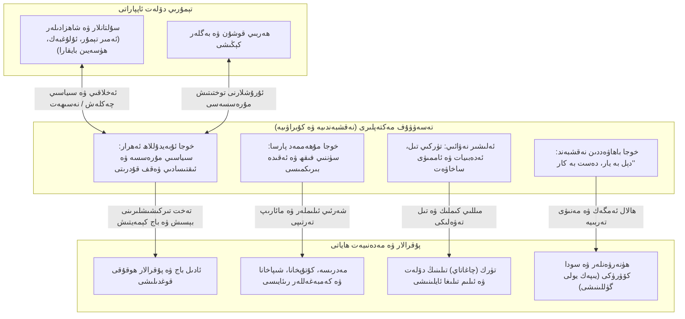
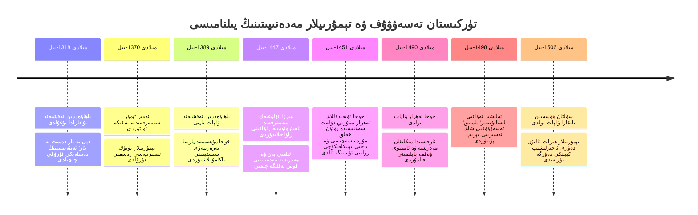
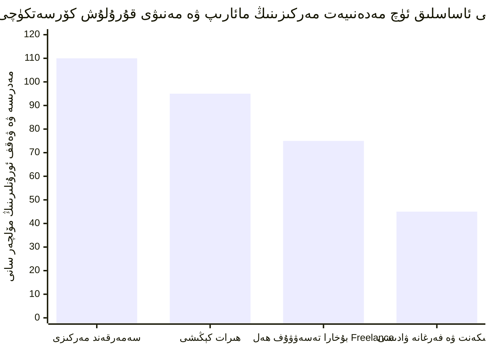
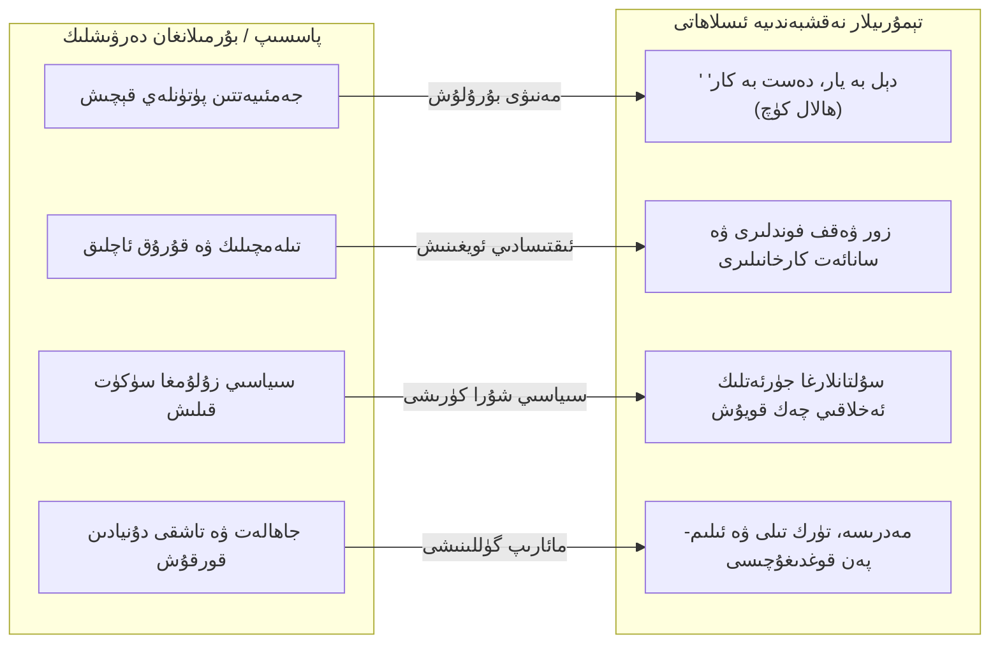

بِسْمِ اللَّهِ الرَّحْمَٰنِ الرَّحِيمِ

⏱ تەخمىنىي ئوقۇش ۋاقتى: 25 مىنۇت

تارىخ سەھنىسىدە مىللەتلەرنىڭ قەد كۆتۈرۈشى پەقەتلا پولات تىغ ۋە قوشۇنلارنىڭ سەپ تۈزۈشى بىلەن ئەمەس، بەلكى ئۇنىڭ مەنىۋى قەلبىنى شەكىللەندۈرگەن چوڭقۇر ئەقىدە، پىكرىي جۇشقۇنلۇق ۋە ئىجتىمائىي ئەخلاق نىزامى بىلەن بەلگىلىنىدۇ. 14-ئەسىرنىڭ كېيىنكى يېرىمىدىن 16-ئەسىرنىڭ باشلىرىغىچە بولغان دەۋر، يەنى <dfn title="تېمۇرىيلار ئىمپېرىيەسى (مىلادى 1370 – 1507): ئەمىر تېمۇر كۆرەگان تەرىپىدىن قۇرۇلغان، پايتەختى سەمەرقەند ۋە كېيىنچە ھىرات بولغان، ئوتتۇرا ئاسىيا، ئىران، كاۋكاز ۋە شىمالىي ھىندىستانغىچە سوزۇلغان بۈيۈك تۈرك-ئىسلام ئىمپېرىيەسى. بۇ دەۋر پەن، مەممارلىق، ئەدەبىيات ۋە ئىلىم-پەننىڭ غايەت زور تەرەققىياتى سەۋەبلىك «تېمۇرىيلار گۈللىنىش دەۋرى» دەپ نام ئالغان.">«تېمۇرىيلار ئىمپېرىيەسى (مىلادى 1370 – 1507)»</dfn> دەۋرى، پۈتكۈل تۈركىستان زېمىنىدا تەڭداشسىز بىر مەدەنىيەت ۋە ئىلمىي گۈللىنىش نۇقتىسىنى ياراتتى. بۇ ئالتۇن دەۋرنىڭ مەركىزىي تۈۋرۈكلىرىدىن بىرى، ھەرگىزمۇ كىشىلەر ئادەتتە بىلىدىغاندەك دۇنيادىن پۈتۈنلەي قول ئۈزگەن، غارلاردا ئولتۇرۇپ خىيال سۈرىدىغان مۇتەئەسسىپلىك ئەمەس، بەلكى جەمئىيەتنىڭ سىياسىي قارارلىرىغا، ئەدەبىياتىغا، ئىقتىسادىي ھاياتىغا ۋە مىللىي ئېڭىغا بىۋاسىتە رەھبەرلىك قىلغان پىشقان تەسەۋۋۇف مەكتەپلىرى ئىدى. مەزكۇر تەتقىقات ماقالىسىدە، تېمۇرىيلار دەۋرىدىكى تۈركىستان تەسەۋۋۇفىنىڭ يادرولۇق سىياسىي-ئىجتىمائىي ماھىيىتى، مەشھۇر شەخسلەرنىڭ كۈرەش مۇساپىسى ۋە بۇ تارىخىي بۇرۇلۇشنىڭ بۈگۈنكى كۈندە زۇلۇم ئاستىدا تۇرۇۋاتقان شەرقىي تۈركىستان مىللىي ئەركىنلىك دەۋاسىغا بېرىدىغان ئۆلمەس ئىستراتېگىيەلىك ئىبرەتلىرى چوڭقۇر ئانالىز قىلىنىدۇ.

<!-- Image 1 -->

---

## 1. كىرىش سۆز: «تېمۇرىيلار گۈللىنىش دەۋرى» ۋە ئىسلام تەسەۋۋۇفىنىڭ تارىخىي پەللىسى

مۇڭغۇللارنىڭ 13-ئەسىردىكى دەھشەتلىك ۋەيرانچىلىقىدىن كېيىن، پۈتكۈل ئوتتۇرا ئاسىيا ۋە ئىسلام دۇنياسى پىكرىي جەھەتتىن قايتا تىرىلىش باسقۇچىغا كىردى. بۇ بوشلۇقنى ئەسلىگە كەلتۈرۈشتە ئەمىر تېمۇر (مىلادى 1336 – 1405) قۇرغان قۇدرەتلىك سىياسىي قۇرۇلما پەقەت ھەربىي كۈچكىلا تايانمىدى. تېمۇرىي ھۆكۈمرانلىرى دەۋلىتىنىڭ تۈۋرۈكىنى خەلق بىلەن مۇستەھكەم باغلايدىغان ئەڭ تەسىرلىك كۈچنىڭ ئىسلام ئەقىدىسى ۋە شۇ ئەقىدىنىڭ خەلقئارالىق، ئەخلاقىي ۋە ئەمەلىي كۆرۈنۈشى بولغان تەسەۋۋۇف ئېقىملىرى ئىكەنلىكىنى چۈشىنىپ يەتكەن ئىدى. نەتىجىدە پايتەخت سەمەرقەند، ئەدەبىيات ۋە سەنئەت بۆشۈكى ھىرات، ھەمدە تەۋەررۈك ئىلىم مەركىزى بۇخارا شەھەرلىرى بىرلا ۋاقىتتا ھەم غايەت زور دۆلەتچىلىك ئىستراتېگىيەسىنىڭ مەركىزى، ھەم تەسەۋۋۇفىي-ئىلمىي تەپەككۇرنىڭ يۇقىرى چوققىسىغا ئايلاندى.

بۇ دەۋردىكى ئىسلام تەسەۋۋۇفى ئىلگىرىكى زامانلاردىكى يالغۇزلۇق، گۆشەنەشىنلىك ۋە پاسسىپ تەقدىرپەرەسلىك پاتقىقىدىن پۈتۈنلەي قۇتۇلۇپ، دۆلەتنىڭ سىياسىي قارارلىرىنى تۈزەيدىغان، باج تۈزۈمىنى ئادالەتكە چاقىرىدىغان، مەدرىسەلەرنى قۇرۇپ زامانىۋى بىلىملەرنى تەشۋىق قىلىدىغان ھەمدە كۈچلۈك ئىقتىسادىي مەنبەگە ئىگە ئاكتىپ پۇقرالار جەمئىيىتى قۇرۇلمىسىنى بەرپا قىلدى. تېمۇرىي سۇلتانلىرى قۇرۇلتايلىرىدا ۋە دۆلەت كېڭەشلىرىدە شەيخ ۋە مۇتەپەككۇرلار بىلەن بىللە ئولتۇراتتى، دۆلەت سىياسىتى بىلەن خەلق مەنپەئەتى ئوتتۇرىسىدا دەل مۇشۇ تەسەۋۋۇف ئەھلى ھەقىقىي مۇرەسسەچى، ئادالەت پەرياتچىسى ۋە تۇراقلاشتۇرغۇچى كۆۋرۈك بولۇپ مەيدانغا چىقتى.

---

### سىخېما 1: تېمۇرىيلار دەۋرى تەسەۋۋۇفىنىڭ جەمئىيەت، سىياسەت ۋە مەدەنىيەت مېخانىزمى

تۆۋەندىكى دىئاگراممىدا تېمۇرىيلار دەۋرىدىكى تەسەۋۋۇف مەكتەپلىرىنىڭ دۆلەت تەختىدىن تارتىپ ئاددىي دېھقان-ھۈنەرۋەنلەرگىچە بولغان ئارىلىقتا قانداق قىلىپ تۈۋرۈكلۈك رول ئوينىغانلىقى كۆرسىتىلدى:

*(1-سىخېما: تېمۇرىيلار دەۋرىدە تەسەۋۋۇف، سىياسىي ھاكىمىيەت ۋە خەلق مەنپەئەتىنىڭ زەنجىرسىمان ئورگانىك باغلىنىش مودېلى)*

---

## 2. ئاساسلىق تەسەۋۋۇف مەكتەپلىرى ۋە دەۋر بۆلگۈچ مەشھۇر شەخسلەر

تېمۇرىيلار زامانىدا تۈركىستان تۇپرىقى پۈتكۈل شەرقىي ئىسلام دۇنياسىغا مەنىۋى رەھبەرلىك قىلغان ئىككى چوڭ سىستېمىنىڭ قەد كۆتۈرۈشىگە گۇۋاھ بولدى: بۇلار **نەقشبەندىيە** ۋە **كۇبراۋىيە** تەستىق مەكتەپلىرىدۇر.

### A. خوجا باھاۋەددىن نەقشبەند ۋە ھەقىقىي ئەمگەك ئىنقىلابى

<dfn title="باھاۋەددىن نەقشبەند (مىلادى 1318 – 1389): نەقشبەندىيە تەريقىتىنىڭ پىرى ۋە يادرولۇق ئۇستازى. بۇخارانىڭ قەسرى ھىندۇۋان (كېيىنكى قەسرى ئارىفان) يېزىسىدا تۇغۇلغان. تەسەۋۋۇفتا ھۇرۇپاتلىق ۋە دەرۋىشلىك قاچقۇنلۇقىنى يوقىتىپ، جەمئىيەت ئىچىدە ياشاپ ھالال تىرىكچىلىك قىلىش مەكتىپىنى تۇرغۇزغان.">«خوجا باھاۋەددىن نەقشبەند (مىلادى 1318 – 1389)»</dfn> تەرىپىدىن سىستېمىلاشتۇرۇلغان نەقشبەندىيە تەريقىتى، ئەينى دەۋردە مەيدانغا كەلگەن تەبىئىي بىر «ئەخلاقىي-ئىقتىسادىي ئىنقىلاب» ھېسابلىنىدۇ. نەقشبەندىيە پەلسەپىسى مەشھۇر پارسچە ھېكمەت ئاساسىغا قۇرۇلغان:

> **«دېل بە يار، دەست بە كار»** (دل به یار، دست به کار)  
> *مەنىسى: «كۆڭلۈڭ ھەق تائالادا بولسۇن، ئەمما قولۇڭ دۇنيا ئىشىدا، ھالال ئەمگەكتە، دەسمايىدا ۋە ئىشلەپچىقىرىشتا بولسۇن!»*

بۇ پرىنسىپ ئىسلام جەمئىيىتىنى كاردىن چىقىرىدىغان، تىلەمچىلىكنى «تەۋەككۈل» دەپ ئاتايدىغان، كىشىلەرنى تاشقى تاجاۋۇزچىلار ئالدىدا مەھكۇم قىلىپ قويىدىغان ساختا روھانىيلىققا بېرىلگەن كۈچلۈك زەربە بولدى. نەقشبەند شەيخلىرى ۋە مۇرىتلىرى پاختا تېرىدى، توقۇمىچىلىق بىلەن شۇغۇللاندى، زىلچا ۋە كىمخاپ توقۇدى، كانلارنى ئاچتى، كىتابلارنى كۆچۈرۈپ ھۆسنخەتچىلىك قىلدى. ئىشسىز يېتىپ دۇئا قىلىش ئەمەس، پۈتۈن كۈچى بىلەن ئىشلەپ قولىنىڭ كۈچى بىلەن نان تېپىش ۋە تاپقان بايلىقى ئارقىلىق مىللەتنىڭ مەدرىسەلىرىنى قوغداش نەقشبەندىيەنىڭ ئالتۇن قائىدىسىگە ئايلاندى.

<!-- Image 2 -->

### B. خوجا مۇھەممەد پارسا: فىقھ بىلەن تەسەۋۋۇفنىڭ ئىلمىي ئۇچرىشىشى

<dfn title="خوجا مۇھەممەد پارسا (مىلادى 1348 – 1419): باھاۋەددىن نەقشبەندنىڭ ئەڭ مۇھىم شاگىرتى ۋە نەقشبەندىيە نەزەرىيەسىنى يازما تۈسكە كىرگۈزگەن بۈيۈك پەقىھ ۋە مۇتەسەۋۋۇف. ئۇنىڭ 'فەسلىل خىتاب' (فصل الخطاب) ۋە 'رىسالەئى قۇدسىيە' ناملىق ئەسەرلىرى سۈننىي ئەقىدە، ھەدىس ۋە روھىي ئەخلاقنىڭ پىشقان ئۆرنىكىدۇر.">«خوجا مۇھەممەد پارسا (مىلادى 1348 – 1419)»</dfn> بولسا بۇ مەكتەپنىڭ ئىلمىي ۋە فىقھىي قانات تۈۋرۈكى بولدى. ئۇ قۇرۇق ئاغزاكى تەسىراتلارنى ئەمەس، تەسەۋۋۇفنى شەرىئەت پىرىنسىپلىرى، ساھابىلەر دەۋرىنىڭ ھەقىقىي تۇرمۇشى ۋە فىقھ ئىلمى بىلەن بىرلەشتۈردى. 

پارسانىڭ شەخسىي كۇتۇپخانىسى ئەينى زاماندا پۈتكۈل ئوتتۇرا ئاسىيادىكى ئەڭ چوڭ ۋە ئەڭ قىممەتلىك ئارخىپلارنىڭ بىرى بولۇپ، ئۇ ئىلىم ئەھلىگە، تالىپلارغا ۋە سىياسىي ئەربابلارغا دۇنيانى تەتقىق قىلىش، ماتېماتىكا، تېبابەت، ھەدىس ۋە پەلسەپە ئۆگىنىشنى تەۋسىيە قىلاتتى. ئۇ ئۆز دەۋرىدىكى ھاكىملار بىلەن زىچ ئالاقە باغلاپ، ھۆكۈمرانلارنىڭ زۇلۇم قىلىشىنىڭ ئالدىنى ئالدى، تېمۇرىي ئەمىرلىرى ئۇنىڭ پىكرىنى ئالماي تۇرۇپ مۇھىم قانۇنلارنى ئىجرا قىلالمايتتى.

<!-- Image 3 -->

### C. خوجا ئۇبەيدۇللاھ ئەھرار (ئەھرار ۋەلى): سىياسىي سەھنىدىكى بۈيۈك مۇرەسسەچى ۋە مەمۇرىي كۈچ

تېمۇرىيلار تارىخىدا سىياسىي جەھەتتىن ئەڭ ھەل قىلغۇچ رول ئوينىغان شەخس شۈبھىسىزكى <dfn title="خوجا ئۇبەيدۇللاھ ئەھرار (ئەھرار ۋەلى، مىلادى 1404 – 1490): تاشكەنتتە تۇغۇلۇپ، سەمەرقەند ۋە ھىراتتا پائالىيەت ئېلىپ بارغان مەشھۇر نەقشبەندىيە رەھبىرى. ئۇ سىياسىي مۇرەسسەچى، ئادالەت قوغدىغۇچىسى، يۈزلىگەن يېزا ۋە بازارلارنى ئۆز ئىچىگە ئالغان ۋەقف فوندلىرىنىڭ باشقۇرغۇچىسى بولۇپ، تېمۇرىي ھۆكۈمرانلىرى ئارىسىدىكى قانلىق ئىچكى ئۇرۇشلارنى بىۋاسىتە توختاتقان.">«خوجا ئۇبەيدۇللاھ ئەھرار (مىلادى 1404 – 1490)»</dfn> دۇر. ئۇ تەسەۋۋۇف تارىخىدا «تەنھا ئىبادەتخانىدا ئولتۇرىدىغان سوپى» ئوبرازىنى تامامەن ئاغدۇرۇپ تاشلىدى. ئۇ مۇنداق دەيتتى:

> *«بىزنىڭ بۇ يولغا كىرىشىمىزدىن مەقسەت دەرۋىشلىك سۈپىتىنى سېتىش ئەمەس، بەلكى كىشىلەرنىڭ دەردىگە يېتىش، پۇقرالارنى زالىملارنىڭ شەررىدىن قوغداش ۋە ئىسلام ئەھلىگە خىزمەت قىلىشتۇر. ئەگەر مەن پەقەت ئىبادەت ئۈچۈنلا ياشىسام ئىدى، تاش ساندۇقتا ئولتۇرۇپ باش كۆتۈرمەيتتىم. لېكىن پۇقرانىڭ ھەققىنى تەلەپ قىلىش ھەممىدىن ئەۋزەلدۇر.»*

خوجا ئەھرار تېمۇرىي شاھزادىلىرىدىن سۇلتان ئەبۇ سەئىد مىرزا (مىلادى 1424 – 1469) ۋە كېيىن سۇلتان ئەھمەد مىرزا قاتارلىقلار ئوتتۇرىسىدا قوزغالغان مەشئۇم ئىچكى ئۇرۇشلاردا نەق جەڭ مەيدانىغا ئۆزى بېرىپ، ئىككى تەرەپ قوشۇنلىرى ئارىسىغا كىرىپ تۇرۇپ قان تۆكۈلۈشنى توختاتقان. ئۇ شاھلارنى قىلىچلىرىنى قىنىغا سېلىشقا، ئەمەلدارلارنى پۇقرالاردىن ئېلىنىدىغان تامامەن ناھەق «تامغا بېجى» قاتارلىق زالىمانە سېلىقلارنى بىكار قىلىشقا مەجبۇرلىغان. ئۇنىڭ غايەت زور يەر-مۈلۈكلىرى، تېرىلغۇ دالالىرى ۋە سودا كارۋانلىرى بار ئىدى. ئەمما بۇ بايلىق ئۇنىڭ شەخسىي ئەيش-ئىشرىتىگە ئەمەس، قۇرۇلغان مىڭلىغان تالىپلارنىڭ ھەقسىز ياتاق-تامىقىغا، مېيىپلار، يېتىملار ۋە چارىسىزلەرنىڭ كۈندىلىك تەمىناتىغا سەرپ قىلىنغان <dfn title="ۋەقف (Waqf): ئىسلام تەلىماتىدىكى پۇقرالار ۋە مەنىۋى ئەربابلار ئۆز پۇقرالىق مۈلكىنى ئاللاھ يولىدا مەڭگۈلۈك ئاممىۋى ساخاۋەتكە، مائارىپ، مەدرىسە، كۇتۇپخانا، كۆۋرۈك ۋە دوختۇرخانىلارغا ئاجرىتىپ بېرىدىغان ئۆزگىچە ئىقتىسادىي ۋە ئىجتىمائىي فوند تۈزۈمى.">ۋەقف سىستېمىسى</dfn> غا ئايلانغان ئىدى.

<!-- Image 4 -->

### D. كۇبراۋىيە تەريقىتى: روھىي پاكلىنىش ۋە جەڭگىۋار قەھرىمانلىق

نەقشبەندىيە بىلەن يانداش ھالدا، تۈركىستان زېمىنىدا ئۆز دەۋرىدە تەڭداشسىز ئىز قالدۇرغان يەنە بىر مەكتەپ <dfn title="نەجمىددىن كۇبرا (مىلادى 1145 – 1221): خاراBackgroundTask مەركىزى بولغان ئۈرگەنچتە ياشىغان ئۇلۇغ مۇتەسەۋۋۇف، كۇبراۋىيە تەريقىتىنىڭ ئاساسچىسى. مۇڭغۇل باسقۇنچىلىرى ئۈرگەنچنى قورشاۋغا ئالغاندا، چىڭگىزخاننىڭ شەھەردىن چىقىپ كېتىش تەكلىپىنى قەتئىي رەت قىلىپ، پۇقرالار بىلەن بىللە قورال تۇتۇپ تاجاۋۇزچىلارغا قارشى جەڭ قىلىپ شېھىت بولغان.">«نەجمىددىن كۇبرا (مىلادى 1145 – 1221)»</dfn> ئاساس سالغان **كۇبراۋىيە تەريقىتى** ئىدى. تېمۇرىيلار دەۋرىگە كەلگەندە، كۇبراۋىيە شەيخلىرى روھىي چېنىقىش ۋە نەپسى كۈرەش بىلەن بىرگە ۋەتەنپەرۋەرلىكنى تەسەۋۋۇفنىڭ ئىمانىي تەلەپلىرىدىن بىرى سۈپىتىدە تارقاتتى.

نەجمىددىن كۇبرانىڭ مۇڭغۇللار ھۇجۇم قىلغاندا: «مەن خەلقىمنى ئاپەتكە تاشلاپ يالغۇز جان باقمايمەن!» دەپ ئەلەم تۇتۇپ شېھىت بولغان روھى، تېمۇرىيلار زامانىدىكى تەسەۋۋۇف ئەھلى ئۈچۈن قارشىلىق ۋە مىللىي ئىرادىنىڭ سىمۋولى بولۇپ ساقلاندى. روھىي كۈچ پەقەت مەسجىدتە زىكىر ئېيتىش ئۈچۈنلا ئەمەس، تاجاۋۇزچى كەلگەندە پۈتۈن مىللەتنى سەپەرۋەر قىلىپ تۇپراقنى مۇداپىئە قىلىش ئۈچۈن زۆرۈر ئىكەنلىكىنى كۇبراۋىيە مەكتىپى ئەۋلادلارغا ئۆگەتتى.

<!-- Image 5 -->

---

### سىخېما 2: تۈركىستان تەسەۋۋۇف تارىخىنىڭ ئالتۇن دەۋر يىلنامىسى (1318 – 1506)

تۆۋەندىكى ۋاقىت ئوقى سىخېمىسىدا، نەقشبەندىيە ۋە كۇبراۋىيە مەكتەپلىرىنىڭ قەد كۆتۈرۈشى ھەمدە ئۇلارنىڭ تېمۇرىيلار گۈللىنىش دەۋرىدىكى چوڭ بۇرۇلۇش دەۋرلىرى بىلەن تۇتاشقان تارىخىي دەۋرلىرى ئەكس ئەتتۈرۈلدى:

*(2-سىخېما: تېمۇرىيلار دەۋرىدىكى مەشھۇر مۇتەپەككۇرلار ۋە سىياسىي ۋەقەلەرنىڭ تۇتاشما ۋاقىتنامىسى)*

---

## 3. تېمۇرىيلار دەۋرى تەسەۋۋۇپىنىڭ تۆت بۈيۈك ئىدىيەۋى تۈۋرۈكى

تېمۇرىيلار دەۋرىدىكى سۇپىزىمنى پۈتكۈل دۇنيا تارىخىدىكى ئۆزگىچە مەدەنىيەت ھادىسىسىگە ئايلاندۇرغان ئاساسلىق ئىدىيەۋى سىستېمىلار مۇنۇ تۆت ئاساسىي تۈۋرۈكتىن تەركىب تاپىدۇ:

### 1) جەمئىيەت بىلەن بىللە ياشاش (خەلق ئارىسىدا تۇرۇپ ھەقنى ئىزدەش)
سۇپىلار چۆللەرگە قېچىپ كېتىش ئورنىغا، بازاردا دۇكان ئاچتى، كارۋانلار بىلەن بىللە يىپەك يولىنى بويلاپ ماڭدى، ھۈنەرۋەنلەر بىلەن تۆمۈر تاۋلىدى، دېھقانلار بىلەن بىللە ئېرىق چاپتى. تەسەۋۋۇف تەلىماتى ئەمەلىي جەمئىيەت بوشلۇقىدا قىممەت ياراتتى. ئۇلار دۇنيادىن بارماق بىلەن قېچىشنى مەنىۋى ئاجىزلىق دەپ قاراپ، دۇنيانىڭ ئوتتۇرىسىدا تۇرۇپ، دۇنيا پارقىراقلىقىغا كۆڭۈل بەرمەستىن ئاللاھقا باغلىنىشنى ئەڭ يۈكسەك جاسارەت دەپ جاكارلىدى.

### 2) ھاكىمىيەتنى ئەخلاقىي ۋە قانۇنىي جەھەتتىن چەكلەش
تېمۇرىي سۇلتانلىرى (مەسىلەن، ئۇلۇغبەك، ھۈسەيىن بايقارا، ئەبۇ سەئىد مىرزا) ئىلىم-پەن، شېئىرىيەت ۋە تەسەۋۋۇف ئەھلىگە قارشى مۇستەبىت پوزىتسىيە تۇتالمىدى. تەسەۋۋۇف شەيخلىرى ھاكىملارنىڭ چەكسىز خەزىنە كۆپەيتىش نەپسىگە چەك قويدى، زۇلۇم قىلغان بەگلەرنى ئاممىۋى سورۇنلاردا قاتتىق سۆكتى ۋە ئۇلارنىڭ دۆلەتنى ھالاكەتكە سۆرەۋاتقانلىقىنى ئاشكارا ئاگاھلاندۇردى. بۇ بولسا قەدىمكى تۈركىستاندا سىياسىي ھاكىمىيەتنى ئەخلاقىي-دىنىي نىزام بىلەن باغلانغان <dfn title="شۇرا (مەسلىھەت ۋە كېڭەش تۈزۈمى - شورى): ئىسلام سىياسىي تەپەككۇرىدا دۆلەتنى باشقۇرۇشتا بىر كىشىنىڭ يەككە مۇستەبىتلىكىنى چەكلەپ، قارارلارنى ئالىملار، خەلق ئاقساقاللىرى ۋە ئىختىساس ئىگىلىرى بىلەن مەسلىھەتلىشىپ ئورتاق قوبۇل قىلىدىغان ئادالەت تۈزۈمى.">«شۇرا (مەسلىھەت كېڭىشى)»</dfn> پىرىنسىپىنىڭ جانلىق ئىپادىسى ئىدى.

### 3) قۇرۇق تەقلىدچىلىكنى رەت قىلىپ، پەن، ئەقىل ۋە مەرىپەتكە ئەھمىيەت بېرىش
تۈركىستان تەسەۋۋۇفى ساۋاتسىز زىكىرۋازلىققا قەتئىي ئورۇن بەرمىدى. ئەكسىچە مەدرىسەلەردە ئوقۇش-ئوقۇتۇشنى شەرت قىلدى. سەمەرقەندتىكى مەشھۇر مىرزا ئۇلۇغبەك رەسەتخانىسى بىلەن مەدرىسەلىرى دەل مۇشۇنداق ئىلمىي چۈشەنچىنىڭ مېۋىسى ئىدى. بىر مۇتەسەۋۋۇف فىقھ، ھەدىس بىلەن بىللە ھېساب، دەۋر تېبابىتى ۋە تەبىئەت ھادىسىلىرىنى تەتقىق قىلاتتى. نادانلىق شەيتاننىڭ ئەڭ چوڭ تۇزىقى دەپ قارىلىپ، ئىلىم ئۆگىنىش مەنىۋى تەربىيەنىڭ بىرىنچى شەرتى قىلىپ بېكىتىلدى.

### 4) تۈرك (چاغاتاي) تىلى ۋە ئەدەبىياتىنىڭ مىللىي تۈۋرۈككە ئايلىنىشى: ئەلىشىر نەۋائىي ھادىسىسى
تېمۇرىيلار دەۋرىگە قەدەر پارس تىلى ئەدەبىيات ۋە ئوردا تىلىدا مونوپول بولۇپ كەلگەن بولسا، مەشھۇر ۋەزىر، تەڭداشسىز مۇتەپەككۇر، شائىر ۋە سۇپى <dfn title="نىزامىددىن ئەلىشىر نەۋائىي (مىلادى 1441 – 1501): ئۇيغۇر ۋە پۈتكۈل تۈرك دۇنياسىنىڭ ئەڭ ئۇلۇغ مۇتەپەككۇرى، شائىرى ۋە دۆلەت ئەربابى. ھىراتتا سۇلتان ھۈسەيىن بايقارانىڭ باش ۋەزىرى بولغان. نەقشبەندىيە تەريقىتىگە مەنسۇپ بولۇپ، خوجا ئەھرار ۋە مەۋلانا جامىينىڭ قەدىردان شاگىرتى. 'مۇھاكىمەتۇل لۇغەتەين' ۋە 'لىسانۇتتەير' قاتارلىق ئەسەرلىرى بىلەن تۈرك تىلىنى جاھان تىلى سەۋىيەسىگە كۆتۈرگەن.">«مىر ئەلىشىر نەۋائىي (مىلادى 1441 – 1501)»</dfn> تەسەۋۋۇف پەلسەپىسىنى ئۆز تىلىمىزغا — قەدىمكى تۈركىي تىلىمىزغا ئېلىپ كىردى. 

نەۋائىي نەقشبەندىيە تەريقىتىنىڭ سادىق مۇرىتى ۋە خوجا ئۇبەيدۇللاھ ئەھرار بىلەن مەۋلانا ئابدۇراھمان جامىي (مىلادى 1414 – 1492) نىڭ كۆيۈملۈك شاگىرتى ئىدى. نەۋائىينىڭ يازغان «لىسانۇتتەير» (قۇشلار تىلى)، «مەھبۇبۇل قۇلۇب» (كۆڭۈللەرنىڭ سۆيۈملۈكى) ۋە بەش داستاندىن تەركىب تاپقان تەڭداشسىز <dfn title="خەمسە (بەشلىك): شەرق كلاسسىك ئەدەبىياتىدا بەش چوڭ مەسنەۋى داستاننى بىر توپلام قىلىپ يېزىش ئەنئەنىسى. ئەلىشىر نەۋائىي تۈرك تىلى تارىخىدا تۇنجى قېتىم چاغاتاي ئۇيغۇر تىلىدا تەڭداشسىز 'خەمسە' يېزىپ چىقىپ، تۈرك تىلىنىڭ شېئىرىيەت ۋە پەلسەپىدىكى يۈكسەك قۇدرىتىنى ئىسپاتلىغان.">«خەمسە»</dfn> سى، تەسەۋۋۇفىي-ئەخلاقىي ئەقىدىنى تۈركىستان خەلقىنىڭ ئانا تىلىدا يۈرەك تەۋرىتەرلىك قىلىپ بايان قىلدى. نەۋائىي تۈرك تىلىنى پەقەت چۆچەك تىلى ئەمەس، ئىلاھىي ئاشىقلىق، دۆلەتچىلىك ئىنتىزامى ۋە ئەخلاق پەلسەپىسىنىڭ بۈيۈك لۇغىتىگە ئايلاندۇردى.

<!-- Image 6 -->

---

### سىخېما 3: تېمۇرىيلار مەدەنىيەت مەركەزلىرىنىڭ مائارىپ، ۋەقف ۋە كۇتۇپخانا قۇرۇلمىسى

تېمۇرىيلار زامانىدا تەسەۋۋۇف ۋە ھۆكۈمرانلار ھەمكارلىقى نەتىجىسىدە سەمەرقەند، ھىرات ۋە بۇخارا شەھەرلىرىدە تەڭداشسىز مائارىپ تورى بەرپا قىلىندى. تۆۋەندىكى سېلىشتۇرما دىئاگرامما ئاساسلىق مەركەزلەردىكى كۇتۇپخانا مەنبەلىرى ۋە مەدرىسەلەر نىسبىتىنى ئەكس ئەتتۈرىدۇ:

*(3-سىخېما: تېمۇرىيلار گۈللىنىش دەۋرى شەھەرلىرىدە پۇقرالار مائارىپى ۋە ۋەقف تەشكىلاتلىرىنىڭ تارقىلىش كۆلىمى)*

تۆۋەندىكى سىستېمىلىق جەدۋەلدە بۇ شەھەرلەرنىڭ خاراكتېرى تېخىمۇ تەپسىلىي يورۇتۇلدى:

| شەھەر نامى | ئاساسلىق ۋەكىللىك شەخسلەر | يادرولۇق ئىلمىي ۋە مەنىۋى ئالاھىدىلىكى | ئىجتىمائىي ۋە مەمۇرىي تەسىرى |
| :--- | :--- | :--- | :--- |
| **سەمەرقەند** | ئەمىر تېمۇر، مىرزا ئۇلۇغبەك، خوجا ئەھرار | ئاسترونومىيە، ماتېماتىكا، ھەيۋەتلىك مەممارلىق ۋە سىياسىي ھاكىمىيەت مەركىزى | پۈتكۈل ئىمپېرىيەنىڭ قانۇن ۋە بۈيۈك دىپلوماتىك تۈگۈنى |
| **ھىرات** | ئەلىشىر نەۋائىي، سۇلتان ھۈسەيىن بايقارا، مەۋلانا جامىي | تۈرك ۋە پارس ئەدەبىياتى، كىتاب مىنياتۇرا سەنئىتى، يۈكسەك تەسەۋۋۇف شېئىرىيىتى | تۈرك تىلىنىڭ قەد كۆتۈرۈشى ۋە مەنىۋى ئېستېتىكا گۈللىنىشى |
| **بۇخارا** | باھاۋەددىن نەقشبەند، خوجا مۇھەممەد پارسا | نەقشبەندىيە ھەقىقىي ئەمگەك ۋە سۈننىي فىقھ نەزەرىيەسى، نادىر كۇتۇپخانىلار | پۈتۈن شەرق دۇنياسىغا تارقالغان نەقشبەندىيە مەكتىپىنىڭ بۆشۈكى |
| **تاشكەنت** | خوجا ئۇبەيدۇللاھ ئەھرار، زەڭگى ئاتا ئەۋلادلىرى | دېھقانچىلىق، سۇ ئىنشائاتلىرى، چارۋىچىلىق ۋە غايەت زور ۋەقف مەدەنىيىتى | يەر ئىگىلىرىنى تەمىنلەش ۋە شىمالىي تۈركىستان رايونىنىڭ بىرلىكى |

---

## 4. تۆت تۈرلۈك تارىخىي ئىبرەت بىلەن سېلىشتۇرما تەھلىل

بىر مەدەنىيەت دەۋرىنى پەقەت ئۆز رامكىسى ئىچىدىلا چۈشىنىش يېتەرلىك ئەمەس. تېمۇرىيلار دەۋرىدىكى تەسەۋۋۇف ھادىسىسىنى دۇنياۋى، ئىسلامىي، خىتاي ۋە ئۇيغۇر تارىخىدىكى ھادىسىلەر بىلەن سېلىشتۇرغاندا بۈگۈنكى كۈنگە تەئەللۇقلۇق ئىنتايىن چوڭقۇر ساۋاقلار كېلىپ چىقىدۇ:

<!-- Image 7 -->

### 1) ئىسلام تارىخىدىن ئىبرەت: پەيغەمبەر ئەلەيھىسسالام ۋە ساھابىلەرنىڭ ھەقىقىي سۈننىتى
ئىسلام دىنىنىڭ دەسلەپكى ئالتۇن دەۋرىگە قارىساق، پەيغەمبىرىمىز مۇھەممەد ئەلەيھىسسالام ﷺ ۋە ساھابە-تابىئىنلار ئەزەلدىن تاشقى دۇنيادىن ئايرىلىپ قالمىغان. پەيغەمبەر ئەلەيھىسسالام ﷺ تۇنجى بولۇپ مەدىنەگە كەلگەندە مەسجىد بىلەن تەڭلا مەدىنە بازىرىنى قۇرۇپ چىققان، ئىقتىسادىي مونوپوللۇقنى سۇندۇرغان، سىياسىي جەھەتتە مەشھۇر <dfn title="مەدىنە ۋەسىقىسى (مىلادى 622): پەيغەمبىرىمىز مۇھەممەد ئەلەيھىسسالام ﷺ تەرىپىدىن مەدىنەدە ئېلان قىلىنغان دۇنيادىكى تۇنجى يازما پۇقرالار ئاساسىي قانۇنى. بۇ ھۆججەت مۇسۇلمانلار ۋە ئەتراپتىكى يەھۇدىي قەبىلىلىرىنىڭ ھوقۇقى، ئورتاق دۆلەت مۇداپىئەسى ۋە ئىچكى ئادالەت قائىدىلىرىنى رەسمىي نىزامغا سالغان.">«مەدىنە ۋەسىقىسى (مىلادى 622)»</dfn> ئارقىلىق پۈتۈن تەركىبلەرنى دۆلەتچىلىك ئىنتىزامىغا بويسۇندۇرغان. ھەزرىتى ئۆمەر رەزىيەللاھۇ ئەنھۇ مەسجىدتە ئىبادەتنى باھانە قىلىپ تىلەمچىلىك قىلىپ ئولتۇرغان بىكار تەلەپلەرنى كۆرگەندە چىۋىق بىلەن ئۇرۇپ: «ئاسماندىن سىلەرگە ئالتۇن-كۈمۈش يېغىپ چۈشمەيدۇ، چىقىپ ھالال ئىشلەڭلار!» دەپ ھەيدەپ چىقارغان. 

تېمۇرىيلار زامانىدىكى باھاۋەددىن نەقشبەند ۋە خوجا ئەھرارلار ئوتتۇرىغا قويغان «قول ئىشتا، كۆڭۈل ئاللاھتا» پىرىنسىپى ئەمەلىيەتتە ئاشۇ دەسلەپكى ساھابىلەر رەۋىشىنىڭ ئوتتۇرا ئەسىردىكى تولۇق تىرىلىشى بولۇپ ھېسابلىنىدۇ. قۇرئان كەرىمدە بۇ ھەقىقەت ئېنىق بايان قىلىنغان:

﴿رِجَالٌ لَّا تُلْهِيهِمْ تِجَارَةٌ وَلَا بَيْعٌ عَن ذِكْرِ اللَّهِ وَإِقَامِ الصَّلَاةِ وَإِيتَاءِ الزَّكَاةِ ۙ يَخَافُونَ يَوْمًا تَتَقَلَّبُ فِيهِ الْقُلُوبُ وَالْأَبْصَارُ﴾

> *(مەنىسى: «ئۇ شۇنداق ئەركەكلەردۇركى، نە تىجارەت ۋە نە ئېلىم-سېتىم ئۇلارنى ئاللاھنى زىكرى قىلىشتىن، نامازنى تولۇق ئادا قىلىشتىن ۋە زاكات بېرىشتىن غەپلەتتە قالدۇرالمايدۇ. ئۇلار قەلبلەر ۋە كۆزلەر قورقۇنچتىن ئۆرۈلۈپ كېتىدىغان بۈيۈك قىيامەت كۈنىدىن قورقىدۇ.» — نۇر سۈرىسى، 37-ئايەت)*

### 2) دۇنيا تارىخىدىن ئىبرەت: ياۋروپا «پروتېستانت ئەمگەك ئەخلاقى» بىلەن نەقشبەندىيەنىڭ سېلىشتۇرمىسى
زامانىۋى غەرب سوتسىيولوگىيەسىنىڭ ئاتىسى <dfn title="ماكىس ۋېبېر (Max Weber, 1864 – 1920): نېمىس سوتسىيولوگى ۋە ئىقتىسادشۇناسى. ئۇنىڭ 'پروتېستانت ئەخلاقى ۋە كاپىتالىزم روھى' ناملىق دۇنياغا مەشھۇر ئەسىرىدە، ياۋروپانىڭ زامانىۋى قەد كۆتۈرۈشىگە دىنىي ئەقىدىنىڭ كۈندىلىك تەرتىپلىك ئەمگەككە، تېجەشچانلىققا ۋە ئىنتىزامغا ئايلىنىشى سەۋەب بولغانلىقى ئىسپاتلانغان.">ماكىس ۋېبېر (Max Weber, 1864 – 1920)</dfn> ئۆزىنىڭ شاھ ئەسىرىدە ياۋروپانىڭ زامانىۋى دۇنيانى بېسىپ چۈشۈشىنى «پروتېستانت ئىسلاھاتى» غا، يەنى خىرىستىيانلارنىڭ ئىبادەتخانىغا بەند بولۇپ ياشاشتىن قۇتۇلۇپ ئەمگەكنى مۇقەددەس ۋەزىپە قىلىپ قارىشىغا باغلايدۇ. 

ۋاھالەنكى، ماكىس ۋېبېر ئوتتۇرىغا قويغان بۇ نەزەرىيەدىن دەل 150 يىل بۇرۇن، تۈركىستاندا خوجا باھاۋەددىن نەقشبەند خۇددى شۇ ئەمگەك ۋە مەسئۇلىيەت ئەخلاقىنى پۈتكۈل ئىسلام تۇپرىقىدا ئومۇملاشتۇرۇپ بولغان ئىدى! تەسەۋۋۇف كىشىلەرنى ئۆز تىرىشچانلىقى ئارقىلىق دەسمايە قۇرۇشقا، يەرلەرنى ھوسۇللۇق قىلىشقا، زاۋۇت-فابرىكىلارنىڭ ئاساسى بولغان سېخلارنى كېڭەيتىشكە يېتەكلىدى. ئەگەر كېيىنچە چار رۇسىيە ۋە خىتاي مەنبەلىرى بۇ يۈكسەك ئەنئەنىنى بۇرمىلاپ، بىزنىڭ خەلقىمىزگە سۇپىزم نامى ئاستىدا پاسسىپلىقنى، زىيارەتگاھلارغا ماڭقۇرتلارچە باغلىنىشنى تېڭىپ قويمىغان بولسا ئىدى، تۈركىستان يەر شارىدىكى تۇنجى سانائەت ۋە مائارىپ دۆلىتىگە ئايلانغان بولاتتى.

### 3) خىتاي فېئودال زۇلمىنىڭ قاراڭغۇلۇقىدىن ئىبرەت: شەخس ۋە مەنىۋىيەتنى تۇنجۇقتۇرۇش
تېمۇرىيلار بىلەن زامانداش بولغان خىتايدىكى <dfn title="مىڭ سۇلالىسى (مىلادى 1368 – 1644): جو يۈەنجاڭ (朱元璋 - Zhū Yuánzhāng) تەرىپىدىن قۇرۇلغان خىتاي خانلىقى. ئىچكى جەھەتتە تۇتاش تەكشۈرۈش، مەمۇرىي جاسۇسلۇق ئورگانلىرى (جىن يىۋېي - 锦衣卫) ئارقىلىق پۈتۈن پۇقرالارنىڭ ئەركىن تەپەككۇرى ۋە كىشىلىك ھوقۇقىنى تۇنجۇقتۇرغان، دېڭىزنى قامال قىلىپ دۇنيادىن پۈتۈنلەي ئۈزۈلگەن مۇستەبىت پېتى زاۋال تاپقان.">مىڭ سۇلالىسى (مىلادى 1368 – 1644)</dfn> دەۋرىگە نەزەر سالساق، سىستېمىنىڭ تامامەن ئەكسىچە بولغان قاراڭغۇ مۇستەبىتلىككە چۆككەنلىكىنى كۆرىمىز. خىتاينىڭ پادىشاھى جو يۈەنجاڭ خەلقنى تۈرلۈك چەكلىمىلەر بىلەن كىشەنلىگەن، ئەركىن ئويلاشنى چەكلىگەن، ئىستىبدات مەخپىي ساقچى ئورگانلىرى (جىن يىۋېي - 锦衣卫) نى قۇرۇپ پۈتۈن جەمئىيەتتىكى تەپەككۇر ئۇچقۇنلىرىنى يوقاتقان. خىتاي ھاكىمىيىتى ئىنساننى دۆلەت پادىشاھىنىڭ شەخسىي قۇلى دەپ بىلگەن. 

تۈركىستان تېمۇرىي دۆلىتى بولسا دەل كىشىلىك ھۆرمەت، تەپەككۇر، ئالىملارغا ئېھتىرام ۋە خەلقنىڭ ۋەقف مۈلۈكلىرى ئارقىلىق قوغدىلىدىغان باياشات شەھەر پۇقرالىقى تۈزۈمى بىلەن مىڭ سۇلالىسىدىن چەكسىز ئۈستۈن تۇرغان. خىتاينىڭ مۇتەئەسسىپ ۋە يېپىق مۇستەبىت سىستېمىسى كېيىنچە زاۋاللىققا يۈزلەنگەن بولسا، تۈركىستان ئىجاد قىلغان گۈللىنىش مىراسى بۈگۈنكى زامان ئىسلام ۋە تۈرك مەدەنىيىتىنىڭ مەڭگۈلۈك ئابىدىسىگە ئايلاندى.

### 4) ئۇيغۇر تارىخىنىڭ ئۆلمەس ئىجابىي يىلتىزلىرى: قاراخانىيلاردىن جۇمھۇرىيەتلەرگىچە
بىزنىڭ مىللىي تارىخىمىز پۈتۈنلەي دەل مۇشۇنداق ئىلىم ۋە كۈرەشچان تەسەۋۋۇف بىلەن سۇغىرىلغان. <dfn title="قاراخانىيلار دەۋلىتى (مىلادى 840 – 1212): تۇنجى قېتىم ئىسلامنى دۆلەت دىنى دەپ قوبۇل قىلغان تۈرك-ئۇيغۇر ئىمپېرىيەسى. قەشقەر ۋە بالاساغۇن مەركەز قىلىنغان بۇ دەۋردە مەھمۇد قەشقەرىي، يۈسۈپ خاس ھاجىب ۋە ئەھمەد يۈكنەكىي قاتارلىق دۇنياۋى تالانتلار يېتىشىپ چىققان.">«قاراخانىيلار دەۋلىتى (مىلادى 840 – 1212)»</dfn> دەۋرىدە يۈسۈپ خاس ھاجىب ئۆزىنىڭ «قۇتادغۇ بىلىك» ناملىق دۆلەتچىلىك دەستۇرىدا تەسەۋۋۇف ۋە ھەقىقىي مەرىپەت ئەھلىنى — ئۆزگۈرمىش پېرسوناژى ئارقىلىق — دۆلەت ھاكىمىيىتىگە يول كۆرسەتكۈچى ئەڭ سەمىمىي ئەقىل ئامبىرى سۈپىتىدە تەسۋىرلەيدۇ. 

شۇنىڭدەك، 20-ئەسىردە قۇرۇلغان 1933-يىلىدىكى «شەرقىي تۈركىستان ئىسلام جۇمھۇرىيىتى» بىلەن 1944-يىلىدىكى «شەرقىي تۈركىستان جۇمھۇرىيىتى» دەۋرىدىمۇ ئالىملىرىمىز ۋە يېتەكچىلىرىمىز مەسجىد مۇنبىرى بىلەن مىللىي ئارمىيە سېپىنى، تەسەۋۋۇفىي ساداقەت بىلەن پەن-مائارىپ ئىسلاھاتىنى بىر گەۋدە قىلىپ ئېلىپ ماڭغان ئىدى. بىزنىڭ كىملىكىمىزدە تەسەۋۋۇف ئەزەلدىن قورقۇنچاقلىقنىڭ ئەمەس، ئاللاھتىن باشقىغا باش ئەگمەسلىكنىڭ بۈيۈك رەمزى بولۇپ كەلگەن.

---

### سىخېما 4: تەسەۋۋۇف پەلسەپىسىنىڭ ئەمەلىي سىياسىي-ئىجتىمائىي ئۆزگىرىش مودېلى

تۆۋەندىكى دىئاگراممىدا، نەقشبەندىيەنىڭ پاسسىپ دەرۋىشلىكتىن ئاكتىپ پۇقرالىق كۈچىگە ئۆتۈش باسقۇچى سېلىشتۇرۇلما ھالەتتە كۆرسىتىلدى:

*(4-سىخېما: پاسسىپ تەبىقە تەپەككۇرىدىن ھەقىقىي مىللىي قۇرغۇچى كۈچكە ئايلىنىش سىستېمىسى)*

---

## 5. شەرقىي تۈركىستاننىڭ بۈگۈنكى مىللىي مۇستەقىللىق كۈرىشىگە خىزمەت قىلىدىغان ئىستراتېگىيەلىك ئىبرەتلەر

تېمۇرىيلار دەۋرىدىكى تۈركىستان تەسەۋۋۇفى پەقەتلا ئۆتمۈشنىڭ كىتاب راۋاقلىرىدا قېلىپ كېتىدىغان گۈزەل بىر ئەسلىمە ئەمەس. بۈگۈن خىتاي مۇستەملىكىچىلىرى تەرىپىدىن ۋەتىنى تالان-تاراج قىلىنىۋاتقان، مىللىي كىملىكى ۋە دىنى قىرغىنچىلىققا ئۇچراۋاتقان شەرقىي تۈركىستان خەلقى ئۈچۈن بۇ مىراس مىللىي قۇتۇلۇشنىڭ، ئىستراتېگىيەلىك پاراسەتنىڭ ۋە دەۋر بۆلگۈچ دۆلەتچىلىكنىڭ نىجاتلىق يول خەرىتىسىدۇر:

<!-- Image 8 -->

1. **پاسسىپ تەقدىرچىلىك ۋە سۈنئىي تەۋەككۈلچىلىكنى سۇندۇرۇش:**  
   خىتاي كوممۇنىست تاجاۋۇزچىلىرى يىللاردىن بۇيان ئۇيغۇر خەلقىنىڭ قارشىلىق كۆرسىتىش ئەزىمىنى سۇندۇرۇش ئۈچۈن، «تەقدىرىڭگە تەن بەر، سەۋر قىل دېگەن ئىچىڭدە پۇچۇلىنىپ زۇلۇمغا باش ئېگىشتۇر» دەيدىغان قۇللۇق ئېڭىنى مەخسۇس ئۇرغۇتۇپ كەلدى. بىز ئەجدادلىرىمىز باھاۋەددىن نەقشبەند ۋە خوجا ئەھرارلار تەشەببۇس قىلغاندەك قايتىدىن بىلىشىمىز كېرەككى: **ھەقىقىي ئىمان ۋە تەسەۋۋۇف زالىمغا قارشى پۇت دەسسەپ تۇرۇش، ھەر بىر دەقىقىنى ئەمەلىي كۈرەشكە، ئىلىمگە، تەشكىللىنىشكە ۋە ئىتتىپاقلىققا سەرپ قىلىشتۇر!** تىلىمىز تەسۋىھتە تۇرغان بىلەن، قولىمىز مىللىي مەنپەئەت يارىتىشتا، ۋەتەن قۇتقۇزۇش ئۈچۈن لازىملىق پەن-تېخنىكا، دىپلوماتىيە ۋە ئىقتىسادىي قوراللارنى ئىگىلەشتە بولۇشى پەرزدۇر.

2. **ئىقتىسادىي كۈچ ۋە مىللىي ۋەقف (فوند) سىستېمىسى قۇرۇش:**  
   خوجا ئۇبەيدۇللاھ ئەھرار نېمە ئۈچۈن سۇلتانلارنى تەڭشىيەلەيتتى؟ چۈنكى ئۇنىڭ دۆلەتتىن پۈتۈنلەي مۇستەقىل بولغان كۈچلۈك ئىقتىسادىي ئاساسى ۋە خەلقنى باقىدىغان ۋەقف بايلىقى بار ئىدى. چەتئەللەردىكى شەرقىي تۈركىستان جامائىتى چوقۇم تارقاق، قۇرۇق شوئارۋازلىقتىن ئۆتۈپ، پۈتكۈل مىللىي ھەرىكەتنى، مەتبۇئاتنى، ئاكادېمىكلارنى ۋە پائالىيەتچىلەرنى پۈتۈنلەي قوللاپ قامدىيالايدىغان مەڭگۈلۈك كۈچلۈك ئىستراتېگىيەلىك ۋەقف-فوند سىستېمىلىرىنى تۇرغۇزۇشى شەرت. بايلىق ۋە كاپىتال پەقەت شەخسىي قورساق غېمى ئۈچۈن ئەمەس، مىللىي داۋانىڭ ئوق-دورىسى ۋە يىپەك يولى دىپلوماتىيەسىگە ئايلىنىشى زۆرۈردۇر.

3. **ئانا تىل، ئەدەبىيات ۋە كىملىكنى ئەڭ مۇقەددەس قەلئە قىلىپ تۇتۇش:**  
   ئەلىشىر نەۋائىي ھەزرەتلىرى تۈرك تىلىنى پەلسەپە ۋە ئالىي شېئىرىيەت تىلى قىلىش ئارقىلىق مىللەتنىڭ مەدەنىيەت يىلتىزىنى يوقىلىشتىن ساقلاپ قالغان. بۈگۈنكى كۈندە تاجاۋۇزچى خىتاي ھاكىمىيىتى ئانا مەكتەپلىرىمىزنى تاقاپ، ئانا تىلىمىزنى تامامەن مەنئى قىلىپ، بالىلىرىمىزنى لاگېرلاردا خىتايلاشتۇرۇۋاتقان بىر تارىخىي كىرىزىستە تۇرۇۋاتىمىز. شۇڭا ھەربىر ئۇيغۇر ئائىلىسى، ھەربىر زىيالىي ئانا تىلىمىزنى تەسەۋۋۇفىي بىر ئىبادەت ئېڭى بىلەن قوغدىشى، نەۋائىي تىلىنى پۈتۈن دۇنيا سەھنىسىدە ياڭرىتىشى كېرەك. تىلى ئۆلمىگەن مىللەت ھەرگىز ئۆلمەيدۇ، كېچە ئۆتۈپ تاڭ ئاتقاندا ئەركىن دۆلىتىنى چوقۇم قايتا تۇرغۇزىدۇ!

4. **ئىسلامىي دۆلەتچىلىك، ئادالەت ۋە ئەركىنلىك ئەنئەنىسىنى يۈكسەلدۈرۈش:**  
   بىزنىڭ كۈرىشىمىز خىتاي تەشۋىقاتى دۇنياغا چاپلاۋاتقاندەك «ھەممىنى كۆيدۈرۈپ كۈل قىلىدىغان ئاشقۇنلۇق» ھەرگىزمۇ ئەمەس. ئەكسىچە بىز سەمەرقەند ۋە ھىراتتىن مەدىنەگىچە سوزۇلغان بۈيۈك بىر مەدەنىيەتنىڭ، دۆلەتچىلىك ئىنتىزامىنىڭ، تەسەۋۋۇفىي كەڭ قورساقلىق، ئىنسانپەرۋەرلىك ۋە ئادالەتنىڭ قانۇنلۇق ۋارىسلىرىمىز. بىز شەرقىي تۈركىستان ئازاد بولغاندا، ئۆز تۇپرىقىمىزدا ئەركىنلىكنى، ئادالەتنى، پۇقرالارنىڭ ئىززەت-ھۆرمىتىنى ۋە ئىسلامىي دۆلەتچىلىك ئەخلاقىنى قايتا تۇرغۇزۇش ئارقىلىق، دۇنيا تىنچلىقىغا ئەڭ نەمۇنىلىك بىر دۆلەت بولۇپ نامايان بولۇش سالاھىيىتىگە تولۇق ئىگىمىز.

---

## 6. تەۋسىيە كىتابلار

تېمۇرىيلار دەۋرىدىكى تەسەۋۋۇف پەلسەپىسى، نەقشبەندىيە تەريقىتى ۋە تۈركىستان ئىلىم-پەن گۈللىنىشى ھەققىدە چوڭقۇر ئىزدەنگۈچىلەر ئۈچۈن تۆۋەندىكى ئۈچ نوپۇزلۇق كىتابنى ئوقۇپ چىقىش تەۋسىيە قىلىنىدۇ:

1. **«فەسلىل خىتاب» (فصل الخطاب)**  
   *ئاپتورى:* خوجا مۇھەممەد پارسا (مىلادى 1348 – 1419)  
   *چۈشەندۈرۈش:* نەقشبەندىيە تەريقىتىنىڭ سۈننىي ئەقىدە، قۇرئان، ھەدىس ۋە فىقھىي پرىنسىپلار ئاساسىدا قۇرۇلغان ئەڭ مۇھىم نادىر يازما ئاساسى. تەسەۋۋۇف بىلەن شەرىئەت ئىلمىنىڭ ئايرىلماس بىر گەۋدە ئىكەنلىكىنى ئەڭ ئالىي سەۋىيەدە ئىسپاتلايدۇ.

2. **«رەشىھاتۇ ئەينىل ھايات» (رشحات عين الحياة - ھايات بۇلىقىدىن تامچىلار)**  
   *ئاپتورى:* فەخرەددىن ئەلى سەفىي (مىلادى 1463 – 1532)  
   *چۈشەندۈرۈش:* خوجا باھاۋەددىن نەقشبەندتىن تارتىپ خوجا ئۇبەيدۇللاھ ئەھرارغىچە بولغان تۈركىستان ئۇلۇغلىرىنىڭ ھاياتى، ئىجتىمائىي مۇرەسسەچىلىكى، باج ۋە دۆلەتچىلىككە كۆرسەتكەن تەسىرىنى يورۇتۇپ بەرگەن ئەڭ مۇپەسسەل تارىخىي دەستۇر.

3. **«لىسانۇتتەير ۋە مەھبۇبۇل قۇلۇب» (لسان الطير ومحبوب القلوب)**  
   *ئاپتورى:* نىزامىددىن مىر ئەلىشىر نەۋائىي (مىلادى 1441 – 1501)  
   *چۈشەندۈرۈش:* تۈرك (چاغاتاي) تىلىدا يېزىلغان ئەڭ پىشقان تەسەۋۋۇفىي-ئەخلاقىي ئەسەرلەر بولۇپ، ھەقىقەت قۇشى (سىمۇرغ) نى ئىزدەش مۇساپىسى ئارقىلىق مىللەتنىڭ مەنىۋى قەد كۆتۈرۈشى ۋە جەمئىيەت تۈزۈلمىسىنىڭ ئەخلاقىي قائىدىلىرى بايان قىلىنىدۇ.

---

## پايدىلانغان مەنبەلەر

1. خوجا مۇھەممەد پارسا، «فەسلىل خىتاب لى ۋەسىيلەتۇل ئەھباب»، تاشكەنت شەرقشۇناسلىق ئىنستىتۇتى قوليازما فوندى، 1418-يىلى قوليازما نۇسخىسى. 
2. فەخرەددىن ئەلى سەفىي، «رەشىھاتۇ ئەينىل ھايات»، تەھران نەشرى، 1356-ھىجرىيە قەمەرىيە نەشرى، تۈركىستان ئارخىپ تەتقىقاتلىرى. 
3. نىزامىددىن مىر ئەلىشىر نەۋائىي، «مۇكەممەل ئەسەرلەر توپلىمى (20 توملۇق)»، تاشكەنت، پەنلەر ئاكادېمىيەسى نەشرىياتى، 1991-يىلى نەشرى. 
4. مىرزا مۇھەممەد ھەيدەر كۆرەگان، «تارىخى رەشىدى»، ئۇيغۇرچە نەشرى، مىللەتلەر نەشرىياتى، تېمۇرىيلار ۋە موغۇلىستان سىياسىي تارىخى قىسمى.

5. Gross, Jo-Ann (1992). <i>Muslims in Central Asia: Expressions of Identity and Change</i>. Duke University Press. pp. 115–142. 
6. Algar, Hamid (1990). "A Brief History of the Naqshbandi Order." In <i>Naqshbandis: Cheminements et situation actuelle d'un ordre mystique musulman</i>, Isis Press, Istanbul, pp. 3–44. 
7. Subtelny, Maria E. (2007). <i>Timurids in Transition: Turko-Persian Politics and Acculturation in Medieval Iran and Central Asia</i>. Brill Academic Publishers. 
8. Paul, Jürgen (1998). <i>Doctrine and Organization in Khwaja Ahrar's Sufi Order</i>. Berlin: Das Arabische Buch.

