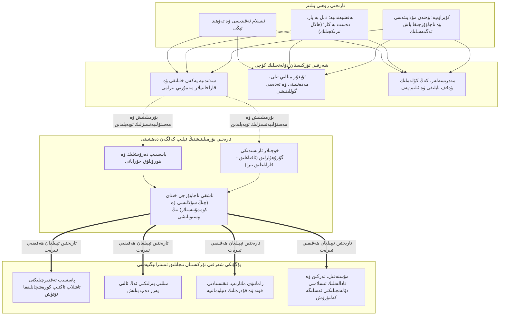
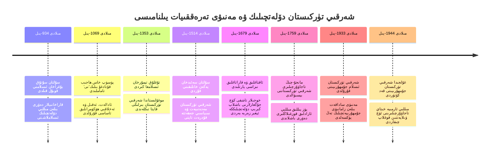
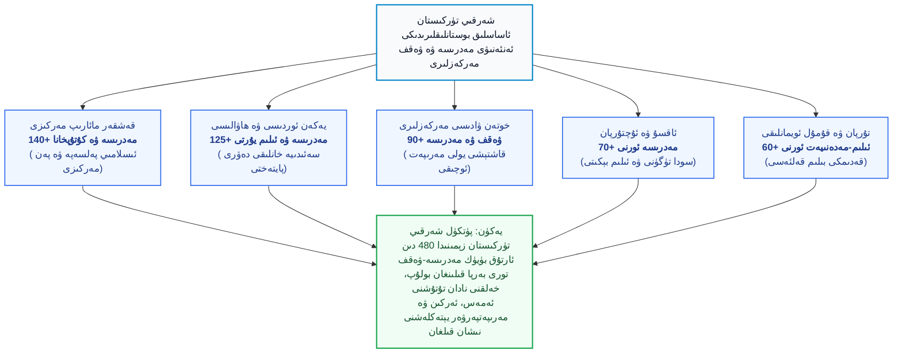
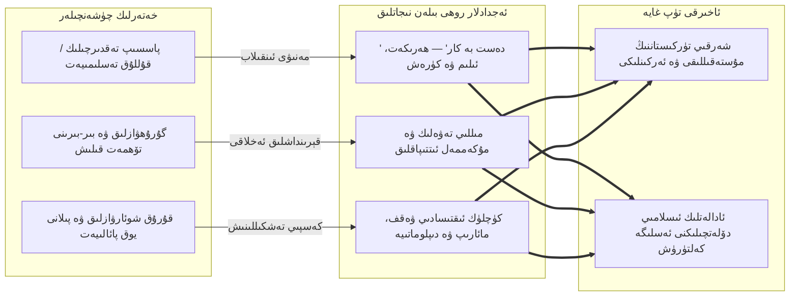

بِسْمِ اللَّهِ الرَّحْمَٰنِ الرَّحِيمِ

⏱ تەخمىنىي ئوقۇش ۋاقتى: 20 مىنۇت

بۈگۈنكى كۈندە تاجاۋۇزچى مۇستەبىت خىتاي ھاكىمىيىتىنىڭ لاگېرلار، قىرغىنچىلىق ۋە مەدەنىيەت ئاسسىمىلياتسىيەسى ئارقىلىق پۈتۈنلەي يوقىتىشقا ئۇرۇنۇۋاتقان نەرسىسى پەقەتلا شەرقىي تۈركىستان خەلقىنىڭ جىسمانىي ۋۇجۇدى ئەمەس، بەلكى ئۇنىڭ مىڭ يىللاپ تىكلەنگەن مۇستەقىل دۆلەتچىلىك ئەقلى، مىللىي غۇرۇرى ۋە تەسەۋۋۇفىي-ئىسلامىي مەنىۋى قەلئەسىدۇر. شەرقىي تۈركىستان تارىخىدا، مەنىۋى يېتەكچىلىك بىلەن دۆلەتچىلىك ئاڭ ئارىسىدا ھايات-ماماتلىق بىر رىشتە مەۋجۇت بولۇپ كەلگەن: روھىيەت ساپ ئەمگەك، مىللىي بىرلىك ۋە ھەقىقىي كۈرەشچانلىققا تايانغان دەۋرلەردە شەرقىي تۈركىستان تۇپرىقى پۈتكۈل ئوتتۇرا ئاسىيانى زىلزىلىگە سالغان قۇدرەتلىك خانلىقلارنىڭ بۆشۈكىگە ئايلانغان؛ ئەكسىچە، تەسەۋۋۇف شەخسىي مەنپەئەت، ھورۇنلۇق، دەرۋىشلىك قاچقۇنلۇقى ۋە ئاقتاغلىق-قاراتاغلىق گۇرۇھۋازلىقىغا ئايلاندۇرۇلۇپ كاردىن چىقىرىلغان زامانلاردا، دۆلەت ئاجىزلاپ خىتاي ۋە باشقا تاشقى تاجاۋۇزچىلارنىڭ ئاسارىتىگە چۈشۈپ قالغان. بۇ تېمىنى چوڭقۇر ئىلمىي تەكشۈرۈش، مىللىتىمىزنىڭ بۈگۈنكى مۇستەقىللىق كۈرىشىنى خاتا يوللاردىن ساقلاپ، ھەقىقىي نىجاتلىق يولىنى كۆرسىتىپ بېرىدىغان ئەڭ جىددىي مەسئۇلىيەتتۇر.

<!-- Image 1 -->

---

## 1. شەرقىي تۈركىستان: تۈرك-ئىسلام مەدەنىيىتىنىڭ ئايرىلماس يادروسى

تارىخ يالغانچىلىقنى كۆتۈرمەيدۇ. خىتاي تاجاۋۇزچىلىرى ئۆزلىرىنىڭ ساختا تارىخ تەشۋىقاتىدا شەرقىي تۈركىستاننى قەدىمدىن تارتىپ خىتاينىڭ بىر پارچىسى سۈپىتىدە كۆرسىتىشكە تىرىشىپ كەلگەن بولسىمۇ، پۈتكۈل ئارخېئولوگىيەلىك، مەدەنىيەت ۋە يازما تارىخ پاكىتلىرى شەرقىي تۈركىستاننىڭ ئەزەلدىن تۈركىستان تۇپرىقىنىڭ، ئىسلام مەدەنىيەت سىستېمىسىنىڭ ئايرىلماس قەلبى ئىكەنلىكىنى ئىسپاتلايدۇ.

<dfn title="قاراخانىيلار دەۋلىتى (مىلادى 840 – 1212): تۇنجى بولۇپ ئىسلامنى رەسمىي دۆلەت دىنى دەپ قوبۇل قىلغان تۈرك-ئۇيغۇر ئىمپېرىيەسى. سۇلتان سۇتۇق بۇغراخان (مىلادى 920 – 955) تەرىپىدىن مىللىي ئاڭ ۋە ئىسلام ئەقىدىسى بىرلەشتۈرۈلۈپ، پايتەخت قەشقەر ۋە بالاساغۇن پۈتكۈل شەرق دۇنياسىنىڭ ئەڭ قۇدرەتلىك ئىلىم-سەنئەت مەركىزىگە ئايلانغان.">«قاراخانىيلار دەۋلىتى (مىلادى 840 – 1212)»</dfn> دەۋرىدىن تارتىپ، ئارقىدىن چاغاتاي ئۇلۇسى (مىلادى 1227 – 1348)، <dfn title="موغۇلىستان دۆلىتى (مىلادى 1348 – 1514): تۇغلۇق تېمۇرخان (مىلادى 1329 – 1363) تەرىپىدىن قۇرۇلغان ۋە شەرقىي تۈركىستاننى مەركەز قىلغان مۇستەقىل تۈرك-ئىسلام خانلىقى. تۇغلۇق تېمۇرخاننىڭ شەيخ جەمالىددىن ۋە مەۋلانا ئارشىددىن تەسىرىدە 160 مىڭ كىشى بىلەن بىللە ئىسلامغا كىرىشى تارىختا مىللىي كىملىكنى ئەبەدىي مۇستەھكەملىگەن ئۇلۇغ ۋەقەدۇر.">«موغۇلىستان دۆلىتى (مىلادى 1348 – 1514)»</dfn> ۋە داڭلىق <dfn title="يەكەن خانلىقى (سەئىدىيە خانلىقى، مىلادى 1514 – 1705): سۇلتان سەئىدخان (مىلادى 1487 – 1533) تەرىپىدىن پايتەخت يەكەن قىلىپ قۇرۇلغان قۇدرەتلىك ئۇيغۇر دۆلىتى. ئابدۇرەشىدخان (مىلادى 1509 – 1560) ۋە ئاماننىساخان دەۋرىدە مىللىي كۈلتۈر، مەدەنىيەت بايلىقى، مائارىپ، تەسەۋۋۇف، دىپلوماتىيە ۋە يىپەك يولى سودىسى پۈتۈن دۇنياغا داڭق چىقارغان.">«يەكەن خانلىقى (مىلادى 1514 – 1705)»</dfn> دەۋرلىرىگىچە بولغان ئارىلىقتا، شەرقىي تۈركىستان ھەرگىزمۇ سەمەرقەند ۋە ھىراتتىن ئايرىلغان ئەمەس.

ئەمىر تېمۇر (مىلادى 1336 – 1405) دەۋرىدە تۈركىستاندا گۈللەنگەن مەنىۋى ۋە ئەدەبىي گۈللىنىش، شەرقىي تۈركىستاندا ئەڭ چوڭقۇر ئىنكاسقا ئېرىشتى. سەمەرقەندتىكى مەدرىسەلەر بىلەن قەشقەردىكى ساككىيە مەدرىسەلىرى، بۇخارادىكى نەقشبەندىيە زىكىرگاھلىرى بىلەن يەكەندىكى خان مەدرىسەلىرى ئارىسىدا مىڭلىغان ئالىملار، ئاسترونوملار ۋە ئەدىبلەر بېرىپ كېلىپ تۇردى. شەرقىي تۈركىستان ئىلىم-پەن، دىن ۋە دۆلەتچىلىكنىڭ پىشقان ئۈلگىسىنى يارىتىپ، رايوندا ئەركىن ۋە مۇستەقىل مەۋجۇت بولۇپ تۇردى.

---

### سىخېما 1: شەرقىي تۈركىستاننىڭ مەنىۋى قەلئەسى ۋە دەۋلەتچىلىك قۇرۇلمىسى لوگىكا خەرىتىسى

تۆۋەندىكى دىئاگراممىدا، مەنىۋى كۈچ بىلەن دۆلەتچىلىك ئىقتىدارىنىڭ ئورگانىك بىرىكىشى ۋە ئۇنىڭ بۈگۈنكى شەرقىي تۈركىستان مۇستەقىللىقىگە خىزمەت قىلىش لوگىكىسى كۆرسىتىلدى:

*(1-سىخېما: شەرقىي تۈركىستان مەنىۋى كۈچىنىڭ دۆلەتچىلىك، تارىخىي ساۋاق ۋە كەلگۈسى نىجاتلىق زەنجىرى)*

---

## 2. نەقشبەندىيە ئىسلاھاتى ۋە شەرقىي تۈركىستاننىڭ ئىجتىمائىي گۈللىنىشى

تېمۇرىيلار دەۋرىدە سىستېمىلاشقان <dfn title="نەقشبەندىيە تەريقىتى: باھاۋەددىن نەقشبەند تەرىپىدىن تاكامۇللاشتۇرۇلغان، قۇرئان ۋە ھەدىسكە ئەڭ تەنقىدىي باغلىنىدىغان، شەخسنى جەمئىيەتتىن ئايرىپ تاشلىماي، ئىشلەپچىقىرىش، سىياسەت ۋە ئىلىم-پەندە ئاكتىپ بولۇشقا چاقىرىدىغان بۈيۈك ئىسلام روھىيەت مەكتىپى.">نەقشبەندىيە تەريقىتى</dfn> پۈتكۈل شەرقىي تۈركىستان ۋادىلىرىغا كىرگەندە، ئۇ مەۋجۇت بولۇپ تۇرغان تۇرمۇشقا تۈپتىن يېڭى بىر ھاياتلىق بەردى.

### A. ھالال ئەمگەك ۋە مەنىۋى قۇۋۋەت: تاشلاندۇق بوستانلىقلارنىڭ گۈللىنىشى
شەرقىي تۈركىستان خەلقى تارىختىن بۇيان تەكلىماكان باغرىدىكى بوستانلىقلاردا ياشاپ كەلگەن مىللەت. سۇنى تېجەش، ئېرىق-ئۆستەڭ چاپىش، يىپەك ۋە قاشتېشى كولاش، پاختا تېرىش پەۋقۇلئاددە ئىنتىزام ۋە چىدامچانلىق تەلەپ قىلاتتى. نەقشبەندىيەنىڭ پىرى خوجا باھاۋەددىن نەقشبەند (مىلادى 1318 – 1389) ئوتتۇرىغا قويغان:

> **«دېل بە يار، دەست بە كار»** (دل به یار، دست به کار)  
> *«كۆڭلۈڭ ياردا (ئاللاھ تائالادا) بولسۇن، قولۇڭ كاردا (ھالال ئەمگەك، قۇرۇلۇش ۋە ئىشلەپچىقىرىشتا) بولسۇن!»*

دېگەن ئەخلاقىي شوئار، ئۇيغۇر دېھقان ۋە ھۈنەرۋەنلىرى ئۈچۈن ئىبادەتنىڭ يادروسىغا ئايلاندى. قەشقەر، يەكەن، خوتەن، ئاقسۇ ۋە تۇرپان شەھەرلىرىدە تەسەۋۋۇف ئەھلى تەركىدۇنيا بولمىدى. ئۇلار يىپەك يولىدىكى ئەڭ باي، ئەڭ ئىشەنچلىك سودىگەرلەرگە، كان ئىگىلىرىگە، كارۋان بېشى ۋە كۇتۇپخانا مەسئۇللىرىغا ئايلاندى. شەرقىي تۈركىستان مەدەنىيىتى ئاكتىپ خىزمەت قىلىش ئارقىلىق مىللەتنىڭ بايلىقىنى ئاشۇردى.

<!-- Image 2 -->

### B. مەخدۇمى ئەزەم ۋە سەئىدىيە خانلىقى دەۋرىدىكى سىياسىي-مەنىۋى بىرلىك
16-ئەسىردە نەقشبەندىيەنىڭ چوڭ شەيخلىرىدىن <dfn title="مەخدۇمى ئەزەم (ئەھمەد كاسانىي، مىلادى 1461 – 1542): فەرغانە ۋە سەمەرقەندتە ياشىغان مەشھۇر نەقشبەندىيە پىرى. ئۇ يەكەن خانلىقىنىڭ سۇلتانى سەئىدخان بىلەن يۈكسەك قېرىنداشلىق ۋە سىياسىي مەسلىھەتداشلىق مۇناسىۋىتى ئورناتقان. تەسەۋۋۇفنى دۆلەت ئىسلاھاتىغا، ئەخلاق تۈزۈمىگە تەدبىقلىغان.">«مەخدۇمى ئەزەم (مىلادى 1461 – 1542)»</dfn> نىڭ شەرقىي تۈركىستانغا كېلىشى، دۆلەتچىلىك بىلەن دىنىي تەربىيەنىڭ يېڭى بىر ئىتتىپاقىنى قۇردى. 

سۇلتان سەئىدخان (مىلادى 1487 – 1533) ھەربىي يۈرۈشلىرىدە ۋە دۆلەت قانۇنلىرىنى بەلگىلەشتە ئۆز بېشىمچىلىق قىلماي، ئالىملار ۋە مۇتەسەۋۋۇفلار بىلەن مەسلىھەتلىشەتتى. سۇلتان ئابدۇرەشىدخان زامانىدا مەدەنىيەت ئەڭ يۇقىرى چوققىغا چىقتى. تەسەۋۋۇف پەلسەپىسى ئۇيغۇر تىلىدىكى شېئىرىيەتنى، ئەخلاق كىتابلىرىنى ۋە پۈتكۈل مىللىي كۈلتۈرنى سۇغاردى. تەسەۋۋۇف مەدرىسەلىرى دۆلەتنىڭ مەنىۋى ئىنتىزامىنى قوغدايدىغان بۈيۈك بىر سىستېما ئىدى.

---

### سىخېما 2: شەرقىي تۈركىستان دۆلەتچىلىكى ۋە مەنىۋى مۇساپىسىنىڭ ئاساسلىق يىلنامىسى

تۆۋەندىكى ۋاقىت ئوقى سىخېمىسىدا، شەرقىي تۈركىستان تارىخىدىكى بۇرۇلۇش نۇقتىلىرى، دەۋرلەر ۋە سىياسىي-روھىي كۈرەش باسقۇچلىرى كۆرسىتىلدى:

*(2-سىخېما: شەرقىي تۈركىستان دۆلەتچىلىكى ۋە مەنىۋى سىناقلار تارىخىنىڭ ئالتۇن دەۋر يىلنامىسى)*

---

## 3. تارىخىي ئاچچىق ئىبرەت: تەسەۋۋۇفنىڭ بۇرمىلىنىشى ۋە خوجىلار زامانىدىكى پاجىئە

شەرقىي تۈركىستان تارىخى بىزگە ئىنتايىن سەمىمىي ۋە رەھىمسىز بىر دەرسنى ئۆگىتىدۇ: **دىن، ئەقىدە ۋە تەسەۋۋۇف ھەقىقىي مىللىي بىرلىككە، ئەمگەككە ۋە دۆلەتچىلىككە خىزمەت قىلغاندا مىللەت قۇدرەت تاپىدۇ؛ ئەمما ئۇ شەخسىي بايلىق توپلاش، خەلقنى ماڭقۇرتلاشتۇرۇش، تاشقى دۇنيادىن پۈتۈنلەي قورقۇپ پاسسىپلىشىش ۋە گۇرۇھۋازلىققا ئايلانغاندا، ۋەتەن ۋە دۆلەت قولدىن كېتىدۇ!**

17-ئەسىرنىڭ كېيىنكى يېرىمىغا كەلگەندە، تەسەۋۋۇف شەيخلىرىنىڭ كېيىنكى نەسلى بولغان خوجىلار باھاۋەددىن نەقشبەندنىڭ «دەست بە كار» پرىنسىپىنى، خوجا ئەھرارنىڭ پۇقرالارنى زۇلۇمدىن قوغداش ئەخلاقىنى ئۇنتۇپ قالدى. نەتىجىدە:
- ئۇلار <dfn title="ئاقتاغلىقلار ۋە قاراتاغلىقلار (خوجىلار نىزاسى): 17- ۋە 18-ئەسىرلەردە شەرقىي تۈركىستاندا نەقشبەندىيە تەسەۋۋۇف نامى ئاستىدا ئىسھاقىيە (قاراتاغلىق) ۋە ئاپپاقىيە (ئاقتاغلىق) دەپ ئىككى گۇرۇھقا بۆلۈنۈپ، ھاكىمىيەت تالىشىپ ئېلىپ بارغان ۋە ئاخىرىدا جۇڭغار ھەم مانجۇ-چىڭ تاجاۋۇزچىلىرىنىڭ كىرىشىگە يول ئاچقان ئەڭ پاجىئەلىك ئىچكى بۆلۈنۈش.">«ئاقتاغلىقلار (ئاپپاق خوجا پىرقىسى)» ۋە «قاراتاغلىقلار (ئىسھاق خوجا پىرقىسى)»</dfn> دەپ ئىككى تەرەپكە بۆلۈنۈپ، تەخت ۋە بايلىق تالاشتى.
- مەسجىدلەر خەلقنى ئويغىتىدىغان ئىلىم راۋاقلىرىدىن بىر-بىرىنى كاپىرغا چىقىرىدىغان بۆلگۈنچىلىك كۇرسىلىرىغا ئايلىنىپ قالدى.
- ئەڭ ئېچىنىشلىقى، ئاپپاق خوجا شەخسىي ھاكىمىيەت نەپسى ئۈچۈن موڭغۇل-جۇڭغار فېئوداللىرىنى (غالداننى) ئەلچى ئارقىلىق شەرقىي تۈركىستانغا باشلاپ كىردى!

بۇ تارىخىي خىيانەت پۈتكۈل يەكەن خانلىقىنىڭ سىياسىي ئاساسىنى غۇلاتتى، ئارقىدىن مانجۇ-چىڭ تاجاۋۇزچىلىرى (1759-يىلى) كېلىپ شەرقىي تۈركىستاننى بېسىۋالدى. 

بۇ دەۋر بۈگۈنكى شەرقىي تۈركىستان خەلقىگە بېرىلگەن ئەڭ چوڭ سىگنالدۇر: ئەگەر بۈگۈنكى چەتئەلدىكى ۋە ۋەتەن ئىچىدىكى دەۋا ساھىبلىرى ئەجدادلارنىڭ خاتالىقىنى تەكرارلاپ، گۇرۇھۋازلىققا، پىرقىۋازلىققا، كىچىك شەخسىي داڭق-ئاتاق ياكى ئايرىمچىلىققا پېتىپ قالسا، دۈشمەن خىتاي شۇ بوشلۇقتىن پايدىلىنىپ پۈتۈن بىر مىللەتنى تىرىك كۆمۈشنى داۋاملاشتۇرىدۇ!

<!-- Image 3 -->

---

### سىخېما 3: شەرقىي تۈركىستان ئاساسلىق بوستانلىقلىرىدىكى مەدرىسە ۋە مەنىۋى مەركەزلەر كۆلىمى

تارىخىي پاكىتلار شەرقىي تۈركىستاننىڭ قەدىمكى بوستانلىق مەركەزلىرىدە تەڭداشسىز مائارىپ تورى بولغانلىقىنى ئىسپاتلايدۇ. تۆۋەندىكى دىئاگراممىدا، يەكەن خانلىقى ۋە كېيىنكى دەۋرلەردىكى ئاساسلىق شەھەرلەرنىڭ مائارىپ ۋە مەدرىسە نىسبىتى ئەكس ئەتتۈرۈلدى:

*(3-سىخېما: شەرقىي تۈركىستان شەھەرلىرىدە پۇقرالار ئىلىم-پەن، مائارىپ ۋە ۋەقف تورىنىڭ تارقىلىش كۆلىمى)*

| بوستانلىق ۋە شەھەر | مەدرىسە ۋە كۇتۇپخانا كۆلىمى | يادرولۇق مەدەنىيەت ئالاھىدىلىكى | تارىخىي ۋە سىياسىي ئورنى |
| :--- | :--- | :--- | :--- |
| **قەشقەر مەركىزى** | 140+ مەدرىسە ۋە كۇتۇپخانا | ساكساكىيە، مەھمۇدىيە مەدرىسىلىرى، يۇقىرى ئىسلامىي تەتقىقات | شەرقىي تۈركىستاننىڭ مەنىۋى ۋە دىپلوماتىك پايتەختى |
| **يەكەن ئوردىسى** | 125+ مەدرىسە ۋە مەرىپەت يۇرتى | خانلىق مەدرىسىلەر، تىببىي، ئەدەبىي ۋە ھۆكۈمرانلىق بىلىملىرى | سەئىدىيە خانلىقى مەركىزى، مىللىي گۈللىنىش قەلبى |
| **خوتەن ۋادىسى** | 90+ مەدرىسە ۋە ۋەقف مەركىزى | ھۈنەر-سەنئەت مائارىپى، ئىلمىي تەسەۋۋۇف، قوليازما ئىشلەش | جەنۇبىي يىپەك يولىنىڭ بىلىم ۋە ئىشلەپچىقىرىش قەلئەسى |
| **ئاقسۇ-ئۇچتۇرپان** | 70+ مەدرىسە ۋە ئىلىم ئورنى | فىقھشۇناسلىق، تىلشۇناسلىق ۋە رايونلارئارا سودا ئەخلاقى | تەڭرىتاغ ئېتىكىدىكى مۇستەھكەم تەپەككۇر بازىسى |
| **تۇرپان-قۇمۇل** | 60+ ئەنئەنىۋى ئىلىم يۇرتى | قەدىمكى تۈرك كۈلتۈرى بىلەن ئىسلام ئىلىملىرىنىڭ بىرىكىشى | شەرقىي قاپقا، كارۋان يولى تەربىيە مەنزىلى |

*(3-سىخېما: شەرقىي تۈركىستان شەھەرلىرىدە پۇقرالار ئىلىم-پەن، مائارىپ ۋە ۋەقف تورىنىڭ تارقىلىش كۆلىمى)*

---

## 4. تۆت مەنبەلىك تارىخىي ئىبرەتنىڭ شەرقىي تۈركىستانغا بولغان بىۋاسىتە تەدبىقى

بىزنىڭ بۈگۈنكى كۈرىشىمىز تارىخنىڭ چوڭقۇر دەرياسىدىن كۈچ ئالغاندا ئاندىن ئېزىپ كەتمەيدۇ:

### 1) ئىسلام تارىخىدىن ئىبرەت: غارغا قامىلىش ئەمەس، پۇت دەسسەپ مەسئۇلىيەت ئېلىش
پەيغەمبىرىمىز مۇھەممەد ئەلەيھىسسالام ﷺ ۋە ئۇنىڭ بۈيۈك ساھابىلىرى زۇلۇمغا دۇچ كەلگەندە، «بىزگە شۇنداق پۈتۈلۈپتۇ، دۇئا قىلىپ جىمجىت ئۆلەيلى» دەپ غارلارغا قېچىپ ياتمىغان. بەلكى مەدىنەگە ھىجرەت قىلىپ، سىياسىي ھاكىمىيەت قۇرغان، ئەركىنلىك، ئادالەت ۋە باراۋەرلىك ئۈچۈن بەدر، ئۇھۇد ۋە خەندەك مەيدانلىرىدا پۈتۈن بارلىقى بىلەن جەڭ قىلغان. شەرقىي تۈركىستان دەۋاسىغا بۈگۈن دەل مۇشۇنداق قەھرىمان ساھابىلەرچە مەسئۇلىيەتچانلىق كېرەك. تەسۋىھ تۇتقان قوللار ئوقيا، قەلەم ۋە زامانىۋى پەن-تېخنىكىنى تەڭ تۇتۇشى شەرت.

ئاللاھ تائالا قۇرئان كەرىمدە مۇنداق دەپ ئاگاھلاندۇرىدۇ:

﴿إِنَّ اللَّهَ لَا يُغَيِّرُ مَا بِقَوْمٍ حَتَّىٰ يُغَيِّرُوا مَا بِأَنفُسِهِمْ﴾

> *(مەنىسى: «شۈبھىسىزكى، بىر قەۋم ئۆز ھالىتىنى، پىسخىكىسى ۋە ھەرىكىتىنى ئۆزگەرتمىگۈچە، ئاللاھ ئۇلارنىڭ ھالىتىنى ھەرگىز ئۆزگەرتمەيدۇ.» — رەئد سۈرىسى، 11-ئايەت)*

### 2) دۇنيا تارىخىدىن ئىبرەت: فىنلاندىيە ۋە بالتىق بويى ئەركىنلىك مۆجىزىسى
دۇنيا تارىخىدا سان جەھەتتە ئاز، ئەمما روھىي ۋە ئەخلاقىي ئەزىمى بىلەن بۈيۈك زالىم ئىمپېرىيەلەرنى يەڭگەن خەلقلەر ئاز ئەمەس. فىنلاندىيە خەلقى 1939-يىلى سوۋېت قىزىل ئارمىيەسىنىڭ مىليونلۇق قوشۇنى ھۇجۇم قىلغاندا («قىشلىق ئۇرۇش»)، ئۆزلىرىنىڭ مىللىي بىرلىكى، ئېگىلمەس ۋەتەنپەرۋەرلىك روھى (سىسۇ - Sisu) ۋە ئادالەت ئەقىدىسى بىلەن غايەت زور باسقۇنچىلارنى تالاپەتكە ئۇچرىتىپ مۇستەقىللىقىنى قوغداپ قالدى. بالتىق بويى دۆلەتلىرى (ئېستونىيە، لاتۋىيە، لىتۋا) يېرىم ئەسىر سوۋېت بېسىۋېلىشى ئاستىدا تۇرغان بولسىمۇ، ئۆزلىرىنىڭ ئانا تىلىنى، مەدەنىيىتىنى ۋە مىللىي كىملىكىنى ئائىلىلەردە مەنىۋى قەلئە قىلىپ تۇتۇپ پۈتۈنلەي ساقلاپ قالدى ۋە ئاخىرى مۇستەقىللىققا ئېرىشتى. شەرقىي تۈركىستان مىللىتى خىتايدىن نوپۇس جەھەتتە ئاز بولسىمۇ، پىكرىي كۈچ، تەسەۋۋۇفىي تاۋلىنىش ۋە مىللىي ئىرادە جەھەتتە يۈز ھەسسە ئۈستۈن تۇرىدۇ.

### 3) خىتاي تارىخىنىڭ قاراڭغۇ چىرىكلىكىدىن ئىبرەت: كۈچەيگەن كۈندە يىقىلىش
خىتاينىڭ 3000 يىللىق پۈتكۈل تارىخى تاشقى قىياپەتتە ھەيۋەتلىك، ئەمما ئىچىدە قىلچە ئەخلاق، ئادالەت ۋە ئىمان بولمىغان يالغانچىلىق، سۇيىقەست ۋە قىرغىنچىلىقنىڭ تارىخىدۇر. <dfn title="چىن سۇلالىسى (مىلادىدىن بۇرۇنقى 221 – 206): چىن شىخۇاڭ تەرىپىدىن قاتتىق مۇستەبىت قانۇنچىلىق تۈزۈمى ئاساسىدا قۇرۇلغان خىتاي خانلىقى. پۈتۈن ئەركىن كىتابلارنى كۆيدۈرۈپ، نەچچە يۈزلىگەن پىكىر ئىگىلىرىنى تىرىك كۆمگەن. پەقەت 15 يىلدا خەلق ئۆچمەنلىكى بىلەن ئاغدۇرۇلغان.">«چىن سۇلالىسى (مىلادىدىن بۇرۇنقى 221 – 206)»</dfn> پۈتۈن كىتابلارنى كۆيدۈرۈپ، زىيالىيلارنى ئۆلتۈرۈپ يەنىلا 15 يىلدا غۇلاپ چۈشكەن؛ يېقىنقى زاماندىكى مانجۇ-چىڭ ئىمپېرىيەسىمۇ يۈكسەك مۇستەبىتلىككە تايىنىپ تۇرۇپ ئاخىرى ئېچىنىشلىق قەبرىگە كىرگەن. 

بۈگۈنكى شى جىنپىڭ باشچىلىقىدىكى خىتاي كومپارتىيەسىمۇ مىليونلىغان شەرقىي تۈركىستان پۇقرالىرىنى لاگېرلارغا قاماپ، مەسجىدلەرنى چېقىپ دۇنياغا كۆرەڭلەۋاتىدۇ. ئەمما ئۇلار پۈتۈنلەي روھىي چىرىكلىك، ئىقتىسادىي كىرىزىس ۋە تۈزۈم پارچىلىنىشىغا يۈزلەنمەكتە. زۇلۇم چوققىسىغا چىققاندا كۈلگە ئايلىنىدۇ، ھەق ھامان غالىب كېلىدۇ!

### 4) ئۇيغۇر تارىخىنىڭ ئىجابىي يۈكسىلىشى: جۇمھۇرىيەتلەر ئىزى
بىزنىڭ ئەجدادلىرىمىز خىتاي تاجاۋۇزچىلىرىغا بىر كۈنمۇ مەڭگۈلۈك بويسۇنۇپ باقمىغان. 1933-يىلى 11-ئاينىڭ 12-كۈنى قەشقەردە جاكارلانغان «شەرقىي تۈركىستان ئىسلام جۇمھۇرىيىتى» دۇنياغا پۈتۈنلەي ئېنىق بىر نىشاننى كۆرسەتكەن: ئۇلار قۇرئان ۋە ئىسلام ئەخلاقى بىلەن ئەركىنلىك، پۇقرالار ئادالىتى ۋە مىللىي ئارمىيەنى بىرلەشتۈرگەن؛ 1944-يىلى غۇلجىدا تىكلەنگەن «شەرقىي تۈركىستان جۇمھۇرىيىتى» دە مەشھۇر مەرىپەتپەرۋەر رەھبەر ئەلىخان تۆرە (مىلادى 1885 – 1976) باشچىلىقىدا مىللىي ئارمىيە گومىنداڭ خىتاي قوشۇنلىرىنى تارمار قىلىپ غەلىبە قازانغان. بىزنىڭ مىللىي كېنىمىزدە ئەركىنلىك ۋە ئادالەت جەڭچىلىرىنىڭ قېنى قاينايدۇ.

---

### سىخېما 4: بۈگۈنكى شەرقىي تۈركىستان كۈرىشىنىڭ دەۋر بۆلگۈچ بۇرۇلۇش مېخانىزمى

تۆۋەندىكى دىئاگراممىدا، بۈگۈنكى مىللىي دەۋانىڭ پاسسىپ سۈكۈتتىن ھەقىقىي ئەمەلىي كۈرەشچانلىققا ۋە دۆلەتچىلىك قۇرۇلمىسىغا ئۆتۈش سىستېمىسى ئەكس ئەتتۈرۈلدى:

*(4-سىخېما: پاسسىپ خىيالدىن قۇتۇلۇپ، مۇستەقىل دۆلەتچىلىك پەللىسىگە يېتىش مېخانىزمى)*

---

## 5. شەرقىي تۈركىستاننىڭ بۈگۈنكى نىجاتلىق يول خەرىتىسى

تېمۇرىيلار دەۋرىدىكى تەسەۋۋۇف پەلسەپىسى ۋە شەرقىي تۈركىستاننىڭ ئەسىرلەر بويى بەرپا قىلغان تارىخى بۈگۈنكى پۈتكۈل ۋەتەن ئەھلىگە، خەلقئارادىكى ئۇيغۇر جامائىتىگە، ياشلىرىمىز ۋە زىيالىيلىرىمىزغا مۇنۇ جىددىي ۋەزىپىلەرنى يۈكلەيدۇ:

<!-- Image 4 -->

1. **پاسسىپ روھانىيلىقنى تامامەن رەت قىلىپ، جىھادىي-ئەمەلىي ئەمگەككە ئۆتۈش:**  
   بۈگۈنكى كۈندە شەرقىي تۈركىستان دەۋاسىنى قۇتقۇزىدىغىنى پەقەتلا ھەسرەت چېكىپ يىغلاش ئەمەس. نەقشبەندىيە روھىيىتى بىزگە: «ئورنۇڭدىن تۇر، قولۇڭنى ئىشقا سال، ئىلىم ئۆگەن، دەسمايە قۇر، دۇنياۋى تىللارنى، سۈنئىي ئىدراك ۋە ھەربىي تەپەككۇرنى ئىگىلە!» دەپ بۇيرۇيدۇ. بىز خىتايغا قارشى پۈتۈن بىلىمىمىز، ئىقتىسادىمىز ۋە كۈچىمىز بىلەن تاقابىل تۇرۇشىمىز كېرەك.

2. **ئىچكى نىزا ۋە بۆلگۈنچىلىككە دەپنە چېكى قويۇش:**  
   خوجىلار دەۋرىدىكى ئاقتاغلىق ۋە قاراتاغلىق نىزاسى بىزگە ۋەتىنىمىزنى قولدىن كەتكۈزۈش بەدىلىگە توختىغان. بۈگۈن چەتئەللەردىكى شەرقىي تۈركىستان تەشكىلاتلىرى ۋە شەخسلىرى قەتئىي ھالدا بىر-بىرىنىڭ پۇتىدىن تارتىشنى، مەنپەئەت تالىشىشنى، ئەرزىمەس مەسىلىلەردە ئايرىلىشنى توختىتىشى شەرت. شەرقىي تۈركىستاننىڭ دۈشمىنى پەقەت بىرلا — ئۇ بولسىمۇ تاجاۋۇزچى خىتاي كومپارتىيەسى ۋە ئۇنىڭ مۇستەملىكىچى سىستېمىسىدۇر! پۈتۈن نەيزە ئۇچى پەقەتلا مۇشۇ دۈشمەنگە توغرىلىنىشى كېرەك.

3. **ئائىلىلەرنى مىللىي ۋە مەنىۋى قەلئەگە ئايلاندۇرۇش:**  
   ۋەتەن سىرتىدا ياشاۋاتقان ھەربىر ئۇيغۇر ئائىلىسى شەرقىي تۈركىستاننىڭ بىر كىچىك مۇستەقىل ئەلچىخانىسىدۇر. بالىلىرىمىزغا ئانا تىلىمىزنى ئەڭ يۈكسەك دەرىجىدە ئۆگىتىش، ئىسلام ئەقىدىسىنى ساپ ۋە پىشقان ھالەتتە يەتكۈزۈش، نەۋائىينىڭ تىلىنى، يۈسۈپ خاس ھاجىبنىڭ پاراسىتىنى قەلبىگە سىڭدۈرۈش جىددىي مەسئۇلىيىتىمىزدۇر. مەدەنىيەت يىلتىزىدىن ئۈزۈلمىگەن مىللەت ھەرگىز قۇل بولمايدۇ.

4. **مۇستەقىللىق ۋە ئىسلامىي دۆلەتچىلىك ئىقتىدارىنى نامايان قىلىش:**  
   بىزنىڭ دەۋايىمىز خىتايدىن نان ياكى كىشىلىك ھوقۇق تەلەپ قىلىدىغان تىلەمچىلىك داۋاسى ئەمەس! بىزنىڭ تەلەپ قىلىدىغىنىمىز — ئۆزىمىزنىڭ مىڭ يىللىق تۇپرىقى بولغان **شەرقىي تۈركىستاننىڭ تولۇق سىياسىي مۇستەقىللىقىدۇر!** بىز زۇلۇم ئاخىرلاشقاندا، ئۆز تۇپرىقىمىزدا ئەركىنلىك، ئادالەت، تىنچلىق ۋە قانۇن ئۈستۈنلۈكىنى تۇرغۇزۇپ، پۈتكۈل تۈركىستان ۋە ئىسلام دۇنياسىنىڭ پارلاق بىر چىرىغى بولۇپ قايتا قەد كۆتۈرىمىز!

---

## 6. تەۋسىيە كىتابلار

شەرقىي تۈركىستان دۆلەتچىلىكى، مەنىۋى ئەنئەنىسى ۋە تەسەۋۋۇف تارىخى ھەققىدە ئەتراپلىق مەلۇماتقا ئېرىشىش ئۈچۈن تۆۋەندىكى ئۈچ نادىر كىتاب تەۋسىيە قىلىنىدۇ:

1. **«قۇتادغۇ بىلىك» (بەخت ۋە دۆلەت ئاتا قىلغۇچى بىلىم)**  
   *ئاپتورى:* يۈسۈپ خاس ھاجىب (مىلادى 1019 – 1085)  
   *چۈشەندۈرۈش:* شەرقىي تۈركىستان تۇپرىقىدا دۇنياغا كەلگەن ئەڭ بۈيۈك سىياسىي پەلسەپە ۋە ئەخلاقىي دۆلەتچىلىك دەستۇرى. ئادالەت (كۈنتۇغدى)، دۆلەت ۋە بەخت (ئايتولدى)، ئەقىل (ئۆگدۈلمىش) ۋە قانائەت-مەنىۋىيەت (ئۆزگۈرمىش) نىڭ سىستېمىلىق بىرلىكىنى كۆرسىتىپ بېرىدۇ.

2. **«تارىخى رەشىدى»**  
   *ئاپتورى:* مىرزا مۇھەممەد ھەيدەر كۆرەگان (مىلادى 1499 – 1551)  
   *چۈشەندۈرۈش:* موغۇلىستان ۋە يەكەن خانلىقىنىڭ سىياسىي تەرتىپى، تەسەۋۋۇف ئەھلى بىلەن خانلارنىڭ ھەمكارلىقى، شەرقىي تۈركىستان جۇغراپىيەسى ۋە خەلق تۇرمۇشى ھەققىدىكى ئەڭ دەۋر بۆلگۈچ، بىرىنچى قول تارىخىي شاھ ئەسەر.

3. **«تەزكىرەئى خوجىگان»**  
   *ئاپتورى:* مۇھەممەد سادىق قەشقەرىي (18-ئەسىر)  
   *چۈشەندۈرۈش:* شەرقىي تۈركىستاندىكى نەقشبەندىيە خوجىلىرىنىڭ تارىخى، ئىسھاقىيە ۋە ئاپپاقىيە نىزالىرىنىڭ كېلىپ چىقىش سەۋەبلىرى ھەققىدە يېزىلغان ئەڭ مۇھىم تارىخىي كۆزگۈ.

---

## پايدىلانغان مەنبەلەر

1. مىرزا مۇھەممەد ھەيدەر كۆرەگان، «تارىخى رەشىدى»، ئۇيغۇرچە نەشرى، مىللەتلەر نەشرىياتى، قەشقەر ۋە يەكەن بابلىرى. 
2. مۇھەممەد سادىق قەشقەرىي، «تەزكىرەئى ئەزىزان (تەزكىرەئى خوجىگان)»، قەشقەر قوليازمىلار فوندى، 1768-يىللىق ئەسلى نۇسخا. 
3. نىزامىددىن مىر ئەلىشىر نەۋائىي، «مەھبۇبۇل قۇلۇب»، تاشكەنت پەن نەشرىياتى، 1993-يىلى نەشرى. 
4. پىروفېسسور دوكتور تۇرغۇن ئالماس، «ئۇيغۇرلار»، ئۈرۈمچى، تۈركىستان قەدىمكى دەۋلەتلىرى بابى.

5. Kim, Hodong (2004). <i>Holy War in China: The Muslim Rebellion and State in Chinese Central Asia, 1864–1877</i>. Stanford University Press. 
6. Papas, Alexandre (2005). <i>Soufisme et politique entre Chine, Tibet et Turkestan: Étude sur les Khwajas Naqshbandis (XVIIe-XVIIIe siècles)</i>. Paris: Jean Maisonneuve. 
7. Millward, James A. (2007). <i>Eurasian Crossroads: A History of Eastern Turkestan</i>. Columbia University Press. 
8. Fletcher, Joseph (1995). <i>Studies on Chinese and Islamic Inner Asia</i>. Variorum. pp. 1–48.

