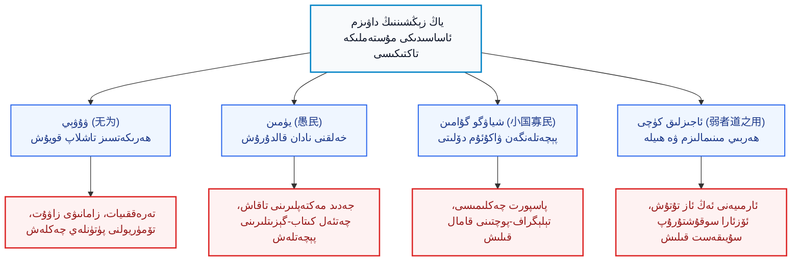
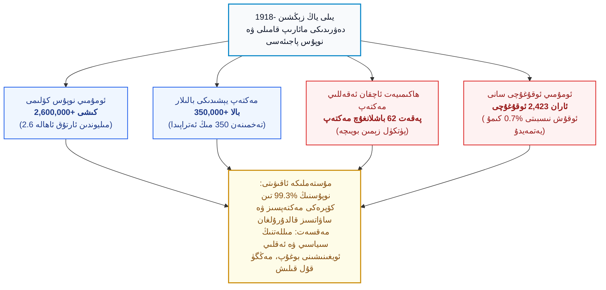
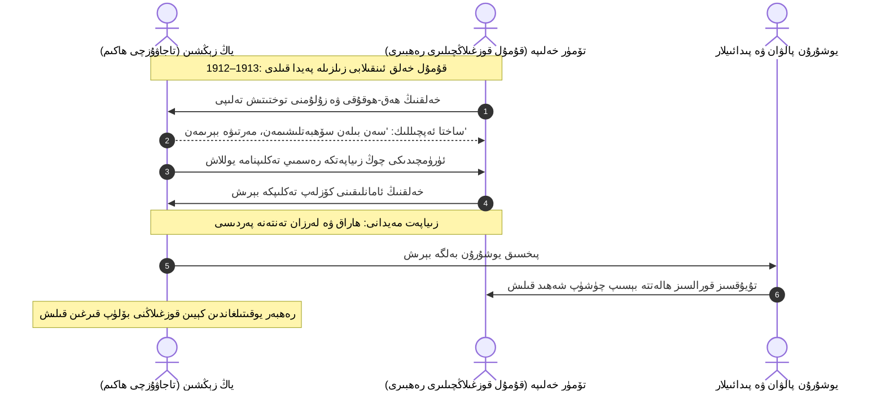
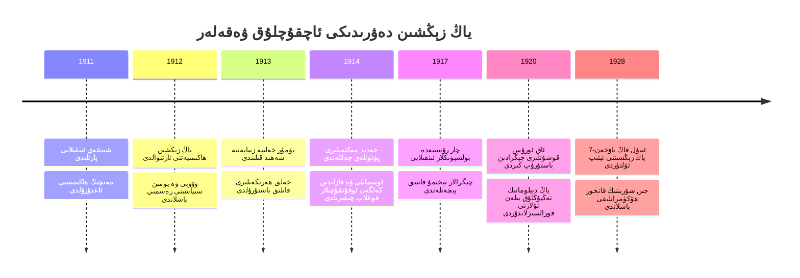
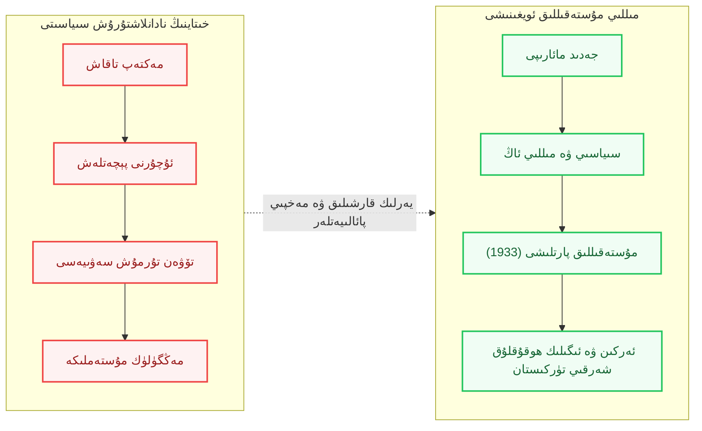

بِسْمِ اللَّهِ الرَّحْمَٰنِ الرَّحِيمِ

⏱ تەخمىنىي ئوقۇش ۋاقتى: 22 مىنۇت

بۈگۈنكى كۈندە تاجاۋۇزچى خىتاي كۇمپارتىيەسى لاگېرلار، ئىدىيەۋى مېڭە يۇيۇش ۋە مەدەنىيەت قىرغىنچىلىقى ئارقىلىق مىللىتىمىزنى يىلتىزىدىن قۇرۇتۇشقا ئۇرۇنۇۋاتقاندا، نۇرغۇن كىشىلەر بۇ رەزىللىكنى يېڭى پەيدا بولغان دەپ ئويلايدۇ. ھالبۇكى، خىتاينىڭ شەرقىي تۈركىستاننى مۇستەملىكە قىلىپ تۇتۇپ تۇرۇش تارىخىغا نەزەر سالساق، تاجاۋۇزچىلارنىڭ ھەر دەۋردە ئوخشاش بىر نىجاسەت سىياسەتنى — يەنى «خەلقنىڭ مېڭىسىنى بوشىتىپ، پىكىر قىلالمايدىغان نادان ھالەتتە تۇتۇش» رەزىللىكىنى ئۆزگەرمەس قورال قىلغانلىقىنى كۆرىمىز. مانا مۇشۇ تاجاۋۇزچىلىق تېخنىكىسىنىڭ ئەڭ رەزىل ۋە سىستېمىلىق شەكلى 20-ئەسىرنىڭ باشلىرىدا، خىتاي ئۇرۇش خوجايىنى <dfn title="ياڭ زېڭشىن (1864–1928): يۈننەنلىك مەنچىڭ ئەمەلدارى، 1912-يىلدىن 1928-يىلى ئۆلتۈرۈلگىچە شەرقىي تۈركىستاندا 17 يىل مۇستەملىكە ھۆكۈمرانلىق يۈرگۈزگەن خىتاي مىلىتارىستى. كلاسسىك داۋ پەلسەپىسىنى نادانلاشتۇرۇش ۋە باستۇرۇش قورالى قىلىپ قوللانغان.">ياڭ زېڭشىن (1864–1928)</dfn> تەرىپىدىن يۈرگۈزۈلگەن ئىدى. ياڭ زېڭشىن كونا خىتاينىڭ خۇراپىي تەسەۋۋۇرى بولغان «داۋ ئېقىمى» (داۋىزىم) نىڭ پىرىنسىپلىرىنى، بولۇپمۇ «ۋۇۋېي» (ھەرىكەتسىز تاشلاپ قويۇش) ۋە «يۈمىن» (خەلقنى نادان قالدۇرۇش) نەزەرىيەلىرىنى سىياسىي تۈزۈمگە ئايلاندۇرۇپ، شەرقىي تۈركىستاننى تاشقى دۇنيادىن پۈتۈنلەي ئۈزۈۋەتكەن، زامانىۋى مەكتەپلەرنى چەكلەپ جەدىدچىلىك ئويغىنىشىنى بوغقان بىر پېچەتلىك تۈرمىگە ئايلاندۇرغان. مەزكۇر تەتقىقات ماقالىسىدە، ياڭ زېڭشىننىڭ بۇ مۇستەملىكە قىلتىقى پاش قىلىنىپ، بۈگۈنكى مۇستەقىللىق كۈرىشىمىز ئۈچۈن قىممەتلىك سىياسىي ۋە ئىستراتېگىيەلىك ساۋاقلار يورۇتۇپ بېرىلىدۇ.

<!-- Image 1 -->

---

## 1. تارىخىي ئارقا كۆرۈنۈش: ئىنقىلابلار دەۋرىدىكى سۈنئىي ۋاكۇئۇم

20-ئەسىرنىڭ بىرىنچى چارىكى پۈتكۈل ئېۋرازىيە قىتئەسىدە غايەت زور سىياسىي يانار تاغلار ئېتىلغان زامان بولدى. بىر تەرەپتىن، نەچچە ئەسىرلىك پادىشاھلىقلار ئارقا-ئارقىدىن گۇمران بولدى: 
- خىتايدىكى مانجۇلارنىڭ <dfn title="مەنچىڭ سۇلالىسى (1644–1912): شەرقىي تۈركىستاننى 1759-يىلى دەھشەتلىك قىرغىنچىلىق ئارقىلىق بېسىۋالغان، 1884-يىلى بولسا بۇ زېمىنغا 'يېڭى چېگرا' مەنىسىدىكى مۇستەملىكىچىلىك نامىنى تاڭغان تاجاۋۇزچى ئىمپېرىيە. 1912-يىلى شىنخەي ئىنقىلابى بىلەن ئاغدۇرۇلغان.">مەنچىڭ سۇلالىسى (1644–1912)</dfn> شىنخەي ئىنقىلابى (1911) دا غۇلاپ چۈشۈپ، خىتاي پۈتۈنلەي پارچىلىنىپ ئۇرۇش خوجايىنلىرى مەزگىلىگە كىردى؛
- شىمالدىكى چار پادىشاھ رۇسىيەسى (1721–1917) بىرىنچى دۇنيا ئۇرۇشىنىڭ قاينىمىدا ئاغدۇرۇلۇپ، 1917-يىلى بولشېۋىكلار ئىنقىلابى پارتلىدى؛
- غەربتىكى ئوسمانلى خەلىپىلىكى (1299–1924) پارچىلىنىپ يېڭى جۇمھۇرىيەتچىلىك دەۋرى بارلىققا كەلدى؛
- ئوتتۇرا ئاسىيا ۋە قازان تاتارلىرى ئارىسىدا تۈرك-ئىسلام مائارىپىنى زامانىۋىلاشتۇرۇش، تېخنىكا ۋە ئەركىنلىككە چاقىرىق قىلغان <dfn title="جەدىدچىلىك (ئۇسۇلى جەدىد): 19-ئەسىرنىڭ ئاخىرىدا ئىسمائىل غاسپىرالى (1851–1914) تەرىپىدىن 'تىلدا، پىكىردە، ئىشتا بىرلىك' شوئارى بىلەن باشلانغان، مەكتەپلەردە كونا ھىجالاش ئورنىغا تاۋۇش ئۇسۇلىنى قوللانغان، تەبىئىي پەنلەر، جۇغراپىيە ۋە مىللىي تارىخنى ئۆگىتىشنى تەشەببۇس قىلغان ئۇلۇغ مىللىي ئويغىنىش ھەرىكىتى.">جەدىدچىلىك ھەرىكىتى</dfn> پۈتۈن مىللەتنى ئويغاتماقتا ئىدى.

مانا مۇشۇنداق بىر دەۋردە، شەرقىي تۈركىستان ئۆزىنىڭ جۇغراپىيەلىك ۋە مەدەنىيەت ماھىيىتى بىلەن دەل مۇشۇ ئويغىنىشنىڭ مەركىزىگە ئايلىنىشى مۇقەررەر ئىدى. بىراق، 1912-يىلى سۇيىقەست بىلەن تۇتۇق ھاكىمىيىتىنى قولىغا كىرگۈزگەن ياڭ زېڭشىن دەل 17 يىل بويىچە (1912–1928) شەرقىي تۈركىستاننى كونا دۇنيانىڭ چىرىگەن قالدۇقىغا ئايلاندۇرۇپ، ئۇنى دۇنيانىڭ ئويغىنىش نۇرىدىن ئايرىپ تاشلىدى.

خەلقئارالىق داڭلىق ئاكادېمىك مەۋلان تەڭرىقۇت ئۆزىنىڭ «A Taoist 'Still Point': Governing East Turkistan in an Age of Revolution (1912–1928)» ناملىق تەتقىقات ماقالىسىدە ئوتتۇرىغا قويغاندەك، ياڭ زېڭشىننىڭ شەرقىي تۈركىستاننى باشقۇرۇش ئۇسۇلى ئادەتتىكى بىر مەمۇرىي سىياسەت ئەمەس، بەلكى كونا خىتاينىڭ دەھشەتلىك مۇستەبىتلىك تېخنىكىسى بولغان داۋىزمنىڭ «ئۆلۈك تىنىچلىق» پەلسەپىسىنى يەرلىك خەلقنى نادان قالدۇرۇپ پۇت-قولىنى باغلاشقا خىزمەت قىلدۇرۇشى ئىدى.

---

## 2. داۋ پەلسەپىسى ۋە تاجاۋۇزچىلىق تېخنىكىسى

ياڭ زېڭشىن ئۆزىنىڭ سىياسىي ھاياتىنى خاتىرىلىگەن 44 جىلدلىق خىتايچە ئەسىرى <dfn title="بۇگو جەي كۈندىلىك خاتىرىسى (补过斋日记): ياڭ زېڭشىننىڭ 1912-يىلدىن 1928-يىلغىچە بولغان ئارىلىقتا يازغان 44 جىلدلىق كۈندىلىك خاتىرىسى ۋە سىياسىي ماقالىلىرى توپلىمى. بۇ كىتابتا ئۇ داۋىزم ۋە كونا خىتاي مىكىرلىرىنى قانداق قىلىپ مۇستەملىكىنى ساقلاپ قېلىشقا قوللانغانلىقىنى ئوچۇق ئېتىراپ قىلغان.">«بۇگو جەي كۈندىلىك خاتىرىسى» (补过斋日记)</dfn> دە، ئۆزىنىڭ ھەر بىر مۇستەملىكە سىياسىتىگە داۋ پەلسەپىسىدىن مەنبە ئالغانلىقىنى شەرھلىگەن. بۇ سىياسەتنىڭ تۆت تۈۋرۈكى بار ئىدى:

### 1) ۋۇۋېي (无为) — تەرەققىياتنى توڭلىتىش ئارقىلىق پۈتۈن ھاكىمىيەتنى تۇتۇپ تۇرۇش
داۋىزمنىڭ ئاساسچىسى <dfn title="لاۋزى (مىلادىدىن بۇرۇنقى 6-ئەسىر): داۋىزم تەلىماتىنىڭ ۋە داۋدېجىڭ ناملىق ئەسەرنىڭ ئاپتورى دەپ قارىلىدىغان قەدىمكى خىتاي پەيلاسوپى. تەبىئەتكە چاتلاشماسلىق، پۈتۈن ئىشلارنى ئۆز ھالىغا قويۇپ ھەرىكەت قىلماسلىقنى تەشەببۇس قىلغان.">لاۋزى (مىلادىدىن بۇرۇنقى 6-ئەسىر)</dfn> ئوتتۇرىغا قويغان «ۋۇۋېي» ئۇقۇمى ئەسلىدە كائىنات بىلەن ماسلىشىشنى كۆرسەتسىمۇ، ياڭ زېڭشىن ئۇنى تاجاۋۇزچىلىق نىزامىغا ئايلاندۇردى:
- شەرقىي تۈركىستان زېمىنىدا بىر دانىمۇ زامانىۋى تاشيول، تۆمۈريول قۇرۇلۇشىغا رۇخسەت قىلمىدى؛
- ھېچقانداق سانائەت ۋە كەن-بايلىق ئېچىش قۇرۇلۇشى قىلدۇرمىدى، سەۋەبى زامانىۋى قۇرۇلۇش ئىشچىلار سىنىپىنى ۋە زامانىۋى بىلىملىك كىشىلەرنى كۆپەيتەتتى؛
- پېكىن (بېيجىڭ) دىكى مەركىزىي ئۇرۇش خوجايىنلىرى ھاكىمىيىتى بىلەن تاشقى جەھەتتە بويسۇنغاندەك قىياپەتتە بولسىمۇ، ئەمەلىيەتتە ھېچقانداق باج تاپشۇرمىدى ۋە مەركەزنىڭ ئىچكى ئىشلارغا ئارىلىشىشىغا پۈتۈنلەي تاقابىل تۇردى.

### 2) شياۋگو گۇامىن (小国寡民) — تاشقى دۇنيادىن كېسىپ تاشلانغان قاراڭغۇ قەلئە
لاۋزى «داۋدېجىڭ» نىڭ 80-بابىدا تەسۋىرلىگەن «دۆلەت كىچىك، پۇقرا ئاز بولسۇن؛ كېمە-ھارۋا بولسىمۇ ئۇنىڭغا چىقىدىغان ئادەم بولمىسۇن؛ قوشنا ئەللەرنىڭ خوراز-ئىت ئاۋازلىرى ئاڭلىنىپ تۇرسىمۇ، كىشىلەر بىر-بىرى بىلەن ئۆلگۈچە بېرىش-كېلىش قىلمىسۇن» دېگەن سۆزىنى ياڭ زېڭشىن ئەڭ مەھكەم تۇتقا قىلدى:
- پۈتكۈل تاشقى پاسپورت ۋە چېگرادىن ئۆتۈش تەرتىپى تاشقى دۇنيا بىلەن ئالاقىنى پۈتۈنلەي ئۇزىدىغان قىلىپ پېچەتلەندى؛
- شەرقىي تۈركىستان ئارقىلىق ئۆتىدىغان سوۋېت ۋە ئەنگلىيە پوچتا لىنىيەلىرى قاتتىق نازارەت ئاستىغا ئېلىندى؛
- تاشقىرىدا يۈز بەرگەن شىنخەي ئىنقىلابى (1911)، تۆتىنچى ماي ھەرىكىتى (1919)، رۇسىيە ئىنقىلابى (1917) ۋە ئوسمانلىنىڭ پارچىلىنىشىغا ئائىت بىرەر پارچە گېزىت ياكى خەۋەرنىڭ شەرقىي تۈركىستانغا كىرىشى مۇتلەق جىنايەت دەپ بېكىتىلدى.

<!-- Image 2 -->

---

## 3. نادانلاشتۇرۇش سىياسىتى (يۈمىن): مائارىپ ۋە پىكىرنى قۇل قىلىش

داۋ پەلسەپىسىدىكى ئەڭ دەھشەتلىك نەزەرىيەلەرنىڭ بىرى:
> «قەدىمدە ياخشى ھۆكۈمرانلىق قىلغانلار خەلقنى ئاقارتماستىن، ئەكسىچە نادان قالدۇراتتى. خەلقنى باشقۇرۇشنىڭ قىيىن بولۇشى ئۇلارنىڭ ئەقلى ۋە بىلىمى كۆپىيىپ كەتكەنلىكىدىندۇر. شۇڭا دۆلەتنى ئەقىل-بىلىم بىلەن باشقۇرۇش دۆلەتنىڭ بالايىئاپىتىدۇر؛ دۆلەتنى نادانلاشتۇرۇش ئارقىلىق باشقۇرۇش دۆلەتنىڭ بەختىدۇر.» (داۋدېجىڭ، 65-باب).

ياڭ زېڭشىن دەل مۇشۇ خىتايچە قۇللۇق تاكتىكىسىنى شەرقىي تۈركىستاننىڭ ئەزىز پۇقرالىرىغا تېڭىشقا بارلىق ۋاستىلىرىنى ئىشلەتتى. ئۇ كۈندىلىك خاتىرىسىدە: **«خەلق ئەگەر بىلىم ئالسا، زامانىۋى پىكىر قىلسا، ھەق-ھوقۇق تەلەپ قىلىدۇ، باش كۆتۈرىدۇ؛ ئەگەر نادان، ساۋاتسىز بولسا ئۇلارنى قورسىقىنى تويغۇزۇپ قويۇش ئارقىلىق مەڭگۈ ئىتائەتتە تۇتقىلى بولىدۇ»** دەپ ئوچۇق-ئاشكارە يازغان.

### جەدىد مەكتەپلىرىنى چەكلەش ۋە مائارىپنى ۋەيران قىلىش
1910-يىللىرىنىڭ باشلىرىدا، تۈركىيە ۋە تاتار مۇتەپەككۇرلىرىنىڭ تەسىرى بىلەن قەشقەر، غۇلجا، ئاتۇش، تۇرپان قاتارلىق شەھەرلەردە مەرىپەتپەرۋەر ئۇيغۇر بايلىرى ۋە زىيالىيلىرى ئۆز يانلىرىدىن پۇل چىقىرىپ تۇنجى جەدىد مەكتەپلىرىنى قۇردى. بۇ جەدىد مەكتەپلىرىدە قۇرئان كەرىم بىلەن بىرگە ھېساب-ماتېماتىكا، جۇغراپىيە، دۇنيا تارىخى، تۈركىي تىل، تەبىئىي پەنلەر ئۆگىتىلەتتى. مەسىلەن، مەرىپەتپەرۋەر مۇسۇلباي (ھۈسەيىنباي ۋە باۋۇدۇنباي قېرىنداشلار) ئاتۇشتا مەكتەپ قۇرغان بولسا، قەشقەردە تۈركىيەدىن كەلگەن ئوقۇتقۇچى ئەھمەد كامال ئىلكۇل (Ahmet Kemal Ilkul) پائالىيەت ئېلىپ بارغان ئىدى.

ياڭ زېڭشىن بۇ ئويغىنىشنى كۆرۈپلا دەرھال دەھشەتكە چۈشتى:
1. بارلىق يېڭىچە جەدىد مەكتەپلىرىنىڭ قۇلپىلىنىشىنى ۋە تاقىلىشىنى بۇيرۇدى؛
2. تۈركىيەدىن، رۇسىيەدىن ياكى قازاندىن كەلگەن بارلىق پەن-مائارىپ ئوقۇتقۇچىلىرىنى «خەتەرلىك تاشقى ئېلېمېنت» دەپ تۇتۇپ قاماققا تاشلىدى ياكى قوغلاپ چىقاردى؛
3. يەرلىك كىشىلەرنىڭ چەتئەلگە، ھەتتا تاشكەنت ۋە ئىستانبۇلغا بېرىپ ئىلىم تەھسىل قىلىشىنى پۈتۈنلەي چەكلىدى؛
4. مەكتەپلەردە زامانىۋى خەرىتە، دۇنيا جۇغراپىيەسى، مىللىي تارىخ ۋە سىياسىي ئۇقۇملارنىڭ تىلغا ئېلىنىشىنى مۇتلەق مەنئى قىلدى.

تۆۋەندىكى سىتاتىستىكىلىق سېلىشتۇرما ياڭ زېڭشىننىڭ شەرقىي تۈركىستان مائارىپىنى قانداق قەستەن بوغۇپ ئۆلتۈرگەنلىكىنى ئېنىق كۆرسىتىپ بېرىدۇ:

*(2-سىخېما: 1918-يىلى ياڭ زېڭشىن ھاكىمىيىتىنىڭ مائارىپنى بوغۇش ۋە نادانلاشتۇرۇش سىياسىتى سېلىشتۇرمىسى)*

| كۆرسەتكۈچ تۈرى | سانلىق مىقدار | نىسبەت ۋە ئەھۋال | ياڭ زېڭشىننىڭ سىياسىي مەقسىتى |
| :--- | :--- | :--- | :--- |
| **ئومۇمىي نوپۇس** | 2,600,000+ كىشى | پۈتكۈل شەرقىي تۈركىستان ئاھالىسى | غايەت زور يەر ئاستى ۋە ئۈستى بايلىقى بار كەڭ تۇپراق |
| **مەكتەپ يېشىدىكى بالىلار** | 350,000+ بالا | كەلگۈسى ئەۋلادنىڭ يادروسى | پەن ۋە زامانىۋى مەدەنىيەتتىن پۈتۈنلەي مەھرۇم قويۇلدى |
| **ئەقەللىي باشلانغۇچ مەكتەپ**| پەقەت 62 مەكتەپ | بارلىق ۋىلايەت-شەھەرلەردە چەكلىك | يېڭىچە جەدىد مەكتەپلىرى پۈتۈنلەي پېچەتلەندى |
| **ئومۇمىي ئوقۇغۇچى سانى** | ئاران 2,423 ئوقۇغۇچى | بالىلارنىڭ %0.7 كىمۇ يەتمەيدۇ | پەقەت بىر خىتايچە كۇرس تەسىس قىلىنىپ، خەلق نادان قالدۇرۇلدى |

پۈتكۈل 2.6 مىليوندىن ئارتۇق ئاھالىگە ئىگە، ياۋروپانىڭ بىر نەچچە چوڭ دۆلىتىنىڭ زېمىنىغا تەڭ كېلىدىغان غايەت زور شەرقىي تۈركىستان زېمىنىدا بار-يوقى **62 باشلانغۇچ مەكتەپ** ۋە ئارانلا **2,423 ئوقۇغۇچى** بار ئىدى! ئۇ پۈتكۈل رايوندا ئاران بىر دانە خىتايچە ئەقەللىي ئوقۇتقۇچىلار تەربىيەلەش كۇرسى (Normal School) تەسىس قىلىپ، خەلقنىڭ مائارىپقا يېقىنلىشىشىنى پۈتۈن كۈچى بىلەن بوغقان ئىدى. بۇ ھەرگىزمۇ ئىقتىساد كەمچىللىكىدىن ئەمەس، بەلكى خىتاينىڭ تاجاۋۇزچىلىق مەۋجۇتلۇقىنى ساقلاپ قېلىش ئۈچۈن قەستەن پىلانلانغان «مەدەنىيەت ئاسارىتى» ئىدى.

---

## 4. قانلىق زىياپەتلەر، سۇيىقەست ۋە «بۆلۈپ ئىدارە قىلىش» تاكتىكىسى

ياڭ زېڭشىن ھەربىي جەھەتتە كۈچ ئىشلىتىشتىن بەكرەك، خىتاينىڭ تاجاۋۇزچىلىق تارىخىدىكى ئەڭ پاسكىنا سۇيىقەست ئۇسۇللىرىنى قوللاندى. ئۇ ھەرگىزمۇ ئۇچۇق مەيداندا ئۇرۇشمايتتى، بەلكى كۈلۈمسىرەپ تۇرۇپ دوستلۇق كۆرسىتەتتى، زىياپەتكە چاقىراتتى ۋە زىياپەت ئۈستىلىدە باش كېسىپ قەتلى قىلاتتى.

### تۆمۈر خەلىپىنىڭ پاجىئەسى: مۇستەملىكىچىگە ئىشىنىشنىڭ بەدىلى
1912-يىلى قۇمۇلدا يۈز بەرگەن، كېيىن بارلىق ئەتراپقا كېڭەيگەن دەھشەتلىك خەلق قوزغىلىڭىنىڭ رەھبىرى باتۇر مىللىي قەھرىمان <dfn title="تۆمۈر خەلىپە (1881–1913): قۇمۇل دېھقانلار ئىنقىلابىنىڭ رەھبىرى، مەنچىڭ ۋە خىتاي مۇستەملىكىچىلىرىگە قارشى شىجائەت بىلەن كۈرەش قىلغان قەھرىمان. ياڭ زېڭشىننىڭ ساختا سۈلھى ۋە زىياپەت سۇيىقەستىدە رەھىمسىزلەرچە قەتلى قىلىنغان.">تۆمۈر خەلىپە (1881–1913)</dfn> ياڭ زېڭشىننىڭ تەختىنى تىترەتكەن ئىدى. یاڭ زېڭشىن ئۆزىنىڭ قوراللىق كۈچى بىلەن بۇ ئەركىنلىك جەڭچىلىرىنى يېڭەلمەيدىغانلىقىنى بىلگەندىن كېيىن، خىتاينىڭ مىڭ يىللىق پىتنە قورالىنى ئىشلەتتى:
- تۆمۈر خەلىپىگە مەمۇرىي مەرتىۋە، ئوفىتسېرلىق ئۇنۋانى ۋە خەلقنىڭ داۋاسىنى ئاڭلاش ۋەدىسىنى بەردى؛
- ئۇنى ئۈرۈمچىدىكى تۇتۇق يامۇلىغا بۈيۈك بىر زىياپەت بىلەن تەكلىپ قىلدى؛
- تۆمۈر خەلىپە زىياپەت زالىغا كىرىپ داستىخانغا ئولتۇرۇشى بىلەن تەڭ، پەردە ئارقىسىغا مۆكۈنگەن جاللاتلار تەرىپىدىن ۋەھشىيلەرچە پارچىلاپ تاشلاندى.

ياڭ زېڭشىن شۇنىڭ بىلەنلا قالماي، ئىلىدىكى گېلاۋخۇي (哥老会) فېدېراتسىيەسى رەھبەرلىرى بولغان شيا خېيەن ۋە فېڭ تېمىن قاتارلىقلارنىمۇ نەق مۇشۇنداق قىلتاق زىياپەتلەردە ئۆلتۈردى. ئۇ بىر تەرەپتىن تۇڭگانلارنى (خۇيزۇ) ئىشقا سېلىپ ئۇيغۇرلارنى باستۇرسا، يەنە بىر تەرەپتىن ئۇيغۇر ئەمەلدارلار ئارقىلىق تۇڭگانلارنى تەھدىت ئاستىدا تۇتۇپ، شەرقىي تۈركىستان خەلقلىرى ئارىسىدا ھېچقاچان بىر مىللىي بىرلىك كېڭىشى شەكىللەنمەسلىكىگە كاپالەتلىك قىلدى.

<!-- Image 3 -->

---

## 5. ياڭ زېڭشىن ھۆكۈمرانلىقىنىڭ يىلنامىسى (1911–1928)

تۆۋەندىكى يىلنامە ئارقىلىق ياڭ زېڭشىننىڭ شەرقىي تۈركىستاندا 17 يىل بويىچە قانداق تاكتىكىلار بىلەن ھاكىمىيەت يۈرگۈزگەنلىكىنى تېخىمۇ روشەن كۆرۈۋالالايمىز:

ياڭ زېڭشىن ھەممىنى ئۆزىنىڭ تىزگىنىدە دەپ ئويلاپ تۇرغاندا، 1928-يىلى 7-ئىيۇل كۈنى ئۈرۈمچىدىكى خىتاي-رۇس قانۇن تىلى مەكتىپىنىڭ ئوقۇش پۈتتۈرۈش مۇراسىمىدا، ئۇنىڭ ئۆز سىياسىي گۇرۇھىدىكى تاشقى ئىشلار مەمۇرى <dfn title="فاڭ ياۋخەن (Fan Yaonan, 1885–1928): ياپونىيەدە ئوقۇغان، ياڭ زېڭشىننىڭ پېچەتلىك مۇستەبىت سىياسىتىگە نارازى بولغان خىتاي ئەمەلدارى. 1928-يىلى 7-ئىيۇل ياڭ زېڭشىننى قەتلى قىلغان، ئارقىدىن جىن شۇرېن تەرىپىدىن ئۆلتۈرۈلگەن.">فاڭ ياۋخەن (1885–1928)</dfn> تەرىپىدىن ئېتىپ ئۆلتۈرۈلدى. ياڭ زېڭشىن ئۆلگەن كۈنىدىن باشلاپ، پۈتكۈل زېمىننى نادان تۇتۇش ئارقىلىق توپلانغان بارلىق پارتلاش كۈچلىرى بىر نەچچە يىل ئىچىدە كۆككە تاقاشتى ۋە مەشھۇر <dfn title="1931–1933 شەرقىي تۈركىستان ئىنقىلابى: قۇمۇل دېھقانلار قوزغىلىڭى بىلەن باشلىنىپ، قەشقەردە 1933-يىلى 12-نويابىر شەرقىي تۈركىستان ئىسلام جۇمھۇرىيىتىنىڭ قۇرۇلۇشى بىلەن پەللىگە يەتكەن شانلىق مۇستەقىللىق ئىنقىلابى.">1931-يىلدىكى قۇمۇل دېھقانلار ئىنقىلابى</dfn> پارتلاپ، 1933-يىلى قەشقەردە <dfn title="شەرقىي تۈركىستان ئىسلام جۇمھۇرىيىتى (1933–1934): 1933-يىلى 12-نويابىر قەشقەردە قۇرۇلغان، مىللىي ئاساسىي قانۇن ۋە ئاي يۇلتۇزلۇق كۆك بايراق ئاستىدا تۇنجى قېتىم زامانىۋى ئىسلامىي دۆلەتچىلىكنى تىكلىگەن جۇمھۇرىيەت. رەئىس جۇمھۇر خوجانىياز ھاجى، باش ۋەزىر سابىت داموللام بولغان.">شەرقىي تۈركىستان ئىسلام جۇمھۇرىيىتى</dfn> نىڭ قۇرۇلۇشىغا تۇتاشتى.

---

## 6. تۆت تۈرلۈك تارىخىي ئىبرەت

ياڭ زېڭشىننىڭ 17 يىللىق پېچەتلىك ۋە نادانلاشتۇرۇش ھاكىمىيىتى بىزگە دۇنيا ۋە مىللىتىمىز تارىخىدىن قىممەتلىك تۆت تۈرلۈك دەرس قالدۇردى:

### 1) ئىسلام تارىخىدىكى ئىبرەت: ئىلىمنى تاشلاپ قۇرۇق قالغان قەۋم ئاسارەتكە دۇچار بولىدۇ
ئاللاھ تائالانىڭ رەسۇلۇللاھقا ئەۋەتكەن ئەڭ تۇنجى خىتابى **«ئوقۇ!» (ئىقرە)** ئىدى. ئىسلام ھەرگىزمۇ كىشىلەرنى ئۆز پېتى ھورۇن، دۇنيادىن بىخەۋەر تۇرۇشقا چاقىرمايدۇ. تەسەۋۋۇف ياكى دىن نامى ئاستىدا تاشقى دۇنيادىن ئۈزۈلۈپ، دۇنيانىڭ ئىلىم-پەن، تېخنىكا، ھەربىي كۈچ سېپىدە قەدەم تاشلىماسلىق ئەسلىدە ئىسلام روھىغا خىلاپتۇر. ياڭ زېڭشىن يەرلىك سۇپى ۋە مۆتىۋەرلەرنى «سېنىڭ دىنىڭ دۇنياغا ئارىلاشماسلىق» دەپ تەشۋىق قىلىپ، خەلقنىڭ قارشىلىق روھىنى سۇسلاشتۇرغان ئىدى. ئىلىم ۋە سىياسىي ھوشيارلىقتىن مەھرۇم قالغان مىللەت ھامان بىر كۈنى شۇ نادانلىقى تۈپەيلى مۇستەملىكىچىنىڭ پۇتلىرى ئاستىغا چۈشىدۇ.

### 2) دۇنيا تارىخىدىكى ئىبرەت: پېچەتلەنگەن جەمئىيەتلەر ھامان تاشقى ھۇجۇمدا كۆيۈپ كېتىدۇ
دۇنيا تارىخىدا ئۆزىنى ئەتراپتىن كېسىپ تاشلىغان ھەر قانداق ھاكىمىيەت — مەيلى كونا ياپونىيەنىڭ ئېدو دەۋرىدىكى ساكوكۇ (锁国) سىياسىتى بولسۇن ياكى چار رۇسىيەسىنىڭ سېنزورىسى بولسۇن — خەلقنى قۇل تۇتۇش ئارقىلىق دۆلەتنى ۋاقىتلىق ساقلىغاندەك قىلسىمۇ، دۇنيانىڭ تېز سۈرئەتتە راۋاجلىنىۋاتقان پاراخوت، ئوق-دورا ۋە ئىلمىي كۈچى ئالدىدا پۈتۈنلەي زاۋاللىققا يۈزلەنگەن. ياڭ زېڭشىن سۈنئىي بەرپا قىلغان «ۋاكۇئۇم» ئاخىرىدا ئۇيغۇر ئېلىنى تېخىمۇ ۋەھشىي مىلىتارىستلارنىڭ، قىزىل سوۋېت جاسۇسلىرىنىڭ ۋە ئەڭ ئاخىرىدا خىتاي كوممۇنىستلىرىنىڭ تاپىنىدا ئېزىلىشىگە شارائىت ھازىرلاپ بەردى.

### 3) خىتاي مۇستەبىتلىكىنىڭ قاراڭغۇ تارىخىدىن ئىبرەت: چىڭ شىخۇاڭدىن ياڭ زېڭشىنغىچە نادانلاشتۇرۇش ئەنئەنىسى
خىتاي سىياسىي تەپەككۇرىدا پەلسەپە ئەزەلدىن ھاكىمىيەتنى تۇتۇپ تۇرۇشنىڭ مەخپىي تاكتىكىسى بولۇپ كەلگەن. مىلادىدىن بۇرۇنقى 3-ئەسىردە <dfn title="چىڭ شىخۇاڭ (مىلادىدىن بۇرۇنقى 259–210): خىتاينىڭ بىرىنچى ئىمپېراتورى، فاشىستلارچە فاجيا تۈزۈمى بىلەن 'كىتابلارنى كۆيدۈرۈپ دانىشمەنلەرنى تىرىك كۆمۈش' جىنايىتىنى سادىر قىلغان مۇستەبىت.">چىڭ شىخۇاڭ (مىلادىدىن بۇرۇنقى 259–210)</dfn> «كىتابلارنى كۆيدۈرۈپ دانىشمەنلەرنى تىرىك كۆمۈش» (焚书坑儒) ئارقىلىق ئۆكتىچى پىكىرنى يوقاتقان بولسا، لاۋزى ۋە <dfn title="خەنفىيزى (مىلادىدىن بۇرۇنقى 280–233): خىتاي فاجيا (قانۇنچىلار) مەكتىپىنىڭ داھىيسى، قەبىھ مۇستەبىتلىك، خەلقنى رەھىمسىز يوقىتىش ۋە پۈتۈن ئىختىيارلىقنى ھاكىمغا بېغىشلاش نەزەرىيەسىنىڭ ئاپتورى.">خەنفىيزى (مىلادىدىن بۇرۇنقى 280–233)</dfn> نەزەرىيەلىرى مۇستەبىتلىكنىڭ قەلبىگە سىڭىپ كەتكەن. ياڭ زېڭشىن بۇ ئىككى قاراڭغۇ چىراينى بىرلەشتۈرۈپ قوللاندى: تاشقى قىياپەتتە تەبىئىي بوش قويۇپ بەرگۈچى داۋ پىرى، ئىچىدە بولسا قانخور پىتنە ئۇستىسى بولدى. بۈگۈنكى شى جىنپىڭ ھاكىمىيىتىمۇ لاگېرلاردا تىل ۋە تارىخنى يوقىتىش ئارقىلىق مانا مۇشۇ 2000 يىللىق نادانلاشتۇرۇش ئەنئەنىسىنى يۈرگۈزمەكتە.

### 4) ئۇيغۇر تارىخىدىكى ئاكتىپ تەجرىبىلەردىن ئىبرەت: نادانلىق زەنجىرىنى پارچىلىغان مىللىي ئويغىنىش
بارلىق قامال ۋە سۈنئىي قاراملىقلارغا قارىماي، ئۇيغۇر خەلقى ھەرگىزمۇ نادانلىققا مەڭگۈ كۆنۈپ قالمىدى. مەمتىلى ئەپەندى، ئابدۇقادىر داموللام ۋە كېيىنكى مەرىپەتپەرۋەرلەر قاراڭغۇ زىندانلارنىڭ ئىچىدىن يېرىپ چىقىپ، مەكتەپلەرنى كېڭەيتتى. شەرقىي تۈركىستان ئوغۇل-قىزلىرى قورال تەڭلەپ كۈرەش قىلىشنىڭ ئالدىدا، چوقۇم مىللىي ئاڭ ۋە ئىلمىي پەننى قورال قىلىش كېرەكلىكىنى چوڭقۇر ھېس قىلدى.

---

## 7. شەرقىي تۈركىستاننىڭ مۇستەقىللىق داۋاسى ئۈچۈن ئىستراتېگىيەلىك دەرسلەر

ياڭ زېڭشىن دەۋرى يالغۇز ئۆتۈپ كەتكەن تارىخ ئەمەس، بەلكى بۈگۈنكى تاجاۋۇزچى خىتاينىڭ شەرقىي تۈركىستان زېمىنىنى پۈتۈنلەي قاراڭغۇ بىر ئۈستى ئوچۇق تۈرمىگە ئايلاندۇرۇۋالغانلىقىنىڭ ئەينىكىدۇر. بۇنىڭدىن چىقىرىلىدىغان ئاچقۇچلۇق ئىستراتېگىيەلىك تەۋسىيەلەر تۆۋەندىكىچە:

1. **ئۇچۇر ۋە بىلىم قورغىنى بەرپا قىلىش**: مۇستەملىكىچىلەر خەلقىمىزنى نادان، ئىنتېرنېتسىز، دۇنيا خەۋەرلىرىدىن ئۈزۈلگەن تۇتۇش ئارقىلىق ئۆز ھاكىمىيىتىنى ساقلاپ كەلمەكتە. چەتئەلدىكى ھەر بىر شەرقىي تۈركىستانلىق زامانىۋى سۈنئىي ئىدراك، تېخنىكا، يۇقىرى پەن-مائارىپ سەۋىيەسىگە يېتىپ، ۋەتەن ئىچىگە ھەقىقەت نۇرىنى يەتكۈزۈش يولىدا ئىزدىنىشى كېرەك.
2. **تاجاۋۇزچىنىڭ «سۈلھى» ۋە زىياپەت تۇزاقلىرىغا مەڭگۈ ئالدانماسلىق**: تۆمۈر خەلىپە پاجىئەسى بىزگە بىر مەڭگۈلۈك دەرس: خىتاي تاجاۋۇزچىسى ھېچقاچان تىنچلىق ياكى سەمىمىيلىك بىلەن قەستىدىن يانمايدۇ. ئۇ ئاجىز بولغاندا سۈلھى سورايدۇ، پۇرسەت كەلگەندە زەھەرلىك خەنجىرىنى قىنىدىن چىقىرىدۇ.
3. **«بۆلۈپ ئىدارە قىلىش» قىلتىقىغا قارشى كۈچلۈك بىرلىك سېپى تۇرغۇزۇش**: رايونۋازلىق، شەھەرۋازلىق ۋە گۇرۇھۋازلىق دەل خىتاينىڭ بىزنى بويسۇندۇرۇشقا ئەڭ كۆپ ئىشلىتىدىغان ھىيلىسىدۇر. مىللىي مۇستەقىللىق مەۋقەسىدە پەقەت بىر تۇتاش پىداكارلىق ئارقىلىقلا بۇ زەنجىرنى ئۈزۈپ تاشلىغىلى بولىدۇ.
4. **دۇنياۋى ئىتتىپاقداشلارنى توغرا كۆزىتىش ۋە سىياسىي ھوشيارلىق**: يالغۇز كۈچ بىلەنلا ئەمەس، دۇنيانىڭ چوڭ سىياسىي ھەرىكەتلىرى ۋە خەلقئارالىق پۇرسەت كۆزنەكلىرىدىن پايدىلىنىدىغان يۈكسەك دىپلوماتىك ئەقىل بەرپا قىلىنىشى شەرت.

<!-- Image 4 -->

---

## تەۋسىيە قىلىنغان كىتابلار

شەرقىي تۈركىستاننىڭ 20-ئەسىر باشلىرىدىكى سىياسىي مۇستەملىكە تارىخى، ياڭ زېڭشىننىڭ رەزىل سىياسەتلىرى ۋە مىللىي ئويغىنىش ھەرىكەتلىرىنى تېخىمۇ چوڭقۇر چۈشىنىش ئۈچۈن تۆۋەندىكى ئۈچ كىتاب تەۋسىيە قىلىنىدۇ:

1. **«شەرقىي تۈركىستان تارىخى» — دوكتور نەبىجان تۇرسۇن (6 جىلدلىق سالامەت ئەسەر)**  
   بۇ بۈيۈك مونوگرافىيەدە مەنچىڭ ئاغدۇرۇلغاندىن كېيىنكى ياڭ زېڭشىن، جىن شۇرېن ۋە شېڭ شىسەي مۇستەملىكە دەۋرلىرى ئەڭ مول ھۆججەت ۋە ئارخىپلار بىلەن يورۇتۇلغان بولۇپ، خىتاينىڭ پېچەتلەش ۋە نادانلاشتۇرۇش جىنايەتلىرى بىرىنچى قول مەنبەلەر ئاساسىدا پاش قىلىنغان.
2. **«قەشقەر تارىخى» — پروفېسسور مەمتىلى زۇنۇن**  
   قەشقەردە جەدىدچىلىك مائارىپىنىڭ بارلىققا كېلىشى، ئەھمەد كامال ئەپەندى ۋە يەرلىك مەرىپەتپەرۋەرلەرنىڭ مەكتەپ ئېچىش كۈرىشى، شۇنداقلا ياڭ زېڭشىن يامۇلى تەرىپىدىن بۇ مەكتەپلەرنىڭ دەھشەتلىك تاقىلىش جەريانى جانلىق تەپسىلاتلىرى بىلەن يېزىلغان.
3. **«Warlords and Muslims in Chinese Central Asia: A Political History of Republican Sinkiang 1911–1949» — Andrew D. W. Forbes**  
   كامبرىج ئۇنىۋېرسىتېتى نەشر قىلغان كلاسسىك ئىلمىي مونوگرافىيە بولۇپ، ياڭ زېڭشىننىڭ داۋىست ھەرىكەتسىزلىك، دىپلوماتىك تەڭپۇڭلۇق ۋە ھىيلىگەر باستۇرۇش تاكتىكىلىرى غەرب ئىلمىي ئۆلچەملىرى بويىچە چوڭقۇر تەھلىل قىلىنغان.

---

## پايدىلانغان مەنبەلەر

1. Tanrikut, Mevlan. (2026). *A Taoist ‘Still Point’: Governing East Turkistan in an Age of Revolution (1912–1928)*. China Report / Sage Journals. DOI: 10.1177/00094455261475890.
2. Yang, Zengxin. (1928). *Buguozhai Riji* (补过斋日记 - بۇگو جەي كۈندىلىك خاتىرىسى), 44 جىلد.
3. Forbes, Andrew D. W. (1986). *Warlords and Muslims in Chinese Central Asia: A Political History of Republican Sinkiang 1911–1949*. Cambridge University Press.
4. Millward, James A. (2007). *Eurasian Crossroads: A History of Xinjiang*. Columbia University Press.
5. Newby, L. J. (2005). *The Empire and the Khanate: A Political History of Qing Relations with Khoqand c. 1760–1860*. Brill.
6. Brophy, David. (2016). *Uyghur Nation: Reform and Revolution on the Russia-China Frontier*. Harvard University Press.
7. تۇرسۇن، نەبىجان. (2021). *شەرقىي تۈركىستان تارىخى* (4- ۋە 5- جىلدلار). ئىستانبۇل.
