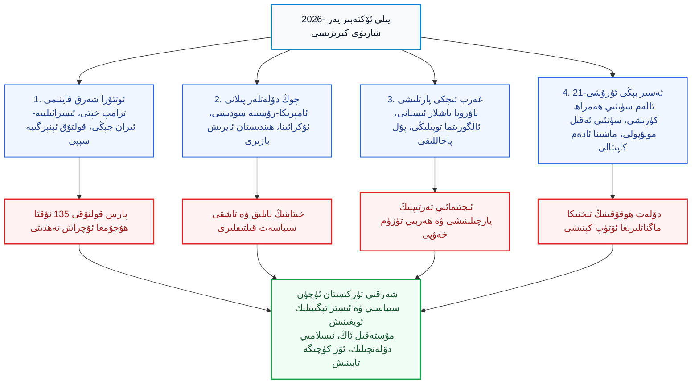
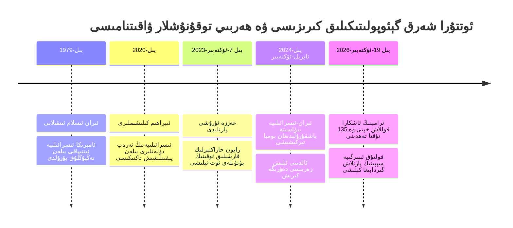
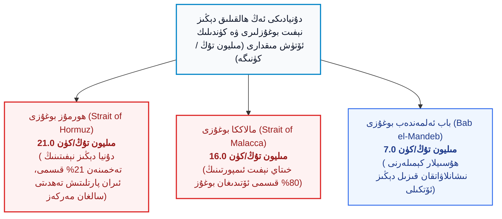

بِسْمِ اللَّهِ الرَّحْمَٰنِ الرَّحِيمِ

⏱ تەخمىنىي ئوقۇش ۋاقتى: 25 مىنۇت

2026-يىلىنىڭ ئۆكتەبىر كۈنلىرى پۈتكۈل يەر شارى خاراكتېرلىك سىياسىي، ھەربىي ۋە ئىقتىسادىي تەڭپۇڭلۇقنىڭ يىلتىزىدىن تەۋرەۋاتقان، كونا تۈزۈلمىلەر گۇمران بولۇپ، نامەلۇم ۋە زوراۋان يېڭى بىر دەۋرنىڭ دەرۋازىسى ئېچىلىۋاتقان بۇرۇلۇش نۇقتىسىغا شاھىت بولماقتا. ئوتتۇرا شەرقتە ترامپنىڭ نەتىنياھۇغا ئەۋەتكەن مەخسۇس قوللاش مەكتۇپى، ئىسرائىلىيە بىلەن ئىران ئوتتۇرىسىدىكى بىر-بىرىگە تۇيۇقسىز زەربە بېرىش تەھدىتلىرى ۋە پارس قولتۇقىدىكى 135 تىن ئارتۇق ئېنېرگىيە، سانلىق مەلۇمات مەركەزلىرىنىڭ بىۋاسىتە ھۇجۇم نىشانىغا ئايلىنىش ئېھتىماللىقى پۈتكۈل دۇنيانى ھالاكەت سېنارىيەسىگە سۆرەپ كىرمەكتە. بۇنىڭ بىلەن بىر ۋاقىتتا، ئۇكرائىنا-رۇسىيە ئۇرۇشىنىڭ پەردە ئارقىسىدىكى بۈيۈك سودىلىشىشلار، پۈتكۈل غەربىي ياۋروپانى سىلكىۋاتقان كوچا توپىلاڭلىرى ۋە ئىجتىمائىي ئىسيانلار، يەر يۈزىدىكى ئىنتېرنېت كابېللىرىدىن ئالەم پەرۋازىدىكى سۈنئىي ھەمراھلارغا قاراپ يۈزلەنگەن ئالەم ئۇرۇشلىرى، ھەمدە ئىنسانىيەتنىڭ ئەمگىكىنى تارتىۋېلىپ بىر قانچە مونۇپول گىگانتلارغا مەركەزلەشتۈرۈۋاتقان سۈنئىي ئەقىل ئولىگارخىيەسى بىر-بىرى بىلەن زىچ باغلانغان زەنجىرسىمان كىرىزىسلارنى ئوتتۇرىغا چىقارماقتا. مەزكۇر چوڭقۇر تەھلىلىي ماقالىمىزدە، خەلقئارالىق سىياسىي كۆزەتكۈچى ۋە ئىستراتېگ ئابدۇللاھ چىفتچىنىڭ ئەڭ يېڭى ئانالىزلىرى ئاساسىدا، دۇنيانى تەۋرىتىۋاتقان گېئوپولىتىكىلىق پىلتىلار بايان قىلىنىدۇ؛ شۇنىڭ بىلەن بىر ۋاقىتتا تاجاۋۇزچى خىتاينىڭ بۇ تاشقى داۋالغۇشلاردىن قانداق مەنپەئەتلىنىشكە ئۇرۇنۇۋاتقانلىقى پاش قىلىنىپ، ئەسىردىن بۇيان زۇلۇم ئاستىدا ياشاۋاتقان شەرقىي تۈركىستاننىڭ مۇستەقىللىق دەۋاسى، مىللىي ئويغىنىشى ۋە ئەركىنلىك كۈرىشى ئۈچۈن تارىخىي ۋە ئەمەلىي ئىستراتېگىيەلىك ساۋاقلار يورۇتۇپ بېرىلىدۇ.

<!-- Image 1 -->

---

## 1. ماقالىنىڭ ئومۇمىي قۇرۇلمىسى ۋە كۈچ تىركىشىش سىستېمىسى

نۆۋەتتىكى خەلقئارالىق كىرىزىس نوقۇل بىر رايوننىڭ ياكى دۆلەتنىڭ مەسىلىسى ئەمەس، بەلكى يەر شارىۋى كاپىتال، ئېنېرگىيە كۆچۈشى، ھەربىي بىخەتەرلىك ۋە پەن-تېخنىكا كۈچلىرىنىڭ تۈپتىن قايتا بۆلۈنۈشىدۇر. دۇنيانىڭ ئالدىنقى قاتاردىكى قۇدرەتلىك مەركەزلىرى ئۆزلىرىنىڭ ئىچكى ۋەيرانچىلىقى ۋە ھاكىمىيەت كىرىزىسىنى سىرتقا يۆتكەش ئۈچۈن قارشى تەرەپنى قەستەن تەھدىتكە سالماقتا.

*(1-سىخېما: 2026-يىلى ئۆكتەبىر يەر شارىۋى كىرىزىسىنىڭ ئاساسىي تارماقلىرى ۋە شەرقىي تۈركىستان مەسىلىسىگە كۆرسىتىدىغان تەسىر زەنجىرى)*

---

## 2. ئوتتۇرا شەرق پىلتىسى: ترامپنىڭ خېتى، نەتىنياھۇ ۋە قولتۇق ھالاكىتى

ئوتتۇرا شەرقتىكى ۋەزىيەت 2026-يىلى 19-ئۆكتەبىر كۈنىدىن باشلاپ پۈتۈنلەي تىزگىندىن چىقىش گىردابىغا يەتتى. ئامېرىكىنىڭ سابىق ۋە نۆۋەتتىكى پىرېزىدېنت نامزاتى <dfn title="دونالد ترامپ (Donald Trump): ئامېرىكىنىڭ 45-نۆۋەتلىك پىرېزىدېنتى، تاشقى سىياسەتتە ئەنئەنىۋى كۆپ تەرەپلىمىلىكتىن ۋاز كېچىپ، كۈچلۈك بىر تەرەپلىمىلىك ۋە سودىگەرچە سودىلىشىش تاكتىكىسىنى قوللىنىدىغان رەھبەر.">دونالد ترامپ (Donald Trump)</dfn> ئىسرائىلىيە باش مىنىستىرى <dfn title="بىنيامىن نەتىنياھۇ (Benjamin Netanyahu): ئىسرائىلىيەنىڭ ئەڭ ئۇزۇن ۋەزىپە ئۆتىگەن ئوڭ قانات باش مىنىستىرى، ھەربىي كېڭەيمىچىلىك ۋە ئىرانغا قارشى رايونلۇق يوقىتىش ئۇرۇشىنى يادرو قىلغان رەھبەر.">بىنيامىن نەتىنياھۇ (Benjamin Netanyahu)</dfn> ئۈچۈن ئاشكارا مەكتۇپ ئېلان قىلىپ، ئىسرائىلىيە خەلقىنى نەتىنياھۇنى قەتئىي قوللاشقا چاقىردى. ئامېرىكا سىياسىي تارىخىدا بىر پىرېزىدېنتنىڭ ئىسرائىلىيەدىكى سايلامغا بۇ قەدەر بىۋاسىتە ۋە ئاشكارا ئارىلىشىپ، «بىزنىڭ ئىران بىلەن تۈگەتمىگەن ھېساباتىمىز بار، ئۇنى پەقەت نەتىنياھۇ بىلەن بىرلىكتە تاماملايمىز، ئەگەر باشقا بىرى سايلانسا مەن يالغۇز قېلىپ قىينىلىپ قالىمەن» دەپ بايانات بېرىشى مىسلىسىز بىر ھادىسىدۇر. بۇ مەكتۇپ ئىسرائىلىيە ئىچكى سىياسىتىدىكى تېنچلىقپەرۋەر ۋە مۆتىدىل پارتىيەلەرنىڭ رەھبەرلىرىنى سايلامدىن چېكىنىشكە مەجبۇر قىلدى ھەمدە ئىسرائىلىيە ھەربىي سەرخىللىرىگە تۇيۇقسىز تاجاۋۇزچىلىق بېلىتىنى سۇندى.

بۇ ئەھۋال نوقۇل بىر سىياسىي تەشۋىقات بولماستىن، ئەكسىچە كەڭ كۆلەملىك رايون ئۇرۇشىنىڭ پىلتىسىنى ياندۇرۇش سىگنالىدۇر. دەرۋەقە، ئىسرائىلىيە تەرەپ ئامېرىكىنىڭ ياردىمى بولمىسىمۇ ئىرانغا قارىتا <dfn title="تەھدىت يوقىتىش ھۇجۇمى (Preemptive Strike): قارشى تەرەپ ھۇجۇم قىلىشتىن بۇرۇن، ئۇنىڭ ھەربىي، يادرو ياكى ئىستراتېگىيىلىك ئەسلىھەلىرىنى تەلتۆكۈس پاچاقلاپ تاشلاش مەقسىتىدە ئېلىپ بېرىلىدىغان دەسلەپكى تۇيۇقسىز زەربە.">«ئالدىنى ئېلىش زەربىسى» (Preemptive Strike)</dfn> بېرىشكە تەييار ئىكەنلىكىنى ئوتتۇرىغا قويدى. بۇنىڭغا جاۋابەن، ئىراننىڭ يېڭى تەيىنلەنگەن مۇداپىئە مىنىستىرى ۋە ئىنقىلاب مۇھاپىزەتچىلىرى قوشۇنى ھەربىي تەييارلىقنى ئەڭ يۇقىرى چەككە كۆتۈرۈپ، «بىزمۇ ئامېرىكا ۋە ئىسرائىلىيەگە تۇنجى بولۇپ زەربە بېرىشكە، بىر ھەپتە ئىچىدە يادرو بازىلىرىمىزنىڭ ئىشىكىنى ئېچىپ دۇنياغا جاۋاب قايتۇرۇشقا قادىرمىز» دەپ تەھدىت سالدى.

بۇ قورقۇنچلۇق تىركىشىشنىڭ پۈتكۈل ئىنسانىيەتكە سالىدىغان ئەڭ چوڭ ۋەھىمىسى ئوتتۇرا شەرقتىكى ئېنېرگىيە تومۇرىنىڭ پۈتۈنلەي تۇمشۇقلىنىشىدۇر. ئىران ھەربىي دائىرىلىرى ئەگەر ئۆزلىرىگە ھۇجۇم قىلىنسا، قاتار، كۇۋەيت، بەھرەين، ئەرەب بىرلەشمە خەلىپىلىكى ۋە سەئۇدى ئەرەبىستانىدىكى تەخمىنەن 135 تال ھاياتىي مۇھىم نېفىت پىششىقلاپ ئىشلەش، سۇ تاتلىقلاش، تېلېگراف ۋە سۈنئىي ئەقىل سانلىق مەلۇمات مەركەزلىرىنى بىۋاسىتە ۋەيران قىلىدىغانلىقىنى ئېلان قىلدى. پارس قولتۇقى ۋە <dfn title="ھورمۇز بوغۇزى (Strait of Hormuz): پارس قولتۇقىنى ئوممان قولتۇقى ۋە ھىندى ئوكيان بىلەن تۇتاشتۇرىدىغان، دۇنيا دېڭىز نېفىت سودىسىنىڭ تەخمىنەن بەشتىن بىرى ئۆتىدىغان ئەڭ ھالقىلىق گېئوپولىتىكىلىق بوغۇز.">ھورمۇز بوغۇزى (Strait of Hormuz)</dfn> دۇنيا نېفىت ئېھتىياجىنىڭ مىسلىسىز قىسمىنى تەمىنلەيدىغان ئورۇن بولۇپ، بۇ رايون پارتلىسا دۇنيا بازىرىدا بىر تۇڭ نېفىتنىڭ باھاسى نەچچە ھەسسە ئۆرلەپ، پۈتكۈل قىتئەلەردە كونترولسىز پۇل پاخاللىقى ۋە ئاچارچىلىق ئاپىتى يۈز بېرىشى مۇقەررەردۇر.

<!-- Image 2 -->

تۆۋەندىكى تارىخىي ۋە جەڭگىۋار ۋەقەلەرنىڭ ۋاقىتنامە سىخېمىسىدا، پارس قولتۇقى ۋە ئوتتۇرا شەرقتىكى كىرىزىسنىڭ قانداق قىلىپ كۈنسېرى كەسكىنلىشىپ بۈگۈنكى پارتلاش نۇقتىسىغا يەتكەنلىكى ئېنىق كۆرسىتىلگەن:

*(2-سىخېما: ئوتتۇرا شەرق ۋە قولتۇق رايونىدىكى تارىخىي كۈچ تىركىشىشى ۋە 2026-يىللىق بۇرۇلۇش دەۋرى)*

بۇنىڭغا قوشۇلۇپ، يەمەندىكى <dfn title="ھۇسىيلار (ئەنسارۇللاھ ھەرىكىتى): يەمەننىڭ تاغلىق رايونلىرىدا شەكىللەنگەن، قورال-ياراغلىرىنى تاغلار ئاستىدا ئىشلەپچىقىرىدىغان، قىزىل دېڭىز كېمە قاتنىشى ۋە رايونلۇق ئېنېرگىيە لىنىيەلىرىگە قارشى تۇرۇۋاتقان جەڭگىۋار قوراللىق ھەرىكەت.">ھۇسىيلار (Houthi Movement)</dfn> نىڭ تاغ قىيانلىرىدا ئۆز ئالدىغا قورال-ياراغ ئىشلەپچىقىرىپ، پارس قولتۇقىدىكى 35 تىن ئارتۇق نېفىت تانكېرلىرىنى يۇقىرى تېخنىكىلىق، سۈنئىي ئەقىل ئارقىلىق يىراقتىن كونترول قىلىنىدىغان سۇ ئاستى پارتلاتقۇچلىرى بىلەن دەل كېمىنىڭ ئارقا رولى ۋە موتورىدىن تېشىپ تاشلىشى ئۇرۇشنىڭ تۈسىنى ئۆزگەرتتى. سەئۇدى ئەرەبىستانى نوقۇل ئاتالمىش ئەرەب بىرلەشمە كۈچى بىلەن بۇ ھەرىكەتنى توسۇيالماي، پاكىستان، مىسىر، تۈركىيە، ھەتتا فىرانسيە ۋە گىرېتسىيەدىن مۇداپىئە خاراكتېرلىك ئەسكەر تەلەپ قىلىشقا مەجبۇر بولدى. بۇ ھالەت نوقۇل بىر رايونلۇق بەقەم ئەمەس، بەلكى كونا دۇنيا ئېنېرگىيە خەرىتىسىنىڭ ۋەيران بولۇشىدۇر.

---

## 3. چوڭ كۈچلەر سودىسى: ئامېرىكا-رۇسىيە مەخپىي پىلانى، ئۇكرائىنا ۋە ياۋروپانىڭ تەڭقىسلىقى

پەردە ئارقىسىدىكى بۈيۈك گېئوپولىتىكىلىق شاھماتقا نەزەر سالساق، ئامېرىكا سىياسىتىنىڭ قانچىلىك پىراگماتىك، شەپقەتسىز ۋە مەپكۇرەسىز ئىكەنلىكىنى كۆرىمىز. ئامېرىكىنىڭ تاشقى ئىشلار مىنىستىرى <dfn title="ماركو رۇبىئو (Marco Rubio): ئامېرىكىنىڭ دۆلەت ئىشلىرى مىنىستىرى، خىتايغا قارشى قاتتىق پوزىتسىيەسى بىلەن تونۇلغان، ئەمما ھازىرقى ھاكىمىيەتنىڭ رايونلۇق ئېنېرگىيە ۋە تاشقى سىياسەت تەڭشەشلىرىنى ئەمەلىيلەشتۈرۈۋاتقان دىپلومات.">ماركو رۇبىئو (Marco Rubio)</dfn> ھىندىستانغا سەپەر قىلىپ، رۇسىيە نېفىتىنى قايتا پىششىقلاپ ياۋروپاغا يوشۇرۇن ساتىدىغان ماگنات ئايرىش بازىلىرىنى كۆزدىن كەچۈرمەكتە. ترامپ گورۇھى رۇسىيە بىلەن دىزېل ۋە ئېنېرگىيە سودىسى توغرىسىدا كېلىشىملەرنى تۈزۈپ، ئۇكرائىنا پىرېزىدېنتى <dfn title="ۋولودىمىر زېلېنسكىي (Volodymyr Zelenskyy): ئۇكرائىنا پىرېزىدېنتى، 2022-يىلدىن بۇيان رۇسىيە تاجاۋۇزچىلىقىغا قارشى كۈرەشكە رەھبەرلىك قىلىپ كېلىۋاتقان، ئەمما نۆۋەتتە غەرب ئىتتىپاقداشلىرىنىڭ سىياسىي بېسىمى ۋە ھەربىي ياردەمنى كېسىپ تاشلاش تەھدىتىگە ئۇچراۋاتقان رەھبەر.">ۋولودىمىر زېلېنسكىي (Volodymyr Zelenskyy)</dfn> نى ئۇرۇشنى ئاخىرلاشتۇرۇش ئۈچۈن قورشاۋغا ئالماقتا.

ترامپ زېلېنسكىينى غەرب ئەللىرى ئەۋەتكەن مىلياردلىغان دوللار ياردەملەرنى خورىتىۋېتىپ، 2022-يىلى ئىستانبۇلدا پۇرسەت بار چاغدا تىنچلىق ئورناتمىغان، ئەمدى بولسا رۇسىيە بىلەن بولغان نېفىت تۇرۇبا لىنىيەلىرىنى قايتا ئېچىشنى رەت قىلىۋاتىدۇ دەپ پۈتۈن كۈچى بىلەن ئەيىبلىمەكتە. ئامېرىكا ئۆزىنىڭ سۈنئىي ھەمراھ كۆزىتىش سىستېمىسى بولغان <dfn title="ستارلىنك (Starlink): ئېلون ماسكنىڭ شىركىتى SpaceX تەرىپىدىن ئالەمگە قويۇپ بېرىلگەن، تۆۋەن ئوربىتىلىق مىڭلىغان سۈنئىي ھەمراھلار ئارقىلىق پۈتۈن يەر شارىنى يۇقىرى سۈرئەتلىك ئىنتېرنېت بىلەن تەمىنلەيدىغان ۋە ھازىرقى زامان ئۇرۇشلىرىدا ھەل قىلغۇچ ئورۇن تۇتىدىغان تور.">«ستارلىنك» (Starlink)</dfn> نى ئۇكرائىنادا قەستەن ئاستىلىتىپ ياكى ئۈزۈپ تاشلاپ، زېلېنسكىينى تەسلىم بولۇش كېلىشىمىگە ئىمزا قويۇشقا مەجبۇرلىماقتا. بۇ ئەھۋاللار قەدىمكى دۇنيا تارىخىدا بۈيۈك ئىمپېرىيەلەرنىڭ ئۆز تۇغى ئاستىغا كىرگەن ئاجىز ئىتتىپاقداشلىرىنى مەنپەئەت توشقاندا قانداق قۇربان قىلىپ تاشلايدىغانلىقىنىڭ ئەينەن زامانىۋى كارتىنىسىدۇر.

يەنە بىر تەرەپتىن، غەربىي ياۋروپا نۆۋەتتە ئەڭ ئېچىنىشلىق كۈلپەتتە قالدى. 20-ئەسىردە ياۋروپا مىللەتلىرى ئۆزلىرىنى «تىنچلىق رايونى» ئاتاپ، ھەربىي بىخەتەرلىكىنى پۈتۈنلەي ئامېرىكىغا، ئەرزان ئېنېرگىيەنى رۇسىيەگە، ئەرزان ئىستېمال ماللىرىنى بولسا تاجاۋۇزچى خىتايغا تايىنىپ ھەل قىلىشقا كۆنۈپ قېلىپ، نەچچە ئون يىل داۋامىدا خۇشامەتچىلىك ئۇيقۇسىدا ياتتى. ئەمدىلىكتە ئامېرىكا ئۇلارغا يۈز ئۆرۈپ بىخەتەرلىك چىقىمىنى تەلەپ قىلماقتا، رۇسىيە بىلەن بولغان تەبىئىي گاز ۋە ئېنېرگىيە تۈگىدى، خىتاينىڭ ئەرزان توكسۇن كېڭەيمىچىلىكى ياۋروپانىڭ ئۆز سانائىتىنى ۋەيران قىلىپ، گېرمانىيە ۋە فىرانسيەنىڭ زاۋۇتلىرىنى ۋەيران قىلدى.

<!-- Image 3 -->

تۆۋەندىكى ستاتىستىكا دىئاگراممىسى ۋە سېلىشتۇرما جەدۋەلدە، دۇنيا بويىچە يېپىق ھالەتكە چۈشۈپ قېلىش خەۋپى ئاستىدا تۇرغان ئىستراتېگىيىلىك دېڭىز ئېنېرگىيە ئۆتكىلى بىلەن خىتاينىڭ بېقىنىش لىنىيەلىرى تەمىنلەنگەن:

*(3-سىخېما: يەر شارىۋى دېڭىز ئېنېرگىيە بوغۇزلىرىنىڭ كۈندىلىك تىرانسپورت مىقدارى ۋە پارتلاش نۇقتىلىرى سېلىشتۇرمىسى)*

### دۇنياۋى ھالقىلىق دېڭىز بوغۇزلىرىنىڭ تۈزۈلمىلىك خەۋپ ستاتىستىكىسى:

| بوغۇز نامى | كۈندىلىك نېفىت ئۆتۈش كۆلىمى | پۈتۈن دۇنيا دېڭىز نېفىتىدىكى ئۈلۈشى | نۆۋەتتىكى ھەربىي تەھدىت ۋە خەۋپ دەرىجىسى | ئاساسلىق تەسىرگە ئۇچرىغۇچى قۇۋۋەت |
| :--- | :--- | :--- | :--- | :--- |
| **ھورمۇز بوغۇزى** | 21 مىليون تۇڭ | تەخمىنەن 21% | ئىنتايىن يۇقىرى (ئىران تۇمشۇقلاش ۋە پارس قولتۇقى ھۇجۇمى) | ياپونىيە، ياۋروپا، خىتاي، ھىندىستان |
| **مالاككا بوغۇزى** | 16 مىليون تۇڭ | تەخمىنەن 16% | يۇقىرى («مالاككا قىسىلمىسى»، ئامېرىكا دېڭىز ئېمبارگوسى خەۋپى) | تاجاۋۇزچى خىتاي، شەرقىي ئاسىيا دۆلەتلىرى |
| **باب ئەلمەندەب بوغۇزى** | 7 مىليون تۇڭ | تەخمىنەن 7% | داۋاملىق ئېتىشىش (ھۇسىيلار باشقۇرۇلىدىغان بومبا ۋە درون ھۇجۇملىرى) | سۇۋەيش قانىلى ئارقىلىق ياۋروپاغا بارىدىغان سودا |
| **دۆڭگۈلۈك ئۈمىد تۇمشۇقى** | 5.5 مىليون تۇڭ | تەخمىنەن 5.5% | ئوتتۇراھال (قىزىل دېڭىزدىن قاچقان پاراخوتلارنىڭ قوشۇمچە يولى) | تىرانسپورت ۋاقتى 14 كۈن ئۇزىرايدۇ، تەننەرخ 3 ھەسسە ئۆسىدۇ |

---

## 4. ياۋروپانى سىلكىۋاتقان كوچا توپىلاڭلىرى: ئالگورىتما دەۋرى ۋە ئىجتىمائىي زەنجىرنىڭ ئۈزۈلۈشى

دۇنيا بۈيۈك ئۇرۇش گىردابىغا كېلىپ قالغان پەيتتە، ياۋروپانىڭ شەھەر كوچىلىرى مىسلىسىز ئىچكى ئىسيان ئوتىدا كۆيمەكتە. فىرانسيەدە پەقەت بىرلا ھەپتە ئاخىرىدا 2400 ئادەم قولغا ئېلىنىپ، 1000 دىن ئارتۇق ژاندارما ۋە ساقچى ئېغىر يارىلاندى؛ تۆت چوڭ شەھەردە كەچ سائەت 8 دىن كېيىن كوچىغا چىقماسلىق بۇيرۇقى چىقىرىلدى. پورتۇگالىيە، ئىسپانىيە، ئىتالىيە، بېلگىيە ۋە ئالبانىيەدە ھۆكۈمەت بىنالىرى ۋە ئالىي سوت مەھكىمىلىرىگە ئوت قويۇلدى.

بۇ ھەرىكەتلەرنىڭ ئارقىسىدا ئادەتتىكى بىر نارازىلىق نامايىشى ئەمەس، بەلكى 21-ئەسىرگە خاس مۇرەككەپ تۆت چوڭ ئىجتىمائىي گۇرۇپپىنىڭ ئايرىم-ئايرىم غەزىپى تۇرماقتا:
1. **Z ئەۋلادى (ئوقۇغۇچىلار):** ئىجتىمائىي تاراتقۇلاردا ئۈستۈنكى تەبىقىنىڭ ھەددىدىن زىيادە داغدۇغىلىق داغدۇغىسىنى كۆرۈپ، ئۆزلىرىنىڭ كەلگۈسىگە قىلچە ئۈمىد قالماي، ئوقۇش ھەققى ۋە مائارىپ تەڭسىزلىكىگە قارشى پارتلىغان گۇرۇپپا؛
2. **ئوتتۇرا ۋە ئىشچىلار سىنىپى:** تۇرمۇش بۇيۇملىرىنىڭ ئۆسۈپ كېتىشى، پېنسىيە چەكلىمىلىرى، يېقىلغۇ قىممەتلىكى ۋە ھۆكۈمەتلەرنىڭ خامچوتنى قىسقارتىش سىياسەتلىرىگە تاقەت قىلالمىغان كەڭ خەلق؛
3. **كۆچمەنلەر ۋە ئاز سانلىقلار:** ياۋروپا ساقچىلىرىنىڭ ئىرقچىلىق بېسىمى، مەدەنىيەت چەتكە قېقىشى ۋە ھەق-ھوقۇقسىزلىقىدىن شىكايەت قىلىپ، سىستېمىدىن قىساس ئېلىش پوزىتسىيەسى بىلەن ساقچىلارغا قارشى تۇرۇۋاتقان ئاھالىلەر؛
4. **تالان-تاراجچىلار ۋە قالايمىقانچىلىقتىن مەنپەئەتلەنگۈچىلەر:** دۇكانلارنى چېقىپ، مۈلۈكلەرنى بۇلاپ مەنپەئەت يەتكۈزۈشكە كىرىشكەن، ئىجتىمائىي تۈزۈلمە يىقىلغاندا پەيدا بولىدىغان پۇرسەتپەرەسلەر.

<!-- Image 4 -->

ئەڭ قورقۇنچلۇقى، بۇ ئىسيانلار نوقۇل سىياسىي پارتىيەلەرنىڭ تەشكىللىشى بىلەن ئەمەس، بەلكى **ئىجتىمائىي تاراتقۇ ئالگورىتمىلىرى** نىڭ يېتەكچىلىكىدە تارقالماقتا. سۇبيېكتىپ ئالگورىتمىلار ئاممىنىڭ پىسخىكىسىنى پۈتۈنلەي قۇتۇپلاشتۇرۇپ، دەقىقە ئىچىدە كىشىلەرنى مەيدانلارغا تۆكمەكتە. بۇنىڭ يەكۈنى ياۋروپا كوچىلىرىغا مىللىي ئارمىيەلەرنىڭ چۈشۈپ، پۈتۈن بىر قىتئەنىڭ ھەربىي ھالەت تۈزۈمىگە قايتىشىنى تېزلەتمەكتە. بىر دەۋرنىڭ باياشاتلىق ئاساسى تەلتۆكۈس يىمىرىلمەكتە.

---

## 5. 21-ئەسىر يېڭى ئۇرۇشى: ئالەم كۈرىشى، سۈنئىي ئەقىل ئولىگارخىيەسى ۋە دۆلەتچىلىكنىڭ چېكىنىشى

دۇنيا تارىخىدا ھاكىمىيەتنىڭ شەكلى بايلىق ۋە تېخنىكىنى تىزگىنلەش ئارقىلىق بېكىتىلگەن. بۈگۈنكى كۈندە ئۇرۇش ۋە ھۆكۈمرانلىق يەر يۈزىدىن كۆتۈرۈلۈپ ئالەم بوشلۇقىغا كۆچتى. ئالەم بوشلۇقى نوقۇل ئاسترونومىيەلىك تەتقىقات ئورنى بولۇپ قالماستىن، ئەكسىچە دۇنيانىڭ ئالاقە تومۇرى، ئىستىخبارات كۆزى ۋە ئېنېرگىيە سېپىگە ئايلاندى:

1. **دېڭىز ئاستى كابېللىرىدىن ئالەم سۈنئىي ھەمراھ تورىغا كۆچۈش:** يەر يۈزىدىكى نۇر كابېللىرىنى مىللىي دۆلەتلەر كېسىۋېتەلەيتتى ياكى تىزگىنلىيەلەيتتى. شۇڭا يەر شارىۋى بۈيۈك ماگناتلار پۈتكۈل ئالاقىنى ئالەمگە چىقىرىپ، يەر يۈزى دۆلەتلىرىنىڭ ئىنتېرنېتنى ئۈزۈپ تاشلاش ھوقۇقىنى تارتىۋالماقتا؛
2. **ئالەم سانلىق مەلۇمات مەركەزلىرى ۋە ئېنېرگىيە توپلاش:** ئالەم بوشلۇقىدا قۇياش نۇرى تاختىلىرى ئارقىلىق چەكسىز ئېنېرگىيە توپلاپ، يەر شارىدىكى قوبۇللىغۇچلارغا نۇرلاندۇرۇش تەتقىقاتلىرى ۋە ئاي شارىدىكى ئىستراتېگىيىلىك ئۆتكەللەرنى بېسىۋېلىش بەيگىسى رەسمىي باشلاندى؛
3. **سۈنئىي ئەقىل ۋە ماشىنا ئادەم كاپىتالىنىڭ زىددىيىتى:** دۇنيانىڭ ئەڭ باي ماگناتلىرى (ئېلون ماسك، رەي دالىئو، بىلل گەيتس) «ماشىنا ئادەملەر بارلىق ئىشلەپچىقىرىشنى ئۆز ئۈستىگە ئالىدۇ، ئىنسانلارنىڭ ئىشلىشى ھاجەتسىز بولىدۇ» دەپ تاتلىق ۋەدىلەرنى بەرگەن بىلەن، تارىخ شۇنى كۆرسەتتىكى، زېمىن ۋە زاۋۇت كىمنىڭ قولىدا بولسا، مەنپەئەت پەقەت شۇلارغا ئاقىدۇ. سانائەتكە سۈنئىي ئەقىل كىرگەنسېرى، ھەم ئاق ياقىلىقلار (زىيالىيلار، پروگراممېرلار، ھېساباتچىلار) ھەم كۆك ياقىلىقلار (زاۋۇت ۋە قۇرۇلۇش ئىشچىلىرى) مىسلىسىز ئىشسىزلىق ئارمىيەسىگە ئايلىنىدۇ؛
4. **دۆلەت باج تۈزۈلمىسىنىڭ كرىزىسى ۋە مەركەزسىز پۇللار:** دۆلەتلەر ئەڭ ئاسان باجنى ئادەتتىكى مائاشلىق خادىملاردىن يىغاتتى. ئىشچىلار تۈگىگەندە، دۆلەتلەر خامچوت جەھەتتىن قۇرۇغدىلىپ، چوڭ پەن-تېخنىكا كارخانىلىرى چىقارغان مەۋھۇم پۇللار (كۆپ خىل شىفىرلىق پۇل ۋە سىتېبىلكويىنلار) ئالدىدا پۈتۈنلەي تىز پۈكىدۇ. خەلقنىڭ ياشاش مائاشى دەپ ئاتالغان «ئومۇمىي ئاساسىي كىرىم» نى بېرىدىغان شىركەتلەر، ئىنسانلاردىن پۈتۈن ئەركىنلىكى ۋە روھىيىتىنى تەڭداشسىز ئەرزان باھادا تەسلىم قىلىشنى تەلەپ قىلىدۇ.

<!-- Image 5 -->

---

## 6. تۈركىيە ۋە تۈرك دۇنياسىنىڭ مۇداپىئە تەييارلىقى

بۇ غايەت زور يەر شارىۋى داۋالغۇش ئىچىدە، ئوتتۇرا شەرق ۋە تۈركىستان تۇپرىقى ئۈچۈن قارشىلىق كۆرسىتىۋاتقان ئۈچ چوڭ كۈچ تۈرۈلمىسى بار:
1. **ئىسرائىلىيەنىڭ كېڭەيمىچىلىك لايىھەسى:** «بۈيۈك ئىسرائىلىيە» نامىدا ئەتراپتىكى بارلىق ئەرەب ئەللىرىنى مۇستەملىكە ئاستىغا ئېلىش؛
2. **ئىراننىڭ رايون خاراكتېرلىك ھۆكۈمرانلىق لايىھەسى:** «پارس قولتۇقى بىزنىڭ، ئامېرىكا چىقىپ كەتسۇن» شوئارى ئاستىدا قولتۇقنى تولۇق ئۆز مەزھىپى ئاستىغا بويسۇندۇرۇش؛
3. **تۈركىيە ۋە تۈرك دۆلەتلىرى تەشكىلاتىنىڭ تىنچلىق ۋە قوغدىنىش سېپى:** بۇ ئىككى كېڭەيمىچى تەرەپ بىر-بىرىنى يوقىتىش ئۈچۈن قولتۇقنى كۆيدۈرۈۋاتقاندا، تۈركىيە ئۆزىنىڭ تەرەققىي قىلغان مۇداپىئە سانائىتى، زامانىۋى ئۇچقۇچىسىز ئايروپىلانلىرى ۋە مەككە مۇداپىئە ئەھدىنامىسى قاتارلىق ئىستراتېگىيىلىك ئورۇنلاشتۇرۇشلىرى بىلەن رايون خاراكتېرلىك تىنچلىق قەلئەسى بەرپا قىلماقتا.

ئەمما بىر دۆلەتنىڭ ئەڭ چوڭ تەھدىتى ھەرگىزمۇ تاشقى دۈشمەنلەردە ئەمەس، بەلكى ئۆز ئىچىدىكى پىكىرسىزلىك، پۇل پاخاللىقى، مائاش تەڭسىزلىكى ۋە كىچىك شەخسىي مەنپەئەتلەر ئۈچۈن بىر-بىرىنى يەۋاتقان ئىچكى زىددىيەتلەردىدۇر. ئەگەر تۈركىيە ۋە تۈرك دۇنياسى ئۆزىنىڭ ئىچكى ئىقتىسادىي ئادالىتىنى، مائارىپ سىستېمىسىنى ۋە بىرلىكىنى مۇستەھكەملىسە، بۇ ئەسىردە پەقەت ئۆزىنى قوغداپ قالماستىن، بەلكى كۈچلۈك بىر خەلقئارالىق قۇتۇپقا ئايلىنىدۇ.

---

## 7. تارىخىي ئىبرەتلەر زەنجىرى: ئىسلام، دۇنيا، خىتاي ۋە ئۇيغۇر تارىخىدىن دەلىللەر

بۈگۈنكى بۇ داۋالغۇش كىشىلەرگە تۇيۇقسىز ۋە يېڭىدەك تۇيۇلغىنى بىلەن، ئىنسانىيەتنىڭ تارىخى تەكرارلىنىپ تۇرىدىغان ئىبرەتلەر خەزىنىسىدۇر:

### 1) ئىسلام تارىخىدىن ئىبرەت: سالاھىددىن ئەييۇبىنىڭ بىرلىك ۋە پاراسەت ئىستراتېگىيەسى
ئوتتۇرا شەرق تارىخىدا ئەھلى سەلىپ قوشۇنلىرى پۈتكۈل مۇسۇلمان ئەللىرىنى بۆلۈپ، ھەر بىر ئەمىرلىكنى بىر-بىرىگە تىركەشتۈرۈپ قويغان قاراڭغۇ دەۋردە، بۈيۈك مۇجاھىد <dfn title="سۇلتان سالاھىددىن ئەييۇبى (1137–1193): ئەييۇبىيلار سۇلالىسىنىڭ ئاساسچىسى، قۇددۇسنى 1187-يىلى ھەتتىن جېڭى ئارقىلىق پۈتۈنلەي ئازاد قىلغان، ئادالەت، پاراسەت ۋە ھەربىي تەشكىلىي قۇۋۋەتنىڭ ئەڭ كاتتا ئۈلگىسى بولغان رەھبەر.">سۇلتان سالاھىددىن ئەييۇبى (1137–1193)</dfn> ئالدى بىلەن مىسىر ۋە شامدىكى ئىچكى ئېغىشلارنى تۈگىتىپ، مۇستەھكەم تەشكىلىي ئىتتىپاق بەرپا قىلغان. ئۇ دۈشمەننىڭ كۈچلۈكلىكىگە قاراپ ئۈمىدسىزلەنمەستىن، تاجاۋۇزچىلارنىڭ ئىچكى ئاچكۆزلۈكى ۋە چىرىكلىكىنى چوڭقۇر مۆلچەرلەپ، ۋاقتى كەلگەندە بىرلا ئەجەللىك زەربە بىلەن قۇددۇسنى قۇتقۇزۇپ چىققان. بۈگۈنكى ئىسلام دۇنياسى دۈشمەننىڭ قەغەز پىرەنىكلىرىگە ئالدانماي، ئۆزئارا بۆلۈنۈشنى تاشلاپ ئىتتىپاقلاشقاندىلا ئەركىنلىككە چىقالايدۇ.

<!-- Image 6 -->

### 2) دۇنيا تارىخىدىن ئىبرەت: رىم ئىمپېرىيەسىنىڭ ئىچكى يىمىرىلىشى
<dfn title="رىم ئىمپېرىيەسى (مىلادىدىن بۇرۇنقى 27 – مىلادى 476): ئوتتۇرا دېڭىز ھەۋزىسىنى تولۇق بېسىۋالغان، ئەمما ھەددىدىن زىيادە ھەربىي كېڭىيىش، ئىچكى چىرىكلىك، پۇل پاخاللىقى ۋە ئاممىنىڭ قوزغىلىشى نەتىجىسىدە غۇلاپ چۈشكەن غايەت زور كلاسسىك ئىمپېرىيە.">رىم ئىمپېرىيەسى (مىلادىدىن بۇرۇنقى 27 – مىلادى 476)</dfn> تارىختا دۇنيانىڭ بىردىنبىر زومىگىرى ئىدى. لېكىن ئىمپېرىيە ھەددىدىن زىيادە زېمىن بېسىۋېلىپ كېڭىيىپ كەتكەندە (Imperial Overstretch)، ئۆز چېگرالىرىنى قوغداشقا چىقىمى يەتمىدى؛ كۈمۈش پۇللارنىڭ مىقدارىنى ئازايتىپ ساختىلىق قىلىپ، خەلقنى مىسلىسىز باجغا باستۇردى؛ نەتىجىدە ھەشەمەتكە پاتقان پايتەخت رىم شىمالدىن كەلگەن جەڭگىۋار قەبىلىلەر ئالدىدا بىر كۈندىلا گۇمران بولدى. بۈگۈنكى ئامېرىكا ۋە خىتاينىڭ تاشقى قەرزگە پېتىپ، پۈتكۈل ئېنېرگىيە ۋە ھەربىي تەننەرخىنىڭ چېكىگە يېتىشى دەل رىمنىڭ زاۋاللىق يولىنى بېسىپ ماڭغانلىقىنىڭ ئوچۇق ئىسپاتىدۇر.

### 3) خىتاي تارىخىنىڭ قاراڭغۇلۇقىدىن ئىبرەت: چىن سۇلالىسىنىڭ زوراۋانلىق ئاپىتى
خىتاينىڭ بارلىق بەگلىكلەرنى قانغا بويىغان <dfn title="چىن سۇلالىسى (مىلادىدىن بۇرۇنقى 221 – 206): شاڭ ياڭنىڭ رەھىمسىز قانۇنچىلىق سىستېمىسىغا تايىنىپ، بارلىق بەگلىكلەرنى يۇتۇۋالغان، كىتابلارنى كۆيدۈرۈپ زىيالىيلارنى تىرىك كۆمگەن، زوراۋانلىق پەللىگە چىققاندا پەقەت 15 يىل ئىچىدە دېھقانلار قوزغىلىڭى بىلەن تەلتۆكۈس يوقىتىلغان خىتاي ھاكىمىيىتى.">چىن سۇلالىسى (مىلادىدىن بۇرۇنقى 221 – 206)</dfn> پۈتۈن مىللەتنىڭ ئەقلىنى نادانلاشتۇرۇپ، قانۇنچىلار (فاجيا) نىڭ قورقۇنچلۇق جازاسى ئارقىلىق خەلقنى قۇل قىلغان ئىدى. ئۇلار يۈز مىڭلىغان گۇناھسىز پۇقرالارنى سېپىل ۋە قەسىرلەرگە سېلىپ، ئۆزلىرىنى مىڭ ئەسىرلىك سەلتەنەت تۈزدۇق دەپ كۆرەڭلىگەن. ئەمما زۇلۇم پەللىگە يەتكەندە، قورالسىز، قولىغا ياغاچ كالتەك ئالغان چېن شېڭ ۋە ۋۇ گۇاڭ باشلىق يالاڭتۆش دېھقانلار پارتلىغان ھامان، دۇنيانى قورقۇتقان چىن ئارمىيەسى بار-يوقى 15 يىل ئىچىدە يەر بىلەن يەكسان بولۇپ يوقالدى. بۈگۈنكى تاجاۋۇزچى خىتاي كومپارتىيەسى شەرقىي تۈركىستاندا مىليونلىغان قېرىنداشلىرىمىزنى لاگېرلارغا بەنت قىلىپ، زامانىۋى دىگىتال كۆزىتىش كالتەكلىرى بىلەن دۇنياغا پو ئېتىۋاتقان بولسىمۇ، ئۇنىڭ كۆرۈنۈشتىكى قۇدرىتى قۇم ئۈستىگە قۇرۇلغان چىرىك سامان ئۆيدۇر.

<!-- Image 7 -->

### 4) ئۇيغۇر تارىخىنىڭ ئۈلگىلىرىدىن ئىبرەت: ئورخۇن، قاراخانىيلار ۋە 1933، 1944 جۇمھۇرىيەتلەر
ئەجدادلىرىمىز تارىختا مەدەنىيەتنىڭ، دۆلەتچىلىكنىڭ ۋە مۇستەقىل تەپەككۇرنىڭ ئەڭ پارلاق ئەۋرىشكىلىرىنى ياراتقان. <dfn title="قاراخانىيلار دەۋلىتى (مىلادى 840 – 1212): تۈرك-ئىسلام مەدەنىيىتىنىڭ تۇنجى ئۇلۇغ دۆلىتى، تۈركىستان زېمىنىدا ئىلىم-پەن، ئىسلامىي دۆلەتچىلىك، شەھەر مەدەنىيىتى ۋە 'قۇتادغۇ بىلىگ'تەك ئۆلمەس شادەۋرلەرنى بارلىققا كەلتۈرگەن قەھرىمان سەلتەنەت.">قاراخانىيلار دەۋلىتى (مىلادى 840 – 1212)</dfn> ئىسلام نۇرى بىلەن يۈكسەك تۈرك دۆلەتچىلىكىنى بىرلەشتۈرۈپ، قەشقەرنى دۇنيانىڭ ئىلىم پايتەختىگە ئايلاندۇرغان؛ <dfn title="شەرقىي تۈركىستان ئىسلام جۇمھۇرىيىتى (1933–1934): قەشقەردە ئېلان قىلىنغان، تۈرك-ئىسلام دۇنياسىدىكى ئىنتايىن ئىلغار، زامانىۋى قوراللىق مىللىي ئارمىيەگە ۋە ئاساسىي قانۇنغا ئىگە تۇنجى جۇمھۇرىيەتلەرنىڭ بىرى.">1933-يىلى قەشقەردە قۇرۇلغان شەرقىي تۈركىستان ئىسلام جۇمھۇرىيىتى</dfn> ۋە <dfn title="شەرقىي تۈركىستان جۇمھۇرىيىتى (1944–1949): غۇلجىدا مەشئىلى يېقىلغان، تەرتىپلىك 30 مىڭ كىشىلىك مىللىي ئارمىيە قۇرۇپ خىتاي تاجاۋۇزچىلىرىنى ماۋنۇرغۇندەك زەربە بىلەن سۈپۈرۈپ تاشلىغان پولاتتەك جۇمھۇرىيەت.">1944-يىلى غۇلجىدا قۇرۇلغان شەرقىي تۈركىستان جۇمھۇرىيىتى</dfn> ئۆز زامانىسىنىڭ كۈچلۈك ئىمپېرىيەلىرىنىڭ شاھمات تېشىغا ئايلانماي، مىللىي قوشۇن تۈزۈپ، زامانىۋى مائارىپ بەرپا قىلىپ، تاجاۋۇزچى خىتاي ئارمىيەلىرىنى تارمار قىلىپ ئۆز كۈچىگە تايىنىش ئىرادىسىنى نامايان قىلغان. ئەجدادلىرىمىز ھەرگىزمۇ كىشىلەر گۇمان قىلغاندەك ئاجىز، بېچارە ياكى تاجاۋۇزچى خىتاي چاپلاۋاتقان يالغان بۆھتانلاردەك «تېررورچى» ئەمەس، بەلكى پاراسەتلىك، يۈكسەك شەھەر مەدەنىيىتى ياراتقان، ئىنسانىي ئەركىنلىك ۋە ئادالەتنى سۆيىدىغان، تاجاۋۇزچىلىققا تىز پۈكمەيدىغان باتۇر مىللەتتۇر.

---

## 8. شەرقىي تۈركىستان ئۈچۈن سىياسىي ۋە ئىستراتېگىيىلىك ئويغىنىش تەھلىلى

نۆۋەتتىكى يەر شارىۋى داۋالغۇشتا تاجاۋۇزچى خىتاينىڭ ئەڭ پاتقان پاتقىقى دەل شەرقىي تۈركىستاننى پۈتۈنلەي قورشاۋ ئاستىدا تۇتۇپ، ئۆزىنىڭ ئاتالمىش «بىر بەلباغ بىر يول» ئالدامچىلىقىنى داۋاملاشتۇرۇشقا ئۇرۇنۇشىدۇر. ھالبۇكى، يۇقىرىدىكى گېئوپولىتىكىلىق پاكىتلار كۆرسەتكەندەك:

1. **خىتاينىڭ ھاياتىي ئېنېرگىيە تومۇرى پۈتۈنلەي تاشقى دۇنياغا تايىنىدۇ:** خىتاينىڭ نېفىت ئىمپورتىنىڭ 50% تىن 60% كىچە بولغان قىسمى دەل ھازىر ئۇرۇش گىردابىغا كەلگەن ئوتتۇرا شەرق ۋە پارس قولتۇقىدىن كېلىدۇ. ئەگەر قولتۇقتىكى 135 ئېنېرگىيە مەركىزى ئۇرۇش پىلتىسىدە پارتلىسا، خىتاينىڭ بارلىق تاشقى سودىسى، سانائىتى ۋە ھەربىي بازىلىرى بىر نەچچە ھەپتە ئىچىدە توختاپ قالىدۇ؛
2. **مالاككا بوغۇزىنىڭ بېسىمى ۋە شەرقىي تۈركىستان تۇپرىقىنىڭ سۈمۈرۈلۈشى:** خىتاي ئۆزىنىڭ نېفىت ئېھتىياجىنىڭ مالاككا بوغۇزىدىن ئۆتىدىغانلىقىنى ۋە ئۇ كېسىلگەندە ھالاك بولىدىغانلىقىنى بىلگەنلىكتىن، مەجبۇرىي ھالدا شەرقىي تۈركىستان، پاكىستان ۋە ئوتتۇرا ئاسىيا ئارقىلىق قۇرۇقلۇق نېفىت تۇرۇبىسى تارتىشقا جىددىي كىرىشمەكتە. بۇ زېمىننى ساقلاپ قېلىش ئۈچۈن خىتاي خەلقىمىزگە پۈتۈنلەي مەدەنىيەت قىرغىنچىلىقى ئېلىپ بارماقتا. ئەمما خەلقئارالىق قەرز كىرىزىسى ۋە ئىچكى پۇل پاخاللىقى خىتاينىڭ بۇ تاشقى تۈرلىرىنى ۋەيران قىلىشقا باشلىدى؛
3. **ئۈمىدسىزلىك پىسخىكىسىنى سۇندۇرۇش ۋە خەلقئارالىق پۇرسەت دېرىزىسى:** دۇنيادىكى بارلىق مۇستەبىت كۈچلەر ئۆز ئىچىدىن پارچىلىنىپ، يەر شارىۋى كۈچ بوشلۇقى شەكىللىنىۋاتقان مۇشۇ دەۋردە، بىز شەرقىي تۈركىستان خەلقى بىلىشىمىز شەرتكى، خىتاي ھەرگىزمۇ چۆكمەس كېمە ئەمەس. دەل ئەكسىچە، ئىچى چىرىگەن، تاشقى كىرىزىسلارغا بەرداشلىق بېرەلمەيدىغان غايەت زور زوراۋانلىق سىستېمىسىدۇر. دۇنياۋى پارتلاشنىڭ دولقۇنى خىتاينىڭ ئىچكى قورشاۋلىرىنى بىردىن-بىردىن تارمار قىلىدۇ.

<!-- Image 8 -->

### مىللىي مۇستەقىللىق كۈرىشىمىز ئۈچۈن 5 چوڭ ئەمەلىي مىللىي پايدا:

1. **غەربنىڭ ساختىلىقىغا ياكى قۇرۇق ۋەدىلەرگە قەتئىي باغلانماسلىق:** ئامېرىكىنىڭ ئۇكرائىنانى بىر كېچىدىلا قۇربان قىلىشقا تەييار تۇرغانلىقى شۇنى كۆرسەتتىكى، ھېچقانداق چوڭ دۆلەت باشقا بىر مىللەتنىڭ ئەركىنلىكى ئۈچۈن ئۇرۇش قىلمايدۇ. بىزنىڭ مىللىي كۈرىشىمىز پەقەت ئۆزىمىزنىڭ مىللىي غۇرۇرى، ھەقىقىي ئىمانى ۋە يۈكسەك ئىرادىمىزگە تايىنىشى شەرت؛
2. **پەن-تېخنىكا، ئۇچۇر ۋە رەقەملىك كۈچنى قورال قىلىش:** ئۇرۇشنىڭ كۈنىمىزدە يەر ئاستى ۋە ئالەمگە كۆچكەنلىكىنى بىلىپ، پۈتكۈل ياشلىرىمىز سۈنئىي ئەقىل، رەقەملىك تور بىخەتەرلىكى ۋە ئىستراتېگىيىلىك ئاخبارات ساھەلىرىدە دۇنيانىڭ ئەڭ يۇقىرى پەللىلىرىگە چىقىشى لازىم. زامانىۋى تېخنىكىنى بىلمەيدىغان مىللەت، پىكىرسىز قۇللۇق قىلتىقىغا چۈشۈپ كېتىدۇ؛
3. **ئىچكى تەشكىلىي قۇۋۋەت ۋە دۆلەتچىلىك ئىقتىدارىنى كۈچەيتىش:** تارىخ شۇنى دەلىللىدىكى، خەلقنى بىرلەشتۈرگەن نەرسە قۇرۇق پاراڭ ئەمەس، بەلكى كۈچلۈك مەسئۇلىيەتچان رەھبەرلىك ۋە ئادالەت تۈزۈمىدۇر. شەرقىي تۈركىستان مىللىي كۈرىشى قۇرۇق ئېقىملار بىلەن ئەمەس، ئەركىنلىك، ئادالەت ۋە ئىسلامىي دۆلەتچىلىك روھى بىلەن بىر پۈتۈن تەشكىلاتقا ئايلىنىشى شەرت؛
4. **تاجاۋۇزچى خىتاينىڭ ساختا ھېلىگەرلىكلىرىنى پاش قىلىش:** خىتاينىڭ خەلقئارا سەھنىدە تىنچلىقپەرۋەر يارىشىشتۇرغۇچى سىياقىغا كىرىۋېلىپ، ئۆز ئىچىدە مىليونلىغان ئۇيغۇرلارنى لاگېرلاردا قىرىۋاتقان مۇناپىق قىياپىتىنى پۈتكۈل ئىسلام ئەللىرى ۋە تۈركىي جۇمھۇرىيەتلەرگە كۈندە ئاڭلىتىش؛
5. **ئىستراتېگىيەلىك سەۋرچانلىق ۋە پۇرسەت دېرىزىسىنى قولدىن بەرمەسلىك:** خىتاينىڭ ئىچكى قەرز كىرىزىسى، قولتۇق ئېنېرگىيە سىستېمىسىنىڭ ئۈزۈلۈشى ۋە ئامېرىكا-رۇسىيە-خىتاي ئوتتۇرىسىدىكى رەھىمسىز يىرتىشلار ئەڭ پەللىگە يەتكەن پەيتتە، شەرقىي تۈركىستان ئۆز زېمىنىنى ئەركىنلىككە چىقىرىدىغان تارىخىي بوشلۇققا ئىگە بولىدۇ. بۇ پۇرسەت يېتىپ كەلگەندە پۇت-قولى تېڭىلغان تەييارلىقسىز ھالەتتە قالماسلىق ئۈچۈن، بۈگۈندىن باشلاپ ئەقلىي ۋە تەشكىلىي جەھەتتىن تولۇق سەپەرۋەر بولۇشىمىز كېرەك.

---

## 9. خۇلاسە

2026-يىلى ئۆكتەبىر دۇنيا تارىخىدا بىر دەۋرنىڭ يېپىلىپ، يېڭى بىر قارا دەۋرنىڭ باشلانغان كۈنى سۈپىتىدە ئەستە قالىدۇ. پارس قولتۇقىدىكى ئوت، ياۋروپادىكى پارتلاشلار، ئالەم سۈنئىي ھەمراھ كۈرەشلىرى ۋە ماشىنا ئادەم كاپىتالىنىڭ ھۇجۇمى ئىنسانىيەتنى تۈپتىن سىناققا سالماقتا. ئەمما ئۇنتۇلماسلىقى كېرەككى، ئەڭ كۈچلۈك كۆرۈنگەن زالىملار ۋە مۇستەبىتلەرنىڭ ھالاكىتى دەل ئۇلارنىڭ زۇلۇمى چېكىگە يەتكەن ۋە مەغرۇرلانغان چاغلىرىدا يۈز بەرگەن. پۈتكۈل ئالەمنىڭ ھەقىقىي بىر ئىگىسى باردۇر. ھەرقانداق كېڭەيمىچى كۈچ دۇنيانىڭ بىردىنبىر خوجايىنى بولۇپ قالالمايدۇ. بىز شەرقىي تۈركىستان پەرزەنتلىرى غەپلەت ئۇيقۇسىدىن پۈتۈنلەي ئويغىنىپ، زامانىۋى بىلىم، ئەركىنلىككە بولغان تەۋرەنمەس ئېتىقاد ۋە قەيسەر مىللىي ئىرادە بىلەن قوراللانغىنىمىزدا، تۇپرىقىمىزنى تاجاۋۇزچى خىتاينىڭ قانلىق پۇتلىرىدىن پاكىزلاپ، ئەجدادلىرىمىزنىڭ شانلىق تۇغىنى يەنىلا تەڭرىتاغ چوققىلىرىدا جەۋلان قىلدۇرىمىز.

---

## تەۋسىيە كىتابلار

تېمىنى تېخىمۇ چوڭقۇر چۈشىنىش، گېئوپولىتىكىلىق كىرىزىسلار ۋە تاشقى سىياسەتنىڭ يوشۇرۇن قانۇنىيەتلىرىنى ئۆگىنىش ئۈچۈن تۆۋەندىكى 3 مۇھىم ئەسەرنى تەۋسىيە قىلىمىز:

1. **«The Grand Chessboard: American Primacy and Its Geostrategic Imperatives» (بۈيۈك شاھمات تاختىسى)** — زبىگنىيېۋ برزېجىنسكىي (Zbigniew Brzezinski). ئېۋرازىيە قىتئەسىدىكى كۈچ تىركىشىشلىرى، ئوتتۇرا ئاسىيا ۋە شەرقىي تۈركىستاننىڭ يەر شارىۋى ئورنى، بۈيۈك دۆلەتلەرنىڭ كېڭەيمىچىلىك تاكتىكىلىرى ھەققىدە يېزىلغان ئەڭ مۇھىم كلاسسىك ئىستراتېگىيە ئەسىرى.
2. **«The Rise and Fall of the Great Powers» (بۈيۈك كۈچلەرنىڭ قەد كۆتۈرۈشى ۋە زاۋاللىققا يۈزلىنىشى)** — پائۇل كېننېدى (Paul Kennedy). ئىقتىسادىي كۈچ بىلەن ھەربىي كېڭىيىش ئوتتۇرىسىدىكى تەڭپۇڭسىزلىقنىڭ قانداق قىلىپ ئىمپېرىيەلەرنى ئىچىدىن يىمىرىپ تاشلايدىغانلىقى بايان قىلىنغان بۈيۈك تەتقىقات.
3. **«قۇتادغۇ بىلىگ» (Saadet Veren Bilgi)** — يۈسۈپ خاس ھاجىب (مىلادى 1069). ئۇيغۇر-تۈرك دۆلەتچىلىك پەلسەپىسى، ئادالەت، ئەقىل، قانۇن ۋە ھاكىمىيەت يۈرگۈزۈش قائىدىلىرىنىڭ شادەۋرى. دۇنياۋى كىرىزىسلارغا ئىچكى پاراسەت بىلەن تاقابىل تۇرۇشنىڭ مىللىي دەستۇرى.

---

## پايدىلانغان مەنبەلەر

1. چىفتچى، ئابدۇللاھ (2026-يىلى 19-ئۆكتەبىر). <i>2026-يىلى ئۆكتەبىر كىرىزىسى: ترامپنىڭ خېتى، قولتۇقتىكى 135 نۇقتا تەھدىتى ۋە ئالەم ئۇرۇشلىرى تەھلىلى</i>. ئىستانبۇل.
 
2. ئۇيغۇر تەتقىقات ئىنستىتۇتى (2024). <i>شەرقىي تۈركىستان جۇمھۇرىيەتلىرىنىڭ مىللىي ئارمىيە ۋە مائارىپ تەجرىبىلىرى</i>. ئىستانبۇل.

3. Çiftçi, Abdullah (2026). <i>Ortadoğu'da Kıyamet Senaryosu, Trump'ın Mektubu ve Uzay Savaşları</i>. YouTube Stratejik Analiz Bülteni, 19 Ekim 2026.
 
4. U.S. Energy Information Administration (EIA) (2024). <i>World Oil Transit Chokepoints: Strategic Importance of the Strait of Hormuz and Malacca</i>. Washington, D.C.: Official Statistics Release.
 
5. Brzezinski, Zbigniew (1997). <i>The Grand Chessboard: American Primacy and Its Geostrategic Imperatives</i>. New York: Basic Books.
 
6. Kennedy, Paul (1987). <i>The Rise and Fall of the Great Powers: Economic Change and Military Conflict from 1500 to 2000</i>. New York: Random House.
 
7. Wall Street Journal (2026). <i>AI Capital Overhang, Dot-Com Echoes and Corporate Debt in Automation Megaprojects</i>. New York.

