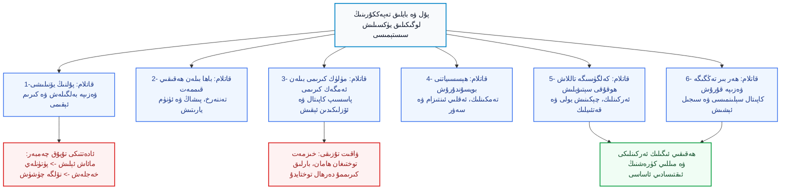
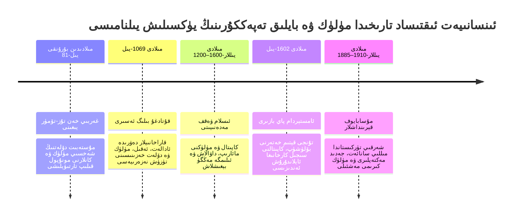
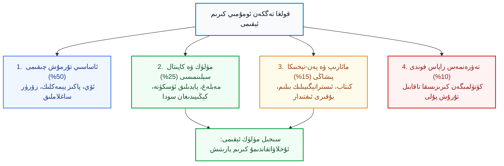

بِسْمِ اللَّهِ الرَّحْمَٰنِ الرَّحِيمِ

⏱ تەخمىنىي ئوقۇش ۋاقتى: 25 مىنۇت

ئىنسانىيەت جەمئىيىتىدە مىليونلىغان كىشىلەر ئەتىگەندىن كەچكىچە پۈتۈن ھاياتىنى، بارلىق كۈچ-قۇۋۋىتىنى ۋە ئەڭ قىممەتلىك ياشلىقىنى خىزمەت ئورۇنلىرىدا ئۆتكۈزىدۇ؛ ئەمما ئۇلارنىڭ مۇتلەق كۆپ قىسمى ئۆمرىنىڭ ئاخىرىغىچە تۈگىمەس ئىقتىسادىي قىستاشلار، قەرز ساراسىمىسى ۋە نامراتلىق پاتقىقىدىن چىقالمايدۇ. كۆپلىگەن كىشىلەر بۇ ھالەتنى ئۆزىنىڭ كۈچىنىڭ يەتمىگەنلىكىدىن، تالانتىنىڭ كەمچىللىكىدىن ياكى تىرىشچانلىقىنىڭ يېتەرلىك بولمىغانلىقىدىن دەپ خاتا قاراپ ئۈمىدسىزلىككە پاتىدۇ. ھالبۇكى، رېئاللىق شۇنى ئېنىق كۆرسىتىدۇكى، ئۇلارنىڭ بۇ قىيىنچىلىققا چۈشۈپ قېلىشىنىڭ تۈپ يىلتىزى ئەسلا ئىقتىدارسىزلىق ئەمەس، بەلكى كىشىلىك ھاياتتا مىسلىسىز كۈچكە ئىگە بولغان «پۇل»نىڭ زادى نېمە ئىكەنلىكىنى، بايلىقنىڭ قايسى قانۇنىيەتلەر ئاساسىدا ھەرىكەت قىلىدىغانلىقىنى ۋە ئۇنىڭ ئەڭ ئالىي مەقسىتىنىڭ نېمىدىن ئىبارەت ئىكەنلىكىنى تۈپتىن چۈشەنمىگەنلىكىدىندۇر. كۆپىنچە كىشىلەر پۇلنى پەقەت بۈگۈنكى ئىستېمال، قورساق تويغۇزۇش، نەرسە-كېرەك سېتىۋېلىش ۋە قىسقا مۇددەتلىك تېيىز راھەت-پاراغەتكە ئېرىشىش ۋاسىتىسى دەپلا بىلىدۇ. لېكىن چوڭقۇر پەلسەپىۋى ۋە سىياسىي تەپەككۇرغا ئىگە سەرخىللار بىلىدۇكى: پۇل ئۆزلۈكىدىنلا بىر قورال بولۇپ، ئۇ بىر خىل يىغىلغان كاپىتال، باشقۇرغىلى ۋە كۆپەيتكىلى بولىدىغان ھاياتىي قۇۋۋەت، ئەڭ مۇھىمى كەلگۈسىگە تاللاش ھوقۇقىنى سېتىۋالىدىغان ئەڭ كۈچلۈك ئىگىلىك ھوقۇقىدۇر. ئەگەر بىر ئىنسان، ھەتتا بىر پۈتۈن خەلق پۇلنىڭ ئەڭ ئاساسىي مالىيە قانۇنىيىتىنى پىكىر قىلمىسا، كىرىمى ئاشقان تەقدىردىمۇ، ئۇنىڭ پۈتۈن ھاياتى پەقەت «تۆۋەن كىرىملىك نامراتلىق»تىن «يۇقىرى كىرىملىك ئەندىشە، تەشۋىش ۋە ساراسىمە»گە يۆتكىلىدۇ. مەزكۇر تەتقىقات ماقالىمىزدە، بايلىق تەپەككۇرىنىڭ ئالتە چوڭ دەۋر بۆلگۈچ قاتلىمى چوڭقۇر يورۇتۇلۇپ، مۈلۈك ئارقىلىق شەخسىي ئەركىنلىككە ئېرىشىشنىڭ ئىلمىي يوللىرى كۆرسىتىپ بېرىلىدۇ؛ شۇنىڭ بىلەن بىر ۋاقىتتا، پۈتكۈل تارىختا مىللەتلەرنىڭ ئۆز بايلىقىنى ساقلاپ قېلىش ياكى مۇستەبىتلەرگە تارتۇرۇپ قويۇش پاجىئەلىرى بايان قىلىنىپ، ئەسىردىن بۇيان خىتاي تاجاۋۇزچىلىرىنىڭ ئىقتىسادىي بۇلاڭچىلىقى ئاستىدا ئېزىلىۋاتقان شەرقىي تۈركىستان مىللىي ئازاتلىق دەۋاسى ئۈچۈن ئىقتىسادىي قۇدرەت تۇرغۇزۇشنىڭ ھاياتىي تەدبىرلىرى كۆرسىتىپ بېرىلىدۇ.

<!-- Image 1 -->

---

## 1. بايلىق تەپەككۇرىنىڭ ئومۇمىي قۇرۇلمىسى ۋە مۈلۈك ئايلىنىش سىستېمىسى

بايلىق توپلاش نوقۇل ھالدا تەلەي ياكى ئارتۇقچە پۇرسەتنىڭ مېۋىسى ئەمەس، بەلكى بىر پۈتۈن ئەقلىي ئىنتىزام ۋە ئىستراتېگىيەلىك سىستېمىنىڭ مۇقەررەر مەھسۇلىدۇر. تۆۋەندىكى ئومۇمىي قۇرۇلما سىخېمىسىدا، پۇلغا بولغان تېيىز چۈشەنچىدىن ھالقىپ، تۇراقلىق مۈلۈك ۋە سىجىل تاللاش ھوقۇقىغا ئېرىشىشنىڭ لوگىكىلىق پەللىلىرى ئېنىق كۆرسىتىپ بېرىلدى:

*(1-سىخېما: بايلىق تەپەككۇرىنىڭ ئالتە قاتلاملىق لوگىكىلىق يۈكسىلىش پەللىلىرى ۋە تاللاش ھوقۇقى زەنجىرى)*

---

## 2. 1-قاتلام: پۇلنىڭ يۆنىلىشى — نىشانسىز كىرىمنىڭ تۇيۇق ھالقىسى

نۇرغۇن كىشىلەرنىڭ بىر ئۆمۈر جاپالىق تەر تۆكۈپ تۇرۇپمۇ قەرزدارلىق پاتقىقىدىن چىقالماسلىقىنىڭ بىرىنچى سەۋەبى، ئۇلارنىڭ پۇلنىڭ ئېقىش يۆنىلىشىگە قارىتا ھېچقانداق تۈزۈلمىلىك نىشان بەلگىلىمىگەنلىكىدىندۇر. بۇ كىشىلەرنىڭ تۇرمۇشى پۈتۈنلەي يېپىق بىر تۇيۇق ئايلانمىغا بەنت بولۇپ قالغان: جاپالىق ئىشلەپ مائاش ياكى كىرىم ئېلىش، پۇل قولغا تەگكەن تۇنجى بىر-ئىككى كۈندە روھىي بېسىمنى يەڭگىللىتىش ئۈچۈن نەپسىنى قاندۇرۇش، ئاندىن ئۆي ئىجارىسى، تۈرلۈك بانكا ئۆسۈملىرى، ھەشەمەت ۋە تېيىز كۆڭۈل ئېچىشلار بىلەن پۇلنىڭ ھەممىسىنى خەجلەپ بولۇش، ئاخىرىدا پۈتۈنلەي نۆلگە قايتىپ يەنە قايتىدىن شۇ ئازابلىق دەۋرىيلىكنى باشلاش. بىر يىل ئۆتۈپ ھېساباتقا قارىسا، ئۆزى نەچچە يۈز مىڭ يۈەن ياكى مىڭلىغان دوللار كىرىم قىلغاندەك قىلغان بىلەن، يانچۇقتا ھېچنېمە قالمىغان.

بۇ كۈلپەتنىڭ تۈپ مەسىلىسى كىرىمنىڭ ئازلىقىدا ئەمەس، بەلكى **«پۇلغا ھېچقاچان ئېنىق، قاتتىق بىر ۋەزىپە بەلگىلەپ بېرىلمىگەنلىكىدە»** تۇرىدۇ. قەدىمكى بۈيۈك سودىگەرلەر ۋە ئىستراتېگلار پۇلنى نوقۇل بىر ئالماشتۇرۇش قەغىزى ئەمەس، بەلكى خۇددى بىر سەردار قول ئاستىدىكى جەڭچىلىرىنى ئۆتكەلگە قويغاندەك، ئۆزىگە يېڭى زېمىن ۋە ئەركىنلىك ئەكىلىدىغان ياللانما قوشۇن دەپ بىلگەن. 

ئادەتتىكى كىشى پۇل قولىغا كىرگەن دەقىقىدە ئۆزىدىن: «بۇ پۇلغا ھازىر كۆز ئالدىمدا نېمە سېتىۋالسام بولار؟» دەپ سورايدۇ. مانا بۇ ئىستېمالچى مېڭىنىڭ سوئالىدۇر. ئەمما ھەقىقىي كاپىتال پەلسەپىسى بار دانىشمەن كىشى: «بۇ كاپىتال پۇرسىتى كەلگۈسىدە ماڭا يەنە قانداق ئىمكانىيەتلەرنى، يېڭى مۈلۈكلەرنى ۋە تاللاش ھوقۇقىنى ئېلىپ كېلىدۇ؟» دەپ پىكىر يۈرگۈزىدۇ. بىرىنچىسى پۇلنىڭ ئۆزىدىن يىراقلاپ كېتىشىگە، قاچىدىكى سۇدەك قۇرۇپ تۈگىشىگە يول قويىدۇ؛ ئىككىنچىسى بولسا پۇلنى ئۆز قېشىدا ئېلىپ قېلىپ، ئۇنىڭ سىجىل تۈردە يېڭى قىممەت ۋە نەق پۇل تومۇرى پەيدا قىلىشىغا سەۋەبچى بولىدۇ.

---

## 3. 2-قاتلام: باھا بىلەن ھەقىقىي قىممەت — پىشاڭ ۋە ئۈنۈم يارىتىش سەنئىتى

مالىيە تەپەككۇرىدا ئەڭ قورقۇنچلۇق توزاقلارنىڭ بىرى باھا (Price) بىلەن قىممەتنى (Intrinsic Value) بىر دەپ قاراش دۆلىتىدۇر. تېيىز تەپەككۇر قىلىدىغان كىشىلەر بىر نەرسىنى ياكى پۇرسەتنى سېتىۋالغاندا پەقەت شۇ كۆز ئالدىدىكى كۆرۈنگەن سانغا قاراپ: «بۇ قىممەتمۇ ياكى ئەرزانمۇ؟» دەپ چولتا ھۆكۈم چىقىرىدۇ. ھالبۇكى، بايلىقنىڭ چوڭقۇر ماتېماتىكىسىنى پىششىق بىلگەن كىشىلەر ھەر دائىم: **«بۇ سېلىنما ئۆزىگە سەرپ قىلىنغان چىقىمغا ئەرزىمدۇ-يوق، ئۇ كەلگۈسىدە قانچىلىك ۋاقىت ۋە پىشاڭ يارىتىپ بېرىدۇ؟»** دەپ تەكشۈرىدۇ.

بۇ قائىدىنىڭ ئاستىدا ئۈچ چوڭ ھاياتىي پەلسەپە بار:
1. **ۋاقىت ۋە زېھىننى خورىتىدىغان ساختا ئەرزانلىق:** ئەرزان باھادا سېتىۋېلىنغان بىر پارچە سۈپەتسىز ئەسۋاب ياكى ئەرزان تۇرمۇش ئادىتى، ئەگەر سىزنىڭ ھەر كۈنلۈك بىر نەچچە سائەت ۋاقتىڭىزنى ئوڭشاشقا، بىھۇدە ئەندىشىگە ۋە ئەسەبىيلىككە خورىتىۋاتقان بولسا، ئۇ دۇنيادىكى ئەڭ قىممەتكە، ئەڭ پاجىئەلىك زىيانغا چۈشكەن نەرسىدۇر؛
2. **ئۈنۈمنى ھەسسىلەپ ئاشۇرىدىغان قورال پىشاڭى:** سەل قىممەترەك بىلىنگەن بىرەر كەسپىي ئۈسكۈنە، يۇقىرى ئىقتىدارلىق يۇمشاق دېتال، ئىلغار ئىجادىي سىستېما ياكى چوڭقۇر بىلىم، ئەگەر سىزنىڭ ئىشلەش سۈرئىتىڭىزنى ۋە قىممەت يارىتىش كۈچىڭىزنى نەچچە ھەسسە ئۆستۈرۈپ بەرسە، ئۇ ئەكسىچە ئەڭ كۆپ پۇل تېجەپ بەرگەن، ئەڭ ئەرزان چۈشكەن نادانلىق كۆرۈنمەيدىغان غايەت زور نېمەتتۇر؛
3. **مىليونلىغان خاتالىقنىڭ ئالدىنى ئالىدىغان كاپىتال كۆزىتىشى:** بىر قېتىملىق نوپۇزلۇق بىلىمگە ياكى تەجرىبىلىك ئۇستازنىڭ نەسىھىتىگە سەرپ قىلىنغان بىر نەچچە تەڭگە مەبلەغ، ئەگەر كەلگۈسىدە پۈتۈن دۇنيا مۈلكىنى قايمۇقۇشلاردا كۆيدۈرۈپ تۈگىتىشنىڭ ئالدىنى ئالالىسا، ئۇ باھاسى چەكسىز قىممەتكە ئىگە ئەڭ ئالىي مۈلۈكتۇر.

<!-- Image 2 -->

چۈنكى كىشىلىك ھاياتتا ئەخمەقلىقتىن ساقلىنىش، ئۆزىنى قالتىس ئەقىللىق كۆرسىتىشكە تىرىشقاندىن مىڭ ھەسسە مۇھىمدۇر. بايلىقتىن تۇيۇقسىز ئايرىلىپ قېلىش كۆپىنچە پۇل تاپالماسلىقتىن كېلىپ چىقمايدۇ؛ ئەكسىچە، تەكەببۇرلۇق بىلەن ئېلىپ بېرىلغان خاتا ھېسسىياتلىق ئىستېمال ۋە نادانلارچە قىلىنغان تەۋەككۈلچىلىك تۈپەيلىدىن، يىللاپ يىغقان بايلىقنىڭ بىر دەمدىلا نۆلگە چۈشۈپ كېتىشىدىن يۈز بېرىدۇ.

---

## 4. 3-قاتلام: مۈلۈك كىرىمى بىلەن ئەمگەك كىرىمى — ئىنسانىيەتنىڭ ئەڭ چوڭ تۇزىقى

ئىقتىساد تارىخىدا كىشىلەر دۇچ كەلگەن ئەڭ دەھشەتلىك ئىدىيەۋى كىشەن دەل پەقەت ئەمگەك كىرىمىگىلا تايىنىپ ياشاش قېلىپىدۇر. پۈتكۈل مائارىپ ۋە جەمئىيەت تۈزۈلمىلىرى كىشىلەرگە كىچىكىدىن باشلاپ: «ياخشى ئوقۇ، ياخشى مائاشلىق خىزمەت تاپ، تىرىشىپ ئىشلەپ مائاشىڭنى ئۆستۈر» دېگەن بىر تەرەپلىمە ئەقىلنى ئۇقتۇرىدۇ. بىراق، «مېنىڭ تاپقان پۇلۇم ئەمدى مەن ئۈچۈن قاچان خىزمەت قىلىدۇ؟ مەن ئۇخلاۋاتقان ۋاقتىمدىمۇ ئۆزلۈكىدىن قىممەت ئېقىپ تۇرىدىغان بىرەر ئېرىق ياسىيالىدىممۇ-يوق؟» دېگەن سوئالنى ئۆگەتمەيدۇ.

تۆۋەندىكى تۈزۈلمىلىك سېلىشتۇرما جەدۋەلدە، ئەمگەك كىرىمى بىلەن مۈلۈك كىرىمى ئوتتۇرىسىدىكى يادرولۇق پەرق ۋە ماھىيەت يورۇتۇلدى:

| ئۆلچەم ۋە ئالاھىدىلىك | ئاكتىپ كىرىم (ئەمگەك كىرىمى) | پاسسىپ كىرىم (مۈلۈك ۋە كاپىتال كىرىمى) |
| :--- | :--- | :--- |
| **ئالماشتۇرۇلىدىغان مەنبە** | ئىنساننىڭ قايتىلانماس فىزىكىلىق ۋاقتى ۋە زېھنى | قۇرۇلغان سىستېما، بىلىم مۈلكى، ئۈسكۈنە، كاپىتال |
| **كېڭىيىش ئىقتىدارى (Scalability)** | سىستېمىلىق چەكلىمىگە ئىگە (كۈنىگە ئەڭ كۆپ 24 سائەت) | چەكسىز (پۈتۈن دۇنياغا ۋە بىر نەچچە بازارغا كېڭىيەلەيدۇ) |
| **خىزمەت توختىغاندا** | كىرىم شۇ دەقىقىدىلا تەلتۆكۈس نۆلگە چۈشىدۇ | كىرىم ئۈزۈلمەستىن، ئۆزلۈكىدىن داۋاملىق كىرىپ تۇرىدۇ |
| **روھىي بېسىم ۋە ئەركىنلىك** | كېسەل بولۇش، ئىشتىن بوشىتىلىش قورقۇنچى يۇقىرى | ئەركىنلىك دەرىجىسى يۇقىرى، تاللاش ھوقۇقى پۈتۈنلەي ئۆزىدە |
| **تۈپ مەقسەت** | بۈگۈنكى ھاياتلىق ۋە ئىستېمال چىقىملىرىنى قامداش | كەلگۈسىگە سىياسىي ۋە ئىقتىسادىي ئۆز ئالدىغا ھۆكۈمرانلىق قۇرۇش |

دۇنياغا مەشھۇر مەبلەغ سالغۇچى <dfn title="ۋاررېن باففېت (Warren Buffett): دۇنيادىكى ئەڭ ئۇتۇق قازانغان قىممەت مەبلەغ سالغۇچىسى، بېركشىر خاتاۋاي (Berkshire Hathaway) شىركىتىنىڭ قۇرغۇچىسى، ئۇزۇن مۇددەتلىك سىستېمىلىق مۈلۈك توپلاش ۋە كاپىتالنى مۇرەككەپ ئۆسۈمدە كۆپەيتىش پەلسەپىسىنىڭ ئۇستازى.">ۋاررېن باففېت (Warren Buffett)</dfn> نىڭ ئېيتقىنىدەك: «ئەگەر سىز ئۇخلاۋاتقان ۋاقتىڭىزدىمۇ پۇل كىرىدىغان بىرەر يول تاپالمىسىڭىز، قېرىپ ئۆلگۈچە ئىشلەشكە مەجبۇر بولىسىز». بۇ بايان ھەرگىزمۇ كىشىلەرنى ئىشنى تاشلاپ تەۋەككۈل بىلەن كوچىغا چىقىپ كېتىشكە دەۋەت قىلمايدۇ. بەلكى بۈيۈك بىر ئاگاھلاندۇرۇشتۇر: كۈندىلىك ئەمگەكتىن كىرگەن مائاش كەلگۈسىنىڭ مۈلكىنى سېتىۋېلىشقا خىزمەت قىلىشى كېرەك. ھەقىقىي ئەقىللىق ئىنسان بۈگۈن مائاشىدىن ئاشۇرۇپ تەر ئاققۇزۇش ئارقىلىق، ئەتە كېلىدىغان تاللاش ھوقۇقىنى ۋە ئىگىلىك ئەركىنلىكىنى سېتىۋالىدۇ.

<!-- Image 3 -->

---

## 5. 4-قاتلام: ھېسسىيات قۇربانى بولماسلىق — كاپىتالنى تەمكىن ئەقىل بىلەن ئىدارە قىلىش

پۇل مۇئامىلە دۇنياسىدا كىشىلەرنىڭ مەغلۇپ بولۇشى پەننى بىلمىگەنلىكىدىن ئەمەس، بەلكى ئىچكى پىسخىكىسى ۋە تۇراقسىز ھېسسىياتىنى كونترول قىلالمىغانلىقىدىن كېلىپ چىقىدۇ. ئادەتتىكى كىشىلەرنىڭ پۇل ھەققىدە چىقارغان قارارلىرى پۈتۈنلەي قورقۇنچ (Fear) ۋە نەپسى ئاچكۆزلۈك (Greed) نىڭ قاينىمىغا بەنت بولۇپ كېتىدۇ:
- پۇل تاپقان دەقىقىلەردە ئۆزىنى قۇدرەتلىك ۋە مەڭگۈ يېڭىلمەستەك ھېس قىلىپ، دەرھال ئۆزىگە ھاجەتسىز بولغان ھەشەمەت ۋە ئىسراپچىلىق تۇزىقىغا كىرىدۇ؛
- بىرەر كۈتۈلمىگەن زىيانغا ئۇچرىغاندا ياكى بازار تەۋرىگەندە بولسا، ۋەھىمىگە چۈشۈپ، ئەڭ تۆۋەن باھادا بارلىق مۈلكىنى كۆيدۈرۈپ قاچىدۇ؛
- باشقىلارنىڭ تېز پۇل تاپقانلىقى توغرىسىدىكى يالغان ئالۋاستى خەۋەرلەرنى ئاڭلىغان ھامان، ئىچىنى ساراسىمە بېسىپ، تەرتىپسىز ۋە بىلىمسىز ھالدا كاپىتالىنى ئوتقا تاشلايدۇ.

ھەقىقىي باي كىشىلەر قىسقا مۇددەتلىك ئۆتكۈنچى ھېسسىياتلارنىڭ ئۇزۇن مەزگىللىك ئىستراتېگىيەلىك تۈزۈلمىنى بۇزۇۋېتىشىگە ئەسلا يول قويمايدۇ. ئۇلار قاچان سەۋرچانلىق بىلەن كۈتۈش كېرەكلىكىنى، قاچان سالماق مەبلەغ سېلىپ، قاچان جەلپكار پۇرسەت كۆرۈنگەن قىلتاقلارنى كەسكىن رەت قىلىش لازىملىقىنى ناھايىتى ئېنىق بىلىدۇ. مەبلەغ سېلىش مۇشۇنداق ئېغىر بېسىقلىقنى تەلەپ قىلىدۇ، دۆلەت باشقۇرۇش مۇشۇنداق سوغۇققانلىققا موھتاج، پۈتكۈل مىللىي ئازاتلىق كۈرىشىمۇ دەل مۇشۇنداق تەمكىن ئەقىل-پاراسەتنى تەلەپ قىلىدۇ.

---

## 6. 5-قاتلام: پۇلنىڭ ئەڭ ئالىي نېگىزى — كەلگۈسىگە تاللاش ھوقۇقى سېتىۋېلىش

دۇنيادا نۇرغۇن كىشىلەر پۇل تېپىشنىڭ بىردىنبىر مەقسىتىنى پەقەت ماركىلىق قىممەت بويۇملارنى ئېلىش، ھەشەمەتلىك داچىلاردا ياشاش ياكى كىشىلەرگە كۆرەڭلەپ كۆرسىتىش دەپ ئويلايدۇ. لېكىن ئەقىل-پاراسەت ئىگىلىرى ئۈچۈن بايلىقنىڭ پۈتۈن كائىناتتىكى ئەڭ تەڭداشسىز قىممىتى — **«مۇستەقىل تاللاش ھوقۇقىغا ئىگە بولۇشتۇر»**.

ئەگەر بىر كىشىنىڭ ياكى بىر خەلقنىڭ يېنىدا مۇقىم ئىقتىسادىي ئاساسى، تېخنىكىسى ۋە تېنىمسىز مۈلۈك ئېقىمى بولمىسا:
- ئۇ پۈتۈنلەي ئۆزى نەپرەتلىنىدىغان خىزمەتنى جان بېقىش ئۈچۈن چىشىنى چىشلەپ داۋاملاشتۇرۇشقا مەجبۇر بولىدۇ؛
- زالىملارنىڭ، قوپال خوجايىنلارنىڭ ۋە تاجاۋۇزچى تۈزۈملەرنىڭ بارلىق ناھەق، رەھىمسىز شەرتلىرىگە بويسۇنۇشقا مەجبۇر بولىدۇ؛
- بۈگۈنكى قورساق غېمى ئۈچۈن ئۆزىنىڭ كەلگۈسى تەرەققىيات پۇرسەتلىرىنى، مىللىي غۇرۇرىنى ۋە تارىخىي بۇرچىنى قۇربان قىلىشقا مەجبۇر قالىدۇ، چۈنكى ئۇنىڭدا چېكىنىدىغان ھېچقانداق مالىيە سېپى يوق.

<!-- Image 4 -->

ئەمما كىشىنىڭ يېنىدا مۇستەھكەم مۈلۈك ئاساسى ۋە ئۆزلۈكىدىن ئېقىپ تۇرىدىغان نەق پۇل تومۇرى بار بولغاندا:
- ئۇ پەقەت ئۆز ئەخلاقى ۋە ئېتىقادىغا ئۇيغۇن كەلگەن پاكىز ئىشلارنىلا تاللىيالايدۇ؛
- بارلىق زوراۋان ۋە نامۇۋاپىق تەكلىپلەرنى باشنى كۆتۈرۈپ تۇرۇپ كەسكىن رەت قىلالايدۇ؛
- ۋاقتىنى ئۆز مىللىتىنىڭ مائارىپى، تەشكىلىي قۇۋۋىتى ۋە تېخنىكىسىنى تۇرغۇزۇشقا تۈگەتمەس مەنبە قىلالايدۇ؛
- كەلگۈسىدىكى بۈيۈك پۇرسەتلەر ۋە مىللىي نىشانلار ئۈچۈن قورقماستىن، ئەركىن ئىرادە بىلەن ھەرىكەت قىلالايدۇ.

پۇل ئۆزلۈكىدىنلا تەييار ئەركىنلىك ئەكىلىپ بەرمەيدۇ؛ ئەمما پۇل بولمىسا، دۇنيادىكى نۇرغۇنلىغان ھەققانىي ئەركىنلىكلەرنى ۋە تەستىقلارنى ئەمەلگە ئاشۇرۇش تامامەن مۇمكىن بولماي قالىدۇ. شۇڭلاشقا، كۈچلۈك بولۇشنىڭ تۇنجى قەدىمى پەقەتلا ھېسسىياتلىق شوئار توۋلاش ئەمەس، بەلكى بايلىق ۋە مۈلۈككە بولغان تەپەككۇرنى ئەڭ باشتىن توغرا تۇرغۇزۇشتۇر.

---

## 7. 6-قاتلام: ھەر بىر تەڭگىگە ئېنىق نىشان بەلگىلەش — مالىيە تەقسىماتىنىڭ سىجىللىقى

بىر شەخسنىڭ ياكى مىللەتنىڭ ئىقتىسادىي ھالىتىنىڭ يىلتىزىدىن ياخشىلىنىشى، تۇيۇقسىز تاپقان نەچچە مىليون پۇلىدىن ئەمەس، بەلكى قولىغا كىرىۋاتقان كۈندىلىك پۇلنىڭ قايسى نىزام بويىچە بۆلۈنۈشىدىن باشلىنىدۇ. بۈگۈن تاپقان پۇلنى ئەتە ھەممىنى يەپ تۈگەتكەن خەلق، بىر كۈندە قۇلغا ئايلىنىدۇ؛ تاپقان پۇلىنى تېجەپ، ئۇنى قىممەت يارىتىدىغان يەرلەرگە سىستېمىلىق كىرگۈزگەن كىشىلەر بولسا، ئەۋلادتىن-ئەۋلادقا سەلتەنەت تىكلەيدۇ.

تۆۋەندىكى تارىخىي ۋاقىتنامە سىخېمىسىدا، ئىنسانىيەتنىڭ بايلىق تەپەككۇرى، مۈلۈك ئايلىنىش ئەندىزىسى ۋە ئىگىلىك ئەركىنلىكى باسقۇچلىرىنىڭ تارىخىي تەرەققىياتى يورۇتۇلدى:

*(2-سىخېما: ئىنسانىيەت ئىقتىساد تارىخىدا مۈلۈك ۋە بايلىق تەپەككۇرىنىڭ تارىخىي تەرەققىيات يىلنامىسى)*

تۆۋەندىكى دىئاگراممىدا، پۇلنى تۆت ھاياتىي بۆلەككە بۆلۈپ باشقۇرۇشنىڭ ئىلمىي پىشاڭ نىزامى كۆرسىتىلدى:

*(3-سىخېما: بايلىق تەقسىماتىنىڭ سىجىللىق نىزامى ۋە مۈلۈك فوندىنىڭ ھەرىكەتلىنىش سىستېمىسى)*

تۇنجى قەدەمدىلا مىليونلىغان پۇلنىڭ بولۇشى شەرت ئەمەس، ئەمما پۇلغا توغرا مەنتىقە بىلەن مۇئامىلە قىلىش مۇتلەق شەرت. چۈنكى پۇلنىڭ ئۆزى نادان ئادەمنى باي قىلالمايدۇ؛ خاتا تەپەككۇر تېخىمۇ كۆپ پۇلنىڭ تۇماندەك غايىب بولۇشىنى تېزلەتسە، توغرا تەپەككۇر بولسا چەكلىك كاپىتالنىڭمۇ ۋاقىت ئۇزارغانسېرى ھەسسىلەپ كۆپىيىپ قەلئەگە ئايلىنىشىغا شارائىت ھازىرلايدۇ.

---

## 8. تارىخىي ئىبرەتلەر زەنجىرى: ئىسلام، دۇنيا، خىتاي ۋە ئۇيغۇر تارىخىدىن دەلىللەر

پۇل ۋە بايلىقنىڭ شەخسلەرنىڭ، دۆلەتلەرنىڭ تەقدىرىنى قانداق بەلگىلەيدىغانلىقى پۈتكۈل ئىنسانىيەت تەجرىبىلىرىدە روشەن ئىسپاتلانغان:

### 1) ئىسلام تارىخىدىن ئىبرەت: ۋەقف تۈزۈمى — تۈگىمەس مۈلۈك كىرىمىنىڭ نادىر ئۈلگىسى
ئىسلام مەدەنىيىتىدە دۇنياغا مىسلى كۆرۈلمىگەن بىر ئىقتىسادىي مۆجىزە تەقدىم قىلىنغان بولۇپ، ئۇ دەل <dfn title="ۋەقف (Waqf) سىستېمىسى: شەخسىي كاپىتال ياكى يەر-مۈلۈكلەرنى پۈتۈنلەي جامائەت مەنپەئەتىگە، مائارىپ، داۋالاش ۋە كۆۋرۈك-سۇ ئەسلىھەلىرىگە بېغىشلاپ، ئۇنىڭ ئەسلى مۈلكىنى ساتماستىن ۋە يوقاتماستىن، ئۇنىڭدىن كەلگەن كىرىم بىلەن نەچچە يۈز يىللاپ ئىلىم-پەننى مۇستەقىل باققان ئۇلۇغ ئىسلامىي مالىيە تۈزۈلمىسى.">ۋەقف تۈزۈمى</dfn> دۇر. ئوسمانلى ئىمپېرىيەسى (1299–1922) ۋە ئابباسىيلار خەلىپىلىكى (750–1258) دەۋرىدە، سەرخىل تىجارەتچىلەر، ئالىملار ۋە بايلار مەكتەپلەرنى، كۇتۇپخانىلارنى، كېسەلخانىلارنى ۋە شەھەر سۇ يوللىرىنى ھۆكۈمەتنىڭ كۈندىلىك باج خامچوتىغا باغلاپ قويماستىن، ئۇلارغا كارۋانساراي، زاۋۇت، زەيتۇنزارلىق ۋە دۇكانلارنى مۈلۈك قىلىپ ۋەقف قىلغان. پادىشاھلار ئالماشسىمۇ، ئۇرۇشلار چىقسىمۇ، ئۇ كۇتۇپخانىلار ۋە ئۇنىۋېرسىتېتلار شۇ مۈلۈكلەردىن ئۆزلۈكىدىن ئېقىپ تۇرغان كىرىملەر بىلەن يۈزلىگەن يىللار بويىچە دۇنيانىڭ ئىلىم قەلئەسى بولۇپ مەۋجۇت بولۇپ تۇرغان. بۇ ھالەت بىزگە پاسسىپ مۈلۈك كىرىمىنىڭ بىر مەدەنىيەتنى قانداق مەڭگۈ ياشنىتالايدىغانلىقىنى كۆرسىتىدۇ.

<!-- Image 5 -->

### 2) دۇنيا تارىخىدىن ئىبرەت: گوللاندىيە ۋە ياۋروپا كاپىتال ئەركىنلىكى
17-ئەسىردە ياۋروپانىڭ كىچىككىنە بىر دۆلىتى بولغان گوللاندىيە جۇمھۇرىيىتى پۈتۈن دۇنيانىڭ سودا ۋە كاپىتال مەركىزىگە ئايلاندى. ئۇلار پۇلنى نوقۇل ساندۇقتا ساقلاپ قويماي، <dfn title="بىرلەشمە ئاگېنتلىق ۋە پاي چېكى بىرژىسى: 1602-يىلى ئامستېردامدا قۇرۇلغان دۇنيادىكى تۇنجى زامانىۋى پاي چېكى بازىرى، شەخسىي كىشىلەرنىڭ ئازغىنا كاپىتالىنى بىر يەرگە يىغىپ، دۇنياۋى تىجارەت فلوتىغا ئايلاندۇرغان تۈزۈم.">دۇنيادىكى تۇنجى پاي چېكى بىرژىسى</dfn> نى بەرپا قىلدى. كىشىلەر ئۆز كاپىتالى بىلەن دېڭىز ئوكيان پاراخوتلىرىغا مۈلۈك ھەمراھى بولدى. يەككە ئىنسانلار تالاپەتتە ۋەيران بولۇپ كەتمەستىن، خەتەرنى ئورتاق بۆلۈشۈپ، كاپىتالنىڭ سىجىل كۆپىيىشى ئارقىلىق پۈتۈن بىر مىللەتنىڭ سىياسىي ۋە ئىقتىسادىي قۇدرىتىنى تىكلىدى. تۈزۈلمىلىك بايلىق تەپەككۇرى كىچىك بىر خەلقنى دۇنيا دېڭىزلىرىنىڭ خوجايىنىغا ئايلاندۇردى.

<!-- Image 6 -->

### 3) خىتاي تارىخىنىڭ قاراڭغۇلۇقىدىن ئىبرەت: تۇز-تۆمۈر مونۇپولى ۋە خۇسۇسىي مۈلۈكنى مۇسادىرە قىلىش رەزىللىكى
خىتاينىڭ تاجاۋۇزچىلىق ۋە زۇلۇم تارىخىغا قارىساق، خىتاي پادىشاھلىقلىرىنىڭ ئەڭ قورققان نەرسىسى پۇقرالارنىڭ ياكى بويسۇندۇرۇلغان خەلقلەرنىڭ مۇستەقىل مۈلۈك ۋە ئىقتىسادىي قۇۋۋەتكە ئىگە بولۇشى بولغان. <dfn title="تۇز ۋە تۆمۈر يىغىنى (盐铁会议 - Yántiě Huìyì): مىلادىدىن بۇرۇنقى 81-يىلى غەربىي خەن سۇلالىسى دەۋرىدە ئۆتكۈزۈلگەن سىياسىي يىغىن. بۇ يىغىندا خىتاي ئىمپېرىيەسى بارلىق مۇھىم تەبىئىي بايلىق، كان ۋە سودىنى پەقەت ھۆكۈمران سۇلالىنىڭلا مونۇپول قىلىشىنى، خەلقنىڭ مۈلۈك تۇتۇشىنى بوغۇشنى قانۇنلاشتۇرغان.">غەربىي خەن سۇلالىسى (مىلادىدىن بۇرۇنقى 202 – مىلادى 9)</dfn> دەۋرىدە ئۆتكۈزۈلگەن تۇز-تۆمۈر يىغىنىدىن تارتىپ، خىتاي مۇستەبىتلىرى پۈتكۈل كان، تۇز، تۆمۈر ۋە ئېنېرگىيەنى دۆلەت مۈلكى نامىدا تارتىۋېلىپ، شەخسىي تىجارەتچىلەرنىڭ كاپىتالىنى بىر كېچىدىلا مۇسادىرە قىلىپ تۈگەتكەن. بۈگۈنكى تاجاۋۇزچى خىتاي كومپارتىيەسىمۇ شەرقىي تۈركىستاندا دەل مۇشۇ رەزىل سىياسەتنى پۈتۈن كۈچى بىلەن ئىجرا قىلىپ، ئۇيغۇر بايلىرىنىڭ، تىجارەتچىلىرىنىڭ مىلياردلىغان قانۇنلۇق مۈلكىنى لاگېرلار باھانىسى بىلەن تالان-تاراج قىلدى. بۇ تارىخىي ئىبرەت شۇنى كۆرسىتىدۇكى: سىياسىي ھوقۇق ۋە مۇستەقىل دۆلەتچىلىك قوغدىمىغان ھەرقانداق بايلىق، مۇستەبىتلەرنىڭ ئاغزىدىكى بىر چىشلەم تائامدىن باشقا نەرسە ئەمەس.

<!-- Image 7 -->

### 4) ئۇيغۇر تارىخىدىن ئىبرەت: مۇسابايوف قېرىنداشلار — مىللىي سانائەت ۋە مائارىپنىڭ مۈلۈك ئاساسى
ئۇيغۇر مىللىتى ھەرگىزمۇ تاجاۋۇزچى چاپلاۋاتقان بۆھتانلاردەك تېيىز مىللەت بولماستىن، ئەكسىچە ئەسىرلەردىن بۇيان يۈكسەك شەھەر مەدەنىيىتى ۋە خەلقئارالىق سودا پىشاڭى ياراتقان دانا مىللەتتۇر. 19-ئەسىرنىڭ ئاخىرى ۋە 20-ئەسىرنىڭ باشلىرىدا چۆچەك ۋە غۇلجىدا مىللىي سانائەت مەشئىلىنى ياققان <dfn title="مۇسابايوف قېرىنداشلار: باۋۇدۇن مۇسابايوف ۋە ھۈسەيىن مۇسابايوف باشلىق ئۇيغۇر سانائەتچى مەرىپەتپەرۋەرلىرى. ئۇلار ياۋروپادىن زامانىۋى تېخنىكا كىرگۈزۈپ ئىستانسىلار، كۆن-خۇرۇم زاۋۇتلىرى ۋە مەتبەئەلەرنى قۇرغان، مائارىپنى ئۆز تىجارەت مۈلكى بىلەن سىجىل تەمىنلەپ مىللىي ئويغىنىشنىڭ پىلتىسىنى ياندۇرغان بۈيۈك شەخسلەر.">مۇسابايوف قېرىنداشلار</dfn> ياۋروپادىن زامانىۋى كۆن-خۇرۇم ئۈسكۈنىلىرىنى، پار ماشىنىلىرىنى ئەكىلىپ سانائەت ئاساسى قۇرغان؛ زاۋۇتلاردىن چىققان تۈگىمەس مۈلۈك كىرىملىرى بىلەن شەرقىي تۈركىستاننىڭ تۇنجى زامانىۋى جەدىد مەكتەپلىرىنى، ھەقسىز دارىلئېيتاملارنى ۋە مەتبەئە نەشرىياتلىرىنى ئاچقان. ئۇلار ئۆز ئەمگىكى ۋە مۈلكى ئارقىلىق مىللەتكە زامانىۋى بىلىم ئېلىش ئەركىنلىكىنى سېتىۋېلىپ بەرگەن.

<!-- Image 8 -->

---

## 9. شەرقىي تۈركىستان ئۈچۈن ئىستراتېگىيىلىك مالىيە ئويغىنىشى ۋە مىللىي پايدىلار

بۈگۈنكى كۈندە شەرقىي تۈركىستان تۇپرىقىدا تاجاۋۇزچى خىتاي پۈتكۈل يەر ئاستى ۋە يەر ئۈستى نېفىت، گاز، ئالتۇن، لىتىي ۋە پاختا بايلىقلىرىمىزنى مىسلىسىز تالان-تاراج قىلىپ، پۈتكۈل بىر مىللەتنى ئۆز زېمىنىدا قۇللارچە جان بېقىش ھالىتىگە چۈشۈرۈپ قويدى. چەتئەللەردىكى ئۇيغۇر جامائىتىمۇ كۆپ ھاللاردا كۈندىلىك خىزمەتنىڭ سۈرئىتىدە چارچاپ، مىللىي دەۋا ۋە تەشكىلىي خىزمەتلەرگە كېرەكلىك بولغان ئۈزۈلمەس ئىقتىسادىي فوندى قۇرۇشتا قىينالماقتا.

مۇشۇ رېئاللىق ئالدىدا، پۇل ۋە بايلىق تەپەككۇرىنى شەرقىي تۈركىستاننىڭ مۇستەقىللىق دەۋاسىغا خىزمەت قىلدۇرۇش ئۈچۈن تۆۋەندىكى **5 چوڭ ئەمەلىي مىللىي پايدا** تۇرغۇزۇلۇشى شەرت:

1. **مىللىي تەشكىلىي ۋەقف ۋە كاپىتال فوندى بەرپا قىلىش:** مىللىي كۈرەش نوقۇل قۇرۇق ئىئانە ۋە ھېسسىياتلىق خەير-ساخاۋەت بىلەن مەڭگۈ داۋاملىشالمايدۇ. دۇنيانىڭ ھەر قايسى جايلىرىدىكى ئۇيغۇر سەرخىللىرى مەبلەغنى بىر يەرگە يىغىپ، مۇقىم مۈلۈككە، كۆچمەس مۈلۈككە، تېخنىكا كارخانىلىرىغا سالغاندا، ئۇنىڭدىن كەلگەن پاسسىپ كىرىم دەۋانىڭ ئىستىخبارات، دىپلوماتىيە ۋە مېدىيا تومۇرىنى ھېچكىمگە يالۋۇرماستىن مۇستەقىل قامدىيالايدۇ؛
2. **پۇلنى يالغان ئىستېمالدىن قۇتقۇزۇپ مىللىي كۈچكە كىرگۈزۈش:** شەخسىي تۇرمۇشتا داغدۇغىلىق كىيىم، ھەشەمەتلىك ماشىنا ۋە قۇرۇق ئىسراپچىلىقلارنى چەكلەپ، زېھىن ۋە كاپىتالنى پەن-تېخنىكا ئۆگىنىش، يۇمشاق دېتال قۇرۇش ۋە خەلقئارالىق ئىقتىسادىي تۈزلەرگە سالغاندا، پۈتكۈل مىللەت يۈكسەك قۇۋۋەتكە كىرىدۇ؛
3. **ئۇيغۇر مىللىتىنىڭ مەدەنىيەتلىك ۋە قەيسەر ئوبرازىنى تىكلەش:** دۇنيا ئەللىرىگە ئۇيغۇرلارنىڭ تاجاۋۇزچى خىتاي چاپلاۋاتقان بۆھتانلاردەك «تېررورچى ياكى بىچارە ياردەم تىلىگۈچى» ئەمەس، بەلكى تارىختىن بېرى دۇنيا يىپەك يولىنىڭ پاراسەتلىك سودىگەرلىرى، ئۆز ئالدىغا زامانىۋى ئىقتىساد، سىستېما ۋە دۆلەت باشقۇرۇش تەجرىبىسىگە ئىگە ئىقتىدارلىق، مەدەنىيەتلىك خەلق ئىكەنلىكىنى ئىقتىسادىي ئىش-ھەرىكەتلىرىمىز بىلەن ئىسپاتلاش؛
4. **شەخسىي مۇستەقىللىق بىلەن مىللىي مۇستەقىللىقنى بىر گەۋدىلەشتۈرۈش:** بىر ئىنسان ئۆزىنىڭ كۈندىلىك پۇل قىستاشلىرىدىن قۇتۇلۇپ، تاللاش ھوقۇقىغا ئېرىشكەندىلا، ئۆز مىللىتىنىڭ تەقدىرى ئۈچۈن قورقماستىن قۇربانلىق بېرەلەيدۇ، زالىملارنىڭ تاشقى ۋاسىتىلىرىگە تىز پۈكمەيدۇ؛
5. **خىتاينىڭ ئىقتىسادىي تاجاۋۇزچىلىق زەنجىرىنى ئۈزۈپ تاشلاش:** خىتاينىڭ «بىر بەلباغ بىر يول» نىقابىدىكى قەرز قىلتىقلىرى ۋە بايلىق ئوغرىلىقلىرىنى دۇنيا بازىرىدا كەسكىن ئېچىپ تاشلاپ، خەلقئارالىق شىركەتلەرنى خىتاينىڭ پاختا، قۇياش ئېنېرگىيە تاختىلىرى ۋە كان مەھسۇلاتلىرىدىن تامامەن ۋاز كېچىشكە تۈرتكە بولۇش.

---

## 10. تۈپ يەكۈن

پۇلنىڭ ماھىيىتى قەغەزدە ياكى رەقەملىك بانكا سانلىرىدا ئەمەس، بەلكى ئۇنىڭ ئىنسان روھىغا بېغىشلىغان قەيسەرلىكى، تەمكىن ئەقىل-پاراسىتى ۋە كەلگۈسىگە ئېلىپ كەلگەن تاللاش ھوقۇقىدا ياتىدۇ. كۈندىلىك پۇلنىڭ قۇلى بولۇپ ياشاشتىن قۇتۇلۇپ، پۇلنى ئۆز ئەركىنلىكىمىز ئۈچۈن خىزمەت قىلىدىغان ئەڭ كۈچلۈك مۈلۈككە ئايلاندۇرۇش — نوقۇل شەخسىي بەخت-سائادەتنىڭ قورالى بولماستىن، بەلكى شەرقىي تۈركىستاننىڭ زۇلمەتلىك ئەسىرلىرىنى يورۇتۇپ، مىللىتىمىزنى قايتىدىن دۇنيا سەھنىسىدە ئەركىن، قۇدرەتلىك ۋە مۇستەقىل دۆلەت سەۋىيەسىگە كۆتۈرۈشنىڭ پۈتمەس-تۈگىمەس تاش تۈۋرۈكىدۇر.

---

## تەۋسىيە كىتابلار

پۇل ۋە بايلىق تەپەككۇرى، مۈلۈك سىستېمىسى ۋە ئىقتىسادىي ئەركىنلىك پەلسەپىسىنى چوڭقۇر تەتقىق قىلىش ئۈچۈن تۆۋەندىكى 3 نوپۇزلۇق ئەسەرنى تەۋسىيە قىلىمىز:

1. **«The Psychology of Money: Timeless lessons on wealth, greed, and happiness» (پۇلنىڭ پىسخىكىسى)** — مورگان خائۇسېل (Morgan Housel). بايلىق توپلاشنىڭ پەقەت ماتېماتىكا ئەمەس، بەلكى كىشىلىك ھېسسىياتنى بويسۇندۇرۇش ۋە تەمكىن قارار چىقىرىش ئىقتىدارى ئىكەنلىكىنى يورۇتقان بۈيۈك ئەسەر.
2. **«The Almanack of Naval Ravikant: A Guide to Wealth and Happiness» (ناۋال راۋىكانت كىتابى)** — ئېرىك جورگېنسون (Eric Jorgenson). تىرىشىپ ئىشلەشتىن بەكرەك پىشاڭ (Leverage)، مۈلۈك ۋە ئەقلىي ئىقتىدار ئارقىلىق تاللاش ئەركىنلىكىگە ئېرىشىشنىڭ زامانىۋى قوللانمىسى.
3. **«قۇتادغۇ بىلىگ» (Saadet Veren Bilgi)** — يۈسۈپ خاس ھاجىب (مىلادى 1069). ئۇيغۇر-تۈرك دۆلەتچىلىكىدە بايلىقنىڭ رولى، مال-دۇنيانى ئەقىل ۋە ئادالەت بىلەن باشقۇرۇش ھەمدە كاپىتالنى مىللەتنىڭ بەختىگە ئايلاندۇرۇشنىڭ كلاسسىك ئىلمىي ئابىدىسى.

---

## پايدىلانغان مەنبەلەر

1. خاس ھاجىب، يۈسۈپ (1069). <i>قۇتادغۇ بىلىگ (سائادەت بېغىشلىغۇچى بىلىم)</i>. قەشقەر: قاراخانىيلار دەۋرى دۆلەتچىلىك دەستۇرى.
 
2. ئۇيغۇر تەتقىقات ئىنستىتۇتى (2023). <i>مۇسابايوفلار ۋە شەرقىي تۈركىستاننىڭ دەسلەپكى مىللىي سانائەت تارىخى</i>. ئىستانبۇل.
 
3. قەشقەرلىق، ئابدۇۋەلى (2021). <i>ئىسلام ۋەقف تۈزۈمىنىڭ تۈركىستان شەھەر مەدەنىيىتىدىكى رولى</i>. ئىلمىي تەتقىقات ماقالىلىرى مەجمۇئەسى.

4. Housel, Morgan (2020). <i>The Psychology of Money: Timeless lessons on wealth, greed, and happiness</i>. Petersfield: Harriman House.
 
5. Jorgenson, Eric (2020). <i>The Almanack of Naval Ravikant: A Guide to Wealth and Happiness</i>. Magrathea Publishing.
 
6. Buffett, Warren & Munger, Charlie (2018). <i>Berkshire Hathaway Letters to Shareholders (1965–2017)</i>. Omaha: Berkshire Services.
 
7. Weber, Max (1905). <i>The Protestant Ethic and the Spirit of Capitalism</i>. London: Allen & Unwin.

