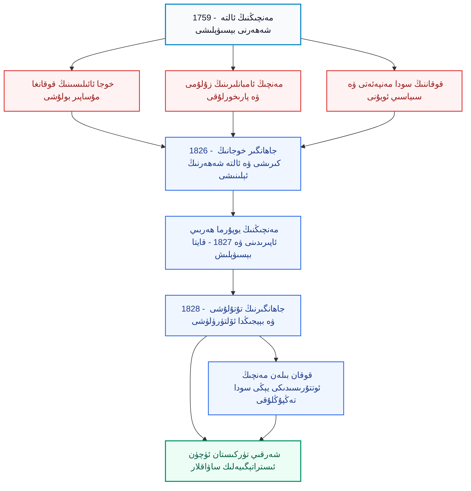
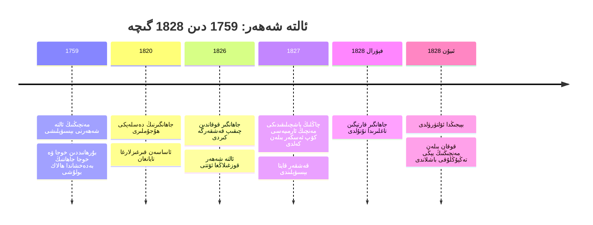
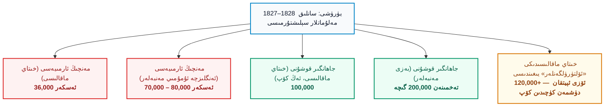
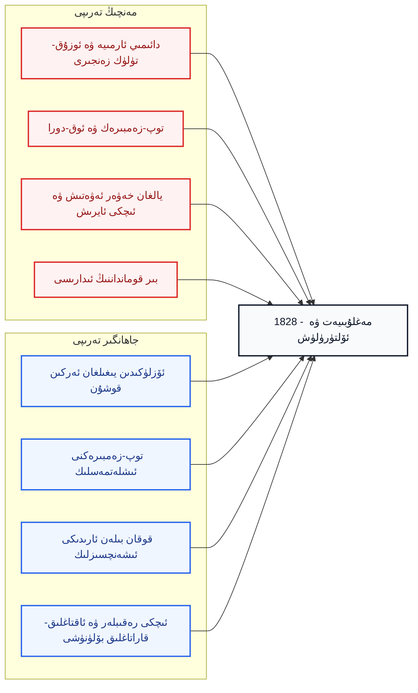

بِسْمِ اللَّهِ الرَّحْمَٰنِ الرَّحِيمِ

⏱ تەخمىنىي ئوقۇش ۋاقتى: 20 مىنۇت

ئىنتېرنېتتە خىتاي تىلىدا ئېلان قىلىنغان «تارىخ» ماقالىلىرىنىڭ ئارىسىدا «قەشقەر ۋە ئالتە شەھەرنىڭ قايتا بويسۇندۇرۇلۇشى» دېگەن تېمىدا يېزىلغان بىر پارچە ماقالە دىققىتىمنى تارتتى. ماقالىنىڭ سەرلەۋھىسى «پارچىلاپ-كېسىپ ئۆلتۈرۈشنى بېيجىڭدا كۆرۈڭ» دېگەن مەنىدە بولۇپ، ئۇ <dfn title="جاھانگىر خوجا (1788–1828): ئاقتاغلىق (ئاق تاغلىق) خوجىلار ئائىلىسىنىڭ ۋەكىلى، بۇرھانىددىن خوجىنىڭ نەۋرىسى. 1826-يىلى قوقان تەرەپتىن ئالتە شەھەرگە كىرىپ، مەنچىڭ ھۆكۈمرانلىقىغا قارشى كۆتۈرۈلگەن قوزغىلاڭغا رەھبەرلىك قىلغان. خىتاي مەنبەلىرىدە «جاڭگېر» (张格尔) دەپ ئاتىلىدۇ ۋە «ئەسەبىي ئوۋ» سۈپىتىدە تەسۋىرلىنىدۇ.">جاھانگىر خوجا (1788–1828)</dfn> نىڭ ئاخىرقى كۈنلىرىنى، يەنى مەغلۇبىيىتى، قولغا چۈشۈشى ۋە بېيجىڭدا ئۆلتۈرۈلۈشىنى «ئادالەتنىڭ غەلىبىسى» دەپ مەدھىيىلەيدۇ. ماقالىدا جاھانگىر «بۇزغۇنچى»، «ئىسيانكار»، «ۋەتەنگە خىيانەت قىلغۇچى» دەپ ئاتىلىدۇ، ئۇنىڭ كەينىدىن ئەگەشكەن ئون مىڭلىغان ئاددىي ئادەملەر بولسا ئادەمدەك ئەمەس، بەلكى «سانى كۆپ توپا» سۈپىتىدە، ئۇلارنىڭ ئۆلۈمى ئوۋ نەتىجىسىدەك چاغلىنىپ بايان قىلىنىدۇ، ئەڭ ئاخىرىدا بولسا پارچىلاپ ئۆلتۈرۈش دەھشىتى ھاياجان بىلەن تىلغا ئېلىنىدۇ. بۇ ماقالىنى ئوقۇغان بىر ئۇيغۇر ئوقۇرمەن ئالدى بىلەن غەزەپلىنىدۇ، ئاندىن سوئال قويىدۇ: بىزنىڭ ئەجدادلىرىمىز ئارىسىدىكى بۇ ئەسىرلىك ئەركىنلىك ئۇرۇنۇشى ھەقىقەتەن نېمە ئىدى؟ ئۇ نېمە ئۈچۈن ئاز ۋاقىتتا ئۇتتۇرۇپ قويدى؟ خىتاينىڭ بۈگۈنكى ئوقۇرمەنلىرىگە سۇنۇلىۋاتقان ھېكايىدە قايسى ئىشلار ئىنكار قىلىنىدۇ، قايسى ئىشلار بۇرمىلىنىدۇ؟ مەزكۇر ماقالە مۇشۇ سوئاللارغا ئىلمىي، ئەمما ئۆز مىللىتىمىزنىڭ كۆزقارىشىدىن جاۋاب بېرىدۇ ھەمدە بۇ تارىخ ئارقىلىق بۈگۈنكى شەرقىي تۈركىستان مۇستەقىللىق داۋاسى ئۈچۈن قانداق ئەمەلىي ساۋاقلارنى چىقىرىش كېرەكلىكىنى كۆرسىتىدۇ.

<!-- Image 1 -->

<em>قەشقەردىكى ئاپاق خوجا مازىرى (Wikimedia Commons، CC BY-SA 2.5). جاھانگىر خوجا مۇشۇ ئائىلىنىڭ ۋارىسى سۈپىتىدە خەلق ئارىسىدا ھۆرمەتكە ئېرىشكەن.</em>

---

## 1. ماقالىنىڭ ئومۇمىي قۇرۇلمىسى

تارىخنى توغرا چۈشىنىش ئۈچۈن ئالدى بىلەن ۋەقەلەرنىڭ يۈز بەرگەن لوگىكىلىق زەنجىرىنى كۆز ئالدىمىزغا كەلتۈرۈشىمىز كېرەك. جاھانگىر خوجا قوزغىلىڭى بىر كۈندە پەيدا بولغان ئىش ئەمەس؛ ئۇ 1759-يىلىدىكى مەنچىڭ بېسىۋېلىشى، ئاقتاغلىق خوجىلارنىڭ قوقاندا مۇساپىر بولۇشى، مەنچىڭ ئەمەلدارلىرىنىڭ ئالتە شەھەردىكى زۇلۇمى ۋە قوقان خانلىقىنىڭ ئىقتىسادىي مەنپەئەتى دېگەن ئۈچ يىلتىزدىن ئوزۇقلانغان بولۇپ، ئاخىرىدا ئىمپېرىيەنىڭ كۈچلۈك قايتۇرما ھۇجۇمى ۋە ئۇنىڭ كەينىدىن كەلگەن ئىنتىقام بىلەن ئاخىرلاشقان. تۆۋەندىكى سىخېما ماقالىنىڭ ئاساسىي پىكىر لىنىيەسىنى كۆرسىتىدۇ.

*(سىخېما 1: ماقالىنىڭ ئومۇمىي مەزمۇن ۋە سەۋەب-نەتىجە قۇرۇلمىسى)*

---

## 2. ئارقا كۆرۈنۈش: ئاپاق خوجىدىن مەنچىڭ بېسىۋېلىشىغىچە

شەرقىي تۈركىستاننىڭ جەنۇبىدىكى تارىم ئويمانلىقى ئەسىرلەر بويى «ئالتە شەھەر» (<dfn title="ئالتە شەھەر (Altishahr / ئالتىشەھەر): ھازىرقى كاشغەر، يەكەن، خوتەن، ئاقسۇ، كۇچا ۋە ئۇشتۇرپان (ياكى يېڭىسار) قاتارلىق بوستانلىق شەھەرلەرنى ئاتاش ئۈچۈن ئىشلىتىلگەن تارىخىي نام. 18- ۋە 19-ئەسىرلەردە بۇ نام ئەنئەنىۋىي ئىسىم سۈپىتىدە ساقلانغان.">Altishahr</dfn>) دەپ ئاتالغان ئىدى. 17-ئەسىردە بۇ ئويمانلىقتا <dfn title="ئاپاق خوجا (ھىدايەتۇللاھ، 17-ئەسىر): ئاقتاغلىق (ئاق تاغلىق) خوجىلار تارمىقىنىڭ داڭلىق رەھبىرى، تەرىقەتچى ۋە سىياسىي ئەربابى. كېيىنكى خوجا ئەۋلادلىرى ئۆزلىرىنى ئۇنىڭ ئەۋلادى دەپ ئاتىغان. قەشقەردىكى ئاپاق خوجا مازىرى مۇشۇ ئائىلىنىڭ ھۆرمەت مەركىزى بولۇپ قالغان.">ئاپاق خوجا</dfn> ئەۋلادلىرى بولغان ئاقتاغلىق خوجىلار بىلەن قاراتاغلىق خوجىلار ئوتتۇرىسىدا تەرىقەت، ھوقۇق ۋە ئىقتىسادىي مەنپەئەت ئۈستىدە ئۇزاققىچە رىقابەت داۋام قىلدى. بۇ ئىچكى بۆلۈنۈش كېيىنچە سىرتقى كۈچلەرنىڭ ئارىلىشىشىغا يول ئاچتى. 1750-يىللىرىنىڭ ئاخىرىدا <dfn title="جۇڭغار خانلىقى (1634–1758): ئوتتۇرا ئاسىيا ۋە شەرقىي تۈركىستاننىڭ شىمالىدا ھۆكۈم سۈرگەن موڭغۇل-ئويراتلار خانلىقى. مەنچىڭ ئىمپېرىيەسى ئۇنى 1755–1758-يىللىرى قاتتىق قىرغىنچىلىق بىلەن يوقاتقان.">جۇڭغار خانلىقى (1634–1758)</dfn> غا قارشى ئۇرۇش ئېلىپ بارغان <dfn title="مەنچىڭ ئىمپېرىيەسى (1644–1912): مانجۇ ئاقسۆڭەكلىرى قۇرغان ئىمپېرىيە. 1759-يىلى شەرقىي تۈركىستانغا تاجاۋۇز قىلىپ ئۇنى ئۆز تەركىبىگە قوشۇۋالغان، 1912-يىلى شىنخەي ئىنقىلابى بىلەن ئاغدۇرۇلغان.">مەنچىڭ ئىمپېرىيەسى (1644–1912)</dfn> ئىمپېراتور <dfn title="چيەنلۇڭ (1711–1799، ھۆكۈمرانلىقى 1735–1796): مەنچىڭ ئىمپېراتورى. ئۇنىڭ دەۋرىدە جۇڭغار خانلىقى يوقىتىلىپ، شەرقىي تۈركىستان 1759-يىلى مەنچىڭ ئىمپېرىيەسىگە بويسۇندۇرۇلغان.">چيەنلۇڭ (1711–1799)</dfn> نىڭ قوماندانلىقىدا ئالتە شەھەرگە كىردى. ئاقتاغلىق خوجىلاردىن <dfn title="بۇرھانىددىن خوجا (؟–1759) ۋە خوجا جاھان: ئاقتاغلىق خوجىلاردىن ئىككى قېرىنداش. جۇڭغارلار ئۇلارنى ئۇزۇن يىل ئىلىدا ئەسىر قىلىپ تۇتقان، مەنچىڭ ئارمىيەسى ئۇلارنى 1755-يىلى ئازاد قىلغان، كېيىن ئۇلار مەنچىڭ ھۆكۈمرانلىقىغا قارشى چىقىپ، 1759-يىلى بەدەخشانغا قېچىپ ئۆلتۈرۈلگەن.">بۇرھانىددىن خوجا</dfn> ۋە خوجا جاھان قېرىنداشلار دەسلەپتە مەنچىڭنى «ئەسىرلىكتىن قۇتقۇزغۇچى» دەپ قارىغان بولسىمۇ، ئاخىرىدا ئۆز ۋەتىنىنىڭ ئىگىلىك ھوقۇقى ئۈچۈن قارشى تۇرۇشنى تاللىدى. 1759-يىلى مەنچىڭ ئارمىيەسى ئۇلارنى مەغلۇب قىلدى، قېرىنداشلار بەدەخشان ھۆكۈمدارى سۇلتان شاھنىڭ قولىدا ھالاك بولدى. شۇ كۈندىن باشلاپ ئاقتاغلىق خوجىلارنىڭ قالدۇقلىرى قوقان خانلىقىغا (<dfn title="قوقان خانلىقى (1709–1876): پەرغانە ۋادىسىدا قۇرۇلغان ئۆزبېك خانلىقى. شەرقىي تۈركىستان بىلەن مەنچىڭ ئوتتۇرىسىدىكى سودا يوللىرىنىڭ مۇھىم ئارىلىق تۈگۈنى بولغان. 1876-يىلى رۇسىيە تەرىپىدىن قوشۇۋېلىنغان.">قوقان خانلىقى (1709–1876)</dfn>) ۋە ئۇنىڭ ئەتراپىغا مۇساپىر بولۇپ كەتتى، ئەمما ئالتە شەھەر خەلقىنىڭ ھاياتىدا ئۇلارنىڭ ئىسمى ھەرگىز ئۆچمىدى.

بۇ باسقۇچنى چۈشىنىش ئۈچۈن مەنچىڭ ئىدارە قىلىشىنىڭ ماھىيىتىگە قاراش لازىم. ئىمپېرىيە ئالتە شەھەردە <dfn title="ئامبان (阿奇木伯克/参赞大臣 يۇقىرى ئەمەلدارى): مەنچىڭ ئىمپېرىيەسىنىڭ ئالتە شەھەرگە ئەۋەتكەن ھەربىي-مەمۇرىي ئەمەلدارى. يەرلىك بەگلەر ئۇلارنىڭ ئاستىدا خىزمەت قىلغان.">ئامبانلار</dfn> ۋە ئۇلارنىڭ ئاستىدىكى يەرلىك بەگلەر ئارقىلىق ھۆكۈمرانلىق قىلاتتى. مەنچىڭنىڭ كۆزقارىشىدا بۇ زېمىن «يېڭى چېگرا» ئىدى، شۇڭا ئۇنىڭ ئاھالىسى سالماقلىق بىلەن باج بېرىشى، لېكىن ھەرگىز ئۆزىنىڭ ئىگىلىك ھوقۇقىنى تەلەپ قىلماسلىقى كېرەك ئىدى. نۇرغۇن ئەمەلدارلار بولسا ھاكىمىيەتنى شەخسىي بايلىق مەنبەسىگە ئايلاندۇرۇۋالغان ئىدى. قوزغىلاڭ ئالدىدىكى يىللاردا ئامبان <dfn title="بىنجىڭ (斌静): قەشقەردە تۇرغان مەنچىڭ ئامبانلىرىدىن بىرى. ئۇنىڭ جىنايەتلىرى خىتاي مەنبەلىرىدە خالىغانچە يۇمشىتىلغان ياكى يوشۇرۇلغان دەپ قارىلىدۇ.">بىنجىڭ</dfn> دېگەندەك ئەمەلدارلارنىڭ زۇلۇمى توغرىسىدىكى ئاڭلىنىشلار تارقالدى؛ بەزى تارىخچىلار مەنچىڭنىڭ بۇ جىنايەتلەرنى «يەنە كېلىپ قوشۇمچە قالايمىقانچىلىق پەيدا قىلماسلىق ئۈچۈن» ئاستىرتىن ئۈستۈن ئېلىپ قويغانلىقىنى ئەسكەرتىدۇ. بۇ يەردە مۇھىم بولغىنى — ئالتە شەھەر خەلقىنىڭ مەنچىڭ ھۆكۈمرانلىقىدىن رازى ئەمەسلىكىنىڭ ھەرگىز تاسادىپىي ئەمەسلىكى.

<!-- Image 2 -->

<em>قوقان خانلىقى ئوردىسىنىڭ دەرۋازىسى (19-ئەسىرنىڭ ئاخىرى، Wikimedia Commons). خوجىلار قوقاننىڭ ھىمايىسىگە تايىنىپ كۈرەش ئېلىپ بارغان.</em>

---

## 3. خىتاي ماقالىسىنىڭ كۆزقارىشى: نېمە بايان قىلىنغان، نېمە يوشۇرۇلغان؟

ئالدى بىلەن بۇ خىتاي ماقالىسىنىڭ ئۆزىنى ئوقۇپ بېقىڭ. ئۇ جاھانگىرنى باشتىن-ئاخىر «مۇتەئەسسىپ بۇزغۇنچى» دەپ ئاتايدۇ، ئۇنىڭ قوشۇنىنى «بۇزغۇنچى توپلىرى» دەيدۇ، ئۇنىڭ بىلەن بىللە جەڭ قىلغان قوقان ئەسكەرلىرىنى «ياللانما ئەسكەر» (雇佣军) دەيدۇ. چاڭلىڭ، ياڭ يۈچۈن ۋە ياڭ فاڭ ئىسىملىك مەنچىڭ سەردارلىرى بولسا «باتۇر»، «ئاقىل» ۋە «غەلىبىلىك» سۈپىتىدە تەسۋىرلىنىدۇ. ماقالىدە ھەتتا «ۋەتەنگە خىيانەت» (背叛祖国) دېگەن ئىبارە ئىشلىتىلىدۇ؛ ھالبۇكى 1826-يىلى ئالتە شەھەر خەلقى «خىتاي ۋەتىنى» دەپ ئاتالغان بىر ئۇقۇمنىڭ بۆلىكى ئەمەس ئىدى، بەلكى 67 يىل ئىلگىرى مەنچىڭ ئىمپېرىيەسى تەرىپىدىن بېسىۋېلىنغان، ئۆزىنىڭ مۇسۇلمان خانلىق ئەنئەنىسى ۋە مەدەنىيىتى بار بىر مىللەت ئىدى. «خىيانەت» ئاتالغۇسىنىڭ ئۆزى ئاللىقاچان مۇستەملىكىچىلىك پوزىتسىيەسىنى ئاشكارىلاپ تۇرىدۇ، چۈنكى ئۆز ئىگىلىك ھوقۇقى ئۈچۈن كۈرەشنى «خىيانەت» دەپ ئاتىغان كىشى ئالدى بىلەن مۇستەملىكىنىڭ مەۋجۇتلۇقىنى مەزكۇر كۈرەشتىن ئىلگىرىلا ئىككىلەنمەي قوبۇل قىلغان بولىدۇ.

ماقالىدىكى سانلىق مەلۇماتلارمۇ ئىنتايىن ئەجەبلىنەرلىك. مەسىلەن، ماقالىدىكى جەڭ تەپسىلاتلىرىدا مەنچىڭنىڭ ھەر بىر جەڭدە «ئون مىڭلاپ» ئادەم ئۆلتۈرگەنلىكى، ئاخىرقى جەڭدە بولسا «ئاتمىش مىڭ» دۈشمەننى ئۆلتۈرگەنلىكى يېزىلغان. ئەگەر ماقالىدىكى «ئۆلتۈرۈلگەن» سانلىرىنىڭ تۆۋەن چېكىنى قوشساق (10,000 + 10,000 + 10,000 + 30,000 + 60,000)، جەمئىي 120,000 دىن ئاشىدۇ؛ شۇ ماقالىنىڭ ئۆزىدە جاھانگىر ئەڭ كۆپ يىغقان قوشۇن 100,000 دەپ كۆرسىتىلگەن. دېمەك، ماقالىدىكى يوقىتىش سانلىرى ئۆزى ئېيتقان دۈشمەن كۈچىنىڭ ئومۇمىي سانىدىن كۆپ؛ بۇ ھەرگىز ئەمەلىي ھېسابات ئەمەس، بەلكى غەلىبە ئېلانىنىڭ بېزەكلىك رىتورىكىسىدۇر.

تۆۋەندىكى جەدۋەل خىتاي ماقالىسىدىكى ئاساسلىق ئىبارىلەرنى ئۇلارنىڭ ئاستىدىكى سىياسىي مەنىسى ۋە ئىلمىي ئوقۇلۇشى بىلەن سېلىشتۇرىدۇ:

| خىتاي ماقالىسىدىكى ئىبارە | ئۇنىڭ يوشۇرۇن پوزىتسىيەسى | ئىلمىي ئوقۇلۇشى |
| :--- | :--- | :--- |
| «بۇزغۇنچى / بۇزغۇنچى توپلىرى» | ئىگىلىك ھوقۇق ئۈچۈن كۈرەشنى جىنايەت دەپ كۆرسىتىش | ئىمپېرىيەگە قارشى كۆتۈرۈلۈش ھەر دەۋردە «ئىسيان» دەپ ئاتالغان؛ ئۇنىڭ مەنىسىنى غالىب تەرەپ بەلگىلىگەن |
| «ۋەتەنگە خىيانەت» | 1826-يىلىدىكى ئالتە شەھەرنى «خىتاي ۋەتىنى» دەپ قوبۇل قىلىش | مەنچىڭ دەۋرىدە «خىتاي مىللىي دۆلىتى» ئۇقۇمى يوق ئىدى؛ بۇ ئاتالغۇ كېيىنكى زامانىنىڭ ئوي-پىكىرى |
| «ياللانما ئەسكەر» | يەرلىك خەلقنى مەنىسىز كۆرسىتىش | ئالتە شەھەر خەلقىنىڭ كۆپ قىسمى ئەركىن ھالدا قوزغىلاڭغا قاتناشقان؛ قوقان ئەسكەرلىرى رول ئوينىغان، ئەمما يەككە-يېگانە ئەمەس |
| «ئۆلتۈرۈلگەنلەر: ئون مىڭلار، ئاتمىش مىڭلار» | قان قۇيۇشنى جاسارەت سۈپىتىدە ئاپىرىن ئېيتىش | ئۆزئارا زىت ۋە شىشىرىلغان سانلار؛ ھەربىي رىتورىكا، ئەمەلىي سان ئەمەس |
| «ئەل ئىچىدىكى مۇسۇلمانلار ئۇنى ئۆچ كۆرگەن» | قوزغىلاڭنىڭ خەلقتىن ئايرىلغانلىقىنى كۆرسىتىش | قىسمەن توغرا: قوقان ئەسكەرلىرىنىڭ بۇلاڭچىلىقى ۋە باشقۇرۇش ئاجىزلىقى ھەقىقەتەن خەلقنىڭ ئىشەنچىنى سۇسلاشتۇرغان |

مۇشۇ ئاخىرقى قۇر ناھايىتى مۇھىم، چۈنكى ئادىل تارىخ ئوقۇغۇچى بولۇش ئۈچۈن ئۆز تەرىپىمىزنىڭ ئاجىزلىقىنىمۇ ئىنكار قىلماسلىقىمىز كېرەك. ھەقىقەتەن، جاھانگىرنىڭ ھاكىمىيىتى قوقان ئەسكەرلىرىنىڭ ئارىلىشىشى، تۇتاش بىر ئارمىيە قۇرالماسلىق ۋە باشقۇرۇش قابىلىيىتىنىڭ تۆۋەنلىكى سەۋەبىدىن خەلقنىڭ تولۇق قوللىشىغا ئېرىشەلمىدى. بۇ ئىشلارنى ئويلىماي تۇرۇپ، بىزدىن ئەسىرلەر ئىلگىرىكى ئەجدادلىرىمىزنىڭ كۈرىشىنى پەقەت غۇرۇر بىلەنلا ئوقۇش، ئۇنىڭدىن ئەمەلىي ساۋاق ئالالمىغانلىق بولىدۇ.

---

## 4. 1826-يىلىدىكى بۇرۇلۇش: جاھانگىرنىڭ قوقاندىن چىقىشى

جاھانگىر خوجا 1788-يىلى چامامىدا قوقاندا تۇغۇلدى؛ ئۇ ئاقتاغلىق خوجىلاردىن بۇرھانىددىن خوجىنىڭ نەۋرىسى ئىدى. قوقان خانى <dfn title="مۇھەممەد ئەلى خان (مادەلى خان، ھۆكۈمرانلىقى 1822–1842): قوقان خانلىقىنىڭ مەشھۇر خانى. مەنچىڭ بىلەن سودا مەنپەئەتى ئۈچۈن ئويۇن ئوينىغان، خوجىلارنى بەزىدە ئۆز مەنپەئەتىگە ئىشلەتكەن، بەزىدە توسقان.">مۇھەممەد ئەلى خان (ھۆكۈمرانلىقى 1822–1842)</dfn> مەنچىڭ بىلەن بىر مەخپىي كېلىشىم بويىچە ئۇنى نازارەتتە ساقلاۋاتقان بولۇپ، 1826-يىلى ياز پەسلىدە ئۇ پەرغانە ۋادىسىنى لەرزىگە سالغان بىر يەر تەۋرەش چاغدىكى قالايمىقانچىلىقتىن پايدىلىنىپ قېچىپ چىققان. ئۇنىڭ دەسلەپكى ھەمراھلىرى بىر قانچە يۈز كىشى، ئۇلارنىڭ ئىچىدە قىرغىزلار ۋە ئاقتاغلىق مۇرىتلار بار ئىدى. ئەمما ئۇ ئالتە شەھەرگە كىرگەندىن كېيىن ساناقسىز كىشىلەر، بىر نەچچە ئاي ئىچىدە ئون مىڭلىغان ئادەم، ئۇنىڭ بايرىقى ئاستىغا يىغىلدى (بەزى مەنبەلەردە ئۇنىڭ كۈچى 200,000 گىچە يەتكەن دېيىلىدۇ، بۇ سان ھەرگىزمۇ ئېنىق ئەمەس). خەلقنىڭ ئۆزلۈكىدىن قوزغىلىشى ئىنتايىن روشەن: يەنى ئالتە شەھەر خەلقى ئاللىبۇرۇنلا ئامبانلارغا ئاچچىق ئىچىدە ئىدى، بىر ئۇچقۇننىڭ كېلىشىنى كۈتۈپ تۇراتتى.

قوزغىلاڭنىڭ تەسىرى ناھايىتى تېز بولدى: ئىنقىلاب قوشۇنى قەشقەر، يەكەن، خوتەن، يېڭىسار، قاغىلىق ۋە مارالبېشى قاتارلىق ئالتە شەھەرنى ئېلىپ، مەنچىڭ ھەربىي قىسىملىرىنى تارمار قىلدى. مەنچىڭنىڭ قەشقەردىكى ئامبانى چىڭشياڭ (庆祥) ئۆزىنى ئۆلتۈرىۋەتتى؛ ئۇنىڭ ئوغلى ۋېنجۈن (文军) كېيىن قاتتىق ئىنتىقام ئېلىش ئۈچۈن ئويلاپ يۈردى. ئىمپېرىيەنىڭ ئەسكەرلىرى «ئالتە شەھەر»دىن بىردەمدە چېكىنىپ كەتتى. بۇ ئىشلار بىزگە شۇنى ئىسپاتلايدۇكى، مەنچىڭنىڭ 67 يىللىق ھۆكۈمرانلىقى خەلق نەزىرىدە كۈچلۈك ئاساسقا ئىگە ئەمەس ئىدى.

<!-- Image 3 -->

<em>«خۇنباشى دەريا جېڭى»: مەنچىڭ ئوردىسىدا 1828–1829-يىللىرى غەلىبە ئەسلىمىسى سۈپىتىدە سىزىلغان رەسىملەر تۈركۈمىدىن (Wikimedia Commons، ئاممىۋى مۈلۈك). بۇ رەسىملەر غالىب تەرەپنىڭ نەزىرىدىن سىزىلغان.</em>

---

## 5. ۋاقىتنامە: 1759 دىن 1828 گىچە

تۆۋەندىكى ۋاقىتنامە ئالتە شەھەرنىڭ تارىخىدىكى بۇ ئىنتايىن مۇھىم 70 يىللىق ئارىلىقنى كۆرسىتىدۇ. ئەسكەرتىش: بەزى چېسلالار (بولۇپمۇ جاھانگىرنىڭ ئۆلتۈرۈلگەن ئېنىق كۈنى) مەنبەلەرگە قاراپ ئازراق پەرقلىنىدۇ، تۆۋەندىكى سىخېمىدا ئەڭ كۆپ قوبۇل قىلىنغان چېسلالار بېرىلدى.

*(سىخېما 2: ئالتە شەھەر ۋە جاھانگىر خوجا قوزغىلىڭىنىڭ ۋاقىتنامىسى)*

---

## 6. مەنچىڭنىڭ ئاپىرىدىنى: ئىمپېرىيە قانداق قايتا بېسىۋالدى؟

مەنچىڭ ئىمپېراتورى <dfn title="داۋگۇاڭ (1782–1850، ھۆكۈمرانلىقى 1820–1850): مەنچىڭ ئىمپېراتورى. ئۇنىڭ دەۋرىدە ئالتە شەھەردە جاھانگىر قوزغىلىڭى باستۇرۇلغان، كېيىن 1839–1842-يىللىرى بىرىنچى ئەپيۇن ئۇرۇشىدا ئىنگلىزلار بىلەن مەغلۇب بولغان.">داۋگۇاڭ (1782–1850)</dfn> ئىمپېرىيەنىڭ بارلىق كۈچىنى سەپەرۋەر قىلدى. ئىلى سەركەردىسى <dfn title="چاڭلىڭ (1758–1838): مانجۇ-موڭغۇل سەردار، مەنچىڭنىڭ «ياڭۋېي جىيەنجۈن» (ھەيۋەت ئاشۇرغۇچى سەركەردە) ئۇنۋانى بىلەن 1826–1828-يىلىدىكى ئالتە شەھەر يۈرۈشىگە قوماندانلىق قىلغان.">چاڭلىڭ (1758–1838)</dfn> باش قوماندان بولۇپ تەيىنلەندى، <dfn title="ياڭ يۈچۈن (1761–1837): سىچۇەنلىك خىتاي سەردارى. شەنشى-گەنسۇ ۋالىيسى بولۇپ، 1827-يىلى جاھانگىرگە قارشى يۈرۈشتە ئاساسلىق رول ئوينىغان.">ياڭ يۈچۈن (1761–1837)</dfn> ۋە <dfn title="ياڭ فاڭ (1770–1846): خىتاي سەردارى. جاھانگىرگە قارشى يۈرۈشتە ياڭ يۈچۈن بىلەن بىللە جەڭ قىلغان، كېيىن 1840-يىللاردىكى ئەپيۇن ئۇرۇشىدا ئىنگلىزلارغا قارشى ئۇرۇشقا قاتناشقان.">ياڭ فاڭ (1770–1846)</dfn> قاتارلىق خىتاي سەركەردىلىرى ۋە تۈرلۈك قىسىملار ئاقسۇغا يىغىلدى. مەنبەلەردە ئارمىيە سانى ئوخشىمايدۇ: خىتاي ماقالىسى 36,000 دېسە، ئەنگلىزچە ئۇمۇمىي مەنبەلەردە 70,000 دىن 80,000 گىچە كۆرسىتىلىدۇ. پەرقلىنىشىنىڭ ئەڭ ئېھتىماللىق سەۋەبى شۇكى، «36,000» بەلكىم تۇنجى يۈرۈشتىكى ئاساسىي قىسىم، «70,000» بولسا ئارقا سەپ، ئوزۇق-تۈلۈك ئەترەتلىرى ۋە يەرلىك ياردەمچى كۈچلەرنى ئۆز ئىچىگە ئالغان ئومۇمىي سان بولۇشى مۇمكىن.

شۇنىڭ بىلەن بىرگە، مەنچىڭنىڭ غەلىبىسىنىڭ ئەسلى ئاساسى ھەرگىزمۇ «ئەسكەر سانى» ئەمەس ئىدى. ئىمپېرىيە ئالدى بىلەن تەشكىللىك، ئوزۇق-تۈلۈك تەمىناتى مۇكەممەل، توپ-زەمبىرەك ۋە ئوق-دورا بىلەن قوراللانغان مۇنتىزىم ئارمىيە قۇرغان ئىدى. يۇقىرىدىكى رەسىمدە كۆرۈنگەندەك، توپ-زەمبىرەك تۆگىلەرگە ئارتىلغان؛ بىزنىڭ تەرەپتە بولسا ھەر بىر ئەسكەر قوشۇن باشلىقىنىڭ شەخسىي ئەگەشكۈچىسى بولۇپ، يىغىلىپ-تارقىلىدىغان ئەركىن توپ ئىدى. بىرىنچى قېتىم قەشقەر قولغا ئېلىنغاندىن كېيىن، جاھانگىر يىغىلغان داۋالغۇپ يۈرگەن كۈچلەرنىڭ كۆپىنى تارقىتىۋەتكەن ۋە دائىمىي ئارمىيە قۇرمىغان؛ توپ-زەمبىرەكلەرنىمۇ ئىشلەتمىگەن ئىدى. مەنچىڭنىڭ تۇماننى (Tuman) دەرياسى بويىدىكى توپ ئوقى بىلەن ئۇنىڭ سەپلىرى قالايمىقانلاشتى؛ ئالدى بىلەن بەدەخشان، قوقان ۋە قۇندۇزدىن كەلگەن ياللانما ئەسكەرلەر ئارقىغا قاچتى، ئاندىن يەرلىك ئەسكەرلەر ئۇلارغا ئەگەشتى.

<!-- Image 4 -->

<em>مەنچىڭ ئوردا رەسساملىرى سىزغان «سابدۇل جېڭى» رەسىمى (Wikimedia Commons، ئاممىۋى مۈلۈك).</em>

### سانلىق مەلۇمات: كۈچ سېلىشتۇرمىسى ۋە ماقالىنىڭ ئىشەنچلىكلىكى

تۆۋەندىكى سىخېما ۋە جەدۋەلدە خىتاي ماقالىسى بىلەن باشقا مەنبەلەرنىڭ سانلىق مەلۇماتلىرى بىر-بىرى بىلەن سېلىشتۇرۇلىدۇ. بۇ ئارقىلىق بىرىنچىدىن، مەنبەلەر ئارىسىدىكى پەرقنىڭ نەقەدەر چوڭ ئىكەنلىكى؛ ئىككىنچىدىن، غالىب تەرەپنىڭ سانلىرىغا ھەرگىز كۆزنى يۇمۇپ ئىشىنىشكە بولمايدىغانلىقى ئايدىڭلىشىدۇ.

*(سىخېما 3: كۈچلەر ۋە ئۆلتۈرۈلگەن سانلارنىڭ سېلىشتۇرمىسى)*

| كۆرسەتكۈچ | خىتاي ماقالىسى | ئەنگلىزچە ئۇمۇمىي مەنبەلەر | ئىلمىي باھا |
| :--- | :--- | :--- | :--- |
| مەنچىڭ ئارمىيەسى | 36,000 | 70,000 – 80,000 | چوڭ پەرق؛ ئەسكەر ۋە ياردەمچى كۈچلەر ئايرىلمىغان ئىكەن |
| جاھانگىر قوشۇنى | 100,000 | 200,000 گىچە | ھەر ئىككى سان ئېشىپ كەتكەن بولۇشى مۇمكىن، ئىشەنچلىك ئەمەس |
| قوقان ياللانما ئەسكىرى | تەخمىنەن 4,000 | ئېنىق ئەمەس | مەنچىڭ مەنبەلىرىگىلا ئاساسلانغان |
| مەنچىڭ «ئۆلتۈردى» دەپ ئېلان قىلغان سان | 120,000+ (ماقالىدىكى بەش جەڭنىڭ تۆۋەن چېكىدىكى يىغىندىسى) | قەشقەر ئاھالىسىدىن 20,000 گىچە ئادەم قىرغىن قىلىنغان دەپ كۆرسىتىدىغان مەنبەلەر بار | ھەر ئىككىسى تەكشۈرۈشكە ئېھتىياجلىق، ئېنىق سان ئەمەس |

---

## 7. ھەل قىلغۇچ ئامىللار: نېمە ئۈچۈن مەغلۇپ بولدى؟

جاھانگىر خوجا ھاكىمىيىتىنىڭ مەغلۇبىيىتىنى بىر ئىككى سەۋەب بىلەنلا چۈشەندۈرگىلى بولمايدۇ. بۈگۈنكى ئىلمىي ماقالىلەردە ئاساسەن ئۈچ ئامىل ئەڭ مۇھىم دەپ كۆرسىتىلىدۇ: قوقان بىلەن ئالتە شەھەر ئىدارىسى ئوتتۇرىسىدىكى ئىشەنچ يوقلۇقى، مەنچىڭنىڭ يېڭىلانغان ئىستراتېگىيەسى ۋە يەرلىك ئاقساقاللار-بەگلەرنىڭ تۇرغان ئورنى. بۇلارنى تۆۋەندىكى سىخېمىدا تېخىمۇ ئېنىق كۆرگىلى بولىدۇ.

*(سىخېما 4: ئىككى تەرەپنىڭ ئىستراتېگىيەلىك ئارتۇقچىلىق ۋە ئاجىزلىقلىرىنىڭ سېلىشتۇرمىسى)*

بۇ ئامىللار ئىچىدە بولۇپمۇ قوقان خانلىقىنىڭ ھالىتى دىققەتكە سازاۋەر. قوقان خانى مۇھەممەد ئەلى خانغا نىسبەتەن جاھانگىر ئالتە شەھەردە مەنچىڭغا بېسىم ئىشلىتىدىغان بىر قورال ئىدى؛ ئۇنىڭ ئاساسلىق نىشانى ھەرگىزمۇ ئالتە شەھەرنىڭ مۇستەقىللىقى ئەمەس، بەلكى ئالتە شەھەر بىلەن بولغان سودا يولىدىكى ئىمتىيازلار ئىدى. قوقان خانلىقىنىڭ ئىقتىسادى بىۋاسىتە مۇشۇ سودىغا باغلىنىپ قالغان؛ شۇڭا قوقان ھەم مەنچىڭغا ئالدىرىماي قارشى چىقاتتى، ھەم خوجىلارنى «قوزغاپ» تۇراتتى. جاھانگىرنىڭ قەشقەرنى قوقانغا بېرىشكە ۋەدە قىلغانلىقى توغرىسىدىكى مەلۇماتلارمۇ بار؛ ئەمما كېيىنكى ۋەقەلەرنىڭ كۆرسىتىشىچە، قوقان ئەسكەرلىرى جەڭدە قىيىنچىلىققا ئۇچرىغاندا ئالدى بىلەن چېكىنگەن. ئاندىن، جاھانگىر ئۆلتۈرۈلگەندىن كېيىن مەنچىڭ قوقاننىڭ ئالتە شەھەرگە كىرىدىغان مالىنى چەكلەپ جازالاش ھېسابىدا ئىقتىسادىي ئۇرۇش قىلدى؛ قوقان خانى بولسا ئىنتىقام سۈپىتىدە يۈسۈپ خوجىنى (1830-يىلى) قوزغاپ قايتا ھۇجۇم قىلدۈردى. ئاخىرىدا 1830-يىللارنىڭ بېشىدىكى كېلىشىمدە قوقان سودا ئىمتىيازلىرىغا ئېرىشتى. بۇ ئىشلارنىڭ ھەممىسى بىزگە ئوچۇق ئۆگىتىدۇ: بىر خەلقنىڭ ئازادلىق كۈرىشى باشقا بىر ھاكىمىيەتنىڭ سودا ھېسابىغا ئايلىنىپ قالسا، ئۇ ھاكىمىيەت ئۆز پايدىسىنى كۆرگەندە ئۇنىڭدىن ئاسانلا ۋاز كېچىدۇ.

<!-- Image 5 -->

<em>مەنچىڭ ئوردا رەسساملىرىنىڭ «قەشقەرنىڭ قايتا ئېلىنىشى» رەسىمى (Wikimedia Commons، ئاممىۋى مۈلۈك). ئۈستىدىكى خەت ئىمپېراتور داۋگۇاڭنىڭ غەلىبە ئەسلىمىسىدۇر.</em>

---

## 8. ئەڭ ئاخىرقى باب: قولغا چۈشۈش ۋە بېيجىڭدىكى ئىنتىقام

قەشقەر قولدىن كەتكەندىن كېيىن جاھانگىر خوجا قىرغىزلار ئارىسىدا تاغ-داۋانلارغا مۇساپىر بولدى. مەنچىڭ مەنبەلىرىگە كۆرە، 1828-يىلىنىڭ باشلىرىدا ئۇ قەشقەردىكى بىر قىسىم تاغلىق قېرىنداشلىرىدىن يالغان بىر خەۋەر ئالدى: «مەنچىڭنىڭ ئاساسىي قوشۇنى كېتىپ بولدى، شەھەر قوغدىغۇچىسىز قالدى». بۇنى مەنچىڭ مەنبەلىرى ئۆز ئارمىيەسىنىڭ ئەقىللىق «ئاختارما ئۇرۇشى» دەپ ماختايدۇ. بەزى مەنبەلەردە بۇ يالغان خەۋەرنى ئەۋەتكەن كىشى ئىلگىرى قەشقەردە ھاكىمبەگلىك قىلغان ئىسھاق خوجا دەپ ئاتىلىدۇ. جاھانگىر شۇ ئالدامچىلىققا ئىشىنىپ، بىر نەچچە ئون ئادىمى بىلەن ئىلگىرىلىگەندە، مەنچىڭ ۋە ئۇنىڭ ياردەمچىلىرى بولغان بىر قىسىم يەرلىك كىشىلەر قارتېگىن تاغلىرىدا ئۇنى ئوراپ، قولغا ئالدى. بۇ يەردە شۇنى ئالاھىدە قەيت قىلىش كېرەككى، مەنچىڭ ئىمپېرىيەسى ئۆز غەلىبىسىدە ھەرگىزمۇ پەقەت ئۆزىنىڭ ئەسكەرلىرىگىلا تايانمىدى؛ ئۇلار خوجىلار بىلەن بەگلەر ئارىسىدىكى ئىچكى زىددىيەتلەرنى ئۇستىلىق بىلەن ئىشلەتتى. تۇرپان ۋە قۇمۇلدىكى سادىق ئۇيغۇر بەگلىرى، شۇنداقلا خۇيزۇ (دۇڭگان) سودىگەرلىرى بىر قىسىم رول ئوينىغان؛ بۇ «مۇسۇلمان ئىچىدە ئىككى تەرەپ» ئەمەلىيىتى مەنچىڭنىڭ «بۆلۈپ ئىدارە قىلىش» ئۇسۇلىنىڭ تىپىك مىسالىدۇر.

ئۇنىڭدىن كېيىنكى ئىشلار ئىنتايىن ئاچچىق. جاھانگىر خوجا ئايلار بويى بېيجىڭغا ئېلىپ كېلىنىپ، شەھەر كوچىلىرىدا كۆرگەزمە قىلىندى. ئىمپېراتور داۋگۇاڭ ئۇنى <dfn title="ئۇمېن (午门): بېيجىڭدىكى چىڭ ئوردىسىنىڭ (ياساق شەھەر) جەنۇبىي دەرۋازىسى. مەنچىڭ ئىمپېراتورلىرى ئەسىرلەرنى ئۇ يەردە قوبۇل قىلىپ، «غەلىبە مەراسىمى» ئۆتكۈزگەن.">ئۇمېن (午门)</dfn> دەرۋازىسى ئالدىدا قوبۇل قىلدى، كېيىن ئۇنى «لىڭچى» (<dfn title="لىڭچى (凌迟): «ئاستا-ئاستا كېسىپ ئۆلتۈرۈش» دەپ ئاتالغان قەدىمكى خىتاي ئۆلۈم جازاسى. 1905-يىلى ئىمپېراتورلۇق ھۆكۈمىتى تەرىپىدىن رەسمىي بىكار قىلىنغان.">لىڭچى</dfn>) جازاسىغا ھۆكۈم قىلدى. بۇ ئۆلۈم جازاسىنىڭ ئۆزى ئەزەلدىن بىر سىياسىي ئوبراز بولۇپ، ئىمپېرىيەنىڭ كۈچىنى ۋە «ئىسيانكارلار تەقدىرى»نى بارلىق ئاھالىگە كۆرسىتىش ئۈچۈن ئويلاپ چىقىلغان ئىدى. بىز بۇ يەردە جازانىڭ تەپسىلاتىغا چۈشۈپ ئولتۇرمايمىز؛ بىراق ئاگاھلاندۇرۇپ قويماقچىمىزكى، خىتاي ماقالىسى بۇنى ئاشكارا ھالدا «ئادىل جازا» دەپ ماختاپ، ھەتتا ئىنتىقام ئالغۇچىنىڭ قىلمىشىنى «ئاتىغا بولغان ۋاپادارلىق» دەپ ئۇلۇغلايدۇ. بۇنداق تىل بىر ئادەمنى يوقىتىشنى بايرام قىلىپ كۆرسىتىدىغان ئىدىيەنىڭ ئۆزىنى بىلدۈرىدۇ. ئۇ ئادەم بىزنىڭ كۆز قارىشىمىزدا ئۆز يۇرتىنىڭ ئەركىنلىكى ئۈچۈن كۈرەش قىلىپ شېھىت بولغان بىر ئىنسان ئىدى.

<!-- Image 6 -->

<em>«جاھانگىرنىڭ قارلىق تاغلاردا تۇتۇلۇشى» (Wikimedia Commons، ئاممىۋى مۈلۈك). رەسىمدىكى خەت ئىمپېراتور داۋگۇاڭنىڭ غەلىبە شېئىرىدۇر.</em>

<!-- Image 7 -->

<em>«ئىمپېراتور ئۇمېندا ئەسىرلەرنى قوبۇل قىلىدۇ» (1828، Wikimedia Commons، ئاممىۋى مۈلۈك). بۇ رەسىم ئىمپېرىيەنىڭ ئۆز كۈچىنى كۆرسىتىدىغان تەشۋىقات سەھنىسىدۇر.</em>

---

## 9. ئاقىۋەت: يېڭى «تەڭپۇڭلۇق» ۋە ئۇزۇن مۇددەتلىك ئىزلار

جاھانگىرنىڭ ئۆلۈمى ئالتە شەھەر مەسىلىسىنى ھەل قىلىپ قويمىدى. مەنچىڭ قوقانغا جازا سۈپىتىدە سودا چەكلىمىسى قويدى؛ قوقان خانى مۇھەممەد ئەلى خان بولسا 1830-يىلى جاھانگىرنىڭ ئاكىسى يۈسۈپ خوجىنى ئالتە شەھەرگە كىرگۈزۈپ ئەسكەر ئەۋەتتى. يۈسۈپ خوجا قەشقەرنى مۇھاسىرە قىلغان بولسىمۇ، ئۇنى ئېلىشقا قادىر بولالمىدى. ئاخىرىدا مەنچىڭ بىلەن قوقان ئوتتۇرىسىدا بىر كېلىشىم تۈزۈلۈپ، قوقان سودىگەرلىرى يېڭى ئىمتىيازلارغا ئېرىشتى. شۇنىڭ بىلەن قوقان بىلەن مەنچىڭ ئىككى تەرەپ ئۆز مەنپەئەتىنى كېلىشتۈرۈپ، خوجىلارنىڭ ئىشى ئىككىنچى ئورۇنغا چۈشۈپ قالدى. بۇ يەردە شۇنى يەنە بىر قېتىم تەكىتلەش كېرەككى، ئالتە شەھەرنىڭ بىزنىڭ تەرىپىمىز دەپ قارالغان بىرەر كۈچنىڭ ھىمايىسىگە ئاساسلانغان ئازادلىق ئارزۇسى خېلى مۇددەتكىچە بۇ ئىككى ھاكىمىيەت ئوتتۇرىسىدىكى سودا بىتىملىرى بىلەن ئارىلاشتۇرۇلۇپ قالدى.

بۇنىڭدىن كېيىنكى ئىزلار تېخىمۇ ئەھمىيەتلىك: 1847-يىلىدىكى «يەتتە خوجا قوزغىلىڭى»، 1857-يىلى ۋەلىخان تۆرەنىڭ ھۇجۇمى ۋە ئۇنىڭدىن كېيىنكى 1864-يىلى كۇچادا باشلانغان قوزغىلاڭ ئارقىلىق ئاخىرىدا <dfn title="يەتتەشەھەر (Yettishar) دۆلىتى (1865–1877): يەقۇپبەگ (1820–1877) قۇرغان ئىسلام دۆلىتى. ئالتە شەھەر ۋە ئۈرۈمچىگىچە بولغان زېمىننى ئۆز ئىچىگە ئالغان، 1877-يىلى مەنچىڭ ئارمىيەسى تەرىپىدىن مەغلۇب قىلىنغان.">يەتتەشەھەر دۆلىتى (1865–1877)</dfn> قۇرۇلدى. ئاندىن مەنچىڭ ئىمپېرىيەسى ئۇنى يوقىتىپ، 1884-يىلى بۇ زېمىنغا «يېڭى چېگرا» دېگەن مەنىدە يېڭى بىر نام تاڭدى. دېمەك، جاھانگىر قوزغىلىڭى بىر ئىزچىل كۈرەش زەنجىرىنىڭ ئاستىدىكى مۇھىم بىر ھالقا ئىدى، ئاخىرقى ھالقا ئەمەس.

<!-- Image 8 -->

<em>«غەلىبە زىياپىتى» (1828، Wikimedia Commons، ئاممىۋى مۈلۈك). ئىمپېرىيە ئەسكەرلىرىنى بايراق ئاستىدا مۇكاپاتلىغان بىلەن، ئاستىدا ئۆلگەنلەرنىڭ ئاھى يېتىپ تۇراتتى.</em>

---

## 10. تۆت تۈرلۈك تارىخىي ئىبرەت

### 1) ئىسلام تارىخىدىكى ئىبرەت: كۆپلۈك ئەمەس، ئىتتىپاق ۋە ئىنتىزام

ھۈنەيىن غازىتى (مىلادى 630) دە سانى كۆپ مۇسۇلمان قوشۇنى ئۆزىنىڭ كۆپلۈكىدىن ھوزۇرلىنىپ، دەسلەپتە ئارقىغا قاچقان ئىدى؛ ئاللاھ تائالا بۇ ئىشنى قۇرئاندا ئەسكەرتكەن:

﴿لَقَدْ نَصَرَكُمُ اللَّهُ فِي مَوَاطِنَ كَثِيرَةٍ وَيَوْمَ حُنَيْنٍ إِذْ أَعْجَبَتْكُمْ كَثْرَتُكُمْ فَلَمْ تُغْنِ عَنكُمْ شَيْئًا﴾

> *(ئاللاھ سىلەرگە نۇرغۇن مەيدانلاردا ياردەم بەردى. ھۈنەيىن كۈنىدىمۇ [ياردەم بەردى]؛ شۇ چاغدا سىلەر ئۆز كۆپلۈكۈڭلاردىن مەغرۇرلاندىڭلار، ئۇ سىلەرگە ھېچ پايدا بەرمىدى...)* (سۈرە تەۋبە، 25-ئايەت).

پەيغەمبىرىمىز ﷺ ئۆز ساھابىلىرىنى قايتا تەرتىپكە كەلتۈرگەندىن كېيىن غەلىبە قازىنىلغان. شۇنىڭدەك ئاللاھ تائالا ئىتتىپاقنى ۋە ئىنتىزامنى مۇنداق بۇيرۇغان:

﴿وَأَطِيعُوا اللَّهَ وَرَسُولَهُ وَلَا تَنَازَعُوا فَتَفْشَلُوا وَتَذْهَبَ رِيحُكُمْ ۖ وَاصْبِرُوا ۚ إِنَّ اللَّهَ مَعَ الصَّابِرِينَ﴾

> *(ئاللاھقا ۋە ئۇنىڭ پەيغەمبىرىگە ئىتائەت قىلىڭلار، تالاش-تارتىش قىلماڭلار، بولمىسا ئاجىزلاپ قالىسىلەر، كۈچ-قۇدرىتىڭلار كېتىدۇ. سەۋر قىلىڭلار، ئاللاھ ھەقىقەتەن سەۋر قىلغۇچىلار بىلەن بىللىدۇر.)* (سۈرە ئەنفال، 46-ئايەت).

جاھانگىر قوزغىلىڭىدىكى ئاقتاغلىق-قاراتاغلىق بۆلۈنۈشى، قوقان بىلەن ئارىدىكى ئىشەنچسىزلىك ۋە ئارمىيەنىڭ ئىنتىزامسىزلىقى دەل مۇشۇ ئايەتلەردە ئاگاھلاندۇرۇلغان «تالاش-تارتىش، ئاجىزلىق» نىڭ تارىخىي مىسالىدۇر.

### 2) دۇنيا تارىخىدىكى ئىبرەت: يالغۇز قالغان قوزغىلاڭ بىلەن دىپلوماتىيەلىك غەلىبە

جاھانگىر قوزغىلىڭىدىن ئاران تۆت يىل كېيىن، 1830–1831-يىللىرى پولشادا <dfn title="نويابىر قوزغىلىڭى (1830–1831): رۇسىيە ئىمپېرىيەسىنىڭ پولشاغا ھۆكۈمرانلىقىغا قارشى پولشا ئوفىتسېرلىرى ۋە خەلقى كۆتۈرگەن قوزغىلاڭ. ياۋروپا چوڭ كۈچلىرىنىڭ ھىمايىسى يوق بولغاچقا، رۇسىيە تەرىپىدىن باستۇرۇلغان.">نويابىر قوزغىلىڭى (1830–1831)</dfn> پارتلىدى. پولشا ئەسكەرلىرى باتۇرلارچە ئېلىشقان بولسىمۇ، ياۋروپانىڭ چوڭ كۈچلىرىدىن ھەقىقىي ياردەم كەلمىدى ۋە قوزغىلاڭ رۇسىيە ئارمىيەسى تەرىپىدىن ئېزىلدى. ئەكسىچە، يەنە شۇ دەۋردە (1821–1829) گرېتسىيە مىللىي ئازادلىق ئۇرۇشى ئۇتتۇرۇپ قويىدىغاندەك كۆرۈنگەن ئىدى؛ ئەمما 1827-يىلى ناۋارىن دېڭىز جېڭىدە ئەنگلىيە، فرانسىيە ۋە رۇسىيە ئارمىيەلىرى ئوسمانلى فلوتىنى مەغلۇب قىلغاندىن كېيىن ئۇ دىپلوماتىيەلىك غەلىبىگە ئايلاندى. دېمەك، ئەركىنلىك ئۇرۇشى ئۈچۈن باتۇرلۇقنىڭ ئۆزى يېتەرلىك ئەمەس؛ خەلقئارالىق ئىتتىپاقداشلارنىڭ ئەقىللىق تاللىنىشى ھەل قىلغۇچ ئامىل.

### 3) خىتاي تارىخىنىڭ قاراڭغۇ تەرىپىدىن ئىبرەت: تەكەببۇرلۇق ۋە ئۇنىڭ كەينىدىن كەلگەن ھالاكەت

مەنچىڭ ئىمپېرىيەسى جاھانگىرنى باستۇرغاندىن كېيىن ئۆزىنى «ئەڭ كۈچلۈك» دەپ قارىدى، ئەمما ئارىدىن ئاران ئون بىر يىل ئۆتكەندە ئىنگلىزلار بىلەن بولغان <dfn title="بىرىنچى ئەپيۇن ئۇرۇشى (1839–1842): ئەنگلىيە بىلەن مەنچىڭ ئىمپېرىيەسى ئوتتۇرىسىدىكى ئۇرۇش. مەنچىڭ مەغلۇپ بولۇپ نەنجىڭ كېلىشىمىنى (1842) تۈزۈشكە مەجبۇر بولغان.">بىرىنچى ئەپيۇن ئۇرۇشى (1839–1842)</dfn> دا مەغلۇب بولدى ۋە ئاندىن <dfn title="تەيپىڭ ئاسمان پادىشاھلىقى ھەرىكىتى (1850–1864): جەنۇبىي خىتايدا باشلانغان، ئون مىليونلىغان ئادەمنىڭ ئۆلۈمىگە سەۋەب بولغان قانلىق ئىچكى ئۇرۇش.">تەيپىڭ ھەرىكىتى (1850–1864)</dfn> نىڭ ئوتىدا ئىچىدىن يېرىلدى. ئىمپېرىيە ئاجىز كۈچلەر ئالدىدا ئۆزىنى «ھەيۋىلىك» كۆرسەتكەنگە ئوخشاش، ئۆزىدىن كۈچلۈك دۈشمەن ئالدىدا ئاسانلا يەنچىلدى. بۇ ئاقىۋەتنىڭ ئۆزى خىتاي مۇستەملىكىچىلىكىنىڭ ئەبەدىي ئەمەسلىكىگە تارىخىي ئىسپاتتۇر.

### 4) ئۇيغۇر تارىخىنىڭ ئىجابىيلىقىدىن ئىبرەت: ئۆز مەدەنىيىتى ۋە دۆلەتچىلىك ئەنئەنىسى

جاھانگىر خوجا مەغلۇپ بولغان بولسىمۇ، ئۇنىڭ ئارقىسىدا ئۇيغۇرلارنىڭ كۈرەش ئەنئەنىسى ھەرگىز ئۈزۈلمىدى. بىز ئۆزىمىزنىڭ <dfn title="قاراخانىيلار دۆلىتى (840–1212): تارىختا تۇنجى بولۇپ ئىسلام دىنىنى دۆلەت دىنى قىلغان تۈرك-ئۇيغۇر دۆلىتى. قەشقەر ۋە بالاساغۇننى مەركەز قىلغان.">قاراخانىيلار دۆلىتى (840–1212)</dfn> ۋە <dfn title="قوچۇ (ئىدىقۇت) ئۇيغۇر دۆلىتى (843–1335): تۇرپان ئويمانلىقىدا ھۆكۈم سۈرگەن ئۇيغۇر دۆلىتى، يۇقىرى شەھەر مەدەنىيىتى ۋە مائارىپ ئەنئەنىسى بىلەن داڭلىق.">قوچۇ ئۇيغۇر دۆلىتى (843–1335)</dfn> دېگەندەك دۆلەتچىلىك ئەنئەنىسىگە ۋارىسلىق قىلىمىز. 20-ئەسىردە بولسا <dfn title="شەرقىي تۈركىستان ئىسلام جۇمھۇرىيىتى (1933–1934): 1933-يىلى 12-نويابىر كۈنى قەشقەردە جاكارلانغان، ئاساسىي قانۇنلۇق، بايراقلىق ئىسلام جۇمھۇرىيىتى.">شەرقىي تۈركىستان ئىسلام جۇمھۇرىيىتى (1933–1934)</dfn> ۋە <dfn title="شەرقىي تۈركىستان جۇمھۇرىيىتى (1944–1949): 1944-يىلى 12-نويابىر كۈنى غۇلجىدا جاكارلانغان، مىللىي ئارمىيە ۋە مائارىپقا ئىگە دۆلەت.">شەرقىي تۈركىستان جۇمھۇرىيىتى (1944–1949)</dfn> نى قۇرۇپ، ئۆز ئارمىيەسى، مائارىپى ۋە بايرىقى بار دۆلەت ئىكەنلىكىمىزنى ئىسپاتلىدۇق. جاھانگىر قوزغىلىڭى ئاشۇ كۈرەش زەنجىرىنىڭ باشلىنىش ھالقىلىرىدىن بىرى سۈپىتىدە ئەسلىنىشكە ھەقلىق.

---

## 11. شەرقىي تۈركىستان مۇستەقىللىق داۋاسى ئۈچۈن ئىستراتېگىيەلىك ساۋاقلار

1. **دائىمىي، ئىنتىزاملىق ۋە تەشكىللىك قۇۋۋەت قۇرۇش:** جاھانگىر خوجا ئارمىيەسىنىڭ ئەڭ چوڭ ئاجىزلىقى — ئۇنىڭ دائىمىي قوشۇنى يوقلۇقى ۋە ئۇرۇش بولمىغاندا قوشۇننى تارقىتىۋېتىشىدۇر. بۈگۈنكى كۈرەشتە بۇ «قوشۇن» ئۇقۇمى ھەربىي كۈچ بىلەنلا چەكلەنمەي، تەشكىلات، مالىيە، ئارخىپ، ئىلمىي كادىر ۋە خەلقئارالىق ئالاقە تورىنىڭ ھەممىسىنى ئۆز ئىچىگە ئالىدۇ.
2. **تاشقى ھىمايىچىگە پۈتۈنلەي تايانماسلىق:** قوقان خانلىقى جاھانگىرنى ئۆز سودا مەنپەئەتى ئۈچۈن ئىشلەتتى ۋە كېرەك بولغاندا تاشلىۋەتتى. خەلقئارادىكى ھەر قانداق دۆلەت ياكى كۈچ ئۆز مەنپەئەتىنى ئاۋۋال ئويلايدۇ؛ شۇڭا ئىتتىپاقداشلارنى كۆپ تەرەپلىمىلىك تاللاش، ئۇلارنىڭ مەنپەئەتى بىلەن بىزنىڭ ئەركىنلىكىمىز ئوتتۇرىسىدىكى كېسىشىش نۇقتىلىرىنى ئېنىق بىلىش لازىم.
3. **ئىچكى بۆلۈنۈش ۋە گۇرۇھۋازلىققا قارشى تۇرۇش:** مەنچىڭ ئاقتاغلىق ۋە قاراتاغلىق خوجىلار ئوتتۇرىسىدىكى رىقابەتنى، شۇنداقلا يەرلىك بەگلەر بىلەن خوجىلار ئوتتۇرىسىدىكى ئاداۋەتنى ئىشلىتىپ ئۆز غەلىبىسىنى تېزلەتتى. بۈگۈنكى دۈشمەن يەنىلا شۇ «بۆلۈپ ئىدارە قىلىش» ئۇسۇلىنى ئىشلىتىۋاتىدۇ.
4. **يالغان ئۇچۇر ۋە ئالدامچىلىققا قارشى ھوشيارلىق:** جاھانگىرنىڭ تۇتۇلۇشى ئاساسەن بىر يالغان خەۋەر ئارقىلىق بولدى. بۈگۈنكى كۈندە ئۇچۇرنى دەلىللەش، ئۈچىنچى تەرەپتىن دەلىل ئېلىش ۋە بىخەتەرلىك ئىنتىزامىنى كۈچەيتىش خەلقئارالىق كۈرەشنىڭ كۆرۈنمەيدىغان لېكىن ھەل قىلغۇچ قوراللىرىدىن بىرىدۇر.
5. **ئۆز تارىخىمىزنى ئۆزىمىز يېزىش:** خىتاي ماقالىسى جاھانگىرنى «بۇزغۇنچى» دەپ ئاتاش ئارقىلىق ئۇنىڭ ئارقىسىدىكى ئاممىۋى ھەرىكەتنى ئۇنۇتتۇرماقچى بولىدۇ. شۇڭا بىز ئىلمىي مەنبەلەر، يەرلىك ئەسلىمىلەر ۋە ئارخىپ ماتېرىياللىرىنى سىستېمىلىق توپلاپ، ئۆز تارىخىمىزنى ئۆز تىلىمىزدا، ئۆز ئىلمىي ئۆلچىمىمىز بويىچە يېزىپ دۇنياغا تونۇشتۇرۇشىمىز كېرەك.
6. **ئادىل ۋە ئىنسانىي ئىزچىللىق:** بىز دۈشمىنىمىزنىڭ ئىنسانىيلىقنى يوقاتقان كۆرۈنۈشلىرىدىن ئۆزىمىزنى يىراقتا تۇتۇشىمىز، ئۆز كۈرىشىمىزدە ئادالەت، ئەركىنلىك ۋە ئىنسانىي قەدىر-قىممەتنى ھەمىشە ئاساس قىلىشىمىز كېرەك؛ ئاندىن بىزنىڭ تىنچلىقپەرۋەر، مەدەنىيەتلىك ۋە دۆلەت قۇرۇش ئىقتىدارىغا ئىگە مىللەت ئىكەنلىكىمىز ھەممىگە ئايدىڭ كۆرۈنىدۇ.

---

## تەۋسىيە قىلىنغان كىتابلار

1. **«China Marches West: The Qing Conquest of Central Eurasia» (خىتاي غەربكە يۈرۈش قىلىدۇ: مەنچىڭنىڭ ئوتتۇرا ئاسىيانى بېسىۋېلىشى) — Peter C. Perdue**  
   مەنچىڭنىڭ 18-ئەسىردە جۇڭغار ۋە ئالتە شەھەرنى بېسىۋېلىشىنى چوڭقۇر ئىلمىي ئاساستا يورۇتىدىغان كلاسسىك ئەسەر. جاھانگىر قوزغىلىڭىنىڭ ئارقا كۆرۈنۈشىنى چۈشىنىش ئۈچۈن ئەڭ ياخشى مەنبە.
2. **«The Empire and the Khanate: A Political History of Qing Relations with Khoqand c. 1760–1860» — Laura J. Newby**  
   مەنچىڭ ئىمپېرىيەسى بىلەن قوقان خانلىقى ئوتتۇرىسىدىكى سىياسىي-ئىقتىسادىي مۇناسىۋەتلەرنى، خوجىلارنىڭ بۇ مۇناسىۋەتتىكى ئورنىنى ۋە جاھانگىر قوزغىلىڭىنىڭ دىپلوماتىك ئاقىۋىتىنى تەپسىلىي بايان قىلغان.
3. **«Holy War in China: The Muslim Rebellion and State in Chinese Central Asia, 1864–1877» — Kim Hodong**  
   جاھانگىر قوزغىلىڭىدىن كېيىنكى ئۇزۇن كۈرەش زەنجىرىنىڭ يەتتەشەھەر دۆلىتى دەۋرىگىچە داۋاملىشىشىنى، قوزغىلاڭ بىلەن دۆلەت قۇرۇش ئوتتۇرىسىدىكى مۇناسىۋەتنى ئىلمىي ئۇسۇلدا تەھلىل قىلغان.

---

## پايدىلانغان مەنبەلەر

  

    1. Peter C. Perdue, <em>China Marches West: The Qing Conquest of Central Eurasia</em>, Cambridge, MA: Harvard University Press, 2005.
  

  

    2. Laura J. Newby, <em>The Empire and the Khanate: A Political History of Qing Relations with Khoqand c. 1760–1860</em>, Leiden: Brill, 2005.
  

  

    3. Kim Hodong, <em>Holy War in China: The Muslim Rebellion and State in Chinese Central Asia, 1864–1877</em>, Stanford: Stanford University Press, 2004.
  

  

    4. James A. Millward, <em>Eurasian Crossroads: A History of Xinjiang</em>, New York: Columbia University Press, 2007.
  

  

    5. Wikipedia, “Jahangir Khoja” ۋە “Revolt of the Altishahr Khojas” ماقالىلىرى (en.wikipedia.org) — ئومۇمىي ئارقا كۆرۈنۈش ۋە چېسلالارنى تەكشۈرۈش ئۈچۈن، ئىلمىي مەنبەلەر بىلەن سېلىشتۇرۇلغان ھالدا.
  

  

    6. «碎剐凌迟见北京——逆回张格尔的末日», kknews.cc، خىتاي تىلىدىكى تەشۋىقات خاراكتېرلىك ماقالە (بۇ ماقالىدا تەھلىل ئوبيېكتى سۈپىتىدە ئېلىندى).
  

  

    7. Wikimedia Commons: Qing court battle paintings (1828–1829) ۋە باشقا رەسىملەر.
  

