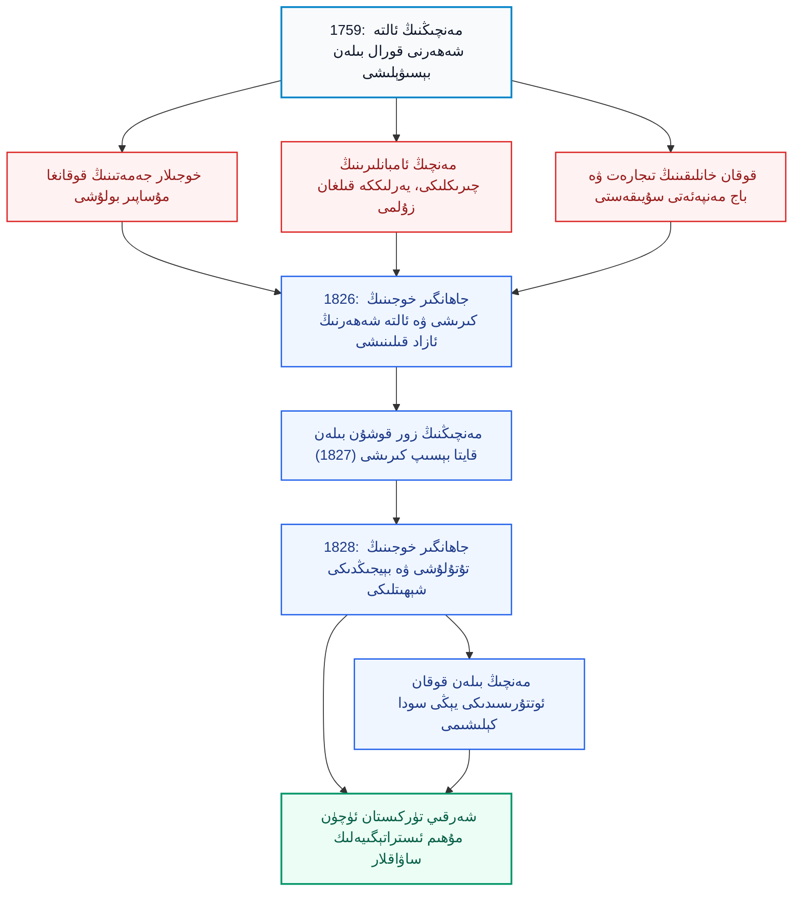
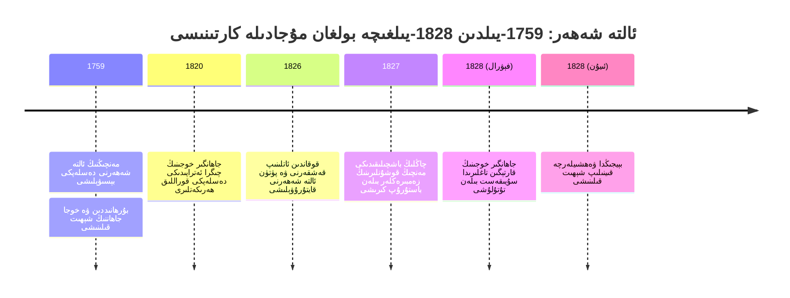
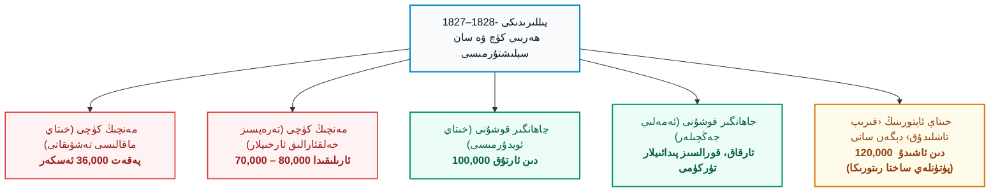
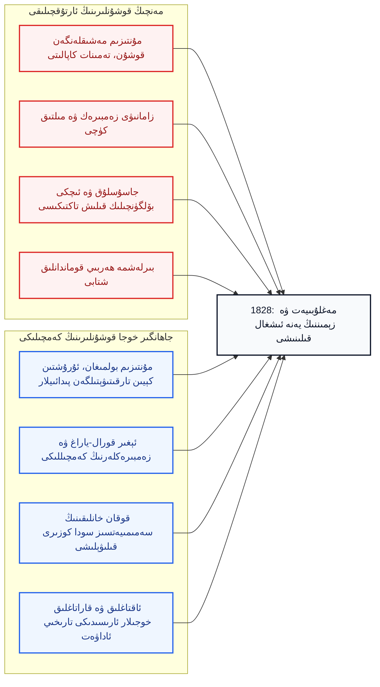

بِسْمِ اللَّهِ الرَّحْمَٰنِ الرَّحِيمِ

⏱ تەخمىنىي ئوقۇش ۋاقتى: 20 مىنۇت

ئىنتېرنېت سەھىپىلىرىدە خىتاي تىلىدا ئېلان قىلىنغان ساختا «تارىخ» ماقالىلىرىنىڭ ئارىسىدا «قەشقەر ۋە ئالتە شەھەرنىڭ قايتا بويسۇندۇرۇلۇشى» دېگەن تېمىدا يېزىلغان بىر پارچە تەشۋىقات ماقالىسى دىققىتىمنى تارتتى. ماقالىنىڭ سەرلەۋھىسى ئەينەن «بېيجىڭدا پارچىلاپ گۆش شىلىش جازاسىنى كۆرۈڭ — ئاسىي جاڭگېرنىڭ ئاخىرقى كۈنلىرى» (碎剐凌迟见北京——逆回张格尔的末日) دەپ قويۇلغان بولۇپ، ئۇ شەرقىي تۈركىستاننىڭ قەھرىمان ئوغلانى <dfn title="جاھانگىر خوجا (1788–1828): ئاقتاغلىق خوجىلار جەمەتىنىڭ ۋەكىلى، بۇرھانىددىن خوجىنىڭ نەۋرىسى. 1826-يىلى قوقان تەرەپتىن ئالتە شەھەرگە كىرىپ، مەنچىڭ مۇستەملىكىچىلىكىگە قارشى مىللىي ئازادلىق قوزغىلىڭىغا رەھبەرلىك قىلغان. خىتاي تەشۋىقاتىدا «جاڭگېر» (张格尔) دەپ ئاتىلىپ پۈتۈنلەي قارىلىنىدۇ.">جاھانگىر خوجا (1788–1828)</dfn> نىڭ ئاخىرقى كۈنلىرىنى، يەنى مەغلۇبىيىتى، تۇتقۇن قىلىنىشى ۋە بېيجىڭدا ۋەھشىيلەرچە قىينىلىپ شېھىت قىلىنىشىنى «ئادالەتنىڭ تەنتەنىسى» دەپ مەدھىيىلەيدۇ. ماقالىدە جاھانگىر خوجا «ئاشقۇن قاراقچى»، «ئىسيانكار پىتنەخور»، «ۋەتەن خائىنى» دەپ تىللىنىدۇ؛ ئۇنىڭ ئەركىنلىك ساداسىغا ئەگەشكەن ئون مىڭلىغان مەردانە ئەجدادلىرىمىز بولسا ئىنسان ئورنىدا ئەمەس، بەلكى «قارا قاشاڭ توپىلاڭچىلار پودىسى» دەپ ئاتىلىپ، ئۇلارنىڭ رەھىمسىزلەرچە قىرىلىشى گويا بىر داغدۇغىلىق قىرغىنچىلىق ئوۋىدەك مەدھىيىلىنىدۇ؛ ئەڭ ئاخىرىدا بولسا بىر تىرىك ئىنساننىڭ گۆشىنى شىلىپ پارچىلاپ ئۆلتۈرۈش دەھشىتى قالپاق كىيگۈزۈلۈپ بايرام كەيپىياتى بىلەن بايان قىلىنىدۇ. بۇ قەبىھ ماقالىنى ئوقۇغان ھەر بىر ئۇيغۇر ئالدى بىلەن غەزەپكە چۆمىدۇ، ئاندىن جىددىي تەپەككۇر قىلىدۇ: بىزنىڭ ئەجدادلىرىمىز ئېلىپ بارغان بۇ ئۈزلۈكسىز ئەركىنلىك كۈرىشى نېمە سەۋەبتىن مەغلۇبىيەتكە ئۇچرىدى؟ خىتاينىڭ بۈگۈنكى ئوقۇرمەنلىرىگە سۇنۇۋاتقان پىروپاگاندىسىدا قايسى ئىشلار يوشۇرۇلدى، قايسى ھەقىقەتلەر تەتۈر ئۆرۈلدى؟ مەزكۇر تەنقىدىي ماقالە مۇشۇ سوئاللارغا ئىلمىي ۋە مىللىي ئاڭ تۇرغۇسىدىن جاۋاب بېرىدۇ ھەمدە بۇ تارىخ ئارقىلىق بۈگۈنكى شەرقىي تۈركىستان مۇستەقىللىق داۋاسى ئۈچۈن قايسى ئىستراتېگىيەلىك ساۋاقلارنى ئېلىشىمىز كېرەكلىكىنى كۆرسىتىپ بېرىدۇ.

<!-- Image 1 -->

<em>قەشقەردىكى ئاپاق خوجا مازىرى (Wikimedia Commons، CC BY-SA 2.5). جاھانگىر خوجا مۇشۇ جەمەتنىڭ داۋامچىسى سۈپىتىدە تارىم خەلقى ئارىسىدا يۈكسەك ھۆرمەتكە ئېرىشكەن.</em>

---

## 1. ماقالىنىڭ ئومۇمىي قۇرۇلمىسى

تارىخىي ھەقىقەتنى توغرا چۈشىنىش ئۈچۈن ۋەقەلەرنىڭ لوگىكىلىق زەنجىرىنى ئېنىق كۆرۈۋېلىش شەرت. جاھانگىر خوجا قوزغىلىڭى تاسادىپىي كېلىپ چىققان ھادىسە ئەمەس؛ ئۇ مەنچىڭ ئىمپېرىيەسىنىڭ 1759-يىلىدىكى تاجاۋۇزچىلىقى، ئاقتاغلىق خوجىلارنىڭ قوقاندا سۈرگۈندە ياشىشى، مەنچىڭ ئامبانلىرىنىڭ ئالتە شەھەردىكى ئېغىر زۇلمى ۋە قوقان خانلىقىنىڭ سىياسىي-ئىقتىسادىي مەنپەئەتۋازلىقىدىن ئىبارەت ئۈچ چوڭ يىلتىزدىن تۇغۇلغان. تۆۋەندىكى سىخېما ماقالىنىڭ سەۋەب-نەتىجە قۇرۇلمىسىنى يورۇتۇپ بېرىدۇ.

*(سىخېما 1: قوزغىلاڭنىڭ كېلىپ چىقىش تۈپ سەۋەبلىرى ۋە نەتىجە خەرىتىسى)*

---

## 2. تارىخىي ئارقا كۆرۈنۈش: ئاپاق خوجىدىن مەنچىڭ تاجاۋۇزىغىچە

شەرقىي تۈركىستاننىڭ جەنۇبىي قىسمى ئەسىرلەردىن بېرى يەرلىك خەلق تىلىدا «ئالتە شەھەر» (<dfn title="ئالتە شەھەر (Altishahr): تارىم ئويمانلىقىدىكى قەشقەر، يەكەن، خوتەن، ئاقسۇ، كۇچا ۋە ئۇچتۇرپان (ياكى يېڭىسار) قاتارلىق ئەنئەنىۋى مۇستەقىل شەھەرلەرنى ئۆز ئىچىگە ئالغان ئورتاق تارىخىي نام.">Altishahr</dfn>) دەپ ئاتالغان ئىدى. 17-ئەسىردىن باشلاپ بۇ بوستانلىقلاردا <dfn title="ئاپاق خوجا (ھىدايەتۇللاھ، 17-ئەسىر): ئاقتاغلىق (ئىشقىيە) خوجىلار تەرىقىتىنىڭ داڭلىق داھىيسى. ئۇنىڭ قەشقەردىكى مازىرى كېيىنچە خەلق ئارىسىدا چوڭ تاۋاپگاھ ۋە سىياسىي ھۆرمەت مەركىزىگە ئايلانغان.">ئاپاق خوجا</dfn> ئەۋلادلىرى بولغان ئاقتاغلىقلار بىلەن قاراتاغلىقلار ئوتتۇرىسىدا تەرىقەت، ھوقۇق ۋە پۇقرا تالىشىشتەك ئېچىنىشلىق نىزالار داۋاملاشقان. بۇ ئىچكى زىددىيەتلەر سىرتقى تاجاۋۇزچىلارنىڭ رايونغا ئارىلىشىشىغا بوشلۇق يارىتىپ بەردى. 1750-يىللىرىنىڭ ئاخىرىدا پۈتكۈل ئوتتۇرا ئاسىيانى زىلزىلىگە سالغان <dfn title="جۇڭغار خانلىقى (1634–1758): ئويرات موڭغۇللىرى قۇرغان قۇدرەتلىك خانلىق. مەنچىڭ ئىمپېرىيەسى ئۇنى 1755–1758-يىللىرى مىسلىسىز قانلىق قىرغىنچىلىق ئارقىلىق پۈتۈنلەي يوقاتقان.">جۇڭغار خانلىقى</dfn> نى يوقاتقان <dfn title="مەنچىڭ ئىمپېرىيەسى (1644–1912): مانجۇ ئاقسۆڭەكلىرى قۇرغان ئىمپېرىيە. 1759-يىلى شەرقىي تۈركىستاننى پۈتۈنلەي قورال كۈچى بىلەن بېسىۋالغان.">مەنچىڭ ئىمپېرىيەسى</dfn> ئىمپېراتور <dfn title="چيەنلۇڭ (1711–1799): مەنچىڭ پادىشاھى. شەرقىي تۈركىستاننى قورال بىلەن بېسىۋېلىپ، ئويرات ۋە ئۇيغۇرلارغا قارشى بىر قاتار قىرغىنچىلىقلارنى پىلانلىغۇچى.">چيەنلۇڭ</dfn> نىڭ بۇيرۇقى بىلەن ئالتە شەھەرگە بېسىپ كىردى. ئاقتاغلىق خوجىلاردىن <dfn title="بۇرھانىددىن خوجا ۋە خوجا جاھان (؟–1759): ئىلىدا جۇڭغارلارنىڭ زىندىنىدا ياتقان، مەنچىڭ تاجاۋۇزچىلىرىغا قارشى ئالتە شەھەردە مۇستەقىللىق بايرىقىنى تىكلەپ ئاخىرىدا بەدەخشاندا ھالاك بولغان قېرىنداش خوجىلار.">بۇرھانىددىن خوجا ۋە خوجا جاھان</dfn> قېرىنداشلار ئۆز تۇپرىقىنىڭ مۇستەقىللىقى ئۈچۈن قارشىلىق كۆرسەتكەن بولسىمۇ، مەنچىڭ قوشۇنلىرى تەرىپىدىن مەغلۇب قىلىنىپ، بەدەخشاندا ئۆلتۈرۈلدى. شۇنىڭدىن كېيىن، ئاقتاغلىق خوجىلار پەرغانە ۋادىسىدىكى <dfn title="قوقان خانلىقى (1709–1876): پەرغانە ۋادىسىنى مەركەز قىلغان تۈركىي خانلىق. شەرقىي تۈركىستان بىلەن چىڭ سۇلالىسى ئوتتۇرىسىدىكى تىجارەت ۋە سىياسىي ئويۇنلارنىڭ مەركىزى بولغان.">قوقان خانلىقى</dfn> غا كۆچۈپ بېرىپ مۇساپىر بولۇپ ياشىدى، ئەمما تارىمدىكى خەلق ئارىسىدا ئۇلارنىڭ نوپۇزى ئەسلا ئۆچمىدى.

مەنچىڭ ئىمپېرىيەسى ئالتە شەھەرنى قوراللىق ھەربىي مۇستەملىكە ئاستىدا تۇتتى. يەرلىك بەگلەر پەقەت مانجۇلار تەيىنلىگەن <dfn title="ئامبان (Amban): مەنچىڭ ھۆكۈمىتى شەرقىي تۈركىستاندىكى ھەر بىر مۇھىم شەھەرگە تەيىنلىگەن ھەربىي-مەمۇرىي ئالىي مانجۇ ئەمەلدارى.">ئامبانلار</dfn> نىڭ ياردەمچىلىرى سۈپىتىدە ئىشلەيتتى. مەنچىڭ ئەمەلدارلىرىنىڭ نەزىرىدە بۇ زېمىن پەقەتلا بۇلاڭ-تالاڭ قىلىنىدىغان ئولجا ئىدى. قوزغىلاڭ ھارپىسىدا قەشقەردە تۇرۇشلۇق ئامبان <dfn title="بىنجىڭ (斌静): قەشقەردە تۇرۇشلۇق مەنچىڭ ئامبانى. ئۇنىڭ ھاياسىزلىق بىلەن يەرلىك ئۇيغۇر ئاياللىرىغا تاجاۋۇز قىلىشى ۋە چىرىكلىكى خەلقنىڭ غەزىپىنى پارتلاتقان ئاساسلىق سەۋەب بولغان.">بىنجىڭ</dfn> يەرلىك ئۇيغۇر ئاياللىرىغا باسقۇنچىلىق قىلىپ، پۇقرالارنى مال-مۈلكى بىلەن بىللە دەپسەندە قىلغان؛ مەنچىڭ ئوردىسى بۇ قەبىھ جىنايەتلەرنى تۈزۈتۈش ئورنىغا بېسىقتۇرۇپ يوشۇرغان. دېمەك، خەلقنىڭ ئورنىدىن دەس تۇرۇشى تاسادىپىي ھادىسە ئەمەس، بەلكى چىدىغۇسىز مىللىي زۇلۇم ۋە نائادىللىققا بېرىلگەن تەبىئىي جاۋاب ئىدى.

<!-- Image 2 -->

<em>قوقان خانلىقى ئوردىسىنىڭ دەرۋازىسى (Wikimedia Commons). خوجىلار دەل قوقان خانلىقىنىڭ سىياسىي ھىمايىسى ئاستىدا تۇرۇپ شەرقىي تۈركىستان ئازادلىق ھەرىكىتىنى قوزغىغان.</em>

---

## 3. خىتاي تەشۋىقاتىدىكى ساختىلىقلار: نېمە بايان قىلىندى، نېمە يوشۇرۇلدى؟

خىتاينىڭ بۇ تىپتىكى ماقالىلىرى ئوقۇلغاندا، جاھانگىر خوجىنىڭ ئىسمى باشتىن-ئاخىر پەسكەش تىل بىلەن «مۇتەئەسسىپ ئاسىي»، «قاراقچى»، ئۇنىڭ بايرىقى ئاستىدىكى ئەركىنلىك جەڭچىلىرى بولسا «توپىلاڭچى پودا»، قوقاندىن كەلگەن ئەسكەرلەر بولسا «ياللانما ئوغرىلار» دەپ كۆرسىتىلگەن. مەنچىڭنىڭ جاللات سەردارلىرىدىن چاڭلىڭ، ياڭ يۈچۈن ۋە ياڭ فاڭلار بولسا «ۋەتەنپەرۋەر»، «باتۇر ۋە ئاقىل» شەخسلەر قىلىپ تەسۋىرلەنگەن. 

ماقالىدە جاھانگىر خوجا قوزغىلىڭى نومۇسسىزلارچە «ۋەتەنگە خىيانەت قىلىش» (背叛祖国) دەپ ئاتالغان. ئەمما 1826-يىلى ئالتە شەھەر خەلقى ئۈچۈن قىلچىلىكمۇ مەۋجۇت بولمىغان «خىتاي ۋەتىنى» گە قانداق خىيانەت قىلىنسۇن؟ ئۆز زېمىنى تاجاۋۇز قىلىپ بېسىۋېلىنغىنىغا تېخى بىر ئەۋلاد كىشىنىڭ ۋاقتى ئۆتكەن، مۇستەقىل خانلىق تارىخى بار خەلقنىڭ ئۆز تۇپرىقىنى قايتۇرۇۋېلىش ئۈچۈن قوزغىلىشىنى «خىيانەت» دەپ ئاتاش — تاجاۋۇزچىلىق مەنتىقىسىنىڭ كىشى ئەقلىنى خارلىشىدىن باشقا نەرسە ئەمەس.

ماقالىدىكى ئۆلتۈرۈلگەنلەر سانىمۇ ئاشقۇن دەرىجىدە ساختا كۆپتۈرۈلگەن. خىتاي ئاپتورى ھەر بىر جەڭدە مەنچىڭ ئارمىيەسىنىڭ «ئون مىڭلاپ» قوزغىلاڭچىنى يوقاتقانلىقىنى، ھەل قىلغۇچ جەڭدە بولسا «60 مىڭ ئادەمنى قىرغانلىقىنى» پەخىر بىلەن يازىدۇ. ئەگەر ماقالىدىكى سانلارنى قوشساق، خىتاي ئۆلتۈردۇق دېگەن قوزغىلاڭچىلارنىڭ سانى **120 مىڭدىن ئېشىپ كېتىدۇ**؛ ھالبۇكى، شۇ ماقالىنىڭ ئۆزىدە جاھانگىر خوجىنىڭ ئەڭ كۆپ يىغقان قوشۇنى 100 مىڭ ئەتراپىدا دەپ كۆرسىتىلگەن! مانا بۇ سان ئويدۇرمىلىرىنىڭ ئۆزىلا خىتاينىڭ مەزكۇر ھۆججەتلىرىنىڭ ئىلمىي تارىخ ئەمەس، پەقەت غالىبلارنىڭ زەپەر ھېكايىسى ئۈچۈن پۈتۈلگەن بىمەنە پىروپاگاندا ئىكەنلىكىنى چۈشەندۈرۈپ بېرىدۇ.

| خىتاي ماقالىسىدىكى ئىبارىلەر | سىياسىي مەقسىتى | تارىخىي ۋە ئىلمىي رېئاللىق |
| :--- | :--- | :--- |
| **«بۇزغۇنچى / ئاسىي توپىلاڭچى»** | مىللىي ئازادلىق ھەرىكىتىنى جىنايەت قىلىپ كۆرسىتىش | مۇستەملىكىچىلەر ھەر زامان ئۆز ئەركىنلىكىنى تەلەپ قىلغان خەلقلەرگە «ئاسىي» دەپ قالپاق كىيدۈرگەن |
| **«ۋەتەنگە خىيانەت قىلىش»** | مانجۇ تاجاۋۇزچىلىقىنى «تەبىئىي ۋە دەسلەپتىن بار ۋەتەن» دەپ قوبۇل قىلدۇرۇش | 1826-يىلى ھازىرقى خىتاي مىللىي دۆلىتى مەۋجۇت ئەمەس ئىدى؛ ئۇيغۇرلار چىڭ ئىمپېرىيەسىگە كۈچ بىلەن تىز پۈكتۈرۈلگەن ئىدى |
| **«ياللانما قاراقچىلار»** | يەرلىك خەلقنىڭ قوزغىلاڭغا قىلغان پىداكارلىقىنى يوققا چىقىرىش | قوزغىلاڭغا پۈتكۈل ئالتە شەھەر ئاھالىسى ئۆز ئىرادىسى بىلەن ئەگىشىپ قوشۇلغان |
| **«ئۆلتۈرۈلگەنلەر: نەچچە ئون مىڭلاپ»** | قانلىق باستۇرۇشنى قەھرىمانلىق قىلىپ تەرغىب قىلىش | سانلار بىر-بىرىگە زىت بولۇپ، ئۆز سەردارلىرىنىڭ مەرتىۋىسىنى كۆتۈرۈش ئۈچۈن يالغان شىشىرگەن |
| **«ئەل ئىچىدىكى خەلق ئۇنىڭدىن يۈز ئۆرۈگەن»** | مىللەتنىڭ ئۆز داھىيلىرىغا قارشى ئىكەنلىكىنى ساختىلىق بىلەن دەلىللەش | قىسمەن پاكىت بار: قوقان قوشۇنلىرىنىڭ تەرتىپسىزلىكى ۋە ئۇرۇش چىقىملىرى سەۋەبىدىن بەزى شەھەرلەردە نارازىلىق كۆرۈلگەن |

بىز ئۆز ئەجدادلىرىمىزنىڭ كۈرىشىنى مۇلاھىزە قىلغاندا مەردانە بولۇشىمىز، يېتەرسىزلىكلەرنىمۇ يوشۇرماسلىقىمىز كېرەك. جاھانگىر خوجىنىڭ قوقان قوشۇنلىرىغا بەك بەك تايىنىپ قېلىشى، قوشۇنلارنىڭ ئىنتىزامسىزلىقى، پۇختا دۆلەت ئاپپاراتى قۇرۇپ ئۇلغىيالمىغانلىقى دەل مەغلۇبىيەتنىڭ ئىچكى سەۋەبلىرى ئىدى. بۇلارنى تەتقىق قىلىش بۈگۈنكى كۈرىشىمىز ئۈچۈن ھاياتىي ساۋاقتۇر.

---

## 4. 1826-يىلىدىكى بۇرۇلۇش: جاھانگىر خوجىنىڭ پەرغانىدىن يۈرۈش باشلىشى

جاھانگىر خوجا تەخمىنەن 1788-يىلى قوقاندا دۇنياغا كەلگەن بولۇپ، بۇرھانىددىن خوجىنىڭ نەۋرىسى ئىدى. قوقان خانى <dfn title="مۇھەممەد ئەلى خان (مادەلى خان، ھۆكۈمرانلىقى 1822–1842): قوقان خانى. مەنچىڭ ئوردىسى بىلەن مۇرەسسە قىلىپ، شەرقىي تۈركىستان ئارقىلىق غايەت زور باج ۋە سودا ئىمتىيازى ئېلىش ئۈچۈن خوجىلارنى دەستەك قىلغان سىياسىيون.">مۇھەممەد ئەلى خان</dfn> مەنچىڭ ئوردىسى بىلەن قىلغان يوشۇرۇن سودىلىشىشى تۈپەيلىدىن ئۇنى يېقىندىن نازارەت قىلىپ كەلگەن. ئەمما 1826-يىلى ياز پەسلىدە پەرغانە ۋادىسىدا يۈز بەرگەن ئېغىر بىر يەر تەۋرەشتىن كېيىنكى داۋالغۇشتىن پايدىلانغان جاھانگىر خوجا قىرغىز ۋە ئاقتاغلىق سادىق مۇرىتلىرىدىن تەشكىللەنگەن بىر قانچە يۈز ئادىمى بىلەن ئاتلىنىپ قەشقەر تەۋەلىكىگە بۆسۈپ كىردى.

ئۇنىڭ قەدىمى يېتىپ كېلىشى بىلەن تەڭلا پۈتكۈل ئالتە شەھەر تۇپرىقى گۈلدۈرلىدى. نەچچە ئون يىل بويى مەنچىڭ ئامبانلىرىنىڭ خورلىشىغا ئۇچراپ پارتلاش ھالىتىگە كەلگەن پۇقرالار تۈركۈم-تۈركۈملەپ ئۇنىڭ بايرىقى ئاستىغا ئەگەشتى؛ قىسقا ۋاقىت ئىچىدە قوشۇننىڭ سانى ئون مىڭلارغا يەتتى. خەلقنىڭ بۇ دەرىجىدە شىددەت بىلەن قوزغىلىشى مەنچىڭنىڭ رايوندىكى مۇستەملىكە ھاكىمىيىتىنىڭ يەرلىك پۇقرالار قەلبىدە قىلچىلىكمۇ ئورنى يوقلۇقىنىڭ ئېنىق ئىسپاتى ئىدى.

قوزغىلاڭ چاقماق تېزلىكىدە غەلىبە قىلدى: خەلق ئازادلىق ئارمىيەسى قەشقەر، يەكەن، خوتەن، يېڭىسار قاتارلىق شەھەرلەرنى پۈتۈنلەي ئىگىلەپ، مۇستەملىكىچىلەرنى پۈتۈنلەي تارمار قىلدى. قەشقەردە تۇرۇشلۇق مەنچىڭ باش ئامبانى چىڭشياڭ گۇلبەگ قەلئەسىدە قورشاۋدا قېلىپ، ئۆزىنى كۆيدۈرۈپ ئۆلۈۋالدى. پۈتكۈل مەنچىڭ قوشۇنلىرى جەنۇبىي رايوندىن تۈپ-تۈز قوغلاپ چىقىرىلدى. مەنچىڭنىڭ 67 يىللىق قاراڭغۇ ھۆكۈمرانلىقى بىر نەچچە ئاي ئىچىدە ئەنە شۇنداق تۈگەشتى.

<!-- Image 3 -->

<em>«خۇنباشى دەرياسى جېڭى»: مەنچىڭ ئوردا رەسساملىرى 1828-يىلى سىزغان مەنچىڭ ئارمىيەسىنىڭ غەلىبە پىروپاگاندىسى سۈرىتى (Wikimedia Commons، ئاممىۋى مۈلۈك).</em>

---

## 5. ۋاقىتنامە: 1759-يىلدىن 1828-يىلغىچە بولغان جەريانلار

*(سىخېما 2: مۇجادىلە مۇساپىسىنىڭ ئاساسىي ۋاقىت يۆنىلىشى)*

---

## 6. مەنچىڭنىڭ قايتا بېسىۋېلىش ھەربىي يۈرۈشى ۋە مەغلۇبىيەت جەريانى

مەنچىڭ ئىمپېراتورى <dfn title="داۋگۇاڭ (1782–1850): مەنچىڭ ئىمپېراتورى. ئۇنىڭ دەۋرىدە جاھانگىر قوزغىلىڭى باستۇرۇلغان، كېيىن بىرىنچى ئەپيۇن ئۇرۇشىدا ئەنگلىيەگە شەرمەندىلەرچە تىز پۈككەن.">داۋگۇاڭ</dfn> ئالتە شەھەرنىڭ قولدىن كەتكەنلىكىنى ئاڭلاپ تەلۋىلەرچە پۈتۈن ئىمپېرىيە قوشۇنلىرىنى سەپەرۋەر قىلدى. ئىلى جياڭجۈنى <dfn title="چاڭلىڭ (1758–1838): مانجۇ سەردارى، «ياڭۋېي جياڭجۈن» (ھەيۋەت چاچقۇچى گېنېرال) ئۇنۋانى بىلەن ئالتە شەھەرگە قوشۇن تارتىپ كىرگەن.">چاڭلىڭ</dfn> باش قوماندان، شەنشى-گەنسۇ پۈتۈن ھەربىي باشلىقى <dfn title="ياڭ يۈچۈن (1761–1837): سىچۈەنلىك خىتاي سەردارى. خەنزۇ قوشۇنلىرىغا قوماندانلىق قىلىپ مۇسۇلمانلارنى قانلىق باستۇرۇشتا تەجرىبە توپلىغان ئەشەددىي گۇنداي.">ياڭ يۈچۈن</dfn> ۋە سەركەردە ياڭ فاڭلار ياردەمچى قوماندان قىلىنىپ، قوشۇنلار ئاقسۇغا جەملەندى. 

مەنبە سېلىشتۇرمىلىرىغا قارىغاندا: خىتاي ماقالىسى مەنچىڭ ئارمىيەسىنى «پەقەت 36 مىڭ ئەسكەر» دەپ ئاز كۆرسىتىشكە تىرىشسىمۇ، تەرەپسىز ئەنگلىزچە ۋە خەلقئارالىق ئارخىپلار مەنچىڭنىڭ ئەسلى ئۇرۇش قىلغۇچى قوشۇنى، زەمبىرەكچىلىرى، ئارقا سەپ پىدائىيلىرى ۋە يەرلىك كۈچلەرنى قوشقاندا **70 مىڭدىن 80 مىڭغىچە** ئەسكەر كىرگۈزگەنلىكىنى ئىسپاتلايدۇ.

مەنچىڭنىڭ غەلىبە قىلىشىدىكى ئەڭ چوڭ تېخنىكىلىق پەرقى — ھەرگىزمۇ ئۇلارنىڭ جاسارىتىدە ئەمەس، بەلكى ئۇلارنىڭ زامانىۋى قورال-ياراغ، ئېغىر توپ-زەمبىرەك، مىلتىق ۋە تەمىناتى ئۈزۈلمەس مۇنتىزىم زەنجىرىنىڭ بارلىقىدا ئىدى. يۇقىرىدىكى تارىخىي رەسىملەردە كۆرۈنۈپ تۇرغىنىدەك، مەنچىڭ قوشۇنلىرى تۆگىلەرگە پۈتۈن ئېغىر زەمبىرەكلەرنى ئارتىپ پۇختا تۈزۈلگەن ھەربىي ئىنتىزام بىلەن جەڭگە كىرگەن. 

ئەكسىچە، جاھانگىر خوجا قەشقەر ۋە ئالتە شەھەرنى ئالغاندىن كېيىن، ئۇرۇش تۈگىدى دەپ قاراپ تەرتىپسىز ھالدا ئەسكەرلەرنى ئۆي-ئۆيلىرىگە قايتۇرۇۋەتكەن، سىستېمىلىق مۇنتىزىم ئارمىيە، قورال زاۋۇتى ۋە زەمبىرەك باتارېيەلىرىنى قۇرمىغان. مەنچىڭ قوشۇنلىرى بىلەن قەشقەر سىرتىدىكى **تۈمەن دەرياسى** بويىدا ۋە **شابۇدۇر (沙布都尔)** دا دۇچ كەلگەندە، مەنچىڭنىڭ شىددەتلىك زەمبىرەك ۋە زەھەرلىك زەمبىرەك ئوقلىرى قوزغىلاڭچىلارنىڭ تۇراقسىز سەپلىرىنى بۆسۈپ تاشلىدى. بەدەخشان، قوقاندىن كەلگەن چەۋەندازلار تۇنجى بولۇپ جەڭ مەيدانىنى تاشلاپ قاچتى؛ بۇنىڭ بىلەن ئالتە شەھەر خەلقى رەھىمسىز ئوق تۈگمىنى ئاستىدا قايتىدىن قالدى.

<!-- Image 4 -->

<em>مەنچىڭ قوشۇنلىرىنىڭ زەمبىرەكلەر بىلەن قوزغىلاڭچىلارنى تارمار قىلىش كۆرۈنۈشى — شابۇدۇر جېڭى (Wikimedia Commons، ئاممىۋى مۈلۈك).</em>

*(سىخېما 3: ھەربىي كۈچ سېلىشتۇرمىسى ۋە ساختىلىقلار)*

---

## 7. مەغلۇبىيەتنىڭ ھەل قىلغۇچ ئامىللىرى

جاھانگىر خوجا دەۋرىدىكى مەغلۇبىيەت بىزگە دەۋر ھالقىغان ئىبرەتلەرنى قالدۇردى. بۈگۈنكى كۆز بىلەن قارىغاندا ئۈچ چوڭ يوقىتىش ئامىلى كۆزگە تاشلىنىدۇ:

*(سىخېما 4: ئىككى تەرەپنىڭ ئىستراتېگىيەلىك سېلىشتۇرمىسى ۋە مەغلۇبىيەت تۈگۈنى)*

بۇ يەردىكى ئەڭ دەھشەتلىك نۇقتا — قوقان خانلىقىنىڭ پىچاق سېلىش رولىدۇر. قوقان خانى مۇھەممەد ئەلى خان ئۈچۈن جاھانگىر خوجىنىڭ ئەركىنلىك دەۋاسى پەقەتلا مەنچىڭ ئوردىسىدىن سودا بېجى تەلەپ قىلىدىغان تاكتىكىلىق بىر ۋاسىتە ئىدى. ئۇلار شەرقىي تۈركىستاننىڭ مۇستەقىل دۆلەت بولۇشىنى ئەسلا ئويلىغان ئەمەس؛ ئەكسىچە، خوجىلار ئارقىلىق خىتاينى قورقۇتۇپ، ئالتە شەھەر بازىرىغا قوقان باجسىز كىرىدىغان ئىقتىسادىي ھوقۇقنى تارتىۋېلىش ئىدى. قوقان قوشۇنلىرى جەڭ قىيىنلاشقاندا دەرھال ئارقىغا چېكىندى. 

جاھانگىر خوجا ئۆلتۈرۈلگەندىن كېيىن، مەنچىڭ قوقاننى جازالاش ئۈچۈن ئالتە شەھەرگە كىرىدىغان ماللارنى چەكلىدى؛ قوقان خانى بولسا مەنچىڭنى قايتا بويسۇندۇرۇش ئۈچۈن 1830-يىلى جاھانگىرنىڭ ئاكىسى يۈسۈپ خوجىنى يەنە ئاتلاندۇردى. ئىككى تەرەپ تەڭ تەۋرىگەندىن كېيىن، مەنچىڭ قوقانغا چىگرا ھالقىغان سودا بېجى ئېلىش، يەرلىك ئەلچى تۇرغۇزۇش كەبى غايەت زور ئىمتىيازلارنى بەردى، قوقان بولسا خوجىلارنى تۇتۇپ بېرىش ياكى چەكلەشكە ۋەدە قىلدى. مانا بۇ، بىر مىللەتنىڭ مۇقەددەس ئازادلىق ھەرىكىتىنىڭ يات بىر مەنپەئەتپەرەس كۈچكە يۈكلىنىپ قېلىشى قانداق پاجىئەلەرنى ئېلىپ كېلىدىغانلىقىنىڭ ئەڭ ئاچچىق سىياسىي ساۋاغىدۇر.

<!-- Image 5 -->

<em>مەنچىڭ ئوردىسى سىزغان «قەشقەرنى قايتا بېسىۋېلىش» پىروپاگاندىسى (Wikimedia Commons). ئۈستىدىكى قەغەز پادىشاھ داۋگۇاڭنىڭ غەلىبە كۆرگەزمىسى ئۈچۈن پۈتۈلگەن.</em>

---

## 8. ئاخىرقى كۈرەش: سۇيىقەست بىلەن تۇتۇلۇش ۋە بېيجىڭدىكى شېھىتلىك

قەشقەر مەغلۇپ بولغاندىن كېيىن جاھانگىر خوجا ئاز ساندىكى سادىق ئەگەشكۈچىلىرى بىلەن پامىر-قارتېگىن قىيالىقلىرىغا چىكىندى. 1828-يىلىنىڭ باشلىرىدا، مەنچىڭ ئوردىسى يەرلىكتىكى مەنپەئەتدار ئىچكى يۈزلۈكلەرنى ئىشقا سېلىپ رەزىل بىر ساختا سۇيىقەست ئۇيۇشتۇردى: قەشقەردىكى بەزى سېتىلغان مۇناپىقلار خوجىغا يالغان ئۇچۇر ئەۋەتىپ: «مەنچىڭ ئارمىيەسى ئاقسۇغا پۈتۈنلەي قايتىپ كەتتى، قەشقەر قوغدىغۇچىسىز قۇپقۇرۇق قالدى، شەھەر سىزگە تەشنا بولۇپ تەييار تۇرىدۇ» دېگەن مەخپىي خەت سۇندى. 

جاھانگىر خوجا خەلقىنىڭ ئازادلىق ئۈمىدىگە قايتا ئىشىنىپ، بىر نەچچە ئون مۇجاھىد بىلەن قارلىق تاغلاردىن چۈشۈپ كەلگەندە، مەنچىڭ سەردارى ياڭ فاڭ ۋە خىتايغا سېتىلغان يەرلىك مۇناپىقلار ئۇلارنى قارتېگىن جىلغىلىرىدا كۈتۈلمىگەن ھالدا تۇيۇقسىز قورشاۋغا ئېلىپ، ئېغىر جاندىن كېچىش جېڭىدىن كېيىن جاھانگىر خوجىنى ئەسىرگە ئالدى. بۇ جەريان دەل مەنچىڭنىڭ «تۈركىي قوۋملار ئارىسىغا پىتنە سېلىپ، بىرى بىلەن بىرىنى تۇتۇش» (以夷制夷) سىياسىتىنىڭ قانلىق نەتىجىسى ئىدى.

<!-- Image 6 -->

<em>مەنچىڭ ئوردىسىنىڭ رەسىملىرى: «جاھانگىرنىڭ قارلىق تاغدا قىلتاققا چۈشۈرۈلۈشى» (Wikimedia Commons، ئاممىۋى مۈلۈك).</em>

جاھانگىر خوجا تۇتۇلغاندىن كېيىن ئېغىر تۆمۈر كويزا-كىشەنلەر بىلەن مىڭلىغان چاقىرىملىق يولنى بېسىپ بېيجىڭغا ئېلىپ كېتىلدى. پادىشاھ داۋگۇاڭ چىڭ ئوردىسىنىڭ (ياساق شەھەر) جەنۇبىي دەرۋازىسى بولغان <dfn title="ۋۇمېن (午门): بېيجىڭدىكى چىڭ ئوردىسىنىڭ ئەڭ مۇھىم مەركىزىي جەنۇبىي دەرۋازىسى. مەنچىڭ پادىشاھلىرى تاشقى ئەللەرنى بېسىۋالغاندىن كېيىن پۇقرالار ئالدىدا سىياسىي ھەيۋە كۆرسىتىش ئۈچۈن قارشى چىققان ئەسىرلەرنى مۇشۇ يەردە كۆرگەزمە قىلىپ قوبۇل قىلغان.">ۋۇمېن (午门)</dfn> سارىيى ئۈستىدە تەنتەنىلىك ئولتۇرۇپ، ئەسىر ئېلىنغان خوجىنى پۇقرالار ئالدىدا نومۇسسىزلارچە كۆرگەزمە قىلدى. 

كېيىن، مەنچىڭ ھۆكۈمىتى ئۇنىڭغا قەدىمكى خىتاينىڭ ئەڭ دەھشەتلىك فاشىستىك جازاسى بولغان <dfn title="لىڭچى (凌迟): تىرىك ئادەمنىڭ گۆشىنى مىڭلىغان قېتىم پىچاق بىلەن تىلىپ-شىلىپ قىيناپ ئۆلتۈرىدىغان قەبىھ خىتاي ئۆلۈم جازاسى (1905-يىلى دۇنيا بېسىمى بىلەن ئەمەلدىن قالدۇرۇلغان).">«لىڭچى» (凌迟 - تىرىك شىلىپ كېسىش جازاسى)</dfn> نى ئىجرا قىلدى. خىتاينىڭ مەزكۇر تەشۋىقات ماقالىسى بىر قەھرىماننىڭ تىرىك تۇرۇپ گۆشلىرىنىڭ شىلىنىپ ئۆلتۈرۈلۈشىنى «ئادالەت بايرىمى» سۈپىتىدە لەززەت بىلەن پەردازلايدۇ. ئەمما پۈتكۈل شەرقىي تۈركىستان خەلقى ئۈچۈن جاھانگىر خوجا دۈشمەننىڭ دەھشەتلىك زىندانلىرى ئالدىدا قىلچە باش ئەگمەي، ئۆز ئېتىقادى ۋە ۋەتىنى ئۈچۈن شېھىتلىك شەرىپىگە يەتكەن تىز پۈكمەس مىللىي ئوغلاندۇر!

<!-- Image 7 -->

<em>داۋگۇاڭ پادىشاھنىڭ بېيجىڭ ۋۇمېن دەرۋازىسى ئالدىدا تۇرۇپ غەلىبە نۇتقى سۆزلىشى (1828، Wikimedia Commons). تاجاۋۇزچىلارنىڭ پىروپاگاندىسى.</em>

---

## 9. تارىخنىڭ داۋامى: توختىماس ئىنقىلاب زەنجىرى

جاھانگىر خوجىنىڭ قىيناپ شېھىت قىلىنىشى شەرقىي تۈركىستاننىڭ ئەركىنلىك ئۈمىدىنى ئەسلا تۈگىتەلمىدى؛ بەلكى ئۇ خەلقنىڭ قەلبىدە مەنچىڭ تاجاۋۇزچىلىرىغا بولغان چوڭقۇر ئۆچمەنلىك پىلتىسىنى ياندۇردى:
- **1830-يىلى:** يۈسۈپ خوجا قوزغىلىڭى پارتلىدى؛
- **1847-يىلى:** «يەتتە خوجا» قوشۇن تارتىپ كىرىپ قەشقەرنى قايتا لەرزىگە سالدى؛
- **1857-يىلى:** ۋەلىخان تۆرە مەنچىڭ مۇستەملىكىچىلىرىگە قارشى شىددەتلىك ھۇجۇم باشلىدى؛
- **1864-يىلى:** كۇچادىن پارتلىغان مىللىي ئىنقىلاب پۈتۈن مەنچىڭ ھاكىمىيىتىنى تارىم ئويمانلىقىدىن قوغلاپ چىقىرىپ، پۈتۈن دۇنيا ئېتىراپ قىلغان مۇستەقىل <dfn title="يەتتەشەھەر دۆلىتى (1865–1877): يەقۇپبەگ قۇرغان مەشھۇر دۆلەت بولۇپ، ئوسمانلى خەلىپىلىكى، بۈيۈك بىرىتانىيە ۋە رۇسىيە تەرىپىدىن رەسمىي ئېتىراپ قىلىنغان مۇستەقىل تۈرك-ئىسلام دۆلىتى.">يەتتەشەھەر دۆلىتى</dfn> نى بەرپا قىلدى.

مانا بۇ تارىخ كۆرسىتىدۇكى: جاھانگىر خوجا قوزغىلىڭى بىر ئايرىم ۋەقە ئەمەس، بەلكى 1759-يىلدىن تاكى 1949-يىلى خىتاي كوممۇنىست تاجاۋۇزچىلىرى باستۇرۇپ كىرگەنگە قەدەر داۋاملاشقان، قېنى توختىمىغان مۇقەددەس شەرقىي تۈركىستان مىللىي كۈرىشىنىڭ ئەڭ مۇھىم غۇرۇر ھالقىلىرىنىڭ بىرىدۇر.

<!-- Image 8 -->

<em>«غەلىبە زىياپىتى» (1828، چىڭ ئوردىسى رەسىملىرى، Wikimedia Commons). مۇستەملىكىچىلەر ئۆز قەبىھلىكىنى بايرام قىلسىمۇ، تارىخنىڭ ھۆكمى ئۇلارنىڭ زۇلمىنى مەڭگۈ كەچۈرمەيدۇ.</em>

---

## 10. تۆت تۈرلۈك چوڭقۇر تارىخىي ئىبرەت

### 1) ئىسلام تەلىماتىدىن ئىبرەت: غەلىبە قۇرۇق كۆپلۈكتە ئەمەس، ئىتتىپاق ۋە ساپ تەرتىپتىدۇر

ھۈنەين غازىتىدا سانىنىڭ كۆپلۈكىگە ئىشىنىپ مەغرۇرلانغان قوشۇن ئەلەملىك سىناققا ئۇچرىغاندا، ئاللاھ تائالا مۆمىنلەرگە شۇنداق ئەسكەرتكەن:

﴿لَقَدْ نَصَرَكُمُ اللَّهُ فِي مَوَاطِنَ كَثِيرَةٍ وَيَوْمَ حُنَيْنٍ إِذْ أَعْجَبَتْكُمْ كَثْرَتُكُمْ فَلَمْ تُغْنِ عَنكُمْ شَيْئًا﴾

> *(شۈبھىسىزكى، ئاللاھ سىلەرگە نۇرغۇن جەڭ مەيدانلىرىدا نۇسرەت بەردى. ھۈنەين كۈنىدىمۇ نۇسرەت بەردى؛ شۇ كۈندە ئۆزۈڭلارنىڭ كۆپلۈكى سىلەرنى غۇرۇرغا پاتۇرۇپ ھۇزۇرلاندۇرغان ئىدى، ئەمما ئۇ كۆپلۈك سىلەرگە ھېچ ئەسقاتمىدى...)* — سۈرە تەۋبە، 25-ئايەت.

شۇنىڭدەك ئاللاھ تائالا ئىچكى ماجىراغا قارىتا قەتئىي ئاگاھلاندۇرىدۇ:

﴿وَأَطِيعُوا اللَّهَ وَرَسُولَهُ وَلَا تَنَازَعُوا فَتَفْشَلُوا وَتَذْهَبَ رِيحُكُمْ ۖ وَاصْبِرُوا ۚ إِنَّ اللَّهَ مَعَ الصَّابِرِينَ﴾

> *(ئاللاھقا ۋە ئۇنىڭ ئەلچىسىگە ئىتائەت قىلىڭلار، ئۆزئارا تالاش-تارتىش ۋە ئىختىلاپ قىلماڭلار؛ ئۇنداق قىلساڭلار روھىڭلار چۈشۈپ كېتىدۇ، كۈچ-قۇۋۋىتىڭلار يوقىلىدۇ. سەۋر قىلىڭلار، چۈنكى ئاللاھ سەۋر قىلغۇچىلار بىلەن بىللىدۇر.)* — سۈرە ئەنفال، 46-ئايەت.

جاھانگىر خوجا قوزغىلىڭىدىكى تارقاقلىق، ئىنتىزامسىزلىق ۋە مەزھەپ-تەرىقەت تالاش-تارتىشلىرى دەل مۇشۇ ئايەتلەردە كۆرسىتىلگەن ھەقىقەتنىڭ تارىختىكى قانلىق دەلىلىدۇر.

### 2) دۇنيا تەجرىبىسىدىن ئىبرەت: تاشقى ئىتتىپاقداشلارنىڭ كوزىرى بولۇپ قالماسلىق

جاھانگىر قوزغىلىڭىدىن ئاران ئىككى يىل كېيىن، ياۋروپادا پولشا خەلقى رۇسىيە ئىمپېرىيەسىگە قارشى 1830-يىلى نويابىر ئىنقىلابىنى قوزغىدى. پولشا مىللىتى جان تىكىپ ئۇرۇشقان بولسىمۇ، ياۋروپا چوڭ كۈچلىرىنىڭ ھەقىقىي مەنپەئەت تىرەكلىرى بولمىغاچقا، چار رۇسىيەسى تەرىپىدىن باستۇرۇلدى. يەنە شۇ دەۋردىكى گرېتسىيە ئازادلىق ھەرىكىتى بولسا ئەنگلىيە، فىرانسىيە ۋە رۇسىيەنىڭ رايوندىكى ئىستراتېگىيەلىك مەنپەئەتلىرى بىلەن تۇتاشقانلىقى ئۈچۈن، 1827-يىلدىكى ناۋارىن دېڭىز ئۇرۇشى ئارقىلىق مۇستەقىللىققا ئېرىشتى. دېمەك، خەلقئارالىق سىياسەتتە پۇختا دىپلوماتىك تەڭپۇڭلۇق قۇرماي تۇرۇپ پەقەت قوشنا كۈچنىڭ شەخسىي مەنپەئەتىگىلا تايىنىپ قېلىش پاجىئەلەرنى كەلتۈرۈپ چىقىرىدۇ.

### 3) خىتاي زۇلمىنىڭ مۇقەررەر ئاقىۋىتى: تەكەببۇرلۇق بىلەن كەلگەن زاۋاللىق

مەنچىڭ ئىمپېرىيەسى جاھانگىر خوجىنى يوقىتىپ پۈتۈن بېيجىڭ كوچىلىرىدا قان دەرياسى ئاققۇزۇپ ئۆزىنى تەڭداشسىز چاغلىغان بولسىمۇ، ئارىدىن ئون يىل ئۆتۈپ-ئۆتمەيلا، 1839–1842-يىللىرىدىكى بىرىنچى ئەپيۇن ئۇرۇشىدا ئەنگلىيە قوراللىرى ئالدىدا ئىتتەك تىز پۈكتى؛ ئارقىدىن تەيپىڭ تەڭرى پادىشاھلىقى ئىنقىلابى (1850–1864) پارتلاپ پۈتۈن خىتاي زېمىنى خارابىگە ئايلاندى. ئۆزگىلەرنى پەسكەش قىلىپ خورلىغان بىر مۇستەبىت ھاكىمىيەت ھامان تېخىمۇ چوڭ بىر بالايىئاپەتكە غەرق بولىدۇ.

### 4) ئۇيغۇر خەلقىنىڭ تۈگەنمەس داۋامى: ئەركىنلىككە تەلپۈنگەن روھ يېڭىلمەيدۇ

جاھانگىر خوجا قۇربان بولدى، ئەمما ئۇيغۇر خەلقىنىڭ روھى ئەسلا تىز پۈكمىدى. بىزنىڭ قېنىمىزدا قاراخانىيلاردىن، يەركەنت خانلىقىدىن، 1933-يىلىدىكى شەرقىي تۈركىستان ئىسلام جۇمھۇرىيىتى ۋە 1944-يىلىدىكى شەرقىي تۈركىستان جۇمھۇرىيىتىدىن قالغان مەردانە ئەركىنلىك گېنى بار. زالىملار گۆشنى پارچىلىيالايدۇ، ئەمما مىللەتنىڭ كۆكسىدىكى مۇستەقىللىق مەشئىلىنى ئەسلا ئۆچۈرەلمەيدۇ.

---

## 11. بۈگۈنكى شەرقىي تۈركىستان داۋاسى ئۈچۈن 6 ئىستراتېگىيەلىك دەرس

1. **مۇنتىزىم، سىجىل ۋە ئىنتىزاملىق ئاپپاراتلارنى تىكلەش:** كۈرەشنى ھېسسىياتقا ياكى پەسىللىك داۋالغۇشلارغا تاياندۇرۇپ قويماسلىق؛ مەيلى دىپلوماتىيە، مەيلى تاراتقۇ ياكى مائارىپ ساھەسىدە بولسۇن، كۈچلۈك ئىنتىزامغا، مەبلەغ سىستېمىسىغا ۋە كەسپىي كادىرلار قوشۇنىغا ئىگە پۇختا ئورگانلارنى شەكىللەندۈرۈش لازىم.
2. **تاشقى كۈچلەرگە ئەقىللىق، كۆپ تەرەپلىمىلىك ۋە تەڭپۇڭ مۇئامىلە قىلىش:** ھەر قانداق خەلقئارالىق دۆلەت ياكى تەشكىلات ئۆز مەنپەئەتى بىلەن ھەرىكەت قىلىدۇ. دەۋايىمىزنى پەقەت بىرلا دۆلەتنىڭ سودا-ئىقتىسادىي كوزىرىغا ئايلاندۇرۇپ قويماي، دۇنياۋى پىرىنسىپلار، خەلقئارا ئىنسانىي ھوقۇق ۋە ئورتاق سىياسىي كېسىشىش نۇقتىلىرى ئاساسىدا قوغداپ چىقىش شەرت.
3. **مەزھەپپەرەسلىك، گۇرۇھۋازلىق ۋە يۇرتۋازلىقنى تامامەن پاچاقلاش:** مەنچىڭ ئاقتاغلىق ۋە قاراتاغلىق، شىمال ۋە جەنۇب ئايرىمىچىلىقىدىن پايدىلىنىپ بىزنى پۈتۈنلەي قۇل قىلدى. بۈگۈن دەۋايىمىز ئۈچۈن ئەڭ ۋەيران قىلغۇچى ئاپەت — ئىچكى بۆلگۈنچىلىك ۋە سۈيىقەست باھالىرىدۇر. بىرلىك — مەۋجۇتلۇقنىڭ بىرىنچى شەرتى.
4. **ئۇچۇر بىخەتەرلىكى ۋە ساختا خەۋەرلەرگە قارشى تاش قورغان تۇرغۇزۇش:** جاھانگىر خوجىنىڭ ئەڭ چوڭ پاجىئەسى مەنچىڭنىڭ يالغان ئۇچۇرىغا دەلىللىمەستىن ئىشىنىپ قىلتاققا چۈشۈپ كېتىشى بولدى. نۆۋەتتىكى خەلقئارالىق سىبېر ئۇرۇش ۋە خىتاينىڭ كەڭ كۆلەملىك ئىچكى پارچىلاش تەشۋىقاتى دەۋرىدە، ھەر بىر ئۇچۇرنى ئۈچىنچى تەرەپ بىلەن ئېنىقلاش ۋە تەكشۈرۈش ئىقتىدارىنى چېنىقتۇرۇش ھاياتىي قورالدۇر.
5. **مىللىي قەھرىمانلىرىمىزغا ئىگە چىقىپ، ھەقىقىي تارىخىمىزنى ئۆزىمىز يېزىش:** خىتاينىڭ جاھانگىر خوجىنى «قاراقچى» دەپ دۇنياغا جار سېلىشىغا قاراپ سۈكۈت قىلىپ ئولتۇرۇش نومۇس؛ بىز ئۇيغۇر ئازادلىق يولىدا قان تۆككەن بارلىق شېھىتلىرىمىزنىڭ، خوجىلار ۋە بارلىق داھىيلىرىمىزنىڭ ھاياتىنى ئىنگلىزچە، تۈركچە ۋە ئەرەبچە كىتابلار، ھۆججەتلىك فىلىملەر بىلەن دۇنياغا پۈتۈپ چىقىشىمىز زۆرۈر.
6. **ئادالەت، ئەركىنلىك ۋە ئىنسانىي قەدىر-قىممەت سېپىدە مەزمۇت تۇرۇش:** بىزنىڭ داۋايىمىز بىر تاجاۋۇزچىنىڭ گۆش شىلىش قىلمىشلىرىغا ئوخشاش فاشىستىك قەبىھلىك ئەمەس، بەلكى ئۆز زېمىنىدا ئۆز ئەركىنلىكى، ئىززەت-ھۆرمىتى ۋە دىنى بىلەن ياشاشنى خالايدىغان بىر مۇقەددەس خەلقنىڭ دەۋاسىدۇر. ھەققانىيەت بىز تەرەپتە، ھەقىقەت ھامان زۇلۇم ئۈستىدىن غەلىبە قىلىدۇ.

---

## ئالاقىدار مۇھىم تەۋسىيە كىتابلار

1. **«China Marches West: The Qing Conquest of Central Eurasia» — Peter C. Perdue**  
   مەنچىڭ ئىمپېرىيەسىنىڭ ئوتتۇرا ئاسىيا ۋە شەرقىي تۈركىستاننى بېسىۋېلىش جەريانى، چيەنلۇڭ ۋە داۋگۇاڭ سۇلالىلىرىنىڭ رايوندىكى ۋەھشىيانە تەكتىكىلىرى ھەققىدىكى ئەڭ قايىل قىلارلىق خەلقئارالىق ئەسەر.
2. **«The Empire and the Khanate: A Political History of Qing Relations with Khoqand c. 1760–1860» — Laura J. Newby**  
   چىڭ سۇلالىسى بىلەن قوقان خانلىقى ئوتتۇرىسىدىكى مەخپىي سىياسىي ئويۇنلار، تىجارەت كېلىشىملىرى ۋە جاھانگىر خوجا قوزغىلىڭىنىڭ ئارقا كۆرۈنۈشىنى تەپسىلىي پاش قىلغان ئاساسلىق مەنبە.
3. **«Holy War in China: The Muslim Rebellion and State in Chinese Central Asia, 1864–1877» — Kim Hodong**  
   خوجىلار قوزغىلاڭلىرىنىڭ مەنتىقىسى ۋە ئۇنىڭ ئاخىرىدا يەتتەشەھەر ئىسلام دۆلىتىنىڭ قۇرۇلۇشىغا تۇتاشقان تارىخىي كارتىنىسىنى ئېسىل يورۇتىدۇ.
4. **«Eurasian Crossroads: A History of Xinjiang» — James A. Millward**  
   شەرقىي تۈركىستاننىڭ 18- ۋە 19-ئەسىرلەردىكى كېڭەيمىچىلىككە قارشى ئېلىپ بارغان بارلىق قوزغىلاڭلىرى ۋە ئىجتىمائىي ھاياتىنى چۈشىنىشتىكى نۇپۇزلۇق كىتاب.

---

## پايدىلانغان مەنبەلەر تىزىملىكى

  

    1. Peter C. Perdue, <em>China Marches West: The Qing Conquest of Central Eurasia</em>, Cambridge, MA: Harvard University Press, 2005.
  

  

    2. Laura J. Newby, <em>The Empire and the Khanate: A Political History of Qing Relations with Khoqand c. 1760–1860</em>, Leiden: Brill, 2005.
  

  

    3. Kim Hodong, <em>Holy War in China: The Muslim Rebellion and State in Chinese Central Asia, 1864–1877</em>, Stanford: Stanford University Press, 2004.
  

  

    4. James A. Millward, <em>Eurasian Crossroads: A History of Xinjiang</em>, New York: Columbia University Press, 2007.
  

  

    5. «碎剐凌迟见北京——逆回张格尔的末日», خىتاي تور ماقالىسى (تەنقىد ئوبيېكتى).
  

  

    6. قۇرئان كەرىم، سۈرە تەۋبە 25-ئايەت، سۈرە ئەنفال 46-ئايەت.
  

  

    7. سۈرەت مەنبەلىرى: Wikimedia Commons (Afaq Khoja Mausoleum, Kokand Palace Gate, Qing Court paintings of Hunbashi River, Sabdur Battle, Kashgar Retaking, Jahangir Capture and Meridian Gate Triumphs).
  

