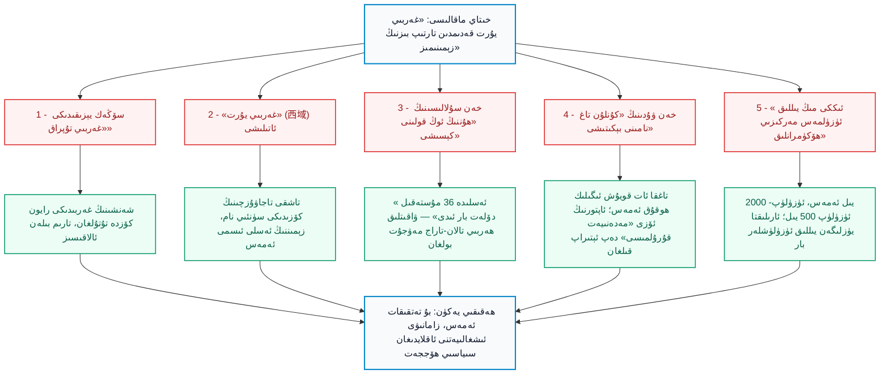
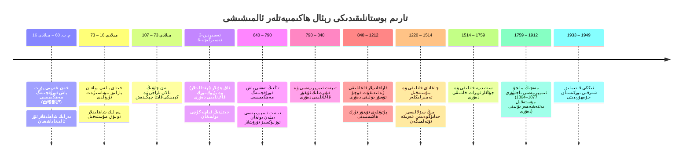
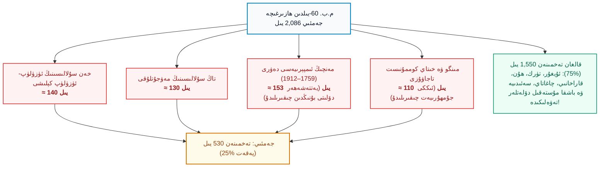
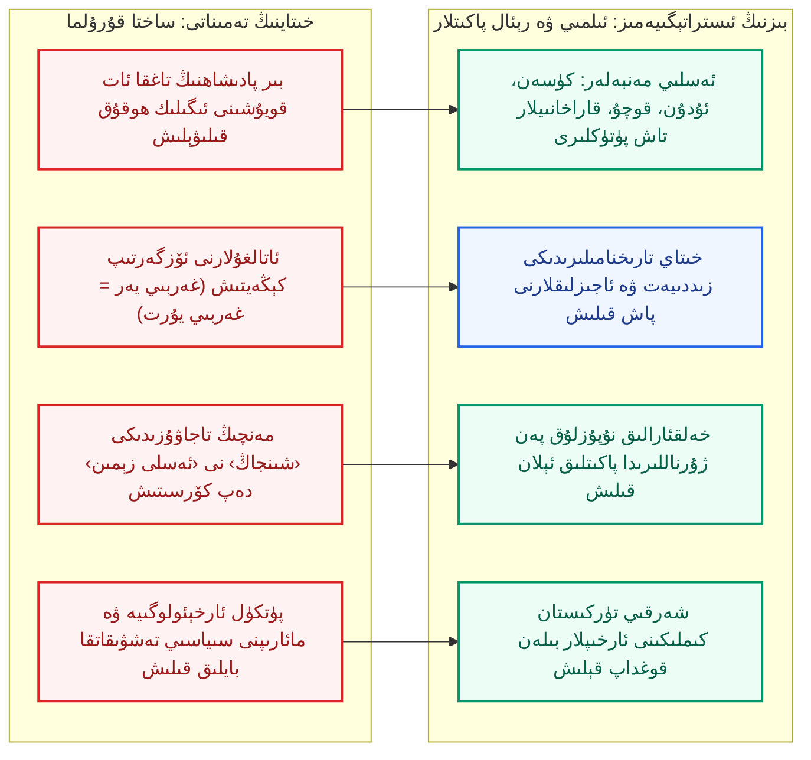

بِسْمِ اللَّهِ الرَّحْمَٰنِ الرَّحِيمِ

⏱ تەخمىنىي ئوقۇش ۋاقتى: 22 مىنۇت

خىتاينىڭ داڭلىق نەزەرىيە ۋە ئىدىيەۋى بايلىق تور بېكىتى «ئەيسىشياڭ» (爱思想) دا «ئاسمان ئاستىدىكى غەربىي يۇرت: كۇنلۇن مەدەنىيىتى كۆزىتىشىدىكى زېمىن قۇرۇلۇشى، دۆلەت بىرلىكى ۋە مەدەنىيەت ئۆزلۈكى» ماۋزۇسىدا، ۋۇ شىنخۇا (巫新华) ئىسىملىك ئاپتورنىڭ ئۇزۇن بىر مەپكۇرىۋى ماقالىسى ئېلان قىلىندى. ماقالە سىرتىغا «ئىلمىي تەتقىقات» لىباسىنى كىيگەن، ئاخىرىدا 43 پارچە مەنبە تىزىلغان، خىتاينىڭ قەدىمكى تارىخ خاتىرىلىرىدىن، تاشپاقا قاسىرىقى پال سۆڭەك يېزىقلىرىدىن (甲骨文) تارتىپ تاكى بۈگۈنكى پارتىيە گېزىتلىرىگىچە بولغان قەغەزلەردىن ئۇزۇن نەقىللەر كەلتۈرۈلگەن. ئەمما ئۇنىڭ كۆزلىگەن يەكۈنى ئىنتايىن ساددا ۋە زوراۋانلارچە: «غەربىي يۇرت (西域) قەدىمدىن تارتىپ ھەر ۋاقىت خىتاينىڭ زېمىنىدۇر، كۇنلۇن تېغى بولسا خىتاي مەدەنىيىتىنىڭ بۆشۈكىدۇر. شەرقىي تۈركىستان تۇپرىقى ئىككى مىڭ يىلدىن بېرى ئۈزۈلمەستىن بېيجىڭنىڭ باشقۇرۇشىدا بولۇپ كەلگەن؛ شۇ سەۋەبتىن بۈگۈنكى كۈندە يۈرگۈزۈلۈۋاتقان ‹مەدەنىيەت ئارقىلىق شىنجاڭنى نەملەندۈرۈش› ۋە ‹جۇڭخۇا مىللىتى ئورتاق گەۋدىسى ئېڭىنى مۇستەھكەملەش› كەبى ئاسسىمىلياتسىيە سىياسەتلىرى تامامەن ھەققانىيدۇر». بۇ ماقالىنىڭ پۈتكۈل خىتاي ئىنتېرنېت تورلىرىدا، ئالىي مەكتەپلەردە كۆرسەتمە ماتېرىيال سۈپىتىدە تارقىتىلىشى ئەسلا كۈتۈلمىگەن ھادىسە ئەمەس؛ بەلكى ئۇ خىتاينىڭ نۆۋەتتىكى مىللىي قىرغىنچىلىقىغا تارىختىن سۈنئىي قالقان ياساپ بېرىش پىلانىنىڭ بىر قىسمىدۇر. شۇڭلاشقا بىز بۇ ھۆججەتنىڭ كۆپۈكىنى ئۇچۇرۇپ، ئۇنىڭ قەيەردە ئاتالمىش «پاكىت»، قەيەردە پارتىيەۋى ساختا «خىيال» نىڭ ھەقىقەت ئورنىغا ئۆتۈپ كەتكەنلىكىنى تارىخىي ئارخىپلار بىلەن پاچاقلاپ تاشلايمىز.

<!-- Image 1 -->

<em>خەن سۇلالىسى دەۋرىدىكى ئوتتۇرا ئاسىيا رايونىنىڭ ئەسلىي خەرىتىسى (Wikimedia Commons، ئاممىۋى مۈلۈك). خەرىتىدە ئۇيسۇن، كۈسەن، ئۇدۇن، سۇلى (قەشقەر)، پىشان (گۇما) قاتارلىق مۇستەقىل شاھلىقلار ئېنىق كۆرۈنۈپ تۇرىدۇ.</em>

---

## 1. خىتاي ماقالىسىنىڭ ئاساسىي قۇرۇلمىسى ۋە ئاجىز ھالقىلىرى

ئالدى بىلەن ماقالىنىڭ تايانغان ئالتە يادرولۇق دەلىل زەنجىرىنى كۆرۈپ چىقايلى: (1) پال سۆڭەك يېزىقىدىكى «غەربىي زېمىن» (西土) سۆزى؛ (2) «غەربىي يۇرت» (西域) نامىنىڭ كېيىنكى دەۋرلەردىمۇ ساقلىنىپ قېلىشى؛ (3) خەن سۇلالىسىنىڭ «خېشى كارىدورى» نى بېسىۋېلىپ، «ھۇننىڭ ئوڭ قولىنى كېسىش» ئىستراتېگىيەسى؛ (4) خەن ۋۇدىنىڭ تۇيۇقسىز «كۇنلۇن تېغى نامىنى بېكىتىشى» (定昆仑)؛ (5) توقۇپ چىقىلغان «ئىككى مىڭ يىللىق ئۈزۈلمەس مەركىزىي ئىدارە»؛ (6) «شىنجاڭ» نامىنى سۈنئىي پەدەزلەپ «كونا يۇرتنىڭ قايتىپ كېلىشى» (故土新归) دەپ ئاتاش. 

تۆۋەندىكى سىخېما بۇ دەلىللەرنىڭ نەقەدەر ئاجىز تايانچىلار ئۈستىگە قۇرۇلغانلىقىنى كۆرسىتىپ بېرىدۇ:

*(سىخېما 1: خىتاي تەشۋىقاتىدىكى ساختىلىقلار زەنجىرى ۋە تارىخىي رېئاللىق)*

---

## 2. ئاتالغۇ كىمنىڭ؟ «غەربىي يۇرت» — تاجاۋۇزچىنىڭ كۆزىدىكى تاشقى چەك

ماقالىنىڭ بىرىنچى «پاكىتى» ئاتالمىش «غەربىي يۇرت» نامىنىڭ ئىككى مىڭ يىل ساقلىنىپ قالغانلىقىدۇر. ئاپتور بۇ ئاتالغۇنى خىتاينىڭ بۇ زېمىن ئۈستىدىكى تۈپ ئىگىلىك ھوقۇقى دەپ كۆرسەتمەكچى بولىدۇ. ھالبۇكى، «غەربىي يۇرت» (西域) دېگەن ئاتالغۇنىڭ سۆز مەنىسىنىڭ ئۆزىلا «بىزنىڭ غەربىمىزدىكى يات چەك، غەربتىكى يىراق ماكانلار» دېگەنلىكتۇر. بۇ نام دەل ئوتتۇرا تۈزلەڭلىكتە ئولتۇرغان بىر يات سۇلالە ئەمەلدارىنىڭ كۆزى بىلەن قويۇلغان تاشقى بىر بايان بولۇپ، مەزكۇر تۇپراقتا ياشىغان ئەسلىي يەرلىك خەلقلەر ئۈچۈن بۇ ماكان «غەربىي يۇرت» ئەمەس، ئەجدادلاردىن مىراس قالغان مۇقەددەس «ۋەتەن» ۋە «تۈرك ئېلى» ئىدى.

بۇ ھەقىقەتنى دەل خىتاينىڭ ئۆز تارىخنامىلىرىمۇ پاش قىلىدۇ. ماقالىدە كۆپ نەقىل ئېلىنغان <dfn title="«خەننامە · غەربىي يۇرت بايانى» (汉书·西域传): شەرقىي خەن سۇلالىسى دەۋرىدە بەن گۇ تۈزگەن رەسمىي تارىخ. تارىم بوستانلىقىدىكى دۆلەتلەرنىڭ شەھەر، ئەسكەر ۋە نۇپۇس سىتاتىستىكىسىنى پۈتكەن.">«خەننامە · غەربىي يۇرت تەزكىرىسى»</dfn> دە مۇنداق كۆرسىتىلگەن: «غەربىي يۇرت بىلەن خەن ۋۇدى (مىلادىدىن بۇرۇنقى 156–87) دەۋرىدە تۇنجى قېتىم يول ئېچىلىپ ئالاقە باغلىنىشقا باشلىدى. ئۇ يەردە ئەسلىدە **36 دۆلەت** بار ئىدى، كېيىن ئاستا-ئاستا بۆلۈنۈپ 50 تىن ئاشتى؛ بۇ دۆلەتلەرنىڭ ھەممىسى ھۇنلارنىڭ غەربىگە، ئۇيسۇنلارنىڭ جەنۇبىغا توغرا كېلىدۇ».

بۇ يەردە ئىككى تۈپ پاكىت بار:
1. «تۇنجى قېتىم ئالاقە قىلىندى» دېيىش ئارقىلىق، خەن سۇلالىسى ئۆزلىرىنىڭ ئۇ ۋاقىتقا قەدەر تارىم بوستانلىقى بىلەن ھېچقانداق مۇناسىۋىتى يوقلۇقىنى ئېتىراپ قىلغان؛
2. «ئەسلىدە 36 دۆلەت بار ئىدى» دېگەن جۈملە خەن قوشۇنلىرى كېلىشتىن بۇرۇنلا كۈسەن، ئۇدۇن، سۇلى، پىشان، جۈشى قاتارلىق ئۆز ئالدىغا ئارمىيەسى، قانۇنى، پادىشاھى ۋە مۇستەقىل دۆلەت سىستېمىسى بار ئەللەرنىڭ مەۋجۇت ئىكەنلىكىنى تەن ئالغان.

<!-- Image 2 -->

<em>مەھمۇد قەشقىرىنىڭ 1072-يىلى سىزغان تۇنجى تۈرك دۇنياسى خەرىتىسى (Wikimedia Commons، CC BY-SA 3.0). قەشقەر ۋە بالاساغۇن دۇنيانىڭ ئوتتۇرىسىدا ئورۇن ئالغان؛ بۇ تۇپراق تاجاۋۇزچىلارنىڭ «غەربىي يۇرتى» ئەمەس، ئەركىن «تۈرك ئېلى» سۈپىتىدە پارلىغان.</em>

ئۇيغۇر ۋە باشقا قېرىنداش مىللەتلەر بۇ زېمىننى ھەرگىز تاجاۋۇزچىنىڭ ئاتالغۇسى بىلەن ئەمەس، ئەسىرلەر بويى «ئالتە شەھەر»، «يەتتەشەھەر»، «ئۇيغۇرىستان» ۋە «شەرقىي تۈركىستان» دەپ ئاتاپ كەلگەن. مەھمۇد قەشقىرى 11-ئەسىردە دۇنيا خەرىتىسىنى سىزغاندا پۈتكۈل تۈركىي دۇنيانىڭ مەركىزى سۈپىتىدە قەشقەرنى بەلگىلىگەن. يۈسۈپ خاس ھاجىبمۇ «قۇتادغۇبىلىك» ئەسىرىنى مانا مۇشۇ تۇپراقتا يېزىپ قالدۇرغان. بۇ ھەقىقىي مىللىي ئاۋاز خىتاينىڭ بارلىق توقۇلما ھېكايىلىرىنى تەلتۆكۈس ۋەيران قىلىدۇ.

---

## 3. پال سۆڭەك يېزىقىدىكى «غەربىي زېمىن» ئەپسانىسى: جۇغراپىيەلىك سۈيىقەست

ئاپتور شاڭ سۇلالىسى دەۋرىگە ئائىت (م.ب. 1600–1046) تاشپاقا سۆڭەك يېزىقلىرىدىكى «تۆت تەرەپ تۇپرىقى» ئىچىدىكى «غەربىي تۇپراق» (西土) سۆزىنى تارىم بوستانلىقى بىلەن چېتىشتۇرۇشقا ئۇرۇنىدۇ. ئاندىن ئۇنى جۇ سۇلالىسى دەۋرىدىكى سۆزلەر بىلەن كېڭەيتىپ، ئاخىرىدا خەن سۇلالىسى دەۋرىدىكى زېمىنلارغا ئۇلاپ قويىدۇ.

بۇ كۈلكىلىك بىر ئالدامچىلىقتۇر. چۈنكى خىتاينىڭ شاڭ ۋە جۇ دەۋرىدىكى پۈتكۈل ئارخىپلىرى ئېتىراپ قىلىدۇكى، «غەربىي تۇپراق» (西土) دەپ ئاتالغان رايون — پەقەتلا ھازىرقى شەنشى ئۆلكىسىنىڭ چىشەن تېغى (岐山) ۋە ۋېيشۈي دەرياسى ئەتراپىدىكى خىتاي شاھزادىلىرىنىڭ ئۆز يېقىن چېگرالىرى ئىدى. تارىم بوستانلىقى بولسا بۇ ئورۇنلاردىن نەچچە مىڭ چاقىرىم يىراقتا، ئارىلىقتا گەنسۇ، ھېشى كارىدورى ۋە غايەت زور تەكلىماكان كەتكەن زېمىن ئىدى. 

خىتاينىڭ شاڭ پادىشاھلىرى شەنشىنىڭ غەربىدىكى بىر قەبىلىنى كۆرۈپ «غەربىي تۇپراق» دەپ پۈتۈپ قويسا، بۈگۈنكى سىياسەتچىلەر ئۇنى مىڭلىغان چاقىرىم يىراقتىكى ئۇيغۇر ئېلىغا قارىتىپ يېزىلغان دەپ داۋا قىلماقتا. بۇ خۇددى قەدىمكى رىملىقلار «غەربىي ئۆلكە» دېگەن سۆزنى ئىشلەتكەنلىكى ئۈچۈن، بۈگۈنكى ئىتالىيە پۈتۈن ئاتلانتىك ئوكيان ۋە ئامېرىكا قىتئەسىگە «بۇ بىزنىڭ ئەسلى زېمىنىمىز ئىدى» دەپ دەۋا قىلغانغا ئوخشاش مەسخىرىلىك لوگىكىدۇر.

### ھەقىقىي ئىلمىي پاكىتلار: تارىم مۇمىيالىرى ۋە كۆپ قۇتۇپ مەدەنىيىتى

ئارخېئولوگىيەلىك پاكىتلار خىتاي سىياسەتچىلىرىنىڭ يۈزىگە تەستەك سالىدۇ. كىروران ۋە <dfn title="شياۋخې قەبرىستانلىقى (م.ب. 2000–1500): لوپنۇر ئەتراپىدىن تېپىلغان تەڭداشسىز ياخشى ساقلانغان مۇمىيالار. قەدىمكى ئىنسانلارنىڭ ياۋروپائىد ئىرقىغا مەنسۇپ بولۇپ، يۇڭ توقۇمىچىلىقى بىلەن شۇغۇللانغانلىقى ئېنىقلانغان.">تارىم مۇمىيالىرى</dfn> دەۋرىگە ئائىت ئىسپاتلار تامامەن ئوتتۇرا ئاسىيا ۋە غەرب خەلقلىرىنىڭ مەۋجۇتلۇقىنى كۆرسىتىدۇ. 2021-يىلى دۇنيانىڭ نوپۇزلۇق «Nature» ژۇرنىلىدا ئېلان قىلىنغان گېن تەتقىقاتى (Zhang Fan ۋە باشقىلار) تەكلىماكان ئەتراپىدىكى ئەڭ قەدىمكى ئىنسانلارنىڭ گېنى خىتاي مىللىتىگە ئەمەس، بەلكى قەدىمكى يەرلىك مۇستەقىل ئوتتۇرا ئاسىيا تېگىگە تەۋە ئىكەنلىكىنى دۇنياغا ئېلان قىلدى. 

مىلادىدىن بۇرۇنقى 1-مىڭ يىللىقتىن باشلاپ، بۇ تۇپراقتا ساكلار (<dfn title="ساكلار (Saka / Scythians): تارىم ئويمانلىقىنىڭ غەربى ۋە جەنۇبى، پامىر بويلىرىدا ھۆكۈم سۈرگەن قەدىمكى جەڭگىۋار ئاتلىق خەلقلەر.">ساكلار</dfn>)، تۇخارلار (<dfn title="تۇخارلار (Tocharians): كۈسەن (كۇچا) ۋە قاراشەھەر بوستانلىقلىرىدا مۆجىزىلەرنى ياراتقان، ئۆز تىلى، ئۆز يېزىقى بولغان قەدىمكى خەلق.">تۇخارلار</dfn>) ۋە كېيىن تۈركىي قوۋملار قىزىل مىڭ ئۆيلىرى، يارغول ۋە كىروران مەدەنىيەت مۆجىزىلىرىنى بىنا قىلدى؛ بۇ مەدەنىيەتلەر ھىندى، ئىران، گرېك ۋە ئوتتۇرا ئاسىيا روھىغا ئىگە بولۇپ، ئۇنىڭ خىتاي مەدەنىيىتى بىلەن ھېچقانداق تۈپ يىلتىز ئالاقىسى بولمىغان.

<!-- Image 3 -->

<em>يارغول (交河) قەدىمكى شەھەر خارابىلىرى، تۇرپان (Wikimedia Commons، Sharonkuei، CC BY-SA 4.0). مۇستەقىل جۈشى خانلىقىنىڭ سېپىللىرى قەد كۆتۈرگەن قەدىمىي مەركەز.</em>

<!-- Image 4 -->

<em>كۈسەندىكى (كۇچا) قىزىل مىڭ ئۆيلىرى تام رەسىملىرى، تەخمىنەن مىلادى 500-يىللار (Wikimedia Commons، ئاممىۋى مۈلۈك). كۈسەن خەلقى ھىندى-ئىران ۋە تۇخار سەنئىتى بىلەن دۇنيانى ھەيران قالدۇرغان مۇستەقىل مەدەنىيەت مەركىزى ئىدى.</em>

ئەگەر خىتاي ئاپتورى دەۋا قىلغاندەك شاڭ ۋە جۇ دەۋرىدىن تارتىپ بۇ جايلار بېيجىڭغا قاراشلىق بولغان بولسا، ئۇنداقتا خەن ۋۇدىنىڭ ئەلچىسى جاڭ چيەن مىلادىدىن بۇرۇنقى 2-ئەسىردە بۇ يەرگە كەلگەندە، نېمە سەۋەبتىن پۈتۈن خىتاي كىتابلىرى بۇ كېلىشنى «يول ئاچتى، تۇنجى قېتىم يورۇقلۇققا چىقاردى» (凿空) دەپ ھەيران قېلىپ يازىدۇ؟ بۇ قارشى-قارشى قاراشلارنىڭ ئۆزىلا خىتاينىڭ پۈتۈن تارىخ تەتقىقاتىنىڭ ساختا سىياسىي تەشۋىقات ئۈستىگە قۇرۇلغانلىقىنى كۆرسىتىپ تۇرۇپتىغۇ!

---

## 4. خەن سۇلالىسى دەۋرى: تالان-تاراج ۋە ھەربىي يۈرۈشنىڭ ماھىيىتى

خەن سۇلالىسى تارىم بوستانلىقىغا كەلمىدى ئەمەس، كەلدى. ئەمما قانداق كەلدى؟ بۇ بىر مەدەنىيەت بىرلىكى ئەمەس، بەلكى تاجاۋۇزچىلىق ۋە قوراللىق ھەربىي كېڭەيمىچىلىك (军事拓土) ئىدى. خەن ۋۇدى ھۇنلارنى خېشى كارىدورىدىن سىقىپ چىقارغاندىن كېيىن، ۋۇۋېي، جاڭيې، جيۇچۈەن ۋە دۇنخۇاڭدىن ئىبارەت تۆت قورغان ئوبلاستىنى قۇرۇپ، شەرقىي تۈركىستاننىڭ بوستانلىقلىرىغا كۆز تىكتى.

ئۇلارنىڭ سىياسىتى ناھايىتى ئېنىق قىلىپ: **«ھۇننىڭ ئوڭ قولىنى كېسىش» (断匈奴右臂)** دەپ ئاتالدى. «خەننامە» دە بايان قىلىنىشىچە، ھۇنلار بۇرۇن بۇ جايدىكى دۆلەتلەردىن ئولپان ئالاتتى؛ خەن سۇلالىسى كېلىپ، ھۇنلارنىڭ ئورنىغا ئۆزى باج ئېلىشقا باشلىدى. دېمەك، بۇ يەردە ھېچقانداق «زېمىن بىرلىكى» بولغان ئەمەس، بەلكى ئىككى چوڭ كۆچمەن ۋە زېمىن ئىمپېرىيەسىنىڭ مۇستەقىل شەھەر دۆلەتلىرى ئۈستىدىن باج تالىشىش تالاش-تارتىشى بولغان. ھۇنلار باج ئالغان مەزگىلدە بۇ زېمىن ھۇن دۆلىتى بولۇپ قالمىغاندەك، خەن سۇلالىسى باج سالغان مەزگىلدىمۇ بۇ شەھەرلەر ھەرگىز خىتاينىڭ زېمىنىغا ئايلىنىپ قالغان ئەمەس.

---

## 5. ۋاقىتنامە: توقۇپ چىقىلغان «ئىككى مىڭ يىللىق باشقۇرۇش» پۈچەكلىكى

ماقالىدىكى ئەڭ ئاشقۇن پىروپاگاندا — «خەن سۇلالىسىدىن چىڭ سۇلالىسىگىچە ئىككى مىڭ يىل بويى مەركىزىي ھۆكۈمەتنىڭ ئۈزۈلمەس ئىدارىسىدە بولۇپ كەلدى» دېگەن جۈملىدۇر. تۆۋەندىكى ئەينەن تارىخىي دەۋرلەر كارتىنىسى بۇ يالغانچىلىقنى كۆز ئالدىمىزدا ئېچىپ تاشلايدۇ:

*(سىخېما 2: تارىم بوستانلىقىدىكى ئەمەلىي سىياسىي كۈچ سېلىشتۇرمىسىنىڭ ۋاقىتنامىسى)*

بۇ تارىخىي كارتىنىدا ئېنىق كۆرۈنۈپ تۇرۇپتىكى:
1. خەن سۇلالىسى ئورناتقان ئاتالمىش «غەربىي يۇرت باش قورۇقچىبەگ مەھكىمىسى» مىلادى 16-يىلىلا گۇمران بولۇپ، خىتاينىڭ بۇ يەردىكى كۈچى تۈگىگەن. كېيىن بەن چاۋ زوراۋانلىق بىلەن قايتا كىرگەن بولسىمۇ، مىلادى 107-يىلى شەرقىي خەن سۇلالىسى پۈتۈنلەي مەغلۇپ بولۇپ رايوندىن پۈتۈنلەي قېچىپ چىققان؛ كېيىنكى نەچچە يۈز يىلدا خىتاينىڭ بۇ تۇپراق بىلەن قىلچە ئالاقىسى بولمىغان;
2. تاڭ سۇلالىسى (618–907) 640-يىلى تۇرپاننى بېسىۋالغان بولسىمۇ، 755-يىلىدىكى ئەن لۈشەن توپىلىڭىدىن كېيىن پۈتۈنلەي كۈچتىن قېلىپ، 790-يىلى پۈتكۈل ئەنشى قوشۇنلىرى يەرلىك خەلق ۋە تىبەتلەر تەرىپىدىن پۈتۈنلەي قىرىپ تاشلانغان;
3. مىڭ سۇلالىسى (1368–1644) دەۋرىدە، خىتايلار جيايۈگۈەن سېپىلىنىڭ سىرتىغا قەدەم بېسىشقىمۇ جۈرئەت قىلالمىغان؛ تۇرپان خانلىقى ۋە يەركەنت خانلىقى مۇستەقىل مەۋجۇت بولۇپ تۇرغان.

---

## 6. سىتاتىستىكا: «2000 يىل» مەۋجۇتمۇ ياكى بار-يوقى 530 يىلمۇ؟

خىتاي ماقالىسىدىكى بۇ قالپاقنى پەن ئۆلچىمىگە سالايلى. مىلادىدىن بۇرۇنقى 60-يىلىدىن بۈگۈنكى كۈنگىچە (2026-يىلى) جەمئىي 2086 يىللىق بىر ۋاقىت مەۋجۇت. خىتاينىڭ ھەقىقىي ھەربىي تۇرالغۇ قۇرۇپ، يەرلىك ھاكىمىيەتلەرگە زوراۋانلىق قىلالىغان ۋاقتى قانچىلىك؟

*(سىخېما 3: تارىم بوستانلىقىدىكى ھەقىقىي ھاكىمىيەت نىسبىتى سېلىشتۇرمىسى)*

| تارىخىي سۇلالىلەر | ھەقىقىي ھەربىي تۇرۇش مەزگىلى (يىل) | ئىلمىي ۋە تارىخىي رېئاللىقى |
| :--- | :--- | :--- |
| **غەربىي ۋە شەرقىي خەن** | ≈ 140 يىل | پەقەت باج يىغىش بىلەن چەكلەنگەن؛ ئارىلىقتا ئەسىرلەپ ئۈزۈلگەن |
| **تاڭ سۇلالىسى** | ≈ 130 يىل | تىبەتلەر ۋە كۆكتۈركلەر بىلەن بولغان ئۇرۇشتا داۋاملىق تارمار قىلىنغان |
| **مەنچىڭ ئىمپېرىيەسى** | ≈ 153 يىل | 1864–1877 يىللىرى مۇستەقىل يەتتەشەھەر دۆلىتى قوغلاپ چىقارغان |
| **مىنگو ۋە كوممۇنىست خىتاي** | ≈ 110 يىل | 1933 ۋە 1944-يىللىرى مۇستەقىل جۇمھۇرىيەتلەر قۇرۇلغان |

بۇ سانلىق مەلۇماتلار شۇنى كۆرسىتىدۇكى: «ئىككى مىڭ يىللىق ئۈزۈلمەس ئىدارە» پۈتۈنلەي ئۇيغۇرلاردىن قورققانلىق سەۋەبىدىن توقۇلغان چوڭ يالغانچىلىقتۇر. بۇ زېمىن تارىخىنىڭ **تۆتتىن ئۈچ قىسمىدىن كۆپرەكىدە** خىتاينىڭ ھېچقانداق ھۆكۈمرانلىقى بولمىغان، بەلكى ئۇيغۇر ۋە تۈركىي قوۋملەر ئۆز مۇستەقىل دۆلەتلىرى بىلەن ياشىغان.

---

## 7. «كۇنلۇن تاغ نامىنى بېكىتىش»: ئات قويۇپ قويۇش بىلەن زېمىن ئىگىسى بولۇپ قالامدۇ؟

ماقالىنىڭ ئەڭ پۈچەك نەزەرىيەسى — «خەن ۋۇدىنىڭ كۇنلۇننى بېكىتىشى» (定昆仑) دۇر. «تارىخىي خاتىرىلەر» (史记·大宛列传) دە يېزىلىشىچە، خەن ۋۇدى يىراقتىن قايتىپ كەلگەن ئەلچىلەردىن ئۇدۇن (خوتەن) تاغلىرىدىن قاشتېشى چىقىدىغانلىقىنى ئاڭلاپ، پۈتۈنلەي ئۆزىنىڭ ئەپسانىۋى قەدىمكى كىتابلىرىغا تەققاسلاپ «بۇ دەريا چىققان تاغنىڭ نامى كۇنلۇن بولسۇن» دەپ ئات قويۇپ قويغان («天子案古图书，名河所出山曰昆仑云»).

خىتاي ئاپتورى مانا مۇشۇ بىر تال ئىسىم قويۇش ھەرىكىتىنى «پۈتكۈل زېمىننىڭ قانۇنىيلىقىنى تىكلىگەن بۈيۈك مۆجىزە» دەپ بازارغا سالىدۇ. بۇ بىر ئەقىلسىزلىقتۇر: بىر پادىشاھنىڭ يىراقتىكى تاغقا خىيالىي ئىسىم قويۇپ قويۇشى قانداقسىگە شۇ تاغدا نەچچە ئەسىرلەپ ياشاۋاتقان مۇستەقىل خەلقلەرنىڭ زېمىنىنى خىتاينىڭ قىلىپ قويالىسۇن؟ ئەگەر بىرەر پادىشاھ تاغ ياكى دەرياغا ئات قويۇپلا پۈتۈن بىر قىتئەگە ئىگە بولىدىغان بولسا، ئەنگلىيە پادىشاھلىرى ئافرىقىدىكى «ۋىكتورىيە شارقىراتمىسى» ۋە «ۋىكتورىيە كۆلى» گە قاراپ پۈتكۈل ئافرىقىنى، ئىسپانىيە پادىشاھى فىلىپ بولسا ئاسىيادىكى «فىلىپپىن» غا قاراپ پۈتكۈل فىلىپپىن زېمىنىنى بۈگۈن ئۆزىنىڭ تېرىتورىيەسى دەپ دەۋا قىلىشى كېرەك ئىدى.

تېخىمۇ قىزىقى، ئاپتورنىڭ ئۆزى مەزكۇر ھەرىكەتنى كېڭەيمىچىلىكنىڭ تۈرتكىسىدە سادىر قىلىنغان «ئاكتىپ مەدەنىيەت قۇرۇلمىسى» (主动文化建构) دەپ ئېتىراپ قىلىدۇ. يەنى بۇ كۇنلۇننىڭ ئەسلىدىن شۇ يەردە بولغانلىقى ئەمەس، بەلكى خىتاي ئىمپېرىيەسىنىڭ ئۆز مەپكۇرىسى بويىچە يېڭىدىن قۇراشتۇرۇپ چىققان بىر ئىدىيەۋى سۇيىقەستى ئىكەنلىكىنى ئۆز پەرۋازى بىلەن پاش قىلىپ قويىدۇ. ئاپتور بۇ ئويدۇرمىنى ھازىرقى خىتاينىڭ تۈرمە، جازا لاگېرلىرى ۋە ئاسسىمىلياتسىيە زوراۋانلىقى تۈسىنى ئالغان «مەدەنىيەت ئارقىلىق شىنجاڭنى نەملەندۈرۈش» (文化润疆) سىياسىتىنىڭ تۇنجى قەدىمى دەپ تەشۋىق قىلىش ئارقىلىق، بۇ ماقالىنىڭ بىر ئىلىم ئەمەس، پەقەت مۇستەبىت كومپارتىيەگە مەدھىيە ئوقۇش قەغىزى ئىكەنلىكىنى تولۇق ئاشكارىلايدۇ.

<!-- Image 5 -->

<em>قوچۇ كونا شەھەر خارابىلىرى، تۇرپان (Wikimedia Commons، CC BY-SA 4.0). بۇ مەركەز كېيىنچە دۇنياغا مەدەنىيەت نۇرى چاچقان قۇدرەتلىك قوچۇ ئۇيغۇر دۆلىتىنىڭ (843–1335) پايتەختى بولۇپ گۈللەنگەن.</em>

<!-- Image 6 -->

<em>خوتەن دەندان ئۆيلۈكتىن تېپىلغان بۇددا-سوغد مەدەنىيىتى تام رەسىمى (Wikimedia Commons، ئاممىۋى مۈلۈك). ئۇدۇن خەلقىنىڭ خىتايغا پۈتۈنلەي ئوخشىمايدىغان مۇستەقىل تىلى ۋە كۆپ خىل مەدەنىيىتى بار ئىدى.</em>

---

## 8. «كونا يۇرتنىڭ قايتىپ كېلىشى»: بېسىۋېلىشنى پەردازلاش كۈلكىلىكتۇر

ماقالىنىڭ يەنە بىر ساختا نۇقتىسى — مانجۇ-چىڭ ئىمپېرىيەسىنىڭ بۇ زېمىننى بېسىۋالغاندىن كېيىن قويغان «يېڭى چېگرا» (新疆 - شىنجاڭ) نامىنى «كونا يۇرتنىڭ يېڭىدىن قايتىپ كېلىشى» (故土新归) دەپ چۈشەندۈرۈشىدۇر.

بۇ پۈتۈنلەي تارىخنى خاتا تەپسىر قىلىشتۇر:
1. «شىنجاڭ» نامى مەنچىڭ ئوردىسى تەرىپىدىن مىلادى 1759-يىلى جۇڭغار ۋە ئالتە شەھەرنى قورال كۈچى بىلەن بېسىۋالغاندىن كېيىن، يېڭىدىن مۇستەملىكە قىلىنغان بىر رايون سۈپىتىدە قويۇلغان ئاتالغۇ؛
2. مەنچىڭ ئوردىسى بۇ زېمىننى رەسمىي ھۆججەتلەردە «خۇيجياڭ» (回疆، يەنى مۇسۇلمانلار چېگراسى) دەپ ئاتىغان، يەنى مانجۇلار بۇ زېمىننىڭ بۇرۇن خىتاينىڭ ئەمەسلىكىنى، يات بىر مىللەتنىڭ زېمىنى ئىكەنلىكىنى ناھايىتى ئېنىق بىلگەن؛
3. تارىخچى پېتېر پېرديۇ (Peter Perdue) ئۆزىنىڭ «خىتاي غەربكە يۈرۈش قىلىدۇ» دېگەن شاھ ئەسىرىدە كۆرسەتكەندەك، مەنچىڭ ھاكىمىيىتى 1755–1758-يىللىرى ئارىلىقىدا ئويرات خەلقىگە مىسلىسىز قىرغىنچىلىق ئېلىپ بېرىپ، ئاندىن خوجىلارنىڭ قارشىلىقىنى قان دەرياسى ئاققۇزۇپ باستۇرغان. خىتاينىڭ بۇ تۇپراققا كىرىشى مەدەنىيەت قۇچاقلىشىشى ئەمەس، ئىنسان قېنى بەدىلىگە كەلگەن مۇستەملىكىچىلىك باسقۇنچىلىقىدۇر.

<!-- Image 7 -->

<em>كۈسەنلىك قوراللىق زىرھلىق جەڭچىلەرنىڭ كۆرۈنۈشى، قىزىل مىڭ ئۆيلىرى (ئالبېرت فون لې كوك ئارخىپى، Wikimedia Commons، ئاممىۋى مۈلۈك). كۈسەننىڭ كۈچلۈك ئۆز ئارمىيەسى، مىللىي سالاپىتى ۋە مەدەنىيىتى مەۋجۇت بولغان.</em>

---

## 9. تارىخنى كىم يازىدۇ؟ تەشۋىقاتقا قارشى ئىلمىي كۈرەش ئىستراتېگىيەسى

خىتاينىڭ بۇنداق توقۇلما ئەپسانىلىرى ئالدىدا بىز قانداق يول تۇتۇشىمىز كېرەك؟ قۇرۇق غەزەپ كۇپايە قىلمايدۇ. ئەڭ توغرا يول — دۈشمەننىڭ ئۆز كىتابلىرىدىكى ئىقرارلار بىلەن ئۇلارنىڭ ساختىلىقىنى دۇنياغا پاش قىلىش، شۇنداقلا ئەجدادلىرىمىزنىڭ مىڭ يىللىق مىراسلىرىنى خەلقئارالىق تىللاردا جاكارلاشتۇر.

*(سىخېما 4: ساختا تەشۋىقاتنى تارمار قىلىشنىڭ ئىلمىي رەددىيە سىستېمىسى)*

<!-- Image 8 -->

<em>ئورخۇن ئۇيغۇر قاغانلىقىنىڭ (744–840) دۆلەت خەرىتىسى (Wikimedia Commons، Ktrinko، CC BY-SA 4.0). ئۇيغۇرلار 840-يىلى غەربكە كۆچۈپ كېلىپ، تارىم بوستانلىقىدا قاراخانىيلار ۋە قوچۇ ئىدىقۇت دۆلەتلىرىنىڭ يارقىن سەھىپىسىنى ئاچقان.</em>

---

## 10. تۆت تۈرلۈك تارىخىي ئىبرەت

### 1) ئىسلام تەلىماتىدىن ئىبرەت: ھەقىقەت بىلەن يالغاننى ئارىلاشتۇرۇش قەبىھلىكتۇر

قۇرئان كەرىمدە ئاللاھ تائالا مۆمىنلەرنى تارىخ ۋە گۇۋاھلىقتا ھەقنى يوشۇرماسلىققا شۇنداق بۇيرۇيدۇ:

﴿وَلَا تَلْبِسُوا الْحَقَّ بِالْبَاطِلِ وَتَكْتُمُوا الْحَقَّ وَأَنتُمْ تَعْلَمُونَ﴾

> *(ھەقنى باتىل بىلەن ئارىلاشتۇرماڭلار، بىلىپ تۇرۇپ ھەقىقەتنى يوشۇرماڭلار.)* — سۈرە بەقەرە، 42-ئايەت.

ئىسلام پەزىلىتى — ئادالەتنى سۆيۈش ۋە زالىمنىڭ زۇلمىنى ئاقلايدىغان ساختىلىققا قارشى چىقىشتۇر. خىتاينىڭ بۇ قۇرۇلما ماقالىلىرى دەل ھەق بىلەن باتىلنى، ھەقىقىي تارىخ بىلەن پارتىيەۋى ساختىلىقنى ئارىلاشتۇرۇپ تۇتقان مۇناپىقلىقتۇر.

### 2) دۇنيا تەجرىبىسىدىن ئىبرەت: سوۋېت بالتىق ئەپسانىسىنىڭ زاۋالى

سوۋېت ئىتتىپاقى 1940-يىلى ئېستونىيە، لاتۋىيە ۋە لىتۋانىيەنى بېسىۋالغاندىن كېيىن، مىڭلىغان ماقالىلەر بىلەن «بۇ خەلقلەر سوتسىيالىزمنى سۆيۈپ، ئۆز ئىختىيارى بىلەن بىزگە قوشۇلدى» دەپ دۇنيانى ئەخمەق قىلغان. ئەمما 1989-يىلى 23-ئاۋغۇست كۈنى ئىككى مىليوندىن ئارتۇق خەلق قوزغىلىپ، «بالتىق يولى» (Baltic Way) ناملىق ئۇلۇغ ئادەم زەنجىرىنى ھاسىل قىلىپ، ئىشغالىيەتنى ئەيىبلىدى؛ ئىككى يىلدىن كېيىن ئۆز ئەركىنلىكىنى قايتۇرۇۋالدى. دېمەك، تاجاۋۇزچىلارنىڭ ئىلمىي ژۇرناللىرى قانچىلىك كۆپ بولۇشىدىن قەتئىينەزەر، بىر مىللەتنىڭ كۆكسىدىكى ھۆرلۈك ئېڭىنى ئەسلا ئۆچۈرەلمەيدۇ.

### 3) خىتاي سىياسىتىنىڭ زۇلمەت ئىزناسى: كىتاب كۆيدۈرۈش ۋە زىيالىيلارنى كۆمۈش ئەنئەنىسى

خىتاي سىياسىي تارىخى باشتىن-ئاخىر ھەقىقىي پىكىرنى ئۆلتۈرۈش ئۈستىگە قۇرۇلغان. م.ب. 213-يىلى چىن شىخۇاڭ «كىتاب كۆيدۈرۈپ، ئۆلىمالارنى تىرىك كۆمۈش» (焚书坑儒) بۇيرۇقى چىقارغان بولسا، چىڭ سۇلالىسىنىڭ پادىشاھى چيەنلۇڭ «سىكۇ چۈەنشۇ» (四库全书) توپلىمىنى تۈزۈش جەريانىدا مىڭلىغان ئەسەرلەرنى يوقىتىپ، مەشھۇر «ئەدەبىي تەپتىش قىرغىنچىلىقى» (文字狱) نى ئېلىپ بارغان. بۈگۈنكى كۈندە شەرقىي تۈركىستاندا مىڭلىغان ئۇيغۇر ئالىملىرىنىڭ لاگېرلارغا قامىلىپ، مىللىي ئەدەبىياتىمىزنىڭ چەكلىنىشى مانا مۇشۇ قاراڭغۇ فاشىستىك روھنىڭ 21-ئەسىردىكى سىياسىي داۋامىدۇر.

### 4) ئۇيغۇر خەلقىنىڭ شانلىق تۈۋرۈكى: ئۆز بايرىقى ۋە ئۆز پۈتۈكى بار مىللەت

بىز خىتاي پادىشاھلىرىنىڭ خەيرى-ساخاۋىتىگە بېقىنىپ باققان خەلق ئەمەس. بۈيۈك <dfn title="قاراخانىيلار قاغانلىقى (840–1212): تۈرك-ئىسلام مەدەنىيىتىنىڭ تۇنجى دۆلىتى، قەشقەر ۋە بالاساغۇننى پايتەخت قىلغان بۈيۈك ئوتتۇرا ئاسىيا دۆلىتى.">قاراخانىيلار دەۋرى</dfn>، يۈسۈپ خاس ھاجىبنىڭ «قۇتادغۇبىلىك» سىياسەتنامىسى، مەھمۇد قەشقىرىنىڭ «تۈركىي تىللار دىۋانى» دۇنياۋى قامۇسى ۋە يېقىنقى زاماندىكى:
- **شەرقىي تۈركىستان ئىسلام جۇمھۇرىيىتى (1933–1934)**
- **شەرقىي تۈركىستان جۇمھۇرىيىتى (1944–1949)**

كەبى مۇستەقىل دۆلەتچىلىك مۆجىزىلىرىمىز بىزنىڭ تارىختا ئۆز تىلىمىز، ئۆز بايرىقىمىز ۋە ئۆز قوشۇنىمىز بىلەن ياشىغان مەردانە مىللەت ئىكەنلىكىمىزنىڭ مەڭگۈلۈك ئۆچمەس ئابىدىسىدۇر!

---

## 11. شەرقىي تۈركىستان مۇستەقىللىق داۋاسى ئۈچۈن ئىستراتېگىيەلىك ساۋاقلار

1. **دۈشمەن تەشۋىقاتىنى ئۆز مەنبەلىرى ئارقىلىق يوقىتىش:** خىتاينىڭ بارلىق ساختا تەشۋىقاتىنى خىتاينىڭ كونا كىتابلىرىدىكى ئىقرارلار بىلەن ئۇرۇپ يېقىتىش ئۇسۇلىنى كېڭەيتىش زۆرۈر;
2. **ئاكادېمىك دۇنيادا يېڭى تەتقىقات سېپى قۇرۇش:** ئۇيغۇر تەتقىقاتچىلىرى خەلقئارالىق نۇپۇزلۇق تۈركولوگلار، تارىخچىلار بىلەن بىرلىشىپ، تارىم مەدەنىيىتى، ئۇيغۇر قاغانلىقلىرى ھەققىدە ئىنگلىزچە ئەڭ يېڭى كىتاب ۋە ماقالىلەرنى كۆپلەپ چىقىرىشى كېرەك;
3. **ئارخېئولوگىيە ۋە گېن پاكىتلىرىنى خەلقئارادا ئومۇملاشتۇرۇش:** تارىم مۇمىيالىرىنىڭ ئەسلىي يىلتىزى، ئۇيغۇر ئېلىنىڭ ئوتتۇرا ئاسىيا كىملىكىنى پەن گۇۋاھلىقى بىلەن دۇنيا مەتبۇئاتىدا ئۈزلۈكسىز يورۇتۇش لازىم;
4. **مۇستەملىكىچى ئاتالغۇلارنى پاش قىلىش ۋە چەكلەش:** «شىنجاڭ»، «غەربىي يۇرت»، «مەدەنىيەت ئارقىلىق نەملەندۈرۈش» دېگەندەك سىياسىي ھەييارلىقلارنى قەتئىي رەت قىلىپ، «شەرقىي تۈركىستان» (East Turkistan) رەسمىي نامىنى دىپلوماتىك سەھنىلەردە تىكلەش كېرەك;
5. **ئۆز ئىلمىي ئوبرازىمىزنى كۈچلۈك ساقلاش:** تەتقىقاتلىرىمىزدا ھېسسىياتقا ئەمەس، پۈتۈنلەي تەكشۈرگىلى بولىدىغان پەن پاكىتلىرىغا تايىنىپ، خىتاينىڭ يالغانلىرىنى ھەممە ساھەدە ئېچىپ تاشلاش لازىم;
6. **ھۆرلۈك، ئادالەت ۋە مەزمۇتلۇق بىلەن غەلىبە قىلىش:** بىزنىڭ داۋايىمىز ئۆچمەنلىككە ئەمەس، ئۆز تۇپرىقىمىزدا ئەركىن، ئىنسانىي قەدىر-قىممەت بىلەن ياشاش ھەققىگە تايىنىدۇ؛ زۇلۇم ۋە يالغانچىلىق ئۈستىگە قۇرۇلغان مۇستەبىت پادىشاھلىقلار ھامان يىمىرىلىشكە مەھكۇمدۇر.

---

## تەۋسىيە قىلىنغان مۇھىم ئىلمىي كىتابلار

1. **«Eurasian Crossroads: A History of Xinjiang» — James A. Millward**  
   شەرقىي تۈركىستاننىڭ قەدىمدىن تارتىپ بۈگۈنگىچە بولغان سىياسىي، ئىقتىسادىي ۋە مەدەنىي تارىخىنى، بولۇپمۇ خىتاينىڭ دەۋالىرىنى خەلقئارالىق نېيترال تەتقىقاتلار بىلەن سېلىشتۇرۇپ بەرگەن ئەڭ كۈچلۈك ئەسەر.
2. **«The Tarim Mummies: Ancient China and the Mystery of the Earliest Peoples from the West» — J. P. Mallory & Victor H. Mair**  
   تارىم مۇمىيالىرى، قەدىمكى تۇخار، ساك مەدەنىيەتلىرىنىڭ يىلتىزىنى ئارخېئولوگىيە ۋە تىلشۇناسلىق نۇقتىسىدىن تولۇق يورۇتۇپ بەرگەن شاھ ئەسەر.
3. **«China Marches West: The Qing Conquest of Central Eurasia» — Peter C. Perdue**  
   مانجۇ-چىڭ ئىمپېرىيەسىنىڭ ئوتتۇرا ئاسىيا ۋە شەرقىي تۈركىستاننى كېڭەيمىچىلىك ئارقىلىق قانداق بېسىۋالغانلىقىنى ۋە جۇڭغار قىرغىنچىلىقىنى پاش قىلغان ئاساسلىق تەتقىقات.
4. **«Uyghur Nation: Reform and Revolution on the Russia-China Frontier» — David Brophy**  
   ئۇيغۇر مىللىي ئېڭىنىڭ شەكىللىنىشى، چېگرا ھالقىغان سىياسىي ھەرىكەتلەر ۋە 20-ئەسىردىكى جۇمھۇرىيەتلەر كۈرىشىنى چوڭقۇر يورۇتىدۇ.

---

## پايدىلانغان مەنبەلەر تىزىملىكى

  

    1. 巫新华, «天下西域：昆仑文化视域下的疆域建构、国家整合与文化认同», ئەيسىشياڭ تورى (aisixiang.com/data/183368.html) — تەنقىد ئوبيېكتى بولغان خىتاي تەشۋىقات ماقالىسى.
  

  

    2. James A. Millward, <em>Eurasian Crossroads: A History of Xinjiang</em>, New York: Columbia University Press, 2007.
  

  

    3. J. P. Mallory and Victor H. Mair, <em>The Tarim Mummies</em>, London: Thames &amp; Hudson, 2000.
  

  

    4. Zhang Fan, Ning Chao et al., “The genomic origins of the Bronze Age Tarim Basin mummies”, <em>Nature</em> 599, 2021.
  

  

    5. Peter C. Perdue, <em>China Marches West: The Qing Conquest of Central Eurasia</em>, Cambridge, MA: Harvard University Press, 2005.
  

  

    6. David Brophy, <em>Uyghur Nation: Reform and Revolution on the Russia-China Frontier</em>, Cambridge, MA: Harvard University Press, 2016.
  

  

    7. 班固, 《汉书·西域传》; 司马迁, 《史记·大宛列传》 (بىرىنچى قول قەدىمكى خىتاي ئوردا تەزكىرىلىرى).
  

  

    8. مەھمۇد قەشقىرى، <em>تۈركىي تىللار دىۋانى</em> (1072–1074)؛ يۈسۈپ خاس ھاجىب، <em>قۇتادغۇبىلىك</em> (1069–1070)؛ قۇرئان كەرىم، سۈرە بەقەرە 42-ئايەت.
  

  

    9. سۈرەت مەنبەلىرى: Wikimedia Commons (Central Asia in the Han Dynasty, Mahmud al-Kashgari World Map, Jiaohe Ruins, Kizil Cave Frescoes, Gaochang Gu Cheng, Dandan Oilik, Uyghur Khaganate Map).
  

