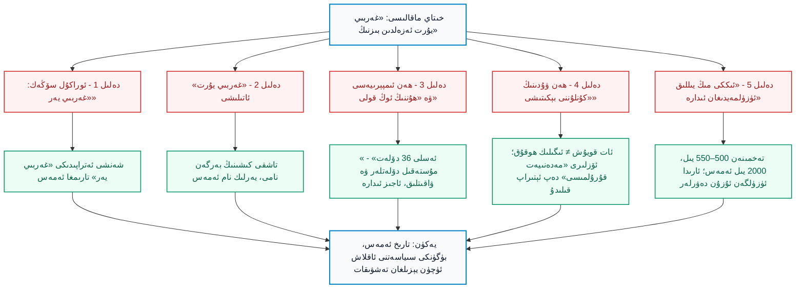
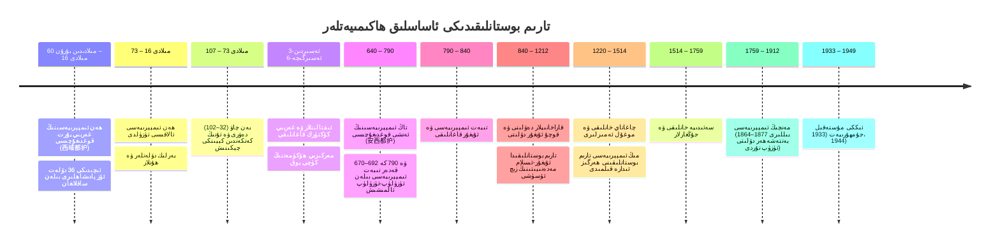
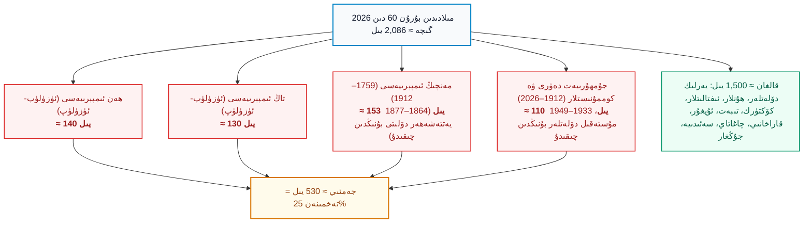
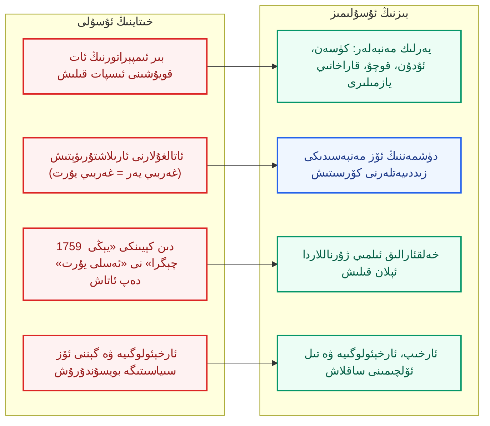

بِسْمِ اللَّهِ الرَّحْمَٰنِ الرَّحِيمِ

⏱ تەخمىنىي ئوقۇش ۋاقتى: 22 مىنۇت

خىتاينىڭ داڭلىق «ئەپسى ئىدىيە» (爱思想) تور بېكىتىدە «ئاسمان ئاستىدىكى غەربىي يۇرت: كۇنلۇن مەدەنىيىتى نەزىرىدىكى زېمىن قۇرۇلۇشى، دۆلەت بىرلىشىشى ۋە مەدەنىيەت ئىدېنتىفىكاتسىيەسى» دېگەن مەنىدە، ئاپتورنىڭ ئىسمى «ۋۇ شىنخۇا» (巫新华) دەپ كۆرسىتىلگەن ئۇزۇن بىر ئىلمىي ماقالە ئېلان قىلىنغان. ماقالە «ئىلمىي» كىيىم كىيگەن، ئاخىرىدا 43 پارچە پايدىلانما كىتاب-ماقالە تىزىلغان، تارىخ ئەسەرلىرىدىن، ئوراكۇل سۆڭەكلىرىدىن ۋە دۆلەت گېزىتلىرىدىن ئۇزۇن-ئۇزۇن نەقىللەر كەلتۈرۈلگەن. ئەمما ئۇنىڭ ئاخىرقى يەكۈنى ئىنتايىن ئاددىي: «غەربىي يۇرت (西域) مەڭگۈ خىتاينىڭ غەربىي يۇرتى، كۇنلۇن بولسا خىتاي مەدەنىيىتىگە تەۋە مۇقەددەس تاغ. شەرقىي تۈركىستان ئەزەلدىن ئىككى مىڭ يىل ئۈزۈلمەي بېيجىڭنىڭ ئىدارىسىدە كەلگەن، شۇڭا بۈگۈنكى سىياسەتلەر («مەدەنىيەت ئارقىلىق نەملەندۈرۈش» ۋە «خىتاي مىللىتى ئورتاق ئاڭنى ئىنتايىن مۇستەھكەملەش») پۈتۈنلەي قانۇنلۇق». بۇ ماقالىنىڭ ئىنتېرنېتتە، ئۇنىۋېرسىتېتلاردا ۋە «ئوقۇتۇش ماتېرىيالى» سۈپىتىدە كەڭ تارقىلىشى تاسادىپىي ئەمەس؛ ئۇ ئىمپېرىيەنىڭ بۈگۈنكى ئاسسىمىلياتسىيە سىياسىتىگە «ئەجدادلار ئارقىلىق» يېزىلغان ئىدىيەۋى ھىمايە. شۇڭا بىز ئۇنى بىر قۇر ئوقۇپلا قويمايمىز؛ ئۇنىڭ دەلىللىرىنى بىر-بىرلەپ سۈرۈشتۈرۈپ، ئۇلارنىڭ قەيەردىن «ئىسپات» كېلىدىغانلىقىنى، قەيەردىن «ئوي-پىكىر»نىڭ ئىسپات ئورنىغا ئۆتۈپ كېتىدىغانلىقىنى كۆرسىتىمىز ھەمدە ئۆز مىللىتىمىزنىڭ ئۆزىنىڭ تارىخىي ھەققى ئۈچۈن ئەمەلىي قانداق ھەرىكەت قىلىشى كېرەكلىكىنى ئويلىشىمىز.

<!-- Image 1 -->

<em>ھەن دەۋرىدىكى ئوتتۇرا ئاسىيا خەرىتىسى (Wikimedia Commons، ئاممىۋى مۈلۈك). خەرىتىدە ئۇيسۇن، كۈسەن، ئۇدۇن، سۇلى (قەشقەر)، پىشامشان قاتارلىق مۇستەقىل دۆلەتلەر كۆرۈنىدۇ.</em>

---

## 1. ماقالىنىڭ ئومۇمىي قۇرۇلمىسى

بىز ئالدى بىلەن خىتاي ماقالىسىنىڭ ئاساسىي دەلىل زەنجىرىنى تونۇپ ئالايلى. ماقالە ئالتە ھالقىدىن تۈزۈلگەن: (1) ئوراكۇل سۆڭەك خېتىدىكى «غەربىي يەر» (西土) ؛ (2) «غەربىي يۇرت» ناملىرىنىڭ يالغۇز ساقلىنىپ قېلىشى؛ (3) ھەن ئىمپېرىيەسىنىڭ «ھېشى كارىدورى» ۋە «ھۇننىڭ ئوڭ قولىنى ئۈزۈش» ھەرىكىتى؛ (4) ھەن ۋۇدىنىڭ «كۇنلۇننى بېكىتىشى»؛ (5) «ئىككى مىڭ يىللىق ئۈزۈلمەيدىغان ئىدارە»؛ (6) «يېڭى چېگرا» (新疆) نىڭ «ئەسلى يۇرتقا قايتىش» دېگەن مەنىسى ۋە بۈگۈنكى سىياسىي خۇلاسە. تۆۋەندىكى سىخېما ھەر بىر ھالقىنىڭ ئاجىز نۇقتىسىنى كۆرسىتىپ بېرىدۇ.

*(سىخېما 1: خىتاي ماقالىسىنىڭ دەلىل زەنجىرى ۋە ھەر ھالقىنىڭ ئاجىز نۇقتىسى)*

---

## 2. ئات كىمنىڭ؟ «غەربىي يۇرت» — ھەن ئىمپېرىيەسىنىڭ كۆزىدىكى «غەرب»

ماقالىنىڭ بىرىنچى «ئىسپات»ى «غەربىي يۇرت» دېگەن ئاتالغۇنىڭ ئىككى مىڭ يىل ساقلىنىپ قالغانلىقى. ماقالە بۇنىڭ سەۋەبىنى «غەربىي يۇرتنىڭ ئاسىيا بىلەن ياۋروپانى تۇتاشتۇرغان بىردىنبىر قۇرۇقلۇق يولى بولغانلىقى» دەپ چۈشەندۈرىدۇ. بۇ ئىزاھات جۇغراپىيەلىك ئاتىلىشنىڭ مۇھىم بولغانلىقىنى كۆرسىتىدۇ، ئەمما ئۇ ھەرگىز «ئىگىلىك ھوقۇق» نى ئىسپاتلىمايدۇ. «غەربىي يۇرت» (西域، «غەربتىكى چەك») دېگەن ئاتالغۇ سۆزلۈك مەنىسى بويىچە «بىزنىڭ غەربىمىزدىكى جاي» دېگەنلىك؛ ئۇ بىر ھەن ئىمپېرىيەسى ئەمەلدارنىڭ ئۆز ئىمپېرىيە مەركىزىدىن قارىغاندىكى ئاتىلىشى. دەل مۇشۇ ئاتالغۇنىڭ «تاشقى كىشى ئات قويغان» خاراكتېرى ئۇنىڭ شۇ جايدا ياشىغان ئادەملەر ئۈچۈن نېمە ئىكەنلىكىنى ئاللىقاچان ئاشكارىلاپ تۇرىدۇ: ئۇلار ئۈچۈن بۇ ماكان «غەربىي يۇرت» ئەمەس ئىدى، بەلكى «ئۆي-ماكان» ئىدى.

بۇنى خىتاي تارىخىنىڭ ئۆز ئەڭ مۇھىم مەنبەسىدىنمۇ كۆرگىلى بولىدۇ. ماقالە ئۆزى كەڭ نەقىل كەلتۈرگەن <dfn title="«ھەننامە · غەربىي يۇرت بايانى» (汉书·西域传): ھەن ئىمپېرىيەسى (مىلادىدىن بۇرۇنقى 202 – مىلادى 220) نىڭ تارىخچىسى بەن گۇ (32–92) تۈزگەن تارىخ كىتابى. تارىم بوستانلىقىدىكى 50 نەچچە كىچىك دۆلەتنىڭ ئىسمى، نوپۇسى ۋە جۇغراپىيەلىك ئورنىنى تەپسىلىي يازغان. ئۇنىڭ ئىچىدە ئاپتور بۇ جايلارنى «ئەسلىدە 36 دۆلەت» دەپ ئاتىغان.">«ھەننامە · غەربىي يۇرت بايانى»</dfn> نىڭ ئاچقۇچلۇق بىر جۈملىسى مۇنداق: «غەربىي يۇرت ھەن ۋۇدى (مىلادىدىن بۇرۇن 156–87) دەۋرىدە تۇنجى قېتىم ئالاقە قىلىندى، ئەسلىدە 36 دۆلەت ئىدى، كېيىن ئاستا-ئاستا 50 نەچچىگە بۆلۈندى؛ ئۇلارنىڭ ھەممىسى ھۇننىڭ غەربىدە، ئۇيسۇننىڭ جەنۇبىدا». ئىككى مۇھىم نۇقتىغا دىققەت قىلايلى: بىرىنچىدىن، «تۇنجى قېتىم ئالاقە قىلىندى» دېگەن ئىبارە، شۇ چاغقىچە ھەن ئىمپېرىيەسىنىڭ بۇ جايلار بىلەن ئالاقىسى يوق ئىكەنلىكىنى ئېتىراپ قىلىدۇ؛ ئىككىنچىدىن، «ئەسلىدە 36 دۆلەت» دېگەن ئىبارە بۇ يەردە «دۆلەتلەر» نىڭ — كۈسەن، ئۇدۇن، سۇلى، پىشامشان، ئالدى قوش خانلىقى (車師) قاتارلىقلارنىڭ — ھەن كېلىشتىن ئىلگىرىلا مەۋجۇت بولغانلىقىنى كۆرسىتىدۇ. يەنى تارىم بوستانلىقىدا ھەن ئىمپېرىيەسىنىڭ ھۆكۈمرانلىقى ئەمەس، ئەكسىچە ئۆزىنىڭ پادىشاھلىرى، قوشۇنلىرى ۋە قانۇنلىرى بار ئون نەچچە ئىگىلىك ھوقۇقلۇق دۆلەت بار ئىدى. ماقالە ئىككى يۈز يىل كېيىنكى «ھەن ئىمپېرىيەسى غەربىي يۇرتنى باشقۇردى» دېگەن بايانلارنى بۇ ئەسلىي ھەقىقەتنىڭ ئۈستىگە ئارتىدۇ.

<!-- Image 2 -->

<em>مەھمۇد قەشقىرى (11-ئەسىر) نىڭ «تۈركىي تىللار دىۋانى» (1072–1074) دىكى خەرىتە: تۈركىي دۇنيانىڭ مەركىزى قەشقەر-بالاساغۇن رايونىدا (Wikimedia Commons، Maytham Mahdipoor، CC BY-SA 3.0). بۇ يەردە ئۆز خەلقىنىڭ ئۆز دۇنياسى بار ئىدى.</em>

شۇنىڭ ئۈچۈن ئۇيغۇر ۋە باشقا تۈركىي خەلقلەرنىڭ تارىخىي ھاياتى ئۈچۈن مۇھىم تەرەپ شۇكى، بۇ جاينىڭ ئۆزىنىڭ ئاتالغۇلىرى بار: «ئالتە شەھەر» (Altishahr)، «يەتتە شەھەر» (Yettishahr)، «ئۇيغۇرىستان»، «شەرقىي تۈركىستان». مەھمۇد قەشقىرى (11-ئەسىر) 11-ئەسىردە ئۆزىنىڭ ئەسىرىدە دۇنيانىڭ خەرىتىسىنى سىزغاندا، ئۆزىنىڭ ۋەتىنى بولغان قەشقەرنى تۈرك دۇنياسىنىڭ قەلبى قىلىپ كۆرسەتكەن؛ ئۇ «غەربىي يۇرت» دېمەيتتى، «تۈرك ئېلى» دەيتتى. شۇنىڭدەك يۈسۈپ خاس ھاجىب (مىلادى 1019–1085) «قۇتادغۇبىلىك» (1069–1070) نى قەشقەردە يازغان. بۇ ئەسەرلەر ئۇ زېمىننىڭ ئۆز ئىچىدىن چىققان، ئۆز تىلىدا يېزىلغان، ئۆز ھاياتىنىڭ ئېنىق يېزىلغان ئىسپاتلىرى. ئۇلار ئىككى مىڭ يىللىق «خىتاي غەربىي يۇرتى» دېگەن ئەپسانىنىڭ ئەڭ كۈچلۈك رەت قىلىنىشى.

---

## 3. ئوراكۇل سۆڭەك «غەربىي يەر»: نەقىل قىلىنغان دەلىلنىڭ ئۆزى ماقالىنى ئاجىزلاشتۇرىدۇ

ماقالە ئالدى بىلەن «ئوراكۇل سۆڭەك خېتى»دىن (甲骨文) نەقىل ئېلىپ، شاڭ (<dfn title="شاڭ سۇلالىسى (مىلادىدىن بۇرۇنقى 1600 – 1046): خىتاي تارىخىدا يېزىق ئىسپاتى ساقلانغان ئەڭ قەدىمكى سۇلالە. ھازىرقى خېنەن ئۆلكىسىدىكى ئەنياڭ ئەتراپىدا مەركەزلەشكەن.">مىلادىدىن بۇرۇنقى 1600 – 1046</dfn>) دەۋرىدىكى «تۆت يەر» (東土، 南土، 西土، 北土) دېگەن ئاتالغۇنى «غەربىي يەر» (西土) نىڭ شاڭ ئىمپېرىيەسى ئىدارىسىدىكى «غەربىي زېمىن» ئىكەنلىكىگە دەلىل قىلىدۇ. ئاندىن «غەربىي يەر» نى ئاستا-ئاستا جۇ سۇلالىسىدىكى «غەربىي يەر» (周人西土) بىلەن ئۇلاپ، ئاخىرىدا ئۇنى ھەن دەۋرىدىكى «غەربىي يۇرت» بىلەن بىرلەشتۈرىدۇ. بۇنداق ئۇلاش ئىنتايىن «ئېلاستىك». ماقالىنىڭ ئۆزى ئېتىراپ قىلىدۇكى، جۇ دەۋرىدىكى «غەربىي يەر» دېگەن ئاتالغۇ «گۇ گۇڭ دەنفۇ (古公亶父) چى تاغ (岐山) دا باشلىغان» رايوننى، يەنى ھازىرقى شەنشى ئۆلكىسىنىڭ ۋېي دەرياسى ۋادىسىنى كۆرسىتىدۇ. «جۇ ۋۇ ۋاڭنىڭ ئۇرۇشىدا قاتناشقان غەربىي يەرنىڭ سەككىز دۆلىتى» (西土八国) بولسا «شاڭ شۇ» دىكى «مۇ شى» (牧誓) بۆلىكىدە ئاتالغان يوڭ، شۇ، چيەڭ، مائۇ، ۋېي، لۇ، پېڭ، پۇ دۆلەتلىرى بولۇپ، ئۇلار ھازىرقى شەنشى، سىچۈەن، خۇبېي ئەتراپىدىكى جايلار؛ تارىم بوستانلىقى بۇ ئورۇنلاردىن مىڭلىغان كىلومېتىر يىراقتا، ئوتتۇرىسىدا گەنسۇ كارىدورى ۋە گوبى چۆللۈكى بار.

يەنى «غەربىي يەر» دېگەن ئىبارە تارىم بوستانلىقىنى ھەرگىز كۆرسەتمەيدۇ؛ ئۇ شاڭ ۋە جۇ ئەھلىنىڭ ئۆزىنىڭ ئەتراپىدىكى «غەرب» ئىدى. ماقالىنىڭ بۇ ئىككى ئاتالغۇنى ئۇلاش ئارقىلىق «خىتاي غەربىي يۇرتى ئەزەلدىن» دېيىشى — ئىككى مىڭ يىللىق ئىككى ئايرىم جاينى ئات ئوخشاشلىقى سەۋەبىدىن بىر نەرسە قىلىپ كۆرسىتىشتۇر. بۇنداق «مەنتىق» بويىچە «شەرق ئېلى» (東國) دېگەن ئاتالغۇنى ئىشلەتكەن مىسىرلىقلار، «غەربىي دۇنيا» دەپ ئاتىغان ياپونلۇقلار، «غەربىي دۆلەت» دەپ ئاتالغان رىم ئىمپېرىيەسى ... بىر-بىرىگە ئۇلىنىپ كېتەتتى.

### ئىلىم-پەن ئىسپاتلىرى: تارىم مۇمىيالىرى ۋە يەرلىك مەدەنىيەتلەر

تارىم بوستانلىقىنىڭ ئەڭ ئىشەنچلىك قەدىمكى ئىسپاتلىرى — بۇ جايدا تېپىلغان <dfn title="تارىم مۇمىيالىرى (小河墓地، مىلادىدىن بۇرۇنقى 2000 – 1500 ئەتراپىدا): لوپنۇر رايونىدىكى شياۋخې (小河) قەبرىستانلىقىدا تېپىلغان، قۇرغاق ئىقلىم سەۋەبىدىن ناھايىتى ياخشى ساقلانغان مۇمىيالار. ئۇلارنىڭ ئاق تېرىلىك، ئۇزۇن بويلۇق، رەڭلىك يۈڭ كىيىملىك بولۇشى دىققەتنى تارتقان.">تارىم مۇمىيالىرى</dfn> (مىلادىدىن بۇرۇنقى 2000 – 1500 ئەتراپى) — ئىنتايىن ھەيران قالارلىق. 2021-يىلى «Nature» ژۇرنىلىدا ئېلان قىلىنغان گېن تەتقىقاتى (Zhang Fan ۋە باشقىلار) كۆرسەتكەنكى، بۇ كىشىلەر ھازىرقى خىتاي مىللىتىنىڭ ئەجدادلىرىدىن ئەمەس، بەلكى يەرلىك، ئۇزاق ۋاقىت ئايرىم قالغان، ئەڭ قەدىمكى شىمالىي ئوتتۇرا ئاسىيا ئەجدادلىرىدىن كېلىپ چىققان تەركىبكە ئىگە. بۇ يەردە «تارىم بوستانلىقىنىڭ ئەڭ دەسلەپكى ئاھالىسى خىتاي ئەمەس» دېگەن نەتىجە كىشىنى ھەيران قالدۇرمايدۇ؛ ئەمما ئۇ، خىتاي ماقالىسىنىڭ «غەربىي يۇرت ئەزەلدىن بىزنىڭ» دېگەن ئىدىيەسىنى ئەڭ تۈپكى ئاساستىن سۇسلاشتۇرىدۇ. مىلادىدىن بۇرۇنقى 1-مىڭ يىللىقتىن باشلاپ بولسا بۇ جايدا ساكلار (<dfn title="ساكلار (Saka / Scythians / 塞人): ئوتتۇرا ئاسىيا ۋە تارىم ئويمانلىقىنىڭ غەربىي جەنۇبىدا ياشىغان، ئىران تىللىق كۆچمەن ئاتلىق جەڭچى ئەجدادلار.">ساكلار</dfn>)، تۇخارلار (<dfn title="تۇخارلار (Tocharians / 吐火罗): كۈسەن ۋە قوچۇ (قاراشەھەر) ئەتراپىدا ياشىغان، ھىندى-ياۋروپا تىل ئائىلىسىگە كىرىدىغان قەدىمكى خەلق. «كۈسەنچە» ۋە «ئاگنىچە» دېگەن ئىككى يېزىق تىلى ساقلانغان.">تۇخارلار</dfn>) ۋە ئۇدۇنلۇقلار ئۆز مەدەنىيەتلىرىنى ياراتتى؛ كۈسەن (龟兹) نىڭ قىزىل مىڭ ئۆيلىرى ۋە يارغول (交河) نىڭ خارابىلىرى شۇ مەدەنىيەتلەرنىڭ ئاشكارا دەلىلى.

<!-- Image 3 -->

<em>يارغول (交河) خارابىلىرى، تۇرپان (Wikimedia Commons، Sharonkuei، CC BY-SA 4.0). ئالدى قوش خانلىقى (車師) نىڭ پايتەختى بولغان قەدىمكى شەھەر.</em>

<!-- Image 4 -->

<em>كۈسەندىكى قىزىل مىڭ ئۆيلىرىدىكى «رەسساملار ئۆيى» تام رەسىمى، تەخمىنەن 500-يىللار (Wikimedia Commons، ئاممىۋى مۈلۈك). كۈسەن مەدەنىيىتى ھەن ئىمپېرىيەسىنىڭ ئەكسى ئەمەس، ئۆز ئالدىغا ھىندى-ئىران-تۇخار ئەنئەنىلىرىنى بىرلەشتۈرگەن گۈللەنگەن مەدەنىيەت ئىدى.</em>

شۇنداقتىمۇ يەنە بىر نۇقتا دىققەتكە سازاۋەر: ئەگەر شاڭ ئىمپېرىيەسى «شى يۈ» (غەربىي يۇرت) نى بىر قانچە يۈز يىل ئىدارە قىلغان بولسا، خىتايلار نېمە ئۈچۈن 1000 يىلدىن كېيىن ھەن ۋۇدىنىڭ ئەلچىسى جاڭ چيەن (مىلادىدىن بۇرۇنقى؟–114) نى «يولنى ئاچقۇچى» (鑿空) دەپ ئاتايدۇ؟ بۇ ئاتالغۇ ھېچ بولمىغاندا ھەن تەرەپ ئۈچۈن بۇ يولنىڭ مىسلىسىز يېڭى ئىكەنلىكىنى بىلدۈرىدۇ. ماقالە ئۆزىنىڭ ئىچكى زىددىيىتىنى كۆرمەيدۇ ياكى كۆرمەسكە سالىدۇ.

---

## 4. ھەن ئىمپېرىيەسى: ھەقىقەتەن كەلدى، ئەمما «ئىدارە قىلىش» نىڭ ماھىيىتى

بىز ئوچۇق-ئاشكارا ئېتىراپ قىلىشىمىز كېرەك: ھەن ئىمپېرىيەسى تارىم بوستانلىقىغا ھەقىقەتەن كىردى، ھەربىي-دىپلوماتىك ئالاقىلەرنى ئورناتتى. <dfn title="ھەن ۋۇدى (مىلادىدىن بۇرۇنقى 156–87، ھۆكۈمرانلىقى 141–87): غەربىي ھەن ئىمپېراتورى. ھۇنلارغا قارشى ھەربىي يۈرۈشلەرنى ئۇزۇن يىل ئېلىپ باردى. ھېشى كارىدورىنى ئىگىلىدى ۋە جاڭ چيەنى غەربكە ئەۋەتتى.">ھەن ۋۇدى (مىلادىدىن بۇرۇنقى 156–87)</dfn> قوماندانلىقىدا <dfn title="ھوچىبىڭ (霍去病، مىلادىدىن بۇرۇنقى 140–117): ھەن ئىمپېرىيەسىنىڭ ياش ھەربىي سەركەردىسى. مىلادىدىن بۇرۇنقى 121-يىلى ھېشى كارىدورىدىن ھۇنلارنى قوغلاپ چىقارغان.">ھوچىبىڭ (مىلادىدىن بۇرۇنقى 140–117)</dfn> ھۇنلارنى ھېشى كارىدورىدىن (河西走廊) قوغلاپ چىقارغاندىن كېيىن، ھەن ئىمپېرىيەسى مىلادىدىن بۇرۇنقى 121–88 يىللىرى ۋۇۋېي، جاڭيې، جيۇچۈەن، دۇنخۇاڭ دېگەن «تۆت ئوبلاست» نى قۇردى. بۇنىڭدا ماقالىنىڭ ئۆزى ئېتىراپ قىلغان مۇھىم بىر ئىش بار: بۇ بىر «ھەربىي كېڭىيىش» (軍事拓土) ئىدى. ماقالە باشقا يەرلەردە «مەدەنىيەت ئارقىلىق بىرلىشىش» نى ئالقىشلىغان بىلەن، بۇ يەردە ئاددىي ھەقىقەتنى — بۇ غەلىبىنىڭ كېڭىيىش، ھۇنلاردىن زېمىن ئېلىش ۋە يەرلىك خەلقلەرنى بويسۇندۇرۇش ئىكەنلىكىنى — ئۆزى ئېتىراپ قىلىدۇ؛ بىز بۇنىڭ ئۆزىنى «ئىككى مىڭ يىللىق ئىتتىپاق» دەپ بويىلىشىغا دىققەت قىلىشىمىز كېرەك.

«ھۇننىڭ ئوڭ قولىنى ئۈزۈش» (斷匈奴右臂) دېگەن ئىستراتېگىيە ھەن ئىمپېرىيەسىنىڭ ئۆز مەنپەئەتى ئۈچۈن ھۇن ئىمپېرىيەسى بىلەن بولغان رىقابىتى ئىدى. ماقالە بۇ ئىستراتېگىيەنىڭ ئاچقۇچلۇق مەنبەسىنى «ھەننامە» دىن نەقىل كەلتۈرگەن: «ھۇننىڭ غەربىي قانىتى ئۈستىدىكى كۈنچىل شاھزادە (日逐王) «بالا-خىزمەتكار تۈزۈمى» (僮仆都尉) نى قۇرۇپ، ئۇنى يەنچى، ۋېيشۇ، ۋېيلى ئارىسىدا تۇرغۇزۇپ، غەربىي يۇرت دۆلەتلىرىدىن باج ئالدى، شۇنىڭ بىلەن بېيىدى». بۇ جۈملىدە ئاجايىب بىر ھەقىقەت ساقلانغان: ھەن ئىمپېرىيەسى كېلىشتىن ئىلگىرى بۇ يەرلەرنى <dfn title="ھۇن ئىمپېرىيەسى (مىلادىدىن بۇرۇنقى 209 – مىلادى 216): ھۇنلار قۇرغان كۆچمەن ئىمپېرىيە، باتۇر تەڭرىقۇت (冒顿单于) دەۋرىدە چوڭ كۈچكە ئايلانغان.">ھۇن ئىمپېرىيەسى</dfn> باج ئېلىش ئۈچۈن ئىدارە قىلاتتى. دېمەك، مۇشۇ ئاتالغان «ئىككى مىڭ يىللىق ئىدارە» ئەمەلىيەتتە ئىمپېرىيەلەرنىڭ يەرلىك دۆلەتلەر ئۈستىدىن «كىم باج ئالىدۇ» دېگەن تالاشلىرىنىڭ ئۇزۇن تارىخى ئىدى. ھۇنلار باج ئېلىپ تۇرغان چاغدا بۇ جايلارنىڭ «ھۇن زېمىنى» بولۇپ قالمىغىنىغا ئوخشاش، ھەن ئىمپېرىيەسى باج ئالىدىغان چاغدىمۇ ئۇلار «ھەن زېمىنى» بولۇپ قالمىدى.

---

## 5. ۋاقىتنامە: «ئۈزۈلمەيدىغان ئىدارە» دېگەن ئەپسانە

ماقالىنىڭ ئەڭ تەشۋىقاتچان بايانلىرىدىن بىرى — «ھەن ئىمپېرىيەسىدىن مەنچىڭ ئىمپېرىيەسىگىچە ئىككى مىڭ يىلدىن ئارتۇق ئۈزۈلمەي مەركىزىي ھۆكۈمەتنىڭ ئىدارىسى ئاستىدا» دېگەن جۈملە. بۇنى خىتاينىڭ ئۆز تارىخ كىتابلىرى بىلەن تەكشۈرۈپ باقايلى. تۆۋەندىكى ۋاقىتنامە ئاساسلىق ھاكىمىيەتلەرنى كۆرسىتىدۇ. (ئەسكەرتىش: بەزى چېسلالار تارىخچىلار ئوتتۇرىسىدا ئوخشىمايدۇ؛ ئەڭ كەڭ قوبۇل قىلىنغان چېسلالار ئېلىندى.)

*(سىخېما 2: تارىم بوستانلىقىنى ئىدارە قىلغان ھاكىمىيەتلەرنىڭ ۋاقىتنامىسى)*

بۇ ۋاقىتنامىدا بىرنەچچە مۇھىم ئىش كۆزگە تاشلىنىدۇ. بىرىنچى، ھەن ئىمپېرىيەسىنىڭ «غەربىي يۇرت قوغدىغۇچىسى» (مىلادىدىن بۇرۇن 60-يىلى قۇرۇلغان) ئارىدا ۋاڭ مەڭ (مىلادى 9–23) دەۋرىدە يوقاپ كەتتى، ئاندىن بەن چاۋ (32–102) ئارقىلىق قايتا ئورنىتىلدى، لېكىن مىلادى 107-يىلى ھەن ئىمپېرىيەسى ئۇنى ئەمەلدىن قالدۇرۇپ، ئاسىيادىن قول ئۈزدى؛ كېيىنكى ئىككى ئەسىردە ئۇنىڭ كۈچى بىر قانچە ئون يىللىق قىسقا ئارىلىقلاردىن باشقا ھالدا كۆرۈنمىدى. ئىككىنچى، تاڭ ئىمپېرىيەسى (مىلادى 618–907) نىڭ تارىم بوستانلىقىدىكى ھۆكۈمرانلىقى 640-يىلى قوچۇ (高昌) نى بويسۇندۇرۇشتىن باشلىنىپ، 755-يىلدىكى ئەن لۇشەن (安禄山) قوزغىلىڭىدىن كېيىن ئاجىزلاپ، 790-يىللىرىغا كەلگەندە تىبەتلەر تەرىپىدىن ئاخىرقى قېتىم قولدىن چىقىرىلغان. ئۈچىنچى، مىڭ سۇلالىسى (مىلادى 1368–1644) مەزگىلىدە خىتاي مەركىزىي ھۆكۈمىتى جيايۈگۇەن دەرۋازىسىنىڭ غەربىدە ھېچقانداق ھەربىي-مەمۇرىي ئورگان قۇرالمىغان؛ ئۇ ۋاقىتتىكى ئۇيغۇرلار موغۇل ئەمىرلىرى ۋە سەئىدىيە خانلىقى (مىلادى 1514–1696) نىڭ ئىدارىسىدا ياشىغان.

---

## 6. سانلىق مەلۇمات: 2000 يىلمۇ، 530 يىلمۇ؟

ماقالىنىڭ «ئىككى مىڭ يىل ئۈزۈلمەي» دېگەن دەۋاسىنى سانلار بىلەن سىنايلى. تۆۋەندىكى ھېسابلاش بىزنىڭ ئۆز مۆلچەرىمىز؛ ئۇنىڭ مەقسىتى ئېنىق بىر «چەك» نى كۆرسىتىشتۇر، ھەرگىز ئاخىرقى ھۆكۈم ئەمەس. ھېسابلاشتا خىتاي مەركىزىي ھۆكۈمىتى (ياكى ئۇنىڭ ئەنئەنىسى) نىڭ تارىم بوستانلىقىدا يەرلىك دۆلەتلەر ئۈستىدىن ھەقىقىي ھەربىي-مەمۇرىي كونترول ئورناتقان يىللىرى ئېلىندى.

*(سىخېما 3: تارىم بوستانلىقىدىكى خىتاي كونتروللۇقى بىلەن باشقا ھاكىمىيەتلەرنىڭ تەخمىنىي ۋاقىت نىسبىتى)*

| دەۋر | ھۆكۈمران | تەخمىنىي ۋاقىت (يىل) | ئىلمىي ئىزاھات |
| :--- | :--- | :--- | :--- |
| مىلادىدىن بۇرۇنقى 60 – مىلادى 16 | ھەن (غەربىي يۇرت قوغدىغۇچىسى) | ≈ 76 | يەرلىك پادىشاھلار ساقلانغان؛ ۋاڭ مەڭ دەۋرىدە ئۈزۈلگەن |
| مىلادى 73 – 107 ۋە 123 – 150 ئەتراپى | شەرقىي ھەن | ≈ 60 | ئاساسەن بەن چاۋ ۋە ئۇنىڭ ئوغلىنىڭ شەخسىي كۈچىگە تايانغان |
| مىلادى 640 – 790 | تاڭ (ئەنشى قوغدىغۇچىسى) | ≈ 130 | تىبەت بىلەن ئۈزۈلۈپ-ئۈزۈلۈپ ئالمىشىپ تۇرغان |
| مىلادى 1759 – 1912 | مەنچىڭ | ≈ 153 | 1864–1877 دە يەتتەشەھەر دۆلىتى ئۈزگەن |
| 1912 – 1949 | جۇمھۇرىيەت ۋە ئۇرۇش خوجايىنلىرى | ≈ 37 (ئۇنىڭدىن 1933–1949 مۇستەقىل دۆلەتلەر) | رېئال كونترول پەقەت قىسمەن |
| 1949 – 2026 | كوممۇنىست خىتاي | ≈ 77 | بۈگۈنكى ئىشغال |

بۇ سانلار بىر نەرسىنى ئېنىق كۆرسىتىدۇ: «ئىككى مىڭ يىللىق ئۈزۈلمەيدىغان ئىدارە» ئىلمىي ئاساسى يوق ئېلانچىلىق. ھەر بىر سان ئۆزى مۇنازىرە قىلىنىدىغان بولسىمۇ، ئومۇمىي كۆرۈنۈش يەنىلا بىر: خىتاينىڭ بۇ زېمىندىكى ھۆكۈمرانلىقى ئۇزۇن، ئۈزۈك، ئۇستىگە ھەربىي كۈچ ئارقىلىق ئورنىتىلغان ھەم كۆپ قېتىم يوقىلىپ كەتكەن.

---

## 7. «كۇنلۇننى بېكىتىش»: ئات قويۇش ئىگىلىك ھوقۇق ئەمەس

ماقالىنىڭ ئەڭ «ئىجادىي» قىسمى — «ھەن ۋۇدىنىڭ كۇنلۇننى بېكىتىشى» (定昆仑). ماقالە بۇنى مۇنداق بايان قىلىدۇ: ھەن ۋۇدى جاڭ چيەندىن كېيىنكى ئەلچىلەرنىڭ «ئۇدۇن (于阗) دا دەريا چىققان، ئۇ تاغدا يېشىل تاش كۆپ» دېگەن مەلۇماتىنى ئاڭلاپ، قەدىمكى خەرىتىلەرنى كۆرۈپ «دەريا چىققان تاغنى كۇنلۇن دەپ ئاتىدى» (<dfn title="«شىجى · داۋەن بايانى» (史记·大宛列传): ھەن دەۋرىنىڭ تارىخچىسى سىما چيەن (مىلادىدىن بۇرۇنقى 145–86) يازغان «تارىخىي خاتىرىلەر» نىڭ بىر بابى. ئۇنىڭ ئاخىرىدا «ئىمپېراتور قەدىمكى خەرىتە-كىتابلارغا قاراپ، دەريا چىققان تاغنى كۇنلۇن دەپ ئاتىدى» دېگەن جۈملە بار.">«شىجى»</dfn> دىكى ئەسلىي جۈملە: «天子案古图书，名河所出山曰昆仑云»). ماقالە بۇ ھەرىكەتنى ئۈچ مەنىدە يەكۈنلەيدۇ: بۇ «غەربىي يۇرتنىڭ قانۇنلۇقىنى بەلگىلىدى»، بۇ «دۇنيانىڭ مەركىزىنى ئوتتۇرا ئويمانلىقتىن كۇنلۇنغا يۆتكىدى»، ۋە بۇ «تۇنجى «مەدەنىيەت ئارقىلىق نەملەندۈرۈش» ھەرىكىتى».

ئالدى بىلەن ئەسلىي جۈملىگە دىققەت قىلايلى. «شىجى» «ئىمپېراتور ... تاغنى كۇنلۇن دەپ ئاتىدى» دەيدۇ. بۇ پەقەت ئات قويۇش. خىتاي ماقالىسىدىكى «غەربىي يۇرتنىڭ قانۇنلۇقىنى بەلگىلىدى» دېگەن ئىبارە «شىجى» دا يوق؛ ئۇ ماقالە ئاپتورىنىڭ ئۆز قوشقان يەكۈنى. بىر ئىمپېراتورنىڭ يىراق بىر تاغقا ئۆزىنىڭ ئەپسانىۋى ئاتىنى بېرىشى — بۇ ئاتنىڭ كۈچى قانچىلىك بولغاندىمۇ، ئۇ ئاشۇ تاغ ئاستىدا ياشايدىغان ئادەملەرنىڭ ئىگىلىك ھوقۇقىنى ئۆزگەرتىشى مۇمكىن ئەمەس. ئەگەر ئاتنى «بېكىتىش» ئىگىلىك ھوقۇق بەرگەن بولسا، ئەنگلىزلار «ۋىكتورىيە كۆلى» نى ياكى ئىسپانلار «فىلىپپىن» نى «بېكىتىش» ئارقىلىق بۇ جايلارنىڭ ئىگىسى بولۇپ قالغان بولاتتى.

ئىككىنچى، ماقالىنىڭ ئۆزى بۇ ئىشنىڭ «دۆلەت تەرىپىدىن ئويلاپ چىقىلغان» ئىكەنلىكىنى بىۋاسىتە ئېتىراپ قىلىدۇ. ئاپتور ئۆز مەتنىدە ئوچۇق يازىدۇ: «كۇنلۇننىڭ غەربكە يۆتكىلىشى ... قەدىمكى خىتاي دۆلىتىنىڭ تەرەققىي قىلىش ئېھتىياجى ۋە ئورۇنلاشتۇرۇشىدىن كەلگەن، ... قەدىمكى دۆلەتنىڭ مۇھىم دۆلەت مەدەنىيەت ۋە سىياسىي تەدبىرى؛ ئۇنىڭ ماھىيىتى ئىمپېرىيە زېمىنىنىڭ كېڭىيىشى ۋە «ئاسمان ئاستى» كۆزقارىشىنىڭ يېڭىلىنىشى ئارقىلىق ئاكتىپ مەدەنىيەت قۇرۇلمىسى (主动文化建构)». بۇنى ئوڭ چۈشەنسەك: ئاپتورنىڭ ئۆزى «كۇنلۇن غەربكە كۆچكەن» دېگەننى «ئىمپېرىيە ئېھتىياجى بىلەن ئاكتىپ ياسالغان مەدەنىيەت قۇرۇلمىسى» دەپ ئاتىماقتا. دېمەك، كۇنلۇننىڭ ئۇدۇنغا قويۇلۇشى تەبىئىي-تارىخىي ئىسپات ئەمەس، بەلكى كېڭەيمىچىلىكنىڭ ئىدىيەۋى ئۈسكۈنىسى. بىز بۇنى ئاپتورنىڭ ئۆزى ئېيتقان سۆز بىلەنلا رەت قىلالايمىز.

ئۈچىنچى، ئاپتور بۇنى «تۇنجى «مەدەنىيەت ئارقىلىق نەملەندۈرۈش»» (文化润疆) دەپ ئاتايدۇ. «文化润疆» بولسا بۈگۈنكى خىتاي كوممۇنىستىك پارتىيەسىنىڭ شەرقىي تۈركىستاندىكى رەسمىي سىياسىتى؛ ئۇ بۇ يەردە ئۇيغۇرلارنىڭ تىلى، دىنى ۋە ئۆرپ-ئادىتىنى «خىتاي مىللىي ئورتاق ئاڭى»غا ئىرىتىشنى مەقسەت قىلغان ئاسسىمىلياتسىيە پىلانى بولۇپ، ئۇنىڭ ئۈستىگە لاگېرلار، بالىلارنى ئاتا-ئانىدىن ئايرىش ۋە قاتتىق نازارەت سىستېمىسى قوشۇلغان. ئاپتور 2000 يىل ئىلگىرىكى ئات قويۇشنى بۈگۈنكى سىياسەتنىڭ «تارىخىي ئەجدادى» قىلىپ كۆرسىتىش ئارقىلىق بىر ئىشنى ئاشكارىلايدۇ: بۇ ماقالە ئىلمىي ئىزدىنىش ئەمەس، بەلكى سىياسەتنىڭ نەزەرىيەۋى تەمىناتى. ماقالىنىڭ ئاخىرىدا «خىتاي مىللىي ئورتاق ئاڭىنى مۇستەھكەملەش» (铸牢中华民族共同体意识) ۋە «بىر بەلۋاغ، بىر يول» (一带一路) قاتارلىق تەشۋىقاتچى شوئارلارنىڭ بىۋاسىتە قوللىنىلىشى بۇنى ئىسپاتلايدۇ.

<!-- Image 5 -->

<em>قوچۇ (高昌) كونا شەھىرىنىڭ خارابىلىرى، تۇرپان (Wikimedia Commons، Giorgioglobe، CC BY-SA 4.0). بۇ يەر كېيىنچە قوچۇ ئۇيغۇر دۆلىتى (843–1335) نىڭ پايتەختى بولدى.</em>

<!-- Image 6 -->

<em>دەندان-ئۈيلىق (ئۇدۇن / خوتەن ئەتراپى) دىن تېپىلغان سوغد-زوروئاستر ئىلاھلىرى (Wikimedia Commons، ئاممىۋى مۈلۈك). «كۇنلۇن» دەپ ئاتالغان تاغنىڭ ئېتىكىدىكى ئۇدۇن مەدەنىيىتىنىڭ ئۆزىگە خاس، ئىران-ھىندى-بۇددا ئارىلاش ئەنئەنىسى بار ئىدى.</em>

---

## 8. «ئەسلى يۇرتقا قايتىش»: «يېڭى چېگرا» دېگەن ئاتنىڭ ھەقىقىي مەنىسى

ماقالىنىڭ ئاخىرقى ھالقىسى — مەنچىڭ ئىمپېرىيەسىنىڭ تارىم بوستانلىقىغا بەرگەن «يېڭى چېگرا» (新疆) دېگەن نامىنى «ئەسلى يۇرتنىڭ يېڭىدىن قايتىشى» (故土新归) دەپ چۈشەندۈرۈش. ئاپتور بۇنى «تارىخىي قانۇنلۇقنى ئىسپاتلايدىغان» ئاتالغۇ سۈپىتىدە كۆرسىتىدۇ. ئەمما ئىلمىي ساھەدە بۇ ئاتالغۇنى ئادەتتە مەنچىڭ ئىمپېرىيەسىنىڭ 1759-يىلى جۇڭغار ۋە ئالتە شەھەرنى بېسىۋالغاندىن كېيىن، بۇ يېڭى بېسىۋېلىنغان زېمىنغا قويغان «يېڭى زېمىن / يېڭى چېگرا» دېگەن مەنىدىكى ئىسىم دەپ چۈشىنىدۇ. «故土新归» دېگەن ئىزاھ ئىمپېرىيە دەۋرىنىڭ ئەمەس، بەلكى 20-ئەسىردىكى «مىللىي دۆلەت» ئىدىيەسىنىڭ كېيىنكى ئىزاھى. ئۇنىڭ ئۈستىگە مەنچىڭ ئىمپېرىيەسىنىڭ ئۆزى 1759-يىلىدىن كېيىن بۇ جاينى «ھۈيجىياڭ» (回疆، «مۇسۇلمان چېگرا») دەپ ئاتىغان؛ ئۇ ئۆزىنى «يات مىللەتنىڭ يۇرتىنى ئېلىۋاتىمەن» دەپ بىلگەن. ئىمپېرىيە ئۈچۈن بۇ زېمىن «خىتاينىڭ ئەسلى يۇرتى» ئەمەس، «مانجۇ ئىمپېرىيەسىنىڭ يېڭى كېڭەيگەن چېگراسى» ئىدى. ئىمپېرىيە بۇ زېمىننى 1884-يىلى ئۆلكە قىلىپ ئۆزگەرتكەندە بىر ئەسىردىن ئارتۇق ۋاقىت ئىچىدە بىر قانچە قېتىملىق قوزغىلاڭنى باستۇرغان ئىدى.

ماقالە «خىتاينىڭ بىر قىسىم زېمىنى» دېگەن ئاتالغۇنىڭ كەينىدە مەنچىڭنىڭ كېڭىيىشىنىڭ ھەقىقىي ئىزلىرىنى كۆرسىتىشتىن ئەستايىدىل قاچىدۇ. مەسىلەن، مەنچىڭ ئىمپېرىيەسى 1755–1758-يىللىرى جۇڭغار خانلىقى (1634–1758) نى يوقاتقاندا ئىنتايىن چوڭ نوپۇس زىيىنى يەتكۈزدى؛ تارىخچى پېتېر پەردۇ (Peter Perdue) نىڭ «خىتاي غەربكە يۈرۈش قىلىدۇ» ناملىق ئەسىرىدە بۇ قىرغىنچىلىق ئىنتايىن قاتتىق ئىلمىي ئاساستا بايان قىلىنغان. بۇنداق ئىشلارنى «ئاسمان ئاستى بىرلىكى» (天下大同) دېگەن گۈزەل شوئار ئارقىلىق يۇيۇۋېتىش، ماقالىنىڭ «خىتاي قەدىمكىدىن تارتىپ كېڭەيمىچىلىك قىلمىغان، پەقەت مەدەنىيەت جەلپكارلىقى ئارقىلىق يىراقتىكىلەرنى ئۆزىگە تارتقان» دېگەن ئىددىئاسىنىڭ ئەڭ ئاجىز يېرى. ھالبۇكى «ھۇننىڭ ئوڭ قولىنى ئۈزۈش»، ھەربىي يۈرۈشلەر، ئەلچىلەر ئارقىلىق بەگلەرنى ئۆزىگە تارتىش ۋە قوزغىلاڭلارنى باستۇرۇش — بۇلارنىڭ ھەممىسى خىتاي مەنبەلىرىدە ئۇچرايدۇ؛ ئەمما ئاپتور ئۇلارنى «ھەربىي كېڭىيىش» دەپ ئاتاش بىلەن «مەدەنىيەت جەلپكارلىقى» دېگەن ئاتالغۇ ئارىسىدا تەسىرلىك ئۆتۈپ كېتىدۇ.

<!-- Image 7 -->

<em>كۈسەنلىك زىرھلىق جەڭچىلەر، قىزىل مىڭ ئۆيلىرىدىن (ئالبېرت فون لې كوك سىزغان نۇسخا، Wikimedia Commons، ئاممىۋى مۈلۈك). قەدىمكى كۈسەننىڭ ئۆز قوشۇنى، ئۆز كىيىم-كېچىكى ۋە ئۆز سەنئىتى بار ئىدى.</em>

---

## 9. «ئېيتىلغان تارىخ» ۋە «ئۆزىمىز يازغان تارىخ»: تارىخ يېزىش ھوقۇقى كىمدە؟

بۇ ماقالىنى ئوقۇغاندا بىرىنچى نۆۋەتتە نېمە ئىش قىلىشىمىز كېرەك؟ تارىخ بۇرمىلاشقا قارشى تۇرۇش پەقەت «ياق، بۇ يالغان» دەپ ۋارقىراشتىنلا ئىبارەت ئەمەس. ئۇ، ئاۋۋال، دۈشمەننىڭ ئۆز سۆزىدىن پايدىلىنىپ ئۇنىڭ زىددىيىتىنى كۆرسىتىش؛ ئىككىنچى، ئۆز ئەجدادلىرىمىزنىڭ مىراسلىرىنى ئىلمىي دەلىللەر بىلەن ئوچۇق دۇنياغا ئوتتۇرىغا قويۇش؛ ئۈچىنچى، ئۆز تارىخىمىزنى ئۆز تىلىمىزدا، لېكىن دۇنيادىكى ئىلمىي ئورتاق تىللار (ئىنگلىزچە، ئەرەبچە، تۈركچە) دىمۇ ئېلان قىلىش دېگەنلىك. تۆۋەندىكى سىخېما ماقالىنىڭ ئاساسىي ئىستراتېگىيەلىك رەددىيە يولىنى يەكۈنلەيدۇ.

*(سىخېما 4: تارىخ بۇرمىلاشقا قارشى ئىلمىي رەددىيە ئىستراتېگىيەسى)*

<!-- Image 8 -->

<em>ئورخۇن ئۇيغۇر قاغانلىقى (744–840) نىڭ زېمىنى (Wikimedia Commons، Ktrinko، CC BY-SA 4.0). 840-يىلى قاغانلىق چۈشكەندىن كېيىن ئۇيغۇرلار غەربكە كۆچۈپ، تارىم بوستانلىقى ۋە تۇرپاندا قاراخانىيلار ۋە قوچۇ دۆلىتىنىڭ ئاساسىنى قۇردى.</em>

---

## 10. تۆت تۈرلۈك تارىخىي ئىبرەت

### 1) ئىسلام تارىخىدىن ئىبرەت: ھەقنى باتىل بىلەن ئارىلاشتۇرماسلىق

ئىسلام ئەنئەنىسىدە تارىخ ۋە شاھادەتنى بۇرمىلاش ئەڭ ئېغىر ئىشلارنىڭ بىرى ھېسابلىنىدۇ. ئاللاھ تائالا قۇرئاندا مۇنداق بۇيرۇغان:

﴿وَلَا تَلْبِسُوا الْحَقَّ بِالْبَاطِلِ وَتَكْتُمُوا الْحَقَّ وَأَنتُمْ تَعْلَمُونَ﴾

> *(ھەقنى باتىل بىلەن ئارىلاشتۇرماڭلار، بىلىپ تۇرۇپ ھەقنى يوشۇرماڭلار.)* (سۈرە بەقەرە، 42-ئايەت).

پەيغەمبىرىمىز مۇھەممەد ﷺ ئەۋلىيالارنىڭ ۋە ئالىملارنىڭ ھەقىقەتنى يوشۇرماسلىقىنى ئەڭ مۇھىم ئىشلارنىڭ بىرى قىلغان ھەم ھەر بىر كىشىنىڭ قىلغان گەپ-سۆزىنىڭ ئاللاھ ئالدىدا ھېساب بېرىلىدىغانلىقىنى ئەسكەرتكەن. تارىخنى ئىمپېرىيەنىڭ ئېھتىياجىغا قاراپ بۇرمىلاش — «ھەقنى باتىل بىلەن ئارىلاشتۇرۇش» نىڭ ئەڭ كەڭ كۆلەملىك شەكلى. بىز ئۆزىمىزمۇ بۇنىڭدىن ساقلىنىشىمىز، ئۆز مىللىتىمىزنىڭ ئاجىزلىقلىرىنى ۋە خاتالىقلىرىنىمۇ ئىلمىي ئادىللىق بىلەن بايان قىلىشىمىز كېرەك.

### 2) دۇنيا تارىخىدىن ئىبرەت: بالتىق دۆلەتلىرىنىڭ «ئىختىيارىي قوشۇلۇش» ئەپسانىسى

<dfn title="سوۋېت ئىتتىپاقى (1922–1991): بولشېۋىكلار قۇرغان كوممۇنىستىك ئىمپېرىيە. 1940-يىلى ئېستونىيە، لاتۋىيە ۋە لىتۋانىيەنى ئىشغال قىلغان.">سوۋېت ئىتتىپاقى (1922–1991)</dfn> 1940-يىلى ئېستونىيە، لاتۋىيە ۋە لىتۋانىيەنى ئىشغال قىلغاندىن كېيىن ئەللىك يىل بويى «بۇ دۆلەتلەر ئىختىيارىي ھالدا ئىتتىپاققا قوشۇلغان» دەپ ئۆگەتتى. ئۇلارنىڭ «ئىلمىي» تارىخچىلىرى، «ئارخىپ ھۆججەتلىرى» ۋە «خەلقئارالىق ماقالىلىرى» بار ئىدى. ئەمما 1989-يىلى 23-ئاۋغۇستتا ئىككى مىليوندىن ئارتۇق كىشى بالتىق دۆلەتلىرى ئارقىلىق ئادەم زەنجىرى (<dfn title="«بالتىق يولى» (Baltic Way، 1989-يىلى 23-ئاۋغۇست): ئېستونىيە، لاتۋىيە ۋە لىتۋانىيە ئارىلىقىدىكى تەخمىنەن 675 كىلومېتىرلىق ئادەم زەنجىرى. 1939-يىلدىكى مولوتوف-رىببېنتروپ كېلىشىمىنىڭ 50 يىللىقىدا تەشكىللەنگەن.">«بالتىق يولى»</dfn>) ھاسىل قىلىپ ئۆزلىرىنىڭ ئەسلىدە ئىشغال قىلىنغانلىقىنى دۇنياغا ئاڭلاتتى؛ 1990–1991-يىللىرى ئۇلار مۇستەقىللىقىنى ئەسلىگە كەلتۈردى. دېمەك، ئىمپېرىيەنىڭ يېزىلغان تارىخى — قانچىلىك ئۇزۇن، قانچىلىك «ئىلمىي» بولۇشىدىن قەتئىينەزەر — خەلقنىڭ ئۆز تارىخىي ھاپىزىسى ساق بولسا ئۇنى ئۆچۈرۈۋېتەلمەيدۇ.

### 3) خىتاي تارىخىنىڭ قاراڭغۇ تەرىپىدىن ئىبرەت: «يازما كۆيدۈرۈش» ئەنئەنىسى

خىتاي سىياسىي مەدەنىيىتىدە تارىخنى كونترول قىلىش يېڭى ئىش ئەمەس. چىن شىخۇاڭ (مىلادىدىن بۇرۇنقى 259–210، چىن سۇلالىسى مىلادىدىن بۇرۇنقى 221–206) مىلادىدىن بۇرۇنقى 213-يىلى «كىتاب كۆيدۈرۈش» (焚書) بۇيرۇقىنى چىقىرىپ، ئۆزىنىڭ ئىدارە قىلىشىغا زىت تارىخ ۋە پەلسەپە ئەسەرلىرىنى كۆيدۈرگەن. مەنچىڭ ئىمپېرىيەسىدە چيەنلۇڭ (1711–1799) «سىكۇ چۈەنشۇ» (四庫全書، 1772–1782) نى تۈزۈش باھانىسىدە ئىمپېرىيەگە زىت دەپ قارىلىدىغان مىڭلىغان ئەسەرنى چەكلىگەن ياكى يوقاتقان؛ بۇ «ئەدەبىي تەپتىش» (文字獄) ئەنئەنىسىنىڭ ئەڭ ئېغىر ئىزلىرىدىن بىرى. بىز ئوقۇغان بۇ ماقالە شۇ ئەنئەنىنىڭ بۈگۈنكى داۋامى: ئەسەرلەر كۆيدۈرۈلمەيدۇ، لېكىن ئۇلارنىڭ ئورنىغا «ئىلمىي ئىسىمدىكى» ماقالىلەر يېزىلىدۇ. ئىمپېرىيە بۇرۇن ئىككى مىڭ يىللىق «يازما كۆيدۈرۈش» بىلەن تارىخنى كونترول قىلغان بولسا، بۈگۈن ئۇنى ئىنتېرنېت ۋە ئىلمىي ژۇرناللار ئارقىلىق قىلىدۇ.

### 4) ئۇيغۇر تارىخىنىڭ ئىجابىيلىقىدىن ئىبرەت: ئۆز تىلىدا، ئۆز نامى بىلەن يېزىلغان ئىلىم

ئۇيغۇر تارىخىنىڭ ئەڭ كۈچلۈك تەرىپى — ئۇنىڭ ئۆز ئاۋازى. <dfn title="قاراخانىيلار دۆلىتى (840–1212): تارىختا تۇنجى بولۇپ ئىسلام دىنىنى دۆلەت دىنى قىلغان تۈرك-ئۇيغۇر دۆلىتى. قەشقەر ۋە بالاساغۇننى مەركەز قىلغان.">قاراخانىيلار دۆلىتى (840–1212)</dfn> دەۋرىدە قەشقەردە مەھمۇد قەشقىرى «تۈركىي تىللار دىۋانى» (1072–1074) نى يازدى ۋە دۇنيانى تۈركىي خەلقلەرنىڭ كۆزى بىلەن تونۇشتۇردى؛ يۈسۈپ خاس ھاجىب «قۇتادغۇبىلىك» (1069–1070) ئارقىلىق ئۇيغۇر-ئىسلام سىياسىي پەلسەپىسىنى ئۆز تىلىدا مۇكەممەل ئىپادىلىدى. <dfn title="قوچۇ (ئىدىقۇت) ئۇيغۇر دۆلىتى (843–1335): تۇرپان ئويمانلىقىدا ھۆكۈم سۈرگەن ئۇيغۇر دۆلىتى، يۇقىرى شەھەر مەدەنىيىتى ۋە مائارىپ ئەنئەنىسى بىلەن داڭلىق.">قوچۇ ئۇيغۇر دۆلىتى (843–1335)</dfn> نىڭ ئەدەبىيات ۋە بۇددا-مانى-خرىستىيان-ئىسلام كۆپ دىنلىق مىراسلىرى؛ <dfn title="شەرقىي تۈركىستان ئىسلام جۇمھۇرىيىتى (1933–1934): 1933-يىلى 12-نويابىر كۈنى قەشقەردە جاكارلانغان، ئاساسىي قانۇنلۇق، بايراقلىق ئىسلام جۇمھۇرىيىتى.">شەرقىي تۈركىستان ئىسلام جۇمھۇرىيىتى (1933–1934)</dfn> ۋە <dfn title="شەرقىي تۈركىستان جۇمھۇرىيىتى (1944–1949): 1944-يىلى 12-نويابىر كۈنى غۇلجىدا جاكارلانغان، مىللىي ئارمىيە ۋە مائارىپقا ئىگە دۆلەت.">شەرقىي تۈركىستان جۇمھۇرىيىتى (1944–1949)</dfn> ئۆز دۆلەتچىلىكىمىزنىڭ 20-ئەسىردىكى ئىسپاتى. بۇ مىراسلارنىڭ ھەممىسى خىتاي ماقالىسى «ئىككى مىڭ يىللىق ئۈزۈلمەيدىغان ئىدارە» دەپ چىرايلىق يېزىپ ئۆتۈپ كەتكەن بوشلۇقنىڭ ئىچىدىن ئېتىلىپ چىققان.

---

## 11. شەرقىي تۈركىستان مۇستەقىللىق داۋاسى ئۈچۈن ئىستراتېگىيەلىك ساۋاقلار

1. **دۈشمەنگە ئۆز سۆزى بىلەن جاۋاب بېرىش:** خىتاي ماقالىسىنىڭ ئەڭ ياخشى رەددىيەسى ئۇنىڭ ئۆزىنىڭ مەنبەلىرىدە: «ھەننامە» دىكى «ئەسلىدە 36 دۆلەت»، «شىجى» دىكى «ئات قويدى»، ئاپتورنىڭ ئۆز «ئاكتىپ مەدەنىيەت قۇرۇلمىسى» دېگەن ئېتىرازى. بىز ئۆز ماقالىلىرىمىزدا ھەر ۋاقىت دۈشمەننىڭ ئۆز ھۆججىتىنى ئاساس قىلساق، ئۇلار «سىياسىي ئادەم» دەپ ئەيىبلىيەلمەيدۇ.
2. **ئىنگلىزچە ۋە خەلقئارا ئىلمىي مۇھىتتا ئاۋاز چىقىرىش:** خىتاي ئۆز «ئىلمىي ئاپپاراتى» ئارقىلىق ئۆز ھېكايىسىنى ئىنگلىزچە ۋە باشقا تىللاردا تارقىتىدۇ. ئۇيغۇر ئالىملىرى، ئۇيغۇر ئېنسىكلوپېدىيە ھەمكارلىقى ۋە دۇنيادىكى تەتقىقاتچىلار (مىلۋارد، بروفى، ماللورى قاتارلىقلار) بىلەن ھەمكارلىشىپ، ئۇيغۇر تارىخىنى ئاكادېمىك ژۇرناللاردا ئىزچىل ئېلان قىلىش كېرەك.
3. **ئارخېئولوگىيە ۋە گېن تەتقىقاتىنى ئۆز ئاۋازىمىز بىلەن تەكرارلاش:** تارىم مۇمىيالىرى، ساك-تۇخار-ئۇدۇن مىراسلىرى ۋە قاراخانىي-قوچۇ قېزىلمىلىرى — بۇلارنىڭ ئۇيغۇرچە، ئىنگلىزچە ۋە تۈركچە ئاممىباب تونۇشتۇرۇشىنى كۆپەيتىپ، ئۆز خەلقىمىزنىڭ، بولۇپمۇ ياشلارنىڭ ئۆز ئەجدادلىرىنى توغرا بىلىشىنى تەمىنلەش.
4. **«ئاتالغۇ» ئۇرۇشىغا ئېھتىيات قىلىش:** «غەربىي يۇرت»، «يېڭى چېگرا»، «مەدەنىيەت ئارقىلىق نەملەندۈرۈش» دېگەن ئاتالغۇلارنى بىر-بىرلەپ ئاشكارىلاپ، ئۇلارنىڭ ئەسلىي مەنىسى ۋە سىياسىي ئىشلىتىلىشىنى ئوقۇرمەنلەرگە كۆرسىتىش؛ ئاتالغۇنى قوبۇل قىلغان كىشى كۆپ ھاللاردا ئۇنىڭ ئارقىسىدىكى يەكۈنىنىمۇ قوبۇل قىلىدۇ.
5. **ئۆز ئىلمىي سەمىمىيەتتىن ۋاز كەچمەسلىك:** ئۆز مىللىتىمىزنىڭ تارىخىنى ئاقلاش ئۈچۈن ئەپسانە ياسىماسلىق كېرەك. بىز قاراخانىي، قوچۇ ۋە باشقا دۆلەتلەرنىڭ ئىجابىي تەرەپلىرىنى ئېيتقاندا ئۇلارنىڭ ئاجىزلىقلىرىنىمۇ يېزىشىمىز؛ ئاندىن بىزنىڭ ئىلمىي ئىشەنچلىكلىكىمىز دۈشمەننىڭ تەشۋىقاتىدىن يۇقىرى تۇرىدۇ.
6. **مۇستەقىللىقنى ئادالەت ۋە ئىنسانىي قەدىر-قىممەت ئاساسىدا ئوتتۇرىغا قويۇش:** بىزنىڭ داۋايىمىز «ئىككى مىڭ يىللىق ھوقۇق» تالىشىش ئەمەس، بەلكى بىر خەلقنىڭ ئۆز زېمىنىدا ئۆز ئىرادىسى بىلەن ياشاش ھەققى؛ بۇ ھەق ئەجدادلاردىن قالغان ئىسپاتلارغا، مىللىي مەۋجۇتلۇققا ۋە ئىنسانىي ئادالەتكە تايىنىدۇ. ئىنتايىن تىنچلىقپەرۋەر، مەدەنىيەتلىك، ئۆز دۆلىتىنى قۇرۇش ئىقتىدارىغا ئىگە خەلق ئىكەنلىكىمىزنى دۇنيا ئالدىدا ئىلمىي يول بىلەن ئىسپاتلاش بۈگۈنكى ئەڭ ئۈنۈملۈك كۈرەش ئۇسۇلىمىزنىڭ بىرى.

---

## تەۋسىيە قىلىنغان كىتابلار

1. **«Eurasian Crossroads: A History of Xinjiang» (ياۋرو-ئاسىيا چاتما يولى: شەرقىي تۈركىستان تارىخى) — James A. Millward**  
   تارىم بوستانلىقىنىڭ قەدىمدىن بۈگۈنگىچە بولغان تارىخىنى ئىلمىي ۋە تەڭپۇڭ ئاساستا بايان قىلغان ئەڭ ئاساسلىق ئاممىباب تەتقىقات. «ئىككى مىڭ يىللىق ئۈزۈلمەيدىغان ئىدارە» ئەپسانىسىنى مەنبەلەر بىلەن تەكشۈرۈشكە ئەڭ ياخشى ياردەمچى.
2. **«The Tarim Mummies: Ancient China and the Mystery of the Earliest Peoples from the West» — J. P. Mallory & Victor H. Mair**  
   تارىم مۇمىيالىرىنىڭ كەشپىياتى، ئۇلارنىڭ ئەجدادلىرى ۋە قەدىمكى تۇخار-ساك مەدەنىيەتلىرى توغرىسىدىكى مەشھۇر ئىلمىي كىتاب. «غەربىي يۇرت ئەزەلدىن خىتاي» ئەپسانىسىنىڭ ئارخېئولوگىيەلىك رەددىيەسىنى چۈشىنىش ئۈچۈن ئەڭ مۇھىم ئەسەر.
3. **«Uyghur Nation: Reform and Revolution on the Russia-China Frontier» — David Brophy**  
   ئۇيغۇر مىللىي ئاڭىنىڭ 19- ۋە 20-ئەسىرلەردىكى شەكىللىنىشى، 1933- ۋە 1944-يىلدىكى جۇمھۇرىيەتلەر ۋە ئۇيغۇر زىيالىيلىرىنىڭ ئۆز تارىخىنى يېزىش ئۇرۇنۇشلىرىنى يورۇتۇپ بېرىدۇ.

---

## پايدىلانغان مەنبەلەر

  

    1. 巫新华, «天下西域：昆仑文化视域下的疆域建构、国家整合与文化认同», 爱思想 (aisixiang.com), https://www.aisixiang.com/data/183368.html — بۇ ماقالىدە تەھلىل ئوبيېكتى سۈپىتىدە ئېلىنغان خىتاي دۆلەت تەشۋىقاتى خاراكتېرلىك ماقالە.
  

  

    2. James A. Millward, <em>Eurasian Crossroads: A History of Xinjiang</em>, New York: Columbia University Press, 2007.
  

  

    3. J. P. Mallory and Victor H. Mair, <em>The Tarim Mummies</em>, London: Thames &amp; Hudson, 2000.
  

  

    4. Zhang Fan, Ning Chao et al., “The genomic origins of the Bronze Age Tarim Basin mummies”, <em>Nature</em> 599, 2021.
  

  

    5. Peter C. Perdue, <em>China Marches West: The Qing Conquest of Central Eurasia</em>, Cambridge, MA: Harvard University Press, 2005.
  

  

    6. David Brophy, <em>Uyghur Nation: Reform and Revolution on the Russia-China Frontier</em>, Cambridge, MA: Harvard University Press, 2016.
  

  

    7. 班固, 《汉书·西域传》; 司马迁, 《史记·大宛列传》 (بىرىنچى قول خىتاي مەنبەلىرى).
  

  

    8. مەھمۇد قەشقىرى، <em>تۈركىي تىللار دىۋانى</em> (1072–1074)؛ يۈسۈپ خاس ھاجىب، <em>قۇتادغۇبىلىك</em> (1069–1070).
  

  

    9. Wikimedia Commons: Central Asia in the Han Dynasty، Mahmud al-Kashgari map، Jiaohe ruins، Kizil Caves painters، Gaochang Gu Cheng، Dandan Oilik، Map of the Uyghur Khaganate.
  

