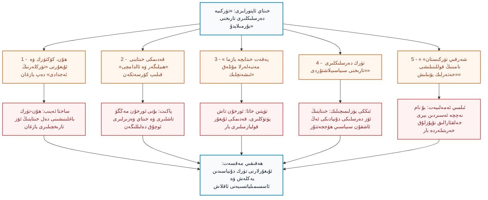
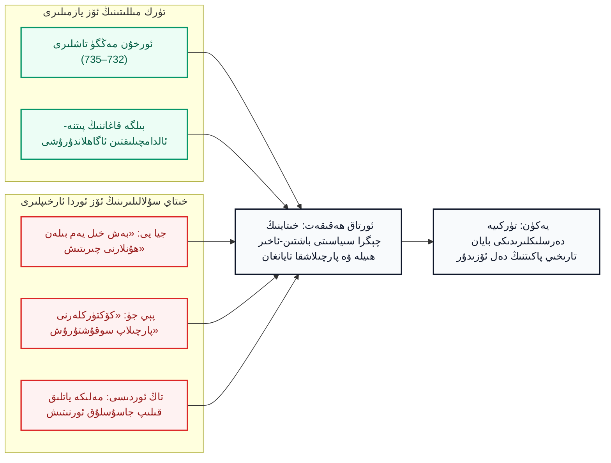
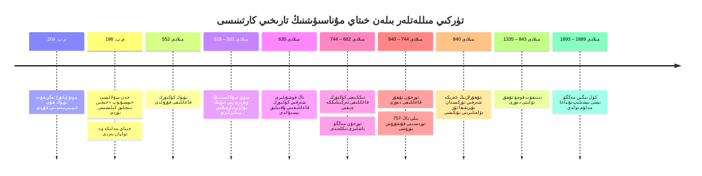

بِسْمِ اللَّهِ الرَّحْمَٰنِ الرَّحِيمِ

⏱ تەخمىنىي ئوقۇش ۋاقتى: 18 مىنۇت

خىتاينىڭ ئىدىيەۋى-نەزەرىيەۋى تور بېكىتى «ئەيسىشياڭ» (爱思想) دا 2026-يىلى 24-ئۆكتەبىر كۈنى خىتاينىڭ نوپۇزلۇق «شى لىن» (史林 - تارىخ ئورمىنى) ژۇرنىلىدىن كۆچۈرۈلگەن جاڭ شياڭروڭ (张向荣) ۋە دۈەن لىجۇ (段丽竹) ئىسىملىك ئىككى ئاپتورنىڭ «تۈركىيە تارىخ دەرسلىكلىرىدىكى قەدىمكى خىتاي بايانى ۋە تۈركىيە دۆلەت قۇرۇلۇشى» ماۋزۇلۇق كۆلەملىك تەتقىقات ماقالىسى قايتا ئېلان قىلىندى. ماقالىدە تۈركىيەنىڭ ئوتتۇرا مەكتەپ تارىخ دەرسلىكلىرى «ئىلمىيلىكتىن يىراق»، «تارىخنى بۇرمىلىغان» دەپ ئەيىبلىنىپ، دەرسلىكلەردە ھۇنلار، كۆكتۈركلەر ۋە ئۇيغۇرلارنىڭ «قەدىمكى تۈركلەر» دەپ بايان قىلىنىشىغا، قەدىمكى خىتاي سۇلالىلىرىنىڭ تاجاۋۇزچىلىق ۋە «ھىيلە-مىكىرلىرى» نىڭ پاش قىلىنىشىغا ھەمدە ئەڭ مۇھىمى «شەرقىي تۈركىستان» تارىخىي-جۇغراپىيەلىك نامىنىڭ قوللىنىلىشىغا قاتتىق ئېتىراز بىلدۈرۈلگەن. لېكىن، ماقالىنى تەكشۈرگىنىمىزدە كۆرۈۋېلىش تەس ئەمەسكى، بۇ ماقالە ھەقىقىي تارىخ ئىلمىگە ئەمەس، بەلكى <strong>خىتاينىڭ نۆۋەتتىكى گېئوسىياسىي ۋە تەشۋىقات تەلىپىگە</strong> خىزمەت قىلىش ئۈچۈن پۈتۈلگەن. ئۇ ئىككى مەينەت نىشاننى كۆزلەيدۇ: بىرى — تۈركىيە جۇمھۇرىيىتىنى ئۆز تارىخىي كىملىكى ۋە ئەجدادلىرىدىن گۇمانلاندۇرۇپ تەۋرىتىش؛ يەنە بىرى — شەرقىي تۈركىستان ئۇيغۇرلىرى بىلەن تۈرك دۇنياسى ئوتتۇرىسىدىكى مىڭ يىللىق قېرىنداشلىق ۋە مەدەنىيەت يىلتىزىنى ئۈزۈپ تاشلاش ئۈچۈن، بۇ ئورتاق كىملىكنى ئاتالمىش «پانتۈركىزم سۈيىقەستى» دەپ قارىلاش. مەن تۆۋەندە خىتاي ئاپتورلىرىنىڭ ئىلگىرى سۈرگەن ساختىلىقلىرىنى دەل خىتاينىڭ كونا مەنبەلىرى ۋە دۇنياۋى پەن ئۆلچەملىرى بويىچە بىر-بىرلەپ تارمار قىلىپ چىقىمەن.

<!-- Image 1 -->

<em>ھۇن ئىمپېرىيەسىنىڭ مىلادىدىن بۇرۇنقى 150-يىللىرى ئەتراپىدىكى ھۆكۈمرانلىق خەرىتىسى (Wikimedia Commons، CC0). ھۇنلار بىلەن خەن سۇلالىسى ئوتتۇرىسىدىكى ھەقىقىي تەبىئىي چېگرا بۈگۈنكى ئىچكى موڭغۇلىيە ۋە سېپىل بويىدا ئىدى.</em>

---

## 1. خىتاي ماقالىسىنىڭ دەۋالىرى ۋە ئەمەلىي تارىخىي رېئاللىق

ماقالىنىڭ بەش تۈرلۈك يادرولۇق ئەيىبلىشىنى ۋە ئۇنىڭغا بېرىلگەن ئىلمىي ئىنكاسلارنى تۆۋەندىكى سىخېما ئارقىلىق سېلىشتۇرۇپ كۆرۈۋېلىش مۇمكىن:

*(سىخېما 1: خىتاي ماقالىسىدىكى سۈنئىي دەلىللەر ۋە تارىخىي رېئاللىقنىڭ تەتۈر كۆرۈنۈشى)*

---

## 2. ماقالىنىڭ ھەقىقىي غەرىزى: تۈركىيەگە دىپلوماتىك بېسىم ۋە ئۇيغۇرلارنى يالغۇز قالدۇرۇش

بۇ ماقالىنىڭ بىر ئاكادېمىك تالاش-تارتىش ئەمەسلىكى ئۇنىڭ ئېلان قىلىنغان مۇھىتىدىنلا مەلۇم. ماقالە دەل خىتاي كومپارتىيەسى تەشۋىقات ئاپپاراتى تەشكىللىك ھالدا «پانتۈركىزم تەھدىتى» ۋە «شەرقىي تۈركىستان ئاتالغۇسىنى يوقىتىش» ھەققىدە بىر قاتار بۇيرۇق ماقالىلىرىنى تارقىتىۋاتقان پەيتتە روياپقا چىقتى. خىتاينىڭ تۈپ غەرىزى — تۈركىيە جۇمھۇرىيىتىگە بېسىم ئىشلىتىپ، دەرسلىكلەردىن قېرىنداش ئۇيغۇر مىللىتى ۋە شەرقىي تۈركىستان نامىنى پۈتۈنلەي ئۆچۈرگۈزۈش، تۈرك دۇنياسىنىڭ ئەڭ قەدىمكى ئۇل تېشى بولغان بۇ زېمىن بىلەن بولغان روھىي باغلىنىشنى ئۈزۈپ تاشلاشتۇر.

دۇنيادىكى ھەر قانداق دېموكراتىك ئەلدە مەكتەپ دەرسلىكلىرى تەنقىدكە، ئىلمىي مۇنازىرىگە ئوچۇق بولىدۇ. تۈركىيە تارىخچىلىرىمۇ ھۇنلار، تىل ئائىلىلىرى ۋە كۆچۈش جەريانلىرى ھەققىدە ئۆز ئارا ئەركىن بەس-مۇنازىرە ئېلىپ بېرىپ كېلىۋاتىدۇ. تۈركىيە ئالىملىرىنىڭ بۇ ئېھتىياتچان ئىلمىي پوزىتسىيەسىنى، پىكىر ئەركىنلىكى پۈتۈنلەي بوغۇلغان، تارىخ پۈتۈنلەي پارتىيە مەنپەئەتىگە باغلانغان بىر دىكتاتۇرا دۆلىتىنىڭ پاكىت بۇرمىلاش سۇيىقەستىگە دەسمايە قىلىش نومۇسسىزلىقتۇر.

---

## 3. «ھۇنلار — تۈركلەرنىڭ ئەجدادى» دېگەن تونۇشنى كىم كەشىپ قىلغان؟

خىتاي تەشۋىقاتچىلىرى تۈركىيە مائارىپىنى «ھۇنلارنى ئۆزىگە ئەجداد قىلىۋالدى» دەپ بىلجىرلايدۇ. ھالبۇكى، تۈركلەر بىلەن ھۇنلارنىڭ تۇغقانلىقىنى ۋە ئەجدادلىق مۇناسىۋىتىنى تۇنجى بولۇپ خاتىرىلىگەنلەر دەل **خىتاينىڭ ئۆز تارىخچىلىرىدۇر**. 

مەسىلەن:
- خىتاينىڭ شىمالىي جوۋ سۇلالىسى ھەققىدىكى رەسمىي ئوردىسى تەزكىرىسى «جوۋشۇ» (周书، 50-توم) دا ناھايىتى ئېنىق قىلىپ: **«突厥者，盖匈奴之别种也» (تۈركلەر بولسا، ئەسلىدە ھۇنلارنىڭ ئايرىم بىر تارمىقىدۇر)** دەپ پۈتۈلگەن؛
- كېيىنكى «سۈيشۇ» (隋书 - سۈي تەزكىرىسى) ۋە تاڭ سۇلالىسى دەۋرىدىكى ھۆججەتلەردىمۇ تۈركلەرنىڭ ئەسلى تېگى-تەكتىنىڭ ھۇنلارغا تۇتىشىدىغانلىقى شۈبھىسىز دەلىللەنگەن.

ئەمدىلىكتە خىتاي ئاپتورلىرىنىڭ ئۆز كونا ئوردا تەزكىرىچىلىرىنىڭ كۆزى بىلەن كۆرۈپ يازغان تارىخىي چۈشەنچىسىنى يوشۇرۇپ، ئۇنى گوياكى يېقىنقى زاماندا «تۈركىيە ئويدۇرۇپ چىقارغان ئەپسانە» دەپ بازارغا سېلىشى كۈلكىلىكتۇر.

شۇنىمۇ ئىلمىي جەھەتتىن ئېتىراپ قىلىش كېرەككى: ھۇنلار دەۋرىدىن يېزىق قالالمىغانلىقى ئۈچۈن، دۇنيا تۈركولوگلىرى ھۇنلارنىڭ تىل قۇرۇلمىسىنى تەتقىق قىلىشتا ھەر ۋاقىت ئېھتىياتچان بولۇپ كەلگەن. ئەمما ھۇنلاردىن كېيىن دۇنيا تارىخىنى قايتا يازغان <dfn title="كۆكتۈرك قاغانلىقى (مىلادى 552–744): «تۈرك» نامىنى دۆلەت ئىسمى قىلىپ رەسمىي تىكلىگەن بۈيۈك ئىمپېرىيە. ئۆز يېزىقى بىلەن ئۆچمەس ئورخۇن مەڭگۈ تاشلىرىنى قالدۇرغان.">كۆكتۈرك قاغانلىقى</dfn> ۋە ئۇنىڭ ۋارىسى بولغان <dfn title="ئورخۇن ئۇيغۇر قاغانلىقى (مىلادى 744–840): ئۆتۈكەندە ھاكىمىيەت يۈرگۈزگەن، تاش پۈتۈكلەر ۋە شەھەر مەدەنىيىتى تىكلىگەن پۇختا ئۇيغۇر دۆلىتى.">ئورخۇن ئۇيغۇر قاغانلىقى</dfn> نىڭ تامامەن بىر قېرىنداش تۈركىي تىللىق خەلقلەر ئىكەنلىكى ھەققىدە دۇنيادا ھېچقانداق سەمىمىي پەن ئەھلىدە شۈبھە يوق.

<!-- Image 2 -->

<em>بىرىنچى كۆكتۈرك قاغانلىقىنىڭ (552–603) قۇدرەت تېپىپ كېڭەيگەن زېمىنى (Wikimedia Commons، CC BY-SA 4.0). تارىم بوستانلىقى ۋە پۈتكۈل ئوتتۇرا ئاسىيا تاڭ سۇلالىسىدىن خېلى بۇرۇنلا كۆكتۈركلەرنىڭ ئەركىن قارمىقىدا گۈللەنگەن.</em>

---

## 4. «پەقەت خىتاي مەنبەلىرىلا ئىشەنچلىك» دېگەن بىمەنە تەلەپپۇز

ماقالىنىڭ دۇنياۋى تارىخشۇناسلىقنى ھاقارەتلىگەن ئەڭ پۈچەك تەرىپى — «تۈركلەر ئۆز ئەجدادلىرى بولغان ھۇن، كۆكتۈرك ۋە ئۇيغۇرلارنىڭ تارىخى ئۈچۈن پەقەت قەدىمكى خىتاي ھۆججەتلىرىگىلا تايىنىشقا مەجبۇر» دېگەن داۋاسىدۇر.

بۇ پۈتۈنلەي ئوچۇق يالغانچىلىق. چۈنكى تۈرك خەلقلىرى ئۆز تىلى، ئۆز ئالىي يېزىقى بىلەن پۈتۈن دۇنياغا ئۆچمەس يالدامىلارنى قالدۇرۇپ كەتكەن:
1. 1889-يىلى رۇس تەتقىقاتچىسى نىكولاي يادرىنتسېۋ (Nikolai Yadrintsev) تەرىپىدىن موڭغۇلىيەدىكى ئورخۇن دەرياسى بويلىرىدىن تېپىلىپ، 1893-يىلى دانىيەلىك تىلشۇناس ۋىلھېلم تومسېن (Vilhelm Thomsen) تەرىپىدىن تىلى يېشىلگەن **ئورخۇن مەڭگۈ تاشلىرى** تۈرك مىللىتىنىڭ ئۆز مەۋجۇتلۇقىنى ئۆز تىلىدا ئېلان قىلغان بۈيۈك گۇۋاھنامىسىدۇر.
2. كۈل تېگىن (732)، بىلگە قاغان (735) ۋە تونيۇقۇق (720-يىللار) ئابىدىلىرى خىتاينىڭ تاجاۋۇزچىلىق تەبىئىتىنى ئۆز كۆزى بىلەن كۆرگەن تۈرك دۆلەت ئەربابلىرىنىڭ ئەۋلادلارغا قالدۇرغان مەڭگۈلۈك ئاگاھلاندۇرۇشىدۇر.
3. ئۇيغۇر قاغانلىقىنىڭ **شىنە-ئۇسۇ (Šine Usu)، تېس (Tes) ۋە تارىئات (Tariat)** تاش پۈتۈكلىرى، تۇرپان ۋە دۇنخۇاڭ غارلىرىدىن تېپىلغان قەدىمكى ئۇيغۇرچە يازمىلار، يۈسۈپ خاس ھاجىبنىڭ «قۇتادغۇبىلىك» (1069) ۋە مەھمۇد قەشقىرىنىڭ تۈرك مىللىتىنىڭ بۈيۈك قامۇسى بولغان «تۈركىي تىللار دىۋانى» (1072) كىتابلىرى دەل بىزنىڭ تارىخىمىزنىڭ ئۆز ئاۋازىمىز بىلەن مەڭگۈلۈك پۈتۈلگەنلىكىنىڭ جانلىق تەنقىدىي ئىسپاتىدۇر.

<!-- Image 3 -->

<em>كۈل تېگىن (Kül Tigin) مەڭگۈ تېشى، ئورخۇن ۋادىسى (732-يىلى تىكلەنگەن، فوتو: Vezirtonyukuk، Wikimedia Commons، CC BY-SA 4.0). قەدىمكى تۈرك رونىك يېزىقى بىلەن پۈتۈلگەن مىللىي گۆھەر.</em>

شۇڭا، «تۈركلەرنىڭ يېزىقى يوق، ھەممىنى خىتايدىن ئۆگەنگەن» دېيىش — دەل خىتاي شۇۋىنىزمىنىڭ ئۆزىنىلا پاش قىلىدۇ. تۈركولوگىيە ئىلمىنىڭ ئاساسى ئورخۇن مەڭگۈ تاشلىرى بىلەن تىكلەنگەن، خىتاي ئارخىپلىرى بولسا پەقەت سېلىشتۇرما قوشۇمچە ماتېرىيال سۈپىتىدە ئىشلىتىلىدۇ.

---

## 5. «تاۋغاچ فېتنىسى»: مەڭگۈ تاشلار ۋە خىتاينىڭ ئۆز تارىخنامىلىرى نېمە دەيدۇ؟

ماقالە تۈركىيە دەرسلىكلىرىدىكى «خىتاي سۇلالىلىرىنىڭ فېتنە-پاسات، سۇيىقەست ۋە ھىيلە-مىكىرلىرى» (Çin entrikası) دېگەن مەزمۇنلارنى «غەرب ئىستېمال قىلىپ تاشلىغان پىكىرلەرنى تەكرارلاش» دەپ پەردازلاشقا ئۇرۇنىدۇ.

ئەمما، بۇ تەسۋىرلەرنى دەسلەپتە بۈگۈنكى تۈركلەر ئەمەس، بەلكى مىلادى 8-ئەسىردىلا ئورخۇن مەڭگۈ تاشلىرىغا بىلگە قاغان مىللىتىگە ئاگاھلاندۇرۇش قىلىپ پۈتۈپ كەتكەن:

> «تاۋغاچ (خىتاي) خەلقىنىڭ سۆزى تاتلىق، يىپەك رەختى يۇمشاق ئىكەن. تاتلىق سۆزى، يۇمشاق رەختى بىلەن ئالداپ، يىراقتىكى مىللەتلەرنى ئۆزىگە يېقىنلاشتۇرىدىكەن. يېقىنلاپ بارغاندىن كېيىن، ئۇلارغا فېتنە ۋە يامان قىلىقلىرىنى چېكىگە يەتكۈزۈپ ئۆگىتىدىكەن... ئاقىل ۋە باتۇر كىشىلەرنى تۈزۈك ياشاتمايدىكەن، تۈرك مىللىتىنى قۇل قىلىشقا كۈچەيدىكەن...» (كۈل تېگىن مەڭگۈ تېشى، تالات تېكىن ئوقۇلمىسى).

ئۇنىڭدىن باشقا، بۇ خىل پارچىلاپ-يۇتۇش سىياسەتلىرى خىتاينىڭ ئۆز ئوردا ۋەزىرلىرىنىڭ پەخىرلىنىپ يازغان مەشھۇر دۆلەت تەدبىرلىرى ئىدى:
- **«بەش خىل يەم سىياسىتى» (五饵):** خەن سۇلالىسى دەۋرىدە ۋەزىر جيا يى (贾谊، م.ب. 200–168) «يېڭى كىتاب» (新书) ناملىق ئەسىرىدە ھۇنلارنى خىتاينىڭ يىپەكلىرى، مەيخورلۇقلىرى، سېھىرلىك ناخشا-مۇزىكىلىرى ۋە ھەشەمەتلىك قىزلار بىلەن يەم بېرىپ رەزىللەشتۈرۈپ يوقىتىش پىلانىنى ئوتتۇرىغا قويغان؛
- **«كۈچلۈكنى بۆلۈپ، ئاجىزنى كۈچلەندۈرۈپ سوقۇشتۇرۇش» (离强合弱):** سۈي سۇلالىسى ۋەزىرى پېي جۈ (裴矩، 547–627) كۆكتۈرك دۆلىتىنى ئۆز ئىچىدىن پارچىلاش ئۈچۈن قېرىنداشلار ئارىسىغا پىتنە سېلىپ، ئاجىز شاھزادىلەرنى قوراللاندۇرۇپ، ئاخىرىدا كۆكتۈركلەرنى شەرقىي ۋە غەربىي دەپ پارچىلاپ تاشلىغان («سۈيشۇ» دا تەپسىلىي بايان قىلىنغان)؛
- **«يات ئەللىكلەر بىلەن يات ئەللىكلەرنى تىزگىنلەش» (以夷制夷):** تاڭ سۇلالىسىنىڭ تۈرك، ئۇيغۇر ۋە تىبەتلەرنى بىر-بىرىگە سېلىپ ئۇرۇشتۇرۇشتىكى مەشھۇر مىكىرى؛
- **«خېچىن سىياسىتى» (和亲):** خىتاي مەلىكىلىرىنى ھۇن ۋە تۈرك قاغانلىرىغا ئەۋەتىپ، ئۇلارنىڭ ئوردىسىغا خىتاي جاسۇسلىرىنى ۋە سىياسىي بۆلگۈنچىلىكىنى سىڭدۈرۈش.

دېمەك، تۈركىيە دەرسلىكلىرىدىكى بايانلار قۇرۇق ئۆچمەنلىك ئەمەس، بەلكى ھەم تۈركلەرنىڭ تاش پۈتۈكلىرى، ھەم خىتاينىڭ كونا تەزكىرىلىرى تەرىپىدىن تەڭ ئىسپاتلانغان ئېچىنىشلىق تارىخىي دەرسلەردۇر.

*(سىخېما 2: تۈرك ۋە خىتاي مەنبەلىرىدە پارچىلاش سىياسىتىنىڭ تەڭ دەلىللىنىشى)*

<!-- Image 4 -->

<em>مىڭ سۇلالىسى دەۋرىدە چىڭىتىلغان بۈيۈك سېپىل (فوتو: ChiralJon، Wikimedia Commons، CC BY 2.0). سېپىل خىتاي بىلەن شىمالدىكى مۇستەقىل كۆچمەن تۈرك-موڭغۇل دۇنياسى ئوتتۇرىسىدىكى رەسمىي مەدەنىيەت ۋە دۆلەت چېگراسى ئىدى.</em>

---

## 6. باشقىلارنى «مىللەتچى» دەپ ئەيىبلىگەن فاشىست خىتاي دەرسلىكلىرىنىڭ ھەقىقىي يۈزى

خىتاي ماقالىسى تۈركىيەنى «تارىختا ئۆزىنى مەركەز قىلىش، مىللەتچىلىك قىلىش» بىلەن قارىلايدۇ. ئەمما بۈگۈنكى يەر شارىدا تارىخنى خىتاي كومپارتىيەسىچىلىك قوپاللىق بىلەن ئۆزگەرتىدىغان، پۈتۈن مائارىپنى فاشىستىك روھقا چۆمدۈرىدىغان ئىككىنچى بىر ھاكىمىيەت يوقتۇر:

| خىتاينىڭ تۈركىيە دەرسلىكلىرىگە ئارتقان ئەيىبى | خىتاينىڭ ئۆز دەرسلىكى ۋە رەسمىي سىياسىتىدىكى شۇۋىنىزم |
| :--- | :--- |
| «ھەممە دۆلەت ۋە مىللەتنى ئۆزىگە تۇتىشىدۇ دەپ قارايدۇ» | خىتاي ھۇن، كۆكتۈرك، ئۇيغۇر، موڭغۇل، مانجۇلارنىڭ ھەممىسىنى «جۇڭخۇا مىللىتىنىڭ بىر پۈتۈن تەركىبى» دەپ بېسىۋالىدۇ |
| «ئۆز مەدەنىيىتىنى بەك قەدىمىي ۋە تاقابىلسىز دەپ تەرىپلەيدۇ» | خىتاينىڭ رەسمىي دەرسلىكلىرىدىكى ساختا «5000 يىللىق ئۈزۈلمەس جۇڭخۇا سivilizاتسىيەسى» ئەپسانىسى |
| «مەنبەلەرنى ئۆز سىياسىي مەنپەئەتىگە قاراپ تاللايدۇ» | شەرقىي تۈركىستان تارىخىدا ئۇيغۇرچە بارلىق تاش پۈتۈك، تارىخ ۋە مەدەنىيەت مىراسلىرىنى مائارىپتىن پۈتۈنلەي چەكلەپ يوقىتىش |
| «تارىخ دەرسلىكىنى ھاكىمىيەت پىروپاگاندىسىغا ئايلاندۇرغان» | بارلىق باشلانغۇچ، ئوتتۇرا مەكتەپلەردە پەقەت پارتىيەگە مەدھىيە ئوقۇيدىغان، مىللەتلەرنى قىزىل قازاندا ئېرىتىدىغان سىستېما قۇرۇپ چىقىش |

خىتاي ھاكىمىيىتى ئورخۇن ئۇيغۇر قاغانلىقى (744–840) يىقىلغاندىن كېيىن، ئۇيغۇرلارنىڭ شەرقىي تۈركىستانغا كۆچۈپ كېلىپ گۈللەندۈرگەن <dfn title="قوچۇ (ئىدىقۇت) ئۇيغۇر دۆلىتى (843–1335): تۇرپان ئويمانلىقىنى مەركەز قىلغان يۇقىرى مەدەنىيەتلىك ئۇيغۇر دۆلىتى. ئىدىقۇت بەگلىرى ئۆز تىلى، ئۆز يېزىقى بىلەن پۈتۈن ئوتتۇرا ئاسىيا ۋە موڭغۇل ئىمپېرىيەسىگە مەمۇرىي ۋە پەن مىراسلىرىنى ئۆگەتكەن.">قوچۇ ئۇيغۇر دۆلىتى</dfn> ۋە پۈتۈن تۈرك دۇنياسىنىڭ تۇنجى ئىسلام دۆلىتى بولغان <dfn title="قاراخانىيلار قاغانلىقى (840–1212): قەشقەر ۋە بالاساغۇننى پايتەخت قىلغان، ئىسلام تۈرك مەدەنىيىتىنىڭ ئەڭ بۈيۈك تۈۋرۈكى بولغان ئۇيغۇر قاغانلىقى.">قاراخانىيلار قاغانلىقى</dfn> نىڭ ئۇيغۇرلارنىڭ ئەركىن زېمىنى ئىكەنلىكىنى تىلغا ئالمايدۇ. 757-يىلى تاڭ ئىمپېرىيەسىدە ئەن لۈشەن توپىلىڭى پارتلاپ، تاڭ پادىشاھلىرى گۇمران بولۇش گىردابىغا كەلگەندە، ئۇيغۇر قاغانى بايانچۇرنىڭ قوشۇن تارتىپ بېرىپ خىتاي پادىشاھلىقىنى قۇتقۇزۇپ قالغانلىقى، تاڭ سۇلالىسىنىڭ ئۇيغۇرلارغا يىللاپ تالاپەت بېجى تاپشۇرۇپ جان باققانلىقىنى ئۆز دەرسلىكلىرىدىن ئۆچۈرۈپ تاشلايدۇ. چۈنكى ھەقىقەت شۇكى: ئۇيغۇرلار تارىختا خىتاينىڭ تەۋەسى ئەمەس، بەلكى خىتاي پادىشاھلىرىنى قۇتقۇزغان، دۇنياغا نوپۇز ئورناتقان بۈيۈك كۈچ ئىدى.

<!-- Image 5 -->

<em>ئورخۇن ئۇيغۇر قاغانلىقىنىڭ (744–840) دۆلەت چېگرالىرى (Wikimedia Commons، CC BY-SA 4.0). پۈتكۈل ئوتتۇرا ئاسىيا ۋە سىبىرىيەنى ئۆز ئىچىگە ئالغان بۈيۈك ئۇيغۇر دۆلىتى.</em>

---

## 7. ۋاقىتنامە: تۈركىي دۆلەتلەر بىلەن قەدىمكى خىتاينىڭ رېئال تىركىشىش مۇساپىسى

*(سىخېما 4: تۈركىي خەلقلەرنىڭ خىتاي بىلەن بولغان مۇستەقىل دۆلەتچىلىك مۇساپىسى)*

<!-- Image 6 -->

<em>ئىككىنچى كۆكتۈرك قاغانلىقى (682–744) نىڭ زېمىنى (Wikimedia Commons، CC0). كۈل تېگىن، بىلگە قاغان ۋە تونيۇقۇق مەڭگۈ تاشلىرى دەل مانا مۇشۇ دەۋردە مەڭگۈلۈك قىلىپ تىكلەنگەن.</em>

---

## 8. «شەرقىي تۈركىستان» نامى: خىتاي ئەمەلدارلىرى نېمىدىن تىترەپ كېتىدۇ؟

خىتاي ماقالىسىنىڭ تۈركىيە مائارىپىغا ئېتىلىپ چۈشۈشىدىكى ئەڭ چىدىغۇسىز ئاغرىق نۇقتىسى مۇنۇ جۈملىدە يوشۇرۇنغان: **«تۈركىيەنىڭ بىر قانچە خىل تارىخ ۋە جۇغراپىيە دەرسلىكلىرىدە ‹شەرقىي تۈركىستان› (Doğu Türkistan) ئاتالغۇسى ئوچۇق-ئاشكارە ئىشلىتىلمەكتە»**.

ئاپتورلار بۇ ھەقتە باشقا گەپ قىلالمىسىمۇ، «بۇنىڭغا ئالاھىدە دىققەت قىلىش ۋە سىياسىي ھوشيارلىق كېرەك» دەپ بېيجىڭغا سىگنال بېرىدۇ. نېمىشقا؟ چۈنكى خىتاينىڭ پۈتۈن تاجاۋۇزچىلىق مەپكۇرىسى مۇستەملىكە بولغان «شىنجاڭ» (يېڭى چېگرا) نامىنى دۇنياغا مەجبۇرىي تېڭىش ئۈستىگە قۇرۇلغان. ئەگەر خەلقئارادا ۋە تۈركىيە دەرسلىكلىرىدە «شەرقىي تۈركىستان» ئىسمى ئەۋلادلارنىڭ قەلبىدە مۇستەھكەم ياشايدىكەن، خىتاينىڭ شەرقىي تۈركىستاننى پۈتۈنلەي يۇتۇۋېلىش پىلانى ھەرگىز ئەمەلگە ئاشمايدۇ.

بۇ ئىسىم ئەسلا يېڭى توقۇلغان نەرسە ئەمەس:
1. نەچچە ئەسىرلەردىن بېرى ئوتتۇرا ئاسىيا ۋە خەلقئارا ئىلمىي جەمئىيەتلەردە، ئەنگلىيە، چار پادىشاھلىق روسىيەسى، فرانسىيە ۋە ئوسمانلى خەرىتىلىرىدە بۇ زېمىن ئىزچىل **«شەرقىي تۈركىستان» (Eastern Turkistan / Doğu Türkistan)** دەپ ئاتىلىپ كەلگەن؛
2. تۈركىيە مائارىپىنىڭ بۇ ئەنئەنىۋى، ئىلمىي ۋە تارىخىي نامنى دەرسلىكلەردە قوغداپ قېلىشى پەقەتلا ھەقىقەتكە بولغان ساداقەتنىڭ ئىپادىسىدۇر؛
3. خىتاينىڭ بۇنىڭدىن بۇنچىۋالا قورقۇپ كېتىشى — ئۇلارنىڭ ئۆز ھۆكۈمرانلىقىنىڭ پۈتۈنلەي قانۇنسىز تاجاۋۇزچىلىق ئۈستىگە قۇرۇلغانلىقىنى ئىچ-ئىچىدىن بىلىپ تۇرغانلىقىنىڭ روشەن پىسخىكىلىق بېشارىتىدۇر.

<!-- Image 7 -->

<em>قوچۇ ئۇيغۇر دۆلىتى دەۋرىدىن قالغان خەنزۇچە-ئۇيغۇرچە يېزىقتىكى بۇددا تېكىستى (Wikimedia Commons، CC BY-SA 4.0). ئۇيغۇر مەدەنىيىتىنىڭ تەرجىمىچىلىك جەھەتتە نەقەدەر ئوچۇق ۋە كۆپ تىللىق ئىكەنلىكىنىڭ ئىسپاتى؛ ئەمما بۇ ھەرگىزمۇ ئۇيغۇرلارنىڭ خىتايغا بېقىندى بولغانلىقىنى كۆرسەتمەيدۇ.</em>

ماقالىدە يەنە بىر كۈلكىلىك ئەيىبلەش بار: تۈركىيە دەرسلىكلىرىدە تاڭ ئەلچىسى ۋاڭ يەندې (王延德) نىڭ «قوچۇغا ئەلچىلىك خاتىرىسى» دىكى ئۇيغۇر شەھەرلىرىدە بار بولغان خەنزۇچە كىتابلار ۋە بۇيۇملار تىلغا ئېلىنماپتۇمىش! بۇ قارا قورساق تەپەككۇر ئۇيغۇرلارنىڭ ئەينى چاغدا پۈتكۈل ئوتتۇرا ئاسىيا يىپەك يولىنىڭ بۈيۈك مەدەنىيەت كۆۋرۈكى بولۇپ، ھىندى، خىتاي، تىبەت ۋە ئىران تىللىرىدىكى ئەسەرلەرنى تەرجىمە قىلغان ئىلغار مەدەنىيەتلىك بىر مىللەت ئىكەنلىكىنى چۈشەنمەيدۇ. بۈگۈن پۈتۈن ياۋروپا ئىشلىتىۋاتقان ئەرەب رەقەملىرى ياۋروپالىقلارنى قانداق ئەرەب قىلىپ قويمىسا، قەدىمكى ئۇيغۇرلارنىڭ قوشنا ئەللەرنىڭ يېزىق-كىتابلىرىدىن پايدىلىنىشىمۇ ئۇلارنى قىلچىلىك خىتاي قىلىپ قويمايدۇ.

<!-- Image 8 -->

<em>بېزەكلىك مىڭ ئۆي تاش كېمىرلىرى، تۇرپان (فوتو: David Stanley، Wikimedia Commons، CC BY 2.0). قوچۇ ئۇيغۇر دۆلىتى مەدەنىيىتىنىڭ دۇنياۋى ئابىدىسى.</em>

---

## 9. تۆت مۇھىم تارىخىي ئىبرەت

### 1) ئىسلام تەلىماتىدىن ئىبرەت: ئادالەت بىلەن ھەق گۇۋاھلىق بېرىش پىرىنسىپى

قۇرئان كەرىمدە مۆمىنلەر قايسى مىللەت بىلەن يۈزلەشمىسۇن، ھەقىقەتكە تەۋرەنمەي گۇۋاھ بولۇشقا بۇيرۇلغان:

﴿يَا أَيُّهَا الَّذِينَ آمَنُوا كُونُوا قَوَّامِينَ بِالْقِسْطِ شُهَدَاءَ لِلَّهِ وَلَوْ عَلَىٰ أَنفُسِكُمْ أَوِ الْوَالِدَيْنِ وَالْأَقْرَبِينَ﴾

> *(ئى ئىمان ئېيتقانلار! ئادالەتنى مەھكەم تۇتقۇچىلاردىن، ئاللاھ ئۈچۈن ھەق گۇۋاھلىق بەرگۈچىلەردىن بولۇڭلار، گەرچە ئۇ گۇۋاھلىق سىلەرنىڭ ئۆزۈڭلارنىڭ، ئاتا-ئاناڭلارنىڭ ياكى يېقىن تۇغقانلىرىڭلارنىڭ زىيىنىغا بولسىمۇ.)* — سۈرە نىسا، 135-ئايەت.

ئادالەت — پاكىتقا قاراپ ھۆكۈم قىلىشتۇر. خىتاي پۈتۈن كۈچى بىلەن تارىخنى بۇرمىلاۋاتقان ۋە شەرقىي تۈركىستاندا مىسلىسىز ئىنسانىي قىرغىنچىلىق ئېلىپ بېرىۋاتقان بىر چاغدا، تارىخ ۋە زۇلۇم ئالدىدا ھەق گۇۋاھلىق بېرىش ھەر بىر مۇسۇلمان ۋە ئىنسانپەرۋەر جەمئىيەتنىڭ تەۋرەنمەس بۇرچىدۇر.

### 2) دۇنيا تەجرىبىسىدىن ئىبرەت: «دەرسلىكلەر جېڭى» نىڭ ماھىيىتى

دۇنيا تارىخىدا گېرمانىيە بىلەن فىرانسىيە، ياپونىيە بىلەن كورىيە قاتارلىق ئەللەر ئوتتۇرىسىدا ئۆتمۈشتىكى دەرسلىكلەر ھەققىدە كۆپلىگەن سىياسىي تالاش-تارتىشلار يۈز بەرگەن. ئەركىن دۇنيا بۇ مەسىلىنى ئوچۇق مۇنازىرە، ئارخىپلارنى تەڭ كۆرۈش ۋە ئەركىن باھالاش ئارقىلىق ھەل قىلىدۇ. ئەمما ئۆزىنىڭ پۈتۈن مائارىپىنى مۇستەبىت سېنزۇرا (تەكشۈرۈش) غا باغلاپ قويغان خىتايدەك بىر تۈزۈمنىڭ، دېموكراتىك بىر دۆلەتنىڭ مەكتەپ دەرسلىكىگە پۇت دەسسەپ بۇيرۇق چۈشۈرۈشكە ئۇرۇنۇشى — تاشقى دۇنياغا ئۆز فاشىستىك قىممەتلىرىنى تاڭغانلىقتۇر.

### 3) خىتاي تارىخىنىڭ قاراڭغۇ ئەنئەنىسى: تارىخنى ھاكىمىيەتنىڭ چۆرىسى قىلىۋېلىش

خىتاي سىياسىي ئەنئەنىسىدە «تارىخ يېزىش» قەدىمدىن تارتىپ ھاكىمىيەتنى ئاقلاشنىڭ، سۇلالىنىڭ «تەڭرى ھوقۇقى» غا ئىگە ئىكەنلىكىنى تەلۋىلەرچە ئىسپاتلاشنىڭ دەستىكى بولغان. خەن دەۋرىدە سىما چيەن ھەقىقەتنى ئېيتقانلىقى ئۈچۈن پىچىۋېتىلىشتەك ئېغىر خورلۇققا ئۇچرىغان بولسا، بۈگۈنكى كۈندە شەرقىي تۈركىستاننىڭ ھەقىقىي تارىخىنى، ئۇيغۇر خەلقىنىڭ قەھرىمانلىقىنى يازغان ئونلىغان ئۇيغۇر ئالىملىرى ۋە زىيالىيلىرى خىتاينىڭ جازا لاگېرلىرى ۋە قارا تۈرمىلىرىدە چىرىتىلمەكتە. بۇ زۇلمەت ئاستىدا ئىشلەپچىقىرىلغان «ئىلمىي ئەمگەك» لەر پەقەت بىرەر ۋاراق تەرەددۇتسىز تەشۋىقات قەغىزىدىن باشقا قىممەتكە ئىگە ئەمەس.

### 4) ئۇيغۇر مىللىتىنىڭ شانلىق مەۋجۇتلۇقى: ئۆز بايرىقى ۋە ئۆز ئاۋازى بار خەلق

ئۇيغۇر مىللىتى دۇنياغا باش ئېگىپ، باشقىلارنىڭ خەيرى-ساخاۋىتىگە يۈكلىنىپ ياشىغان مىللەت ئەمەس. ئورخۇن مەڭگۈ تاشلىرىنىڭ پۈتۈكچىلىرى، قوچۇنىڭ ئاقىل ئالىملىرى، مەھمۇد قەشقىرىنىڭ «تۈركىي تىللار دىۋانى» كىتابى پۈتكۈل تۈركىي تىللىق قەۋملەرنىڭ قەدىمىيلىكى، باي مەدەنىيىتى ۋە يىلتىزىنى مىڭ يىل بۇرۇنلا جەزملەشتۈرۈپ قويغان. بىز ئۆز ئەجدادلىرىمىزنىڭ روھىغا، ئۆز ئانا تىلىمىزنىڭ شان-شەرىپىگە ئىگە چىقىپ، ھەقىقىي تارىخىمىزنى دۇنيا تىللىرىدا ئاڭلىتىشتا قەتئىي ئارقىغا چېكىنمەسلىكىمىز كېرەك.

---

## 10. شەرقىي تۈركىستان مىللىي كۈرىشى ئۈچۈن ئىستراتېگىيەلىك ساۋاقلار

1. **تۈركىيە ۋە پۈتكۈل تۈرك دۇنياسى بىلەن مەنىۋى قېرىنداشلىق قەلئەسىنى مۇستەھكەملەش:** خىتاينىڭ بۇ تىپتىكى ھۇجۇملىرىدىن كۆرۈنۈپ تۇرۇپتىكى، ئۇلار شەرقىي تۈركىستان دەۋاسىنىڭ تۈرك دۇنياسىدا مىللىي ئاڭ ۋە ئىستراتېگىيەلىك تىرەك تېپىشىدىن دەھشەتكە چۈشمەكتە. بىز تۈركىيە پەن-زىيالىيلىرى، پارلامېنتى ۋە مائارىپ ساھەسى بىلەن بولغان مۇناسىۋەتنى پۇختىلاپ، دەرسلىكلەردە شەرقىي تۈركىستان تېمىسىنىڭ تېخىمۇ چوڭقۇرلاپ كىرگۈزۈلۈشىنى قوللىشىمىز كېرەك.
2. **تارىخىمىزنى ئۆز مەنبەلىرىمىز ئارقىلىق خەلقئارالىق تىللاردا ئېلان قىلىش:** خىتاينىڭ «پەقەت خىتايچە مەنبە بار» دېگەن بىمەنە يالغانچىلىقىنى پارچىلاش ئۈچۈن، ئورخۇن يازمىلىرى، ئۇيغۇر قاغانلىقى پۈتۈكلىرى ۋە «قۇتادغۇبىلىك» كەبى تۈۋرۈك ئەسەرلىرىمىزنى ئىنگلىزچە ۋە تۈركچە يېڭى تەتقىقاتلار بىلەن سىستېمىلىق قايتا ئېلان قىلىپ تارقىتىشىمىز زۆرۈر.
3. **«شەرقىي تۈركىستان» خەلقئارالىق نامىنى تەۋرەنمەي قوغداش:** تارىخىي، ئىلمىي ۋە رەسمىي جۇغراپىيەلىك خەرىتىلەردە مۇستەھكەم ئورۇن ئالغان «شەرقىي تۈركىستان» (Doğu Türkistan) ئاتالغۇسىنى خەلقئارالىق دىپلوماتىك سورۇنلاردا داۋاملىق تەكىتلەپ، خىتاينىڭ مۇستەملىكە «شىنجاڭ» ئىسمىنى ئىشلىتىشنى رەت قىلىشىمىز لازىم.
4. **خىتاينىڭ قوش يۈزلىمىچىلىكىنى پاش قىلىش:** تۈركىيەنىڭ ئۆز تارىخىنى قەدىرلىشىنى «مىللەتچىلىك» دەپ تىللاپ، ئۆزىنىڭ فاشىستىك «جۇڭخۇا مىللىتى بىر گەۋدىسى» سىياسىتىنى پۈتۈن دۇنياغا تېڭىۋاتقان رەزىل ئىككى يۈزلىمىچىلىكىنى خەلقئارالىق پەن-تەتقىقات سورۇنلىرىدا ئىزچىل ئېچىپ تاشلاش كېرەك.
5. **تۈركىي دۆلەتلەر بىلەن ئورتاق مەدەنىيەت-مائارىپ فوندى قۇرۇش:** تۈركىيە، قازاقىستان، ئۆزبېكىستان، قىرغىزىستان ۋە ئەزەربەيجاندىكى ئالىملار بىلەن ھەمكارلىشىپ، قەدىمكى تۈرك-ئۇيغۇر تارىخى ھەققىدە مەخسۇس ئورتاق خەلقئارالىق ئىلمىي ژۇرناللارنى تەسىس قىلىش ۋە خىتاي تەشۋىقاتىغا كوللېكتىپ تاقابىل تۇرۇش زۆرۈر.
6. **ھەقىقەت، ئادالەت ۋە مەزمۇتلۇق بىلەن غەلىبە قىلىش:** بىزنىڭ داۋايىمىز ئۆتمۈشنى توقۇپ يالغان سۆزلەيدىغان زالىملارغا ئەمەس، ئۆز تۇپرىقىدا مىڭ يىللار بويى بايرىقىنى لەپىلدىتىپ ياشىغان مىللەتنىڭ سۇنماس غۇرۇرىغا تايىنىدۇ؛ ھەقىقەت ھامان ساختىلىقنى يېڭىدۇ.

---

## تەۋسىيە قىلىنغان مۇھىم ئىلمىي كىتابلار

1. **«An Introduction to the History of the Turkic Peoples» — Peter B. Golden**  
   تۈركىي خەلقلەرنىڭ مەنبەسى، ھۇن، كۆكتۈرك، ئۇيغۇر ۋە باشقا قەبىلىلەرنىڭ كېلىپ چىقىش جەريانىنى نۇپۇزلۇق پەن ئاساسىدا تەمىنلەيدىغان ئاساسلىق تەتقىقات ئەسىرى.
2. **«The Perilous Frontier: Nomadic Empires and China» — Thomas J. Barfield**  
   كۆچمەن تۈرك ئىمپېرىيەلىرى بىلەن خىتاي سۇلالىلىرى ئوتتۇرىسىدىكى مۇرەككەپ ئۇرۇش، تىنچلىق، سودا ۋە «خېچىن»، «پارچىلاپ تىزگىنلەش» ئۇسۇللىرىنىڭ سىياسىي-ئىقتىسادىي ماھىيىتىنى چوڭقۇر يورۇتىدۇ.
3. **«Ancient China and Its Enemies: The Rise of Nomadic Power in East Asia» — Nicola Di Cosmo**  
   ھۇنلار ۋە شىمالىي كۆچمەنلەرنىڭ كۈچىيىشىنى، خىتاينىڭ چېگرا سىياسەتلىرىنىڭ ئەسلى ماھىيىتىنى نېيترال دەلىللەر بىلەن تەھلىل قىلىدۇ.
4. **«Orhon Yazıtları» — Prof. Dr. Talât Tekin**  
   ئورخۇن مەڭگۈ تاشلىرىنىڭ قەدىمكى تۈركچە ئەسلى تېكىستى، گرامماتىكىسى ۋە ھازىرقى زامان تىلىغا ئۆرۈلمىسىنى مۇكەممەل ئۆز ئىچىگە ئالغان ئاساسلىق تۈركولوگىيە گۆھىرى.

---

## پايدىلانغان مەنبەلەر تىزىملىكى

  

    1. 张向荣, 段丽竹, «土耳其历史教科书中的古代中国叙事与土耳其国家建构», 《史林》 (Historical Review) 2025年第2期; ئەيسىشياڭ تورى: aisixiang.com/data/184604.html — تەنقىد قىلىنغان خىتاي ماقالىسى.
  

  

    2. Peter B. Golden, <em>An Introduction to the History of the Turkic Peoples</em>, Wiesbaden: Otto Harrassowitz, 1992.
  

  

    3. Thomas J. Barfield, <em>The Perilous Frontier: Nomadic Empires and China</em>, Oxford: Basil Blackwell, 1989.
  

  

    4. Nicola Di Cosmo, <em>Ancient China and Its Enemies</em>, Cambridge University Press, 2002.
  

  

    5. Talât Tekin, <em>Orhon Yazıtları</em>, Ankara: Türk Dil Kurumu Yayınları, 1988; <em>A Grammar of Orkhon Turkic</em>, Indiana University, 1968.
  

  

    6. 《周书·卷五十·列传第四十二·突厥传》; 《隋书·裴矩传》; 《汉书·匈奴传》; 贾谊, 《新书》 (خىتاي سۇلالىلىرىنىڭ ئۆز يازما مەنبەلىرى).
  

  

    7. مەھمۇد قەشقىرى، <em>تۈركىي تىللار دىۋانى</em> (1072–1074)؛ يۈسۈپ خاس ھاجىب، <em>قۇتادغۇبىلىك</em> (1069)؛ قۇرئان كەرىم، سۈرە نىسا 135-ئايەت.
  

  

    8. سۈرەت مەنبەلىرى: Wikimedia Commons (Map of Xiongnu territory, First/Second Turkic Khaganate maps, Kül Tigin Stele photo by Vezirtonyukuk, Great Wall of China by ChiralJon, Gaochang Uyghur-Chinese texts, Bezeklik Caves).
  

