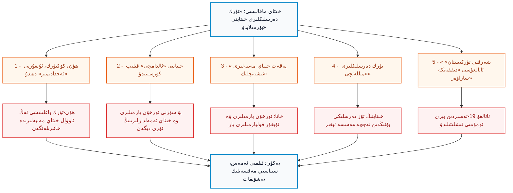
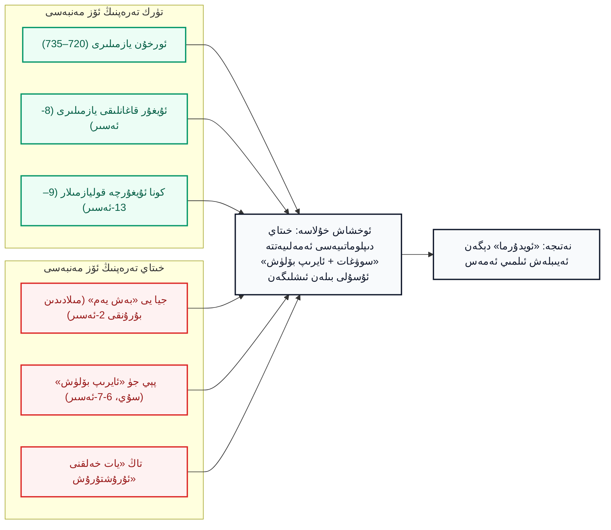
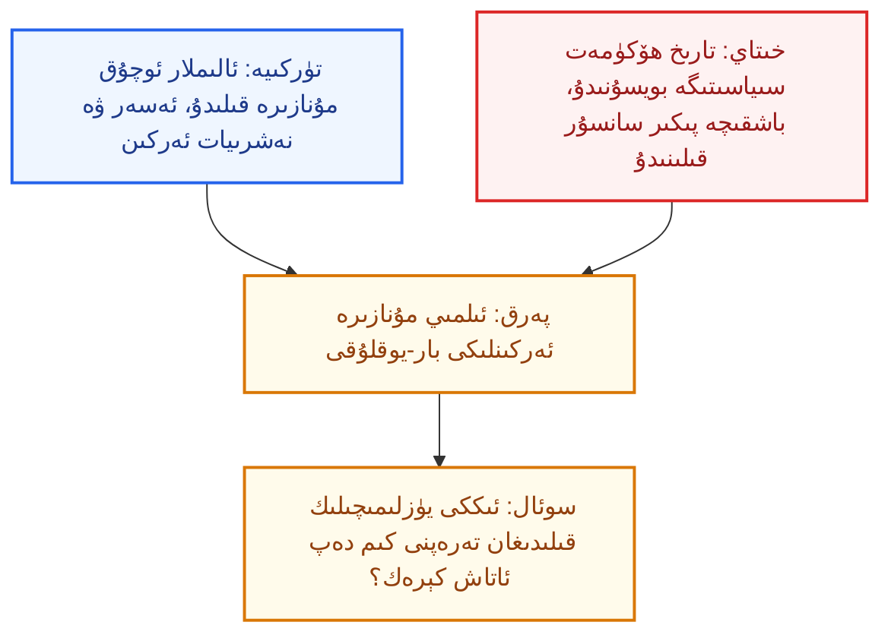
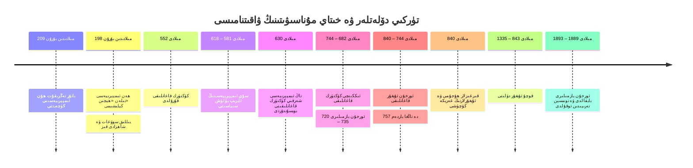

بِسْمِ اللَّهِ الرَّحْمَٰنِ الرَّحِيمِ

⏱ تەخمىنىي ئوقۇش ۋاقتى: 18 مىنۇت

خىتاينىڭ «ئەپسى ئىدىيە» (爱思想) تور بېكىتىدە 2026-يىلى 24-ئوكتەبىردە، «تارىخ ئىزلىرى» (史林) ژۇرنىلىدىن ئېلىنىپ، «زاڭ شياڭروڭ ۋە دۈەن لىجۇ» (张向荣، 段丽竹) دېگەن ئىككى ئاپتورنىڭ «تۈركىيە تارىخ دەرسلىكلىرىدىكى قەدىمكى خىتاي بايانى ۋە تۈركىيە دۆلەت قۇرۇلۇشى» ناملىق ئۇزۇن بىر ماقالىسى قايتا ئېلان قىلىندى. ماقالە تۈركىيە ئوتتۇرا مەكتەپ دەرسلىكلىرىنى «ئىلمىي ئەمەس»، «بۇرمىلانغان» دەپ ئەيىبلەيدۇ، ھۇنلار، كۆكتۈركلەر ۋە ئۇيغۇرلارنى «قەدىمكى تۈركلەر» دەپ ئاتىغانلىقىنى، خىتاينى «ئالدامچى» قىلىپ كۆرسەتكەنلىكىنى كۆرسىتىدۇ ھەمدە تۈركىيە دەرسلىكلىرىدە «شەرقىي تۈركىستان» ئاتالغۇسىنىڭ ئىشلىتىلىشىدىن ئەنسىرەيدۇ. بىراق بۇ ماقالىنىڭ ئەڭ چوڭ مەسىلىسى ئۇنىڭ ئۆز ئىچىدە: ئۇ ئىلىمگە ئەمەس، <strong>خىتاينىڭ بۈگۈنكى سىياسىي ئېھتىياجىغا</strong> خىزمەت قىلىدۇ. ئۇ ئىككى مەقسەتنى كۆزلەيدۇ: بىرى — تۈركىيەنى ئۆز تارىخىدىن «ئۇيالدۇرۇش»؛ يەنە بىرى — ئۇيغۇرلار بىلەن تۈركىي دۇنيا ئوتتۇرىسىدىكى تارىخىي ۋە مەدەنىيەت ئۇلىنىشىنى «پانتۈركىزم ئەپسانىسى» دەپ كۈچسىزلەندۈرۈش. مەن بۇ ماقالىدە ئاپتورلارنىڭ ئاساسلىق دەۋالىرىنى ئۇلارنىڭ ئۆز مەنبەلىرىگە ۋە تارىخىي پاكىتلارغا سېلىشتۇرۇپ تەكشۈرىمەن.

<!-- Image 1 -->

<em>ھۇن ئىمپېرىيەسىنىڭ مىلادىدىن بۇرۇنقى 150-يىل ئەتراپىدىكى تەخمىنىي زېمىنى (Wikimedia Commons، CC0). ھۇنلار بىلەن ھەن ئىمپېرىيەسى ئوتتۇرىسىدىكى چېگرا بوشلۇقى بۈگۈنكى ئىچكى موڭغۇلىيە ئەتراپىدا ئىدى.</em>

---

## 1. ماقالىنىڭ دەلىللىرى ۋە ئۇلارنىڭ ئەمەلىي ئەھۋالى

ماقالىنىڭ بەش ئاساسىي دەۋاسىنى تۆۋەندىكى سىخېمىدا ھەر بىرىگە ئاددىي باھا بىلەن بېرىمىز. يېشىل رەڭ توغرا ياكى چۈشىنىشلىك نۇقتىنى، قىزىل رەڭ ئىلمىي ئاساسى يوق ياكى ئىككى يۈزلىمىچىلىك بار نۇقتىنى كۆرسىتىدۇ.

*(سىخېما 1: خىتاي ماقالىسىنىڭ دەلىل زەنجىرى ۋە ئۇنىڭ ئەمەلىي ئەھۋالى)*

---

## 2. ماقالىنىڭ ھەقىقىي مەقسىتى: تۈركىيەگە بېسىم ۋە ئۇيغۇرلارنى يالغۇزلاندۇرۇش

ماقالىنىڭ تېخنىكىلىق تەرىپىنى تەكشۈرۈشتىن ئاۋۋال ئۇنىڭ ئارقا كۆرۈنۈشىگە قاراش كېرەك. بۇ ماقالە خىتاينىڭ دۆلەت تەشۋىقات تورىدا، «پانتۈركىزم» ۋە «شەرقىي تۈركىستان» ھەققىدىكى ماقالىلەر بىلەن بىللە ئېلان قىلىندى. يەنى ئۇنىڭ نىشانى تۈركىيەنىڭ مەكتەپ دەرسلىكى ئەمەس، تۈركىيە بىلەن ئۇيغۇرلار ئوتتۇرىسىدىكى تارىخىي ۋە مەدەنىيەت باغلىنىشىدۇر. خىتاي بىر مىللەتنىڭ ئۆز تارىخىنى ئۆز تىلىدا ئۆگىنىشىنى «ئىلمىي بۇرمىلاش» دەپ ئاتايدۇ؛ ئەمما ئۆزىنىڭ ئۇيغۇرلار ۋە باشقا خەلقلەرگە قارىتا قوللىنىۋاتقان تارىخ سىياسىتىنى «ئىلمىي ھەقىقەت» دەپ ئاتايدۇ.

شۇنىمۇ ئېنىق ئېيتىش كېرەككى، دۇنيادىكى ھەر قانداق دۆلەتنىڭ دەرسلىكى ئىلىم ساھەسىدە مۇنازىرە قىلىنىدۇ، تۈركىيەدىمۇ ئۇنىڭ ئۆزىنىڭ ئالىملىرى بۇ ھەقتە ئوچۇق ئەسەرلەر يازىدۇ. تۈرك ئالىملىرىنىڭ تارىخ ئوقۇتۇشىنى ئۆز ئىچىدىن مۇنازىرە قىلىشى ئىلمىي ئەركىنلىكنىڭ ئالامىتى؛ ئۇنى بىر ئاپتوكراتىك، سانسۇر تۈزۈمى بار دۆلەتنىڭ ھۆكۈمەت تەشۋىقات ئورگىنىنىڭ تەنقىدى بىلەن ئوخشاش دەپ ئويلاش خاتا. تۈرك تارىخشۇناسلىقىدا ھۇنلارنىڭ تىلى ھەققىدە ئېھتىياتچان بولۇش ئۇزۇندىن بېرى بار؛ ئۇنى «خىتاي ئۇستازلار بىزگە ئۆگىتىپ بەردى» دەپ تەسۋىرلەش — ھەقىقەتنى بۇرمىلاش.

---

## 3. «ھۇنلار — تۈركلەرنىڭ ئەجدادى» دېگەن ئىدىيەنى كىم ئويلاپ چىقاردى؟

ماقالە تۈركىيە دەرسلىكلىرىنى ھۇنلارنى «تۈركلەرنىڭ ئەجدادى» دەپ كۆرسەتكەنلىكى ئۈچۈن ئەيىبلەيدۇ. ئەمما بۇ باغلىنىشنى ئەڭ ئاۋۋال تۈركلەر ئەمەس، <strong>خىتاي مەنبەلىرىنىڭ ئۆزى</strong> خاتىرىلىگەن. خىتاينىڭ رەسمىي سۇلالە تارىخلىرىدىن «جۇشۇ» (周书) دا «تۈركلەر ھۇنلارنىڭ ئايرىم بىر تارمىقى» (突厥者，盖匈奴之别种也) دەپ يېزىلغان؛ «سۇيشۇ» (隋书) ۋە كېيىنكى خىتاي مەنبەلىرىمۇ تۈركلەرنىڭ كېلىپ چىقىشىنى ھۇنلار بىلەن باغلايدۇ. يەنى ئەسلىدە تۈركلەرنى ھۇنلار بىلەن تۇتاشتۇرغان خىتاي تارىخچىلىرىنىڭ ئۆزى. ھازىرقى زامان خىتاي تارىخچىلىرىمۇ، سىز ئېيتقاندەك، بۇ باغلىنىشنى تەكرارلاپ كەلگەن. دېمەك ئاپتورلار «تۈرك دەرسلىكلىرى بۇ ئىدىيەنى ئويدۇرۇپ چىقاردى» دەپ ئەيىبلىسە، ئەمەلىيەتتە ئۆز مىللىي تارىخچىلىرىنىڭ قەدىمكى خاتىرىسىنى ئەيىبلەيدۇ.

ئىلمىي نۇقتىدىن مۇنداق دېيىش مۇمكىن: ھۇنلارنىڭ تىلىدىن ساقلانغان ماتېرىيال ناھايىتى ئاز؛ شۇڭا «ھۇنلار ئەتراپلىق تۈركىي ئىدى» دېگەن يەكۈننى قارشى تەرەپكە ئۆتكۈزۈش ئۈچۈن ئېھتىياتچان بولۇش كېرەك. بۇ ئىلمىي مۇنازىرە ھەققىدە تۈرك، ياۋروپا ۋە ئامېرىكا ئالىملىرى تەڭ ئىلمىي تالاش-تارتىش قىلىپ كەلگەن، ھېچكىم ئۇنى «يوشۇرۇپ» كەلمىگەن. ئەمما ئىلمىي ئېھتىيات بىلەن سىياسىي دەلىل ئوخشىمايدۇ: خىتاي ماقالىسى بۇ ئىلمىي مۇنازىرىنى تۈركىيەنى ئەيىبلەش قورالىغا ئايلاندۇرىدۇ. ئەكسىچە، <dfn title="كۆكتۈرك قاغانلىقى (مىلادى 552–744): ئاشىنا قەبىلىسى قۇرغان، «تۈرك» ئىسمى بىلەن ئاتالغان تۇنجى دۆلەت. ئۇنىڭ ئۆز تىلىدا يېزىلغان ئورخۇن يازمىلىرى ساقلانغان.">كۆكتۈرك قاغانلىقى (552–744)</dfn> ۋە <dfn title="ئورخۇن ئۇيغۇر قاغانلىقى (مىلادى 744–840): كۆكتۈرك قاغانلىقىدىن كېيىن مۇڭغۇلىيەدە قۇرۇلغان ئۇيغۇر قاغانلىقى. 840-يىلى قىرغىزلار تەرىپىدىن ۋەيران قىلىنغاندىن كېيىن ئۇيغۇرلار غەربكە، شەرقىي تۈركىستانغا كۆچكەن.">ئورخۇن ئۇيغۇر قاغانلىقى (744–840)</dfn> نىڭ تۈركىي ئىكەنلىكىدە ھېچ بىر ئىلمىي ئېتىراز يوق، چۈنكى ئۇلار ئۆز تىلىدا ئۆز تارىخىنى يېزىپ قالدۇرغان.

<!-- Image 2 -->

<em>بىرىنچى كۆكتۈرك قاغانلىقى (552–603) نىڭ زېمىنى (Wikimedia Commons، Ktrinko ۋە Greenvert، CC BY-SA 4.0). تارىم بوستانلىقى ۋە ئوتتۇرا ئاسىيانىڭ كۆپ قىسمى بۇ قاغانلىقنىڭ ئىدارىسى ئىچىدە ئىدى.</em>

---

## 4. «پەقەت خىتاي مەنبەلىرى ئىشەنچلىك» دېگەن ئاچقۇچلۇق يالغان

ماقالىنىڭ ئەڭ ئېغىر ئىلمىي خاتالىقى — «تۈركلەرنىڭ ھۇن، كۆكتۈرك، ئۇيغۇر تارىخى ھەققىدە ئىشەنچلىك بىردىنبىر مەنبە قەدىمكى خىتاي يازمىلىرى» دېگەن دەۋاسى. بۇ ھۇنلار ئۈچۈنلا يېرىم توغرا؛ كۆكتۈركلەر ۋە ئۇيغۇرلار ئۈچۈن پۈتۈنلەي خاتا. كۆكتۈركلەر ۋە ئۇيغۇرلار ئۆز ئىمپېرىيەلىرى ھەققىدە ئۆز تىلىدا، ئۆز يېزىقىدا تاشقا ئويۇلغان يازمىلارنى قالدۇرغان. ئۇلار 1889-يىلى رۇس تەتقىقاتچىسى نىكولاي يادرىنتسېۋ (Nikolai Yadrintsev) تەرىپىدىن ھازىرقى موڭغۇلىيەنىڭ ئورخۇن ۋادىسىدا بايقالغان، 1893-يىلى دانىيەلىك تىلشۇناس ۋىلھېلم تومسېن (Vilhelm Thomsen) تەرىپىدىن ئوقۇلغان.

<!-- Image 3 -->

<em>كۈل تېگىن (Kül Tigin) ئابىدىسى، ئورخۇن يازمىلىرى (732-يىلى تىكلەنگەن؛ فوتو: Vezirtonyukuk، Wikimedia Commons، CC BY-SA 4.0). بۇ يازما قەدىمكى تۈرك رونىك يېزىقىدا، تۈرك تىلىدا يېزىلغان.</em>

ئورخۇن يازمىلىرى — كۈل تېگىن (732)، بىلگە قاغان (735) ۋە تونيۇقۇق (720-يىللار) ئابىدىلىرى — قەدىمكى تۈرك تىلىدا، ئۆز رونىك يېزىقىدا، قاغانلارنىڭ ئۆز ئاغزىدىن ئېيتىلغان، تۈرك مىللىتىنىڭ ئۆز ئىرادىسى، تارىخى ۋە ئاگاھلاندۇرۇشلىرىنى ئۆز ئىچىگە ئالغان. ئۇنىڭدىن باشقا ئۇيغۇر قاغانلىقى دەۋرىدىكى تاش يازمىلار (شىنە-ئۇسۇ، تېس، تارىئات)، تۇرپان ۋە دۇنخۇاڭدىن تېپىلغان كونا ئۇيغۇرچە قوليازمىلار، يۈسۈپ خاس ھاجىبنىڭ «قۇتادغۇبىلىك» (1069–1070) ۋە مەھمۇد قەشقىرىنىڭ «تۈركىي تىللار دىۋانى» (1072–1074) — بۇلارنىڭ ھەممىسى تۈركىي خەلقلەرنىڭ ئۆز ئاغزىدىن چىققان مەنبەلەر. شۇڭا «بىردىنبىر مەنبە خىتايچە» دېگەن جۈملە ئىلمىي مەلۇماتسىزلىق ياكى ئاتالغۇ ئوينىشى. ئەمەلىيەتتە تۈركىي تارىخچىلىقىنىڭ ئاساسىي ئورنىنى ئورخۇن يازمىلىرى ئىگىلەيدۇ؛ خىتاي مەنبەلىرى ئۇلارنى تولۇقلاپ، تەكشۈرۈشكە ياردەم قىلىدۇ.

---

## 5. «تاۋغاچ» ھەققىدە ئالدامچىلىق: بۇنى ئورخۇن يازمىلىرى ۋە خىتاينىڭ ئۆزى ئېيتقان

خىتاي ماقالىسى ئەڭ كۆپ كۈلكە قىلغان ئىدىيە — تۈرك دەرسلىكلىرىدىكى «خىتاي ئالدامچىلىقى» (Çin entrikası). ئاپتورلار بۇنى «غەرب ھەققىدە ياسالغان قاراشنىڭ قايتىلىنىشى» دەپ ئاتايدۇ. ئەمما ئىلمىي ئىسپات مۇنداق: ئالدامچىلىق ئىددىئاسى تۈرك دەرسلىكىنىڭ ئۆزى ئويلاپ چىقارغان ئەمەس، بەلكى ئۇنى ئورخۇن يازمىلىرىنىڭ ئۆزى 732-يىلى بىۋاسىتە ئېيتقان. كۈل تېگىن ئابىدىسىدا بىلگە قاغان ئۆز خەلقىگە مۇنداق مەزمۇندا ئاگاھلاندۇرىدۇ:

> «تاۋغاچ (خىتاي) خەلقىنىڭ سۆزى تاتلىق، ھەدىيەسى يۇمشاق ئىكەن. تاتلىق سۆز ۋە يۇمشاق ھەدىيە بىلەن ئالداپ، يىراق خەلقنى مۇشۇنداق يېقىنلاشتۇرىدىكەن. يېقىنلىشىپ ئولتۇراقلاشقاندىن كېيىن ئۇلاردا يامان پىكىرنى ئۆگىتىدىكەن.» (كۈل تېگىن ئابىدىسى؛ ئەسلى قەدىمكى تۈركچىدىن ئۇيغۇرچىغا ئەركىن ئۆرۈلدى).

بۇ جۈملىلەرنى ئورخۇن يازمىلىرىنىڭ ھەرقانداق ئىلمىي نەشرىدە، مەسىلەن تالات تېكىننىڭ (Talât Tekin) تەتقىقاتلىرىدا، تاپقىلى بولىدۇ. بىلگە قاغان يەنە خىتاي ئىمپېراتورىنىڭ تۈرك خەلقىنى شەھەرلەردە ئولتۇراقلاشتۇرۇشنى تەكلىپ قىلغانلىقىنى، ئەمما ئۇنىڭ بۇنى رەت قىلغانلىقىنى بايان قىلىدۇ؛ چۈنكى كۆچمەن تۈركلەر شەھەر ئىچىدە ئاسسىمىلياتسىيە بولۇپ يوقاپ كېتىشتىن ئەنسىرەيتتى. ماقالە بۇ ئەنسىرەنى «تۈرك دەرسلىكلىرىنىڭ ئويدۇرمىسى» دەپ ئاتايدۇ؛ ھالبۇكى ئۇ ئورخۇن يازمىلىرىدا ۋە تونيۇقۇق ئابىدىسىدا بىۋاسىتە خاتىرىلەنگەن.

شۇنىڭدەك «قۇترىتىش، ئارالاشتۇرۇش، سوۋغات بىلەن بېقىندى قىلىش» ئۇسۇلى خىتاينىڭ ئۆز ئەمەلدارلىرى تەرىپىدىنمۇ تەرغىب قىلىنغان:

- ھەن ئىمپېرىيەسىنىڭ (مىلادىدىن بۇرۇنقى 202 – مىلادى 220) ئەمەلدارى جيا يى (贾谊، مىلادىدىن بۇرۇنقى 200–168) ھۇنلارغا قارشى «بەش خىل يەم» (五饵) ئىستراتېگىيەسىنى ئوتتۇرىغا قويغان: ھۇن ئاقسۆڭەكلىرىنى كىيىم-كېچەك، يېمەك-ئىچمەك، مۇزىكا، ئۆي-ئىمارەت ۋە مەنسەپ بىلەن ئازدۇرۇپ، ئۇلارنى ئۆز خەلقىدىن ئايرىۋېتىش. بۇ تەكلىپ جيا يىنىڭ «شىنشۇ» (新书) ناملىق ئەسىرىدە خاتىرىلەنگەن.
- سۇي ئىمپېرىيەسىنىڭ (581–618) ئەمەلدارى پېي جۈ (裴矩، 547–627) كۆكتۈرك قاغانلىقىنى «كۈچلۈكنى ئايرىپ، ئاجىزنى بىرلەشتۈرۈش» (离强合弱) ئارقىلىق پارچىلاشنى تەكلىپ قىلغان؛ ئۇنىڭ سىياسىتى ئەمەلىيەتتە قوللىنىلغان ۋە «سۇيشۇ» دا خاتىرىلەنگەن.
- تاڭ ئىمپېرىيەسىنىڭ (618–907) «يات خەلقلەر بىلەن يات خەلقلەرنى ئۇرۇشتۇرۇش» (以夷制夷) سىياسىتى خىتاي تارىخچىلىقىدا ئوچۇق ئېتىراپ قىلىنغان.
- «ھېچىن» (和亲) يەنى ئىمپېرىيە ئوردىسىدىن شاھزادى قىزلارنى ھۇن، كۆكتۈرك ۋە ئۇيغۇر قاغانلىرىغا ياتلىق قىلىش، خىتاي تارىخچىلىقىدا ھەم ھەربىي-دىپلوماتىك ۋاسىتە دەپ ئوچۇق ئاتىلىدۇ.

دېمەك، تۈرك دەرسلىكلىرىدىكى «خىتاي ئالدامچىلىقى» ئىددىيەسى ئويدۇرما ئەمەس: ئۇنىڭ مەنبەسى ھەم تۈركلەرنىڭ ئۆز ئابىدىلىرى، ھەم خىتاينىڭ ئۆز تارىخچىلىرى. بىز بۇنى بىر مىللەتنىڭ «تەبىئىي ئەخلاقى» دەپ ئومۇملاشتۇرمايمىز؛ بۇلار شۇ دەۋردىكى دۆلەتلەرنىڭ ئۆز مەنپەئەتى ئۈچۈن قوللانغان دىپلوماتىك ئۇسۇللىرى. ئەمما ئاپتورلارنىڭ بۇنى «ئويدۇرما» دەپ ئاتىشى، خىتاينىڭ ئۆز ئەمەلدارلىرى يازغان ھۆججەتلەرگە زىت.

*(سىخېما 2: «ئالدامچىلىق» ئىددىئاسىنىڭ ئىككى تەرەپتىكى مەنبەلىرى)*

<!-- Image 4 -->

<em>مىڭ سۇلالىسى دەۋرىدە سېلىنغان چوڭ سېپىل (فوتو: ChiralJon، Wikimedia Commons، CC BY 2.0). سېپىل كۆچمەن خەلقلەرگە قارشى قوغدىنىش قۇرۇلمىسى بولۇپ، ئۇنىڭ ئىككى تەرىپىدە ئىككى ئايرىم دۇنيا مەۋجۇت ئىدى.</em>

---

## 6. «مىللەتچى دەرسلىك» دەپ ئەيىبلىگەن دۆلەتنىڭ ئۆز دەرسلىكى

خىتاي ماقالىسى تۈرك دەرسلىكلىرىنى «مىللەتچى، ئۆزىنى مەركەز قىلغان، بۇرمىلانغان» دەپ ئەيىبلەيدۇ. بۇ ئەيىبلەرنىڭ ئۆزى خىتاينىڭ ئۆز دەرسلىكىگە ئۇنىڭدىن نەچچە ھەسسە ئېغىر تەتبىقلىنىدۇ:

| ئەيىب (خىتاي ماقالىسى تۈركلەرگە) | خىتاينىڭ ئۆز دەرسلىكى ۋە رەسمىي تارىخىدىكى ئەمەلىيەت |
| :--- | :--- |
| «ھەممە ئىمپېرىيەنى ‹بىر خىتاي› دەپ ئاتايدۇ» | خىتاي رەسمىي تارىخى ھۇن، كۆكتۈرك، ئۇيغۇر، خىتان، موڭغۇل، مانجۇنىڭ ھەممىسىنى «خىتاي مىللەتلىرى تارىخى» ئىچىگە قوشىدۇ |
| «ئۆز مىللىتىنى ئەڭ قەدىمكى ۋە ئەڭ شانلىق قىلىپ كۆرسىتىدۇ» | «5000 يىللىق ئۈزۈلمەيدىغان مەدەنىيەت» دېگەن رەسمىي شوئار |
| «پەقەت ئۆزىگە ماس كېلىدىغان مەنبەنى تاللايدۇ» | شەرقىي تۈركىستان تارىخىنى ئاساسەن ھەن-تاڭ-چىڭ ئەمەلدارلىرى يازغان خىتاي مەنبەلىرى بويىچە بايان قىلىپ، ئۇيغۇرچە مەنبەلەرنى ئىككىنچى ئورۇنغا قويىدۇ |
| «تارىخنى سىياسەتكە بويسۇندۇرىدۇ» | تارىخ تەتقىقاتىنى ۋە ئوقۇتۇشنى «مىللىي ئورتاق ئاڭنى مۇستەھكەملەش» سىياسىتىگە بويسۇندۇرىدۇ |

*(سىخېما 3: ئىككى دۆلەتنىڭ تارىخ ئوقۇتۇشىدىكى ئاساسىي پەرق)*

بۇ يەردە ئۇيغۇر نۇقتىئىنەزىرىدىن بىر مۇھىم ئىش بار. خىتاي ھۇن، كۆكتۈرك ۋە ئۇيغۇرلارنى ئۆز دەرسلىكىدە «خىتاي مىللەتلىرىنىڭ ئەجدادى» دەپ ئاتاپ، بۇ خەلقلەرنىڭ ھازىرقى ۋارىسلىرىنى بولسا — ئۇيغۇرلارنى — شۇ تارىخ ئۈستىدە سۆز قىلىش ھوقۇقىدىن مەھرۇم قىلىدۇ. ئورخۇن ئۇيغۇر قاغانلىقى (744–840) نى قۇرغان ئۇيغۇرلار 840-يىلى قىرغىزلار ھۇجۇمىدىن كېيىن غەربكە، ھازىرقى تۇرپان ۋە ئۈرۈمچى ئەتراپىغا كۆچكەن ۋە <dfn title="قوچۇ (ئىدىقۇت) ئۇيغۇر دۆلىتى (مىلادى 843–1335): تۇرپان ئويمانلىقىدا ھۆكۈم سۈرگەن ئۇيغۇر دۆلىتى. بۇددا، مانى، خرىستىيان ۋە كېيىن ئىسلام ئەنئەنىلىرىنى بىرلەشتۈرگەن يۇقىرى شەھەر مەدەنىيىتى بىلەن داڭلىق.">قوچۇ (ئىدىقۇت) ئۇيغۇر دۆلىتى (843–1335)</dfn> ۋە <dfn title="قاراخانىيلار دۆلىتى (مىلادى 840–1212): تارىختا تۇنجى بولۇپ ئىسلام دىنىنى دۆلەت دىنى قىلغان تۈرك-ئۇيغۇر دۆلىتى. قەشقەر ۋە بالاساغۇننى مەركەز قىلغان.">قاراخانىيلار دۆلىتى (840–1212)</dfn> غا ئاساس سالغان. ئۇلار بۇ زېمىندا ئۆز دۆلەت ۋە مەدەنىيەتلىرىنى قۇرغان؛ ئورخۇن ئۇيغۇر قاغانلىقى بولسا 757-يىلى تاڭ ئىمپېرىيەسىگە ئەن لۈشەن قوزغىلىڭىنى باستۇرۇشقا ياردەم قىلغان ئىمپېرىيە ئىدى؛ بۇنى تاڭ مەنبەلىرىنىڭ ئۆزى خاتىرىلىگەن. دېمەك، ئۇيغۇرلار «بويسۇنغان خەلق» ئەمەس، ئەكسىچە شۇ دەۋرنىڭ تەڭ كۈچلۈك دۆلەتلىرىدىن بىرى ئىدى.

<!-- Image 5 -->

<em>ئورخۇن ئۇيغۇر قاغانلىقى (744–840) نىڭ زېمىنى (Wikimedia Commons، Ktrinko، CC BY-SA 4.0).</em>

---

## 7. ۋاقىتنامە: تۈركىي دۆلەتلەر بىلەن خىتاي مۇناسىۋىتى

تۆۋەندىكى ۋاقىتنامە ماقالىدا تىلغا ئېلىنغان ۋەقەلەرنىڭ تارىخىي تەرتىپىنى ۋە ئورخۇن يازمىلىرىنىڭ ئورنىنى كۆرسىتىدۇ. بەزى ھۇن، كۆكتۈرك چېسلالىرى مەنبەلەرگە قاراپ ئازراق ئوخشىمايدۇ.

*(سىخېما 4: ماقالىدا تىلغا ئېلىنغان ۋەقەلەرنىڭ تارىخىي تەرتىپى)*

<!-- Image 6 -->

<em>ئىككىنچى كۆكتۈرك قاغانلىقى (682–744) نىڭ زېمىنى (Wikimedia Commons، CC0). ئورخۇن يازمىلىرى مۇشۇ دەۋردە تىكلەنگەن.</em>

---

## 8. «شەرقىي تۈركىستان» ئاتالغۇسى: ماقالە نېمىدىن قورقىدۇ؟

ماقالىنىڭ ئەڭ ئەھمىيەتلىك قىسقا بىر جۈملىسى مۇنداق: «بىر قانچە نۇسخا تۈرك تارىخ ۋە جۇغراپىيە دەرسلىكلىرى ‹شەرقىي تۈركىستان› ئاتالغۇسىنى ئىشلىتىدۇ». ئاپتورلار بۇنى چۈشەندۈرمەيدۇ، پەقەت «دىققەت قىلىش كېرەك» دەپ ئەسكەرتىدۇ. بۇ ئەسكەرتىشنىڭ مەنىسىنى ماقالىنىڭ ئاستىدىكى «مۇناسىۋەتلىك ماقالىلار» تىزىملىكىدىن بىلگىلى بولىدۇ: «‹تۈركىستان›؟ مىڭ بىر كېچە ھېكايىسى!» ۋە «تۈركىيە ۋە پانتۈركىزم ھەققىدە» دېگەندەك سەرلەۋھىلەر بار. يەنى خىتاينىڭ نەزەرىدە «شەرقىي تۈركىستان» ئاتالغۇسى ۋە تۈركىيەدىكى ئۇيغۇر كۆچمەنلىرىنىڭ ئاۋازى «پانتۈركىزم ئىلىنجىسى» دەپ قارىلىدۇ.

ئەمەلىيەتتە بۇ ئاتالغۇ ھەرگىز يېڭى ئەمەس. 19-ئەسىردىن بېرى ياۋروپالىق ساياھەتچىلەر، ئەنگلىيە-ھىندىستان خەرىتىلىرى ۋە رۇس سەپەرنامىلىرى «شەرقىي تۈركىستان» (Eastern Turkistan) ئاتالغۇسىنى ئىشلەتكەن. تۈرك دەرسلىكلىرىنىڭ بۇنى ئىشلىتىشى ئۇ مەنبەلەرنى داۋاملاشتۇرىدۇ ۋە بۇ بىر تارىخىي جۇغراپىيەلىك رېئاللىقنى ئاتاشتىن ئىبارەت. خىتاينىڭ بۇنى «خەتەر» دەپ قارىشى، ئۇنىڭ ئۆز ھۆكۈمرانلىقىنىڭ ئاجىزلىقىنى ئىپادىلەيدۇ. تۈركىيەدە ئون مىڭلىغان ئۇيغۇر ياشايدۇ؛ تۈركىيە بىلەن ئۇيغۇرلار ئوتتۇرىسىدىكى مۇناسىۋەت تارىخىي، دىنىي ۋە مەدەنىيەت ئورتاقلىقىغا ئاساسلانغان. بىز بۇنى «سىياسىي ئويۇن» دەپ ئەمەس، بىر مىللەتنىڭ ئۆز ئاتىلىشى ۋە ئۆز دۇنياسى بىلەن بولغان ئۇلىنىشى دەپ كۆرۈشىمىز كېرەك.

<!-- Image 7 -->

<em>قوچۇ دەۋرىدىن قالغان خەنزۇچە-ئۇيغۇرچە قوش يېزىقلىق بۇددا تېكىستى (Wikimedia Commons، Woudloper، CC BY-SA 4.0). بۇ ئۇيغۇر مەدەنىيىتىنىڭ ئاچىقلىقى ۋە كۆپ تىللىقلىقىنىڭ ئىسپاتى، ئەمما ھەرگىزمۇ ئۇيغۇرلارنىڭ خىتايغا تەۋە بولغانلىقىنىڭ ئىسپاتى ئەمەس.</em>

خىتاي ماقالىسى بۇ يەردە يەنە بىر ئىنچىكە ئىش قىلىدۇ: تۈرك دەرسلىكلىرىنىڭ «ۋاڭ يەندىنىڭ ‹قوچۇغا ئەلچىلىك خاتىرىسى› دىكى ئۇيغۇر شەھەرلىرىدىكى كۆپ ساندىكى خەنزۇچە بۇيۇملارنى تىلغا ئالمايدىغانلىقىنى» ئەيىبلەيدۇ. ھەقىقەتەن ئۇيغۇرلار خىتاي يېزىقى ۋە بۇددا ئەسەرلىرىنى تەرجىمە قىلغان؛ ئەمما ئۇيغۇر مەدەنىيىتىنىڭ كۆپ تىللىق بولۇشى ئۇنىڭ خىتاي بولغانلىقىنى بىلدۈرمەيدۇ. ئوخشاشلا ئىنگلىز تىلىدىكى ياپونچە سۆزلەر ئىنگلىز مىللىتىنى ياپونلۇق قىلىپ قويمايدۇ.

<!-- Image 8 -->

<em>بېزەكلىك مىڭ ئۆيلىرى (Bezeklik)، تۇرپان (فوتو: David Stanley، Wikimedia Commons، CC BY 2.0). قوچۇ ئۇيغۇر دۆلىتى دەۋرىدىكى بۇددا ئىبادەتخانىلىرى.</em>

---

## 9. تۆت تۈرلۈك تارىخىي ئىبرەت

### 1) ئىسلام تارىخىدىن ئىبرەت: ئادىل گۇۋاھلىق

قۇرئان مۆمىنلەرنى ئادالەت ئۈچۈن گۇۋاھلىق بېرىشكە بۇيرۇيدۇ:

﴿يَا أَيُّهَا الَّذِينَ آمَنُوا كُونُوا قَوَّامِينَ بِالْقِسْطِ شُهَدَاءَ لِلَّهِ وَلَوْ عَلَىٰ أَنفُسِكُمْ أَوِ الْوَالِدَيْنِ وَالْأَقْرَبِينَ﴾

> *(ئى ئىمان ئېيتقانلار! ئادالەتنى قاتتىق تۇتقۇچىلاردىن بولۇڭلار، ئاللاھ ئۈچۈن گۇۋاھلىق بەرگۈچىلەردىن بولۇڭلار.)* (سۈرە نىسا، 135-ئايەت).

ئادالەت دېگەن — ھەقىقەتنى ئىنكار قىلماسلىق ۋە ھەقسىزلىقنى ئاقلىماسلىقتىن ئىبارەت. خىتاي ماقالىسى دەرسلىككە سۆز قىلغان بىلەن، ئۆزىنىڭ ئۇيغۇرلارغا قىلغان زۇلۇمىنى ئاقلاشتا ئۇنىڭ ئادالەتتىن ئۇزاق ئىكەنلىكىنى كۆرسىتىدۇ.

### 2) دۇنيا تارىخىدىن ئىبرەت: «دەرسلىك ئۇرۇشى»

ماقالىنىڭ ئۆزى تىلغا ئالغاندەك، ياپونىيە ۋە كورىيە، شۇنداقلا تۈركىيە ۋە گرېتسىيە، ئەرمەنىيە ئوتتۇرىسىدا دەرسلىكلەر تالاش-تارتىش مەركىزى بولۇپ كەلگەن. بۇنىڭدىن چىقىدىغان ئىبرەت: ھەر قانداق دۆلەت ئۆز دەرسلىكىنى ئۆز ئالىملىرىنىڭ مۇنازىرىسىگە ئوچۇق قويۇشى كېرەك. بۇ ئىشنى ئەڭ ئاز قىلىدىغىنى — ئۆز دەرسلىكىنى سانسۇر قىلىدىغان، ئۇنى سىياسىي ئورگان بىلەن چەكلەيدىغان خىتاينىڭ ئۆزى.

### 3) خىتاي تارىخىنىڭ قاراڭغۇ تەرىپىدىن ئىبرەت: تارىخ ئارقىلىق ھاكىمىيەتنى ئاقلاش

خىتاي سىياسىي مەدەنىيىتىدە «تارىخ» ھەمىشە ھاكىمىيەتنىڭ ئاقلىغۇچىسى بولغان. ھەن ئىمپېرىيەسىدە سىما چيەن (مىلادىدىن بۇرۇنقى 145–86) ئىمپېراتورغا ياقمايدىغان ھەقىقەتنى ئېيتقانلىقى ئۈچۈن قاتتىق جازالانغان. بۈگۈنمۇ شەرقىي تۈركىستان تارىخى توغرىسىدا ئۇيغۇر ئالىملىرىنىڭ ئەركىن تەتقىقات قىلىشى چەكلەنگەن ۋە نۇرغۇن ئۇيغۇر زىيالىيلىرى تۈرمىگە تاشلانغان.

### 4) ئۇيغۇر تارىخىنىڭ ئىجابىيلىقىدىن ئىبرەت: ئۆز ئاغزىدىن سۆزلىگەن تارىخ

ئۇيغۇر خەلقى ئۆز تارىخىنى ئۆز تىلىدا يازغان. ئورخۇن ئۇيغۇر قاغانلىقىنىڭ تاش يازمىلىرى، قوچۇ ئۇيغۇر دۆلىتىنىڭ كونا ئۇيغۇرچە قوليازمىلىرى، <dfn title="يۈسۈپ خاس ھاجىب (مىلادى 1019–1085): قاراخانىيلار دەۋرىدىكى مۇتەپەككۇر ۋە شائىر، «قۇتادغۇبىلىك» نىڭ ئاپتورى.">يۈسۈپ خاس ھاجىب</dfn> ۋە مەھمۇد قەشقىرىنىڭ ئەسەرلىرى — بۇلار ئۇيغۇرلارنىڭ ئۆز تارىخىنىڭ ئۆز ئاۋازىدۇر. بىز بۇ مىراسنى ئۆگىنىپ، ئۇنى ئۆز تىلىمىزدا ۋە دۇنيا تىللىرىدا ئاڭلىتىشىمىز كېرەك.

---

## 10. شەرقىي تۈركىستان مۇستەقىللىق داۋاسى ئۈچۈن ئىستراتېگىيەلىك ساۋاقلار

1. **تۈركىيە ۋە تۈركىي دۇنيا بىلەن مۇناسىۋەتنى قوغداش:** خىتاينىڭ مەقسىتى — تۈركىيە ۋە ئۇيغۇرلار ئارىسىدىكى باغلىنىشنى ئاجىزلاشتۇرۇش. بىز ئۇنىڭغا قارشى، تۈرك ئالىملىرى ۋە ئاممىسى بىلەن ئىلمىي ھەمكارلىقنى كۈچەيتىشىمىز، ئۇلارنى خىتاي تەشۋىقاتىدىن ھوشيار قىلىشىمىز كېرەك.
2. **ئۆز تارىخىمىزنى ئۆز مەنبەلىرىمىزدىن يېزىش:** خىتاي ماقالىسىنىڭ بىرىنچى ئاجىزلىقى — «بىردىنبىر مەنبە خىتايچە» دېگەن يالغان. ئورخۇن يازمىلىرى، كونا ئۇيغۇرچە قوليازمىلار ۋە «قۇتادغۇبىلىك» نى ئىنگلىزچە ۋە باشقا تىللارغا تەرجىمە قىلىپ تارقىتىش كېرەك.
3. **ئىلمىي ئېھتىيات:** ھۇنلارنىڭ تىلى ھەققىدىكى مۇنازىرىنى ئېتىراپ قىلىش، ئورخۇن يازمىلىرىنى ئاساس قىلىش — بۇ بىزنىڭ ئىشەنچلىكلىكىمىزنى ئاشۇرىدۇ.
4. **«ئىككىلىك ئۆلچەم» نى ئاشكارىلاش:** خىتاينىڭ تۈرك دەرسلىكلىرىنى «مىللەتچىلىك» دەپ ئەيىبلەپ، ئۆز دەرسلىكىدە ئۇنىڭدىنمۇ ئېغىر ئىشنى قىلىشىنى ئوچۇق كۆرسىتىش.
5. **تۈركىي دۇنيا بىلەن ئىلمىي ھەمكارلىق:** تۈركىيە، قازاقىستان، ئۆزبېكىستان ۋە قىرغىزىستاندىكى ئالىملار بىلەن ئورتاق تەتقىقات ۋە تەرجىمە ئىشلىرىنى ئېلىپ بېرىش.
6. **ئادالەت ۋە ئىنسانىي قەدىر-قىممەتنى ئاساس قىلىش:** مۇستەقىللىق داۋايىمىز ئادالەت، ئەركىنلىك ۋە ئىنسانىي ھوقۇققا تايىنىدۇ. شۇنداق بولغاندا، بىز ھەر قانداق مىللەت بىلەن ھەمكارلىشالايمىز.

---

## تەۋسىيە قىلىنغان كىتابلار

1. **«An Introduction to the History of the Turkic Peoples» — Peter B. Golden**  
   تۈركىي خەلقلەرنىڭ كېلىپ چىقىشى، ھۇن، كۆكتۈرك، ئۇيغۇر ۋە باشقا دۆلەتلىرىنى ئىلمىي ئاساستا بايان قىلغان ئەڭ ئاساسلىق كىتاب.
2. **«The Perilous Frontier: Nomadic Empires and China» — Thomas J. Barfield**  
   كۆچمەن ئىمپېرىيەلەر بىلەن خىتاي ئوتتۇرىسىدىكى مۇناسىۋەتنى سىياسىي-ئىقتىسادىي نۇقتىدىن تەھلىل قىلىپ، «ھېچىن»، «سوۋغات سىياسىتى» ۋە «ئايرىپ بۆلۈش» ئۇسۇللىرىنىڭ ھەقىقىي ئىشلىنىشىنى كۆرسىتىدۇ.
3. **«Ancient China and Its Enemies: The Rise of Nomadic Power in East Asia» — Nicola Di Cosmo**  
   ھۇنلار ۋە باشقا كۆچمەن خەلقلەرنىڭ كۈچىنىڭ كۆتۈرۈلۈشىنى ۋە خىتاي مەنبەلىرىنى ئوقۇشتىكى ئىلمىي ئېھتىياتنى چۈشەندۈرىدۇ.

---

## پايدىلانغان مەنبەلەر

  

    1. 张向荣, 段丽竹, «土耳其历史教科书中的古代中国叙事与土耳其国家建构», 《史林》2025年第2期; aisixiang.com/data/184604.html — بۇ ماقالىدە تەھلىل ئوبيېكتى سۈپىتىدە ئېلىنغان خىتاي ماقالىسى.
  

  

    2. Peter B. Golden, <em>An Introduction to the History of the Turkic Peoples</em>, Wiesbaden: Harrassowitz, 1992.
  

  

    3. Thomas J. Barfield, <em>The Perilous Frontier: Nomadic Empires and China</em>, Oxford: Blackwell, 1989.
  

  

    4. Nicola Di Cosmo, <em>Ancient China and Its Enemies</em>, Cambridge University Press, 2002.
  

  

    5. Talât Tekin, <em>Orhon Yazıtları</em>, Ankara: Türk Dil Kurumu, 1988 ۋە <em>A Grammar of Orkhon Turkic</em>, Indiana University, 1968.
  

  

    6. 令狐德棻 قاتارلىقلار, 《周书》卷五十 (突厥传)؛ 魏征 قاتارلىقلار, 《隋书》؛ 班固, 《汉书》؛ 刘昫 قاتارلىقلار, 《旧唐书》 (بىرىنچى قول خىتاي مەنبەلىرى).
  

  

    7. مەھمۇد قەشقىرى، <em>تۈركىي تىللار دىۋانى</em> (1072–1074)؛ يۈسۈپ خاس ھاجىب، <em>قۇتادغۇبىلىك</em> (1069–1070).
  

  

    8. Wikimedia Commons: Map of the Xiongnu, First/Second Turkic Khaganate maps, Kultigin Monument, Ming Dynasty Great Wall, Han-Uyghur scripts from the Gaochang era, Bezeklik Thousand Buddha Caves.
  

