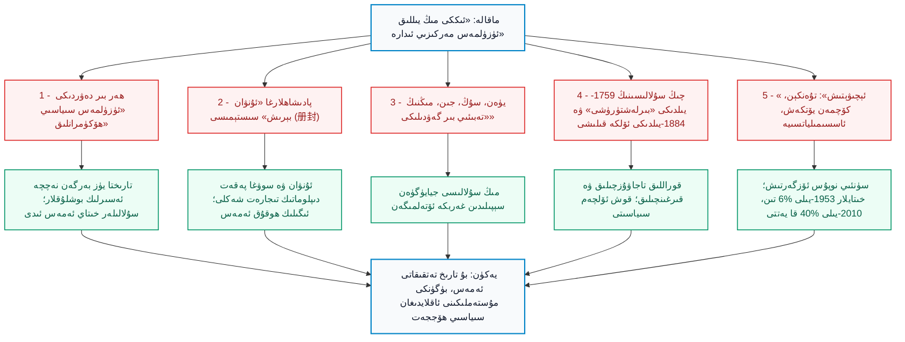
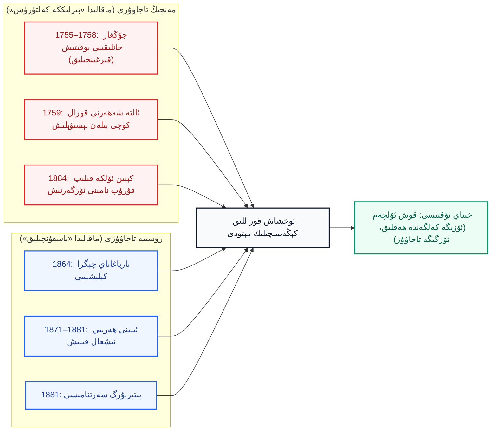
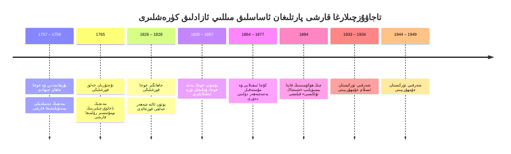
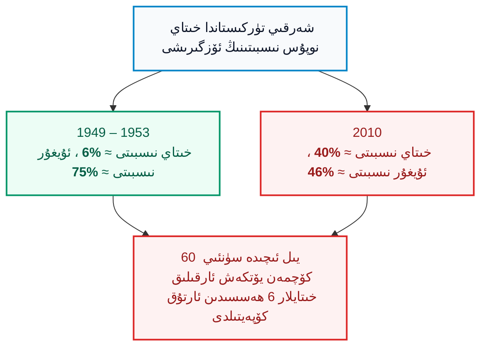

بِسْمِ اللَّهِ الرَّحْمَٰنِ الرَّحِيمِ

⏱ تەخمىنىي ئوقۇش ۋاقتى: 22 مىنۇت

خىتاينىڭ تۈز مەنىسى «يېڭى چىگرا» دېيىلگەن «شىنجاڭ گېزىتى» (新疆日报) دە 2025-يىلى 21-ئاۋغۇست كۈنى ئېلان قىلىنىپ، كېيىن داڭلىق نەزەرىيەۋى تور بېكىتى «ئەيسىشياڭ» (爱思想) غا كۆچۈرۈلگەن بىر ماقالە ئالدىمىزدا تۇرىدۇ. ماقالىنىڭ ئاپتورى شۈ جيەنيىڭ (许建英) دەپ ئەسكەرتىلگەن بولۇپ، ئۇ خىتاي ئىجتىمائىي پەنلەر ئاكادېمىيەسى (CASS) جۇڭگو چېگرا ۋە تارىخ تەتقىقات ئورنىدا ئىشلەيدۇ. ماقالىنىڭ ماۋزۇسى «تارىختىكى مەركىزىي سۇلالىلەرنىڭ شىنجاڭنى ئىدارە قىلىش تەجرىبىسى، ئۈنۈمى ۋە ئىلھامى» دەپ ئاتالغان. بۇنداق ماقالىلەرنىڭ خاراكتېرى شۇكى — ئۇلار ئەسلا ئاددىي بىر «تارىخچىنىڭ ئىلمىي ئىزدىنىشى» ئەمەس، بەلكى ھۆكۈمەت مەتبۇئاتىدا ئېلان قىلىنغان، دۆلەتنىڭ نۆۋەتتىكى تۈپ سىياسەتلىرىگە «تارىخىي مەشئەل» ۋە قانۇنىي ئاساس توقۇپ بېرىش ئۈچۈن يېزىلغان ھۆكۈمەت تەشۋىقات ھۆججىتىدۇر. ئاپتور ماقالىسىنى «شىنجاڭ قەدىمدىن تارتىپ خىتاينىڭ ئايرىلماس مۇقەددەس زېمىنى» دېگەن كونا چۆچەك بىلەن باشلاپ، خەن سۇلالىسىدىن چىڭ سۇلالىسىگىچە بولغان پۈتكۈل بىر-بىرىگە يات خاندانلىقلارنى سۈنئىي بىر گەۋدە قىلىپ تىزىپ چىققان؛ ئاخىرىدا بولسا «ھەر قايسى مىللەتلەر بىر-بىرىگە زىچ سىڭىشكەن ئولتۇراق ئولتۇراقلىشىشنى ئىلگىرى سۈرۈش» ۋە «يېڭى دەۋردىكى بوز يەر ئېچىپ ئەسكەر تۇرغۇزۇش (屯垦 - تۇەنكېن/بىڭتۇەن) تۈزۈمىنى تەرەققىي قىلدۇرۇش» تەك رەزىل سىياسىي بۇيرۇقلار بىلەن تاماملىغان. بۇ ماقالە ئۇيغۇرلارنى تۈپ يىلتىزىدىن مىللىي ئاسسىمىلياتسىيە قىلىش سىياسىتىنىڭ مەپكۇرىۋى قىسمىدۇر. شۇڭا بىز بۇ ھۆججەتنى جىددىي تەكشۈرۈپ، ئۇنىڭ ھەر بىر يالغان «تارىخىي پاكىت»ىنىڭ كۆپۈكىنى ئۇچۇرۇشىمىز، قەيەردە ھەقىقىي تارىخ، قەيەردە سىياسىي رەزىل غەرەز ياتقانلىقىنى ئايرىپ چىقىشىمىز زۆرۈردۇر.

<!-- Image 1 -->

<em>«مىڭ-تۇرپان توقۇنۇشى» خەرىتىسى (Wikimedia Commons، CC BY-SA 4.0). خەرىتىدە يەركەنت خانلىقى، تۇرپان خانلىقى ۋە چاغاتاي خانلىقى پۈتۈنلەي مۇستەقىل دۆلەتلەر سۈپىتىدە، مىڭ سۇلالىسى بولسا جيايۈگۈەن (嘉峪关) نىڭ شەرقىدە كۆرۈنىدۇ.</em>

---

## 1. ماقالىنىڭ ئومۇمىي قۇرۇلمىسى ۋە دەلىل سىستېمىسى

شۈ جيەنيىڭنىڭ ماقالىسى ئۈچ بۆلەكتىن تۈزۈلگەن: «ئالتە تەجرىبە»، «ئۈچ ئۈنۈم» ۋە «تۆت ئىلھام». ئالتە تەجرىبىنىڭ ھەممىسى خىتاينىڭ ئەنئەنىۋى پۇقرالارنى بېسىۋېلىش شوئارلىرىدىن ئوزۇقلانغان: مەسىلەن «ئاسمان ئاستى بىر ئائىلە» (天下一家)، «بۈيۈك بىرلىك» (大一统)، «خۇا ۋە يات ئەللەر بىر گەۋدە» (华夷一体). بىز تۆۋەندىكى سىخېمىدا ئۇنىڭ ساختا دەلىللىرى بىلەن رېئال تارىخ ئوتتۇرىسىدىكى پەرقلەرنى سېلىشتۇرۇپ كۆرسىتىمىز.

*(سىخېما 1: شۈ جيەنيىڭ ماقالىسىنىڭ دەلىل زەنجىرى ۋە تارىخىي رېئاللىق)*

---

## 2. «ئۇنۋان بېرىش» ۋە «ئولپان-تۆھپە»: ئەلچىلىك بىلەن ئىگىلىك ھوقۇقنىڭ پەرقى

ماقالە بەشىنچى تەجرىبىسىدە تارىخىي ئەقىلگە تۈپتىن زىت بىر قاراشنى ئىلگىرى سۈرىدۇ: «بەش دەۋر، سۇڭ، لىياۋ، جىن دەۋرلىرىدە ... قوچۇ ئۇيغۇر خانلىقى، ئۇدۇن (خوتەن) ۋە قاراخانىيلار مەركەزگە ئەلچى ئەۋەتىپ، ‹ئۇنۋان قوبۇل قىلغان› (接受册封) ئىدى؛ شۇڭا ئۇلار مەركىزىي ھاكىمىيەتكە قاراشلىق بولغان». ئاپتور يەنە شۇنداقلا مىڭ سۇلالىسى (1368–1644) دەۋرىدىكى <dfn title="يەركەنت خانلىقى / سەئىدىيە خانلىقى (مىلادى 1514–1696): ئالتە شەھەرنى مەركەز قىلغان چاغاتاي ئەۋلادلىرى قۇرغان قۇدرەتلىك مۇستەقىل ئىسلام دۆلىتى.">سەئىدىيە خانلىقى (1514–1696)</dfn> نىڭ مىڭ ئوردىسى بىلەن سودا ئېلىپ بېرىش تەلىپىنى (求贡) تىلغا ئېلىپ، ئۇنى «بۈيۈك بىرلىكنىڭ ئىسپاتى» دەپ كۆرسىتىدۇ.

بۇ سەپسەتىنىڭ پۇت دەسسەپ تۇرالمايدىغانلىقى كۈندەك ئېنىق. قەدىمكى شەرقىي ئاسىيادىكى «ئولپان تاپشۇرۇش سىستېمىسى» (朝贡体系) ئەسلىدە بىر تاشقى تىجارەت ۋە تىنچ ئەلچىلىك ئالاقىسى ئىدى. ئەلچىلەر خىتاي پادىشاھىغا ھۆرمەت يۈزىسىدىن سوۋغا ئېلىپ باراتتى، خىتاي پادىشاھى بولسا ئۆزىنىڭ «ئاسمان پەرزەنتى» ئىكەنلىكىنى كۆرسىتىش ئۈچۈن ئۇنىڭدىن كۆپ ھەسسە ئارتۇق مىقداردا قايتۇرما بايلىق ۋە سودا قىلىش رۇخسىتى بېرەتتى؛ ئاتالمىش «ئۇنۋان بېرىش» بولسا خىتاي پادىشاھىنىڭ يەرلىك پادىشاھلارنى ئۆزىچە سۈنئىي تەستىقلاپ، ئۆز تەسەللىسىنى قاندۇرۇشىدىن باشقا نەرسە ئەمەس ئىدى. 

بۇ مۇناسىۋەت ئارقىلىق خىتاي ھۆكۈمدارلىرى ئۇ مۇستەقىل دۆلەتلەرنىڭ ئىچكى ئىشلىرىغا، ئارمىيەسىگە ياكى سېلىق تۈزۈمىگە تۈكچىلىكمۇ ئارىلاشقان ئەمەس. مانا مۇشۇ تۈزۈم بويىچە چاۋشيەن (كورىيە)، ۋيېتنام، سىئام (تايلاند)، ريۇكيۇ پادىشاھلىقى ۋە ھەتتا تۇنجى كەلگەن ياۋروپا ئەلچىلىرىمۇ مىڭ ۋە چىڭ ئوردىلىرىغا سوۋغا سۇنۇپ رەسمىيەتلەرنى ئۆتىگەن. ئەگەر شۈ جيەنيىڭنىڭ مەنتىقىسى توغرا بولسا، بۇگۈن خىتاي ۋيېتنام، تايلاند ۋە ياپونىيە زېمىنلىرىغىمۇ «قەدىمدىن بىزنىڭ تەۋەلىكىمىزدە بار ئىدى» دەپ دەۋا قىلىشى كېرەك ئىدى.

مىڭ سۇلالىسى (1368–1644) مەسىلىسىگە كەلسەك، ماقالە تېخىمۇ ئوچۇق كۆز بويامچىلىق قىلىدۇ. ئاپتور: «مىڭ ئىمپېرىيەسى 1406-يىلى قۇمۇلدا ھامى ھەربىي تەپتىش مەھكىمىسى (哈密卫) نى قۇرۇپ، رايونلارنى باشقۇردى» دەيدۇ. ئەمەلىيەتتە، مىڭنىڭ تەسىرى پەقەت قۇمۇل ئەتراپىدىكى چەكلىك بىر پونكىت بىلەنلا باغلانغان بولۇپ، 16-ئەسىرنىڭ باشلىرىدا كۈچلۈك تۇرپان خانلىقىنىڭ قايتۇرما زەربىسىگە چىداپ تۇرالماي، قۇمۇلدىن پۈتۈنلەي چېكىنگەن ۋە ھازىرقى گەنسۇدىكى جيايۈگۈەن (嘉峪关) سېپىلىنىڭ ئىچىگە كىرىپ دەرۋازىسىنى مەھكەم تاقىۋالغان. يۇقىرىدىكى تارىخىي خەرىتىدىن كۆرۈنۈپ تۇرغىنىدەك، تارىم ئويمانلىقى ۋە تۇرپان يۈزلىگەن يىللار مابەينىدە مۇستەقىل ئىسلام دۆلەتلىرىنىڭ پۈتۈنلەي ئۆز ھاكىمىيىتى ئاستىدا تۇرغان.

---

## 3. «بۈيۈك بىرلىك» (大一统) ئەپسانىسى ۋە ھەرقانداق دۆلەتنى «خىتاي» قىلىۋېلىش سۇيىقەستى

ماقالىنىڭ ئەڭ كۈلكىلىك تەرىپى — شەرقىي تۈركىستان زېمىنىدا مەۋجۇت بولغان تامامەن ئايرىم، خىتاي بولمىغان كۆچمەن ئىمپېرىيەلەرنى ئورۇنسىز ھالدا بۈگۈنكى «خىتاي مەركىزىي ھاكىمىيىتى» قىلىپ كۆرسىتىشىدۇر. ئاپتور: «12-ئەسىرنىڭ ئالدىنقى يېرىمىدا غەربىي يۇرت غەربىي لىياۋغا بىرلەشتى، بۇ يۈەن سۇلالىسىنىڭ ‹بۈيۈك بىرلىكى›گە ئاساس سالدى» دەيدۇ.

بۇ جۈملىنىڭ ئارقىسىدا ئىككى چوڭ تارىخىي ساختا قاراش ياتىدۇ:
1. **<dfn title="غەربىي لىياۋ (قاراقىتاي، مىلادى 1124–1218): شىمالىي خىتايدىكى لىياۋ خانلىقى يىقىلغاندىن كېيىن، كۆچمەن خىتان ئاقسۆڭەكلىرى ئوتتۇرا ئاسىياغا كۆچۈپ قۇرغان، مەركىزى بالاساغۇن بولغان دۆلەت.">غەربىي لىياۋ (قاراقىتاي)</dfn>** خىتاي ئىمپېرىيەسى ئەمەس ئىدى؛ ئۇ پەقەت جۈرچەنلەر تەرىپىدىن ۋەيران قىلىنغاندىن كېيىن، ئوتتۇرا ئاسىياغا قېچىپ كېلىپ كۆچمەن ئاقسۆڭەكلەر قۇرغان مۇستەقىل خىتان (契丹) دۆلىتى ئىدى.
2. **يۈەن سۇلالىسى (1271–1368)** ئەمەلىيەتتە موڭغۇللارنىڭ دۇنياۋى ئىمپېرىيەسىنىڭ بىر قىسمى بولۇپ، خىتاينىڭ ئۆزىمۇ موڭغۇللار تەرىپىدىن بېسىۋېلىنغان بىر مۇستەملىكە ئۆلكىسى ئىدى. ئۇنىڭ ئۈستىگە شەرقىي تۈركىستان ئاساسەن چىڭگىزخاننىڭ ئوغلى چاغاتاي ئەۋلادلىرىنىڭ قارمىقىدىكى «چاغاتاي خانلىقى» غا تەۋە بولۇپ، دەشتى قىپچاق ۋە ئوتتۇرا ئاسىيا موڭغۇل-تۈرك سىستېمىسىدا ياشىغان. ئەگەر موڭغۇل ئىمپېرىيەسى بارغان پۈتكۈل زېمىننى «خىتاينىڭ مەركىزىي سۇلالىسى» دەپ ئاتاشقا توغرا كەلسە، ئۇ چاغدا بۈگۈنكى روسىيە، ئىران، ئىراق ۋە پولشالارنىمۇ «خىتاينىڭ قەدىمكى زېمىنى» دەپ دەۋا قىلىشقا توغرا كېلەتتى.

ماقالە چىڭ تۇرۇۋالغان پەلسەپە — ئەنئەنىۋى كىتابلاردىكى «ئاسمان ئاستى بىر ئائىلە» شوئارىدۇر. ھالبۇكى، قەدىمكى خىتاي كۆزقارىشىدىكى ئەڭ مۇھىم پرىنسىپ — «خۇا-يى پەرقى» (华夷之辨)، يەنى خىتايلار (华夏) بىلەن چۆلدىكى، تاغدىكى «ۋەھشىي ئەللەرنى» (夷狄) ئېنىق ئايرىش تەپەككۇرى ئىدى. بۈگۈن خىتاي كوممۇنىستلىرى تەرغىب قىلىۋاتقان «بارلىق مىللەتلەر قەدىمدىن تەڭ بىر ئائىلە كىشىلىرى ئىدى» دېگەن گەپ پەقەت 20-ئەسىرنىڭ بېشىدا چەتئەل تېرىتورىيەلىرىنى سۈمۈرۈۋېلىش ئۈچۈن قۇراشتۇرۇپ چىقىلغان سىياسىي ئەپسانىدۇر.

---

## 4. چىڭ ئىمپېرىيەسىنىڭ كېڭەيمىچىلىكى: قوراللىق تاجاۋۇز ۋە قوش ئۆلچەم

شۈ جيەنيىڭ ماقالىسىدە مەنچىڭ پادىشاھى چيەنلۇڭنىڭ بىر سۆزىنى پەخىر بىلەن نەقىل ئالىدۇ: «جۇڭغار تىنچىتىلدى، ئۇلارنىڭ كونا يايلاقلىرىنىڭ ھەممىسى بىزنىڭ خەرىتىمىزگە كىردى» (准噶尔荡平，凡有旧游牧，皆我版图). 

مەزكۇر بىر جۈملىنىڭ ئۆزىلا خىتاينىڭ مەنتىقىسىنى پاچاقلاپ تاشلايدۇ: پادىشاھ چيەنلۇڭ بۇ رايونلارنى «ئەسلىدىن بىزنىڭ زېمىنىمىز ئىدى» دېمىگەن، بەلكى «كونا يايلاقلار» (旧游牧)، يەنى ئەسلىدە ئويرات-موڭغۇللار ۋە باشقىلارغا تەۋە مۇستەقىل يۇرتلار دەپ ئېنىق ئىقرار قىلغان. چىڭ ئىمپېرىيەسى شەرقىي تۈركىستاننى ئىككى تۈرلۈك قىرغىنچىلىق ئارقىلىق ئىشغال قىلدى:
1. 1755–1758-يىللىرى جۇڭغار خانلىقىنى مىسلى كۆرۈلمىگەن رەھىمسىزلىك بىلەن يوقىتىپ، تارىخچى پېتېر پېرديۇ (Peter Perdue) قاتارلىقلار ئېتىراپ قىلغاندەك، پۈتۈن بىر ئويرات مىللىتىنى قىرغىن قىلىپ، «جۇڭغار گېنوتسېدى» نى سادىر قىلدى؛
2. 1757–1759-يىللىرى ئالتە شەھەردىكى بۇرھانىددىن ۋە خوجا جاھانلارنىڭ مۇستەقىللىق قارشىلىقىنى قانلىق باستۇرۇپ، تارىم بوستانلىقىنى كۈچ بىلەن بېسىۋالدى.

ئاپتور بۇ تارىخنى بايان قىلغاندا چېكىدىن ئاشقان **قوش ئۆلچەم (Double Standards)** ئىشلىتىدۇ. ئۇ 19-ئەسىردە چار پادىشاھلىق روسىيەسىنىڭ ئىلى رايونىدىن «700 مىڭ كۋادرات كىلومېتىردىن ئارتۇق زېمىننى ئېلىۋالغانلىقى» نى تىلغا ئېلىپ، روسىيەنى «تاجاۋۇزچى، يۇتۇۋالغۇچى، تەڭسىز شەرتنامە تۈزگۈچى» دەپ تىللايدۇ. ئەمما ئوخشاشلا ھەربىي كۈچ، زوراۋانلىق ۋە بېسىپ كىرىش ئارقىلىق ئېلىپ بېرىلغان مەنچىڭ كېڭەيمىچىلىكىگە كەلگەندە، ئۇنى نومۇس قىلماي «بىرلىككە كەلتۈرۈش» (统一) دەپ پەردازلايدۇ.

*(سىخېما 2: مەنچىڭ ۋە چار روسىيەنىڭ رايوندىكى مۇستەملىكىچىلىك قىلمىشلىرىغا بېرىلگەن قوش ئۆلچەملىك باھا)*

ماقالىدا يەنە 1771-يىلىدىكى <dfn title="تورغۇتلار (土尔扈特 / Torghuts): ۋولگا بويىغا كۆچۈپ بارغان ئويرات-موڭغۇل قەبىلىسى بولۇپ، 1771-يىلى چار روسىيەنىڭ خورلىشىغا چىدىماي پۈتۈن پۇقرالىرى بىلەن يۇرتىغا قايتىپ كەلگەن.">تورغۇتلارنىڭ قايتىپ كېلىشى</dfn> ۋە مەنچىڭ دەۋرىدىكى سۈرگۈنلەرنى بوز يەر ئېچىشقا سېلىش تۈزۈمىنى (<dfn title="چيەنتۈن (遣屯): مەنچىڭ دەۋرىدە خىتاي ئۆلكىلىرىدىكى ئېغىر جىنايەتچىلەر ۋە قارشى پىكىردىكىلەرنى چېگرا بويلىرىغا ئەۋەتىپ، ئۆمۈرلۈك مەجبۇرىي ئېغىر دېھقانچىلىق ئەمگىكىگە سېلىش جازاسى.">遣屯</dfn>) «مىللەتلەرنىڭ ئۆز-ئارا يۇغۇرۇلۇشى» دەپ سۈپەتلىگەن. ئەمەلىيەتتە «چيەنتۈن» دېگەنلىك ئېغىر جىنايەتچىلەرنى جازالاش ئۈچۈن غەربكە سۈرگۈن قىلىش بولۇپ، بۇ ئەسلا «مەدەنىيەت ئالماشتۇرۇش» ئەمەس، تۈپتىن نوپۇس يۆتكەپ زېمىننى خىتايلاشتۇرۇش جازاسى ئىدى.

<!-- Image 2 -->

<em>قەشقەر يولى مەنزىرىسى، 1870-يىللار (Wikimedia Commons، ئەنگلىيەلىك پولكوۋنىك توماس ئېدۋارد گوردوننىڭ قەلىمى ئارقىلىق، ئاممىۋى مۈلۈك). شەھەر پۈتۈنلەي ئۆزگىچە ئىسلامىي ۋە ئوتتۇرا ئاسىيا تۇرمۇش مەدەنىيىتى بىلەن گۈللەنگەن.</em>

---

## 5. ئاتالغۇلار جېڭى: تاشقى دۇنيا خەرىتىلىرىدىكى «شەرقىي تۈركىستان»

ماقالىدە «شىنجاڭ قەدىمدىن بار ئىسىم» قىلىپ كۆرسىتىلگەن بولسىمۇ، بۇ ئىسىم پەقەت 1759-يىلى بېسىۋېلىنغاندىن كېيىن، مەنچىڭ ئوردىسى تەستىقلىغان «يېڭىدىن ئىگىلەنگەن چىگرا رايون» مەنىسىدىكى مەمۇرىي ئاتالغۇدۇر. مەنچىڭ ھۆكۈمرانلىقىنىڭ ئۆزىمۇ ئالتە شەھەر رايونىنى «خۇيجياڭ» (回疆، يەنى مۇسۇلمانلار چېگراسى) دەپ ئاتىغان. خەلقئارا جەمئىيەت بولسا بۇ رايوننى باشتىن-ئاخىر ئۆز تەبىئىي كىملىكى بىلەن ئاتاپ كەلگەن. تۆۋەندىكى خەرىتە 1873–1874-يىللىرى ئەنگلىيە ھىندىستان ھۆكۈمىتىنىڭ توماس دۇگلاس فورسايت (Thomas Douglas Forsyth) رەھبەرلىكىدىكى ئەلچىلەر ئۆمىكى تەرىپىدىن رەسمىي سىزىلغان بولۇپ، ماۋزۇسى ئېنىق قىلىپ «شەرقىي تۈركىستان خەرىتىسى» (Map of Eastern Turkistan) دەپ بېكىتىلگەن.

<!-- Image 3 -->

<em>ئەنگلىيە ھىندىستان تەكشۈرۈش ئورگىنى تۈزگەن «شەرقىي تۈركىستان خەرىتىسى» (1873–1874، Wikimedia Commons، CC0). خەرىتىدە قەشقەر، يەكەن، خوتەن، ئاقسۇ، كۇچا پۈتۈنلەي بىر گەۋدە، شىمالدا «روسىيە ئىمپېرىيەسى»، غەربتە «قوقان خانلىقى» بىلەن قوشنا كۆرسىتىلگەن.</em>

ئاپتور ئۆزىنىڭ «ئىلمىي تەتقىقاتى» دا مىڭلىغان ھۆججەتلەرگە پۈتۈلگەن «شەرقىي تۈركىستان»، «ئالتە شەھەر»، «يەتتەشەھەر» ۋە «ئۇيغۇرىستان» كەلكۈندەك تارىخىي ئاتالغۇلىرىنىڭ بىرىنىمۇ تىلغا ئالمايدۇ. چۈنكى بۇ ھەقىقىي تارىخىي ئاتالغۇلار مەيدانغا چىقسىلا، ئۇلار توقۇپ چىققان «قەدىمدىن تارتىپ جۇڭگونىڭ پارچىسى» دېگەن يالغان قەلئە تەلتۆكۈس غۇلاپ چۈشىدۇ.

---

## 6. يەتتەشەھەر دۆلىتى: ئىككى مىڭ يىللىق «ئۈزۈلمەس ئىدارە» ئەپسانىسىنى ۋەيران قىلغان دەۋر

ماقالىنىڭ ئاتايىن كۆز يۇمغان ئەڭ ھالقىلىق قىسمى — 1864–1877-يىللىرى شەرقىي تۈركىستان تۇپرىقىدا ھۆكۈم سۈرگەن مۇستەقىل <dfn title="يەتتەشەھەر دۆلىتى (1865–1877): يەقۇپبەگ قۇرغان مەشھۇر ئىسلام دۆلىتى. قەشقەر، يەكەن، خوتەن، ئاقسۇ، كۇچا، كورلا ۋە ئۈرۈمچىنى ئۆز ئىچىگە ئالغان، پۇلى قۇيۇلغان، ئارمىيەسى تەشكىللەنگەن خەلقئارالىق دۆلەت.">يەتتەشەھەر دۆلىتى</dfn> دۇر. 1864-يىلى كۇچادىن پارتلىغان مىللىي ئازادلىق ئىنقىلابى نەتىجىسىدە مەنچىڭ قوشۇنلىرى پۈتۈن ئالتە شەھەردىن تولۇق قوغلاپ چىقىرىلغان. <dfn title="مۇھەممەد يەقۇپبەگ (1820–1877): يەتتەشەھەر دۆلىتىنىڭ قۇرغۇچىسى، «ئاتالىق غازى» ئۇنۋانى بىلەن مەشھۇر ھەربىي سەركەردە.">يەقۇپبەگ</dfn> بۇ تارقاق شەھەرلەرنى مۇستەقىل بىر دۆلەتكە بىرلەشتۈرگەن.

<!-- Image 4 -->

<em>يەتتەشەھەر دۆلىتىنىڭ ھۆكۈمرانى يەقۇپبەگ (1820–1877، Wikimedia Commons، ئاممىۋى مۈلۈك).</em>

بۇ دۆلەت دۇنيا سەھنىسىدە تەڭداشسىز ئورۇن تۇتتى: چار پادىشاھلىق روسىيەسى 1872-يىلى يەتتەشەھەر دۆلىتى بىلەن رەسمىي تىجارەت ۋە تاشقى ئالاقە كېلىشىمى تۈزدى؛ بۈيۈك بىرىتانىيە ئىمپېرىيەسى 1874-يىلى فورسايت ئۆمىكى ئارقىلىق رەسمىي ئىتتىپاقداشلىق-سودا توختامى ئىمزالىدى؛ ئوسمانلى خەلىپىسى سۇلتان ئابدۇلئەزىز خان يەقۇپبەگكە «ئەمىر» ئۇنۋانى بېرىپ، ئوسمانلى بايرىقى، ھەربىي مەسلىھەتچىلەر ۋە زامانىۋى قوراللارنى يوللىدى. بۇلارنىڭ ھەممىسى — شەرقىي تۈركىستاننىڭ خىتاي سۇلالىلىرى بىلەن قىلچە ئالاقىسى بولمىغان، دۇنيا تەرىپىدىن ئېتىراپ قىلىنغان تامامەن مۇستەقىل دۆلەت ئىكەنلىكىنىڭ ئىنكار قىلغۇسىز ئىسپاتىدۇر.

<!-- Image 5 -->

<em>يەتتەشەھەر دۆلىتى ئارمىيەسىنىڭ زامانىۋى زەمبىرەكچى ۋە مىلتىقچى قىسىملىرى، قەشقەر (1870-يىللار، ت. ئې. گوردون سىزغان، Wikimedia Commons، ئاممىۋى مۈلۈك).</em>

<!-- Image 6 -->

<em>ئەنگلىيەلىك تەتقىقاتچى روبېرت شاۋ (Robert Shaw) نىڭ ساياھەت خاتىرىسىدىكى تەسۋىرى: ئەنگلىيە ئەلچىلىرىنىڭ يەقۇپبەگ ئوردىسىغا قوبۇل قىلىنىش كۆرۈنۈشى (1871، Wikimedia Commons، ئاممىۋى مۈلۈك).</em>

يەتتەشەھەر دۆلىتى 1877-يىلى كېيىن مەنچىڭ ئارمىيەسىنىڭ سەردارى <dfn title="زو زۇڭتاڭ (左宗棠، 1812–1885): خىتاي سەردارى. مەنچىڭنىڭ قەرز پۇللىرىغا تايىنىپ قوشۇن تۈزۈپ، شەرقىي تۈركىستاننى قانغا بويىغان ۋە 1884-يىلى «شىنجاڭ ئۆلكىسى» نى قۇرۇشنى ئىلگىرى سۈرگەن فاشىست ئەمەلدار.">زو زۇڭتاڭ (1812–1885)</dfn> نىڭ غايەت زور كۆلەملىك ئىككىنچى قېتىملىق قانلىق يۈرۈشى بىلەن ئاغدۇرۇلدى. خىتاي تەشۋىقاتى بۇ تارىخنى پەقەت «ئاگۇبەي (阿古柏) نىڭ تاشقى تاجاۋۇزىنى يوقىتىش» دەپلا ئاتاپ ئۆتىدۇ. 1884-يىلى مەنچىڭ تەرىپىدىن تەسسىس قىلىنغان «شىنجاڭ ئۆلكىسى» پەقەت ئۆزلىرى پۈتۈنلەي قوغلاپ چىقىرىلغان يات بىر مۇستەقىل زېمىننى 13 يىلدىن كېيىن قايتا قورال بىلەن ئىشغال قىلىشتىن باشقا نەرسە ئەمەس ئىدى.

<!-- Image 7 -->

<em>زو زۇڭتاڭ (1875، فوتوگراف: A. N. Boiarskii، Wikimedia Commons، ئاممىۋى مۈلۈك).</em>

---

## 7. ۋاقىتنامە: «ئىزچىل تىنچ باشقۇرۇش» پەردازى ئاستىدىكى 125 يىللىق قارشىلىق

شۈ جيەنيىڭ پۈتۈن يازمىسىدا بىر قېتىممۇ قارشىلىق ھەرىكەتلىرىنى تىلغا ئالماي، مەنچىڭ دەۋرىنى «ئۇزاق مۇددەتلىك ئەمىنلىك» (长治久安) دەپ تەرىپلەيدۇ. ئەمەلىيەتتە، خىتاينىڭ تاجاۋۇزچىلىقى بارلىققا كەلگەن كۈندىن تارتىپ بۇ تۇپراق قەھرىمانلارچە قارشىلىق ۋە قوزغىلاڭلاردىن بىر دەقىقىمۇ توختاپ باققان ئەمەس.

*(سىخېما 3: مەنچىڭدىن تارتىپ تاجاۋۇزچىلارغا قارشى ئېلىپ بېرىلغان ئۇزۇن مۇساپىلىك مىللىي قارشىلىقلار)*

1765-يىلى يۈز بەرگەن شەرەپلىك ئۇچتۇرپان خەلق ئىنقىلابى بۇنىڭ جانلىق مىسالىدۇر. خارۋاردلىق داڭلىق ئوتتۇرا ئاسىيا تەتقىقاتچىسى جېيمس مىلۋارد (James Millward) نىڭ پاكىتلىرىغا ئاساسلانغاندا، مەنچىڭ ھۆكۈمدارى سۇچېڭ (素诚) ئۇچتۇرپاننىڭ ئۇيغۇر ئاياللىرىغا باسقۇنچىلىق قىلىپ، خەلقنى چىدىغۇسىز ھاقارەتلىگەندە، خەلق پۈتۈن مەنچىڭ ئەسكەرلىرىنى قىرىپ تاشلىغان. كېيىن پادىشاھ چيەنلۇڭ ئەسكەر تۈكۈپ، ئۇچتۇرپاننىڭ بارلىق ئەرلىرىنى رەھىمسىزلەرچە قىرغىن قىلىپ، ئايال-بالىلىرىنى ئىچكىرى ئۆلكىلەرگە قۇل قىلىپ سېتىۋەتكەن. ئەگەر خىتاينىڭ بۇ زېمىندىكى ئىدارە قىلىشى ھەقىقەتەن ئاپتور ئېيتقاندەك «ئىناق كۆپ مىللەتلىك گۈللىنىش» بولغان بولسا، ئۇنداقتا بىر ئەسىردىن ئارتۇق ۋاقىت ئىچىدە يۈز بەرگەن نەچچە ئونلىغان چوڭ كۆلەملىك قانلىق قوزغىلاڭلار نېمىدىن دېرەك بېرىدۇ؟

---

## 8. ماقالىنىڭ ئەسلى مەقسىتى: «ئىلھاملار» ۋە ئۇيغۇرلارغا سېلىنىۋاتقان يېڭى زەنجىر

ماقالىنىڭ ئەڭ مۇھىم قىسمى — ئاخىرقى «تۆت خىل ئىلھام» بولۇپ، ئاپتور بۇ يەردە تارىخ پەردازىنى چۆرۈپ تاشلاپ، شى جىنپىڭ ھۆكۈمىتىنىڭ بۈگۈنكى قىرغىنچىلىق ۋە ئاسسىمىلياتسىيە سىياسىتىنى پەردازلاپ چىقىدۇ:

1. «ئەسكەر تۇرغۇزۇپ بوز يەر ئېچىش ئەنئەنىسىگە ۋارىسلىق قىلىپ، زامانىۋى قوراللىق كۈچنى كۈچەيتىش ۋە يېڭى دەۋردىكى بىڭتۇەن (تۇەنكېن) ئىشلىرىنى راۋاجلاندۇرۇش» (发展新时代屯垦事业)؛
2. «ئىقتىسادىي يادرولۇق رايون قۇرۇپ، تاشقى دۇنياغا ئېچىۋېتىشنى كېڭەيتىش»؛
3. «ئورتاق مەدەنىيەت ئارقىلىق مىللەتلەرنى يۇغۇرۇپ، خىتاي مەدەنىيىتىنى باشلامچى قىلىش»؛
4. «**نوپۇسنىڭ كەڭ كۆلەمدە يۆتكىلىشىنى ئىلگىرى سۈرۈپ، مىللەتلەر ئۆز-ئارا قىستۇرۇلغان، سىڭىشىپ كەتكەن ئولتۇراق رايون ۋە خىزمەت مۇھىتىنى** (嵌入式居住和工作环境) **قۇرۇش؛ ھەر مىللەت خەلقى ‹ئانارنىڭ دانىسىدەك› زىچ بىرىكىپ، ‹مەدەنىيەت ئارقىلىق شىنجاڭنى نەملەندۈرۈش›نى** (文化润疆) **چوڭقۇرلاشتۇرۇش**».

بۇ ئاتالمىش «ئىلھاملار» — بۈگۈن مىليونلىغان قېرىنداشلىرىمىز باشتىن كەچۈرۈۋاتقان تراگېدىيەنىڭ نەزەرىيەۋى دەلىلىدۇر: <dfn title="بىڭتۇەن (شىنجاڭ ئىشلەپچىقىرىش-قۇرۇلۇش بىڭتۇەنى / XPCC): 1954-يىلى قۇرۇلغان ھەربىي-مەمۇرىي-مۇستەملىكە ئاپپاراتى. نوپۇسىنىڭ مۇتلەق كۆپ قىسمى خىتاي بولۇپ، شەرقىي تۈركىستاننىڭ ئىستراتېگىيەلىك، سۇ ۋە تېرىلغۇ مۇنبەت جايلىرىنى ئىگىلەپ تۇرىدۇ.">بىڭتۇەن</dfn> كۈچىنى زورايتىش، ئۇيغۇرلارنىڭ ئەنئەنىۋى مەھەللە، ئائىلە ۋە كەنتلىرىنى بۇزۇپ، ئارىسىغا تۈركۈملەپ خىتاي كۆچمەنلىرىنى ئولتۇراقلاشتۇرۇش («ئۆزئارا قىستۇرۇلۇش») سىياسىتى بۈگۈنكى جىسمانىي ۋە مەنىۋى قىرغىنچىلىقنىڭ دەل ئۆزىدۇر. 

بىرلەشكەن دۆلەتلەر تەشكىلاتى كىشىلىك ھوقۇق ئالىي كومىسسارلىقى (OHCHR) 2022-يىلى 31-ئاۋغۇست ئېلان قىلغان نۇپۇزلۇق دوكلاتىدا، شەرقىي تۈركىستاندا يولغا قويۇلۇۋاتقان كەڭ كۆلەملىك ئىختىيارىي تۇتقۇن قىلىش، زەھەرلىك مەپكۇرە سىڭدۈرۈش، مىللىي ئۆرپ-ئادەت ۋە تىل-يېزىقنى يوقىتىش ھەرىكەتلىرىنىڭ «ئىنسانىيەتكە قارشى تۇرۇش جىنايىتى» تەشكىل قىلىدىغانلىقىنى رەسمىي جەزملەشتۈرگەن ئىدى.

### نوپۇس ئۆزگىرىشى: «ئارىلاشتۇرۇش» پەردازى ئاستىدىكى سۈنئىي ئىشغالىيەت كۆلىمى

ماقالىدىكى «نوپۇسنى يۆتكەش ئارقىلىق يۇغۇرۇش» سىياسىتىنىڭ قانچىلىك دەھشەتلىك كۆلەمدە ئىجرا قىلىنغانلىقىنى ئەمەلىي سىتاتىستىكىلىق رەقەملەر دەلىللەپ تۇرىدۇ (مەنبەلەر: جېيمس مىلۋاردنىڭ «ياۋرو-ئاسىيا چاتما يولى» تەتقىقاتى ۋە خىتاينىڭ 1953–2010-يىللاردىكى رەسمىي نوپۇس تەكشۈرۈشلىرى).

*(سىخېما 4: 1950-يىللاردىن تارتىپ نوپۇس قۇرۇلمىسىنىڭ تۈپتىن ئۆزگەرتىلىش سۈرئىتى)*

| دەۋر / يىل | ئۇيغۇر نىسبىتى (تەخمىنەن) | خىتاي نىسبىتى (تەخمىنەن) | تارىخىي ۋە سىياسىي ئارقا كۆرۈنۈشى |
| :--- | :--- | :--- | :--- |
| **1949 – 1953** | ≈ %75 | ≈ %6 | خىتاي كوممۇنىست تاجاۋۇزچىلىرى يېڭى بېسىۋالغان مەزگىل |
| **1982** | ≈ %46 | ≈ %40 | بىڭتۇەن پىلانلىق يۆتكەپ كەلگەن مىليونلىغان نوپۇس نەتىجىسىدە |
| **2010** | ≈ %46 | ≈ %40 | مەجبۇرىي ئاسسىمىلياتسىيە ۋە كۆچمەن ئېقىمى پەللىگە چىققان پەيت |

بۇ رەقەملەر شۇنى كۆرسىتىدۇكى، ئاپتور «مىللەتلەرنىڭ تەبىئىي كۆچۈپ ئارىلىشىشى» دەپ يالغان سۆزلىگەن پىلان — ئەمەلىيەتتە پۈتۈن بىر زېمىننىڭ يەرلىك ئىگىلىرىنى ئۆز تۇپرىقىدا ئاز سانلىققا ئايلاندۇرۇش ئۈچۈن مەركەزدىن مەخسۇس ئورۇنلاشتۇرۇلغان مۇستەملىكىچىلىك تەدبىرىدۇر.

---

## 9. تۆت مۇھىم تارىخىي ئىبرەت

### 1) ئىسلام تەلىماتىدىن ئىبرەت: ئۈممەتنىڭ كۆپ خىللىقى تەبىئىي ھەقىقەتتۇر

ئىسلام ئېتىقادى ھەرگىزمۇ ئىنسانلارنىڭ تىلى، كىملىكى ۋە مىللىتىنى بىر قازاندا ئىرىتىپ تاشلاشنى بۇيرۇمايدۇ. قۇرئان كەرىمدە كۆپ خىللىقنىڭ يوقىتىلىدىغان پالاكەت ئەمەس، ئاللاھنىڭ بۈيۈك بىر نېمىتى ۋە ئىرادىسى ئىكەنلىكى ئېنىق بايان قىلىنغان:

﴿يَا أَيُّهَا النَّاسُ إِنَّا خَلَقْنَاكُم مِّن ذَكَرٍ وَأُنثَىٰ وَجَعَلْنَاكُمْ شُعُوبًا وَقَبَائِلَ لِتَعَارَفُوا ۚ إِنَّ أَكْرَمَكُمْ عِندَ اللَّهِ أَتْقَاكُمْ﴾

> *(ئى ئىنسانلار! ھەقىقەتەن بىز سىلەرنى بىر ئەر ۋە بىر ئايالدىن ياراتتۇق، بىر-بىرىڭلارنى تونۇشۇڭلار ئۈچۈن سىلەرنى تۈرلۈك مىللەتلەر ۋە قەبىلىلەر قىلدۇق. شۈبھىسىزكى، ئاللاھنىڭ دەرگاھىدا ئەڭ ھۆرمەتلىكىڭلار — ئەڭ تەقۋادارىڭلاردۇر.)* — سۈرە ھۇجۇرات، 13-ئايەت.

ئىسلام دىنى ئىنسانلارنى كۈچ بىلەن بىر-بىرىنىڭ كىملىكىگە يۇغۇرۇۋېتىشنى ئەمەس، ئۆز كىملىكىنى ساقلىغان ئاساستا ئادالەت بىلەن بىللە ياشاشنى بۇيرۇيدۇ. پەيغەمبىرىمىز مۇھەممەد ﷺ نىڭ ۋىدا ھەج خۇتبىسىدىكى «ئەرەبنىڭ ئەجەمدىن (ئەرەب بولمىغاندىن)، ئەجەمنىڭ ئەرەبتىن، قارا تەنلىكنىڭ ئاق تەنلىكتىن پەزىلىتى پەقەت تەقۋادارلىق بىلەندۇر» دېگەن سۆزى بارلىق ئاسسىمىلياتسىيە ۋە فاشىست خىتاي شۇۋىنىزىمىغا بېرىلگەن كۈچلۈك رەددەدۇر.

### 2) دۇنيا تارىخىدىن ئىبرەت: «ئۆز ئىختىيارى بىلەن قوشۇلۇش» ئەپسانىسى ھامان يىمىرىلىدۇ

<dfn title="سوۋېت ئىتتىپاقى (1922–1991): كوممۇنىستىك دۆلەت بولۇپ، 1940-يىلى بالتىق بويى دۆلەتلىرىنى بېسىۋالغان، كېيىن بارلىق خەلقلەرنىڭ قارشىلىقى بىلەن پارچىلانغان.">سوۋېت ئىتتىپاقى</dfn> 1940-يىلى ئەتراپىدىكى بالتىق بويى ئۈچ دۆلىتىنى (ئېستونىيە، لاتۋىيە، لىتۋانىيە) بېسىۋالغاندىن كېيىن، ئەللىك يىل بويى پۈتۈن دۆلەت گېزىتلىرى ۋە ئاكادېمىيەلىرى ئارقىلىق «بۇ دۆلەتلەر بىزنىڭ بۈيۈك ئىتتىپاقىمىزغا ئۆز ئىختىيارى بىلەن خوشاللىق ئىچىدە قوشۇلدى» دەپ پۈتۈن دۇنياغا يالغان ئۆگەتتى. 

ئەمما 1989-يىلى 23-ئاۋغۇست كۈنى بالتىق بويىدىكى ئىككى مىليوندىن ئارتۇق خەلق 600 كىلومېتىردىن ئارتۇق بوشلۇقتا بىر-بىرىنىڭ قولىنى تۇتۇپ «بالتىق يولى» (Baltic Way) ئادەم زەنجىرىنى ھاسىل قىلىپ، پۈتۈن دۇنياغا ئۆزلىرىنىڭ مەجبۇرىي بېسىۋېلىنغانلىقىنى جاكارلىدى؛ 1991-يىلى سوۋېت ئېمپېرىيەسى گۇمران بولۇپ، ئۇلار ئەركىنلىكىنى قايتۇرۇۋالدى. دېمەك، ھاكىمىيەت گېزىتلىرىگە مىڭلىغان ساختا ماقالىلەر يېزىلغان بىلەن، ئۇ خەلقنىڭ يۈرىكىدىكى ئەركىنلىك ئەستە تۇتۇش قابىلىيىتىنى مەڭگۈ يوقىتالمايدۇ.

### 3) خىتاي ئۆتمۈشىنىڭ زۇلمىتىدىن ئىبرەت: غەپلەت ۋە مەغرۇرلۇق ھالاكەتكە باشلايدۇ

مەنچىڭ ئىمپېرىيەسى ئۆزىنى ئەزەلدىن «ئاسمان ئاستىنى بىرلىككە كەلتۈرگەن تۈگىمەس چوڭ دۆلەت» دەپ گۇمرانلىق ئۇيقۇسىدا ياشىغان. ئەمما تارىخ كۆرسەتتىكى، يەرلىك خەلقلەرگە قىرغىنچىلىق ۋە زۇلۇم ئېلىپ كەلگەن بۇ ئىمپېرىيە 1840-يىللاردىكى ئەپيۇن ئۇرۇشى بىلەن چىرىكلىكنىڭ ئەڭ چەتكى پەللىسىگە چۈشۈپ، دۇنيا خەلقى ئالدىدا خار-زار بولدى؛ 1884-يىلى شەرقىي تۈركىستاننى «يېڭى ئۆلكە» قىلىپ جاكارلاپ، ئارقىدىن 28 يىل ئۆتمەيلا — 1912-يىلى چىڭ ھۆكۈمرانلىقى پۈتۈنلەي تارىخ بېتىدىن كۆمۈلۈپ كەتتى. ئاپتور شۈ جيەنيىڭ پەخىرلەنگەن مەنچىڭ ئوردىسى ئەمەلىيەتتە ئۆز مەغرۇرلۇقى ۋە زۇلمىنىڭ قۇربانىغا ئايلانغان ئىدى.

### 4) ئۇيغۇر تارىخىنىڭ شانلىق مەۋجۇتلۇقىدىن ئىبرەت: ئۆز بايرىقى ۋە نامى بىلەن ياشىغان مىللەت

بىزنىڭ بۈگۈنكى مۇستەقىللىق دەۋايىمىز قۇرۇق ئارزۇدىن ئەمەس، تارىختا پۈتۈن مەدەنىيىتى بىلەن دۆلەت قۇرغان ئەجدادلارنىڭ ھەققىدىن كېلىدۇ. <dfn title="قاراخانىيلار دۆلىتى (840–1212): تۈرك-ئىسلام مەدەنىيىتىنىڭ ئالتۇن بۆشۈكى، قەشقەر ۋە بالاساغۇننى مەركەز قىلغان پۈتۈن ئوتتۇرا ئاسىيا ئىمپېرىيەسى.">قاراخانىيلار دەۋرى</dfn>، <dfn title="قوچۇ ئۇيغۇر دۆلىتى (843–1335): تۇرپان ئويمانلىقىنى مەركەز قىلغان يۇقىرى مەدەنىيەتلىك شەھەر قۇرۇلمىسى.">قوچۇ ئۇيغۇر خانلىقى</dfn>، سەئىدىيە خانلىقى، يەتتەشەھەر دۆلىتى ۋە 20-ئەسىردە قۇرۇلغان مىسلىسىز جۇمھۇرىيەتلىرىمىز:
- **<dfn title="شەرقىي تۈركىستان ئىسلام جۇمھۇرىيىتى: 1933-يىلى 12-نويابىر قەشقەردە خەلقئارالىق تۇنجى قېتىم زامانىۋى جۇمھۇرىيەت تۈزۈمى بويىچە جاكارلانغان ئازاد دۆلەت.">شەرقىي تۈركىستان ئىسلام جۇمھۇرىيىتى (1933–1934)</dfn>**
- **<dfn title="شەرقىي تۈركىستان جۇمھۇرىيىتى: 1944-يىلى 12-نويابىر غۇلجىدا تەسسىس قىلىنغان، مىللىي ئارمىيەسى، پۇلى ۋە ھۆكۈمىتى بار مۇستەقىل جۇمھۇرىيەت.">شەرقىي تۈركىستان جۇمھۇرىيىتى (1944–1949)</dfn>**

بۇلارنىڭ ھەممىسى — ئۆز ھاكىمىيىتى، ئۆز پارلامېنتى، ئۆز مىللىي قوشۇنى ۋە قەلبىدە لەپىلدىگەن ئاي يۇلتۇزلۇق كۆك بايرىقى بىلەن دۇنياغا ئۆزىنى نامايان قىلغان ئەركىن ھۆكۈمەتلەردۇر. بۇ ھەقىقەتنى ھېچقانداق خىتاي كوممۇنىست كادىرىنىڭ ساختىلىقى ئۆچۈرۈۋېتەلمەيدۇ.

<!-- Image 8 -->

<em>شەرقىي تۈركىستان ئىسلام جۇمھۇرىيىتىنىڭ قەشقەردە لەپىلدىگەن دەسلەپكى دۆلەت بايرىقى (1933–1934، Wikimedia Commons، ئاممىۋى مۈلۈك).</em>

---

## 10. شەرقىي تۈركىستان كۈرىشى ئۈچۈن ئىستراتېگىيەلىك ساۋاقلار

1. **دۈشمەن تەشۋىقاتىنى تارىخ ئەمەس، ئىجرا قىلىنىۋاتقان جىنايەت ھۆججىتى دەپ چۈشىنىش:** شۈ جيەنيىڭگە ئوخشاش خىتاي ئوردا ئالىملىرىنىڭ يازغان ماقالىلىرى كەلگۈسىدە خىتاينىڭ رايوندا قانداق رەزىل سىياسەتلەرنى قانات يايدۇرىدىغانلىقىنى كۆرسىتىپ بېرىدىغان ئاگاھلاندۇرۇشتۇر. ھەر بىر ماقالىنى تەنقىدىي كۆز بىلەن چۈشىنىپ، ئۇنىڭ سىياسىي تۇزىقىنى پاش قىلىش كېرەك.
2. **«قوش ئۆلچەم» سىستېمىسىنى خەلقئارادا كۆتۈرۈپ چىقىش:** خىتاينىڭ غەرب ئەللىرى ياكى چار روسىيەنىڭ كېڭەيمىچىلىكىنى ئەيىبلەپ، ئۆزىنىڭ ئوخشاش قوراللىق قىرغىنچىلىقلىرىنى «تەبىئىي بىر پۈتۈنلىشىش» دەپ كۆرسىتىشىدىكى ئەخلاقسىز مەنتىقىسىنى كۆپ تىللاردا ئېلان قىلىپ خەلقئاراغا يورۇتۇش كېرەك.
3. **تارىخىي نۇپۇزلۇق ئاتالغۇلارنى ئىلمىي سەھنىدە پۇختا تۇتۇش:** دۇنيا خەرىتىلىرىدە ۋە ئىلمىي ئارخىپلاردا كۆرسىتىلگەن «شەرقىي تۈركىستان» (Eastern Turkistan) ئاتالغۇسىنى، شۇنداقلا «ئالتە شەھەر»، «يەتتەشەھەر» ۋە «ئۇيغۇرىستان» ناملىرىنى ئىنگلىزچە ۋە باشقا غەرب تىللىرىدا داۋاملىق تەكىتلەپ، خىتاينىڭ مۇستەملىكە «شىنجاڭ» نامىنى كۈچتىن قالدۇرۇش لازىم.
4. **نوپۇس كۆچمەنلىكى پاكىتلىرىنى خەلقئارا سورۇنلارغا سۇنۇش:** خىتاينىڭ 1950-يىللىرىدىكى %6 لىك نوپۇستىن بۈگۈنكى %40 تىن ئارتۇق قىلىپ سۈنئىي يۆتكىگەنلىكى، خەلقئارا جىنايى ئىشلار سوتىنىڭ نىزامنامىلىرىگە كۆرە بېسىۋېلىنغان زېمىنلارغا نوپۇس يۆتكەشتەك «ئۇرۇش جىنايىتى» دەپ قارىلىشى كېرەك.
5. **ئۆز كۈرىشىمىزنىڭ پاكىتلىق، مەردانە ۋە ئىلمىي سەۋىيەسىنى يۈكسەلدۈرۈش:** يەقۇپبەگ ياكى خوجىلار دەۋرىدىكى سىياسىي سەۋەنلىكلەرنىمۇ ئوچۇق ئېتىراپ قىلىپ، ئىلمىي پۇختىلىقىمىزنى تىكلەش كېرەك؛ بۇ ئارقىلىق خىتاينىڭ بىزنى «قارىغۇلارچە مىللەتچىلىك قىلىۋاتىدۇ» دەپ قارا چاپلىشىنىڭ ئالدىنى ئالالايمىز.
6. **ھەق ۋە ئادالەت يولىدىن قىلچە تەۋرەنمەسلىك:** بىزنىڭ دەۋايىمىز ئۆچمەنلىككە ئەمەس، ئۆز تۇپرىقىمىزدا ئەركىن ۋە ئىنسانىي قەدىر-قىممەت ئىچىدە ياشاشتىن ئىبارەت ھەققانىيەت پرىنسىپىغا تايىنىدۇ؛ زۇلۇم ئۈستىگە قۇرۇلغان ھەرقانداق قارا نىيەتلىك ئىمپېرىيە تۈۋىدىن يىمىرىلىشكە مەھكۇمدۇر.

---

## ئالاقىدار قىممەتلىك تەۋسىيە كىتابلار

1. **«Eurasian Crossroads: A History of Xinjiang» — James A. Millward**  
   شەرقىي تۈركىستاننىڭ قەدىمدىن زامانىمىزغىچە بولغان سىياسىي، مەدەنىي ۋە نوپۇس ئۆزگىرىش جەريانىنى غەربنىڭ مۇستەقىل ئارخىپلىرى بىلەن يورۇتۇپ بېرىدىغان تەڭداشسىز ئەسەر.
2. **«China Marches West: The Qing Conquest of Central Eurasia» — Peter C. Perdue**  
   مانجۇ-چىڭ ئىمپېرىيەسىنىڭ ئوتتۇرا ئاسىيا ۋە شەرقىي تۈركىستاننى كېڭەيمىچىلىك بىلەن بېسىۋېلىشىنى، جۇڭغار قىرغىنچىلىقى ۋە ئىمپېرىيە تاكتىكىلىرىنى ناھايىتى بايلىق پاكىتلار بىلەن پاش قىلىدۇ.
3. **«Uyghur Nation: Reform and Revolution on the Russia-China Frontier» — David Brophy**  
   ئۇيغۇر مىللىي ئېڭىنىڭ شەكىللىنىشى، چېگرا سىياسەتلىرى ۋە 20-ئەسىردىكى جۇمھۇرىيەتلەر ھەرىكىتىنى چوڭقۇر ئىلمىي تەھلىل بىلەن تەمىنلەيدۇ.
4. **«Holy War in China: The Muslim Rebellion and State in Chinese Central Asia, 1864–1877» — Kim Hodong**  
   يەتتەشەھەر دۆلىتىنىڭ قۇرۇلۇشى، خەلقئارالىق مۇناسىۋەتلىرى ۋە رايوندىكى ئىسلامىي ئىنقىلابلارنىڭ تەپسىلىي كارتىنىسىنى سىزىپ بېرىدۇ.

---

## پايدىلانغان مەنبەلەر تىزىملىكى

  

    1. 许建英, «历代中央王朝治理新疆的经验、成效及启示», 新疆日报 (2025-08-21)، ئەيسىشياڭ تورى: aisixiang.com/data/167026.html — تەھلىل قىلىنغان خىتاي ھۆكۈمەت تەشۋىقات ماقالىسى.
  

  

    2. James A. Millward, <em>Eurasian Crossroads: A History of Xinjiang</em>, New York: Columbia University Press, 2007.
  

  

    3. Peter C. Perdue, <em>China Marches West: The Qing Conquest of Central Eurasia</em>, Cambridge, MA: Harvard University Press, 2005.
  

  

    4. David Brophy, <em>Uyghur Nation: Reform and Revolution on the Russia-China Frontier</em>, Cambridge, MA: Harvard University Press, 2016.
  

  

    5. Kim Hodong, <em>Holy War in China: The Muslim Rebellion and State in Chinese Central Asia, 1864–1877</em>, Stanford University Press, 2004.
  

  

    6. Robert Shaw, <em>Visits to High Tartary, Yarkand, and Kashgar</em>, London: John Murray, 1871.
  

  

    7. UN Office of the High Commissioner for Human Rights, <em>OHCHR Assessment of human rights concerns in the Xinjiang Uyghur Autonomous Region, People's Republic of China</em>, 31 August 2022.
  

  

    8. سۈرەت مەنبەلىرى: Wikimedia Commons (Preliminary Map of Eastern Turkistan 1873–74; Yakub Beg portrait; Zuo Zongtang 1875; Kashgar scenes by T. E. Gordon; Eastern Turkistan Republic Flag 1933).
  

