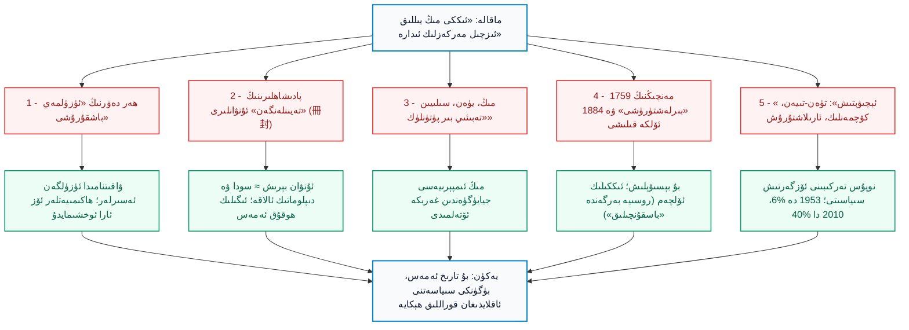
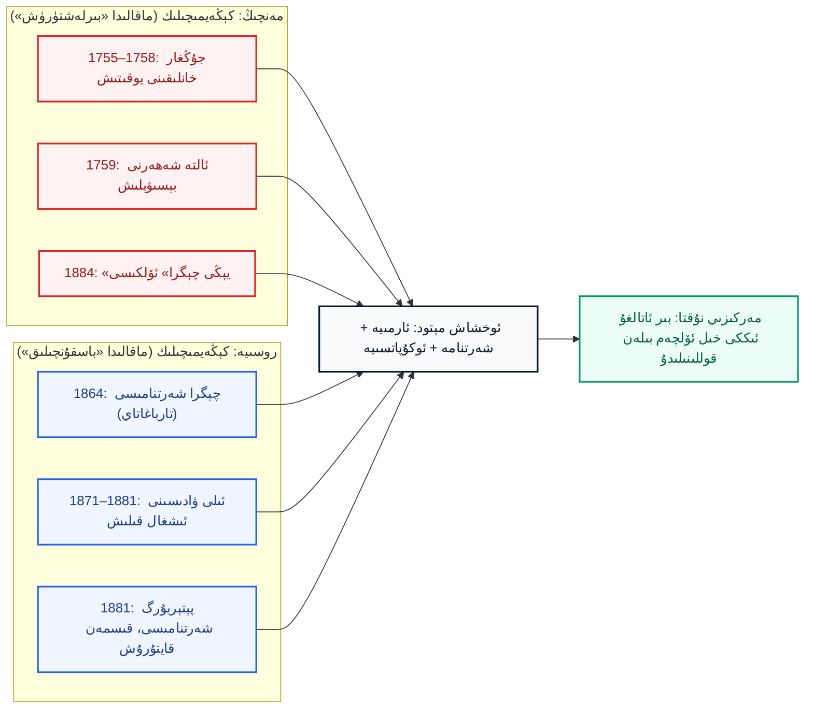
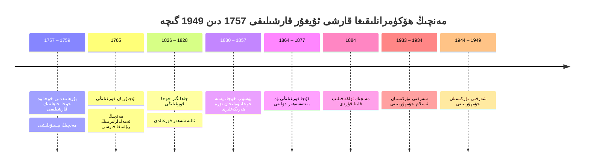
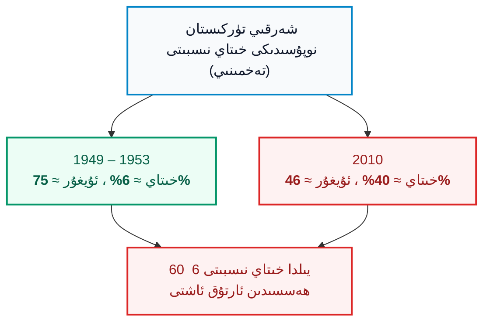

بِسْمِ اللَّهِ الرَّحْمَٰنِ الرَّحِيمِ

⏱ تەخمىنىي ئوقۇش ۋاقتى: 22 مىنۇت

خىتاينىڭ «يېڭى چېگرا گېزىتى» (新疆日报) دە 2025-يىلى 21-ئاۋغۇست كۈنى ئېلان قىلىنىپ، كېيىن «ئەپسى ئىدىيە» (爱思想) تور بېكىتىگە كۆچۈرۈلگەن ماقالە بىزنىڭ ئالدىمىزدا تۇرىدۇ. ماقالىنىڭ ئاپتورى «شۈ جيەنيىڭ» (许建英) دەپ كۆرسىتىلگەن بولۇپ، ئۇ خىتاي ئىجتىمائىي پەنلەر ئاكادېمىيەسى (CASS) نىڭ تارىخ تەتقىقات ئورنىغا تەۋە چېگرا تەتقىقات مەركىزىدە ئىشلەيدۇ. ماقالىنىڭ سەرلەۋھىسى «ئۆتمۈشتىكى مەركەزلىك ھاكىمىيەتلەرنىڭ شەرقىي تۈركىستاننى باشقۇرۇش تەجرىبىسى، ئۈنۈمى ۋە ئىلھامى» دېگەن مەنىدە. بۇنداق ماقالىلەرنىڭ ئالاھىدىلىكى — ئۇلار ئاددىي بىر «تارىخچىنىڭ مۇلاھىزىسى» ئەمەس، بەلكى ھۆكۈمەت گېزىتىدە، ئاخىرىدا ئېنىق سىياسىي بۇيرۇقلار بىلەن ئاخىرلىشىدىغان، دۆلەت سىياسىتىنىڭ «تارىخىي ئاساس»ى سۈپىتىدە يېزىلغان ھۆججەت. ئاپتور ماقالىنى «يېڭى چېگرا (新疆) قەدىمدىن «خىتاينىڭ مۇقەددەس زېمىنى»» دېگەن جۈملە بىلەن باشلايدۇ، ئاندىن ھەن ئىمپېرىيەسىدىن مەنچىڭ ئىمپېرىيەسىگىچە بولغان ھەممە ھاكىمىيەتنى «بىر ئىزچىل مەركەزلىك دۆلەت» دەپ تىزىپ، ئاخىرىدا «ھەرقايسى مىللەتلەرنى ئۆزئارا قوشۇلغان ئولتۇراق رايونلارغا يەرلەشتۈرۈش» ۋە «يېڭى دەۋر تۈەن-تىيەن (屯垦) ئىشلىرىنى راۋاجلاندۇرۇش» نى ئوتتۇرىغا قويىدۇ. بۇ ماقالە ئۇيغۇرلارنىڭ يوقىتىلىۋاتقان ئەمەلىيىتىنىڭ نەزەرىيەۋى قىسمى. شۇڭا بىز ئۇنى جىددىي ئوقۇپ، ھەر بىر «تارىخىي ئىسپات» نى تەكشۈرۈپ، ئۇنىڭ قەيەردە ئىسپات، قەيەردە سىياسىي ئارزۇ ئىكەنلىكىنى ئايرىپ چىقىشىمىز، ئاندىن ئۆز تارىخىمىزنى قانداق قوغداش كېرەكلىكىنى مۇلاھىزە قىلىشىمىز كېرەك. بۇ ماقالە ئالدىنقى «كۇنلۇن مەدەنىيىتى» ماقالىسىدىكى بىر قىسىم پىكىرلەرنى داۋاملاشتۇرىدۇ، لېكىن بۇ يەردە ئاساسلىق نىشان — ئاپتورنىڭ «ھەر دەۋرنىڭ ئاتالغان ھۆكۈمىتى» ھەققىدىكى ئۇزۇن تىزىملىكى ۋە ئۇنىڭ ئاخىرقى سىياسىي يەكۈنلىرى.

<!-- Image 1 -->

<em>«مىڭ-تۇرپان توقۇنۇشى» خەرىتىسى (Wikimedia Commons، CC BY-SA 4.0). خەرىتىدە يەركەنت خانلىقى، تۇرپان خانلىقى ۋە چاغاتاي خانلىقى ئايرىم دۆلەت سۈپىتىدە، مىڭ ئىمپېرىيەسى بولسا جيايۈگۈەن (嘉峪关) نىڭ شەرقىدە كۆرۈنىدۇ.</em>

---

## 1. ماقالىنىڭ ئومۇمىي قۇرۇلمىسى

شۈ جيەنيىڭنىڭ ماقالىسى ئۈچ قىسىمدىن تۈزۈلگەن: «ئالتە تەجرىبە»، «ئۈچ ئۈنۈم»، «تۆت ئىلھام». ئالتە تەجرىبىنىڭ ھەممىسى «ئاتالغان» چوڭ ئىدىيەدىن ئۇرۇنۇپ كېتىدۇ: «ئاسمان ئاستى بىر ئائىلە» (天下一家)، «بىر پۈتۈنلۈك» (大一统)، «مىللەتلەر بىرلىكى» (华夷一体). بىز تۆۋەندىكى سىخېمىدا ئۇنىڭ دەلىللىرىنى ۋە ئۇلارنىڭ ئەمەلىي تارىخقا ماس كەلمەيدىغان تەرەپلىرىنى بىر-بىرىگە ئۇلاپ كۆرسىتىمىز.

*(سىخېما 1: شۈ جيەنيىڭ ماقالىسىنىڭ دەلىل زەنجىرى ۋە ھەر ھالقىنىڭ ئاجىز نۇقتىسى)*

---

## 2. «تەيىنلەش» ۋە «مۇراجىئەت»: ئەلچىلىك بىلەن ئىگىلىك ھوقۇقنىڭ پەرقى

ماقالە بەشىنچى تەجرىبىدىن باشلاپ ئىسپاتلىمىغا ئېغىر بىر مەسىلىنى ئوتتۇرىغا قويىدۇ: «بەش سۇلالە، سۇڭ، لىيائو، جىن دەۋرىدە ... گاۋچاڭ ئۇيغۇر خانلىقى، ئۇدۇن ۋە قاراخانىيلار خانلىقى ھەممىسى مەركەزگە ئەلچى ئەۋەتىپ، «تەيىنلەنگەن» (接受册封) ئىدى؛ شۇڭا ئۇلار مەركەزلىك ھاكىمىيەتكە قاراشلىق». ئاپتور ئوخشاشلا مىڭ ئىمپېرىيەسى (مىلادى 1368–1644) نىڭ يەركەنت خانلىقى (<dfn title="يەركەنت خانلىقى / سەئىدىيە خانلىقى (مىلادى 1514–1696): ئالتە شەھەرنى مەركەز قىلغان چاغاتاي ئەۋلادلىرى قۇرغان مۇستەقىل ئىسلام دۆلىتى. قەشقەر ۋە يەكەن ئۇنىڭ مۇھىم شەھەرلىرى بولغان.">سەئىدىيە خانلىقى (1514–1696)</dfn>) نىڭ «مۇراجىئىتى» (求贡) ئىكەنلىكىنى «چوڭ بىرلىكنىڭ دەلىلى» دەپ كۆرسىتىدۇ.

بۇنداق تەپسىرنىڭ ئاجىز يېرى ئىنتايىن روشەن. شەرقىي ئاسىيادىكى ئەنئەنىۋى «مۇراجىئەت سىستېمىسى» (朝贡体系) ھەقىقىي ھالدا بىر سودا-دىپلوماتىك ئالاقە سىستېمىسى ئىدى؛ ئەلچى ئىمپېرىيە ئوردىسىغا «سوۋغا» ئېلىپ كېلەتتى، ئۇنىڭغا ئوخشاش ياكى يۇقىرى بەھالىق «قايتۇرما سوۋغا» ۋە سودا ئىمتىيازى بېرىلەتتى، تەيىنلەنگەن ئۇنۋان بولسا — ئىمپېرىيە ئۈچۈن «ئوردا ئالدىدىكى ھۆرمەت» ئىدى. بۇ سىستېما ئارقىلىق ئەلچىنى ئەۋەتكەن دۆلەتنىڭ ئىچكى سىياسىتىنى، ئارمىيەسىنى، باج-سېلىقىنى ياكى قانۇنىنى مەركەز بەلگىلىمەيتتى. دەل شۇ يوسۇندا كورىيە، ۋيېتنام، سىيام (تايلاند)، رىيۇكيۇ ۋە ھەتتا ياۋروپا ئەلچىلىرىمۇ مىڭ-چىڭ ئوردىسىغا «مۇراجىئەت» قىلغان بولۇپ، ئۇلارنىڭ ھېچبىرى خىتاينىڭ بىر قىسمى ئەمەس. ئەگەر «مۇراجىئەت» ئىگىلىك ھوقۇقنى ئىسپاتلىسا، بۇ قائىدە ئۇلارغىمۇ قوللىنىلىشى كېرەك ئىدى.

مىڭ سۇلالىسى (1368–1644) نىڭ ئۆزىگە كەلسەك، ماقالە ئاتايىن ئۈنۈمسىز چۈشەندۈرۈش بېرىدۇ. ئاپتور «مىڭ ئىمپېرىيەسى 1406-يىلى قۇمۇلدا ھامى ئىشلىرى مەھكىمىسى (哈密卫) نى ئۇرۇنلاشتۇرۇپ، قۇمۇل، بىشبالىق، ئىلى قاتارلىق جايلارنىڭ ھۆكۈمدارلىرىنى «تەيىنلىدى» دەيدۇ. ھالبۇكى مىڭ ئىمپېرىيەسىنىڭ بۇ جايدىكى ئورنى ناھايىتى ئاجىز ئىدى: ئۇ 16-ئەسىرنىڭ باشلىرىدا تۇرپان خانلىقىنىڭ بېسىمى ئاستىدا ھامىدىن (قۇمۇلدىن) چېكىنىپ، چېگرىنى جيايۈگۈەن (嘉峪关) غا يىغىۋالغان؛ يۇقىرىدىكى خەرىتىدە كۆرگىنىڭىزدەك، تارىم بوستانلىقى ۋە تۇرپان ئىككى ئايرىم مۇستەقىل خانلىق قولىدا ئىدى. دېمەك، مىڭ ئىمپېرىيەسى ئۈچۈن «غەربىي يۇرت» ئەمەلىيەتتە چېگرانىڭ سىرتىدىكى دەرۋازىدىن ئىبارەت ئىدى.

---

## 3. «بىر پۈتۈنلۈك» (大一统) بىلەن «ھەربىر ئىمپېرىيە» نىڭ خىتاي بولۇپ قېلىشى

ماقالىنىڭ ئاچقۇچلۇق ئوپېراتسىيەسى — ئوخشىمايدىغان ئىمپېرىيەلەرنى بىر ئىزچىل «مەركەزلىك خىتاي ھاكىمىيىتى» دەپ تونۇشتۇرۇش. ئاپتور بۇنى ئەڭ ئىنچىكە ئۇسۇلدا «يۈەن» ۋە «غەربىي لىيائو» (<dfn title="غەربىي لىيائو (قارا خىتاي / قاراقىتاي، مىلادى 1124–1218): شىمالىي خىتايدىكى لىيائو سۇلالىسى ئاغدۇرۇلغاندىن كېيىن، خىتانلار ئوتتۇرا ئاسىياغا كۆچۈپ قۇرغان ئىمپېرىيە. ئۇنىڭ مەركىزى ھازىرقى قىرغىزىستاندىكى بالاساغۇن ئەتراپى بولغان؛ ئىسلام، بۇددا ۋە شامان ئەنئەنىلىرى بىللە مەۋجۇت ئىدى.">غەربىي لىيائو (قاراقىتاي)</dfn>) ئارقىلىق كۆرسىتىدۇ: «12-ئەسىرنىڭ ئالدىنقى يېرىمىدا غەربىي يۇرت غەربىي لىيائوغا بىرلەشتى، بۇ يۈەن سۇلالىسىنىڭ ‹بىر پۈتۈنلۈك›ىگە ئاساس سالدى». بۇ جۈملىنىڭ ئاستىدا ئىككى چوڭ ئاتالغۇ خاتالىقى بار. بىرىنچىدىن، غەربىي لىيائو (قاراقىتاي) خىتاي ئىمپېرىيەسى ئەمەس؛ ئۇ لىيائو (916–1125) سۇلالىسى جىن (女真) ئۇرۇشىدا مەغلۇب بولغاندىن كېيىن ئوتتۇرا ئاسىياغا قېچىپ چىققان خىتان (契丹) ئاقسۆڭەكلىرى قۇرغان ئايرىم دۆلەت. ئىككىنچىدىن، يۈەن سۇلالىسى (1271–1368) ئەمەلىيەتتە موڭغۇل ئىمپېرىيەسىنىڭ بىر تارمىقى بولۇپ، تارىم بوستانلىقى ئاساسەن چاغاتاي خانلىقىنىڭ ئىدارىسىدە ئىدى؛ يۈەن ئىمپېرىيەسىنىڭ غەربىي يۇرتتىكى ھۆكۈمرانلىقى ھەقىقىي ئەمەس، ئىسىمدا ئىدى. بۇ بىزگە «چىڭگىزخان ئەۋلادلىرى خىتاي ئىدى» دېگەن يەكۈنگە ئوخشاش ئىسپاتسىز، ئەمما ئاتالغۇ ئوينىشى ئارقىلىق ئېلىنغان نەتىجە.

ماقالىنىڭ «پەلسەپىۋى» ئاساسى «ئاسمان ئاستى بىر ئائىلە» ۋە «ھەر مىللەت ئوخشاش» دېگەن شوئارلار. لېكىن ئەنئەنىۋى خىتاي سىياسىي تەپەككۇرىدىكى «مەدەنىيەت ھالقىسى» (华夷之辨) نى ئوقۇغان ھەر قانداق كىشى بىلىدۇكى، «خۇاشىيا» (华夏) بىلەن «بەش تەرەپتىكى يات خەلقلەر» (夷狄) ئارىسىدىكى دەرىجە ئوتتۇرىسىدىكى پەرق بۇ دۇنيا كۆزقارىشىنىڭ ئاساسى ئىدى. «تەڭ بىر ئائىلە» ئەپسانىسى 20-ئەسىردە مىللىي دۆلەت قۇرۇش جەريانىدا كېيىن ئىجاد قىلىنغان.

---

## 4. مەنچىڭنىڭ «بىرلەشتۈرۈشى»: بېسىۋېلىش ئىككىلىك ئۆلچەم

شۈ جيەنيىڭ ماقالىسىنىڭ ئەڭ ئەھمىيەتلىك بىر جۈملىسى — «ئىمپېرىيە ئۆزى ئىلان قىلغان: ‹جۇڭغار تىنچلاندى، بارلىق ئەسلىدىكى يايلاقلار بىزنىڭ خەرىتىمىز›» (准噶尔荡平，凡有旧游牧，皆我版图). بۇ ئىمپېرىيەنىڭ ئۆز ئاغزىدىن ئېيتىلغان سۆز: ئۇ بىر نەرسىنى «بۇرۇنقىلار» (旧游牧) دەپ ئاتىدى، يەنى ئىمپېرىيە ئۆز زېمىنى دەپ ئەمەس، ئەسلىدە جۇڭغارلارنىڭ ياكى باشقىلارنىڭ يايلاق-بوستانلىقى دەپ ئىتتىپاق قىلدى. ئەمەلىيەتتە مەنچىڭنىڭ ئالتە شەھەرگە بولغان «ھوقۇقى» ئىككى قەدەمدە بارلىققا كەلدى: (1) جۇڭغار خانلىقى (1634–1758) 1680-يىلى ئالتە شەھەرنى بويسۇندۇرغان؛ (2) مەنچىڭ 1755–1758-يىللىرى جۇڭغارلارنى قاتتىق قىرغىنچىلىق بىلەن يوقىتىپ، ئۇلارنىڭ ئورنىنى ئالغان. ئاندىن خوجىلارنىڭ 1757–1759 قارشىلىقىنى باستۇردى. پېتېر پەردۇ (Peter Perdue) ۋە باشقا تارىخچىلار بۇ جەريانى «جۇڭغار قىرغىنچىلىقى» (بەزىلىرى «گېنوتسىد») دەپ ئاتايدۇ.

ماقالىنىڭ ئۆزىدە ناھايىتى تەسىرلىك ئىككىلىك ئۆلچەم بار. ئاپتور 19-ئەسىردە روسىيە ئىمپېرىيەسىنىڭ ئىلى ۋادىسى ۋە چېگرا رايونلىرىدىن «700 مىڭ كۋادرات كىلومېتىردىن ئارتۇق زېمىن» نى ئېلىۋالغانلىقىنى «باسقۇنچىلىق» (侵吞) ۋە «ئادىللىقسىز شەرتنامە» دەپ ئەيىبلەيدۇ؛ ھالبۇكى ئوخشاش مېتودولوگىيە بويىچە، مەنچىڭنىڭ 1759-يىلى جۇڭغار ۋە ئالتە شەھەرنى ئېلىشىمۇ «بېسىۋېلىش» ئىدى. مەنچىڭ ئىمپېرىيەسى ئۈچۈن بىر خىل ئۆلچەم، روسىيە ئۈچۈن باشقا ئۆلچەم. ئەگەر «زېمىن ئېلىش» روسىيەگە قارىتا «زوراۋانلىق» بولسا، ئۇ مەنچىڭغىمۇ زوراۋانلىق؛ ئەگەر مەنچىڭنىڭ كېڭىيىشى «بىرلەشتۈرۈش» بولسا، روسىيەنىڭ كېڭىيىشىمۇ «بىرلەشتۈرۈش» دەپ ئاتىلىشى كېرەك ئىدى.

*(سىخېما 2: مەنچىڭ بىلەن روسىيە كېڭىيىشىنىڭ ئىككىلىك ئۆلچەم بىلەن باھالىنىشى)*

ماقالىدا «تۈرگۈتلەرنىڭ ۋەتەنگە قايتىشى» (<dfn title="تۈرگۈتلەر (土尔扈特 / Torghuts): ۋولگا بويىدا ياشىغان موڭغۇل-ئويرات ئاھالىسى. 1771-يىلى ئۇلار روسىيە ھۆكۈمىتىنىڭ بېسىمىدىن قېچىپ، ئىلى ئەتراپىغا يېتىپ كەلگەن. بۇ ھەرىكەت ئۇلار ئۈچۈن ئېغىر تالاپەتلەر بىلەن ئاخىرلاشقان.">تۈرگۈتلەر (土尔扈特) 1771</dfn>)، «شىبەلەر ۋە سولونلارنىڭ چېگرا مۇھاپىزىتى» ۋە «كۆچمەن دېھقانلار» (<dfn title="遣屯 (جيەن تۈەن): مەنچىڭ ئىمپېرىيەسى دەۋرىدە جىنايەتچى قىلىنغان كىشىلەرنى غەربىي رايونغا ئۆزلىرىنىڭ ئەمگىكى بىلەن يەر ئاچقۇزۇش ئۈچۈن ھەيدەپ ئېلىپ كېلىش. بۇ جازا شەكلى ئىدى؛ ئەمما ماقالىدا «ئېچىۋېتىش» دەپ ئاتالغان.">遣屯</dfn>) لارنى «ئىلغار ھالەتتە ئارىلاشتۇرۇش» نىڭ ئىسپاتى قىلىپ كۆرسىتىدۇ. بۇ يەردىمۇ ئاچقۇچلۇق بىر ئىبارە يوشۇرۇلغان: «遣屯» ھەقىقەتەن «جازا بىلەن ھەيدەلگەن ئادەملەر» ئىدى؛ يەنى مەنچىڭنىڭ ئالتە شەھەردىكى «ئېچىش» مىسالى يەرلىك ئاھالىنىڭ ئۆزى ئەمەس، بەلكى سىرتتىن كەلگەن جازالىنىپ ھەيدىلىپ كەلگەن مۇساپىرلار ئىدى.

<!-- Image 2 -->

<em>قەشقەر يولى مەنزىرىسى، 1870-يىللار (Wikimedia Commons، ئاممىۋى مۈلۈك؛ ئەسلىدە ئەنگلىيەلىك ئوفىتسېر توماس ئېدۋارد گوردون تارتقان). ئۇ دەۋرنىڭ يەرلىك شەھەر ھاياتى ئۆز تۈزۈمى بىلەن ياشايتتى.</em>

---

## 5. ئاتالغۇلار نامى: خەرىتىدە «شەرقىي تۈركىستان»

ماقالە «يېڭى چېگرا» (新疆) نى «قەدىمدىن بېرى بىر ئاتالغۇ» دەپ كۆرسىتىدۇ، لېكىن بۇ ئىسىم 1759-يىلدىن كېيىن مەنچىڭ ئەمەلدارلىرى قوللانغان يېڭى ئاتالغۇ ئىدى. مەنچىڭ ئوردىسىنىڭ ئۆزى ئالتە شەھەرنى «مۇسۇلمان چېگرا» (回疆) دەپ ئاتىغان. بۇ رايوننىڭ تاشقى دۇنيادىكى ئاتىلىشى بولسا باشقىچە ئىدى. تۆۋەندىكى خەرىتە 1873–1874-يىللىرى ئەنگلىيە ھىندىستان ھۆكۈمىتىنىڭ فورسايت (Forsyth) باشچىلىقىدىكى ئەلچىلەر ئۆمىكى قەشقەرگە بارغاندا ئۇنىڭ ئېنىق خاتىرىسى سۈپىتىدە تۈزۈلگەن بولۇپ، سەرلەۋھىسى «شەرقىي تۈركىستان خەرىتىسى» (Map of Eastern Turkistan) دەپ يېزىلغان.

<!-- Image 3 -->

<em>ئەنگلىيە ھىندىستان تەتقىقات ئورنى تۈزگەن «شەرقىي تۈركىستان خەرىتىسى» (1873–1874، Wikimedia Commons، CC0). خەرىتىدە قەشقەر، يەكەن، خوتەن، ئاقسۇ، ئۇچتۇرپان ئاتالغان؛ شىمالدا «روسىيە ئىمپېرىيەسى» ۋە غەربتە «قوقان» ئايرىم ئاتالغان.</em>

مانا مۇشۇ ئاتالغۇ ئۈچۈن ئېيتقاندا، ئاپتورنىڭ ماقالىسى كۆپ يەرلەردە «ئاتالغۇنىڭ تارىخىي بېرىلىشى» نى ئوتتۇرىغا قويىدىغان بولسىمۇ، رەسمىي تارىخىي ئاتالغۇلار ئىچىدە «شەرقىي تۈركىستان»، «ئالتە شەھەر»، «يەتتە شەھەر» ۋە «ئۇيغۇرىستان» كەبى ئىسىملارنىڭ ھېچبىرىنى تىلغا ئالمايدۇ. بۇ ئۇنتۇش ئىلمىي ئەمەس، سىياسىي تاللاش. ئىلمىي تەتقىقاتتا بىر زېمىنغا قويۇلغان ئىسىملارنىڭ ھەممىسى — ھەم ئىمپېرىيە بەرگەن، ھەم يەرلىك ئاھالە ئىشلىتىدىغان ئىسىملار — بىرلىكتە كۆرسىتىلىشى كېرەك.

---

## 6. يەتتەشەھەر دۆلىتى: ئىككى مىڭ يىللىق «ئۈزۈلمەيدىغان ئىدارە» نى بۇزغان 12 يىل

ماقالىنىڭ ئاچقۇچلۇق ئۇنتۇلۇپ كەتكەن بىر بۆلىكى — 1864–1877-يىللىرى ئالتە شەھەردە مەۋجۇت بولغان <dfn title="يەتتەشەھەر دۆلىتى (Yettishar، مىلادى 1865–1877): يەقۇپبەگ (1820–1877) قۇرغان ئىسلام دۆلىتى. قەشقەر، يەكەن، خوتەن، ئاقسۇ، كۇچا ۋە ئۈرۈمچىگىچە بولغان زېمىننى ئىگىلىگەن. روسىيە (1872)، ئەنگلىيە (1874) بىلەن سودا كېلىشىمى تۈزگەن، ئوسمانلى سۇلتانى ئۇنىڭغا «ئەمىر» ئۇنۋانى بەرگەن.">يەتتەشەھەر دۆلىتى (1865–1877)</dfn>. 1864-يىلى كۇچادا باشلانغان قوزغىلاڭ مەنچىڭ ھاكىمىيىتىنى ئالتە شەھەردىن قوغلاپ چىقاردى؛ قوقانلىق سەركەردە <dfn title="يەقۇپبەگ (1820–1877): قوقان خانلىقىدىن كەلگەن ھەربىي رەھبەر. 1865-يىلدىن باشلاپ ئالتە شەھەرنى بىرلەشتۈرۈپ يەتتەشەھەر دۆلىتىنى قۇرغان ۋە «ئاتالىق غازى» ئۇنۋانىنى ئالغان. 1877-يىلى كورلادا ئۆلگەن.">يەقۇپبەگ (1820–1877)</dfn> 1865-يىلدىن باشلاپ ئۇنى بىرلەشتۈردى.

<!-- Image 4 -->

<em>يەتتەشەھەر دۆلىتىنىڭ رەھبىرى يەقۇپبەگ (1820–1877، Wikimedia Commons، ئاممىۋى مۈلۈك).</em>

بۇ دۆلەتنىڭ خەلقئارالىق ئورنى ئىنتايىن مۇھىم. روسىيە ئۇنىڭ بىلەن 1872-يىلى سودا كېلىشىمى تۈزدى؛ ئەنگلىيە ھىندىستان ھۆكۈمىتى فورسايت ئۆمىكى ئارقىلىق 1874-يىلى ئۇنىڭ بىلەن مەخسۇس كېلىشىم ئىمزالىدى؛ ئوسمانلى سۇلتانى ئابدۇلئەزىز ئۇنىڭغا «ئەمىر» ئۇنۋانى بەردى ۋە ھەربىي ئوقۇتقۇچىلار ۋە قورال-ياراغ ئەۋەتتى. بۇلارنىڭ ھەممىسى — ئالتە شەھەرنىڭ ئاشۇ چاغدا ئىككى مىڭ يىللىق «ئىزچىل» خىتاي ئىدارىسىدە بولماستىن، ئايرىم، ئۆزىنى ئىدارە قىلىدىغان، خەلقئارا تونۇلغان ئىسلام دۆلىتى ئىكەنلىكىنىڭ ئىسپاتى.

<!-- Image 5 -->

<em>يەتتەشەھەر دۆلىتى ئارمىيەسىنىڭ «تايفۇرچى» (توپچى ۋە ئوقچى) قىسمى، قەشقەر (1870-يىللار؛ تومەس ئېدۋارد گوردون سىزغان، Wikimedia Commons، ئاممىۋى مۈلۈك).</em>

<!-- Image 6 -->

<em>رىئوبېرت شاۋ (Robert Shaw) نىڭ «ئېگىز تاتارىيە، يەكەن ۋە قەشقەرگە زىيارەتلەر» (1871) ناملىق ساياھەت خاتىرىسىدىكى ئىللۇستراتسىيە (Wikimedia Commons، ئاممىۋى مۈلۈك): ساياھەتچى يەقۇپبەگ ئوردىسىدىكى كېچىلىك قوبۇل قىلىنىشنى تەسۋىرلىگەن.</em>

مەنچىڭ ئىمپېرىيەسىنىڭ ئەكسىچە، يەتتەشەھەر دۆلىتى 1877-يىلى <dfn title="زۇئو زوڭتاڭ (左宗棠، 1812–1885): خىتاي سەردارى ۋە ئەمەلدارى. 1876–1878-يىللىرى مەنچىڭ ئارمىيەسىنىڭ ئالتە شەھەرگە يۈرۈشىگە قوماندانلىق قىلغان ۋە 1884-يىلى بۇ زېمىننى ئۆلكە قىلىشنى ئىلگىرى سۈرگەن.">زۇئو زوڭتاڭ (1812–1885)</dfn> باشچىلىقىدىكى ئىمپېرىيە ئارمىيەسى تەرىپىدىن مەغلۇب قىلىندى. ماقالە بۇ ئىشنى «ئابا گۇ (阿古柏) نى يوقىتىش» دەپ بىر جۈملە بىلەنلا ئۆتۈپ كېتىدۇ. ئەمما بۇ يەردىكى ئىسىمنىڭ ئۆزى: خىتاي مەنبەلىرى «يەقۇپبەگ» نى «ئابا گۇ» دەپ ئاتايدۇ ۋە ماقالە ئۇنىڭ دۆلىتىنى ئىسمى بىلەن ئاتىمايدۇ. 1884-يىلى مەنچىڭ بۇ رايوننى «يېڭى چېگرا ئۆلكىسى» قىلىپ رەسمىي ئاتىغاندا، ئۇ ئەمەلىيەتتە ئۆزى 13 يىل يوقاتقان زېمىننى زور ھەربىي كۈچ بىلەن قايتا ئىگىلەپ، ئاندىن ئۇنى ئۆلكە قىلىپ ئاتىغان ئىدى.

<!-- Image 7 -->

<em>زۇئو زوڭتاڭ (1875، فوتو: A. N. Boiarskii، Wikimedia Commons، ئاممىۋى مۈلۈك).</em>

---

## 7. ۋاقىتنامە: «ئىچكى بىرلىك» دەپ يېزىلغان 125 يىللىق قارشىلىق

ماقالە «يېڭى چېگرا» ئۆلكىسىنىڭ «ئۇزاق مۇددەتلىك مۇقىملىق» (长治久安) ھەققىدە تەپسىلىي گەپ قىلىدۇ؛ ھالبۇكى مەنچىڭ ھۆكۈمرانلىقىنىڭ تارىخى ئۈزۈلمەي داۋاملاشقان قارشىلىق ھەرىكەتلىرى بىلەن تولغان.

*(سىخېما 3: ئالتە شەھەردىكى قارشىلىق ھەرىكەتلىرىنىڭ ۋاقىتنامىسى)*

1765-يىلىدىكى ئۇچتۇرپان (ئۇش) قوزغىلىڭى بۇ ھەرىكەتلەرنىڭ ئەڭ ئاچچىقى؛ جېمس مىلۋارد (James Millward) قاتارلىق تارىخچىلارنىڭ بايانىغا قارىغاندا بۇ قوزغىلاڭ مەنچىڭ ئەمەلدارى سۇچېڭ (素诚) نىڭ يەرلىك ئاياللارغا ۋە ئاھالىگە قىلغان زۇلمى سەۋەبىدىن چىققان، ئىمپېرىيە ئۇنى باستۇرغاندا شەھەر ئاھالىسىنىڭ ئەرلىرىنى قىرغىن قىلغان، ئاياللىرى ۋە بالىلىرىنى قۇل قىلغان. 1826–1828-يىللىرىدىكى جاھانگىر خوجا قوزغىلىڭى ھەققىدە بىز ئالدىنقى بىر ماقالىدە ئايرىم توختالغان ئىدۇق. ماقالىنىڭ ئاپتورى ھەر قايسى دەۋرنىڭ ھەممىسىنى «ئىزچىل قوزغىلاڭسىز» دەپ كۆرسىتىشنى ئويلىغان بولسا، بىر چېتىدە 100 يىلدىن ئارتۇق ۋاقىتتا بۇنچە كۆپ قېتىملىق قوزغىلاڭنى قانداق چۈشەندۈرىدۇ؟ ئەگەر «مەركەزلىك ھاكىمىيەت» ئالتە شەھەر خەلقىنىڭ ئاڭلىق قوبۇلىغا ئېرىشكەن بولسا، مۇنچە كۆپ قېتىملىق ھەربىي يۈرۈش نېمە ئۈچۈن كېرەك بولغان؟

---

## 8. ماقالىنىڭ ئاخىرقى بۆلىكى: ئىلھام نەزەرىيەسى ۋە ئۇيغۇرلارنىڭ بۈگۈنكى ئەمەلىيىتى

ماقالىنىڭ ئەڭ مۇھىم بۆلىكى — ئاخىرقى «تۆت ئىلھام». بۇ يەردە ئاپتور تارىخنى تاشلاپ، بىۋاسىتە بۈگۈنكى سىياسەتنى بايان قىلىدۇ:

1. «ئەسكەر-دېھقانچىلىق روھىنى داۋاملاشتۇرۇپ، قوراللىق كۈچنى زامانىۋىلاشتۇرۇش، يېڭى دەۋر تۈەن-تىيەن ئىشلىرىنى راۋاجلاندۇرۇش» (发展新时代屯垦事业)؛
2. «ئىقتىسادىي يادرو رايوننى قۇرۇش، تاشقى ئېچىۋېتىش»؛
3. «مەدەنىيەت ئارقىلىق ئۆز-ئارا بىرلىشىش، خىتاي مەدەنىيىتىنى تەرغىب قىلىش»؛
4. «**ئىقتىسادىي تەرەققىيات ئارقىلىق ھەر مىللەت نوپۇسىنىڭ ھەرىكىتىنى ئىلگىرى سۈرۈپ، ئۆز-ئارا قىستۇرۇلغان ئولتۇراق ۋە خىزمەت مۇھىتىنى** (嵌入式居住和工作环境) **قۇرۇش؛ ھەر مىللەت ئاۋام خەلقى ‹ئانار دانىسى› دەك زىچ يىغىلىشى كېرەك**» ۋە ‹مەدەنىيەت ئارقىلىق نەملەندۈرۈشنى› (文化润疆) چوڭقۇرلاشتۇرۇش.

بۇ ئىلھاملار ئۇزاقتىن بېرى مەلۇم ئەمەلىيەتتىن كەلگەن: <dfn title="بىڭتۇەن (新疆生产建设兵团، XPCC): 1954-يىلى قۇرۇلغان، ھەربىي-ئىقتىسادىي-مەمۇرىي ئاپپارات. ئۇنىڭ نوپۇسىنىڭ كۆپ قىسمى خىتاي بولۇپ، شەرقىي تۈركىستاندىكى ئاساسلىق بوستانلىقلاردا ئۆز شەھەر، ناھىيە ۋە زاۋۇتلىرىغا ئىگە.">بىڭتۇەن (兵团)</dfn>، «ئۆز-ئارا قىستۇرۇلغان ئولتۇراق» دېگەن سىياسەت بولسا ئۇيغۇرلارنى كەنت ۋە ماھەللىلىرىدىن ئايرىپ، ئۇلارنىڭ ئارىسىغا خىتاي كۆچمەنلەرنى ئورۇنلاشتۇرۇشنى كۆرسىتىدۇ. بۇنىڭ ئۇيغۇر جەمئىيىتىدە قانداق تەسىر قوزغىغانلىقى توغرىسىدا بىرلەشكەن دۆلەتلەر تەشكىلاتى كىشىلىك ھوقۇق ئالىي كوميسسارلىقى (OHCHR) 2022-يىلى 31-ئاۋغۇستتا ئېلان قىلغان دوكلاتىدا، ئۇيغۇرلارغا قارىتىلغان ئىختىيارىي توتۇش، ئېغىر ئازاب، دىنىي ۋە مەدەنىي ئەركىنلىكىنى چەكلەش ئەمەلىيەتلىرىنىڭ «ئىنسانىيەتكە قارشى جىنايەت» دەپ ئاتىلىشى مۇمكىنلىكىنى ئەسكەرتكەن.

### نوپۇس سانلىق مەلۇماتى: «ئارىلىشىش» نىڭ كۆلىمى

ئاخىرقى ئىلھامنىڭ نەتىجىسىنى سانلار بىلەن كۆرۈشكە بولىدۇ. تۆۋەندىكى سېلىشتۇرما نوپۇس ساناقلىرىغا ئاساسەن تۈزۈلگەن؛ سانلار «تەخمىنىي» بولۇپ، بۇ خىل سانلارنىڭ مەنبەسى جېمس مىلۋاردنىڭ «ياۋرو-ئاسىيا چاتما يولى» ۋە خىتاينىڭ 1953-، 2010-يىللىق نوپۇس ساناقلىرى.

*(سىخېما 4: 1950-يىللاردىن 2010 غىچە نوپۇس تەركىبىنىڭ ئۆزگىرىشى)*

| يىل | ئۇيغۇر (تەخمىنىي) | خىتاي (تەخمىنىي) | ئىلمىي ئىزاھات |
| :--- | :--- | :--- | :--- |
| 1949 – 1953 | ≈ 75% | ≈ 6% | كوممۇنىست ھاكىمىيەت ئورنىتىلغان چاغ |
| 1982 | ≈ 46% | ≈ 40% | ئاساسىي ئۆزگىرىش 1950–1980 يىللىرىدا يۈز بەردى |
| 2010 | ≈ 46% | ≈ 40% | بىڭتۇەن ۋە كۆچمەن سىياسىتى كېيىنكى دەۋردىمۇ داۋاملاشتى |

بۇ ساناقلارنىڭ مۇھىم تەرىپى — ئۇلارنىڭ ئېنىق تەبىئىي ئاھالە ئۆسۈشىدىن ئەمەس، بەلكى ئورگانلاشتۇرۇلغان كۆچمەنلىك سىياسىتىدىن كېلىپ چىققانلىقى. شۈ جيەنيىڭ ماقالىسى بۇنى «ئىلھام» دەپ ئاتاپ، ئۇنى يەنە «زور ئارىلاشتۇرۇش» ئارقىلىق داۋاملاشتۇرۇشنى تەلەپ قىلىدۇ.

---

## 9. تۆت تۈرلۈك تارىخىي ئىبرەت

### 1) ئىسلام تارىخىدىن ئىبرەت: ئۈممەتنىڭ كۆپ خىللىقى ۋە ئادالەتتىكى بىرلىك

ئىسلام دۇنياسى ھەرگىز بىر خىل تىل ياكى بىر خىل قەۋمگە ئاساسلانغان ئەمەس. قۇرئاندا ئاللاھ تائالا ئىنسانلارنىڭ مىللەت ۋە قەبىلىلەر بولۇپ ئايرىلىشىنى ئۇلارنىڭ بىر-بىرىنى تونۇشى ئۈچۈن قىلغانلىقىنى بىلدۈرىدۇ:

﴿يَا أَيُّهَا النَّاسُ إِنَّا خَلَقْنَاكُم مِّن ذَكَرٍ وَأُنثَىٰ وَجَعَلْنَاكُمْ شُعُوبًا وَقَبَائِلَ لِتَعَارَفُوا ۚ إِنَّ أَكْرَمَكُمْ عِندَ اللَّهِ أَتْقَاكُمْ﴾

> *(ئى ئىنسانلار! سىلەرنى بىر ئەر ۋە بىر ئايالدىن يارىتتۇق، سىلەرنى تونۇشۇشۇڭلار ئۈچۈن مىللەت ۋە قەبىلىلەر قىلدۇق. ئاللاھنىڭ دەرگاھىدا ئەڭ ھۆرمەتلىكىڭلار — ئەڭ تەقۋادارىڭلاردۇر.)* (سۈرە ھۇجۇرات، 13-ئايەت).

بۇ ئايەت كۆپ خىل مىللەتلەرنىڭ مەۋجۇتلۇقىنى ئاللاھنىڭ ئىرادىسى دەپ ئېتىراپ قىلىدۇ ھەمدە ئۇلارنى بىر-بىرىگە ئىرىتىشنى ئەمەس، بەلكى بىر-بىرىنى تونۇشنى ئۆگىتىدۇ. پەيغەمبىرىمىز مۇھەممەد ﷺ ئاخىرقى ھەج خۇتبىسىدا ئەرەبنىڭ ئەرەب ئەمەسلەردىن، ئاق تېرىلىكنىڭ قارا تېرىلىكتىن ئارتۇقچىلىقى يوقلۇقىنى جاكارلىغان؛ يەنى ئۈممەتنىڭ بىرلىكى ئىرىتىشكە ئەمەس، تەقۋادارلىققا ۋە ئادالەتكە ئاساسلىنىدۇ. خىتاينىڭ «ئارىلاشتۇرۇش» ئىدىيەسى بۇنىڭغا قارىمۇقارشى — ئۇ كۆپ خىللىقنى ئاللاھ بەرگەن مەۋجۇتلۇق دەپ ئەمەس، يوقىتىلىدىغان توسالغۇ دەپ كۆرىدۇ.

### 2) دۇنيا تارىخىدىن ئىبرەت: «ئۆز ئىرادىسى بىلەن قوشۇلۇش» ئەپسانىسى — بالتىق ۋە ئاكراينا

<dfn title="سوۋېت ئىتتىپاقى (1922–1991): بولشېۋىكلار قۇرغان كوممۇنىستىك ئىمپېرىيە. 1940-يىلى ئېستونىيە، لاتۋىيە ۋە لىتۋانىيەنى ئىشغال قىلغان.">سوۋېت ئىتتىپاقى (1922–1991)</dfn> بالتىق دۆلەتلىرىنى ئىشغال قىلغاندىن كېيىن ئەللىك يىل بويى «ئۇلار ئىختىيارىي قوشۇلدى» دەپ ئۆگەتتى؛ ئۇنىڭ «ئىلمىي ئاكادېمىيەلەر» ۋە «دۆلەت گېزىتلىرى» بار ئىدى. ئەمما 1989-يىلى 23-ئاۋغۇستتا ئىككى مىليوندىن ئارتۇق كىشى «بالتىق يولى» (Baltic Way) ئارقىلىق ئادەم زەنجىرى ھاسىل قىلىپ ئۆزلىرىنىڭ ئىشغال قىلىنغانلىقىنى دۇنياغا ئاڭلاتتى؛ 1990–1991-يىللىرى ئۇلار مۇستەقىللىقىنى ئەسلىگە كەلتۈردى. بۇ ئىشنىڭ خىتاينىڭ تەشۋىقاتى ئۈچۈن ئىبرىتى: ھۆكۈمەت گېزىتىدە نەشىر قىلىنغان «ئىلمىي» ماقالىلەر ئۇزۇن مۇددەت ئىچىدە خەلقنىڭ ئۆز ھاپىزىسىنى ئۆچۈرۈۋېتەلمەيدۇ.

### 3) خىتاي تارىخىنىڭ قاراڭغۇ تەرىپىدىن ئىبرەت: ئىككى يۈزلىمىچىلىك ۋە ئۆز-ئۆزىنى ئالدىغان مەغرۇرلۇق

مەنچىڭ ئىمپېرىيەسى ئۆزىنى «ئاسمان ئاستىنىڭ بىرلىكى» (天下大同) نى ئەمەلگە ئاشۇرغان «ئەڭ كۈچلۈك» ئىمپېرىيە دەپ تەسەۋۋۇر قىلغان؛ ئەمما 1839–1842-يىللىرى بىرىنچى ئەپيۇن ئۇرۇشىدا ئەنگلىيەگە مەغلۇب بولدى، كېيىنكى بىر ئەسىرگە يېقىن ۋاقىتتا ئىچكى ۋە تاشقى ھەمدە ئېغىر مەغلۇبىيەتلەرنى يېدى. شۈ جيەنيىڭ ماقالىسى بۇ تارىخنى ئۇنتۇپ، «ئىلگىرىكى مەركەزلىك ھاكىمىيەتلەرنىڭ تەجرىبىسى» دەيدۇ. ئەمما ئىمپېرىيە ئاخىرقى ھېسابتا ئۆزىنىڭ مەغرۇرلۇقىنىڭ قۇربانى بولدى. ئەگەر مەركەز ھەقىقەتەن تەجرىبىلىك بولغان بولسا، 1884-يىلدىن 1912-يىلغىچە بولغان 28 يىللىق ئىچىدە ئۇنىڭ ئۆزى يىمىرىلىپ كەتمەس ئىدى.

### 4) ئۇيغۇر تارىخىنىڭ ئىجابىيلىقىدىن ئىبرەت: ئۆز نامى بىلەن، ئۆز بايرىقى بىلەن دۆلەت قۇرۇش

ئۇيغۇرلارنىڭ بۈگۈنكى ھەققى بىر قانچە ئەسىرلىك ئەنئەنىدىن كېلىدۇ. <dfn title="قاراخانىيلار دۆلىتى (840–1212): تارىختا تۇنجى بولۇپ ئىسلام دىنىنى دۆلەت دىنى قىلغان تۈرك-ئۇيغۇر دۆلىتى. قەشقەر ۋە بالاساغۇننى مەركەز قىلغان.">قاراخانىيلار دۆلىتى (840–1212)</dfn>، <dfn title="قوچۇ (ئىدىقۇت) ئۇيغۇر دۆلىتى (843–1335): تۇرپان ئويمانلىقىدا ھۆكۈم سۈرگەن ئۇيغۇر دۆلىتى، يۇقىرى شەھەر مەدەنىيىتى ۋە مائارىپ ئەنئەنىسى بىلەن داڭلىق.">قوچۇ ئۇيغۇر دۆلىتى (843–1335)</dfn>، يەتتەشەھەر دۆلىتى (1865–1877) ۋە 20-ئەسىردە قۇرۇلغان <dfn title="شەرقىي تۈركىستان ئىسلام جۇمھۇرىيىتى (1933–1934): 1933-يىلى 12-نويابىر كۈنى قەشقەردە جاكارلانغان، ئاساسىي قانۇنلۇق، بايراقلىق ئىسلام جۇمھۇرىيىتى.">شەرقىي تۈركىستان ئىسلام جۇمھۇرىيىتى (1933–1934)</dfn> ۋە <dfn title="شەرقىي تۈركىستان جۇمھۇرىيىتى (1944–1949): 1944-يىلى 12-نويابىر كۈنى غۇلجىدا جاكارلانغان، مىللىي ئارمىيە ۋە مائارىپقا ئىگە دۆلەت.">شەرقىي تۈركىستان جۇمھۇرىيىتى (1944–1949)</dfn> — بۇلارنىڭ ھەممىسى ئۆز بايرىقى، ئۆز ئارمىيەسى، ئۆز قانۇنى ۋە ئۆز ئاتىلىشى بىلەن ئۆز ئىرادىسىدىن قۇرۇلغان دۆلەتلەر.

<!-- Image 8 -->

<em>شەرقىي تۈركىستان ئىسلام جۇمھۇرىيىتىنىڭ (1933–1934) بايرىقى (Wikimedia Commons، ئاممىۋى مۈلۈك).</em>

---

## 10. شەرقىي تۈركىستان مۇستەقىللىق داۋاسى ئۈچۈن ئىستراتېگىيەلىك ساۋاقلار

1. **ھۆكۈمەت ماقالىلىرىنى تارىخ ئەمەس، سىياسەت ھۆججىتى دەپ ئوقۇش:** شۈ جيەنيىڭ ماقالىسىنىڭ ئاخىرقى بۆلىكى ماقالىنىڭ ماھىيىتىنى ئاشكارىلايدۇ: ئۇ «ئۈنۈمنى ئاقلاش» ئۈچۈن يېزىلغان. ھەر بىر خىتاي «ئىلمىي» ماقالىسىنى ئوقۇغاندا، ئالدى بىلەن ئۇنىڭ ئاخىرقى سىياسىي تەلەپلىرىنى ئوقۇپ، ئاندىن ئۇلارنىڭ ئالدىدىكى «تارىخ» نىڭ ئۇ تەلەپلەرگە قانداق خىزمەت قىلىدىغانلىقىنى تەكشۈرۈش كېرەك.
2. **«ئاتالغۇ» ئۇرۇشىدا ئىككىلىك ئۆلچەمنى ئاشكارىلاش:** «بىرلەشتۈرۈش» بىلەن «باسقۇنچىلىق»، «تەيىنلەش» بىلەن «مۇستەقىللىق»، «ئىلگىرىكى يايلاق» بىلەن «ئەسلى زېمىن» ئوتتۇرىسىدىكى ئىككىلىك ئۆلچەم ئوچۇق كۆرسىتىلسە، دەلىلنىڭ ئۆزى يىمىرىلىدۇ.
3. **ئۆز ئاتالغۇمىزنى خەلقئارا ئىلمىي مۇھىتتا قوغداش:** «شەرقىي تۈركىستان»، «ئالتە شەھەر»، «يەتتەشەھەر» ۋە «ئۇيغۇرىستان» ئاتالغۇلىرىنىڭ تارىخىي قوللىنىلىشىنى خەرىتە، سەپەرنامە ۋە ئارخىپلار ئارقىلىق (مەسىلەن 1873–1874 يىللىق ئەنگلىيە خەرىتىسى) كۆپ تىللىق ھالدا ئېلان قىلىش.
4. **نوپۇس سانلىق مەلۇماتلىرىنى ئىلمىي يول بىلەن ئىزچىل ئېلان قىلىش:** نوپۇس تەركىبىنىڭ ئۆزگىرىشى بىر ئۇيغۇرنىڭ «ھېسسىيات» ئەمەس، بەلكى تەكشۈرگىلى بولىدىغان پاكىت. ئۇنى ئىلمىي ژۇرناللاردا، ئىنگلىزچە ۋە باشقا تىللاردا، مەنبە كۆرسىتىپ ئېلان قىلىش كېرەك.
5. **ئۆز تارىخىمىزنىڭ تەنقىدىي ئىلمىي ئۇسۇلىنى ساقلاش:** جاھانگىر خوجا ياكى يەقۇپبەگ دەۋرىدىكى ئاجىزلىقلارنى ئېتىراپ قىلىش ئىلمىي ئىشەنچىمىزنى كۈچەيتىدۇ. ئېتىراپ قىلغان كىشى دۈشمەننىڭ «بىر تەرەپلىمە تەشۋىقات» ئەيىبلىشىدىن مۇداپىئە كۆرىدۇ.
6. **تىنچلىقپەرۋەر، ئادىل ۋە ئىنسانىي يول:** بىزنىڭ كۈرىشىمىز ھەققانىي، تىنچلىقپەرۋەر ۋە مەدەنىيەتلىك بولۇشى كېرەك؛ ئۇ ھۆكۈمەت ئاپپاراتىنىڭ ئىنسانىي قەدىر-قىممەتنى يوقاتقان ئۇسۇللىرىدىن پەرقلىنىدۇ، ئادالەت ۋە ئەركىنلىككە تايىنىدۇ.

---

## تەۋسىيە قىلىنغان كىتابلار

1. **«Eurasian Crossroads: A History of Xinjiang» — James A. Millward**  
   ئالتە شەھەرنىڭ قەدىمدىن بۈگۈنگىچە بولغان تارىخىنى، مەنچىڭنىڭ كېڭىيىشىنى ۋە نوپۇس ئۆزگىرىشىنى ئىلمىي ئاساستا يورۇتىدىغان ئاساسلىق مەنبە.
2. **«China Marches West: The Qing Conquest of Central Eurasia» — Peter C. Perdue**  
   جۇڭغار ۋە ئالتە شەھەرنىڭ 1750-يىللىرىدىكى بېسىۋېلىنىشىنى، ئۇنىڭ ئارقىسىدىكى ئىستراتېگىيە ۋە ئادەم تالاپەتلىرىنى چوڭقۇر تەھلىل قىلىدۇ.
3. **«Uyghur Nation: Reform and Revolution on the Russia-China Frontier» — David Brophy**  
   ئۇيغۇر مىللىي ئاڭىنىڭ شەكىللىنىشى ۋە 20-ئەسىردىكى جۇمھۇرىيەتلەرنىڭ ئارقا كۆرۈنۈشىنى ئىلمىي يول بىلەن بايان قىلىدۇ.

---

## پايدىلانغان مەنبەلەر

  

    1. 许建英, «历代中央王朝治理新疆的经验、成效及启示», 新疆日报 (2025-08-21)، aisixiang.com/data/167026.html — بۇ ماقالىدە تەھلىل ئوبيېكتى سۈپىتىدە ئېلىنغان خىتاي ھۆكۈمەت گېزىتىدىكى ماقالە.
  

  

    2. James A. Millward, <em>Eurasian Crossroads: A History of Xinjiang</em>, New York: Columbia University Press, 2007.
  

  

    3. Peter C. Perdue, <em>China Marches West: The Qing Conquest of Central Eurasia</em>, Cambridge, MA: Harvard University Press, 2005.
  

  

    4. David Brophy, <em>Uyghur Nation: Reform and Revolution on the Russia-China Frontier</em>, Cambridge, MA: Harvard University Press, 2016.
  

  

    5. Kim Hodong, <em>Holy War in China: The Muslim Rebellion and State in Chinese Central Asia, 1864–1877</em>, Stanford University Press, 2004.
  

  

    6. Robert Shaw, <em>Visits to High Tartary, Yarkand, and Kashgar</em>, London: John Murray, 1871.
  

  

    7. UN Office of the High Commissioner for Human Rights, <em>OHCHR Assessment of human rights concerns in the Xinjiang Uyghur Autonomous Region, People's Republic of China</em>, 31 August 2022.
  

  

    8. Wikimedia Commons: Ming–Turpan conflict map، Preliminary Map of Eastern Turkistan (1873–74)، Yakub Beg، Zuo Zongtang 1875، Kashgar road scene 1870s، Gordon Taifurchis.
  

