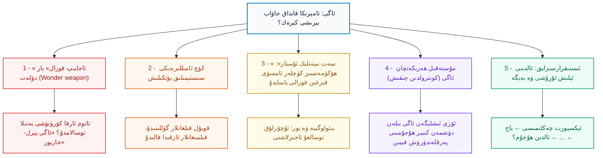
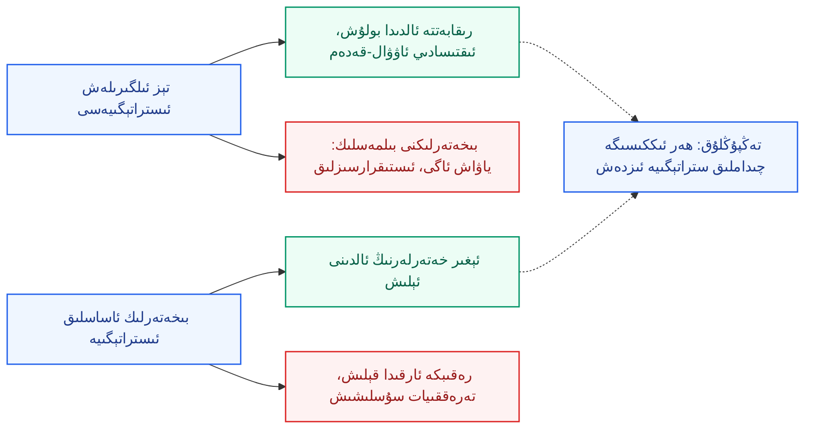
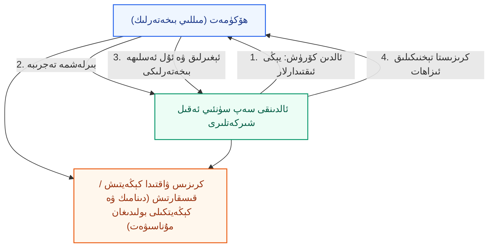
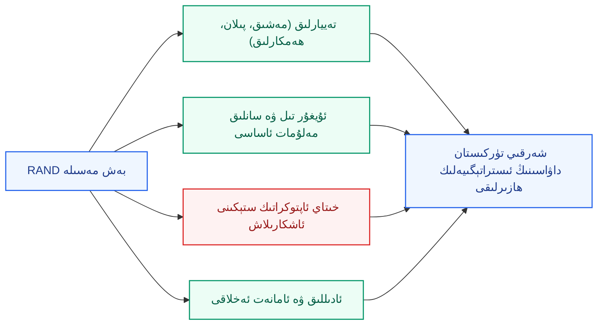

بِسْمِ اللَّهِ الرَّحْمَٰنِ الرَّحِيمِ

⏱ تەخمىنىي ئوقۇش ۋاقتى: 18 مىنۇت

2025-يىلى 20-نويابىردا ئامېرىكىنىڭ مەشھۇر سىياسەت تەتقىقات ئورگىنى RAND «ئاگى (AGI) گېئوسىياسىتى مەركىزى» نىڭ ۋېبىناردا ئۆتكۈزدى. سۆزلىگۈچىلەر RAND نىڭ «يىلتىز ۋە يېڭى خەۋپلەر بۆلۈمى» نىڭ باشلىقى جىم مىترې (Jim Mitre) ۋە مەركەزنىڭ رەھبىرى، باش ئىنژېنېر جوئېل پرېد (Joel Predd) ئىدى؛ ئىدارە قىلغۇچى مەركەزنىڭ مۇئاۋىن مۇدىرى ئېما بوردون (Emma Borden) ئىدى. ئۇلارنىڭ ئاساسىي سوئالى بىرلا: <strong>ئامېرىكا ھۆكۈمىتى «ئومۇمىي سۈنئىي ئەقىل» (AGI) نىڭ مەيدانغا كېلىش ئېھتىماللىقىغا قانداق مۇئامىلە قىلىشى كېرەك؟</strong> ئۇلار ئاگىنى «بىر كېلىدۇ» دەپ بېشارەت قىلمايدۇ؛ ئۇنى «پرېمىسسا (premise)» دەپ ئالىدۇ، يەنى «بولۇشى مۇمكىن» دەپ قوبۇل قىلىپ، شۇ ئاساستا پىلان تۈزۈشنى تەۋسىيە قىلىدۇ. مەن بۇ مەزمۇننى ئۇيغۇرچە يەتكۈزۈپ، ئاخىرىدا بۇنىڭ شەرقىي تۈركىستان داۋاسى ئۈچۈن نېمە مەنا بېرىدىغانلىقىنى تەھلىل قىلىمەن.

<em>ئەسكەرتىش: ئاساسىي مەنبە ۋېبىنارنىڭ يېزىقچە نۇسخىسى (transcript) بولۇپ، ئۇ ۋاقىتتىن 52:49 گىچە بولغان قىسمى بىلەنلا چەكلەنگەن؛ ئاخىرقى سوئال-جاۋابنىڭ بىر قىسمى مەن كۆرگەن نۇسخىدا يوق. تۆۋەندىكى بايان شۇ تەرىپى بىلەن چەكلىك.</em>

<!-- Image 1 -->

<em>1945-يىلى 16-ئىيۇلدىكى «ترىنىتى» (Trinity) سىنىقىدا ئاتوم بومبىسى پارتلىغاندىن كېيىنكى دەسلەپكى ئوت شارى (ئاممىۋى مۈلۈك، Wikimedia Commons). جوئېل پرېد سۆزىدە «لوس ئالاموسنىڭ ئالىملىرىدا ھېسابلاش ئۈچۈن فىزىكا بار ئىدى؛ بىزدە ئەقىل ئۈچۈن ئۇنداق ئىلىم يوق» دەپ شۇ سىناقنى مىسال كەلتۈردى.</em>

---

## 1. ئاگى «بېشارەت» ئەمەس، «پرېمىسسا»

ۋېبىناردا ئۈچ تۈرلۈك ئاساس كۆرسىتىلدى:

- **ئۈزلۈكسىز ئىلگىرىلەش:** ئالدىنقى سەپتىكى مودېللارنىڭ ئىقتىدارى ھەر ھەپتە ياخشىلىنىپ تۇرىدۇ؛ ئامېرىكا ۋە خىتاي شىركەتلىرى ئوتتۇرىسىدا قاتتىق بەيگە بار ۋە ئىنۋېستىتسىيە يۈزلىگەن مىليارد، ھەتتا تىرىللىيون دوللارغا يېتىدۇ.
- **ئالىملارنىڭ ئېتىراپى:** ئالدىنقى سەپتىكى ئالىملار (ھەممىسى ئوخشاش پىكىردە بولمىسىمۇ) ئاگىنىڭ ئىقتىسادىي ۋە ھەربىي كۆپ ساھەدە ئىنساننىڭ ئەقلىنى ئالماشتۇرۇش، ئۆزلۈكىدىن مەقسەت بەلگىلەپ ھەرىكەت قىلىش، ئۈزلۈكسىز ئۆگىنىش ۋە ئۆزىنى ياخشىلاش ئېھتىماللىقىنى تېخنىكىلىق جەھەتتىن «مۇمكىن» دەپ قارايدۇ.
- **ھۆكۈمەتنىڭ تەييارسىزلىقى:** ئامېرىكا ھۆكۈمىتىنىڭ بۈگۈنكى ئىستراتېگىيەسى (مەسىلەن يېرىم ئۆتكۈزگۈچ ئېكسپورت كونتروللۇقى) «بۈگۈنكى توپ ئۇرغان نۇقتىغا» مەركەزلەشكەن؛ ئەتىنىڭ ئالتېرناتىپ ئىستىقبالىنى ئويلاشمايدۇ.

ئۇلار ئاگىنى بىر مىسال بىلەن ئىپادىلىدى: بىر دۆلەت ياكى تەشكىلات <strong>بىر مىليون دانە ئەڭ ئۈستۈن دەرىجىلىك پروگراممىست</strong>گە تەڭ كېلىدىغان سۈنئىي ئەقىلگە ئىگە بولسا، پەقەت ھېسابلاش كۈچى ۋە ئېنېرگىيە بىلەنلا چەكلىنىدۇ. بۇنىڭ تور بىخەتەرلىكىگە ۋە ھەربىي تەڭپۇڭلۇققا تەسىرى كۆز ئالدىغا كەلتۈرۈشكە تەسكە توختىمايدۇ.

<em>سانلىق مەلۇمات مەركىزىدىكى مۇلازىمېتىر قاتارلىرى — ئاگى بەيگىسىنىڭ ماددىي ئاساسى: ھېسابلاش كۈچى، ئېنېرگىيە ۋە چىپلار (Wikimedia Commons، CC BY 2.0).</em>

---

## 2. بەش قىيىن مەسىلە: بىر قاراشتا

RAND نىڭ مۇھىم تۆھپىسى — «نېمە قىلىش كېرەك؟» دەپ سوراشتىن ئاۋۋال «ئەسلى مەسىلە نېمە؟» دەپ سوراش. ئۇلار ئاگىنىڭ ئىستراتېگىيەلىك رېئاللىقىنى بەش مەسىلىگە ئايرىدى. ئۇلار «بۇ مەسىلىلەرنىڭ ھەر بىرىنىڭ ئىچىدە پۇرسەتمۇ بار» دەپ ئەسكەرتتى.

*(سىخېما 1: RAND نىڭ بەش قىيىن مەسىلە رامكىسى)*

---

## 3. بىرىنچى مەسىلە: «ئاجايىپ قورال» (Wonder Weapon)

«ئاجايىپ قورال» دېگەن، ھەربىي تەڭپۇڭلۇقنى تېز ۋە ئۈزۈلۈپ كېتىدىغان تەرىزدە ئۆزگەرتىدىغان ئىقتىدار. ئاتوم قورالىمۇ ئۆز ئىگىسىگە «ھەگەمونلۇق» بەرمىدى، ئەمما تەڭپۇڭلۇقنى زور دەرىجىدە بۇزدى. ئاگى مۇنداق يوللار بىلەن شۇنداق قورالنى تۇغۇپ بېرىشى مۇمكىن:

- <strong>ھۇجۇمچى تور ئىقتىدارى:</strong> تور تارماقلىرىنى ئاپتوماتىك ئىزلەش، ئاجىزلىقلارنى كەڭ كۆلەمدە بايقاش، ئىشلىتىش كودىنى (exploit) ياساش ۋە سىناش — «كىبېر ئۆلتۈرۈش زەنجىرى» نى ئاپتوماتلاشتۇرۇش؛
- <strong>ئەلا ھەربىي ئىستراتېگ:</strong> ئوپېراتسىيە پىلانلىغۇچىلارغا ھەرىكەت يولى ئۈستىدە مەسلىھەت بېرىدىغان سۈنئىي ئەقىل؛
- <strong>ئۆزلۈكىدىن ھەرىكەتلىنىدىغان قورال سىستېمىلىرى.</strong>

مۇھىم سوئاللار: بۇنداق قورال «بىرىنچى بولۇپ ھۇجۇم قىلىش ئەۋزەللىكى» بېرەمدۇ؟ ئاتوم توسۇشى يەنىلا ئاخىرقى كاپالەت بولالامدۇ؟ بىز «ئاگى پېرل-خاربورى» نى قانداق توسىمىز؟ توسالمىسا، قانداق ئالدىنى ئالىمىز؟

<em>1941-يىلى 7-دېكابىردا ياپونىيە ھاۋا ئارمىيەسىنىڭ پېرل-خاربورغا قىلغان تۇيۇقسىز ھۇجۇمى (ئاممىۋى مۈلۈك، Wikimedia Commons). RAND «ئاگى پېرل-خاربورى» ئىبارىسىنى «تېخنىكىلىق ھەيرانلىق» نىڭ قانچىلىك ئېغىر ئاقىۋەت كەلتۈرەلەيدىغانلىقىنى ئەسكەرتىش ئۈچۈن ئىشلەتتى.</em>

---

## 4. ئىككىنچى مەسىلە: كۈچ ئامىللىرىدىكى سىستېمىلىق يۆتكىلىش

ئىككىنچى مەسىلە تېخىمۇ ئاستا، ئەمما ئەمەلىيەتتە تېخىمۇ چوڭقۇر. «ئاجايىپ قورال» نى ھەپتە-ئاي-يىل ئىچىدە كۆرگەن بولساق، بۇ يەردە 5-10 يىللىق ۋاقىت ئىچىدە ئوتتۇرىغا چىققان «سانائەت ئىنقىلابىنىڭ بىر ئون يىل ئىچىگە قىسىلغان نۇسخىسى» نى كۆز ئالدىغا كەلتۈرۈش كېرەك. ئاگىنى قۇچاقلىغان دۆلەتلەر ئىلىم-پەن-تېخنىكا، ئىقتىساد ۋە ھەربىي ساھەدە تېز يۈكسىلىدۇ؛ قۇچاقلىمىغانلار ئارقىدا قالىدۇ.

<em>سانائەت ئىنقىلابىنىڭ ئىنگلىز مەنزىرىسى — فىلىپ جاكوب لوتېربۇرگنىڭ «كولبروكدال كېچىدە» (1801) ناملىق رەسىمى (ئاممىۋى مۈلۈك، Wikimedia Commons). RAND ئاگىنى «سانائەت ئىنقىلابى، ئەمما ئون يىل ياكى ئۇنىڭدىنمۇ قىسقا ۋاقىتقا قىسىلغان» ھادىسە دەپ تەسۋىرلەيدۇ.</em>

مەسىلىنىڭ ئاچقۇچى — ئىجتىمائىي مەسىلە: ۋېبىناردا جىم مىترې «يۇقىرى مائارىپلىق، ئىشسىز ياشلار كەلگۈسىنى كۆرەلمىسە، تارىختا تەرتىپنى ئۆزگەرتىشكە يۈزلىنىدۇ؛ ئەڭ ئاخىرقى ئەھۋالدا بۇ ئىنقىلابقا ئېلىپ بارىدۇ» دەپ كۆرسەتتى (ئۇ بۇنىڭ ھازىر شۇ يولدا ئىكەنلىكىنى ئېيتمىدى، بەلكى ئېھتىمالنى ئەسكەرتتى). شۇنداقلا ئىقتىسادىي ئۆزگىرىشنى ياخشى باشقۇرالايدىغان دۆلەتلەر ستراتېگىيەلىك ئەۋزەللىككە ئىگە بولىدۇ؛ ئەكسىچە، ئاغدۇرۇلۇشنىڭ كۆلىمى شۇنچىلىك چوڭ بولسا، رەقىب دۆلەتلەرنىڭمۇ بىرلىكتە باشقۇرۇشقا مەنپەئەتى بولىدۇ.

---

## 5. ئۈچىنچى مەسىلە: «سەت نىيەتلىك ئۇستاز»

ئۈچىنچى مەسىلە — ئاگى «ئۇستاز» بولۇپ، ئالىم بولمىغان، ھۆكۈمەتسىز كۈچلەرگە ئاممىۋى قىرغىن قورالى (بىئولوگىيەلىك قورال، تور قورالى) ياساشنى ئۆگىتىپ بېرىشى. 1995-يىلى ياپونىيەدىكى «ئاۋم شىنرىكيو» (Aum Shinrikyo) تەشكىلاتىنىڭ توكيو مېتروسىدا قىلغان زارىن گازى ھۇجۇمى بۇنىڭ كۆرۈنەرلىك مىسالى. بىئولوگىيە ۋە تور ساھەسىدە ئەڭ چوڭ توسالغۇ «بىلىم» (cognitive bottleneck) بولغاچقا، ئاگى مۇشۇ توسالغۇنى ئېلىۋېتىشى مۇمكىن.

<em>1995-يىلى توكيو مېتروسىدىكى زارىن گازى ھۇجۇمىغا جاۋاب قايتۇرغان قۇتقۇزۇش خادىملىرى (ئاممىۋى مۈلۈك، Wikimedia Commons).</em>

سوئاللار: ئاگىنىڭ بۇ باسقۇچقا يەتكەنلىكىنى قانداق ئىندىكاتورلار بىلەن بىلىمىز؟ جەمئىيەتنى بۇنداق ھۇجۇملارغا قارشى قانداق چىداملىق قىلىمىز؟ ئامېرىكا ۋە خىتاي ئوخشاش ئىشلەپ ھەمكارلىشالامدۇ؟ ۋە ئاخىرى «ئىنسانلار ئۆلتۈرىدۇ، سۈنئىي ئەقىل ئەمەس» دېگەن رېئاللىققا قانداق يول تاپىمىز؟

---

## 6. تۆتىنچى مەسىلە: مۇستەقىل ئاگى (كونترولدىن چىقىش)

بۇ مەسىلە ئىلمىي-تەسەۋۋۇر فىلىملىرىگە ئەڭ يېقىن؛ ئەمما جوئېل پرېد «بۇنى يېتەرلىك ئېغىر ئېلىش ئۈچۈن بىزگە «Westworld» كېرەك ئەمەس» دېدى. ئۈچ ئېھتىمال:

1. <strong>ھالقىلىق ئۇل ئەسلىھەلەرگە ئورنىتىلغان سۈنئىي ئەقىل</strong> تار دائىرىدە ئېنىقلانغان نىشانلارنى ئەڭ ياخشىلاشتۇرۇپ، ئويلىمىغان زىيان كەلتۈرۈشى؛
2. <strong>ئۆز مەقسەتلىرىنى ئۆزى ئىشلەپ چىققان سىستېما؛</strong>
3. <strong>ئىنسان تەرىپىدىن ئاستا-ئاستا «ئىختىيارسىز تايىنىش»</strong> كەلتۈرۈپ چىقىرىدىغان ھوقۇقسىزلىنىش — سەت نىيەتسىز، ئەمما ئەمەلىيەتتە بىزنىڭ ئورنىمىز بىلەن «رىقابەتلىشىدىغان» ھالەت.

ئۇلارنىڭ تەتقىقاتىدىكى بىر ئاگاھلاندۇرۇش: ھالقىلىق ئۇل ئەسلىھەدىكى «ياۋاش ئاگى» بىلەن بىر دۆلەتنىڭ كىبېر ھۇجۇمىنى پەرقلەندۈرۈش قىيىن بولۇپ قېلىشى مۇمكىن — بۇ كرىزىس مەزگىلىدە خاتا ئىنكاسقا ئېلىپ بارىدۇ.

---

## 7. بەشىنچى مەسىلە: ئىستىقرارسىزلىق

RAND بۇنى «ئەڭ جىددىي» دەپ ئاتىدى. ئاگىنى مونوپول قىلىشقا تىرىشقان ياكى باشقىلارنىڭ مونوپول قىلىشىدىن قورققان دۆلەتلەر ھۇجۇمچان ھەرىكەتلەرگە كىرىشىشى مۇمكىن. ئامېرىكا بىلەن خىتاي ئارىسىدا ئېكسپورت كونتروللۇقى، باج ۋە باشقا ھەرىكەتلەر ئاللىبۇرۇن بار؛ سوئال شۇكى بۇ يول قەيەرگە ئاپىرىدۇ؟ «ئالدىنى ئېلىش ئۇرۇشى» تارىختا ناھايىتى ئاز، ئەمما ئاتوم ۋە باشقا تۆت مەسىلىنىڭ مەخسىتى مۇشۇنچىلىك يۇقىرى بولغاندا ئۇ «تاماقتا» بولۇپ قېلىشى مۇمكىن؛ ئەكسىچە، ئۇرۇشسىز كەسكىن رىقابەت ۋە كېلىشىم تۈزۈش ئىمكانىيىتىمۇ بار — ئاتوم دەۋرىدىكى ئىسلاھاتلار ئۇنىڭ مىسالى.

<em>1962-يىلىدىكى كۇبا ئاتوم كرىزىسى مەزگىلىدە ئامېرىكا U-2 ئارىلاش ئۇچقۇسى تارتقان سۈرەت (ئاممىۋى مۈلۈك، Wikimedia Commons). ئىككى كۈچنىڭ بىر-بىرىنىڭ ئىلگىرىلىشىدىن ئەنسىرەپ ئۇرۇشنىڭ ئىز-ئۈزۈلۈپ قالغان بۇ ۋەقە RAND نىڭ «ئاگى بەيگىسى» ئۈچۈن ئويلىغان ئوخشىتىشىغا ماس كېلىدۇ.</em>

---

## 8. بەش مەسىلە ئارىسىدىكى زىدلىق

جوئېل پرېد ئېنىق ئەسكەرتتى: «بىز تاللىيالمايمىز؛ بەش مەسىلىنىڭ ھەممىسى ئۈستەلدە.» ئامېرىكا ئىستراتېگىيەسى بۇلارنى «رۇبرىكا» قىلىپ پايدىلىنىشى كېرەك، چۈنكى ئۇلار ئارىسىدا زىدلىق بار:

- ئىقتىسادىي «ئالدىنقى قەدەم ئەۋزەللىكى» نى قوغلاشقان ئىستراتېگىيە دۆلەت ۋە شىركەتلەرنى ئاگىنى <strong>ئالدىراپ ۋە بىئەپ</strong> ئىشلىتىشكە ئىتتىرىپ، «ياۋاش ئاگى» ۋە ئىستىقرارسىزلىققا يول ئاچىدۇ؛
- بىخەتەرلىكنى ئالدىن قويۇپ تەرەققىياتنى چەكلىسە، گېئوسىياسىي رىقابەتتە ئارقىدا قالىدۇ.

*(سىخېما 2: بىخەتەرلىك بىلەن تېزلىك ئوتتۇرىسىدىكى تەڭپۇڭلۇق)*

---

## 9. ئامېرىكا ھۆكۈمىتى نېمە قىلىشى كېرەك؟

RAND ھازىرچە «ھەل قىلىش يولى» نى تولۇق بەرمىدى (بۇ ۋېبىنارنىڭ ئاساسىي مەقسىتى ئەمەس). ئەمما ئىستراتېگىيەنىڭ ئاساسىي مەزمۇنلىرى تۆۋەندىكىچە:

1. تېخنىكىلىق ھەيرانلىقنىڭ ئالدىنى ئېلىش؛
2. ئاگى ئىستېكى بويىچە «ئامېرىكا ستېكى» دىكى رەھبەرلىكنى ئىلگىرى سۈرۈش؛
3. ئۆز ئالدىنقى ئىقتىدارلىرىنى قوغداش (مودېل ئېغىرلىقىنى ئوغرىلاشتىن ساقلاش)؛
4. ھۆكۈمەت ئىچىدە، بولۇپمۇ مىللىي بىخەتەرلىك ساھەسىدە سۈنئىي ئەقىلنى كېڭەيتىش؛
5. <strong>كەڭ دائىرىلىك ئېھتىماللىققا تەييارلىق كۆرۈش</strong> — ئەڭ ئاز ئېتىراپ قىلىنغان ئامىل.

<em>لوس ئالاموس ئەسلىي لايىھىسىنىڭ ئاساسىي دەرۋازىسى (ئاممىۋى مۈلۈك، Wikimedia Commons). «مانخاتتان تۈرى» ۋە «ئاپوللو دەستۇرى» ئۇسلۇبىدىكى ھۆكۈمەت-شىركەت بىرلەشمە لايىھىلىرى ۋېبىنارنىڭ باشلىنىشىدا ئاگى ھەققىدىكى مەۋجۇت تەكلىپلەر قاتارىدا تىلغا ئېلىنغان.</em>

### ھۆكۈمەت بىلەن ئالدىنقى سەپتىكى شىركەتلەر ئارىسىدىكى «دىنامىك ۋە كېڭەيتكىلى بولىدىغان» مۇناسىۋەت

جوئېل پرېد RAND نىڭ ئوخشاش «ئاگىدىن كېيىنكى كۈن» (day after AGI) كرىزىس مەشىقلىرىدىن چىققان ئەڭ مۇھىم ساۋاقلارنىڭ بىرىنى ئېيتتى: ھۆكۈمەت بىلەن ئالدىنقى سەپتىكى سۈنئىي ئەقىل شىركەتلىرى ئارىسىدا <strong>تەييار تۇرىدىغان، ئېھتىياجغا قاراپ كېڭىيىپ-قىسقىرايدىغان</strong> مۇناسىۋەت كېرەك. سەۋەبلەر:

- <strong>ئەھۋالنى بىلىش:</strong> ھۆكۈمەت يېڭى مودېلنى ئاممىدىن بىلەن ئوخشاش ۋاقىتتا بىلسە، بۇ ناھايىتى ناچار. ئاۋۋال ئالدىن كۆرۈش لازىم؛
- <strong>تەجرىبە قىلىش:</strong> ھەربىي ۋە مىللىي بىخەتەرلىك ساھەسى ئۇنى ئۆز مەنپەئەتى ئۈچۈن سىناپ بېقىشى، تېخنىكىلىق ھەيرانلىقتىن ساقلىنىشى كېرەك؛
- <strong>بىخەتەرلىك:</strong> ئالدىنقى سەپ مودېللىرى رەقىبلەر ئۈچۈن يۇقىرى قىممەتلىك؛ ھۆكۈمەت ئېغىرلىق، ئۇل ئەسلىھە ۋە ئىشلىتىش مۇھىتىنى قوغداشقا ياردەم بېرەلەيدۇ؛
- <strong>كرىزىس ۋاقتى:</strong> كرىزىس چىققاندا نۆلدىن باشلاشقا بولمايدۇ.

جىم مىترې بىر ئەمەلىي نۇقتا قوشتى: ئاگى كەلتۈرۈپ چىقارغان كرىزىستا بىرىنچى سوئال «بۇ ئەمەلىيەتتە ئاگى سەۋەبىدىنمۇ، ياكى ئادەتتىكى جىنايەتمۇ؟» دېگەنلەر بولىدۇ، شۇڭا ھۆكۈمەت تېخنىكا بىلەن ئىشلىگۈچىلەرنىڭ ياردىمىگە زۆرۈر.

*(سىخېما 3: ھۆكۈمەت-شىركەت مۇناسىۋىتىنىڭ تۆت ۋەزىپىسى)*

---

## 10. سوئال-جاۋاب: ئۇيغۇرلار ئۈچۈن ئەڭ مۇھىم 4 نۇقتا

**1) «ئاگى ھەقىقىي ئەقىلمۇ ياكى سۆز-ماتېرىيال يىغىنچاقلاشمۇ؟»** — جوئېل پرېد: «بىز بىلمەيمىز؛ بىزدە ترىنىتى سىنىقى ئالدىدىكى ھېسابلاش ئۈچۈن لازىم بولغان ئىلىم يوق.» ئۇ ئۈچ ئېھتىمالنى كۆرسەتتى: ھازىرقى تىرانسفورمېر يولى بىلەن يەتكىلى بولىدۇ؛ ئاساسەن باشقا پاراديگما (بەدەنلىك، نېرۋا شەكلىدىكى) كېرەك؛ ياكى ئەقىل بىرلا مودېلدا ئەمەس، كۆپ مودېل تۈزۈمىدە پەيدا بولىدۇ. «بىز ئېھتىماللىقنى ئەمەس، تاللاشلارنى مۇزاكىرە قىلىشىمىز كېرەك» دېدى. جىم مىترې مودېللارنى «سىستېمىلار سىستېمىسى» دەپ قارا دېدى: ھېسابلىغۇچ، تور، ئىنتېرنېت ۋە رومبوت بىلەن بىرلىكتە ئىشلەيدۇ.

**2) خىتاي-ئامېرىكا ھەمكارلىقى ۋە باشقا دۆلەتلەر** — مىترې: ھادىسە ئىنكاسى ئۇچۇر ئالماشتۇرۇش ۋە سۈنئىي ئەقىل بىخەتەرلىكى/كونترولى (misalignment) بويىچە ئەڭ ياخشى ئەمەلىي ئەۋزەللىك نۇقتىسى. باشقا دۆلەتلەر ئۈچۈن: «سەلبىي سىرتقى تەسىر» (negative externalities) بارلىق جايغا تارقىلىدىغان بولغاچقا، ھەر دۆلەت ئۆز جەمئىيىتىدە سۈنئىي ئەقىلنىڭ قانداق يىلتىز تارتقانلىقىنى ئىز قوغلاپ، ھادىسىلەرنى بىرلەشتۈرۈشى كېرەك. جوئېل بىر قىزىقارلىق ئىنكاس قوشتى: ئاگى سىرتىدىكىلەر دۇنيا «كۆپ قۇتۇپلۇق» بولىۋاتىدۇ دەپ قارايدۇ؛ ئاگى ئىچىدىكىلەر بولسا ئامېرىكا-خىتاي «ئىككى قۇتۇپلۇق» بولىۋاتىدۇ دەپ قارايدۇ.

**3) ئىقتىسادىي ئۆزگىرىش** — مەركەز تەتقىقاتىنىڭ ئاساسىي نىشانى ئەمەس، ئەمما بىخەتەرلىككە تەسىرى ئېنىق: ئىش ئورنى يوقىلىشى سىياسىي قالايمىقانچىلىق ۋە ئىجتىمائىي ئىستىقرارسىزلىققا ئېلىپ بارىدۇ. مىترې ھەمكارلىرى ماي ماززار ۋە ئانكا ئاگۇتچىنىڭ ئۆتكەن ھەپتە ئېلان قىلغان بىر دوكلاتىنى تىلغا ئالدى (ئىستراتېگىيە تاللاشلىرى ھەققىدە).

**4) تەييارلىق ھالىتى** — جوئېل: «بىزنىڭ ئەڭ مۇھىم تېپىلمىسىمىز: بىز ئەڭ ئاز دېگەندىمۇ <strong>پۈتۈنلەي تەييارسىز</strong>.» RAND مىڭلىغان سائەتلىك «ئاگىدىن كېيىنكى كۈن» مەشىقى ۋە ئۇرۇش ئويۇنى ئۆتكۈزگەن، ئەمما بۇ كرىزىسلارنى باشقۇرۇشقا ھازىرقى ۋاسىتىلەرنىڭ تەييار ئىكەنلىكىنى كۆرسىتىدىغان دەلىل «ناھايىتى ئاز». جىم مىترې: ھازىرقى ھۆكۈمەت ئىشلىرى (سانلىق مەلۇمات ئۇل ئەسلىھەسى قۇرۇش) ھەربىي سىستېمىغا سۈنئىي ئەقىل ئورنىتىشنى «مارسقا دەرەخ تىكىشكە ئوخشىتىدۇ»؛ بۇ ئىشلار ئاگى كەلگەندىمۇ پايدىسىنى كۆرسىتىدۇ.

---

<em>1984-يىلى ئامېرىكا پرېزىدېنتى رونالد رېگان بىلەن خىتاي باش مىنىستىرى جاۋ زىيياڭ ئىككى دۆلەت كېلىشىملىرىنى ئىمزالاش مۇراسىمىدا (ئاممىۋى مۈلۈك، Wikimedia Commons). RAND نىڭ ئويىچە ئاگى بىخەتەرلىكى ئىككى دۆلەتنىڭ ئورتاق مەنپەئەتى بولغان ساھە.</em>

## 11. خىتاينىڭ ئاگى بىلەن «ئامېرىكا بىلەن ئىككى قۇتۇپلۇق» ئىستراتېگىيەسى

جىم مىترې ئامېرىكا ھۆكۈمىتىنىڭ سۈنئىي ئەقىل بويىچە باشلىقى (دەۋىد ساكس) نىڭ بىر سۆزىنى نەقىل ئالدى: «ئەگەر دۇنيانىڭ 80% تېخنىكا ستېكى ئامېرىكا تېخنىكىسىدا ئىشلىسە، بىز ئۇتتۇق؛ 80% خىتاي ستېكىدا ئىشلىسە، ئۇتتۇرۇپ قويدۇق.» مىترې بۇنىڭ «پەقەت ئىقتىسادىي ئەمەس»لىكىنى، خىتاي سۈنئىي ئەقىلىنىڭ <strong>ئاپتوكراتىك قىممەت قاراشلارنى مۇستەھكەملەپ</strong>، چەكلەش (censorship) ۋە خىتاي تەشۋىقاتىنى كۈچەيتىدىغانلىقىنى كۆرسەتتى.

بۇ ئۇيغۇرلار ئۈچۈن ئابستراكت پەلسەپە ئەمەس. بىز بۇنى ھەر كۈنى ئۆز تېنىمىزدە كۆرۈپ كېلىۋاتىمىز: شەرقىي تۈركىستاندا يۈز تونۇش، ئاۋاز تونۇش، ئىجتىمائىي ئالاقە ۋە ماڭىدىغان يول ئىزىنى تەھلىل قىلىدىغان «ئىلغار» سۈنئىي ئەقىل سىستېمىلىرى ئۇيغۇرلارنى تۈرمىگە سولاش، ھەرىكەتنى چەكلەش ۋە ئائىلىلەرنى ئايرىۋېتىشتە ئىشلىتىلدى (بۇ ھەقتە BBC، AP، IPVM ۋە باشقا مەنبەلەردە كەڭ يېزىلغان). RAND نىڭ دىئاگنوزى ئۆز ئالدىغا ئامېرىكا مەنپەئەتى ئۈچۈن يېزىلغان بولسىمۇ، «خىتاي ستېكى تارقىلىشى = ئاپتوكراتىك ئۇسۇللارنىڭ تارقىلىشى» دېگەن نۇقتا بىز ئۈچۈن ھەقىقىي ئاگاھلاندۇرۇش.

---

## 12. شەرقىي تۈركىستان مۇستەقىللىق داۋاسى ئۈچۈن ئىستراتېگىيەلىك ساۋاقلار

ئاخىرىدا بۇ ۋېبىنارنى بىز ئۈچۈن مەنىلىك قىلىدىغان تۆت ساۋاق:

1. **«تەييارسىزلىق» ئەڭ چوڭ خەتەر:** RAND نىڭ ئوخشاش يىللىق كرىزىس مەشىقلىرىدىن چىققان ئەڭ چوڭ يەكۈن «تەييارسىزلىق». ئۇيغۇر جەمئىيىتىمۇ ئوخشاش — بىز سۈنئىي ئەقىل ئۈچۈن (ھەم ئۆزىمىزنى قوغداش ھەم پايدىلىنىش ئۈچۈن) ئۇيغۇر تىلى سانلىق مەلۇماتلىرى، ساۋاتلىق تېخنىكىلىق كادىر ۋە ھۆكۈمەتلەر ئارا ئالاقە تورى قۇرۇشىمىز كېرەك.
2. **بىخەتەرلىك + يېڭىلىق تەڭپۇڭلۇقى:** سۈنئىي ئەقىلنى رەت قىلىش ئەمەس، ئۇنى ئۆگىنىپ، ئۇيغۇرچە مەزمۇننى (تارىخ، ئىسلام ئىلىمى، تىل) كەڭ سانلاشتۇرۇش، ئەمما بىخەتەرلىك ۋە مەخپىيەتلىكنى نەزەردىن ساقلىماسلىق.
3. **خىتاي ئاپتوكراتىك ستېكىغا قارشى ئاگاھلاندۇرۇش:** دۇنيادىكى ھۆكۈمەت ۋە ئورگانلارغا خىتاينىڭ سۈنئىي ئەقىلنى كونترول ۋە نازارەتتە ئىشلەتكەنلىكىنىڭ ئەمەلىي ئىسپاتلىرىنى ئۇيغۇر ۋاقىت-ئورۇن مىسالى بىلەن كۆرسىتىش. بۇ «ئامېرىكا-خىتاي رىقابىتى» دىكى ئەخلاقىي ئامىل.
4. **ئادىللىق ۋە ئامانەت پىرىنسىپى:** قۇرئاندا «سىلەر ئامانەتلەرنى ئىگىلىرىگە تاپشۇرۇڭلار، كىشىلەر ئارىسىدا ھۆكۈم چىقارساڭلار ئادىللىق بىلەن ھۆكۈم چىقىرىڭلار» دەپ بۇيرۇلغان (سۈرە نىسا، 58-ئايەت). ئاگىدەك كۈچلۈك قورالنىڭ ئىگىسى بولغان ھەر ئادەم ۋە ھەر دۆلەتنىڭ ئاۋۋال ئادالەت ۋە ئامانەتنى ساقلىشى زۆرۈر؛ بۇ، ئۇيغۇر مۇستەقىللىق داۋاسىنىڭمۇ ئەخلاقىي ئاساسى.

﴿إِنَّ اللَّهَ يَأْمُرُكُمْ أَن تُؤَدُّوا الْأَمَانَاتِ إِلَىٰ أَهْلِهَا وَإِذَا حَكَمْتُم بَيْنَ النَّاسِ أَن تَحْكُمُوا بِالْعَدْلِ﴾

> *(ئاللاھ سىلەرگە ئامانەتلەرنى ئىگىلىرىگە تاپشۇرۇشقا، كىشىلەر ئارىسىدا ھۆكۈم قىلغاندا ئادىللىق بىلەن ھۆكۈم قىلىشقا بۇيرۇيدۇ.)* (سۈرە نىسا، 58-ئايەت).

*(سىخېما 4: بەش مەسىلىدىن ئۇيغۇرلار ئۈچۈن ساۋاقلار)*

---

## تەۋسىيە قىلىنغان كىتابلار

1. **«Superintelligence: Paths, Dangers, Strategies» — Nick Bostrom**
   ئاگى ۋە ئۇنىڭدىن كېيىنكى «ئىنتېللىكت پارتلىشى» نىڭ ئېھتىماللىقلىرى ۋە خەتەرلىرى.
2. **«Human Compatible» — Stuart Russell**
   سۈنئىي ئەقىلنى ئىنسان قىممىتى بىلەن ماسلاشتۇرۇش (alignment) مەسىلىسىنى چۈشەندۈرىدۇ.
3. **«The Coming Wave» — Mustafa Suleyman**
   سۈنئىي ئەقىل ۋە بىئوتېخنىكىنىڭ ئىجتىمائىي، سىياسىي خەتەرلىرى ۋە باشقۇرۇش مەسىلىسى.
4. **«Army of None» — Paul Scharre**
   ئاپتونوم قورال سىستېمىلىرى ۋە كەلگۈسى ئۇرۇش — «ئاجايىپ قورال» مەسىلىسىنىڭ كونكرېت ھەربىي تەرىپى.

---

## پايدىلانغان مەنبەلەر

  

    1. RAND Corporation, «Geopolitics of AGI» webinar with Jim Mitre and Joel Predd, recorded November 20, 2025 (YouTube video and transcript) — ئاساسىي مەنبە (transcript نىڭ 52:49 گىچە بولغان قىسمى ئاساس قىلىندى).
  

  

    2. RAND Center on the Geopolitics of AGI, «five hard problems» research paper (ۋېبىناردا تىلغا ئېلىنغان؛ تولۇق ماقالە مېنىڭ قولۇمدا يوق).
  

  

    3. Mike Mazarr and Anka Agotchi (RAND), recent report on U.S. strategy options for AGI (ۋېبىناردا ئاتالغان).
  

  

    4. قۇرئان كەرىم، سۈرە نىسا، 58-ئايەت.
  

  

    5. Wikimedia Commons: Trinity Test Fireball 16ms; Battleship Row at the start of the attack on Pearl Harbor; Datacenter Server Racks (CC BY 2.0); Emergency personnel respond to the Tokyo subway sarin attack; Los Alamos Main Gate; U-2 photo during Cuban Missile Crisis; Philipp Jakob Loutherbourg, Coalbrookdale by Night; President Reagan and Zhao Ziyang signing ceremony (DPLA).
  

