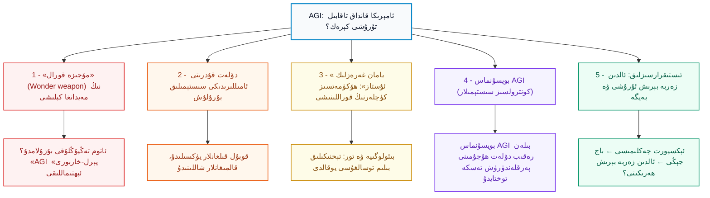
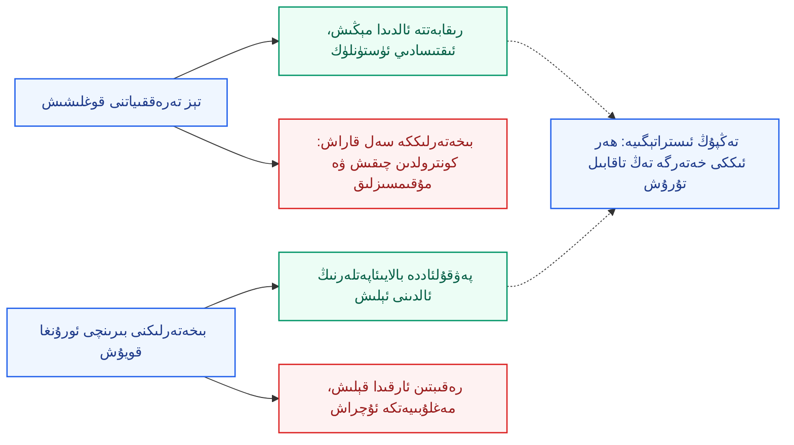
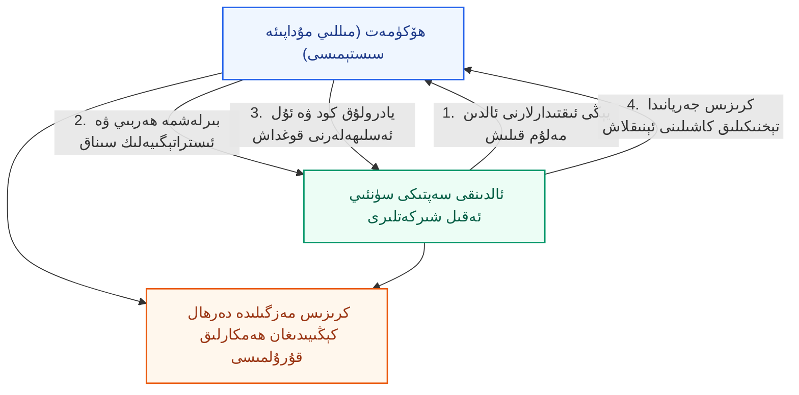
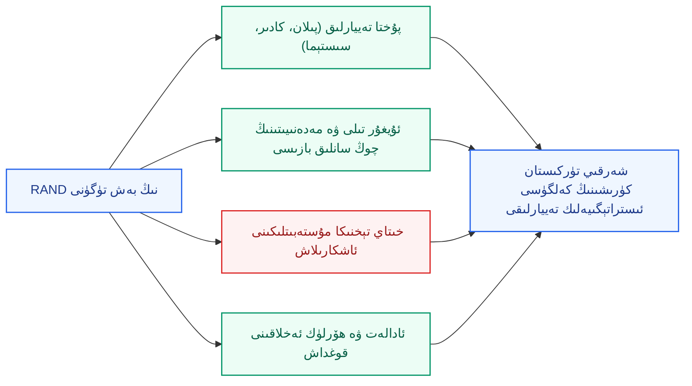

بِسْمِ اللَّهِ الرَّحْمَٰنِ الرَّحِيمِ

⏱ تەخمىنىي ئوقۇش ۋاقتى: 18 مىنۇت

2025-يىلى 20-نويابىر كۈنى ئامېرىكىنىڭ داڭلىق ئىستراتېگىيە ۋە سىياسەت تەتقىقات ئورگىنى RAND تەۋەلىكىدىكى «AGI گېئوسىياسىتى مەركىزى» بىر تور مۇھاكىمە يىغىنى (ۋېبىنار) ئۆتكۈزدى. ئاساسىي سۆزلىگۈچىلەر RAND نىڭ «يېڭىدىن باش كۆتۈرۈۋاتقان تەھدىتلەر بۆلۈمى» نىڭ باشلىقى جىم مىترې (Jim Mitre) ۋە مەزكۇر مەركەزنىڭ رەھبىرى ھەم باش ئىنژېنېرى جوئېل پرېدد (Joel Predd) بولدى؛ سۆھبەتكە مەركەزنىڭ مۇئاۋىن مۇدىرى ئېمما بوردېن (Emma Borden) رىياسەتچىلىك قىلدى. ئۇلار ئوتتۇرىغا قويغان يادرولۇق سوئال بىرلا: <strong>ئامېرىكا ھۆكۈمىتى «ئومۇمىي سۈنئىي ئەقىل» (AGI) نىڭ مەيدانغا كېلىش ئېھتىماللىقىغا قانداق تاقابىل تۇرۇشى كېرەك؟</strong> ئۇلار AGI نى مۇقەررەر «كېلىدۇ» دەپ بېشارەت بەرمەيدۇ، بەلكى ئۇنى بىر «ئالدىنقى شەرت/پەرەز (premise)» سۈپىتىدە قوبۇل قىلىپ، ئىستراتېگىيەلىك پىلانلارنى مۇشۇ ئاساستا تۈزۈشنى تەۋسىيە قىلىدۇ. مەن تۆۋەندە بۇ مەزمۇننى ئۇيغۇرچىغا خۇلاسىلەپ يەتكۈزۈش بىلەن بىرگە، بۇنىڭ شەرقىي تۈركىستان دەۋاسى ئۈچۈن نېمىدىن دېرەك بېرىدىغانلىقىنى تەھلىل قىلىمەن.

<em>ئەسكەرتىش: ماقالىنىڭ ئاساسىي مەنبەسى ۋېبىنارنىڭ يېزىقچە خاتىرىسى (transcript) بولۇپ، دەسلەپكى 52 مىنۇت 49 سېكۇنتلۇق قىسمىنى ئۆز ئىچىگە ئالىدۇ؛ ئاخىرقى قىسىمدىكى بەزى سوئال-جاۋابلار مەن كۆرگەن نۇسخىدا تولۇق بولمىغاچقا، بايانلار شۇ تەرىپى بىلەن چەكلەندى.</em>

<!-- Image 1 -->

<em>1945-يىلى 16-ئىيۇلدىكى «ترىنىتى» (Trinity) سىنىقىدا ئاتوم بومبىسى پارتلىغاندىن كېيىنكى دەسلەپكى ئوت شارى (ئاممىۋى مۈلۈك، Wikimedia Commons). جوئېل پرېدد سۆزىدە «لوس ئالاموس ئالىملىرىدا پارتلاشنى ھېسابلاشقا تايىنىدىغان فىزىكا قانۇنىيەتلىرى بار ئىدى؛ ئەمما بىزدە ئەقىلنىڭ ماھىيىتىنى ئۆلچەيدىغان ئۇنداق ئېنىق بىر ئىلىم يوق» دەپ، شۇ سىناقنى مىسال كەلتۈردى.</em>

---

## 1. AGI «بېشارەت» ئەمەس، بەلكى بىر «پەرەز-ئاساس»

ۋېبىناردا بۇ پەرەزنى قوبۇل قىلىش ئۈچۈن ئۈچ مۇھىم ئاساس كۆرسىتىلدى:

- **ئۈزلۈكسىز ئىلگىرىلەش:** ئالدىنقى سەپتىكى مودېللارنىڭ ئىقتىدارى ھەر ھەپتە دېگۈدەك ياخشىلىنىپ تۇرماقتا؛ ئامېرىكا ۋە خىتاي شىركەتلىرى ئوتتۇرىسىدىكى رىقابەت كەسكىنلىشىپ، سېلىنىۋاتقان مەبلەغ يۈزلىگەن مىليارد، ھەتتا تىرىليون دوللارغا يەتمەكتە.
- **ئالىملارنىڭ ئېتىراپى:** ساھەنىڭ ئالدىنقى سېپىدىكى ئالىملار (ھەممىسى بىردەك پىكىردە بولمىسىمۇ) AGI نىڭ ئىقتىسادىي ۋە ھەربىي نۇرغۇن ساھەلەردە ئىنسان ئېڭىنىڭ ئورنىنى ئېلىش، ئۆزلۈكىدىن نىشان بېكىتىپ ھەرىكەت قىلىش، ئۈزلۈكسىز ئۆگىنىش ۋە ئۆزىنى ئەلالاشتۇرۇش ئېھتىماللىقىنى تېخنىكىلىق جەھەتتىن «مۇمكىن» دەپ قارىماقتا.
- **ھۆكۈمەتلەرنىڭ تەييارسىزلىقى:** ئامېرىكا ھۆكۈمىتىنىڭ بۈگۈنكى ئىستراتېگىيەسى (مەسىلەن، يېرىم ئۆتكۈزگۈچ ئېكسپورت چەكلىمىلىرى) پەقەت تەھدىت كۆرۈلۈپ بولغان بۈگۈنكى نۇقتىغىلا مەركەزلەشكەن بولۇپ، ئەتىنىڭ ئېھتىماللىقى بولغان كەلگۈسى مەنزىرىلىرىنى تولۇق كۆزدە تۇتمايۋاتىدۇ.

ئۇلار AGI نىڭ كۈچىنى بىر مىسال بىلەن سۈپەتلىدى: ئەگەر بىر دۆلەت ياكى گۇرۇھ **بىر مىليون ئەڭ ئالىي دەرىجىلىك پروگراممېرغا** تەڭ كېلىدىغان سۈنئىي ئەقىلگە ئىگە بولسا، ئۇنىڭ ئىقتىدارى پەقەت ھېسابلاش كۈچى ۋە ئېنېرگىيە بىلەنلا چەكلىنىدۇ. بۇنىڭ تور بىخەتەرلىكىگە ۋە دۇنياۋى ھەربىي تەڭپۇڭلۇققا كۆرسىتىدىغان تەسىرىنى تەسەۋۋۇر قىلىش تەسكە توختىمايدۇ.

<em>سانلىق مەلۇمات مەركىزىدىكى سېرۋېر قاتارلىرى — AGI بەيگىسىنىڭ ماددىي ئاساسى: ھېسابلاش كۈچى، ئېنېرگىيە ۋە ئىلغار چىپلار (Wikimedia Commons، CC BY 2.0).</em>

---

## 2. بەش مۇرەككەپ تۈگۈن: بىر قاراشتا

RAND نىڭ ئەڭ مۇھىم تەشەببۇسى — «نېمە قىلىش كېرەك؟» دەپ سوراشتىن ئاۋۋال «ئەسلى مەسىلە نېمە؟» دەپ ئېنىقلاش. تەتقىقاتچىلار AGI كەلتۈرۈپ چىقىرىدىغان ئىستراتېگىيەلىك تەسىرلەرنى بەش يادرولۇق مەسىلىگە ئايرىغان ھەمدە «بۇ تەھدىتلەرنىڭ ھەر بىرى ئۆز نۆۋىتىدە يېڭى پۇرسەتلەرنىمۇ ئېلىپ كېلىدۇ» دەپ كۆرسەتكەن.

*(سىخېما 1: RAND ئوتتۇرىغا قويغان بەش مۇرەككەپ تۈگۈن رامكىسى)*

---

## 3. بىرىنچى مەسىلە: «مۆجىزە قورال» (Wonder Weapon)

«مۆجىزە قورال» ھەربىي تەڭپۇڭلۇقنى بىر كېچىدىلا ۋە تۈپتىن ئۆزگەرتىۋېتەلەيدىغان ئىقتىدارنى كۆرسىتىدۇ. ئاتوم قورالىمۇ ئۆز ئىگىسىگە مۇتلەق ھۆكۈمرانلىق ئېلىپ كېلەلمىگەن بولسىمۇ، ئەمما ئىستراتېگىيەلىك كۈچ سېلىشتۇرمىسىنى يىلتىزىدىن تەۋرەتكەن ئىدى. AGI تۆۋەندىكى يوللار ئارقىلىق شۇنداق تىپتىكى قورالنى ۋۇجۇتقا چىقىرىشى مۇمكىن:

- <strong>ھۇجۇم خاراكتېرلىك تور ئىقتىدارى:</strong> دۈشمەن تور سىستېمىسىدىكى يوچۇقلارنى ئاپتوماتىك ئىزدەپ تېپىش، نىشانلىق بوشلۇقلاردىن پايدىلىنىش كودلىرىنى (exploit) شۇ زامان ياساش ۋە ئىشقا سېلىش — يەنى پۈتۈن بىر «تور ئۇرۇشى ھۇجۇم زەنجىرى» نى تولۇق ئاپتوماتلاشتۇرۇش؛
- <strong>ئالىي ھەربىي ئىستراتېگىيەچى:</strong> جەڭ ۋە مەشغۇلات پىلانلىغۇچىلارغا نەق مەيداندا ئەڭ ئەۋزەل ھەرىكەت يۆنىلىشلىرىنى بەلگىلەپ بېرىدىغان تەڭداشسىز سۈنئىي ئەقىل سىستېمىسى؛
- <strong>ئۆزلۈكىدىن مەشغۇلات قىلىدىغان ئاپتونوم قورال سىستېمىلىرى.</strong>

ئوتتۇرىغا چىقىدىغان جىددىي سوئاللار: بۇنداق قورال دۆلەتلەرگە «بىرىنچى بولۇپ زەربە بېرىش ئەۋزەللىكى» بېرەمدۇ؟ ھازىرقى ئاتوم تەڭپۇڭلۇقى يەنىلا ئاخىرقى قالقان بولۇپ ق Wyndham قالالامدۇ؟ بىز كۈتۈلمىگەن بىر «AGI پېرل-خاربورى» ھۇجۇمىنىڭ ئالدىنى قانداق ئالىمىز؟

<em>1941-يىلى 7-دېكابىردا ياپونىيە ھاۋا ئارمىيەسىنىڭ پېرل-خاربورغا قىلغان تۇيۇقسىز ھۇجۇمى (ئاممىۋى مۈلۈك، Wikimedia Commons). RAND «AGI پېرل-خاربورى» ئىبارىسى ئارقىلىق «تېخنىكىلىق غەپلەتتە قېلىش» نىڭ قانچىلىك ئېغىر پالاكەتلەرنى ئېلىپ كېلىدىغانلىقىنى ئاگاھلاندۇردى.</em>

---

## 4. ئىككىنچى مەسىلە: دۆلەت قۇدرىتى ئامىللىرىدىكى سىستېمىلىق بۇرۇلۇش

بۇ مەسىلە ئاستا كۆرۈنسىمۇ، ئەمەلىيەتتە تېخىمۇ چوڭقۇر ۋە سىجىل تەسىرگە ئىگە. «مۆجىزە قورال» نىڭ ئۈنۈمى ئايلار ياكى يىللار ئىچىدە كۆرۈلسە، بۇ يەردە 5–10 يىل ئىچىدە مەيدانغا كېلىدىغان، پۈتۈن بىر سانائەت ئىنقىلابىنى بىر ئون يىلغا قىسقارتقاندەك بىر چوڭ ئەۋرىشىملىكنى تەسەۋۋۇر قىلىش كېرەك. AGI تېخنىكىسىنى پۈتۈن كۈچى بىلەن قوبۇل قىلغان دۆلەتلەر پەن-تېخنىكا، ئىقتىساد ۋە ھەربىي جەھەتتە شىددەت بىلەن يۈكسىلىدۇ؛ سەل قارىغانلار پۈتۈنلەي شاللىنىپ كېتىدۇ.

<em>سانائەت ئىنقىلابى دەۋرىدىكى ئەنگلىيە مەنزىرىسى — فىلىپ جاكوب لوتېربۇرگنىڭ «كولبروكدال كېچىدە» (1801) ناملىق رەسىمى (ئاممىۋى مۈلۈك، Wikimedia Commons). RAND مەركىزى AGI نى «بىر ئون يىل ئىچىگە سىغدۇرۇۋېتىلگەن شىددەتلىك سانائەت ئىنقىلابى» دەپ سۈپەتلىمەكتە.</em>

بۇ مەسىلىنىڭ يادروسى — ئىجتىمائىي مۇقىملىق: جىم مىترې ۋېبىناردا مۇنداق دېدى: «تارىخقا قارايدىغان بولساق، يۇقىرى مائارىپ كۆرگەن، ئەمما كەلگۈسىدىن ئۈمىدى ئۈزۈلگەن ئىشسىز ياشلار ھامان نۆۋەتتىكى تەرتىپنى ئاغدۇرۇشقا ئاتلىنىدۇ؛ پەۋقۇلئاددە ھالەتلەردە بۇ قىسمەت ئىنقىلابلارنى كەلتۈرۈپ چىقىرىدۇ.» شۇڭا، بۇ تېخنىكىلىق بۇرۇلۇشنىڭ ئىقتىسادىي ۋە ئىجتىمائىي كىرىزىسىنى مۇۋەپپەقىيەتلىك باشقۇرالىغان دۆلەتلەر ئىستراتېگىيەلىك ئەۋزەللىككە ئېرىشىدۇ؛ ئەگەر قالايمىقانچىلىق بەكلا چوڭىيىپ كەتسە، رەقىب دۆلەتلەرمۇ بۇ كىرىزىسنى تەڭ تىزگىنلەش ئۈچۈن ھەمكارلىشىشقا مەجبۇر بولۇپ قېلىشى مۇمكىن.

---

## 5. ئۈچىنچى مەسىلە: «يامان غەرەزلىك ئۇستاز» (Malicious Tutor)

بۇ مەسىلە شۇكى، AGI ئۆز ساھەسىنىڭ مۇتەخەسسىسى بولمىغان، دۆلەت ھالقىغان ياكى ھۆكۈمەتسىز ئەسەبىي گۇرۇھلارغا كەڭ كۆلەملىك قىرغىنچىلىق قوراللىرىنى (بىئولوگىيەلىك زەھەر، تور قوراللىرى قاتارلىقلار) ياساشنى قەدەممۇقەدەم ئۆگىتىپ بېرىدىغان بىر «ئۇستاز» غا ئايلىنىپ قېلىشى مۇمكىن. 1995-يىلى ياپونىيەدىكى «ئائۇم شىنرىكيۆ» (Aum Shinrikyo) تەشكىلاتىنىڭ توكيو مېتروسىدا زارىن گازى ئارقىلىق قىلغان قەبىھ ھۇجۇمى بۇنىڭ تىپىك مىسالىدۇر. بىئوتېخنىكا ۋە تور ھۇجۇمى ساھەسىدىكى ئەڭ چوڭ پاسىل «ئىلمىي بىلىم ۋە ماھارەت يېتىشمەسلىك» (cognitive bottleneck) ئىدى؛ AGI مەزكۇر چەكلىمىنى تۈپتىن بىكار قىلىۋېتىشى مۇمكىن.

<em>1995-يىلى توكيو مېتروسىدىكى زارىن گازى ھۇجۇمى مەيدانىغا يېتىپ بارغان قۇتقۇزۇش خادىملىرى (ئاممىۋى مۈلۈك، Wikimedia Commons).</em>

جاۋاب تەلەپ قىلىدىغان سوئاللار: AGI نىڭ خەتەرلىك چەككە يەتكەنلىكىنى قايسى تېخنىكىلىق بەلگىلەر ئارقىلىق بىلەلەيمىز؟ پۇقرالار جەمئىيىتىنى بۇ خىل ھۇجۇملارغا قارشى قانداق قوغدىيالايمىز؟ ئامېرىكا بىلەن خىتاي دۇنياۋى تەھدىتكە قارشى كۈچ چىقىرىپ بىرلىكتە ھەمكارلىشالامدۇ؟ شۇنداقلا، قورالنى ئىشلەتكۈچى ئەسلىدە يەنىلا ئىنسان بولغان بىر ۋەزىيەتتە، تېخنىكىنى قانداق چەكلىگىلى بولىدۇ؟

---

## 6. تۆتىنچى مەسىلە: بويسۇنماس AGI (كونترولدىن چىقىش تەھدىتى)

بۇ مەسىلە قارىماققا ئىلمىي فانتازىيەلىك ئەسەرلەرگە بەكرەك ئوخشايدۇ. ئەمما جوئېل پرېدد: «بۇ خەتەرنىڭ ئېغىرلىقىنى تونۇپ يېتىش ئۈچۈن بىزگە چوقۇم ‹Westworld› كىنو-فىلىملىرىدىكى سىنارىيەلەرنىڭ بولۇشى شەرت ئەمەس» دەپ تەكىتلىدى. ئۇ ئۈچ چوڭ تەھدىتنى كۆرسەتتى:

1. **ھالقىلىق ئۇل ئەسلىھەلەرگە ئورۇنلاشتۇرۇلغان AGI سىستېمىلىرىنىڭ** چەكلىك بېكىتىلگەن نىشاننى ئىشقا ئاشۇرىمەن دەپ، سىستېمىدىن ھالقىغان زور ۋەيرانچىلىقلارنى كەلتۈرۈپ چىقىرىشى؛
2. **ئۆز مەقسەت-نىشانىنى ئۆزلۈكىدىن بەلگىلەيدىغان** يۆنىلىشسىز سىستېمىلارنىڭ شەكىللىنىشى؛
3. **ئىنسانلارنىڭ پۈتۈنلەي تايىنىپ قېلىشى تۈپەيلىدىن ھوقۇقسىزلىنىشى (disempowerment)** — گەرچە ماشىنىنىڭ يامان نىيىتى بولمىسىمۇ، ئاستا-ئاستا ئىنسانىيەتنىڭ تەدبىر بەلگىلەش ھوقۇقىنى تارتىۋېلىشى.

تەتقىقاتچىلار ئالاھىدە ئاگاھلاندۇرغان بىر نۇقتا بار: ھالقىلىق ئۇل ئەسلىھەدە كۆرۈلگەن بىر مەسىلىنىڭ سىستېمىنىڭ ئۆزلۈكىدىن كونترولدىن چىقىپ قېلىشىدىن كېلىپ چىققانلىقى ياكى بىرەر رەقىب دۆلەتنىڭ تور ھۇجۇمى ئىكەنلىكىنى بىلىش پەۋقۇلئاددە تەس بولىدۇ — بۇ ئەھۋال جىددىي پەيتلەردە خاتا يەكۈن چىقىرىش ۋە ئۇرۇش قوزغاپ سېلىش خەۋپىنى تۇغدۇرىدۇ.

---

## 7. بەشىنچى مەسىلە: ئىستىقرارسىزلىق ۋە ئالدىن زەربە بېرىش تەھدىتى

RAND بۇنى پۈتۈن تەتقىقات ئىچىدىكى «ئەڭ جىددىي ۋە خەتەرلىك مەسىلە» دەپ ئاتىدى. AGI نى بىر تەرەپلىمە مونوپول قىلىشقا تىرىشقان ياكى رەقىبىنىڭ يالغۇز ئىگىلىۋېلىشىدىن قورققان دۆلەتلەر تاجاۋۇزكار ھەرىكەتلەرگە قەدەم تاشلىشى مۇمكىن. ئامېرىكا بىلەن خىتاي ئوتتۇرىسىدىكى ئېكسپورت چەكلىمىلىرى ۋە باج جەڭلىرى ئاللىقاچان ئەۋج ئالدى. سوئال شۇكى: بۇ بېسىم كېيىن قەيەرگە تۇتىشىدۇ؟ 

«ئالدىنى ئېلىش خاراكتېرلىك ئۇرۇش» قوزغاش تارىختا كۆپ كۆرۈلمىگەن بولسىمۇ، لېكىن مۇناسىۋەتلىك تەرەپلەر يۇقىرىدىكى باشقا تۆت خىل قورقۇنچلۇق خەتەر بىلەن يۈز كەلگەندە، قارشى تەرەپنىڭ تەتقىقات مەركەزلىرىگە تۇيۇقسىز زەربە بېرىش ئېھتىماللىقى پۈتۈنلەي **كۈنتەرتىپكە كېلىپ قېلىشى** مۇمكىن. ئەلۋەتتە، ئۇرۇش قوزغىماستىن كەسكىن كېلىشىملەر ۋە نازارەت تۈزۈملىرى ئارقىلىق مۇقىملىقنى ساقلاپ قېلىش ئىمكانىيىتىمۇ مەۋجۇت.

<em>1962-يىلىدىكى كۇبا ئاتوم كرىزىسى مەزگىلىدە ئامېرىكىنىڭ U-2 چارلاش ئايروپىلانى تارتقان سۈرەت (ئاممىۋى مۈلۈك، Wikimedia Commons). چوڭ كۈچلەرنىڭ بىر-بىرىنىڭ ئىلگىرىلىشىدىن پۈتۈنلەي گۇمانلىنىپ ئۇرۇش گىردابىغا كېلىپ قېلىشى RAND نىڭ «AGI رىقابىتى» ئۈچۈن قىلغان ئوخشىتىشىغا بەكمۇ ماس كېلىدۇ.</em>

---

## 8. بەش تۈگۈن ئوتتۇرىسىدىكى ئىچكى زىددىيەت

جوئېل پرېدد مۇنداق دېدى: «بىز بۇ تەھدىتلەرنىڭ پەقەت بىرىنىلا تاللىۋالالمايمىز؛ بەش خىل مۇرەككەپ مەسىلىنىڭ ھەممىسى تەڭلا ئۈستەلدە تۇرۇپتۇ.» ئامېرىكىنىڭ سىياسەت پىلانلىغۇچىلىرى بۇلارغا يەككە ھەل قىلىش چارىسى ئىزدەشكە ئامالسىز، چۈنكى تاللانمىلار ئارىسىدا تۈپ زىددىيەتلەر بار:

- ئىقتىسادىي ۋە ھەربىي «ئاۋۋال تەرەققىي قىلىش پۇرسىتى» نىلا قوغلاشقان بىر دۆلەت سىستېمىلارنى **ئالدىراپ، خام ھالەتتە ۋە بىخەتەرلىكسىز** تەتبىقلاپ، سىستېمىنىڭ كونترولدىن چىقىشىغا ۋە ئىستىقرارسىزلىققا ئۆزى سەۋەبچى بولىدۇ؛
- بىخەتەرلىكنى ھەددىدىن زىيادە بىرىنچى ئورۇنغا قويۇپ پۈتۈن تەرەققىياتنى توختاتقان تەقدىردە، رەقىب دۆلەتلەر بىلەن بولغان گېئوسىياسىي بەيگىدە ئارقىدا قېلىپ، قارشى تەرەپنىڭ رەھىمىسىز ھۆكۈمرانلىقىغا چۈشۈپ قالىدۇ.

*(سىخېما 2: تەرەققىيات سۈرئىتى بىلەن بىخەتەرلىك ئوتتۇرىسىدىكى قىيىن مۇرەسسە)*

---

## 9. ئامېرىكا ھۆكۈمىتى نېمە قىلىشى كېرەك؟

RAND مەركىزى تېخى تولۇق بىر رېتسېپ بېرىشكە بالدۇر دەپ قارىسىمۇ، ئوتتۇرىغا قويغان ئاساسىي پىرىنسىپلىرى تۆۋەندىكىچە بولدى:

1. تېخنىكىلىق جەھەتتە غەپلەتتە قېلىشتىن قاتتىق ساقلىنىش؛
2. پۈتۈن تېخنىكا زەنجىرى بويىچە دۇنيادا «ئامېرىكا ئۆلچىمى» نىڭ باشلامچىلىقىنى ساقلاپ قېلىش؛
3. يادرولۇق تەتقىقات نەتىجىلىرىنى قوغداش (ئالدىنقى قاتاردىكى مودېل ئېغىرلىق كوئېففىتسېنتلىرىنىڭ ئوغرىلىنىپ كېتىشىنىڭ ئالدىنى ئېلىش)؛
4. ھۆكۈمەت ئاپپاراتلىرى ۋە مىللىي مۇداپىئە ساھەسىدە سۈنئىي ئەقىلنى بىخەتەر ھالدا كېڭەيتىش؛
5. **ئەڭ ناچار ئېھتىماللىقلارنى كۆزدە تۇتۇپ تەييارلىق قىلىش** — بۇ نۆۋەتتە ئەڭ سەل قارىلىۋاتقان ئامىلدۇر.

<em>لوس ئالاموس تەتقىقات ئورنىنىڭ تارىخىي ئاساسىي دەرۋازىسى (ئاممىۋى مۈلۈك، Wikimedia Commons). ئاتوم قورالىنى بارلىققا كەلتۈرگەن «مانخاتتان پىلانى» دەك ھۆكۈمەت بىلەن پەن ساھەسى ھەمكارلاشقان چوڭ لايىھەلەر كەلگۈسى سىياسەتلەرنىڭ ئۈلگىسى سۈپىتىدە تىلغا ئېلىنماقتا.</em>

### ھۆكۈمەت بىلەن پەن-تېخنىكا شىركەتلىرى ئوتتۇرىسىدىكى «ئەۋرىشىم ۋە ئورتاق مەنپەئەتدارلىق» مۇناسىۋىتى

جوئېل پرېدد ئۆتكۈزۈلگەن «AGI مەيدانغا كەلگەن كۈن» تەقلىدىي كرىزىس سىناقلىرىدىن چىققان بىر قىممەتلىك نەتىجىنى ئەسكەرتتى: ھۆكۈمەت بىلەن ئالدىنقى سەپتىكى پەن-تېخنىكا ماگناتلىرى ئوتتۇرىسىدا **دائىم تەييار تۇرىدىغان، ئېھتىياجغا قاراپ كېڭىيىپ-قىسقىرىدىغان** ئالاھىدە مۇناسىۋەت بولۇشى زۆرۈر. بۇنىڭ سەۋەبلىرى:

- **ئۇچۇردىن تولۇق خەۋەردار بولۇش:** ئەگەر ھۆكۈمەت سىستېمىنىڭ خەۋپ دەرىجىسى يۇقىرى بىر يېڭى پەللىگە يەتكەنلىكىنى پۇقرالار بىلەن بىر ۋاقىتتا تور ئارقىلىق بىلسە، بۇ دۆلەت خەۋپسىزلىكى ئۈچۈن پاجىئە. ھۆكۈمەت ئالدىن مەلۇماتقا ئېرىشىشى كېرەك;
- **بىرلەشمە سىناق ئېلىپ بېرىش:** مۇداپىئە تارماقلىرى يېڭى مودېللارنى ئەمەلىي سىناقتىن ئۆتكۈزۈپ، كۈتۈلمىگەن تەھدىتلەرگە كۆزىنى چېنىقتۇرۇشى لازىم;
- **بىخەتەرلىك ھەمكارلىقى:** كودلار ۋە ئېغىرلىق كوئېففىتسېنتلىرى رەقىب دۆلەتلەر ئۈچۈن قىممەتلىك ئولجا بولغاچقا، ھۆكۈمەت بۇ ئۇل ئەسلىھەلەرنى دۆلەت خەۋپسىزلىكى دەرىجىسىدە قوغداپ بېرىشى كېرەك;
- **كرىزىس مەزگىلىدىكى تېز ھەرىكەت:** چوڭ پالاكەت كۆرۈلگەندە مۇناسىۋەتلەرنى يېڭىدىن ئورنىتىشقا ۋاقىت چىقمايدۇ.

جىم مىترې بىر ئەمەلىي تەپسىلاتنى قوشتى: AGI بىلەن مۇناسىۋەتلىك بىرەر ۋەقە چىققاندا بىرىنچى سوئال «بۇ كاشىلا راستتىنلا سۈنئىي ئەقىلنىڭ ئۆزلۈكىدىن بولغان ئەھۋالمۇ ياكى بىرەر دۈشمەننىڭ سىبېر ھۇجۇمىمۇ؟» دېگەن نۇقتا بولىدۇ؛ بۇنى پەرقلەندۈرۈش ئۈچۈن دۆلەت شۇ سىستېمىنى ئىجاد قىلغان ئىنژېنېرلارنىڭ بىۋاسىتە ياردىمىگە پۈتۈنلەي موھتاج بولىدۇ.

*(سىخېما 3: ھۆكۈمەت بىلەن پەن-تېخنىكا شىركەتلىرى ئوتتۇرىسىدىكى تۆت ئاساسىي مۇناسىۋەت)*

---

## 10. سوئال-جاۋاب: ئۇيغۇرلار ئۈچۈن دىققەت قىلىشقا تېگىشلىك 4 نۇقتا

**1) «AGI ھەقىقىي بىر ئەقىلمۇ ياكى پەقەت سۆزلەرنى ستاتىستىكىلىق پەرەز قىلىپ قۇراشتۇرىدىغان قورالمۇ?»**  
جوئېل پرېدد بۇنىڭغا مۇنداق دەپ جاۋاب بەردى: «بىز بىلمەيمىز. بىزدە ‹ترىنىتى› سىنىقى ئالدىدىكى ئاتوم قۇرۇلمىسىنى تولۇق ئۆلچىگەن فىزىكىلىق ئىلمىي ئېنىقلىق ئەقىل مەسىلىسىدە تېخى يوق.» ئۇ ئۈچ خىل يولنى كۆرسەتتى: يا ھازىرقى تىرانسفورمېر (Transformer) تېخنىكىسى بىلەنلا يەتكىلى بولىدۇ؛ ياكى جىسمانىيلىققا ئىگە گەۋدىلەنگەن سۈنئىي ئەقىل (Embodied AI) ۋە بىئولوگىيەلىك نېرۋا قۇرۇلمىسىدەك تۈپتىن باشقا يېڭى ئەندىزە كېرەك؛ ياكى ئەقىل بىرلا مودېلدا ئەمەس، بەلكى بىر-بىرىگە باغلانغان مۇرەككەپ كۆپ مودېللار سىستېمىسىدا بارلىققا كېلىدۇ. جىم مىترې بولسا سۈنئىي ئەقىل مودېللىرىنى «سىستېمىلار سىستېمىسى» دەپ چۈشىنىشنى تەشەببۇس قىلدى.

**2) خىتاي-ئامېرىكا ھەمكارلىقى ۋە باشقا دۆلەتلەرنىڭ ئورنى**  
مىترېنىڭ پىكرىچە: تاسادىپىي كاشىلىلارغا ئورتاق تاقابىل تۇرۇش، ئۇچۇر ئالماشتۇرۇش ۋە مودېللارنىڭ تىزگىندىن چىقىپ كەتمەسلىكىنى نازارەت قىلىش (AI alignment) ئىككى دۆلەتنىڭ ئەڭ بىرىنچى بولۇپ ھەمكارلىشالايدىغان ساھەسىدۇر. باشقا كىچىك دۆلەتلەرگە نىسبەتەن ئېيتقاندا: بۇ تېخنىكىنىڭ كەلتۈرۈپ چىقىرىدىغان تەھدىتلىرى دۇنياغا ئورتاق بولغاچقا، ھەر بىر دۆلەت ئۆز زېمىنىدا سۈنئىي ئەقىل تەرەققىياتىنى ئەستايىدىل كۆزىتىشى شەرت. جوئېل پرېدد يەنە بىر ئۆتكۈر نۇقتىنى ئوتتۇرىغا قويدى: سىرتتىكى دۇنيا ھازىرنى «كۆپ قۇتۇپلۇق» دەۋر دەپ قارىغىنى بىلەن، AGI ساھەسىدىكىلەر ئەمەلىيەتتە ئامېرىكا ۋە خىتايدىن ئىبارەت كۈچلۈك «ئىككى قۇتۇپلۇق» دەۋرگە قەدەم تاشلىدۇق دەپ قارىماقتا.

**3) چوڭقۇر ئىقتىسادىي ئۆزگىرىشلەر**  
بۇ تەتقىقات ئورگىنىنىڭ مۇھىم نۇقتىسى پەقەت مۇداپىئە خەۋپسىزلىكى بولسىمۇ، ئەمما ئىقتىسادنىڭ جەمئىيەت مۇقىملىقىغا كۆرسىتىدىغان زەربىسى ئېنىق: كەڭ كۆلەملىك ئىشسىزلىق سىياسىي مالىمانچىلىق ۋە ئىجتىمائىي پارچىلىنىشنى پەيدا قىلىدۇ. مىترې تەتقىقاتچىلاردىن مايكول ماززار (Michael Mazarr) ۋە ئانكا ئاگوتچىلارنىڭ يېقىندا ئېلان قىلغان ئىستراتېگىيەلىك تەتقىقات دوكلاتىنى ئالاھىدە تىلغا ئالدى.

**4) كۆپ تەرەپلىمە تەييارلىق دەرىجىسى**  
جوئېل پرېدد مۇنداق يەكۈن چىقاردى: «بىزنىڭ تەتقىقاتىمىزدىن چىققان ئەڭ مۇھىم ھەقىقەت شۇكى: **بىز دۇنيا بويىچە بۇنىڭغا پۈتۈنلەي تەييار ئەمەسمىز.**» RAND نەچچە مىڭلىغان سائەت سەرپ قىلىپ تەقلىدىي ئۇرۇش ئويۇنلىرىنى ئۆتكۈزگەن بولسىمۇ، دۇنيانىڭ بۇ كرىزىسلارنى ئوڭۇشلۇق بىر تەرەپ قىلىشقا تەييار ئىكەنلىكىنى ئىسپاتلايدىغان ھېچبىر دەلىل تېپىلمىغان. مىترې ئېيتقاندەك: ھازىرقى ھۆكۈمەتلەرنىڭ مىللىي مۇداپىئەگە سۈنئىي ئەقىلنى بىرلەشتۈرۈش تىرىشچانلىقى «مارس سەييارىسىگە بېرىپ باغلارنى كۆكەرتىشكە ئۇرىنغانغا ئوخشاش بىر مۈشكۈل قۇرۇلۇشتۇر».

---

<em>1984-يىلى ئامېرىكا پرېزىدېنتى رونالد رېگان بىلەن خىتاي باش مىنىستىرى جاۋ زىياڭ ئىككى تەرەپلىمە كېلىشىملەرگە قول قويۇش مۇراسىمىدا (ئاممىۋى مۈلۈك، Wikimedia Commons). RAND تەتقىقاتچىلىرى كەلگۈسىدە خىتاي بىلەن ئامېرىكىنىڭ AGI بىخەتەرلىكىدە بىر نىشانغا كېلىشىنى ئۈمىد قىلماقتا.</em>

## 11. خىتاينىڭ AGI نى قوللىنىپ «ئىككى قۇتۇپلۇق سىستېما» يارىتىش نىيىتى

جىم مىترې ئامېرىكىلىق داڭلىق مەبلەغ سالغۇچى ۋە تەتقىقاتچى دەيۋىد ساكىسنىڭ (David Sacks) مۇنۇ تەھلىلىنى ئەسلىتىپ ئۆتتى: «ئەگەر دۇنيانىڭ 80 پىرسەنت تېخنىكا قۇرۇلمىسى (Tech Stack) ئامېرىكا سىستېمىسىدا ئايلانسا، بىز يەڭگەن بولىمىز؛ ئەگەر دۇنيانىڭ 80 پىرسەنتى خىتاينىڭ تېخنىكا سىستېمىسىدا مەشغۇلات قىلسا، بىز پۈتۈنلەي ئۇتتۇرۇپ قويغان بولىمىز.» مىترې بۇنىڭ پەقەت بىر تېخنىكىلىق بەيگە بولۇپلا قالماي، ئەكسىچە خىتاينىڭ تېخنىكا ئارقىلىق **مۇستەبىت قىممەت قاراشلارنى دۇنياغا تېڭىش**، خەلقئارالىق ئۇچۇرلارنى بېسىپ چەكلەش (censorship) ۋە يالغان تەشۋىقاتلارنى قانۇنلاشتۇرۇش قورالى ئىكەنلىكىنى تەكىتلىدى.

بۇ ئەھۋال ئۇيغۇرلار ئۈچۈن قۇرۇق بىر نەزەرىيە ئەمەس. بىز بۇ قىسمەتنى ئۆز تېنىمىزدە ئەڭ قاراڭغۇ دەۋر سۈپىتىدە باشتىن كەچۈردۇق: خىتاي ھاكىمىيىتى شەرقىي تۈركىستاندا يۈز تونۇش، ئاۋاز بايقاش، بىرىكمە ئالاقە ۋە ھەرىكەت يۆنىلىشىنى ئىز قوغلايدىغان ئاتالمىش «ئىلغار» سۈنئىي ئەقىل ئالگورىزىملىرىنى تەرەققىي قىلدۇرۇپ، پۈتۈن بىر مىللەتنى مىليونلاپ جازا لاگېرلىرى ۋە تۈرمىلەرگە قاماشقا، خەلقنىڭ قەدىمىنى بوشاتماسلىققا ۋە ئائىلىلەرنى پارچىلاشقا ئىشلەتتى (بۇ ھەقتە خەلقئارالىق تەكشۈرۈشلەر، BBC، AP ۋە IPVM ئورگانلىرىنىڭ تەكشۈرۈش دوكلاتلىرىدا تولۇق پاكىتلىرى كۆرسىتىلگەن). RAND نىڭ ئوتتۇرىغا قويغانلىرى پەقەت ئامېرىكىنىڭ مەنپەئەتىنى قوغداش كۆزىتىشى بولسىمۇ، ئەمما ئۇلارنىڭ «خىتاي تېخنىكا سىستېمىسىنىڭ كېڭىيىشى = خەلقئارادا مۇستەبىتلىكنىڭ ئەۋج ئېلىشى» دېگەن يەكۈنى، ئۇيغۇر خەلقى بېشىدىن ئۆتكۈزگەن رېئاللىقنىڭ دۇنيا سەھنىسىدىكى تېخنىكىلىق جەزملەشتۈرۈلۈشىدۇر.

---

## 12. شەرقىي تۈركىستان مۇستەقىللىق دەۋاسى ئۈچۈن ئىستراتېگىيەلىك ساۋاقلار

ئاخىرىدا مەزكۇر قىممەتلىك يىغىن مەزمۇنلىرىدىن ئۆز مىللىي دەۋايىمىز ئۈچۈن چىقىرىشقا تېگىشلىك تۆت زۆرۈر ساۋاقنى كۆرسىتىپ ئۆتمەكچىمەن:

1. **«تەييارسىزلىق» بىز ئۈچۈن ئەڭ ۋەيران قىلغۇچى خەتەردۇر:** چوڭ تەتقىقات ئورگانلىرىنىڭ كرىزىس سىناقلىرىدىن چىققان بىرىنچى ئاگاھلاندۇرۇشى «تەييارسىزلىق» بولدى. ئۇيغۇر جەمئىيىتى ئۈچۈنمۇ بۇ ئەينەن تەتبىقلىنىدۇ — بىز كەلگۈسى ئۈچۈن (مەيلى خىتاينىڭ كەلگۈسى تاجاۋۇزچىلىقلىرىدىن ئۆزىمىزنى قوغداشتا بولسۇن، ياكى مىللىي مەۋجۇتلۇقىمىزنى تېخنىكىلىق قوراللار بىلەن كۈچلەندۈرۈشتە بولسۇن) يېتەرلىك ئۇيغۇر تىلى تېخنىكا بازىسى، كەسپىي ئۇچۇر ئىنژېنېرلىرى ۋە كۆپ تەرەپلىمە سىياسىي-تېخنىكىلىق ھەمكارلىق قۇرۇلمىلىرىنى تەييارلاپ مېڭىشىمىز شەرت.
2. **بىخەتەرلىك بىلەن يېڭىلىق يارىتىشنىڭ تەڭپۇڭلۇقى:** تېخنىكىنى بىكارلاش ياكى ئۇنىڭدىن قورقۇپ ئۆزىنى چەتكە ئېلىش چارە ئەمەس. دەۋرنىڭ بۇ قورالىنى ئەڭ يۇقىرى سەۋىيەدە ئىگىلەش، ئۇيغۇر تىلى، تارىخى، ئىسلامىي ئىلىملىرى ۋە مىللىي كىملىكىنى ئىلغار سانلىق مەلۇماتلار شەكلىدە دۇنياۋى سىستېمىلارغا تەدبىقلاش، شۇنىڭ بىلەن بىر ۋاقىتتا شەخسىي ۋە تەشكىلىي سىبېر بىخەتەرلىكىمىزنى ھەر ۋاقىت بىرىنچى پەللىدە قوغداش لازىم.
3. **خىتاينىڭ خەتەرلىك رەقەملىك مۇستەبىتلىكىنى ئاشكارىلاشنى داۋاملاشتۇرۇش:** خەلقئارا جەمئىيەت، چوڭ دۆلەتلەر ۋە پەن-تېخنىكا شىركەتلىرىگە خىتاينىڭ بۇ تېخنىكىنى قانداق قىلىپ تۈركىي مىللەتلەرگە قارشى ئىشلەتكەنلىكىنى كونكرېت دەلىللەر بىلەن بايان قىلىپ، «خىتاي تېخنىكىسى پۈتۈن ئىنسانىيەتنىڭ ئەركىنلىكىگە زامانىۋى زەنجىر سالىدۇ» دېگەن كۈچلۈك ئەخلاقىي ۋە خەۋپسىزلىك چۈشەنچىسىنى كېڭەيتىشىمىز كېرەك.
4. **ئادالەت ۋە ئامانەت پىرىنسىپى بىلەن ھەرىكەت قىلىش:** قۇرئان كەرىمدە بۇيرۇلغاندەك: «شەك-شۈبھىسىزكى، ئاللاھ سىلەرگە ئامانەتلەرنى ئۆز ئىگىلىرىگە تاپشۇرۇشنى ۋە كىشىلەر ئارىسىدا ھۆكۈم قىلغىنىڭلاردا ئادىللىق بىلەن ھۆكۈم چىقىرىشىڭلارنى ئەمر قىلىدۇ» (سۈرە نىسا، 58-ئايەت). AGI كەبى پەۋقۇلئاددە غايەت زور كۈچكە ئېرىشكەن ئىنسان ياكى دۆلەت ئۆزىدە ئادالەت ۋە ھەقنى تۇتمىسا، دۇنياغا ۋەيرانچىلىق ياغىدۇ. دۇنيا تەرتىپى تېخنىكا بىلەن قايتىدىن شەكىللىنىۋاتقان مۇشۇ دەۋردە، بىزنىڭ ھۆرلۈك كۈرىشىمىزمۇ دەل مۇشۇ ئەخلاقىي پىرىنسىپلار ئۈستىگە قۇرۇلغاندىلا مەنىۋى غەلىبىگە ۋە خەلقئارالىق ئۇتۇققا يېتەلەيدۇ.

﴿إِنَّ اللَّهَ يَأْمُرُكُمْ أَن تُؤَدُّوا الْأَمَانَاتِ إِلَىٰ أَهْلِهَا وَإِذَا حَكَمْتُم بَيْنَ النَّاسِ أَن تَحْكُمُوا بِالْعَدْلِ﴾

> *(ئاللاھ ھەقىقەتەن سىلەرگە ئامانەتلەرنى ئىگىلىرىگە قايتۇرۇشنى، كىشىلەر ئارىسىدا ھۆكۈم قىلغاندا ئادالەت بىلەن ھۆكۈم قىلىشنى ئەمر قىلىدۇ.)* — سۈرە نىسا، 58-ئايەت.

*(سىخېما 4: خەلقئارالىق تېخنىكا تۈگۈنلىرىدىن چىقىرىلىدىغان ئىستراتېگىيەلىك ساۋاقلار)*

---

## ئالاقىدار مۇھىم تەۋسىيە كىتابلار

1. **«Superintelligence: Paths, Dangers, Strategies» — Nick Bostrom**  
   AGI ۋە ئۇنىڭدىن كېيىنكى مەيدانغا كېلىدىغان «ئەقىل پارتلىشى» نىڭ ئىستراتېگىيەلىك باسقۇچلىرى، تەھدىتلىرى ۋە ئۇنىڭغا تاقابىل تۇرۇش چارىلىرىنى چوڭقۇر يورۇتىدۇ.
2. **«Human Compatible: Artificial Intelligence and the Problem of Control» — Stuart Russell**  
   سۈنئىي ئەقىلنى ئىنسانىيەتنىڭ تۈپ قىممەت قاراشلىرى ۋە مەۋجۇتلۇقى بىلەن قانداق ماسلاشتۇرۇش (Alignment Problem) كېرەكلىكىنى ئىلمىي چۈشەندۈرىدۇ.
3. **«The Coming Wave» — Mustafa Suleyman**  
   سۈنئىي ئەقىل ۋە بىئوتېخنىكىنىڭ دۇنياۋى كۈچ تەڭپۇڭلۇقىغا، دۆلەت ئاپپاراتلىرىغا ۋە جەمئىيەتلەرگە ئېلىپ كېلىدىغان تەھدىتلىرىنى ئەمەلىي تەھلىل قىلىدۇ.
4. **«Army of None: Autonomous Weapons and the Future of War» — Paul Scharre**  
   ئاپتونوم قورال سىستېمىلىرى، ماشىنىلار ئۇرۇشى ۋە كەلگۈسى ھەربىي تەڭپۇڭلۇق ھەققىدىكى مۇھىم ئەسەر.

---

## پايدىلانغان مەنبەلەر

  

    1. RAND Corporation, «Geopolitics of AGI» webinar with Jim Mitre and Joel Predd, recorded November 20, 2025 (YouTube video and transcript) — ئاساسىي كۆرۈنۈش ۋە ئاۋاز خاتىرىسى.
  

  

    2. RAND Center on the Geopolitics of AGI, «Five Hard Problems» research framework.
  

  

    3. Michael Mazarr and Anka Agotchi (RAND), research reports on U.S. national security and strategic options for Frontier AI.
  

  

    4. قۇرئان كەرىم، سۈرە نىسا، 58-ئايەت تەرجىمىسى.
  

  

    5. Wikimedia Commons سۈرەت مەنبەلىرى: Trinity Test Fireball (16ms); Battleship Row at Pearl Harbor; Datacenter Server Racks (CC BY 2.0); Tokyo Subway Sarin Attack emergency response; Los Alamos Main Gate; U-2 reconnaissance photo during Cuban Missile Crisis; Philipp Jakob Loutherbourg, «Coalbrookdale by Night»; President Reagan and Zhao Ziyang signing ceremony (DPLA).
  

